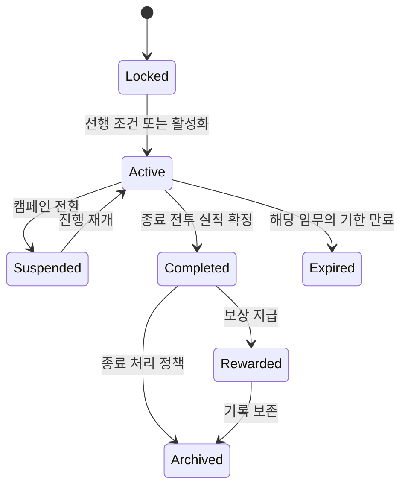

# 17. 임무·배틀 패스·상품·라이브 운영 역기획

> **대상:** Wargaming World of Tanks PC판. **자료 확인일:** 2026-11-13 KST. EU 공식 공개 규칙을 기준으로 한다. 2.4의 Operation Fossa와 2026년 WoT Plus Core/Pro를 반영했다. 시즌·상품·할인은 해당 안내의 유효 기간에만 적용한다.
>
> `[확인]` 공식 사실 / `[분석]` 설계 해석 / `[제안]` 재구현 구조 / `[검증 필요]` 확정하지 않은 항목. 출시 당시 캠페인 구성과 현재 추가 콘텐츠를 구분한다.

## 1. 운영 시스템의 역할

[분석] 라이브 운영은 기본 전투 규칙을 매번 새로 만들지 않고도 플레이 목표를 갱신한다. 일일 임무는 오늘의 짧은 목표, 주간 임무는 여러 날의 누적 목표, 개인 임무는 장기 도전, 배틀 패스는 시즌의 진행 단위다. 상점과 구독은 이 진행에 필요한 시간·자산·선택 폭을 조정한다.

이 문서의 중심은 이벤트 광고 문구가 아니라 **어떤 전투가 어떤 조건을 얼마나 진행시키고, 언제 무엇을 지급하는가**다. 실제 이벤트 전투 규칙은 [12번](12_Modes_Competitive_and_Events.md), 크레딧·XP 지급은 [16번](16_Economy_and_Battle_Rewards.md), 클랜 운영은 [18번](18_Social_Clans_Replays_and_Fair_Play.md)을 참조한다.

## 2. 목표 체계의 계층

| 계층 | 플레이 시간 척도 | 입력 | 보상 방식 | 설계 해석 |
|---|---|---|---|---|
| 일일 | 당일·몇 전투 | 전투 행동·누적량 | 개별 보상·보너스 임무 | 접속 후 첫 목표 제공 |
| 주간 | 여러 날 | 누적·제한 조건 | 재화·캠페인 진행 | 일일 의무감 완화·중기 목표 |
| 개인 임무 | 장기 | 지정 전투 성취·역할 | 차량·자산·명예 보상 | 여러 플레이 방식 학습 |
| 배틀 패스 | 시즌 | 포인트 | 단계별 기본/개선 보상 | 장기 성장을 짧은 성취로 분해 |
| 기간 이벤트 | 특정 기간 | 이벤트 모드·임무·수집 | 특별 자산·꾸미기 | 새로운 경험과 복귀 동기 |
| 업적·기록 | 계정 수명 | 누적 성과 | 표시·숙련 증명 | 성과의 사회적 의미 |

표는 [분석] 분류다. 각 시스템이 같은 피해량을 보더라도 누적 방식과 허용 모드는 다를 수 있다.

## 3. 일일·주간 임무

### 3.1 일일 임무

[확인] 상시 가이드는 난도가 다른 일반 일일 임무 3개를 동시에 진행할 수 있으며 완료 후 보너스 임무가 열린다고 설명한다. 원치 않는 일반 임무는 재추첨할 수 있고 다음 재추첨까지 4시간이 필요하다. 보너스 임무는 당일 만료되고 재추첨할 수 없다. 프리미엄 계정의 추가 임무 3개는 순서대로 진행하며 일반 보너스 임무 해금에는 합산하지 않는다. 완료 임무는 별도 장기 진행에 반영되고 45점 주기로 Epic Reward를 받는다. 진행 갱신은 전투 종료 후 이루어진다. [P17-1]

[분석] 일반 임무의 병렬 진행과 프리미엄 임무의 직렬 진행은 서로 다른 목표 구조다. 프리미엄 임무를 3개의 독립 조건으로 처리하면 한 전투가 순차 해금되지 않은 뒤 임무까지 동시에 완료시키는 오류가 생길 수 있다.

[제안] 재추첨은 기존 임무 ID를 유지하며 조건만 바꾸기보다 새 임무 인스턴스로 교체하고 `rerolled_from`을 기록한다. 전투 중인 차량이 있을 때 재추첨하면 어느 임무 버전에 전투 실적을 반영할지 명시해야 한다. 공식 가이드도 전투 중 재추첨 시 진행 손실 가능성을 주의시킨다. [P17-1]

### 3.2 주간 임무

[확인] 2.0 릴리스는 주초에 받는 3개의 주간 임무, 여러 전투에 걸친 조건, 국가·차종·역할 제한 가능성, 재화와 캠페인 포인트 보상을 소개했다. [P17-2]

[분석] 주간 조건은 특정 차종을 장시간 요구할 수 있으므로 현재 차고에서 완료 가능한지 알려주는 기능이 중요하다. 해당 티어·역할 차량을 보유하지 않은 플레이어에게 높은 보상만 노출하면 목표보다 장벽으로 느껴질 수 있다. “참가 가능한 보유 차량” 필터를 조건과 연결하는 것이 좋다.

## 4. 개인 임무 캠페인

### 4.1 캠페인별 진행 축

[확인] 현재 공식 가이드는 첫 캠페인을 차종, 둘째를 국가 집단, Sector 3를 역할 범주로 나눈다. 첫·둘째 캠페인은 함께 진행할 수 있지만 Sector 3와 동시에 진행하지는 않는다. 전환 시 중지된 진행은 보존된다. 일반적인 시리즈는 15개 임무이며, 임무는 순차 진행한다. 현행 가이드는 개인 임무의 전투를 무작위 전투로 제한한다. [P17-3]

[분석] 차종·국가·역할은 같은 조건이 아니다. 특히 역할은 차종 안에서 다시 나뉠 수 있어 “중형전차면 모든 해당 시리즈에 참가”하는 판정이 성립하지 않는다. 캠페인 설계는 차량 ID의 고정 목록보다 버전이 붙은 역할 정의를 참조해야 한다.

### 4.2 Sector 3의 기본 작전

[확인] 2.0 도입 시 Sector 3는 Windhund, Dravec, Black Rock의 기본 작전으로 안내되었다. 각각 Vanguard·Ambush·Assistance의 3시리즈를 갖고, 각 시리즈 15개로 작전당 45개 임무를 구성했다. 캠페인 포인트를 모아 차량의 부품을 조립하며 일일·주간 임무도 포인트를 제공한다. 최종 보상에는 Tier XI Black Rock이 포함된다. [P17-4]

[분석] 어려운 특정 임무 한 개를 통과해야만 장기 진행이 가능한 구조와, 여러 경로의 포인트로 차량을 조립하는 구조는 실패 경험이 다르다. 후자는 플레이어가 까다로운 임무에서 막혀도 작은 진전을 유지할 수 있다. 대신 차량 획득과 모든 임무의 명예 완료를 같은 완료 상태로 처리하면 안 된다.

### 4.3 Operation Fossa의 예외

[확인] 2.4는 별도 작전 Fossa를 추가했다. 3시리즈 × 21개, 총 63개 임무이며 다른 캠페인·작전의 완료 여부와 독립적으로 시작할 수 있다. 활성화하면 Sector 3의 나머지 기본 작전을 포함한 다른 캠페인 진행이 중지된다. 보상 차량은 Tier X Fossa VM 68이며 모든 임무 완료의 명예 보상은 별도로 존재한다. [P17-5]

| 상태 | 가능한 진행 | 보존해야 할 상태 |
|---|---|---|
| 첫·둘째 캠페인 활성 | 각 규칙에서 허용한 동시 진행 | 각 캠페인 진행 |
| Sector 3 기본 작전 활성 | 해당 기본 작전의 시리즈·포인트 | 중지한 이전 캠페인 |
| Fossa 활성 | Fossa의 시리즈·포인트 | 나머지 모든 캠페인·작전 |
| 다른 작전으로 복귀 | 저장된 지점부터 진행 | Fossa의 누적 상태 |

표는 확인 규칙을 재구현 상태로 정리한 [분석]이다. 임무별 상세 조건·보상표를 현재 클라이언트와 별도로 수집해야 한다.

[검증 필요] 2.0 소개 기사에는 모드 적용이 넓게 표현된 부분이 있지만 현재 상시 개인 임무 가이드는 무작위 전투만 명시한다. 본 문서는 현재 가이드를 우선하며 이벤트·경쟁 모드에서의 인정 여부는 개별 조건으로 확인한다. 2.4.1에서 조정된 일부 Fossa 임무 수치는 이전 기사에서 복사하지 않는다.

## 5. 배틀 패스

### 5.1 단계와 권한

[확인] 상시 가이드의 기본 구조는 3개 챕터 × 50단계이며 단계당 50포인트다. 챕터를 전환해도 기존 진행은 보존된다. 기본 보상과 개선 보상이 분리되고, 개선 패스를 나중에 구매하면 이미 완료한 해당 챕터 단계의 개선 보상도 지급된다. 모든 기본 챕터 완료 후에는 반복 가능한 Elite Circuit이 열리며 별도 단계 규칙을 사용한다. 선택형 보상은 시즌 종료 처리 정책도 갖는다. [P17-6]

[확인] 2026년 Season XXI 안내는 Tier XI 핵심 차량과 시즌 전용 꾸미기·토큰 보상을 소개한다. [P17-7]

[분석] 이는 시즌별 콘텐츠 표가 기존 배틀 패스 공통 구조 위에 올라가는 예다. 출시 초기의 Tier X 중심 설명을 모든 시즌에 고정하지 않는다.

### 5.2 포인트와 교환 재화의 차이

[분석] 배틀 패스 포인트는 단계 진행, 토큰은 지정 보상 교환, 칩은 과거 콘텐츠 상점 등 서로 다른 기능을 갖는다. 어떤 재화는 시즌에, 어떤 재화는 연간 주기에, 어떤 보상은 수령 시점에 묶일 수 있다. 모든 항목에 동일한 만료일을 적용하면 자산 손실과 잘못된 구매 유도가 발생한다.

[제안] 각 자원 정의에 `scope`, `earn_window`, `spend_window`, `expiry_policy`, `fallback_conversion`을 분리한다. 만료 없음도 명시적인 값이어야 한다. “시즌 종료”는 포인트 획득 종료, 미수령 보상 처리, 교환 상점 폐쇄가 모두 같은 순간이라는 뜻이 아니다.

### 5.3 진행 계산과 구매 단계

[분석] 유료 단계 구매가 존재하면 `earned_stage`와 `purchased_stage`의 출처가 다르더라도 플레이어에게 보이는 완료 상태는 일관되어야 한다. 동시에 구매할 수 없는 후속 반복 진행을 일반 단계와 같은 판매 로직으로 처리하면 안 된다. 플레이어의 시간 투입을 요약할 때도 획득 포인트와 구매 완료 단계를 분리하는 편이 정확하다.

## 6. 상품과 구독 구조

[확인] WoT 프리미엄 계정은 전투 보상과 추가 기능을 제공하는 상품이다. WoT Plus는 별도 구독이며 2026년 안내에는 Core와 Pro의 두 등급, Pro Boost·서비스 기록 꾸미기·추가 배틀 패스 관련 혜택 등이 소개된다. [P17-8][P17-9]

[제안] 두 상품을 하나의 프리미엄 상태로 통합하지 않는다.

| 상품·수익 경로 | 플레이어가 얻는 가치 | 분석해야 할 영향 |
|---|---|---|
| 프리미엄 계정 | 같은 플레이의 보상 확대 | 성장 시간·유지비 부담 변화 |
| 구독 서비스 | 반복 편의·지속 혜택 | 접속 주기·권한 만료 의존 |
| 프리미엄·보상 차량 | 다른 운용 경험·경제·수집 | 연구 차량과의 성능·획득 격차 |
| 개선 패스·단계 | 보상 확장·시간 단축 | 동일 시즌 내 진행 차이 |
| 외형 상품 | 취향·희소성·성과 표현 | 성능 효과가 있는 항목과 혼동 방지 |
| 확률형 패키지 | 가변 보상과 수집 | 확률·보장·중복·보상 가치 설명 |

표는 [분석]용 구분이다. 현재 판매 중인 모든 상품의 목록이나 구매 추천이 아니다.

[분석] 게임 내에서 크레딧으로 구입할 수 있는 고성능 탄약·장비가 있다는 사실과, 그 유지비 부담이 계정 혜택에 따라 달라진다는 사실은 함께 봐야 한다. 수익 모델의 영향은 직접적인 전투 성능 판매뿐 아니라 “좋은 구성을 얼마나 오래 유지할 수 있는가”에도 나타날 수 있다. 실제 영향은 동일 숙련·차량·구성 집단을 통제한 데이터로 평가해야 한다.

### 6.1 확률형 보상

[확인] 2026년 Last Stand의 Objects 안내처럼 보상 종류, 확률, 외형 지급·중복 순서를 별도 문서로 안내하는 이벤트 사례가 있다. 그 규칙은 해당 패키지의 사례이며 모든 상자에 적용되는 영구 규칙이 아니다. [P17-10]

[제안] 확률형 상품 정의에는 상품 버전, 보상 풀, 각 확률, 보장 카운터, 중복 보상 규칙, 지역 판매 조건을 함께 보관한다. 구매·개봉 시점 사이에 보상표가 바뀌어도 어떤 표를 적용하는지 설명할 수 있어야 한다. 이벤트 A의 확률·보장 횟수를 이벤트 B로 재사용하지 않는다.

## 7. 임무 판정과 보상 상태 모델



다이어그램은 [제안]이다. 장기 개인 임무의 무기한 진행과 당일 보너스 임무의 만료를 같은 `Expired` 정책으로 처리하지 않는다.

### 7.1 조건 표현

[제안] 임무 조건은 최소한 다음 요소를 갖는다.

- 인정할 모드·티어·차종·국가·역할.
- 한 전투 조건인지 여러 전투 누적인지.
- 피해·지원·발견·승리·생존·기본 XP 등의 입력 지표.
- `AND`, `OR`, 연속 달성, 팀 내 순위 등의 결합 방식.
- 전투 참가 시점과 종료 시점 중 어떤 임무 버전을 적용하는지.
- 자동 지급인지 선택형 수령인지.
- 추가 조건 또는 명예 완료의 별도 상태.

[분석] “피해 2,000 또는 지원 2,000”과 “피해+지원 합계 2,000”은 다른 임무다. “승리하고 생존”과 “승리 또는 생존”도 다르다. 문구 번역과 데이터 조건식이 일치하는지 자동으로 비교할 수 있어야 한다.

## 8. 구체 상황 분석

### 사례 A. 한 전투가 여러 목표를 진전시킨다

[분석] 한 전투의 피해·기본 XP가 일일 임무, 주간 임무, 배틀 패스, 활성 개인 임무에 함께 기여할 수 있다. 그러나 캠페인 상호 배타 규칙과 모드 제한은 각각 먼저 평가해야 한다. 전투 결과 화면은 “획득 XP 1개”를 복제하기보다 같은 전투에서 파생된 각 진행 이벤트를 별도 카드로 보여주는 것이 명확하다.

[제안] `battle_result_id`를 모든 진행 이벤트의 공통 부모로 두고, 각 시스템은 `consumer_policy_version`을 기록한다. 중복 배달되어도 각 소비자가 한 번만 적용하도록 한다.

### 사례 B. Fossa로 바꾼 뒤 이전 임무 실적이 멈췄다

[확인] Fossa 활성화는 다른 캠페인의 진행을 중지한다. [P17-5]

[분석] 이것은 누적치를 삭제하는 기능이 아니다. 전환 확인창은 무엇이 중지되고 무엇이 유지되는지 표시해야 한다. 특히 2개의 이전 캠페인을 병렬 진행하던 사용자는 손해를 예상하기 어렵다. 복귀 버튼에서 저장된 진행을 확인할 수 있어야 한다.

### 사례 C. 시즌 후반에 개선 패스를 산다

[확인] 완료한 해당 챕터 단계의 개선 보상을 소급 수령할 수 있다. [P17-6]

[분석] 구매 확인창은 즉시 받는 보상과 앞으로 단계를 완료해야 받는 보상을 분리해야 한다. 이미 수령한 보상을 다시 지급하지 않도록 보상 권한과 수령 여부를 각각 저장한다. 시즌 종료 직전 구매는 서버 시각과 상품의 유효 기간에 맞춰 판정한다.

## 9. 재구현 데이터 계약

```yaml
# [제안] 설명용 임무·시즌 구조
MissionDefinition:
  mission_id: stable_id
  ruleset_version: version_id
  eligibility: {modes: [], tiers: [], roles: [], nations: []}
  aggregation: SINGLE_BATTLE | SUM | STREAK | RANK
  objective_expression: typed_expression
  activation_group: campaign_group
  mutually_exclusive_groups: []
  schedule_id: optional_id
  reward_bundle_id: stable_id
MissionProgress:
  account_id: stable_id
  definition_version: version_id
  state: ACTIVE | SUSPENDED | COMPLETE | REWARDED | EXPIRED
  counters: {}
  consumed_battle_ids: []
  reward_transaction_id: optional_id
SeasonEntitlement:
  season_id: stable_id
  chapter_id: stable_id
  improved_access: boolean
  achieved_stages: integer
  granted_reward_ids: []
```

[제안] 무한히 커지는 `consumed_battle_ids`는 실제 구현에서 보존 기간이 있는 중복 제거 저장소나 처리 순서 커서로 대체할 수 있다. 보상 거래의 감사 기록은 별도로 유지한다. 공개된 실제 WoT 서버 저장 구조는 아니다.

## 10. 운영 검증 시나리오

| ID | 조건·행동 | 기대 결과 / 확인점 |
|---|---|---|
| P17-01 | 일반 일일 임무 3개와 프리미엄 임무 진행 | 병렬·직렬 차이를 정확히 적용 |
| P17-02 | 전투 중 일일 임무 재추첨 | 어느 임무 버전에 실적을 적용했는지 추적 |
| P17-03 | 보너스 임무 완료와 일일 초기화 동시 | 서버 시각·지급 순서 일관 |
| P17-04 | 첫·둘째 캠페인에서 Sector 3로 전환 | 기존 진행 중지·보존 |
| P17-05 | Fossa 활성 후 기존 작전 실적 발생 | 금지된 동시 진행 차단 |
| P17-06 | OR 조건과 합계 조건 테스트 | 의도한 논리식대로 판정 |
| P17-07 | 배틀 패스 챕터 전환 | 이전 단계·포인트 보존 |
| P17-08 | 개선 패스 후반 구매·재시도 | 소급 보상 한 번씩 지급 |
| P17-09 | 시즌 종료 시 미선택 보상 존재 | 정의된 기본 지급 정책 적용 |
| P17-10 | 이벤트 재화 획득 종료 후 상점 유지 | 서로 다른 일정 정확히 적용 |
| P17-11 | 구독 만료·등급 변경 | 혜택별 권한 회수·유지 구분 |
| P17-12 | 상품 보상표 변경 중 미개봉 아이템 | 적용 상품 버전·보장 카운터 일관 |
| P17-13 | 최신 패치로 임무 조건 완화 | 기존 누적 진행 이관·보상 중복 방지 |

## 11. 설계 평가와 운영 지표

[분석] 라이브 운영의 성공은 참여 횟수만으로 평가할 수 없다. 조건 때문에 팀 승리에 불리한 행동을 반복한다면 임무 완료율은 높아도 전투 경험은 나빠진다. 특정 훈장을 요구하는 임무, 특정 차종만을 강제하는 주간 임무, 생존과 피해 목표가 충돌하는 조건을 별도로 추적해야 한다.

권장 지표는 목표 활성 후 전투 참가율, 임무별 포기·재추첨률, 완료까지 전투 수의 중앙값과 상위 분위수, 캠페인 전환 빈도, 일일 초기화 직전 몰림, 시즌 종료 미수령 비율, 구독 만료 후 구성 손실 경험이다. 성과 분석에서는 신규/숙련, 차고 규모, 티어, 과금 상태의 차이를 분리한다. [제안]

[분석] 플레이어의 장기 목표를 유지하려면 “오늘 하지 않으면 모두 잃는다”는 압박보다 누적 진전의 보존과 이해 가능한 선택이 중요하다. 실제 WoT의 내부 운영 목표를 단정하는 설명은 아니며 공개된 목표 체계에서 도출한 개선 관점이다.

## 12. 출처와 미확인 범위

- **P17-1** — [Daily Missions](https://worldoftanks.eu/en/content/guide/game-mechanics-and-achievements/daily-missions/). 일일·재추첨·보너스·프리미엄·45점 주기.
- **P17-2** — [Release Notes 2.0](https://worldoftanks.eu/en/content/docs/release_notes/release-notes-2-0/). 주간 임무 도입.
- **P17-3** — [Personal Missions](https://worldoftanks.eu/en/content/guide/game-mechanics-and-achievements/personal-missions/). 현재 캠페인 전환·모드·시리즈 규칙.
- **P17-4** — [Update 2.0: Personal Missions—Sector 3](https://worldoftanks.eu/en/news/general-news/update-2-0-personal-battle-missions-3-0/). 기본 작전 출시 구성·캠페인 포인트.
- **P17-5** — [Release Notes 2.4](https://worldoftanks.eu/en/content/docs/release_notes/release-notes-2-4/), [Operation Fossa](https://worldoftanks.eu/en/news/general-news/2-4-personal-battle-missions/). 63개 임무·독립 작전·다른 진행 중지.
- **P17-6** — [Battle Pass](https://worldoftanks.eu/en/content/guide/modes-and-events/battle-pass/). 기본·개선 보상·챕터·후속 진행·소급 지급.
- **P17-7** — [Battle Pass Season XXI: Into the Forgotten](https://worldoftanks.eu/en/news/general-news/battle-pass-season-21/). 2026년 시즌 사례. 보상·기간은 해당 시즌 한정.
- **P17-8** — [WoT Premium Account](https://worldoftanks.eu/en/news/general-news/premium-account/). 계정 혜택과 상품 구분.
- **P17-9** — [WoT Plus Guide](https://worldoftanks.eu/en/news/general-news/wot-plus-guide/), [Update 2.2](https://worldoftanks.eu/en/news/updates/wot-2-2/). Core·Pro 구독 구조.
- **P17-10** — [Last Stand: Invasion's Objects—What's Inside?](https://worldoftanks.eu/en/news/general-news/objects-spring-2026/). 확률형 보상 문서의 2026년 사례.

[검증 필요] 각 서버의 초기화 시각, 실제 판매 가격·세금·결제 수단, 시즌 교환 재화의 세부 만료, 개별 상자의 확률·보장, 현재 Fossa 임무 전체 조건은 별도 라이브 데이터로 검증해야 한다. 테스트 서버의 임시 판매 가격을 정식 상품 가격으로 사용하지 않았다.
