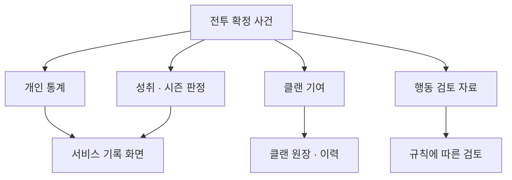

# 18. 협동·클랜·전적·리플레이·공정 플레이

> 대상: Wargaming PC · 기준일: 2026-11-13 KST  
> **[확인]** 공개 규칙 / **[분석]** 설계 해석 / **[제안]** 재구성 구조 / **[검증 필요]** 내부 판정·운영 세부  
> 연관: [소대·매칭](10_Matchmaking_and_Platoons.md), [경쟁 모드](12_Modes_Competitive_and_Events.md), [경제](16_Economy_and_Battle_Rewards.md), [미션](17_Missions_Monetization_and_LiveOps.md)

## 1. 시스템의 목적

**[분석]** 팀 전투는 개인 조작만으로 협업이 완성되지 않는다. 플레이어가 다음 행동을 짧게 공유하고, 함께 플레이할 사람을 유지하며, 전투 결과를 자신의 실력과 팀 기여로 해석할 수 있어야 한다. 이 문서는 그 연결을 담당하는 기능을 묶는다.

협동 UI는 전투 속도를 해치지 않아야 하고, 기록 UI는 서로 다른 평가 기준을 혼동하지 않게 해야 한다. 제재는 게임 규칙의 일부이지만, 실제 탐지 임계값이나 제재 알고리즘을 공개 자료만으로 복원할 수는 없다.

## 2. 전투 중 의사소통

**[확인]** 공식 가이드는 팀 채팅과 소대 채팅, 상황에 따른 빠른 명령, 지형·전차·기지와 연동되는 핑, 미니맵 상호작용을 제공한다. 예시 기본 키는 채팅 Enter, 상황 핑 T, 응답 Z, 미니맵 커서 Ctrl이다. 키 바인딩은 사용자가 변경할 수 있는 입력값으로 취급한다. [S01]

### 2.1 정보 유형별 설계

| 메시지 유형 | 필요한 정보 | 긴급도 | 표현 방식에 대한 분석 |
|---|---|---|---|
| 목표 집중 | 대상·행동 | 높음 | 현재 표적과 연계해 해석 비용 축소 |
| 지원 요청 | 위치·요청자·상황 | 높음 | 미니맵과 월드 표시를 연결 |
| 이동 계획 | 예정 위치 | 중간 | 출발 전 중복 역할을 줄임 |
| 동의·응답 | 원래 요청 식별자 | 중간 | 대화 대신 짧은 수락 표시 |
| 재장전 등 상태 | 가용성·남은 시간 | 상황 의존 | 집중 공격 타이밍 조정 |
| 자유 채팅 | 텍스트·채널 | 낮음~중간 | 전투 정보와 잡담의 주의 경쟁 |

**[제안]** `PingEvent`에 생성자, 팀, 대상, 월드 위치, 만료 시각, 응답 대상 ID를 넣는다. 화면에 남아 있는 핑은 현재 사실이 아니라 누군가의 의도일 수 있으므로, 적 실제 위치·마지막 발견 위치·아군 요청을 서로 다른 시각 기호로 표시한다.

### 2.2 과도한 정보의 비용

**[분석]** 핑이 많을수록 협업이 좋아지는 것은 아니다. 무관한 반복 핑은 위협 표시와 같은 주의 자원을 소모한다. 요청의 위치·유효기간·빈도 제한, 사용자의 음소거 선택을 함께 설계해야 한다.

**[검증 필요]** 현재 전투 모드별 채팅 채널, 핑 횟수 제한, 차단 범위, 팀 밖 노출 여부는 UI 실험을 통해 확인한다. 원작의 서버 rate limit 숫자를 임의로 정하지 않는다.

## 3. 소대와 클랜의 서로 다른 역할

| 구분 | 소대 | 클랜 |
|---|---|---|
| 목표 | 당장 함께 한 판 플레이 | 장기 조직과 공동 목표 |
| 핵심 상태 | 구성원·준비·현재 차량 | 구성원·직책·권한·조직 자원 |
| 주요 제약 | 인원·티어·차종·큐 | 가입·권한·이벤트 참가 |
| 결과 귀속 | 개인 전투 결과 중심 | 개인 결과와 클랜 성과 병존 |
| 연결 문서 | 10장 | 이 장 및 12장 |

**[분석]** 같은 친구 관계라도 소대는 세션 편성이고 클랜은 영속 조직이다. 초대를 수락했다고 클랜 자원 권한이 생겨서는 안 되며, 클랜에 속한다고 현재 소대의 준비 상태가 자동으로 결정되어서도 안 된다.

## 4. 요새와 클랜 자원

**[확인]** Industrial Resource는 요새의 건설·개선·비축물자 준비에 쓰이는 별도 자원이다. 공식 가이드는 Skirmishes·Advances와 Tour of Duty 등을 획득 경로로 안내한다. 비축물자는 경제 보너스와 전투 효과 등의 계열로 나뉜다. [S02][S03]

**[분석]** 클랜 자원은 개인 연구의 크레딧과 다른 공동 의사결정 문제를 만든다. 자원을 모으는 구성원과 사용 권한이 있는 구성원이 다를 수 있다. 그래서 잔액뿐 아니라 누가 어떤 목적으로 사용했는지 보여 주는 이력이 중요하다.

### 4.1 권한 모델 제안

| 작업 | 권한 범주 예시 | 기록할 정보 |
|---|---|---|
| 구성원 조회 | 일반 구성원 | 조회 범위 |
| 비축물자 활성화 | 운영 담당 | 종류·효과 기간·사용자 |
| 시설 개선 | 자원 관리 담당 | 비용·선행 단계·적용 시각 |
| 구성원 직책 변경 | 인사 권한 | 이전·새 직책·행위자 |
| 이벤트 진행 초기화 | 이벤트 지휘 권한 | 영향 단계·차량·확인 시점 |

**[제안]** 위 직책은 원작의 직책 목록이 아니라 기능별 권한 설계 예시다. 클랜 잔액 변경에는 원자적 원장을 사용하고, 개인 크레딧 원장과 다른 계정 범위를 둔다. 동시 활성화 요청이 중복 자원 소비를 일으키지 않도록 요청 ID를 보존한다.

**[검증 필요]** Global Map·Advances 등 특정 콘텐츠의 현재 운영 여부는 권역과 시즌에 따라 별도 확인한다. 상시 가이드가 존재한다는 사실만으로 2026-11-13에 모든 큐가 개방되어 있다고 쓰지 않는다.

## 5. 전적과 성취: 세 가지 다른 질문

### 5.1 WTR: 전반적 기여의 요약

**[확인]** 공식 WTR 설명은 차량별 지표를 기반으로 계정 성과를 구성하며, 승패 자체를 차량 평가 계산에 직접 넣지 않는다고 설명한다. 피해·도움 피해, 격파, 방어, 생존 등 사용 지표는 차량에 따라 달라진다. 1.21에서 표시 체계가 정비되었다. [S04]

**[분석]** WTR은 팀 승률과 같은 지표가 아니다. 승률은 15명의 행동, 매칭, 편성, 지도, 우연을 함께 반영하고, 개인 지표는 관측 가능한 기여를 압축한다. 어느 하나가 다른 하나를 완전히 대체한다고 해석하지 않는다.

### 5.2 숙련도 배지: 한 판의 뛰어난 수행

**[확인]** PC 공식 성취 안내는 같은 차량의 최근 7일 성과와 한 전투 경험치를 비교하여 숙련도 배지를 부여한다고 설명한다. 표시 기준은 III급 50%, II급 80%, I급 95%, Ace 99% 비교 구간이다. 이는 고정 경험치 임계값이 아니다. [S05]

**[분석]** 드물게 매우 잘한 한 판을 인정하는 목표는 장기 평균 목표와 다른 동기를 만든다. 차량별 비교는 서로 다른 전투 역할·티어를 하나의 절대 피해량으로 비교하는 문제도 줄인다.

### 5.3 화력의 증표: 특정 차량의 지속적 수행

**[확인]** 지원 문서는 같은 차량의 비교 성과에 따라 65%·85%·95%에 해당하는 단계의 증표를 설명한다. 도움 피해는 정찰·궤도·스턴을 모두 합치는 대신 그중 최대값을 사용한다고 안내하며, 획득한 증표는 유지된다. [S06]

**[검증 필요]** 지원 문서의 최근 전투 설명을 그대로 단순 산술평균 코드로 구현하지 않는다. 실제 누적·평활·비교 모집단·갱신 경계의 상세 알고리즘은 추가 확인 대상이다.

### 5.4 비교표

| 구분 | 중심 질문 | 평가 단위 | 변화 성격 |
|---|---|---|---|
| 승률 | 우리 팀이 얼마나 자주 이겼는가? | 전투 결과의 누적 | 팀·환경 영향 포함 |
| WTR | 차량별 역할에 따른 기여는 어떠한가? | 차량 평가 → 계정 | 성과에 따라 변동 |
| 숙련도 배지 | 한 판을 얼마나 잘했는가? | 단일 전투 | 특정 순간의 성취 |
| 증표 | 같은 차량으로 꾸준히 잘하는가? | 최근 수행 비교 | 진행률 변화·획득 표시 유지 |
| 시즌 순위 | 해당 경쟁 규칙에서 어느 위치인가? | 시즌·모드 | 시즌 규칙과 초기화 영향 |

**[제안]** 각 지표 화면에 계산 범위와 기준 기간을 보인다. “상위 5%”를 전체 계정 인구의 상위 5%처럼 읽지 않도록 차량·권역·기간의 비교 대상을 명확히 표시한다.

## 6. 리플레이와 학습

**[확인]** 공식 지원은 전투 기록 설정, `.wotreplay` 파일, 게임 클라이언트를 통한 재생을 안내한다. 기록 당시의 클라이언트 버전과 연결되므로 업데이트 뒤 과거 기록이 재생되지 않을 수 있다. [S07]

**[분석]** 리플레이는 두 목적을 가진다. 플레이어에게는 왜 피탄했는지 학습할 근거이고, QA와 운영에는 사건 순서를 재구성할 자료다. 화면 녹화만으로는 조준 입력·탐지 시각·확정 피해 사건을 분리하기 어렵지만, 게임 기록 역시 표시되지 않은 서버 내부 모든 정보를 담는다고 가정할 수 없다.

**[제안] 리플레이 메타데이터**

```text
ReplayHeader:
  client_build
  ruleset_revision
  map_revision
  battle_id
  local_player_id
  coordinate_convention
  event_schema_version
  required_asset_manifest
```

**[제안]** 디버그용 전체 상태 기록과 일반 사용자 리플레이를 구분한다. 사용자용 기록이 당시 보지 못한 적의 정확한 실시간 위치를 전투 중 노출하는 경로가 되어서는 안 된다. 이 권한 설계는 실제 리플레이 파일 구조를 주장하는 것이 아니다.

## 7. 공정 플레이가 시스템 설계에 주는 요구

**[확인]** 공식 정책은 원래 제공하지 않는 적 위치·재장전 정보의 노출, 더 강한 자동 조준, 게임 규칙 변경 등을 금지 범주로 설명한다. 2026년 발사 자동화 관련 공지와 현재 정책은 화력 최적화를 위한 자동 발사 입력 제어와 동등 기능의 매크로를 제한한다. [S08][S09]

**[분석]** 정보 제한형 전투에서 공정성은 명중 판정만의 문제가 아니다. 보이지 않는 적 위치가 클라이언트에 불필요하게 전달되면 UI를 숨겨도 추가 프로그램이 활용할 수 있다. 공개 UI가 제공하는 정보 범위, 서버 전송 범위, 허용 확장 기능이 일관되어야 한다.

**[제안]** 서버는 다음을 독립적으로 검증한다.

- 이동·발사·소모품 명령의 실행 가능 여부.
- 클라이언트에 전달할 관측 정보의 권한.
- 보상과 미션에 사용할 확정 사건.
- 반복적 팀 방해를 추적할 사건 이력.

실제 탐지 로직, 임계값, 제재 우회 가능성을 추정해 기재하지 않는다. 해당 정책의 운영 세부는 원문을 따른다.

## 8. 데이터 및 이벤트 계약 제안



**[제안]** 금전·자원 반영의 안정된 식별키는 `battle_id + account_id + settlement_kind`로 유지하고 계산·처리기 버전은 메타데이터로 저장한다. 수정 결과는 이전 원장과의 차액만 별도 `correction_id`로 원자 적용한다. 통계처럼 재구축 가능한 파생 자료는 버전별 집계 후 교체할 수 있지만, 이를 신규 보상 지급으로 연결하지 않는다. 전적 재계산 때문에 크레딧이 다시 지급되거나, 제재 수정 때문에 기존 증표가 의도치 않게 삭제되지 않도록 각 결과의 소유자를 분리한다.

## 9. 상황 예시

### 예시 A: 같은 피해량, 다른 성취

가상의 두 플레이어가 각각 직접 피해 2,000을 기록했다. 한 명은 중요한 정찰 정보를 오래 제공했고, 다른 한 명은 장갑으로 전선을 버텼다.

**[분석]** 기여를 한 값으로 보여 주면 서로 다른 역할이 가려질 수 있다. 종합 지표와 함께 직접 피해·정보 기여·방어·생존 같은 원시 지표를 남겨야 플레이어와 설계자가 결과를 해석할 수 있다. 이 예시의 수치는 실제 전투 로그가 아니다.

### 예시 B: 클랜 비축물자 활성화가 중복 요청됨

운영 담당의 요청 후 네트워크 응답이 늦어 재요청이 발생한다.

**[제안]** 두 번째 요청이 같은 요청 ID라면 첫 결과를 반환한다. 새로운 요청이라면 잔액·중복 효과·사용 권한을 다시 평가한다. UI는 “처리 중” 상태와 결과를 명시하여 무의식적인 반복 조작을 줄인다.

## 10. QA

| ID | 시험 | 기대 또는 검증점 |
|---|---|---|
| SOC-01 | 팀·소대 채팅 전환 | 수신 범위와 색·명칭 일치 |
| SOC-02 | 여러 핑에 연속 응답 | 응답이 올바른 원래 핑에 연결 |
| SOC-03 | 만료된 적 위치에 핑 | 현재 탐지 정보처럼 표시되지 않음 |
| SOC-04 | 소대 초대 중 차량 변경 | 참가 준비 상태 재검증 |
| SOC-05 | 클랜 권한 해제와 자원 요청 경합 | 서버 권한 기준으로 승인 |
| SOC-06 | 비축물자 요청 재전송 | 이중 지출·이중 효과 없음 |
| SOC-07 | 같은 결과 재처리 | 통계·성취·클랜 기여 중복 없음 |
| SOC-08 | 숙련도 기준 집계 갱신 | 고정 XP 표처럼 오해할 UI 제거 |
| SOC-09 | 과거 버전 리플레이 재생 | 호환 실패를 명확히 안내 |
| SOC-10 | 차단·음소거 적용 | 전투 필수 시스템 알림과 사용자 채팅 구별 |
| SOC-11 | 일반전 외 이벤트 결과 | WTR·증표 등 집계 포함 여부 확인 |
| SOC-12 | 제재 수정 또는 이의 처리 | 변경 이력과 관련 결과의 일관성 |

## 출처

- [S01] [In-Game Communication](https://worldoftanks.eu/en/content/guide/newcomers-guide/communication/)
- [S02] [Industrial Resource](https://worldoftanks.eu/en/content/strongholds_guide/industrial_resource/)
- [S03] [Stronghold Reserves](https://worldoftanks.eu/en/content/strongholds_guide/reserves/)
- [S04] [Updated Stats and Combat Achievements, 1.21](https://worldoftanks.eu/en/news/general-news/1-21-updated-stats-combat-achievements/)
- [S05] [Awards and Achievements](https://worldoftanks.eu/en/news/general-news/awards-and-achievements/)
- [S06] [How Are Marks of Excellence Earned?](https://www.wargaming.net/support/en/products/wot/article/15060/)
- [S07] [Battle Replays: Save, Watch and Upload](https://www.wargaming.net/support/en/products/wot/article/10411/)
- [S08] [Prohibited Mods](https://worldoftanks.eu/en/content/guide/fair-play/prohibited-mods/)
- [S09] [Fair Play Update: New Prohibited Mods and Bans, 2026-01-14](https://worldoftanks.eu/en/news/general-news/ban-wave-jan-2026/)

