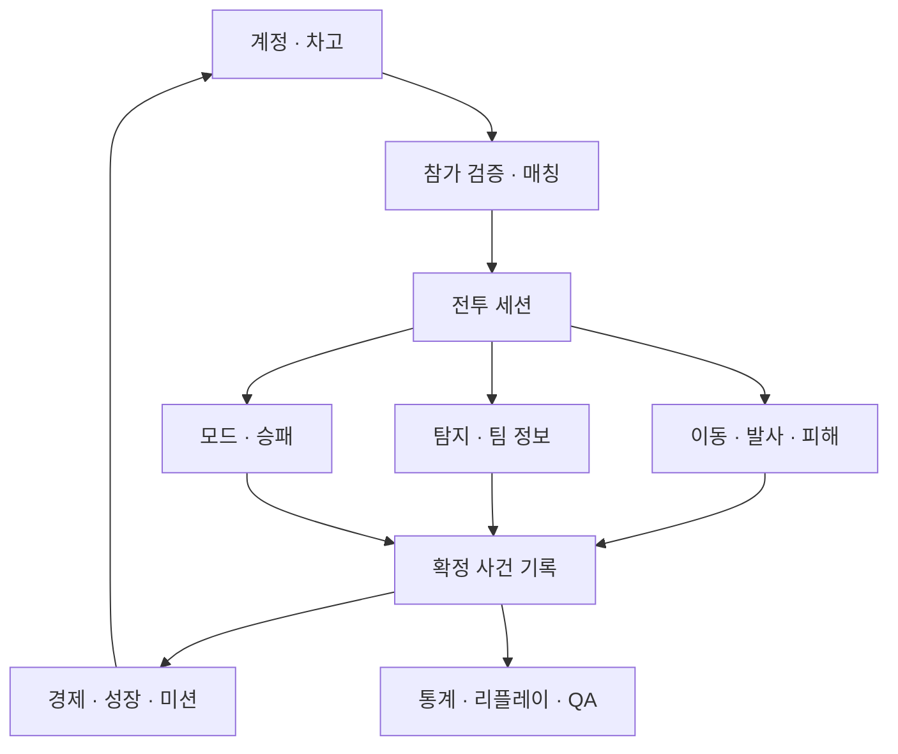
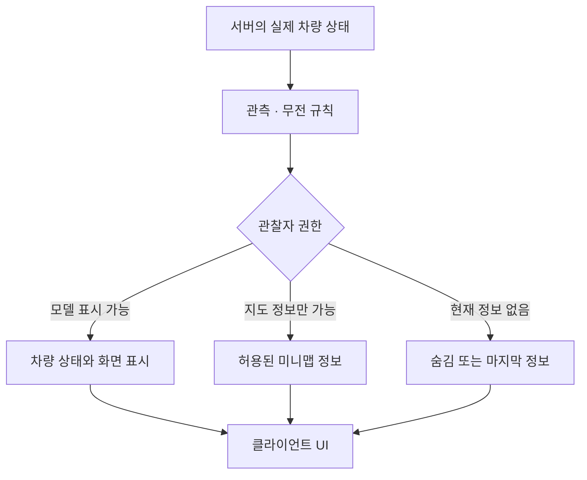

# 19. 서버·데이터·물리·이벤트 구조 재구성

> 대상: Wargaming PC의 공개 규칙을 구현하기 위한 설계 모델  
> 기준일: 2026-11-13 KST  
> **핵심 한계:** 이 장의 구조·스키마·의사코드는 모두 **[제안]**이다. 원작 서버 코드, 패킷, DB, 틱레이트, 현재 물리 엔진을 확인한 결과가 아니다.  
> 연관: [전투 상태](02_Battle_Rules_and_Lifecycle.md), [탄도](04_Aiming_Firing_and_Ammunition.md), [관통](05_Armor_Penetration_and_Damage.md), [시야](08_Spotting_Concealment_and_Radio.md), [경제](16_Economy_and_Battle_Rewards.md)

## 1. 공개 사실에서 말할 수 있는 범위

**[확인]** 9.14의 공식 이동 물리 소개는 당시 개선된 차량 물리를 서버에서 계산한다고 설명했다. 이것은 역사적 서버 권한 근거이며, 2026년의 엔진·솔버·작업 스케줄러·네트워크 주기를 확정하는 자료는 아니다. [S01]

**[확인]** 공개 개발자 API에는 계정·차량 성과와 직접 피해·정찰 도움·궤도 도움·스턴 도움 같은 통계 필드가 있다. 이는 외부 통계 인터페이스의 존재를 보여 줄 뿐 내부 전투 DB나 이벤트 버스의 실제 구조를 의미하지 않는다. [S02]

**[확인]** 리플레이는 기록한 클라이언트 버전과 연결되며, 최신 모드에서는 기본전과 다른 시야·부활·점수 규칙을 사용한다. 따라서 아래 재구성은 버전과 모드별 계약을 명시하는 데 중점을 둔다. [S03][S04]

## 2. 설계 목표

**[제안]**

1. 전투 결과는 서버에서 확정한다.
2. 정보 공개 범위와 물리 세계의 존재를 분리한다.
3. 차량 구성은 전투 시작 시 불변 스냅샷으로 만든다.
4. 장갑·피해·탐지·보상은 버전이 있는 독립 규칙으로 관리한다.
5. 같은 전투 결과를 재처리해도 보상은 중복되지 않는다.
6. 게임플레이 충돌과 화면용 파괴 효과는 다른 비용 구조로 관리한다.
7. 경계값·모드 예외를 자동 또는 통제된 실험으로 검증할 수 있게 기록한다.

이는 원작이 반드시 이렇게 구성되어 있다는 진술이 아니라, 공개된 경험을 일관되게 재현하기 위한 요구사항이다.

## 3. 논리 시스템 분해



**[제안]** 위 도식의 상자는 독립 서버 프로세스를 의미하지 않는다. 초기 재구현에서는 하나의 프로세스 안의 모듈로 구현할 수 있다. 실제 프로세스·서비스 분리는 성능, 장애 격리, 배포 요구가 확인된 뒤 결정한다.

## 4. 데이터 소유권

| 데이터 | 제안 소유자 | 변경 시점 | 주요 불변 조건 |
|---|---|---|---|
| 계정 재화·차량 보유 | 영속 계정 | 구매·정산 | 잔액 변경이 원장과 일치 |
| 차량 정의·장갑판 | 콘텐츠 카탈로그 | 패치 | ID·참조 무결성 |
| 승무원·장비 구성 | 차고 | 편집·전투 준비 | 허용 슬롯·차량 조건 |
| 전투 구성 스냅샷 | 세션 | 입장 확정 | 전투 도중 외부 편집 불가 |
| 위치·HP·재장전 | 전투 시뮬레이션 | 매 처리 단계 | 유효 범위와 상태 전이 |
| 관측 권한 | 탐지·무전 | 관측 상태 변경 | 권한 없는 정보를 전송하지 않음 |
| 점령·모드 점수 | 모드 규칙 | 목표 사건 | 모드 버전과 일치 |
| 최종 결과 | 결과 확정 계층 | 종료 시 한 번 | 마지막 사건 시퀀스 고정 |
| 전적·미션 | 파생 처리 계층 | 확정 결과 처리 | 중복 처리 방지 |

## 5. 차량 정의와 실행 상태

### 5.1 정적 정의

```text
VehicleDefinition
  vehicle_id, nation_id, tier, class_id, role_id
  hull_definition_id, turret_definition_ids
  gun_definition_ids, suspension_definition_id
  engine_definition_id, radio_definition_id
  armor_layout_id, module_layout_id, crew_layout_id
  special_mechanic_definition_id
  research_graph_id, compatible_equipment_rules
```

**[제안]** 외형 메시, 장갑판, 내부 모듈, 탄도 충돌, 이동 충돌의 ID를 구별한다. 보여 주는 전차 형태가 모든 판정 형상과 완전히 같다고 가정하지 않는다.

### 5.2 전투 실행 상태

```text
VehicleRuntime
  entity_id, team_id, build_snapshot_id
  pose, linear_velocity, angular_velocity
  hp, modules, crew_status
  loaded_shell, reserve_ammo, reload_state, aiming_state
  consumable_cooldowns
  special_mechanic_state
  alive_state, last_processed_input_sequence
```

**[제안]** 차체·포탑·포 방향을 별도로 보존한다. 포신 외형의 흔들림과 실제 발사 방향이 어떤 관계를 갖는지는 명시적 규칙으로 둔다. 시각적 흔들림을 물리적 조준 분산과 자동으로 연결하지 않는다.

## 6. 효과와 최종 성능 계산

장비, 승무원, 소모품, 모듈 손상, 특수 기능, 모드 보정은 같은 성능에 영향을 줄 수 있다.

**[제안]**

```text
StatModifier
  source_id
  target_stat
  operation: Add / Multiply / Override / Clamp
  magnitude
  activation_condition
  stacking_group
  priority
  duration_policy
```

계산 순서는 명세에 적고 테스트한다. 예를 들어 기본 재장전, 승무원 보정, 장비 효과, 부상 페널티, 모드 보정은 곱셈의 순서만으로 끝나지 않을 수 있다. 중간 반올림과 상한, 예외 장비 금지, 조건 활성화 여부가 결과를 바꾼다.

**[검증 필요]** 이 자료만으로 실제 원작의 모든 수치 결합 공식을 복원하지 않는다. “기본값에 퍼센트를 전부 더한다” 같은 임의 공식은 설명용 예시로도 원본과 명확히 구분해야 한다.

## 7. 한 번의 서버 갱신을 구성하는 제안

| 논리 단계 | 책임 | 주의점 |
|---|---|---|
| 입력 수집 | 입력 시퀀스·발사·소모품 요청 | 중복·오래된 요청 검증 |
| 상태 갱신 | 이동·회전·재장전·특수 기능 | 확정된 서버 시간 사용 |
| 접촉·탄도 처리 | 이동 충돌·포탄 경로·명중 | 고속 포탄의 충돌 누락 방지 |
| 피해 처리 | 관통·HP·모듈·부상·파괴 | 명목 피해와 유효 피해 구별 |
| 정보 갱신 | 탐지·무전·표시 유지 | 발포와 탐지 순서의 영향 |
| 모드 처리 | 점령·점수·승패 후보 | 동시 사건 충돌 해결 |
| 상태 배포 | 허용된 정보만 전송 | 관측 권한에 따른 분리 |
| 기록 | 사건·계측 | 결과 재현과 성능 비용의 균형 |

**[제안]** 위 순서는 후보 구조다. 병렬화 가능한 계산과 반드시 순서를 지켜야 하는 커밋을 나눈다. 실제 WoT의 틱 순서라고 읽어서는 안 된다. 실험 결과를 맞추기 위해 순서를 바꿀 때는 룰 버전과 재현 테스트도 같이 갱신한다.

## 8. 발사와 피해 이벤트

### 8.1 입력은 의도, 출력은 확정 사실

```text
FireRequest:
  input_sequence
  requested_aim_direction
  selected_shell_slot

ShotAccepted:
  shot_id, shooter_id, server_time
  gun_id, shell_id, muzzle_pose
  aiming_state_snapshot

ImpactResolved:
  shot_id, target_id, surface_id
  result_category
  nominal_damage, effective_hp_damage
  module_damage_events, crew_events
  penetration_rule_revision
```

**[제안]** 클라이언트가 “이 적에게 400 피해”라는 결과를 제출하게 하지 않는다. 발사 요청의 가능 조건을 서버가 검사하고, 가려진 적을 향한 눈먼 사격도 목표 ID 없이 세계 공간에서 판정할 수 있게 한다.

### 8.2 피해 회계의 구분

| 필드 | 의미 |
|---|---|
| nominal_damage | 굴림 또는 규칙으로 산출된 명목 피해 |
| effective_hp_damage | 남은 HP를 고려한 실제 감소량 |
| overkill | 실제 감소량을 넘는 부분 |
| module_damage | 외부·내부 모듈에 대한 별도 변화 |
| assisted_damage_claim | 정찰·궤도·스턴 등 기여 후보 |
| credited_reward_damage | 해당 보상 규칙이 인정한 값 |

**[제안]** 이 값들을 구분해야 과잉 피해 보상, 모듈 손상만 발생한 명중, 여러 도움 유형의 중복 합산을 막을 수 있다. 원작의 보상 계수나 실제 저장 필드명은 아니다.

## 9. 탐지와 네트워크 전송



**[제안]** 다음 세 개를 분리한다.

- `WorldExistence`: 전차는 실제 시뮬레이션에 존재하며 탄과 충돌할 수 있다.
- `ObservationKnowledge`: 누가 어떤 시각의 정보를 알 수 있는가.
- `PresentationState`: 모델·실루엣·미니맵·마지막 위치를 어떻게 표시하는가.

화면에서 사라진 적이 월드에서 사라지는 것은 아니다. 반대로 월드에 존재한다고 해서 모든 클라이언트에 정밀 위치를 계속 보낼 필요도 없다.

## 10. 물리·충돌·시각 파괴의 분리

**[분석]** 같은 건물이 “보인다”, “탄을 막는다”, “차량을 막는다”, “시야를 막는다”, “무너진다”는 다섯 조건은 독립적으로 검증해야 한다. 파편 수와 시각 품질이 클라이언트마다 달라도 게임플레이 결과는 일관되어야 한다.

**[제안]**

| 계층 | 권한과 목적 | 예시 |
|---|---|---|
| GameplayCollision | 서버 확정 | 길이 막혔는지, 포탄이 통과하는지 |
| VisibilityOccluder | 탐지 규칙 | 관측선을 차단하는지 |
| DestructionState | 공통 상태 | Intact → Damaged → Destroyed |
| VisualDebris | 클라이언트 표현 | 작은 파편·먼지·흔들림 |
| AudioEvent | 지각 피드백 | 파괴음·피탄음·방향 정보 |

이것은 실제 WoT의 엔진 구현을 확인한 결론이 아니다. 비슷한 전술 게임을 재구현할 때 성능과 판정 일관성을 함께 관리하는 구조다.

### 10.1 엔진에 적용할 때의 경계

**[제안]** Unreal 또는 다른 엔진에서는 차량 본체, 포탑, 포, 판정 형상, 표면·장갑 데이터, 연출 구성요소를 분리한다. 프레임마다 바뀌는 전투 상태와 콘텐츠 정의를 같은 에셋에 쓰지 않는다. 일반 강체 접촉에서 얻은 충격량을 곧바로 원작의 충돌 피해라고 간주하지 말고 별도 게임 규칙으로 변환한다.

## 11. 정산과 중복 방지

```text
BattleResultFinalized
  -> RewardLedger
  -> ResearchProgress
  -> CrewProgress
  -> MissionProgress
  -> Statistics

각 처리:
  key = battle_id + account_id + settlement_kind
  if key already_applied:
      return stored_result
  calculate_delta()
  commit_delta_and_key_atomically()
  # 계산·결과 버전은 지급 식별키가 아닌 메타데이터로 보존
  # 확정 후 정정은 correction_id별 차액 거래로 처리
```

**[제안]** 결과가 늦게 도착하거나 재시도되어도 보상은 한 번만 적용한다. 계산기 버전이 바뀌어도 원래 지급의 식별자는 유지한다. 정정이 필요하면 이전 원장과 재계산 결과의 차액만 별도 식별자로 적용한다. 원장이 먼저 쓰이고 처리 마커가 나중에 쓰이면 장애 중복 지급이 가능하므로 둘의 일관성을 보장한다. 자동 보급은 전투 보상의 입금과 별도 지출로 기록한다.

## 12. 버전 관리

| 버전 키 | 필요한 이유 |
|---|---|
| client_build | 리플레이·UI·에셋 호환 |
| ruleset_revision | 관통·탐지·특수 기능 규칙 |
| map_revision | 지형·수풀·파괴물 변경 |
| vehicle_catalog_revision | 차량 성능·장갑 변경 |
| reward_revision | 경제·미션·이벤트 변화 |
| season_id | 경쟁 순위·보상 범위 |

**[제안]** 한 전투는 시작 시 선택된 버전을 끝까지 사용한다. 진행 중 전투를 바꾸는 긴급 패치가 꼭 필요하다면 전용 마이그레이션 규칙을 둔다. 기본 정책 없이 최신 전역 설정을 즉시 읽는 구조를 피한다.

## 13. 성능 예산과 계측

**[제안]** 수치 목표는 실제 하드웨어·접속 분포를 측정한 뒤 정한다. 이 문서에서는 WoT의 실제 처리량을 제시하지 않는다.

| 부하 | 측정 단위 | 개선의 후보 |
|---|---|---|
| 차량 이동·접촉 | 세션당 시간·접촉 수 | 넓은 단계 필터·안정된 단순 판정 형상 |
| 포탄 충돌 | 포탄당 처리·최대 구간 | 연속 충돌·표면 필터 |
| 탐지 | 관찰자×대상 후보·추적 횟수 | 공간 분할·거리 기반 후보 축소 |
| 상태 복제 | 수신자별 바이트·변경 빈도 | 허용 정보·변경량·우선순위 |
| 효과 계산 | 갱신 횟수·캐시 적중 | 상태 변할 때 재계산 |
| 결과 처리 | 지연·재시도·중복 | 불변 결과·독립 처리 |

## 14. 장애와 재현

**[제안]** QA 기록에는 사건의 논리 순서와 플레이어가 본 표현 시각을 함께 저장한다. “포탄이 사라졌다”는 신고는 발사 거절, 화면 지연, 탐지 소실, 장애물 충돌, 서버 판정 등 여러 원인을 가질 수 있다. 원인별 로그가 없으면 시각적 증상만으로 결론을 내리게 된다.

## 15. 검증 항목

| ID | 위험 | 확인 |
|---|---|---|
| ARC-01 | 차고 편집이 진행 중 전투에 영향 | 구성 스냅샷 불변 |
| ARC-02 | 발사 요청 재전송 | 탄약·피해가 한 번만 발생 |
| ARC-03 | 고속 포탄 터널링 | 얇은 판정면·저프레임에서도 충돌 |
| ARC-04 | 숨은 적 정보 노출 | 전송 정보와 관측 권한 비교 |
| ARC-05 | 표시 소실 후 눈먼 사격 | 서버 충돌과 HUD 분리 |
| ARC-06 | 탐지와 발사 동시 발생 | 룰 버전별 사건 순서 |
| ARC-07 | 파편 품질 차이 | 게임플레이 충돌 동일 |
| ARC-08 | 결과 저장 중 장애 | 중복·누락 없이 재시도 |
| ARC-09 | 이벤트 보상 오류 재처리 | 전적·크레딧의 이중 적용 없음 |
| ARC-10 | 패치 후 리플레이 | 버전 불일치 식별 |
| ARC-11 | 수치 효과 중복 | 중첩 그룹·상한·반올림 |
| ARC-12 | 지도 파괴 중 재접속 | 확정 파괴 상태 재동기화 |

## 출처

- [S01] [Version 9.14: Improved Vehicle Movement Physics and Sounds](https://worldoftanks.eu/en/news/general-news/version-914-sounds-physics/) — 역사적 서버 계산 설명. 현재 엔진의 증거로 확대하지 않음.
- [S02] [Wargaming Public API: Player Personal Data](https://developers.wargaming.net/reference/all/wot/account/info/) — 공개 통계 필드. 내부 구현과 구분.
- [S03] [Battle Replays](https://www.wargaming.net/support/en/products/wot/article/10411/)
- [S04] [Release Notes 2.4](https://worldoftanks.eu/en/content/docs/release_notes/release-notes-2-4/) — 모드별 규칙 차이의 사례.

