# 월드 오브 탱크 PC판 역기획서 — 통합본

> 기준일: 2026-11-13 KST · Wargaming PC · 확인 가능한 라이브 2.4.1 계열
> 개별 Markdown 22개를 원문 순서로 통합했다. 아래 문서의 출처 ID는 각 장 안에서 해석한다.
> 모든 구현 구조·의사코드는 별도 표시한 재구현 제안이며 실제 원작 소스 코드를 복원한 결과가 아니다.


---

<!-- Source document: 00_README.md -->

# 월드 오브 탱크 PC판 시스템별 역기획서

> **작성 언어:** 한국어  
> **기준일:** 2026-11-13 KST  
> **대상 제품:** Wargaming World of Tanks PC판  
> **자료 범위:** 공식 가이드·지원 문서·확정 패치 노트·공식 이벤트 안내  
> **라이브 기준:** 확인 가능한 2.4.1 계열. 2026-11-05의 2.4.1_4 마이크로패치도 확인. 2.4.2 Common Test를 라이브로 취급하지 않는다.  
> **구성:** 시스템 본문 20개 + 전체 목차 + 출처·버전·용어집 = **22개 개별 Markdown**. 같은 내용을 묶은 통합본을 추가 제공한다.

## 1. 이 역기획서의 목적

월드 오브 탱크를 단순한 전차 성능표나 플레이 공략이 아니라 **서로 연결된 규칙·상태·자원·UI·데이터 시스템**으로 설명한다. 각 시스템이 무엇을 입력받아 어떤 결과를 만들며, 예외가 어디에서 발생하고, 비슷한 게임을 재구현하려면 무엇을 분리해서 설계해야 하는지 정리한다.

특히 전차의 이동·포탑·포신, 조준과 재장전, 장갑·관통·외부/내부 모듈, 탐지·위장·무전, 전투 결과와 경제 정산 사이의 연결을 상세히 다룬다. 원작의 비공개 코드나 실제 플레이 테스트를 수행한 문서가 아니므로, 확인된 규칙과 재구현 제안을 섞지 않는다.

## 2. 표기의 의미

| 표기 | 의미 | 읽는 방법 |
|---|---|---|
| **[확인]** | 연결된 공개 문서에서 확인한 사실 | 버전·권역·모드·출처 시점을 함께 읽기 |
| **[분석]** | 규칙에서 도출한 설계 해석 | 실제 개발팀의 의도라고 단정하지 않기 |
| **[제안]** | 재구현·데이터·의사코드·실험 설계 | 원작 코드와 다른 독립 제안 |
| **[검증 필요]** | 최신 적용·상수·순서·내부 알고리즘 미확정 | 구현 전에 공식 자료나 통제 실험으로 보완 |

각 파일의 `Cxx`, `Vxx`, `Qxx`, `Pxx`, `Sxx` 등 출처 ID는 **그 문서의 출처 목록**을 가리킨다. 전체 URL 목록은 [21번](21_Sources_Versions_and_Glossary.md)에 통합했다. 다른 파일에서 같은 S01을 쓰더라도 같은 자료를 뜻하는 것은 아니다.

## 3. 시스템별 파일

| 번호 | 파일 | 상세 범위 |
|---|---|---|
| 00 | [00_README.md](00_README.md) | 범위·표기·읽는 순서·목차 |
| 01 | [01_Product_Overview_and_Core_Loops.md](01_Product_Overview_and_Core_Loops.md) | 제품 구조, 전술 자원, 순간·전투·성장 루프 |
| 02 | [02_Battle_Rules_and_Lifecycle.md](02_Battle_Rules_and_Lifecycle.md) | 승리·점령·세션 상태, 종료·정산 경계 |
| 03 | [03_Vehicle_Classes_and_Mobility.md](03_Vehicle_Classes_and_Mobility.md) | 병과·역할, 가속·선회·차륜·지형·충돌 |
| 04 | [04_Aiming_Firing_and_Ammunition.md](04_Aiming_Firing_and_Ammunition.md) | 조준·분산·탄도·탄종·장전 구조 |
| 05 | [05_Armor_Penetration_and_Damage.md](05_Armor_Penetration_and_Damage.md) | 장갑·도탄·구경·관통·HP·HE 예외 |
| 06 | [06_Modules_Crew_Damage_and_Repair.md](06_Modules_Crew_Damage_and_Repair.md) | 궤도·모듈·승무원·탄약고·화재·수리 |
| 07 | [07_Artillery_and_Special_Mechanics.md](07_Artillery_and_Special_Mechanics.md) | 자주포·스턴, 열·추진·쌍열·Tier XI 기믹 |
| 08 | [08_Spotting_Concealment_and_Radio.md](08_Spotting_Concealment_and_Radio.md) | 탐지·위장·수풀·무전·표시·육감 |
| 09 | [09_Maps_Terrain_and_Destruction.md](09_Maps_Terrain_and_Destruction.md) | 이동선·사격선·관측선, 엄폐·파괴·지도 밸런스 |
| 10 | [10_Matchmaking_and_Platoons.md](10_Matchmaking_and_Platoons.md) | 티어·역할·차종 제한, 소대·대기·지도 반복 |
| 11 | [11_Controls_HUD_and_Garage_UX.md](11_Controls_HUD_and_Garage_UX.md) | 입력·카메라·HUD, 장갑 검사·차고·준비 흐름 |
| 12 | [12_Modes_Competitive_and_Events.md](12_Modes_Competitive_and_Events.md) | Onslaught·Frontline·Steel Hunter·Black Signal·Maneuvers |
| 13 | [13_Research_Progression_and_Tier_XI.md](13_Research_Progression_and_Tier_XI.md) | 연구·구매·장착, 청사진·Elite·11티어 업그레이드 |
| 14 | [14_Crew_and_Perks.md](14_Crew_and_Perks.md) | 승무원·겸직·효율·특전·재훈련·XP 이전 |
| 15 | [15_Equipment_Consumables_and_Field_Mods.md](15_Equipment_Consumables_and_Field_Mods.md) | 장비·소모품·지휘명령·현장 개량·대체 구성 |
| 16 | [16_Economy_and_Battle_Rewards.md](16_Economy_and_Battle_Rewards.md) | 재화, XP·크레딧, 비용·순수익·정산 원장 |
| 17 | [17_Missions_Monetization_and_LiveOps.md](17_Missions_Monetization_and_LiveOps.md) | 미션·Fossa·배틀 패스·프리미엄·Plus·운영 |
| 18 | [18_Social_Clans_Replays_and_Fair_Play.md](18_Social_Clans_Replays_and_Fair_Play.md) | 소통·클랜·WTR·숙련도·증표·리플레이·공정성 |
| 19 | [19_Server_and_Data_Architecture.md](19_Server_and_Data_Architecture.md) | 서버 권한·판정·정보 공개·물리/연출·데이터 제안 |
| 20 | [20_Balance_KPIs_and_Validation.md](20_Balance_KPIs_and_Validation.md) | 밸런스·통계·성능·경제 계측·통합 QA |
| 21 | [21_Sources_Versions_and_Glossary.md](21_Sources_Versions_and_Glossary.md) | 자료 신뢰도·버전 차이·미확인 항목·용어·출처 |

## 4. 관심사별 읽는 순서

| 목적 | 권장 순서 |
|---|---|
| 게임 전체의 설계 파악 | 01 → 02 → 10 → 13 → 16 → 17 |
| 전투·물리 구현 검토 | 03 → 04 → 05 → 06 → 07 → 19 |
| 탐지·맵·전술 분석 | 08 → 09 → 10 → 12 |
| 조작·준비 UX 설계 | 11 → 14 → 15 → 16 |
| 성장·운영·수익 구조 | 13 → 14 → 15 → 16 → 17 → 18 |
| 실제 재현 프로젝트 착수 | 21 → 02 → 05 → 08 → 19 → 20 |

## 5. 최신성 때문에 특히 주의할 차이

이 항목들의 세부 근거와 적용 범위는 연결 문서에서 확인한다.

- **Tier XI:** 2.0 도입 당시 차량 수와 2026년 전체 차량 목록을 구분한다. 전용 업그레이드와 VI–X 현장 개량을 나눈다.
- **수리·구급:** 과거 소형 아이템의 단일 대상 복구 설명을 현재 전체 복구 규칙과 혼동하지 않는다.
- **HE:** 일반 전차·자주포·기관포는 피해 처리 예외가 다르다.
- **승무원:** 주 직책 특전 상한, 겸직별 보너스 특전, 효율, 재훈련·초기화 비용을 분리한다.
- **매칭:** 2.0 출시 제한에 2.3·2.4·2.4.1의 변경을 누적 적용한다.
- **모드:** 일반전 시야·점령·부활·승패·비용을 Onslaught나 Black Signal에 그대로 적용하지 않는다.
- **자료 시점:** 2.4.2 테스트 공지가 있다는 사실은 해당 버전의 라이브 적용을 뜻하지 않는다.

## 6. 문서 사용 방법

개별 Markdown은 상대 링크로 연결되어 있으므로 같은 폴더 구조를 유지하면 탐색이 쉽다. Mermaid를 지원하는 뷰어에서는 흐름도와 상태도가 렌더링된다. 지원하지 않는 뷰어에서는 코드 블록으로 보이지만 주변 표와 문장으로도 의미를 이해할 수 있도록 구성했다.

통합본은 [World_of_Tanks_Reverse_Design_KO_Complete.md](World_of_Tanks_Reverse_Design_KO_Complete.md)다. 전체 내용을 한 파일에서 검색할 때 사용한다. 개별 파일을 수정하는 작업에서는 각 시스템 파일을 기준으로 삼고 통합본은 다시 생성하는 편이 일관성을 유지하기 쉽다.

## 7. 검증 범위와 한계

제공된 나무위키 URL은 이번 조사에서 본문을 열 수 없었다. 해당 페이지를 읽거나 요약한 것처럼 인용하지 않았으며, 공식 자료를 중심으로 작성했다. 일부 공식 페이지는 직접 접속 시 보안 안내를 반환했기 때문에 검색 도구에 노출된 공식 페이지 본문과 다른 공식 문서를 교차 확인했다.

실제 클라이언트 실행·훈련방 측정·소스 코드 검사·서버 패킷 분석은 수행하지 않았다. 문서 내 QA는 **실행 결과가 아니라 검증 계획**이다. 정규화 상세 공식, 모듈 확률, 탐지 체크 주기, 경제 계수, 틱레이트 등은 근거가 부족한 상태에서 확정값을 만들어 넣지 않았다.

**이 문서 묶음에서 수행한 검토:** 공식 자료 비교, 제품·모드·버전 구분, 문서 간 규칙 대조, 링크·코드 펜스·패키지 무결성 검사. 상세 결과를 실제 게임 검증 완료로 해석해서는 안 된다.

## 8. 기준 버전의 공식 근거

- [Update History](https://worldoftanks.eu/en/content/docs/release_notes/)
- [Release Notes 2.4.1](https://worldoftanks.eu/en/content/docs/release_notes/release-notes-2-4-1/)
- [Micropatch 2.4.1_4 안내](https://worldoftanks.eu/en/news/updates/micro-patch-2-4-1_4/)
- [2.4.2 Common Test 안내](https://worldoftanks.eu/en/news/updates/2-4-2-CT/) — 테스트 환경이라는 범위 확인에만 사용.


---

<!-- Source document: 01_Product_Overview_and_Core_Loops.md -->

# 01. 제품 구조와 핵심 플레이 루프

> 대상: Wargaming World of Tanks PC판 · 기준일: 2026-11-13 KST  
> 문서 성격: 공개 자료 기반 역기획. 실제 클라이언트 조작, 패킷 분석, 소스 코드 검증은 수행하지 않았다.  
> 표기: **[확인]** 공개 규칙 / **[분석]** 규칙의 설계적 해석 / **[제안]** 재구성 구현 / **[검증 필요]** 공개 근거가 부족한 사항  
> 읽기 순서: [전체 목차](00_README.md) → 이 문서 → [전투 생명주기](02_Battle_Rules_and_Lifecycle.md)

## 1. 제품을 한 문장으로 정의하기

**[분석] 월드 오브 탱크는 전차의 장갑·화력·기동 차이와 불완전한 적 정보를 이용해, 유리한 발사 기회를 만들고 팀의 남은 전투력을 보존하는 세션형 전술 전투 게임이다.**

플레이어가 직접 다루는 것은 한 대의 전차이지만, 실제로 거래하는 자원은 여러 가지다. 체력은 위험을 감수할 수 있는 양, 재장전은 다음 공격까지의 시간, 시야는 불확실성을 줄이는 수단, 지형은 적의 대응을 제한하는 조건이다. 따라서 이동과 사격만으로 게임을 복제하면 핵심 경험이 재현되지 않는다. 장갑 방향, 탐지 정보, 발사 간격, 팀 화력의 동시 집중이 연결되어야 한다.

**[확인]** 공식 소개는 무작위 전투의 대표 형식을 15명 팀 간 전투로 설명한다. 다만 실제 큐의 인원 예외와 모드 차이는 별도 규칙이다. 2.0에서 11티어와 전용 성장 시스템이 도입되었으므로 10티어를 전체 게임의 최종 단계라고 정의하면 현재 제품 구조와 맞지 않는다. [S01][S02]

## 2. 범위와 서비스 구분

| 구분 | 이 문서의 취급 | 구분해야 하는 이유 |
|---|---|---|
| Wargaming PC Random Battles | 분석의 중심 | 전차·장갑·시야·차고·경제가 만나는 기본 루프 |
| PC Onslaught 및 이벤트 | 별도 규칙 집합 | 인원, 부활, 시야, 승리 조건이 달라질 수 있음 |
| PC 클랜 콘텐츠 | 조직과 장기 목표 | 개인 재화와 클랜 자원이 분리됨 |
| World of Tanks Blitz | 대상 제외 | 인원, 시간, 경제, 모듈 규칙을 PC에 이식하면 오류 |
| World of Tanks Modern Armor | 대상 제외 | 콘솔 제품 및 모드별 차이 |
| Lesta의 Mir Tankov | 대상 제외 | 서비스 분리 이후 패치와 콘텐츠가 독립적으로 변화 |
| Common Test / Supertest | 실험 또는 예정 규칙 | 라이브 적용의 증거로 사용하지 않음 |

**[분석]** 역기획서의 기본 식별자는 게임명 하나가 아니라 `제품 + 서비스 권역 + 패치 + 모드`이어야 한다. 같은 “경전차 제한”도 전투 전체, 소대 편성, 특정 이벤트 중 무엇을 제한하는지에 따라 의미가 달라진다.

## 3. 세 겹의 플레이 루프

### 3.1 1~20초: 사격 기회 루프

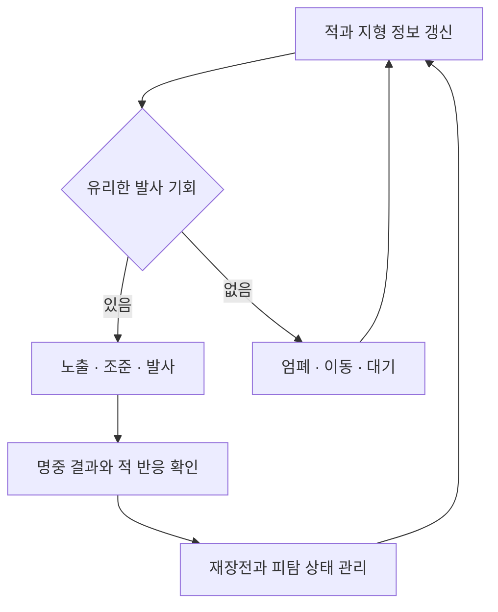

**[분석]** 한 발의 성공은 명중으로 끝나지 않는다. 사격 후 숨을 수 있는지, 궤도가 끊겼을 때 수리 수단이 있는지, 상대 클립에 남은 탄이 있는지까지 포함해야 한다. 이 때문에 조준 UI와 재장전 UI는 단순 조작 보조가 아니라 위험 계산 도구가 된다.

### 3.2 한 전투: 전선 형성 → 우세 확대 → 승리 확정

| 단계 | 플레이어의 질문 | 주요 시스템 | 실패가 누적되는 방식 |
|---|---|---|---|
| 배치 | 어느 방향에서 내 역할을 수행할까? | 지도·양팀 편성·기동성 | 늦은 진입, 역할 중복, 빈 전선 |
| 초반 접촉 | 어디에 적이 있고 얼마나 더 있을까? | 탐지·무전·미니맵 | 정보 없는 돌출, 초기 체력 손실 |
| 교전 | 언제 누구에게 한 발을 교환할까? | 관통·조준·재장전·장갑 | 비관통, 집중 사격, 궤도 고정 |
| 전환 | 지금 밀어야 하나, 돌아가야 하나? | 전력·이동 시간·기지 상태 | 승리한 전선의 정체, 수비 복귀 지연 |
| 종결 | 전멸과 점령 중 무엇이 안전한가? | 생존·점령·남은 시간 | 불필요한 추격, 점령 저지 실패 |

**[분석]** 위 단계는 강제 퀘스트 순서가 아니다. 전투를 해석하기 위한 모델이며, 빠른 돌파나 조기 전멸 때문에 일부 단계가 거의 생략될 수 있다.

### 3.3 여러 전투: 목표 설정 → 획득 → 구성 변경

**[확인]** 연구·구매, 승무원, 장비·소모품, 미션과 보상은 차고에서 전투 준비를 바꾸는 독립 기능으로 제공된다. 상세 규칙은 [13](13_Research_Progression_and_Tier_XI.md)~[17](17_Missions_Monetization_and_LiveOps.md)에서 설명한다. [S03]

**[분석]** 성장 루프는 “숫자 상승”만으로 이해하면 부족하다. 새 포를 장착하면 유효 교전 거리가 바뀔 수 있고, 시야 장비를 선택하면 담당할 위치가 바뀌며, 소모품 구성이 달라지면 위험을 감수할 수 있는 조건이 달라진다. 성장 결과가 전투 선택을 바꿔야 장기 진행과 세션 전투가 연결된다.

## 4. 핵심 자원과 전환 관계

| 자원 | 직접 소비 또는 손실 | 전환되는 이익 | 복구·회수의 성격 |
|---|---|---|---|
| 체력 | 피탄, 화재, 충돌 등의 피해 | 위치 선점, 적 한 발 소모, 돌파 | 일반전과 회복형 이벤트를 분리 |
| 시간 | 이동·조준·재장전·대기 | 정확한 발사, 더 좋은 각도 | 지나간 시간은 회복 불가 |
| 정보 | 탐지 후 소실, 위치 이동으로 노후화 | 집중 사격, 우회, 안전한 전진 | 재탐지·관측·팀 공유로 갱신 |
| 공간 | 전선 후퇴, 엄폐 파괴 | 적의 기동·사격 선택 제한 | 우회와 재점령으로 회수 |
| 탄약 | 발사에 따라 감소 | 피해·모듈 손상·압박 | 기본전과 재보급 모드를 구분 |
| 소모품 가용성 | 사용 후 재사용 대기 | 기동·화력·인적 성능 복구 | 종류별 효과·주기가 다름 |
| 크레딧 | 차량·탄약·정비·구성 비용 | 다음 전투의 준비 수준 | 보상과 판매 등 별도 유입 |
| 연구 진행 | 지출 또는 누적 | 새 차량·업그레이드 접근 | 계정·차량별 귀속을 관리 |

**[분석]** 체력 손실만 피하는 플레이가 항상 최적은 아니다. 팀의 핵심 정찰차를 보호하며 전선을 유지할 수 있다면 일부 체력을 쓰는 것이 이후의 화력 기회를 늘릴 수 있다. 반대로 피해량을 늘리려고 마지막 수비 위치를 비우면 팀 승리 가능성이 떨어질 수 있다.

## 5. 전차 개성을 구성하는 설계 축

**[분석]** 전차를 하나의 전투력 숫자로 비교하지 않고, 다음의 조건부 성능으로 분해한다.

| 축 | 질문 | 다른 축과의 관계 |
|---|---|---|
| 단발 화력 | 노출 한 번으로 얼마를 얻는가? | 긴 재장전·큰 분산과 결합하면 실패 비용 증가 |
| 지속 화력 | 오랫동안 쏠 수 있을 때 얼마나 강한가? | 실제 사격선 유지 시간이 필요 |
| 순간 화력 | 짧은 시간 안에 대상을 제거할 수 있는가? | 클립 소진 후 장시간 취약할 수 있음 |
| 장갑 신뢰도 | 어느 방향·상대 탄종에서 버티는가? | 지형·각도·약점 노출과 결합 |
| 위치 접근성 | 유리한 지형에 먼저 도착하는가? | 최고 속도뿐 아니라 가속·회전·지형 저항 |
| 정보 능력 | 적을 먼저 보고 자신은 숨을 수 있는가? | 시야와 위장은 상대값으로 작동 |
| 포 배치 자유도 | 차체를 숨긴 채 조준 가능한가? | 부각·앙각·포탑 회전·지형 경사 |
| 실수 회복력 | 잘못 진입했을 때 탈출 가능한가? | 후진·장갑·수리·승무원·엄폐 거리 |
| 구성 의존도 | 완성 구성과 초기 구성의 격차는? | 연구 병목과 체감 공정성에 영향 |

**[제안]** 차량 평가 화면에는 평균값 외에 “능력이 발휘되는 조건”을 노출한다. 예를 들어 “조준 완료 후 장거리 정지 사격”, “포탑만 노출한 지형”, “짧은 시간 안의 연속 발사” 같은 전투 문맥을 데이터와 연결한다. 이 설명 방식은 단순 수치 표보다 초보자의 잘못된 역할 선택을 줄일 수 있다.

## 6. 전투 의사결정을 수식으로 읽는 방법

아래는 **[분석]용 간이 모델**이며 실제 게임의 AI, 매치메이커, 보상 공식이 아니다.

```text
발사 기회의 예상 직접 기여
  ≈ 명중 가능성 × 관통 가능성 × 예상 유효 피해

순간 노출의 가치
  ≈ 직접 기여 + 팀 후속 사격 가치 + 위치 확보 가치
     - 예상 반격 손실 - 탈출 실패 비용 - 이후 기회 상실
```

예를 들어 가상의 공격에서 명중 가능성 0.7, 관통 가능성 0.6, 유효 피해 400을 가정하면 직접 피해의 기대값은 168이다. 이 숫자만으로는 발사 여부를 정할 수 없다. 같은 노출로 600의 반격을 받을 위험이 있으면 불리할 수 있고, 마지막 적 정찰차를 제거해 팀 전체가 자유롭게 움직이게 된다면 직접 피해 이상의 가치가 있다.

**[분석]** 실제 플레이어는 이런 곱셈을 매번 계산하지 않는다. 학습을 통해 “이 거리의 이 약점은 맞히기 어렵다”, “상대가 방금 쐈다”, “뒤에 아군 화력이 있다”라는 압축된 판단 규칙을 형성한다. 게임이 제공하는 피드백은 이 학습이 가능한 수준으로 일관되어야 한다.

## 7. 전형적인 두 상황의 역기획

### 상황 A: 중전차가 모퉁이에서 한 발을 교환한다

1. 상대의 마지막 발사와 후퇴를 관찰한다.
2. 차체 각도와 포탑 노출을 조절하며 발사선을 연다.
3. 목표의 약점, 이동, 조준 수렴을 비교한다.
4. 발사 후 즉시 같은 자리에서 후속 사격을 기다릴지 엄폐할지 선택한다.
5. 궤도 손상 또는 피탐·측면 위협이 생기면 원래 계획을 중단한다.

**[분석]** 장갑, 조준, 이동, 피해, 수리, 시야가 하나의 짧은 행동에 모두 관여한다. 이 중 하나의 판정 또는 UI 표현이 늦으면 “조작이 먹히지 않았다”는 인상을 줄 수 있다.

### 상황 B: 정찰차가 공격하지 않고 교전을 만든다

1. 팀의 사격선과 연결되는 관측 위치에 도착한다.
2. 자신의 위장 상태를 유지하면서 적의 이동을 드러낸다.
3. 직접 사격이 탐지 위험을 키우는지 판단한다.
4. 아군의 사격 결과와 적의 접근을 보고 위치를 바꾼다.
5. 전선이 무너지면 정찰 유지보다 생존과 다음 관측 위치 확보를 우선한다.

**[분석]** 좋은 정찰은 발견 횟수만으로 평가하기 어렵다. 아군이 실제로 쏠 수 있는 시점과 위치에서 제공한 정보인지, 정찰차가 너무 일찍 사라지지 않았는지가 중요하다.

## 8. 시스템 의존성

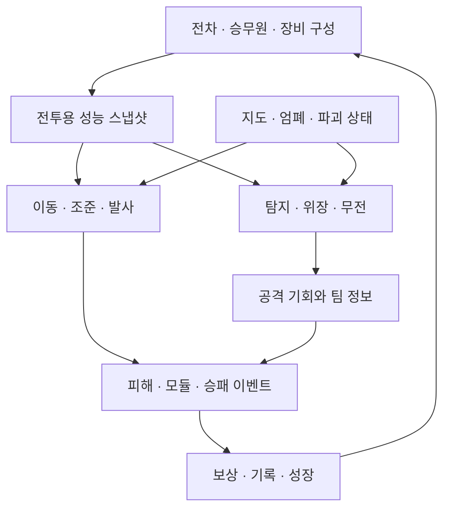

**[제안]** 재구현에서는 화력 계산, 탐지, 보상을 하나의 거대한 차량 클래스에 넣지 않는다. 같은 사건을 서로 다른 시스템이 해석하되, 확정 피해와 승패 같은 사실은 공통 이벤트로 전달한다. 특히 “피해를 주었다”와 “보상 대상 피해다”를 분리해야 이벤트와 훈련 모드를 안전하게 확장할 수 있다.

## 9. 역기획의 우선순위

| 우선순위 | 먼저 밝혀야 하는 질문 | 필요한 산출물 |
|---|---|---|
| P0 | 맞은 곳과 결과가 일관적인가? | 장갑·탄종·피해 판정표 |
| P0 | 누가 누구를 언제 볼 수 있는가? | 탐지·공유·표시 상태 모델 |
| P0 | 전투가 언제 어떻게 끝나는가? | 승패·점령·결과 확정 계약 |
| P1 | 전차별 역할이 실제 전투에서 구별되는가? | 조건부 성능·지도 상성 |
| P1 | 연구와 장비가 선택을 어떻게 바꾸는가? | 성장 의존성·비용·구성 규칙 |
| P1 | 매칭이 역할과 플레이 경험을 어떻게 보존하는가? | 제약과 완화 조건 |
| P2 | 장기 목표와 사회적 인정이 재참여를 만드는가? | 미션·기록·클랜·운영 구조 |

## 10. 검증 항목

| ID | 확인 방법 | 확인할 결과 |
|---|---|---|
| LOOP-01 | 같은 전차로 장비 한 종류만 변경 | 어떤 전투 선택이 바뀌는지 설명 가능 |
| LOOP-02 | 동일 위치에서 발사/비발사 비교 | 위장 변화가 사격의 비용으로 읽힘 |
| LOOP-03 | 모퉁이 교전 로그 재생 | 노출·발사·반격·수리 순서가 추적됨 |
| LOOP-04 | 저체력 생존과 무리한 추가 피해 비교 | 개인 기록과 팀 승리를 분리해서 분석 |
| LOOP-05 | 재장전 중 안전지대까지 이동 | 이동 시간이 다음 발사 기회를 제한 |
| LOOP-06 | 일반전과 회복형 이벤트 비교 | 체력 자원 모델이 모드에 따라 달라짐 |
| LOOP-07 | 차고 변경 후 전투 시작 | 구성 스냅샷이 일관되게 적용 |
| LOOP-08 | 같은 룰의 서로 다른 패치 비교 | 행동 변화가 수치·지도·큐 변경 중 어디서 왔는지 구분 |

## 11. 범위상의 한계

실제 접속자 분포, 서비스 매출, 전환율, 잔존율, 서버 처리량, 차량별 내부 경제 계수는 확보하지 않았다. 이 문서의 설계 해석을 해당 회사의 의사결정 기록으로 읽어서는 안 된다. 전차 전체 목록과 가격·성능의 실시간 데이터베이스 또한 본 문서의 목적이 아니다. 차량별 세부 수치 대신 시스템의 계약, 예외, 의존성과 검증 방법을 문서화했다.

## 출처

- [S01] [공식 게임 소개](https://worldoftanks.eu/en/game/) — 무작위 전투의 대표 형식. 2026-11-13 확인.
- [S02] [Update 2.0: Under the Hatch of Tier XI](https://worldoftanks.eu/en/news/general-news/update-2-0-tier-11-overview/) — 2025년 도입 당시의 11티어와 성장 개편.
- [S03] [공식 Full Guide](https://worldoftanks.eu/en/content/guide/) — 기능 범주의 공식 안내. 세부 규칙은 각 담당 문서의 원출처를 우선한다.


---

<!-- Source document: 02_Battle_Rules_and_Lifecycle.md -->

# 02. 전투 규칙·점령·세션 생명주기

> 대상: Wargaming PC판의 기본 무작위 전투(Standard Battle)  
> 기준일: 2026-11-13 KST · 라이브 확인 범위: 2.4.1 계열  
> **[확인]** 문서 규칙 / **[분석]** 설계 해석 / **[제안]** 재구성 모델 / **[검증 필요]** 현행 실측이 필요한 경계  
> 연관: [매칭](10_Matchmaking_and_Platoons.md), [모드별 예외](12_Modes_Competitive_and_Events.md), [서버 구조](19_Server_and_Data_Architecture.md)

## 1. 시스템의 책임

전투 세션은 계정과 차고에 있는 자산을 일시적인 전투 상태로 복제하고, 허용된 행동을 처리한 뒤, 승패·개인 기여·비용·성장 결과를 영속 계정에 반영하는 단위다.

**[분석]** 전차가 파괴되는 시점, 플레이어가 관전을 종료하는 시점, 서버가 전투를 종료하는 시점, 보상이 계정에 적용되는 시점은 서로 다를 수 있다. 이 네 시점을 같은 것으로 취급하면 결과 누락, 중복 보상, 전투 중 차량 재사용 같은 오류를 만들기 쉽다.

## 2. 대표 규칙과 근거 수준

| 항목 | 규칙 또는 해석 | 근거 수준 |
|---|---|---|
| 대표 인원 | 15 대 15가 기본 형식 | [확인] 공식 소개. 큐 상황 예외는 10장 |
| 기본 승리 | 적 전차 전멸 또는 적 기지 점령 | [확인] 공식 전투 매뉴얼 |
| 대표 제한 시간 | Standard Battle 최대 15분 | [확인·기존 공식 규칙] 최신 클라이언트의 지도별 예외는 실측 필요 |
| 시간 만료 | 승리 조건 미달이면 무승부라는 기존 기본 규칙 | [확인·기존 공식 규칙] Onslaught 규칙과 혼용 금지 |
| 전투 중 파괴 | 일반전은 이벤트식 무한 재출격과 구별 | [분석] 기본 규칙 모델. 모드마다 명시적 설정 필요 |
| 점령 완료 | 100% 표시만이 아니라 Base Captured 상태를 확인 | [확인] 개인미션 지원 문서 |
| 별도 무작위 모드 | Encounter·Assault·Grand Battles는 2.0에서 무작위 큐의 별도 모드로 중단 | [확인] 2.0 패치 노트 |
| 아군 사격·충돌 피해 | 일반 무작위 전투에서 비활성화된 기본 방향 | [확인] 1.6 도입. 스턴·밀기·제재 예외는 별도 |

출처: [S01]~[S06]. 오래된 매뉴얼의 UI 위치, 팀킬 설명, 모드 목록까지 현행으로 채택하지 않는다. **이 표에서 과거 공식 규칙으로 표시한 부분은 현행 재현 실험의 출발점**이며, 최신 패치에 대한 실플레이 확인을 대신하지 않는다.

## 3. 세션 입력과 출력

| 구분 | 데이터 |
|---|---|
| 입력 | 참가 계정, 팀, 차량 식별자, 모듈, 승무원, 장비, 탄약 배분, 소모품, 위장, 모드, 맵, 규칙 버전 |
| 전투 중 상태 | 위치·자세, HP, 모듈·승무원 상태, 탄약·재장전, 피탐·공유 정보, 점령 기여, 연결 상태 |
| 확정 결과 | 팀 승패, 종료 사유, 참가자별 기여, 지출 내역, 미션 판정 근거, 기록 갱신 요청 |
| 파생 결과 | 보상, 차량 잠금 해제, 자동 보급, 연구 가능 상태, 통계·리플레이 |

**[제안]** 준비 화면의 현재 장비값을 전투 중 계속 읽는 대신, 참가 확정 시 `VehicleBuildSnapshot`을 만든다. 이후 서버의 전투 계산은 이 스냅샷과 전투 중 이벤트만 참조한다. 패치와 차고 변경이 전투 도중 기존 세션의 성능을 바꾸지 않도록 하기 위한 제안이다.

## 4. 생명주기 상태도

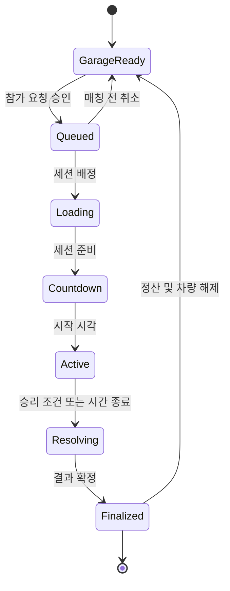

**[제안]** 이것은 원작 내부 상태 머신을 복원한 것이 아니라 관찰 가능한 단계에 맞춘 구현 구조다. `Loading` 완료 조건, 클라이언트 지연 대기, 서버 오류 시 환불 정책은 실제 구현을 확인하지 못했으므로 독립 정책으로 둔다.

### 4.1 단계별 계약

| 상태 | 허용 행동 | 금지 또는 검증할 행동 | 다음 상태로 넘기는 정보 |
|---|---|---|---|
| GarageReady | 구성 편집·참가 요청 | 준비 미달 차량으로 참가 | 확정 가능한 구성 |
| Queued | 대기·취소 | 임의 팀 변경 | 큐 티켓·제약 |
| Loading | 맵·리소스 로드 | 전투 피해 발생 | 참가자 준비 상태 |
| Countdown | 편성 확인·계획 공유 | 시작 전 사격 판정 | 서버 시작 시각 |
| Active | 이동·발사·수리·점령 | 클라이언트의 승패 직접 선언 | 이벤트와 누적 상태 |
| Resolving | 결과 스냅샷 생성 | 결과 이후 신규 기여 반영 | 종료 사유·마지막 시퀀스 |
| Finalized | 정산·미션·통계 반영 | 같은 결과 이중 지급 | 영속 반영 확인 |

## 5. 차량 생명주기와 플레이어 생명주기를 분리하기

**[제안]** 세션과 별도로 참가자에 다음 상태를 둔다.

```text
VehicleState: Alive / Destroyed / Unavailable
ConnectionState: Connected / Disconnected / Reconnecting
ClientViewState: Driving / Spectating / Garage
SettlementState: Pending / Applied / FailedRetryable
```

예를 들어 전차는 파괴되었지만 계정은 연결 중이고 관전 중일 수 있다. 클라이언트가 차고로 돌아와도 전투 결과는 아직 `Pending`일 수 있다. 이 조합을 하나의 `isInBattle` 불리언으로 표현하지 않는 것이 좋다.

**[검증 필요]** 재접속 유예 시간, 파괴 후 차고 복귀의 세부 조건, 전투 종료 전 다른 차량 출격 가능 조건, 재접속 실패 시 AFK 판정은 클라이언트·모드 정책을 확인해야 한다. 실제 동작을 확인하지 않은 값을 하드코딩하지 않는다.

## 6. 기지 점령 모델

### 6.1 확인된 기초와 역사적 수치

**[확인]** 공식 개인미션 설명은 성공한 기지 점령을 `100%`와 `Base Captured` 상태로 설명한다. 2017년 Grand Battle 소개는 당시 Random Battle과 같은 점령 규칙을 쓰며 한 대 100초, 세 대 이상 약 33초가 걸린다고 안내했다. [S03][S07]

**[검증 필요]** 이 역사적 설명만으로 2026년 기본전의 서버 틱 반올림, 100% 이후 확정 유예, 피격 리셋 범위를 확정하지 않는다. 특히 Blitz의 “두 대 79초” 같은 값은 PC 근거가 아니므로 배제했다.

### 6.2 재구현을 위한 제안

**[제안]** 기지 하나에 진행도만 저장하지 않고 참가자별 기여를 저장한다.

```text
CaptureState
  base_id
  attacking_team_id
  contributor_points[player_id]
  total_progress
  completion_candidate_time
  capture_status: Idle / Capturing / CompletionPending / Captured
```

기여자별 저장은 피격·이탈·파괴로 특정 참가자의 기여만 제거하는 규칙을 지원한다. 다만 원작의 리셋 세부 동작은 아래 실험으로 확인한 뒤 결정해야 한다.

| 경계 조건 | 반드시 구분할 질문 |
|---|---|
| HP 피해 | 한 명의 점수만 리셋되는가? |
| 모듈 피해만 발생 | HP가 줄지 않아도 리셋되는가? |
| 비관통·도탄 | 단순 명중으로는 어떤 변화가 있는가? |
| 기지 이탈 | 해당 기여가 즉시 사라지는가? |
| 점령자 파괴 | 파괴 이벤트와 점령 완료의 우선순위는? |
| 수비 차량 진입 | Standard와 중립 기지 모드의 중단 규칙은 같은가? |
| 여러 공격자 | 기여 속도 상한을 넘긴 차량의 기여 저장 방식은? |
| 동시에 100% | 동률 판정에 서버 시각·이벤트 순서가 어떻게 쓰이는가? |

### 6.3 순수 예시

가상 재구현에서 A가 40점, B가 20점을 기여했다고 가정한다. A 피격 시 A의 기여만 제거하는 정책을 채택했다면 남는 진행도는 20점이다. 이는 **제안 모델의 계산 예시**이며, 특정 패치의 실제 서버 계산을 관측한 기록이 아니다.

## 7. 승패 판정과 동시 사건

**[분석]** “전멸 또는 점령”이라는 설명만으로는 구현이 완성되지 않는다. 마지막 적이 파괴되는 프레임에 우리 팀 점령이 완료되거나, 양팀 마지막 차량이 상호 파괴될 수 있다. 일관된 결과를 위해 사건 시각과 평가 순서를 정해야 한다.

**[제안]** 매 틱 확정된 사건을 먼저 수집한 후 모드별 승패 규칙을 한 번만 실행한다.

```text
EvaluateBattleEnd(snapshot, confirmed_events, rule_set):
    candidates = collect_end_conditions(snapshot, confirmed_events)
    result = rule_set.resolve_conflicts(candidates)

    if result exists and battle.result is not finalized:
        freeze_result(result, last_event_sequence)
        publish_result_once(battle_id, result_version)
```

**[검증 필요]** 위 의사코드의 충돌 해결 우선순위는 원작의 실제 순서가 아니다. 기본전은 기본전의 실험 결과로, Onslaught는 공개된 별도 동률 규칙으로 설정해야 한다.

## 8. 아군 피해·탈주·정상 이탈

**[확인]** 현재 공정 플레이 안내는 아군 스턴, 밀어서 침수·전복·추락을 일으키는 행동 등을 팀 피해의 범주로 설명한다. 따라서 “아군 포탄 피해가 없다”를 “아군에게 어떤 방식으로도 피해를 줄 수 없다”로 확대하면 안 된다. [S06]

**[확인]** 지원 문서는 전차가 살아 있는데 부당하게 이탈하는 행위와 관련한 경고·제재를 설명한다. 네트워크 장애인지 고의 이탈인지 판정하는 내부 임계값은 공개 자료만으로 확정하지 않는다. [S08]

**[분석]** 전투 시스템은 정상적인 파괴 후 관전 종료, 갑작스러운 연결 끊김, 반복적 무행동, 고의적 팀 방해를 분리해야 한다. 이벤트만으로 의도를 완벽히 판별할 수 없으므로, 즉시 행동 제한과 사후 검토를 별도 계층으로 두는 편이 추적하기 쉽다.

## 9. 전투 결과와 차고 정산의 연결

**[제안]** 세션 종료 시 다음과 같은 불변 결과를 만든다.

```json
{
  "battle_id": "example-battle",
  "ruleset_id": "pc_random_standard",
  "ruleset_revision": "example-r1",
  "outcome": "win",
  "end_reason": "enemy_eliminated",
  "last_event_sequence": 9123,
  "participants": [
    {
      "account_id": "example-player",
      "vehicle_snapshot_id": "example-build",
      "damage_events": [],
      "assistance_events": [],
      "ammo_consumption": [],
      "capture_contributions": []
    }
  ]
}
```

실제 게임 데이터 형식을 제시한 것이 아니다. 경제 시스템은 이 결과와 자신이 관리하는 보상 규칙으로 원장을 생성한다. 미션 시스템은 같은 결과를 자신의 조건으로 평가한다. 이를 통해 결과를 재전송하더라도 보상은 한 번만 지급하고, 특정 미션 오류를 수정할 때 전투 자체를 다시 실행할 필요를 줄일 수 있다.

## 10. 두 가지 시나리오

### 시나리오 A: 파괴 후 다른 화면으로 이동

플레이어가 전투 중 파괴되어 차고로 이동한다. 서버에서는 다른 팀원들이 계속 전투한다. 이후 승패가 정해지면 해당 계정으로 정산 알림이 도착한다.

**[제안] 확인할 계약:** UI를 떠났다는 이유로 결과 대상에서 제거하지 않는다. 차량 사용 가능 여부, 참가자 상태, 결과 알림 구독은 별도 속성으로 관리한다. 이 사례의 실제 차량 잠금 정책은 실측 후 채택한다.

### 시나리오 B: 점령 완료와 마지막 적 파괴가 근접

두 조건이 근접 시각에 발생한다. 참가자 화면에서는 표시 지연으로 서로 다른 순서처럼 보일 수 있다.

**[제안] 확인할 계약:** 최종 승패는 서버가 확정한 사건 시퀀스로 결정하고, 결과 화면에는 종료 사유 하나를 일관되게 보여 준다. 클라이언트가 먼저 본 애니메이션 순서는 정산의 근거로 쓰지 않는다.

## 11. QA와 재현 실험

| ID | 준비 | 조작 | 확인점 |
|---|---|---|---|
| BAT-01 | 같은 구성의 두 참가자 | 정상 참가·완료 | 구성과 비용 스냅샷 일치 |
| BAT-02 | 대기 중 참가자 | 취소와 매칭 확정 경합 | 유령 참가·이중 배정 없음 |
| BAT-03 | 기본전 점령자 1/2/3/4명 | 같은 시각에 진입 | 속도·상한·반올림 실측 |
| BAT-04 | 두 명이 점령 중 | 한 명에게 HP 피해 | 기여자별 리셋 범위 |
| BAT-05 | 점령 중 외부 모듈만 피격 | 궤도 손상 유발 | HP 피해와 리셋 차이 |
| BAT-06 | 99% 이상 점령 | 마지막 적 제거 | 종료 순서·유예 실측 |
| BAT-07 | 양팀 마지막 차량 | 동시 치명 피해 | 동률·지연 일관성 |
| BAT-08 | 전투 중 연결 종료 | 재접속 | 차량 상태·입력 재개 |
| BAT-09 | 결과 확정 직후 접속 종료 | 다시 접속 | 중복 보상·보상 누락 없음 |
| BAT-10 | 일반전·이벤트 각각 | 아군 사격/스턴 | 모드별 정책 분리 |
| BAT-11 | 파괴 후 관전 중 | 차고 복귀 | 결과 귀속 유지 |
| BAT-12 | 제한 시간 임박 | 기본전과 Onslaught 비교 | 잘못된 동률 규칙 공유 없음 |

## 출처

- [S01] [공식 게임 소개](https://worldoftanks.eu/en/game/) — 대표 15인 팀 형식.
- [S02] [World of Tanks 공식 매뉴얼 PDF](https://worldoftanks.eu/dcont/fb/manuals/world_of_tanks_game_manual_eu_web.pdf) — 기본전 승리·시간·무승부의 기존 규칙. 문서 내 구형 UI·모드는 현행으로 채택하지 않음.
- [S03] [How Do I Complete Personal Missions?](https://www.wargaming.net/support/en/products/wot/article/15110/) — 성공한 점령의 판정 설명.
- [S04] [Release Notes 2.0](https://worldoftanks.eu/en/content/docs/release_notes/release-notes-2-0/) — 무작위 전투 큐 개편.
- [S05] [Update 1.6](https://worldoftanks.eu/en/1.6/) — 아군 사격·충돌 피해 비활성화의 도입 기록.
- [S06] [Teamkill](https://worldoftanks.eu/en/content/guide/fair-play/teamkill/) — 현재 공정 플레이 안내의 팀 피해 분류.
- [S07] [Update 9.20: Grand Battle](https://worldoftanks.eu/en/news/general-news/update-920-grand-battles/) — 당시 기본전 점령 시간의 공식 설명. 역사 자료.
- [S08] [Unfairly Leaving a Battle: Desertion and Warnings](https://wargaming.net/support/en/products/wot/article/31581/) — 이탈·경고·제재 안내.


---

<!-- Source document: 03_Vehicle_Classes_and_Mobility.md -->

# 03. 전차 병과·역할·기동·물리 상호작용

> 기준일: 2026-11-13 KST · 대상: Wargaming World of Tanks PC판 · 확인 범위: 공식 현행 가이드와 2.4까지의 관련 변경, 업데이트 목록 2.4.1 확인.
> **[확인]** 공식 공개 규칙, **[분석]** 규칙의 설계 의미, **[제안]** 재구현 모델, **[검증 필요]** 공개 자료만으로 확정할 수 없는 요소. 직접 플레이·패킷·실행 코드 검증은 수행하지 않았다.

## 1. 시스템 목적과 경계

**[분석]** 전차의 이동은 단순히 조준할 장소까지 운반하는 기능이 아니다. 차체를 돌리면 장갑의 입사각과 약점 노출이 변하고, 차체를 움직이면 사격 안정성과 은폐가 달라지며, 후진 성능은 상대 재장전 사이에 살아 돌아올 수 있는지를 결정한다. 따라서 기동은 화력·방어·정보 세 시스템에 동시에 비용을 지불하는 행동이다.

병과는 전투에서 기대하는 기능을 압축해 보여주는 분류이고, 역할은 같은 병과 안의 운영 차이를 설명한다. 이동 방식은 궤도·차륜·특수 주행 모드처럼 실제 조작과 제약을 결정한다. 이 세 축을 하나의 `TankType` 열거형으로 합치면 신규 전차와 특수 메커니즘 추가 때 예외가 급증한다.

연계 문서: [조준·사격](04_Aiming_Firing_and_Ammunition.md), [장갑·관통](05_Armor_Penetration_and_Damage.md), [모듈 손상](06_Modules_Crew_Damage_and_Repair.md), [특수 메커니즘](07_Artillery_and_Special_Mechanics.md), [시야·위장](08_Spotting_Concealment_and_Radio.md).

## 2. 병과와 전투 역할

### 2.1 공식 분류

**[확인 C01]** PC판의 기본 병과는 경전차, 중형전차, 중전차, 구축전차, 자주포의 다섯 가지다. 공식 가이드는 병과별 강점을 설명하지만, 이는 모든 소속 전차가 같은 장갑·기동을 가진다는 뜻은 아니다. 2.4에서 Tier VI–XI 경전차에 Scout·Versatile·Support 역할이 부여되었다. **[확인 C03]**

다음 표의 전술적 책임과 실패 형태는 분류를 해석한 **[분석]**이다.

| 병과 | 팀에 제공하는 핵심 기여 | 전투 중 판단 기준 | 전형적 실패 형태 | 기동 설계와의 연결 |
|---|---|---|---|---|
| 경전차 | 적 위치·접근 방향 정보, 기동 지원 | 발견 가치가 피격 위험보다 큰가 | 첫 정찰에서 파괴되어 팀 정보원이 사라짐 | 작은 노출 시간과 탈출 경로 확보 |
| 중형전차 | 측면 압박, 전선 간 화력 재배치 | 지금 합류하면 국지적 수적 우위가 생기는가 | 한 위치에서 기다리며 기동 이점을 소모 | 가속·선회·후진을 묶어 평가 |
| 중전차 | 엄폐를 이용한 전선 유지와 돌파 | 장갑과 HP를 써서 아군 사격 기회를 만들 수 있는가 | 이동 도중 집중 사격, 고립된 HP 교환 | 느린 방향 전환을 초반 배치로 보완 |
| 구축전차 | 사선 통제 또는 공격 지원 | 공격 가능한 사선과 후퇴 가능성이 함께 있는가 | 사선이 끊긴 위치에 잔류, 측면 포위 | 고정포·제한포탑 여부가 재조준 비용 결정 |
| 자주포 | 간접 사격과 스턴 지원 | 탄착 시점에도 목표가 유효한가 | 아군이 이미 이긴 구역에 사격, 장전 중 방치 | 저기동 특성을 사전 재배치로 보완 |

**[분석]** 구축전차를 모두 저격수, 중전차를 모두 정면 탱커로 정의하면 실제 운용을 설명하지 못한다. 전차의 장갑 분포·포탑 회전 범위·장전 방식·차체 크기를 함께 보아야 한다. 같은 중전차라도 버티는 전차와 짧은 시간에 탄창을 비우는 전차의 노출 주기는 다르다.

### 2.2 경전차 역할의 세분화

**[확인 C03]** 2.4의 세 역할은 정찰 특화, 균형형, 화력 지원형이라는 구분이며 매치메이킹도 이 차이를 고려하도록 변경되었다. 정확한 매칭 완화 조건은 매치메이킹 문서에서 다룬다.

**[분석]** 이 변경의 의미는 “경전차 수가 같다”는 조건만으로 정보전 공정성을 보장할 수 없다는 데 있다. 한 팀이 정찰 성능을, 다른 팀이 순간 화력을 받은 경우 개활지에서는 첫 발견 시점부터 전투 가능성이 달라질 수 있다. 역할은 콘텐츠 설명뿐 아니라 상대 팀을 구성하는 입력 데이터다.

## 3. 입력·출력과 상태

### 3.1 이동 시스템 계약 — 재구성안

아래 계약은 **[제안]**이며 실제 엔진의 컴포넌트 이름이나 틱 순서를 뜻하지 않는다.

| 분류 | 데이터 | 소비하는 시스템 |
|---|---|---|
| 플레이어 입력 | 전진·후진, 좌우 조향, 제동, 모드 전환 | 이동 상태기 |
| 전차 정의 | 질량, 출력, 전후진 제한 속도, 선회 성능, 접지 특성 | 이동 계산 |
| 전차 현재 상태 | 궤도·바퀴·엔진·조종수, 부스트·특수모드 | 유효 성능 계산 |
| 환경 | 지면 재질, 경사, 접촉 법선, 장애물 | 이동·충돌 계산 |
| 결과 | 위치·속도·각속도·접지 여부 | 서버 상태·카메라·조준·위장 |
| 게임플레이 사건 | 충돌, 추락, 전복·침수 위험, 기동 불가 | 피해·UI·전투 종료 |

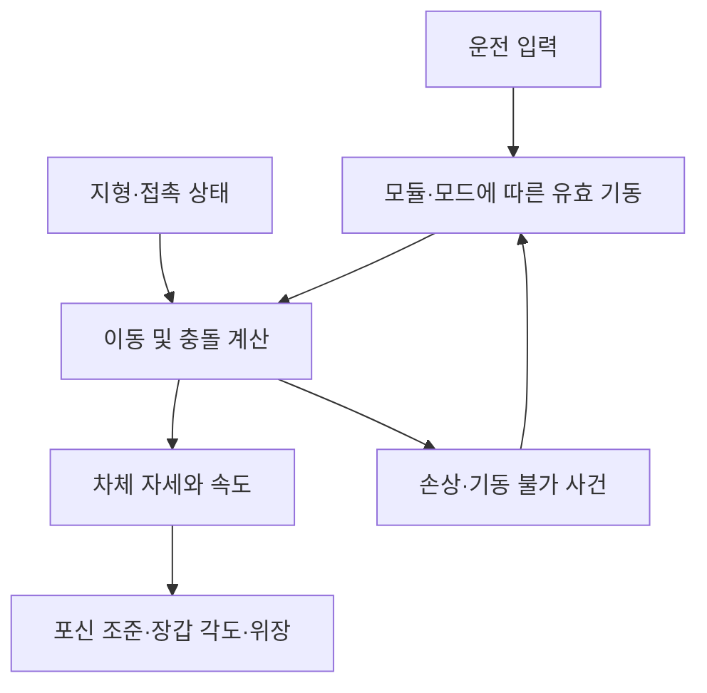

### 3.2 이동 상태와 무장 상태는 분리

**[분석]** 정지했다고 발사 준비가 완료되는 것은 아니다. 재장전 중일 수 있고, 포신이 차체 이동을 뒤따라 회전 중일 수 있으며, 차량은 이동할 수 있지만 포탑 구동부가 손상됐을 수도 있다. 다음 두 상태 집합을 독립적으로 유지해야 조작 결과가 일관된다.

- 기동 상태: 정상 주행, 감속, 주행모드 전환, 현가장치 손상, 기동 불가, 복구 중.
- 무장 상태: 포신 추적, 조준 수렴, 장전, 발사 가능, 특수 사격 준비, 발사 후 잠금.

이 분리는 “고정된 전차의 포탑은 정상 회전”, “움직이는 전차의 주포는 아직 장전 중” 같은 상황을 자연스럽게 표현한다.

## 4. 기동 규칙과 전술적 의미

### 4.1 최고속도 하나로 기동성을 설명할 수 없는 이유

**[확인 C04]** 공식 전차 소개는 최고속도 외에 출력 대비 중량과 지형 저항을 함께 사용해 기동성을 설명한다. **[분석]** 최고속도는 긴 직선에서 도달할 수 있는 상한에 가깝고, 엄폐 사이 수십 미터 이동에서는 가속과 후진이 더 직접적인 차이를 만든다.

| 요소 | 읽어야 할 의미 | 설계·분석 시 실수 |
|---|---|---|
| 전진 최고속도 | 넓은 구역 재배치 능력의 상한 | 짧은 구간 이동 시간을 최고속도만으로 계산 |
| 후진 최고속도 | 사격 직후 차체 방향을 유지한 채 엄폐 복귀 | 전진의 일정 비율로 모든 전차에 동일 처리 |
| 출력/중량 | 가속과 등판 성능에 영향을 주는 요인 | 지면·궤도·손상 상태를 제거하고 절대 성능으로 단정 |
| 차체 선회 | 측면 방어, 좁은 길 방향 전환 | 포탑 회전 성능과 동일 변수 사용 |
| 지형 저항 | 포장·흙·연약지에서 유지하는 운동 능력 | 시각적으로 같은 땅이면 성능도 같다고 판단 |
| 포탑 선회 | 이동 표적 추적과 차체 회전 보상 | 카메라 방향이 즉시 발사 방향이라고 처리 |
| 부각·앙각 | 경사지에서 가능한 포신 방향 | 차체 기준과 월드 기준 각도를 혼동 |

**[제안]** 재구현에서 지형별 감속을 모델링할 때는 실제 서버 물리식을 복제했다고 주장하지 말고, 목표 구간 통과 시간으로 보정하는 것이 안전하다. “0→20 km/h”, “후진으로 8 m 이동”, “젖은 지면에서 90° 회전”과 같은 사용 상황별 결과를 검증해야 한다.

### 4.2 차체 자세와 장갑

**[확인 C02]** 9.14 물리 설명은 서버에서 차량 운동을 계산하며 차체의 흔들림과 경사 변화가 유효 장갑에 영향을 줄 수 있다고 설명한다. 해당 설명은 차체 흔들림 자체가 조준원 동작을 그대로 흔드는 것과 구분한다. 이 자료는 도입 당시 설계 근거이며, 현재 틱 주기나 전체 물리 구현을 공개하는 자료는 아니다.

**[분석]** 여기서 필요한 분리는 세 가지다.

1. 충돌 판정에 쓰이는 차체 자세.
2. 포신이 향하는 실제 발사 방향.
3. 화면에 보이는 카메라 흔들림과 현가 애니메이션.

이를 한 transform으로 취급하면 연출용 흔들림이 명중 판정이나 서버 권위와 충돌한다. 반대로 차체 자세를 무시하면 경사와 차체 각도로 장갑 효율을 바꾸는 전술이 사라진다.

### 4.3 고정포와 회전포탑

**[분석]** 포탑이 없는 전차는 좁은 수평 포각 밖의 목표를 추적할 때 차체 회전이 필요하다. 이때 차체의 위치·장갑 면·위장·조준 분산이 함께 바뀔 수 있어 “같은 사격을 위한 기동 비용”이 크다. 포탑이 있다는 사실도 무제한 360° 회전을 보장하지 않으므로 데이터는 `hasTurret`와 별도로 허용 회전 구간을 가져야 한다.

고지에서 목표를 내려다볼 때 포신 부각이 부족하면 전진해 차체를 더 드러내야 한다. 이 때문에 부각은 단순한 조준 편의가 아니라 노출 면적과 피격 확률을 조절하는 방어 자원이다.

## 5. 이동 방식별 예외

### 5.1 궤도·차륜·예비 궤도

**[확인 C05]** 프랑스 차륜 계통에는 순항/고속 주행 모드가 도입되어 있다. 이를 모든 차륜 전차의 공통 기능으로 일반화하지 않는다. **[확인 C06]** Yoh 계통의 예비 궤도는 주 궤도가 손상되어도 감속 상태로 이동할 수 있게 하며, 주 궤도와 예비 궤도를 함께 파괴하는 상황은 별도다.

**[분석]** 따라서 “궤도 파괴 → 속도 0”이라는 전역 규칙보다 `mobilityCapability`를 다시 계산하는 구조가 필요하다. 차륜 손상 수, 어느 쪽 예비 궤도가 살아 있는지, 엔진 작동 여부를 조건으로 삼는다. 예비 궤도 세부 수리 순서는 모듈 문서에 있다.

### 5.2 충돌·밀기·낙하

**[분석]** 충돌은 직접 HP 피해와 위치 변화라는 서로 다른 결과를 낼 수 있다. 피해가 작아도 상대를 엄폐 밖으로 밀어내거나 탈출 경로를 막으면 전술 효과가 크다. 반대로 빠른 차량이 충돌해도 상대의 질량·접촉 부위·자신의 손상 위험을 무시하면 손해일 수 있다.

**[제안]** 물리 기반 복제에서는 운동량·접촉 충격량을 이용한 밀기와 게임플레이 HP 산식을 분리한다. 순수 운동에너지 `½mv²`를 그대로 HP로 바꾸었다는 주장은 하지 않는다. 알려진 공개 규칙만으로 충돌 피해 계수·배분·접촉 장갑 적용을 완전히 복원할 수 없다. 추락·침수·전복의 시간 임계값도 모드와 차량별 검증 항목으로 둔다.

### 5.3 주행 강화 능력

**[확인 C07]** 2.1.1의 PTZ-78은 좌우 추진기를 독립 사용하며, AT-FV230 Breaker는 전진 지속과 연결된 Direct Drive를 가진다. **[분석]** 전차의 유효 기동성은 고정 능력치뿐 아니라 “현재 입력 이력·사용 가능한 자원”에 의해 달라진다. 특수 상태를 무시한 평균 이동 시간만으로 대칭 맵을 평가하면 초반 핵심 거점 접근성이 달라질 수 있다.

## 6. 구체적인 상황 분석

### 상황 A: 최고속도가 더 높은 전차가 엄폐 싸움에서 느린 경우

**[제안 예시, 실제 전차 수치 아님]** A는 전진 60·후진 15 km/h, B는 전진 50·후진 25 km/h라고 하자. 두 전차가 사격 후 10 m 후퇴해야 한다면 정속 가정의 이동 시간은 A 약 2.40초, B 약 1.44초다. 실제 값에는 가속·지형·입력 지연이 추가된다.

**[분석]** 전진 최고속도가 높은 A가 더 오래 노출된다. 비교표는 최고속도 한 줄 대신 사격 후 복귀 시간과 후진 가속을 보여줘야 하며, 전차의 “민첩함”을 최고속도만으로 평가하면 사용자가 잘못된 장비 선택을 할 수 있다.

### 상황 B: 선회 추적 중 장갑을 잃는 구축전차

**[제안 상황]** 전방 좁은 포각 안에 적이 있을 때는 차체를 기울여 장갑을 활용할 수 있다. 적이 측면으로 이동해 포각을 벗어나면 차체를 돌려야 한다. 회전으로 사격 기회는 회복되지만 이전의 유리한 입사각과 은폐 상태는 유지되지 않을 수 있다.

**[분석]** 플레이어에게는 “쏠 수 있음”과 “안전하게 쏠 수 있음”이 다르다. 튜토리얼은 단순히 적을 따라 조준하라는 지시보다, 차체 회전으로 바뀌는 위험을 함께 알려야 한다.

## 7. 데이터 모델과 유효 성능 계산

다음은 **[제안]**이다.

```yaml
VehicleMobilityDefinition:
  locomotionType: tracked
  classId: heavy
  roleId: breakthrough
  massTonnes: vehicle_specific
  enginePower: vehicle_specific
  speedLimits: {forward: vehicle_specific, reverse: vehicle_specific}
  terrainProfiles: [hard, medium, soft]
  hullTraverseProfile: vehicle_specific
  turretTraverseLimits: vehicle_specific
  gunElevationLimits: vehicle_specific
  abilities: []
MobilityRuntime:
  moduleState: {}
  crewState: {}
  movementMode: normal
  activeModifiers: []
  supportContacts: []
  velocity: server_authoritative
```

```text
effective = ResolveBaseMobility(vehicle, loadout)
effective = ApplyModuleAndCrewState(effective, state)
effective = ApplyModeAndAbilityModifiers(effective, abilities)
contacts = QueryTerrainAndObstacleContacts(transform)
nextState = SimulateAuthorizedInput(input, effective, contacts, dt)
PublishMovementState(nextState)
EmitGameplayContacts(nextState.contacts)
```

**[검증 필요]** 실제 계산의 곱연산/합연산 순서, 마찰 모델, 변속·엔진곡선, 궤도별 접지 계산, 고속 충돌 보정은 공개 자료로 확정하지 않는다. 재구현 시에는 한 요인의 조정이 다른 특수모드에 중복 적용되지 않도록 수정자 우선순위를 명시한다.

## 8. 검증 계획

실제 게임에서 모두 수행한 결과가 아니라, 원작 대조·재구현을 위한 **[제안 QA]**다.

| ID | 재현 조건 | 확인할 결과 | 중요성 |
|---|---|---|---|
| MOB-01 | 같은 전차, 같은 방향, 포장/흙/연약지 반복 | 가속·정속·통과 시간 차이 | 지형과 성능의 결합 검증 |
| MOB-02 | 0속도·중속도에서 각각 90° 회전 | 회전 반경과 소요 시간 | 차고 선회값의 해석 |
| MOB-03 | 후진 중 차체 회전·제동 | 전진과 별도의 제한이 일관되는지 | 엄폐 복귀 판단 |
| MOB-04 | 포탑 구동부만 파괴, 이후 엔진만 파괴 | 사격 추적과 이동 능력이 독립적으로 손상 | 상태 분리 |
| MOB-05 | 주 궤도/예비 궤도를 순서별로 파괴 | 이동 가능 여부와 복구 순서 | 특수 기동 예외 |
| MOB-06 | 모드 전환 중 부스트 시작·종료 | 능력치가 중복 적용되거나 누락되지 않음 | 특수모드 안정성 |
| MOB-07 | 같은 경사에서 정지·가속·제동 사격 | 차체 자세와 조준 연출 구분 | 물리와 판정 연결 |
| MOB-08 | 경량/중량 전차 충돌, 같은 속도 반복 | HP 피해·밀림·기여 귀속을 따로 기록 | 실제물리식 오인 방지 |
| MOB-09 | 저FPS·높은지연 환경에서 급회전 | 서버 위치·조준 방향의 표시 불일치 측정 | 네트워크 체감 |
| MOB-10 | 특수 지형 경계에서 이동 반복 | 지형분류 전환 시 급격한 수치 튐 확인 | 콘텐츠 QA |

## 9. 설계 해석과 한계

**[분석]** 기동성의 핵심 가치는 “전투가 일어날 장소를 고르는 능력”과 “불리해진 전투에서 나오는 능력”이다. 최고속도와 방향 전환·후진을 분리하고, 사선과 엄폐까지 이동해야 실제 기동 가치가 드러난다. 장갑이 강한 전차를 느리게 만드는 설계는 단순한 능력치 상쇄뿐 아니라 잘못된 초기 배치를 수정하는 데 더 큰 비용을 부과한다.

**[검증 필요]** 물리 엔진 이름·서버 업데이트 주기·정확한 충돌 HP 공식은 이 문서에서 확정하지 않는다. 9.14 개발 설명은 서버 권위와 설계 의도를 확인하는 역사 자료이며, 오늘의 소스 구조나 수치가 그대로라는 증거는 아니다.

## 10. 출처

- **C01** [Vehicle Types and Functions](https://worldoftanks.eu/en/content/guide/game-mechanics-and-achievements/vehicle-types-and-functions/) — 현행 병과·역할 가이드, 게시일 미표기.
- **C02** [Version 9.14: Improved Vehicle Movement Physics and Sounds](https://worldoftanks.eu/en/news/general-news/version-914-sounds-physics/) — 9.14 도입 당시 서버 물리·차체 자세 설명. 역사 자료.
- **C03** [Light Tanks Rebalanced: New Roles, Smarter Matchmaking](https://worldoftanks.eu/en/news/general-news/2-4-lt-roles-rebalance/) 및 [Release Notes 2.4](https://worldoftanks.eu/en/content/docs/release_notes/release-notes-2-4/) — 2026 경전차 역할 변경.
- **C04** [T54 Heavy Tank Review](https://worldoftanks.eu/en/news/guides-reviews/how-to-play-t54-heavy-tank/) — 최고속도·출력중량비·지형저항을 함께 다루는 공식 전차 설명.
- **C05** [Release Notes 1.6](https://worldoftanks.eu/uk/content/docs/release_notes/Release-Notes-1-6/) — 차륜 주행모드 개선의 역사 기록.
- **C06** [American Yoh Tanks Are Here!](https://worldoftanks.eu/uk/news/general-news/brand-new-yoh-tanks/) — 예비 궤도 동작과 수리 순서.
- **C07** [Release Notes 2.1.1](https://worldoftanks.eu/en/content/docs/release_notes/release-notes-2-1-1/) 및 [Tier XI TDs and LT](https://worldoftanks.eu/en/news/general-news/update-2-0-tier-11-tank-destroyers-light-tanks/) — 특수 기동 사례.

모든 URL 확인 기준일은 2026-11-13이며 일부 공식 페이지는 직접 열기가 제한되어 검색 서비스가 제공한 공식 본문 색인을 이용했다.


---

<!-- Source document: 04_Aiming_Firing_and_Ammunition.md -->

# 04. 조준·사격·재장전·탄종

> 기준일: 2026-11-13 KST · Wargaming World of Tanks PC판 · 일반 무작위 전투를 기준으로 하되 특별모드·특수 무장 예외를 구분한다.
> [확인]은 공식 문서 사실, [분석]은 설계 해석, [제안]은 재구현용 모델, [검증 필요]는 확인하지 못한 세부값이다. 직접 플레이·코드 검증은 수행하지 않았다.

## 1. 시스템 목적

**[분석]** 사격은 버튼을 누르는 한 번의 행위지만, 플레이어는 그 전에 시간·노출·탄약·명중 가능성을 교환한다. 완전히 조준하면 맞힐 가능성이 좋아지지만 적에게 더 오래 노출되고, 즉시 발사하면 안전하게 빠질 수 있지만 약점을 놓칠 수 있다. 재장전은 공격의 공백이면서 상대의 전진 신호가 된다.

이 문서는 발사 가능 상태까지의 과정을 다룬다. 충돌 이후 판정은 [장갑·관통·피해](05_Armor_Penetration_and_Damage.md), 자주포와 고유 무장은 [특수 메커니즘](07_Artillery_and_Special_Mechanics.md), 장비 보정은 장비 문서로 연결한다.

## 2. 카메라·포신·조준원의 분리

**[확인 C08]** 공식 조작 가이드는 화면 중앙 조준표시가 바라보는 방향을, 지연되어 따라오는 조준원이 실제 주포 위치를 나타낸다고 설명한다. 차체·포탑 회전은 조준원을 확대하고 정지 후 수렴을 기다리면 정밀 사격에 유리하다.

**[분석]** 따라서 “크로스헤어가 적 위에 있다”는 사실만으로 포신이 그 적을 향한다고 판단하면 안 된다. 카메라를 빠르게 돌렸거나 차체가 경사면에 올라간 직후에는 시선·총구·포각 제한이 서로 다른 결과를 낼 수 있다.

| 요소 | 의미 | 잘못 해석했을 때 생기는 문제 |
|---|---|---|
| 카메라 중앙점 | 사용자가 원하는 방향 | 원하는 방향을 곧바로 실제 발사 방향으로 취급 |
| 실제 포신 방향 | 회전 속도·포각 제약을 적용한 방향 | 포신이 벽에 막히거나 차체가 필요한 상황 무시 |
| 조준원 | 현재 사격 분산의 표시 | 조준원이 작아지면 무조건 관통한다고 오해 |
| 목표 거리 | 사격 위치와 예측의 입력 | 거리 불확실성을 제거한 직선 레이 발사 |
| 서버 기준 사격 상태 | 최종 입력 처리와 실제 판정의 기준 | 화면 연출과 서버 결과 불일치의 원인을 숨김 |

마지막 행의 구체 네트워크 구조는 **[제안]**이며 공개 가이드가 특정 서버 틱·보정 알고리즘을 보증하는 것은 아니다.

## 3. 정확도와 조준 수렴

### 3.1 서로 다른 성능 축

**[분석]** 최종 분산, 조준 수렴 속도, 이동 중 분산은 서로 다른 축이다. 작은 최종 조준원을 가진 전차도 이동 후 수렴이 오래 걸리면 짧은 노출 사격에 불리할 수 있다. 반대로 최종 분산이 평범해도 기동 중 분산 증가가 작으면 순간 대응이 편할 수 있다.

**[확인 C09]** 공식 재조정 내역은 100 m 분산, 조준 시간, 차체 이동/회전·포탑 회전·발사 후 분산을 별도 항목으로 수정한다. 이는 하나의 명중률 수치로 통합하면 게임의 조작 차이를 충분히 표현하지 못한다는 근거다.

| 성능 항목 | 사용자가 느끼는 차이 | 재구현 시 분리할 변수 |
|---|---|---|
| 100 m 분산 | 충분히 기다린 뒤의 정밀도 | `baseDispersion` |
| 조준 시간 | 커진 조준원이 회복되는 속도 | `aimConvergenceProfile` |
| 이동 분산 | 직선 주행 중 사격 위험 | `movementBloom` |
| 차체 회전 분산 | 방향 전환을 동반한 사격 위험 | `hullTraverseBloom` |
| 포탑 회전 분산 | 다른 목표로 전환할 때의 위험 | `turretTraverseBloom` |
| 발사 후 분산 | 연속 사격 시 회복 부담 | `afterShotBloom` |
| 특수모드 보정 | 냉각·충전·구축 모드에 따른 성능 변화 | `activeGunModifiers` |

변수명은 **[제안]**이다. 실제 결합식이 단순 합인지 제곱합인지, 내부 분포가 어떤 확률밀도를 쓰는지는 별도 검증한다.

### 3.2 흔한 수치 오독

- **[분석]** 표시된 “조준 시간 2초”를 어떤 상태에서도 2초 후 완전 조준된다는 의미로 사용하지 않는다. 출발 분산과 적용 보정이 다르므로 실측 정의가 필요하다.
- **[분석]** 조준원 안의 모든 위치가 같은 확률이라고 가정하지 않는다. 원의 경계는 분포를 설명하는 유일한 정보가 아니다.
- **[분석]** 명중률과 관통률은 분리한다. 차체에 맞힐 확률이 높아도 특정 약점에 맞힐 확률은 낮을 수 있다.
- **[검증 필요]** 100 m 분산 표시값을 화면 조준원 지름·반지름과 직접 일치시키는 계산은 현행 HUD 투영·서버 분산 검증 후 적용한다.

## 4. 발사 처리와 입력 우선순위

### 4.1 재구성 처리 흐름

아래는 **[제안]**이다. 원작의 함수 호출 순서가 아니라 관측 가능한 결과를 설명하는 논리 순서다.

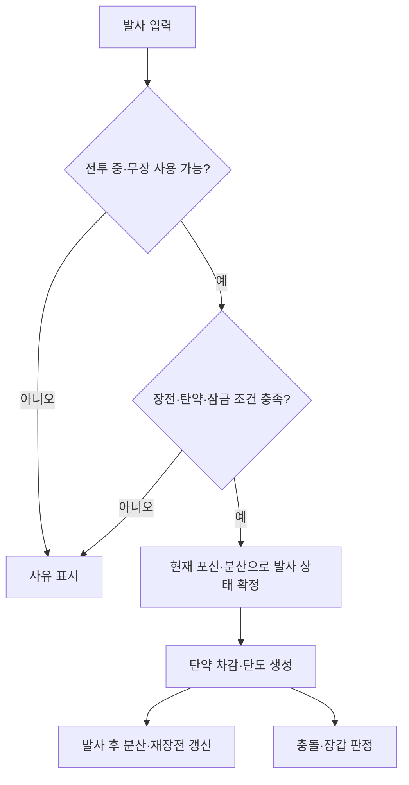

완전 조준은 일반적으로 “발사 가능”을 잠그는 조건으로 취급하지 않는다는 점이 핵심이다. 플레이어는 불리한 명중 확률을 감수하고 발사할 수 있어야 순간 사격 선택이 존재한다. 특정 특수모드의 준비 완료 조건은 별도로 둔다.

### 4.2 탄종 변경

**[분석]** 탄종 선택은 탄약 창고의 종류를 바꾸는 행동과 현재 장전 중인 한 발을 바꾸는 행동으로 나뉜다. 사용자는 다음 발부터 바꾸기와 지금 바꾸기를 혼동하기 쉽다. 구현·QA에서는 `selectedAmmo`, `loadedAmmo`, `nextAmmo`를 구분하고 장전 취소·직관(Intuition)·탄창 교체 예외를 명시해야 한다. 실제 단축키·교체 시간 보정은 현행 설정과 승무원 문서를 기준으로 검증한다.

**[제안]** UI는 장전된 탄과 예약된 탄을 별도 표시하며, 교체 명령이 무시됐을 때 남은 대기시간이나 탄 부족을 알려야 한다. 탄약 표시만 즉시 바꾸고 서버의 실제 탄종이 남아 있으면 관통 결과가 불공정하게 느껴진다.

## 5. 장전 방식별 시간 구조

**[확인 C10·C11]** 이탈리아 자동 재장전 방식은 탄창을 한 발씩 채우며 발사 시 진행 중인 장전이 중단될 수 있다. 소련 쌍열포는 단발 순환·연속 발사·동시 발사의 시간 구조가 다르다. 세부 수치는 전차와 업데이트별로 달라진다.

아래 비교의 전술 의미는 **[분석]**이다.

| 방식 | 시간 자원 구조 | 강점 | 실제 비용 |
|---|---|---|---|
| 단발포 | 매 발 뒤 재장전 | 노출 주기를 예측하기 쉬움 | 한 발 실패가 재장전 전체의 손실 |
| 탄창식 자동장전 | 탄간 간격 + 탄창 전체 재장전 | 짧은 시간에 집중 피해 | 탄창 소진 후 긴 무력 구간 |
| 자동 재장전 | 탄 수별 한 발 재장전 | 단발 운용과 순간 화력 선택 | 미완료 장전의 손실, 빈 탄창 복구 부담 |
| 역자동 재장전·보정형 | 남은 탄 수나 보정 규칙별 시간 변화 | 기존 자동 재장전과 다른 최적 운용 | “모든 자동재장전은 같음”이라는 학습 오류 |
| 소련 쌍열포 | 포신별 상태·전환·일제사격 잠금 | 단발과 높은 순간 피해 사이 선택 | 준비시간, 두 포신 잠금, 장전 순서 |
| 기관포·연속사격 | 발사열·탄창·과열 자원 | 노출된 얇은 장갑에 집중 피해 | 장시간 노출, 열/탄 관리, 낮은 단발 관통 |

**[확인 C12]** 2.1.1의 미국 Ares 계통은 열 관리 기관포와 예비 궤도를 사용한다. 이를 오래된 저단계 자동포나 다른 국가 기관포의 동일한 규칙으로 취급하지 않는다.

### 5.1 DPM·탄창 피해·킬 시간

다음은 실제 전차 제원이 아닌 **[제안 계산 예시]**다.

단발 피해 `D`, 재장전 `R`이면 이상적인 지속 화력은 `60D/R`이다. 피해 390, 재장전 10초라면 2,340 HP/분이다. 이동·재조준·도탄·목표 부재를 제외한 값이므로 실제 전투 성과와 다르다.

탄창 4발, 발당 300, 탄간 2초, 마지막 발 후 전체 재장전 30초인 가상 전차는 첫 발을 0초에 쏘고 2·4·6초에 나머지를 발사한다. 다음 탄창의 첫 발은 36초다. 따라서 장기 주기 기준 DPM은 `1,200×60/36 = 2,000`이고, 최초 6초에는 1,200 피해를 집중할 수 있다. 초반 폭발력과 장기 화력 순위가 다르다.

적 HP를 `H`라 하고 피해가 고정이며 모든 발이 관통한다고 가정하면 필요한 발수는 `ceil(H/D)`, 첫 발이 이미 준비됐을 때 킬 시간은 `(ceil(H/D)-1)R`이다. 실제로는 피해 변동·포신 정렬·이동시간을 추가해야 하므로 이 식을 확정 승리 판정으로 쓰지 않는다.

## 6. 탄종을 선택하게 만드는 차이

**[확인 C13]** 공식 가이드는 AP·APCR·HEAT·HE를 구분하며, APCR이나 HEAT가 일부 차량에서는 기본 탄약일 수 있다고 설명한다. 따라서 “AP=일반탄, APCR=유료탄”처럼 물리 탄종과 경제 분류를 동일시하지 않는다. HESH는 높은 관통력을 가진 HE 성격으로 설명되며 독립적인 실물 탄두 시뮬레이션을 추정하지 않는다.

| 계열 | 판단 시 봐야 할 항목 | 유리한 기회 — 분석 | 경계할 상황 — 분석 |
|---|---|---|---|
| AP | 관통력·거리 감쇠·정규화·탄속 | 장갑 각도와 구경을 고려한 안정적 사격 | 극단적 각도·긴 거리·약점 빗나감 |
| APCR | 실제 탄별 탄속·관통·정규화 | 이동 표적 리드 부담 감소, 높은 관통 활용 | 높은 표기 관통력만 믿고 경사장갑을 무시 |
| HEAT | 거리 손실·공간장갑·장애물 | 두꺼운 단일 주장갑을 적절한 각도로 공격 | 궤도·공간장갑·장애물에 선행 접촉 |
| 일반 HE/HESH | 관통/비관통 피해·장갑 두께 | 얇은 부위, 낮은 HP 적, 점령 방어 | 외부 장갑에서 멈춤, 두꺼운 부위의 낮은 피해 |
| 자주포 HE | 스플래시·스턴·탄도 | 다수 목표 지원 또는 직접 피해 | 일반 전차 HE 규칙으로 판정 |
| 기관포 HE | 낮은 관통·파편/폭발 예외 | 드러난 얇은 장갑에 연속 명중 | 비관통 최소피해를 기대하며 두꺼운 장갑 공격 |

**[확인 C13]** 현행 가이드는 기관포 HE에 일반 HE의 파편피해와 표준 폭발피해가 없다고 명시한다. 이 예외 때문에 “HE는 모든 직격에 항상 피해”라는 범용 규칙을 만들 수 없다. 일반 HE와 자주포 HE의 판정은 다음 문서에서 별도 분기한다.

**[분석]** 탄 가격이 높아도 관통을 보장하지 않고, 빠른 탄속이 조준원 분산을 자동으로 줄이지도 않는다. 탄종 이름보다 선택한 전차·포·탄의 실제 조합 데이터가 우선이다.

## 7. 탄도와 리드 사격

**[확인 C14]** 공식 관통 설명은 포탄이 탄도 궤적으로 날며 높은 탄속의 주포에서는 거의 직선처럼 보일 수 있다고 설명한다. **[분석]** 발사 시점의 적 위치를 겨누는 것과 명중 시점의 위치를 겨누는 것은 다르다.

**[제안 근사]** 낙하와 탄속 변화를 무시하면 비행시간은 `거리/탄속`이다. 거리 400 m, 탄속 1,000 m/s면 0.4초다. 표적이 사선에 직각으로 10 m/s 움직이면 약 4 m 앞을 겨냥하는 출발점이 된다. 실제 리드는 표적의 선회·가속, 고저차, 탄도 보정, 네트워크 표시 상태 때문에 달라진다. 이 계산은 조작 학습을 돕는 근사이고 엔진 탄도식이 아니다.

## 8. 두 가지 상황별 의사결정

### 상황 A: 완전 조준을 기다릴까

**[분석]** 적이 후퇴하기까지 1초 남았고 내 조준이 아직 수렴 중이면, 지금 쏘는 것이 유일한 기회일 수 있다. 반대로 적이 정지했고 내 차체가 안전하다면 수렴을 기다리는 편이 합리적이다. 최적 행동은 명중률 하나가 아니라 `발사기회 × 관통가능성 × 반격노출`을 함께 본다.

**[제안]** QA에서 조준이 덜 된 상태의 발사를 막거나 자동으로 완전조준 때까지 큐에 넣지 않도록 한다. 이런 편의 기능은 원작의 위험 선택 자체를 없앤다.

### 상황 B: 자동 재장전 중 남은 탄을 쏠까

**[제안 상황]** 다음 한 발 장전이 거의 끝났지만 적이 낮은 HP로 노출되어 있다. 바로 쏘면 확정에 가까운 제거 기회가 생기지만 미완료 장전 이득을 잃을 수 있다. 기다리면 이후 장기 화력은 좋아지지만 적이 엄폐할 수 있다.

**[분석]** 이 구조는 탄창을 단순한 “남은 총알 수”에서 “미래 화력의 가치”로 바꾼다. UI는 현재 탄 수뿐 아니라 다음 탄 완성까지 남은 시간, 발사로 중단되는 구간을 명확히 보여야 한다.

## 9. 데이터와 사건 설계

아래는 **[제안]**이다.

```yaml
GunDefinition:
  loadingModel: single | clip | autoreload | dual_barrel | heat
  traverseProfile: vehicle_specific
  aimProfile: vehicle_specific
  shellIds: []
  magazineSize: vehicle_specific
  reloadByMagazineState: []
ShellDefinition:
  physicsType: AP | APCR | HEAT | HE
  sourceFamily: conventional | artillery | autocannon | special
  damageProfileId: configurable
  penetrationByDistance: configurable
  velocityProfile: configurable
  economicCategory: standard | special
GunRuntime:
  loadedShells: []
  pendingShellType: optional
  reloadEndTime: authoritative
  currentDispersion: authoritative
  heat: optional
  lockUntil: optional
```

사건은 `FireRejected(reason)`, `ShotCommitted(shotId)`, `AmmoConsumed`, `ReloadStarted`, `ReloadInterrupted`, `AimStateChanged`, `ShellTypeSwitchQueued` 등으로 분리한다. 발사 확정과 탄약 차감을 서로 다른 비동기 거래로 처리하면 중복 발사·음수 탄약 문제가 생길 수 있다. 서버 권위로 한 명령을 한 번만 소비하는 구조가 필요하다.

## 10. QA와 분석 지표

| ID | 조건 | 확인할 결과 |
|---|---|---|
| GUN-01 | 카메라 급회전 직후 발사 | 실제 포신 제한이 적용되고 표시 방향과 혼동되지 않음 |
| GUN-02 | 이동·차체 회전·포탑 회전을 각각 실행 | 분산 요인을 별도로 측정 가능 |
| GUN-03 | 재장전 완료 시각 직전·직후 입력 | 중복 발사·탄약 차감 누락 없음 |
| GUN-04 | 탄종 예약 중 마지막 탄 소모 | 불가능한 탄종으로 발사하거나 재장전 고착 없음 |
| GUN-05 | 자동 재장전 직전 발사·취소 반복 | 남은 장전 진행의 보존/손실 규칙 일관 |
| GUN-06 | 쌍열 준비 중 취소·주포 파손 | 준비·잠금·장전 상태가 모순되지 않음 |
| GUN-07 | 기관포 HE로 두꺼운 주장갑 공격 | 일반 HE 비관통 피해 규칙을 잘못 공유하지 않음 |
| GUN-08 | 동일 표적을 탄속만 다르게 반복 사격 | 리드 요구량과 탄도 차이 확인 |
| GUN-09 | 능력 종료 순간 발사 | 피해·분산 보너스가 언제 확정되는지 검증 |
| GUN-10 | 서버지연 변화·낮은프레임 | 발사 화면·사운드·결과 간 시간차 기록 |

**[제안 지표]** 첫 유효 사격까지 시간, 발사 시 분산/완전조준 비율, 탄창 미소진 교체율, 탄종별 명중·관통·순수익, 재장전 완료 후 유휴시간을 함께 본다. 단순 DPM이 높은데 실전 피해가 낮다면 장갑 관통뿐 아니라 노출시간·조준 복귀·맵 사선이 원인일 수 있다.

## 11. 출처와 미확인 범위

- **C08** [Controls and Firing](https://worldoftanks.eu/en/content/guide/newcomers-guide/game_controls/) — 카메라 중앙점·조준원·사격 조작.
- **C09** [Widespread Vehicle Rebalancing in Update 1.26](https://worldoftanks.eu/en/news/general-news/vehicle-rebalances-1-26/) — 서로 분리된 분산·조준 파라미터의 공개 사례.
- **C10** [Get Ready for Italian Tanks](https://worldoftanks.eu/hu/news/general-news/italian_tanks/) — 자동 재장전의 도입 원리. 역사적 기본 규칙만 참조.
- **C11** [Colossal Double-Barreled Heavies Are Coming!](https://worldoftanks.eu/en/news/general-news/1-7-1-double-barreled/) — 소련 쌍열포의 발사·장전 구조. 영국 쌍열포와 혼용하지 않음.
- **C12** [Update 2.1.1: Fresh Tier XI Firepower](https://worldoftanks.eu/en/news/updates/wot-2-1-1/) — Ares 열 관리 기관포.
- **C13** [Upgrading Your Vehicles: Ammunition](https://worldoftanks.eu/en/content/guide/newcomers-guide/upgrading_vehicles/) — 탄종, 경제분류와의 차이, 기관포 HE 예외.
- **C14** [Armor Penetration](https://wargaming.net/support/en/products/wot/article/10220/?lang=en) — 탄도·분산·관통의 개요.

**[검증 필요]** 정확한 조준 수렴식, 현행 분산 샘플링 분포, 포별 거리 감쇠 곡선, 탄종 교체의 모든 입력 조합은 공개 문서만으로 완전 복원하지 않았다. 원작 내부 구조처럼 표시한 공식은 없으며, 수치 예제는 모두 가상의 분석용 입력이다.


---

<!-- Source document: 05_Armor_Penetration_and_Damage.md -->

# 05. 장갑·관통·도탄·피해 판정

> 기준일: 2026-11-13 KST · Wargaming World of Tanks PC판 · 일반 전차의 주포, 자주포, 기관포의 탄 처리 예외를 분리한다.
> [확인] 공식 공개 규칙 · [분석] 설계 해석 · [제안] 재구현 모델 · [검증 필요] 미확정 값. 소스 코드와 실제 전투 로그를 직접 검증하지 않았으므로 아래 의사코드는 원작 코드가 아니다.

## 1. 핵심 구조

**[분석]** 이 게임의 방어는 HP만으로 결정되지 않는다. 플레이어가 어느 면을 어떤 각도로 보여주는지, 상대가 어떤 포탄으로 어느 부위를 맞히는지에 따라 공격을 무효화하거나 작은 피해로 줄일 수 있다. 공격도 “명중” 이후 외부 장갑·도탄·주장갑·내부 모듈이라는 서로 다른 결과를 거친다.

따라서 시스템은 적어도 다음 결과를 구분해야 한다.

| 결과 | 의미 | 전술적 후속 판단 |
|---|---|---|
| 빗나감 | 전차 또는 관련 판정체에 유효 접촉하지 않음 | 리드·조준·포신 정렬 수정 |
| 외부 모듈/공간장갑 접촉 | 궤도·주포·외부 판정에만 영향 가능 | 같은 위치를 재조준할지 결정 |
| 도탄 | 각도·탄종 규칙으로 튕김 | 관통력만 높여도 해결되지 않을 수 있음 |
| 비관통 | 해당 층의 관통 조건 미달 | 더 얇은 부위·유리한 각도·다른 탄 고려 |
| 주장갑 관통 | 전차 HP 피해의 중요한 조건 | 피해량·추가 모듈 손상 확인 |
| 일반 HE 비관통 피해 | 주장갑 접촉에 따른 제한적 피해 | 낮은 HP 적 제거·점령 방어 가능성 판단 |
| 치명적 모듈 결과 | 탄약고 폭발 등으로 별도 격파 | HP와 모듈 상태를 함께 평가 |

각 결과가 항상 하나만 발생하는 배타적 목록은 아니다. 한 발이 궤도를 파괴하고 주장갑을 관통하면서 HP 피해와 승무원 부상을 함께 만들 수도 있다. **[분석]**

## 2. 장갑의 세 가지 두께

**[확인 C15]** 공식 가이드는 명목 두께, 탄도 방향에서의 유효 두께, 장갑 법선에 대한 입사각을 구분한다. 같은 전면 장갑에도 약점과 서로 다른 판이 존재하므로 차고의 전면/측면/후면 숫자를 모든 위치에 적용할 수 없다.

- **명목 두께 `t`**: 해당 장갑 부위의 데이터상 두께.
- **기하학적 시선 두께**: 경사 때문에 탄이 지나가야 하는 길이.
- **실제 판정용 유효 저항**: 탄종 정규화·다중 장갑·선행 손실 등의 영향을 반영한 값.

**[제안, 평판 근사]** 균질한 한 장의 평판에 입사각 `θ`를 법선에서 측정하면 기하학적 길이는 `t/cos(θ)`다. 두께 100 mm, 각도 60°면 200 mm가 된다. 이 식만으로 원작의 관통을 완성할 수 없다. 곡면·맞닿은 판·공간장갑·도탄·구경 규칙이 추가되며, 실제 hit point의 장갑 데이터를 사용해야 한다.

### 장갑을 활용하는 행동의 분석

| 행동 | 의도 | 비용 또는 역효과 |
|---|---|---|
| 차체 각 주기 | 정면의 유효 두께 증가 | 측면 노출이 커지거나 다른 약점이 드러남 |
| 사이드스크래핑 | 장애물로 전면을 가리고 측면을 높은 각도로 제시 | 과회전하면 측면 관통 가능성이 증가 |
| 헐다운 | 차체를 지형 뒤로 숨기고 포탑 중심으로 교전 | 포탑 약점·부각·자주포 사선에 의존 |
| 짧은 좌우 이동 | 상대가 작은 약점을 지속 추적하기 어렵게 함 | 자신의 조준 분산과 노출이 증가 가능 |
| 고저차 이용 | 유리한 장갑 면과 사격 각도 확보 | 상판·하부 노출 등 반대 효과도 가능 |

위 전술 효과는 **[분석]**이며 특정 전차가 항상 같은 방식으로 안전하다는 보장이 아니다.

## 3. 탄종별 관통 규칙과 확실성

### 3.1 공식 본문으로 확인한 핵심

**[확인 C15]** AP/APCR은 공식 설명상 입사각이 70°보다 큰 경우 도탄할 수 있으며, 구경이 접촉 장갑의 명목 두께의 3배를 **초과**하면 해당 도탄을 방지한다. HEAT는 85°보다 큰 입사각에 대한 별도 규칙을 가지며 AP/APCR의 3구경 예외를 그대로 적용하지 않는다. HE는 도탄하지 않는다.

| 항목 | AP/APCR | HEAT | 일반 HE |
|---|---|---|---|
| 일반 도탄 기준 | 70°보다 큰 입사각에 대한 규칙 | 85°보다 큰 입사각에 대한 규칙 | 도탄하지 않음 |
| 3구경 초과 예외 | 도탄 방지 | 같은 예외 적용 안 함 | 도탄 판정 자체가 없음 |
| 거리와 관통 | 탄별 거리 손실 고려 | 일반 비행거리 관통 감소 없음 | 거리 관통 감소 없음 |
| 공간장갑 | 선행 층과 주장갑을 구분 | 선행 접촉·층간 간격의 영향 중요 | 외부 장갑 소모 계수의 별도 규칙 |
| HP 피해 | 주장갑 관통 여부가 핵심 | 주장갑 관통 여부가 핵심 | 주장갑 직격 후 관통/비관통 처리 분리 |

거리 관련 사실은 **[확인 C13·C16]**이며, 다중 층을 분리해야 한다는 해석은 **[분석]**이다. 표의 `>`는 공식 자연어 설명을 옮긴 것이며, 정확히 70.000°·85.000°에서의 부동소수점 경계는 실측 없이 확정하지 않는다.

### 3.2 정규화와 2구경 규칙의 취급

**[분석]** 정규화는 AP 계열이 경사장갑을 평가할 때 고려하는 중요한 차이다. 이것을 탄이 실제로 벽 속에서 정해진 각도로 꺾인다는 시각 효과와 동일시하지 않는다. 재구현에서는 충돌 법선, 판정용 각도, 관통 후 경로를 명시적으로 구분해야 한다.

**[확인 C19, 역사 기록]** 8.6 공식 패치 노트는 APCR 정규화를 5°에서 2°로 낮췄다고 기록한다. 그러나 이 문서 하나는 현재 모든 탄과 모든 장갑 층에서 적용되는 처리 순서를 보증하지 않는다.

| 흔히 인용되는 항목 | 이 문서의 증거 상태 | 재구현 결정 |
|---|---|---|
| AP 기본 정규화 5° | 현행 PC 공식 본문에서 수치를 독립 확인하지 못함 | 검증 전 원작 확정 상수로 고정하지 않음 |
| APCR 기본 정규화 2° | 8.6 공식 변경 기록 확보 | 현행 장갑 검사기·통제 사격으로 재확인 |
| 2구경 초과 시 추가 정규화 | 과거 테스트 설명에 언급되나 현행 공식 수식 미확보 | 추가 정규화와 도탄 면제를 구분하고 실험 |
| HE/HEAT 무정규화 | HE는 공식 지원 문서로 확인, HEAT 세부식은 별도 확인 필요 | 탄별 정책을 분리하고 정규화량을 데이터화 |
| 3구경 초과 시 무조건 HP 피해 | 잘못된 확대 해석 | 도탄 면제 이후 남은 층·관통·주장갑 접촉을 판정 |

**[검증 필요]** 모바일 Blitz와 콘솔의 공식 지원 문서에는 비슷한 표현과 다른 상수가 섞여 있다. 이번 분석에서는 그 수치와 수식을 PC판의 증거로 가져오지 않았다. 9.17 Common Test의 2·3구경 통합 제안도 실제 적용 여부 확인 없이 현행 규칙으로 채택하지 않는다.

## 4. 관통력과 피해량의 확률

**[확인 C14·C20]** PC 공식 자료는 일반 관통력 변동의 ±25% 범위를 설명하고, 표준 WoT 피해량 변동 역시 ±25%라고 명시한다. 특별모드, 승무원 특전, 전차 고유 능력 등으로 수정된 범위는 별도다. 승무원 특전의 현행 수치와 합성은 [14번](14_Crew_and_Perks.md)을 참조한다. 범위를 안다고 내부 표본 분포까지 아는 것은 아니다.

**[제안 예시]** 거리 등 조건을 적용한 평균 관통력이 200 mm라면 기본 ±25% 범위는 150~250 mm다. 유효 저항이 260 mm이면 이 단순 모델에서 범위를 벗어나고, 140 mm이면 범위보다 낮다. 200 mm라고 해서 검증 없이 정확히 50% 관통률을 기입하지 않는다. 경사·도탄·외부 장갑·분산으로 다른 부위에 맞는 확률도 따로 존재한다.

평균 피해 390 HP를 같은 기본 범위로 설명하면 292.5~487.5 HP다. 화면 정수 표기·반올림·남은 HP 상한·특수 피해 보정은 별도로 처리한다. 적의 잔여 HP가 100이면 표시/정산 피해를 390으로 중복 집계하지 않아야 한다.

**[분석]** 무작위성을 공격자와 수비자 모두에게 같은 방식으로 설명할 수 있어야 한다. 결과창에서 “최대 이론 피해”와 “실제 HP 감소”를 섞으면 피해 기여·미션·경제 정산이 일관되지 않는다.

## 5. 공간장갑·궤도·외부 모듈

**[분석]** 공간장갑은 서로 떨어진 다수 충돌층이라는 관점으로 이해하면 예외를 정리하기 쉽다. 첫 접촉은 외부 화면일 수 있고 그 뒤에 주장갑이 없을 수도 있다. 궤도 옆을 맞힌 탄이 지면으로 빠진 경우, 외부 모듈을 손상시켜도 전차 HP 피해는 없을 수 있다.

| 접촉 순서 | 가능한 결과 | 사용자에게 필요한 설명 |
|---|---|---|
| 궤도 → 주장갑 → 내부 | 궤도 손상과 HP 피해 동시 발생 가능 | 모듈과 차체 피해를 함께 표시 |
| 궤도 → 지면 | 궤도만 손상 가능 | “맞혔지만 피해 0”의 이유 구분 |
| 공간장갑 → 주장갑 | 남은 관통 성능으로 재평가 | 첫 관통을 전체 전차 관통으로 표시하지 않음 |
| 공간장갑에서 정지 | HP 피해 없음 가능 | 공간장갑 비관통 피드백 |
| 주포 외부 → 전차 밖 | 주포 손상만 가능 | 외부 모듈 피해와 HP를 구분 |

**[확인 C17]** 1.13은 화면·궤도·바퀴 비관통과 주장갑 미접촉을 구분하는 결과 메시지를 추가했다. 이는 “관통 실패” 하나로 원인을 숨기면 플레이어가 다음 사격을 개선하기 어렵다는 문제를 다룬다. **[분석]**

**[검증 필요]** HEAT의 공간 거리별 감쇠량은 8.6 역사 자료에 특정 수치가 있으나, 당시 문서의 도탄 기준도 현행 안내와 다르다. 오래된 숫자 하나를 골라 현재 공식처럼 조합하지 않고 현행 데이터를 확인할 항목으로 남긴다.

## 6. HE를 하나의 처리기로 만들면 안 되는 이유

### 6.1 일반 전차의 일반 HE

**[확인 C16·C17]** 1.13 이후 일반 전차·구축전차의 HE는 차량 HP에 대해 직접 맞힌 단일 목표를 처리한다. 주장갑 관통 시 해당 탄의 관통 피해를, 비관통 시 명중 부위를 기준으로 줄어든 피해를 계산한다. 주장갑에 닿기 전에 외부 층에서 멈추거나 주장갑을 빗나가면 HP 피해가 없을 수 있다.

공식 지원 설명의 HE 관통력 소모는 파괴 가능 장애물에 두께의 ×1, 공간장갑·궤도·바퀴·외부 모듈에 ×3이다. HE가 20 mm 외부 층을 관통했다면 이 설명상 관통력 60 mm가 소비된다. 이 예시는 계수 이해용이며 실제 입사각·층 조합을 추가해야 한다. **[확인 C16]**

**[분석]** 시각적인 폭발 이펙트가 인접한 다른 전차에도 HP 피해를 준다는 뜻은 아니다. 주변 나무·울타리 파괴 연출과 전차 피해 대상을 분리해야 한다.

### 6.2 자주포 HE

**[확인 C21]** 자주포 HE는 폭발 반경과 스턴 등의 별도 규칙을 가진다. 스턴탄은 비관통 시 내부 모듈·승무원 피해 제한이 있고 대체 HE는 스턴 없이 다른 피해 특성을 가진다. 자세한 탄종 선택과 지원 기여는 [07](07_Artillery_and_Special_Mechanics.md)에서 다룬다.

### 6.3 기관포 HE

**[확인 C13]** 기관포 HE에는 일반 HE의 파편피해와 표준 폭발피해가 없다. **[분석]** 일반 HE의 “주장갑에 맞으면 작은 피해라도 기대”하는 가정을 기관포 HE에 복사하면 두꺼운 장갑에 대한 연사 효율이 완전히 달라진다. `physicsType=HE` 외에 `sourceFamily` 또는 피해 정책을 추가해야 한다.

### 6.4 보조 무장·특수 탄

**[분석]** Tier XI 보조 무장이나 로켓이 HE와 비슷하다고 소개되어도 기존 HE 구현을 100% 공유한다고 단정할 수 없다. 독립 재사용 시간, 최소피해, 탄속, 탄약 소모, 기여 집계를 해당 능력의 정의로 검사한다.

## 7. 재구성 판정 흐름

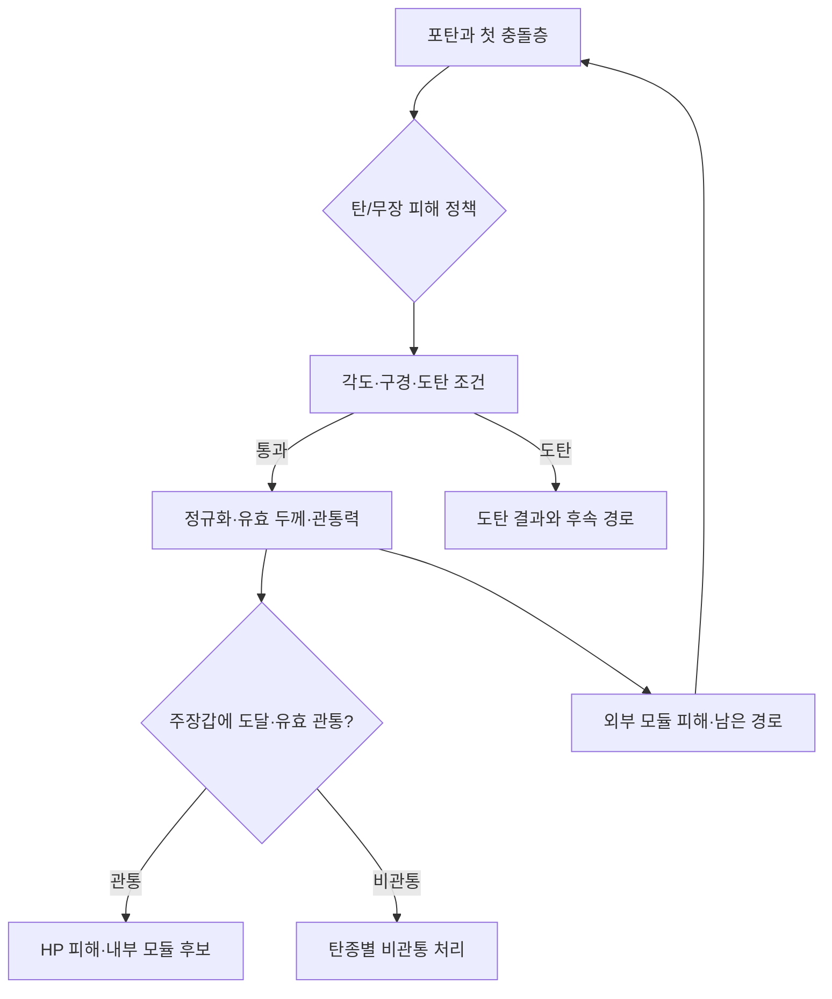

**[제안]** 이 도식은 결과의 논리적 의존성을 표현한다. 원작이 도탄과 정규화를 어느 함수에서 평가하는지, 난수를 언제 뽑는지, 최대 몇 번 충돌하는지는 공개 근거로 확인하지 않았다.

```text
ResolveShellContact(shot, contact):
    policy = RulesFor(shot.shellType, shot.weaponFamily, battleMode)
    layer  = ResolveArmorLayer(contact)
    if policy.ShouldRicochet(shot, layer, contact.angle):
        return policy.ResolveRicochet(shot, contact)
    resistance = policy.EffectiveResistance(layer, contact, shot)
    outcome = policy.ComparePenetration(shot, resistance)
    ApplyExternalModuleEffectsIfAny(outcome)
    if layer.isMainArmor:
        ApplyHullDamage(policy.ResolveHullDamage(outcome))
        ResolveInternalEffects(policy, outcome)
    else:
        ContinueOrStopAccordingToPolicy(shot, outcome)
```

실제 구현에서는 중복 접촉 방지, 파괴 후 상태 갱신, 피해 최소값·최대값, 서버 전투 사건의 순서를 추가해야 한다. 소위 “치명타”는 반드시 HP 피해 배율이라는 뜻이 아니며 모듈 손상 결과일 수 있다.

## 8. 두 가지 판정 사례

### 사례 A: 122 mm 포탄과 40 mm 장갑

**[확인 규칙을 사용한 분석 예시]** 122는 40의 3배인 120보다 크다. 따라서 AP/APCR에 대해 공식 3구경 초과 도탄 방지 조건을 만족한다. 이것은 도탄 조건 하나를 제거한다는 뜻이다. 그 뒤에 주장갑이 있는지, 남은 관통력이 충분한지, 어느 층에 맞았는지까지 해결한 것은 아니다.

정확히 120 mm 대 40 mm의 경계는 공식의 “초과” 표현과 실측을 대조할 대상이다. 121·122·120처럼 경계 주변을 함께 시험해야 자료의 `>`와 `≥` 혼용을 잡아낼 수 있다.

### 사례 B: 고관통 HEAT보다 다른 탄이 유리한 사격선

**[분석 상황]** 적 차체 측면 앞에 궤도·외부 장갑이 있고 그 뒤로 공간이 있다고 하자. 표기 관통력이 높은 HEAT도 선행 접촉과 경로 손실 때문에 기대한 효과를 못 낼 수 있다. 이때는 탄을 바꾸는 선택 외에도 궤도를 피한 주장갑 부위, 다른 각도, 더 가까운 위치를 택하는 선택이 있다.

이 사례의 목적은 특정 탄이 항상 더 좋다는 결론이 아니라, 장갑 레이어와 탄종 규칙이 조준 위치의 가치를 바꾼다는 설명이다. 실제 결과는 전차·탄·거리·입사각 조합으로 검증한다.

## 9. QA·통제 실험

| ID | 시험 | 통제 변수/관찰값 |
|---|---|---|
| ARM-01 | 같은 장갑 부위를 0·30·60°로 공격 | 탄·거리·전차 구성을 고정하고 관통률 측정 |
| ARM-02 | 69.9·70·70.1° 주변 AP/APCR | 내부 경계 처리, 입사각 정의, 도탄 결과 |
| ARM-03 | 84.9·85·85.1° 주변 HEAT | AP 규칙과 분리 여부 |
| ARM-04 | 명목 두께의 3배 전후 구경 | `>`/`≥`와 도탄 면제 이후 관통 조건 |
| ARM-05 | 2구경 전후를 여러 경사에서 비교 | 추가 정규화 후보 검증, 다른 요인 고정 |
| ARM-06 | 외부 장갑·주장갑을 따로 맞힘 | 외부 모듈 피해와 HP 피해 독립 집계 |
| ARM-07 | 일반 HE 주장갑/궤도/주포/지면 명중 | 일반 HE 직접 피해와 미접촉 0피해 |
| ARM-08 | 기관포 HE와 일반 HE를 같은 장갑에 사용 | 무장군별 비관통 피해 예외 |
| ARM-09 | 일반 HE와 SPG HE를 인접 두 표적에 사용 | 다중 목표 피해 정책 분리 |
| ARM-10 | 저HP 목표에 큰 피해 포탄 명중 | 남은 HP 제한, 킬·보조 기여 중복 없음 |
| ARM-11 | 동일 조건 다수 발사 | RNG 범위·분포, 특수능력 영향 분리 |
| ARM-12 | 차고 장갑 검사기와 전투 결과 비교 | 정적인 예측과 동적 명중점 차이 설명 |

**[제안]** 확률 검증은 단발 사례로 결론 내리지 않는다. 반복 횟수와 관통률 신뢰구간을 기록하고, 장갑 검사기와 실전에서 다른 포신·장비·승무원·모드가 적용되지 않았는지 먼저 확인한다.

## 10. 설계 결론

**[분석]** 이 시스템은 적 전차의 HP를 깎는 과정에 공간적 지식을 넣는다. 같은 공격력을 가진 플레이어도 약점을 알고 각도를 바꾸면 다른 성과를 낸다. 성공적인 재구현은 수치를 많이 넣는 것보다 실패 이유를 설명할 수 있는 판정 모델과 피드백에서 시작한다. 비관통·도탄·외부 모듈 명중을 한 종류의 실패로 합치지 않아야 플레이어가 학습할 수 있다.

## 11. 출처

- **C13** [Upgrading Your Vehicles](https://worldoftanks.eu/en/content/guide/newcomers-guide/upgrading_vehicles/) — AP/APCR/HEAT/HE 및 기관포 HE. 04 문서와 동일 출처.
- **C14** [Armor Penetration](https://wargaming.net/support/en/products/wot/article/10220/?lang=en) — 관통 변동·탄도 개요.
- **C15** [How to Survive](https://worldoftanks.eu/en/content/guide/newcomers-guide/how_to_survive/) — 장갑, 도탄, 3구경 초과 규칙.
- **C16** [High-Explosive (HE) Shells](https://wargaming.net/support/en/products/wot/article/15053/) — 일반 HE·외부 장갑·자주포와의 구분.
- **C17** [Release Notes 1.13](https://worldoftanks.eu/en/content/docs/release_notes/release-notes-1-13/) — HE 개편과 판정 피드백.
- **C19** [Release Notes 8.6](https://worldoftanks.eu/hu/content/docs/release_notes/release-notes-86/) — APCR 정규화의 역사 기록. 현행 HEAT 기준으로 사용하지 않음.
- **C20** [Arcade Cabinet: Railgun and Element of Surprise](https://worldoftanks.asia/en/news/general-news/arcade-cabinet-railgun-eos-feb-2025/) — 표준 피해 ±25%와 특별모드 예외를 구분하는 공식 설명.
- **C21** [Changes to Vehicles and SPGs in Update 1.13](https://worldoftanks.eu/en/news/general-news/update-1-13-spg-changes/) — 자주포 탄별 피해·스턴 차이.
- 보조 검증 안내: [Tank Academy: Armour Angling and Side-Scraping](https://worldoftanks.asia/en/content/tank-academy/armour-angling-side-scraping/), [공식 Armor Penetration 영상](https://www.youtube.com/watch?v=RqVfdeGCov4). 영상은 추가 시청용이며 본문에서 확인하지 않은 발언을 인용하지 않았다.


---

<!-- Source document: 06_Modules_Crew_Damage_and_Repair.md -->

# 06. 모듈 손상·승무원 부상·화재·복구

> 기준일: 2026-11-13 KST · Wargaming World of Tanks PC판 · 소형 수리/구급상자를 단일 대상 선택형으로 설명하는 구버전 규칙은 사용하지 않는다.
> [확인] 공식 공개 규칙 · [분석] 설계 의미 · [제안] 재구현·QA · [검증 필요] 정확한 내부 상수. 직접 플레이 또는 원작 코드를 확인한 문서는 아니다.

## 1. HP와 별도의 전투 능력 손실

**[분석]** 전차 HP는 생존 잔량이고, 모듈·승무원 상태는 남은 HP를 얼마나 효과적으로 쓸 수 있는지를 결정한다. HP가 많이 남아도 궤도가 끊겨 측면을 노출하거나 장전수가 부상해 사격 주기를 놓치면 즉시 불리해질 수 있다. 반대로 모듈을 수리한다고 이미 잃은 전차 HP가 회복되는 것은 아니다.

이 계층이 만들어내는 세 가지 효과는 다음과 같다.

1. 적을 격파하지 못한 공격도 이동·사격·정보 능력을 줄이는 기여가 된다.
2. 특정 부위를 노리는 기술과 전차 구조 지식에 가치를 준다.
3. 수리/구급/소화기 사용 시점을 결정하는 전투 중 자원 관리가 생긴다.

모듈은 HP 총량과 별도 상태를 가지며, 승무원 부상은 역할에 따른 성능 저하를 만든다는 점이 공식 설명의 핵심이다. **[확인 C22]**

## 2. 외부와 내부를 나누는 이유

**[확인 C23]** 공식 개인 임무 설명은 궤도·주포·관측장치를 외부 모듈 예시로 들고, 내부 모듈 손상 조건과 구분한다. 단순 손상과 파괴도 서로 다른 조건이다.

| 계층 | 대표 대상 | 주된 결과 | 설계상 별도 기록 이유 |
|---|---|---|---|
| 전차 본체 | 차체 HP | HP 감소·격파 | 보상·생존 판정의 기준 |
| 외부 모듈 | 궤도·바퀴·주포·관측장치 | 기동·명중·정보 제한 | 주장갑 관통 없이도 결과 가능 |
| 내부 모듈 | 엔진·탄약고·연료탱크·포탑 구동부·무전기 | 성능 저하·기능 상실·화재·폭발 | 내부 배치와 진입 방향의 의미 |
| 승무원 | 전차장·포수·조종수·장전수·무전수 | 직책에 따른 성능 저하 | 치료 대상과 피해 기여 구분 |
| 일시 상태 | 스턴·화재·특수능력 디버프 | 시간에 따른 성능/HP 변화 | 모듈 상태와 다른 지속시간·해제 수단 |

표의 설계상 해석은 **[분석]**이다. 실제 전차마다 승무원 수, 겸직, 모듈 배치가 다르며 일부 기능은 여러 하위 부품을 하나의 게임플레이 모듈로 묶어 표현할 수 있다.

## 3. 손상 상태기

**[확인 C22]** 지원 문서는 노란 상태를 손상, 붉은 상태를 기능 불능 수준의 치명 손상으로 설명하고, 승무원의 자동 수리가 모듈을 다시 작동 가능한 손상 상태로 돌린다고 안내한다. 지원 문서의 50% 설명을 모든 모듈의 정확한 임계값·복구 HP로 일반화하지 않는다.

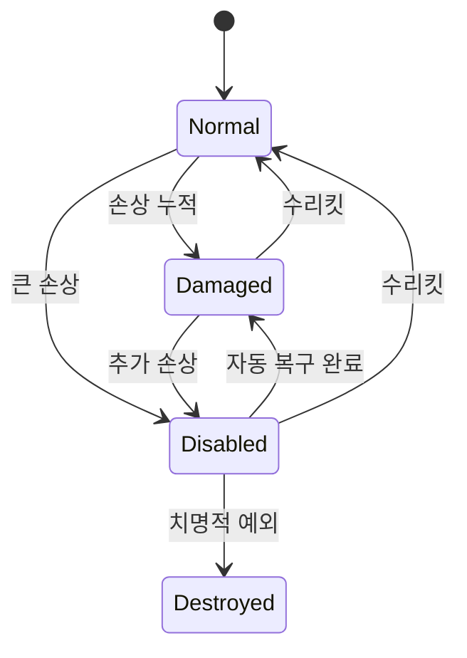

**[제안]** `Normal / Damaged / Disabled`는 기능 상태이고, `currentHP`는 별도 값으로 보관한다. 자동 복구 후 성능 회복과 모듈 내구 회복을 하나의 불리언으로 합치면 “한 번 더 맞으면 다시 끊어지는 궤도” 같은 재손상 위험을 표현하기 어렵다. 장비가 복구 후 현가장치 HP를 바꾸는 경우도 구분한다.

## 4. 부위별 동작 규칙

다음 표는 공식 지원의 기능 방향을 간결하게 정리한 **[확인 C22·C23]**과 재구현 시 필요한 **[분석]**을 함께 표시한다. 정확한 배율·손상 확률은 별도의 데이터다.

| 부위 | 확인된 기능 방향 또는 분류 | 분석·설계상 영향 | 미확인 세부값 |
|---|---|---|---|
| 엔진 | 파괴 시 기동 불가, 화재 가능성 존재 | 화력과 독립적으로 탈출 능력 제거 | 출력 저하 배율, 화재 확률, 재피격 처리 |
| 탄약고 | 손상 시 장전 성능 저하, 완전 파괴 시 폭발 가능 | 상대 사격 주기 예측과 즉사 위험 | 모듈 HP, 보호효과 적용 우선순위 |
| 연료탱크 | 파괴가 화재 원인 | 작은 HP 피해가 지속 손실로 이어질 수 있음 | 화재 틱·지속·연속발화 처리 |
| 포탑 구동부 | 손상 시 회전 저하, 파괴 시 회전 불가 | 차체 회전으로 조준을 보완하는 위험 발생 | 제한포탑·고정포의 예외 |
| 무전기 | 손상 시 신호 범위 저하 | 팀 정보 공유 능력 저하 | 최신 전차별 무전기 피해 예외 |
| 주포 | 외부 모듈로 분류 | 조준 성능과 발사 가능 상태 분리 필요 | 손상/파괴의 정확한 적용값 |
| 관측장치 | 외부 모듈로 분류 | 탐지 능력 저하를 위한 별도 상태 필요 | 감시점·시야 보정·복구값 |
| 궤도·현가장치 | 외부 모듈, 파괴/복구 기록 필요 | 적을 사선에 묶는 지원 가치 | 단측 궤도·차륜·예비 궤도별 조건 |

**[분석]** 위 표를 그대로 “명중한 부위는 항상 손상”이라는 규칙으로 바꾸지 않는다. 시각적인 명중점, 장갑 관통, 내부 경로, 모듈 피해 판정은 서로 다른 단계다. 모듈의 적중 확률·피해량·손상 임계값은 공개 문서만으로 모두 확정하지 못했다.

### 4.1 승무원 역할별 손실

**[확인 C22]** 공식 설명에서 전차장은 관측, 조종수는 이동, 포수는 조준/정확도·회전, 장전수는 장전, 무전수는 신호 성능과 연결된다. 모든 승무원이 부상한 경우 전차는 운용할 수 없는 상태로 간주된다.

**[분석]** 겸직 승무원은 한 명의 부상으로 여러 기능에 영향을 줄 수 있으므로 `crewMemberId`와 `qualificationIds`는 일대일이 아니다. 또한 기본 숙련 체계가 바뀌어도 부상에 의한 전투 성능 제한이라는 구조는 별도로 존재한다. 과거 “주특기 숙련도를 0%로 만든다”는 문장을 현재 UI의 숙련 수치와 직접 동일시하지 말고 실제 유효 성능을 검증한다.

## 5. 화재·탄약고·스턴을 분리

### 5.1 화재

**[확인 C22]** 엔진 손상과 연료탱크 파괴는 서로 다른 화재 경로다. **[분석]** 화재는 1회 피해 사건이 아니라 지속 상태로 보아야 소화기 사용·자동 소화·추가 손상·격파 원인 귀속을 일관되게 처리할 수 있다.

**[제안]** 화재 사건에는 시작 시각, 원인 공격자, 피해 정책, 다음 틱, 종료 조건을 보관한다. 같은 틱에 소화기와 화재 피해가 처리될 때 순서를 고정해야 “소화했는데 추가 틱이 두 번 발생”하는 문제를 막는다. 불이 꺼졌다고 손상된 엔진·연료탱크를 무조건 정상화하지 않는다.

### 5.2 탄약고 폭발

**[확인 C22]** 탄약고 파괴는 전차 전체 파괴로 이어질 수 있다. **[분석]** 남은 전차 HP를 그냥 한 번의 주포 평균 피해로 제한하는 방식과 다르므로 격파 원인에 별도 플래그가 필요하다. 보호 장비·특수능력의 방어/공격 예외가 있다면 치명 결과를 적용하기 전에 우선순위를 결정해야 한다.

**[검증 필요]** “탄약을 모두 사용하면 탄약고가 폭발하지 않는다”와 같은 민간 설명은 이번 공식 본문 확인 범위에서 확정하지 않았다. 해당 조건을 제품 규칙으로 복제하려면 실제 통제 실험이 필요하다.

### 5.3 스턴

**[확인 C24]** 스턴은 일정 시간 동안 여러 성능을 저하시키는 효과이며 구급상자로 제거할 수 있다. **[분석]** 영구적인 승무원 부상과 스턴을 하나의 상태로 합치면 스턴이 끝날 때 부상까지 잘못 회복시키거나, 치료한 뒤에도 중복 패널티가 남는 문제가 생긴다. 두 상태의 합성은 별도 계층이어야 한다.

## 6. 복구 수단과 최신 규칙

### 6.1 자동 수리

**[확인 C22]** 작동 불능 모듈은 시간이 지나면 승무원에 의해 일부 기능이 복구된다. **[분석]** 자동 수리의 목적은 전차를 영구 정지 상태에서 꺼내는 것이고, 전투력을 완전히 초기화하는 것과 다르다. 재피격으로 수리 진행이 어떻게 바뀌는지, 복수 모듈을 병렬 수리하는지, 궤도별 시간이 어떻게 달라지는지는 실측 항목이다.

### 6.2 소모품 — 구식 단일 대상 규칙 폐기

**[확인 C25·C26]** 1.26 이후 소형 수리킷도 모든 손상 모듈을 수리하고, 소형 구급킷도 모든 부상 승무원을 치료한다. 현행 가이드는 재사용 소모품의 기본 대기시간을 일반형 90초, 개량형 60초로 안내한다. 수리킷·구급킷·소화기는 한 전투에서 재사용할 수 있으며, 사용 횟수마다 새 아이템 비용을 반복 지불하는 구조가 아니라 그 전투에서 사용했다면 종료 후 보충 대상이 된다.

| 수단 | 처리 대상 | 사용 판단 — 분석 | 주의 |
|---|---|---|---|
| 소형 수리킷 | 모든 손상 모듈 | 지금 노출을 끊거나 사격 주기를 회복할 필요 | 과거 한 모듈 선택 방식과 혼동 금지 |
| 대형 수리킷 | 모든 손상 모듈 | 짧은 재사용 대기·부가효과의 가치 평가 | 상세 패시브 수치는 장비/소모품 문서 확인 |
| 소형 구급킷 | 부상 승무원·스턴 해제 기능 | 주요 직책 부상이나 즉시 행동 회복 | 다음 피격까지 대기시간 고려 |
| 대형 구급킷 | 부상 승무원·스턴, 부가효과 | 반복 상태이상 대응 | 부상과 스턴 상태 둘 다 검증 |
| 수동/자동 소화기 | 화재 | 지속 HP 손실 차단 | 소화와 모듈 수리를 동일 효과로 취급 금지 |

**[분석]** 대형 소모품의 가치는 “한 번에 여러 개 고침”이라는 옛 설명으로 충분하지 않다. 재사용 속도와 패시브 효과, 전투에서 실제로 두 번째 사용 기회를 얻는 빈도가 핵심 비교 대상이다.

### 6.3 장비·승무원 보정

**[확인 C27]** 공식 장비 설명에는 현가장치 내구와 복구 성능을 개선하는 장비, 탄약고·연료탱크·엔진의 치명 결과를 제한하는 장비가 존재한다. **[분석]** 이를 단순 HP 증가로 통합하면 어떤 피해를 한 번 막았는지와 해당 보호가 소진됐는지를 표시할 수 없다. `preventedCatastrophe`와 같은 전투 중 소모 상태를 별도로 보관하는 편이 명확하다.

## 7. 예비 궤도와 복구의 예외

**[확인 C06]** Yoh 예비 궤도 설명에 따르면 주 궤도만 손상됐을 때는 감속 상태로 계속 이동할 수 있다. 예비 궤도까지 손상된 경우 예비 궤도를 먼저 복구하고 이어서 주 궤도를 복구한다. 움직이는 동안 주 궤도 복구 시간에 불이익이 생길 수 있으며 수리킷은 궤도를 한꺼번에 복구한다.

**[분석]** 이 메커니즘은 수리의 전형적인 “멈춘 채 기다리기”를 “느리게라도 엄폐로 들어가기”로 바꾼다. 따라서 멈춤/이동 상태를 단순하게 파괴 여부에 매핑하면 안 된다. 2.1.1 Ares 계통도 예비 궤도 기능을 사용하므로 국가·병과명으로 하드코딩하지 않고 기능 태그를 활용한다. **[확인 C12]**

## 8. 상황별 복구 의사결정

### 상황 A: 궤도와 탄약고가 동시에 손상

**[제안 상황]** 적 사선에 서 있고 궤도가 끊긴 동시에 탄약고도 손상됐다고 하자. 지금 수리킷을 사용하면 이동과 장전 성능을 함께 회복한다. 소형 수리킷으로 궤도만 고를지 탄약고만 고를지 선택하는 구버전 판단을 현재 규칙에 적용하지 않는다.

**[분석]** 실제 판단은 “지금 사용해야 생존하는가, 곧 더 위험한 재피격을 받을 가능성이 있는가”로 옮겨간다. 아군이 엄호해 주는 동안 자동 수리를 기다려도 된다면 쿨타임을 아낄 수 있고, 집중 사격 중이면 즉시 복구의 가치가 높다.

### 상황 B: 적 재장전 사이 반복 궤도 파괴

**[제안 상황]** 첫 궤도 파괴로 상대가 수리킷을 사용했다. 아군은 상대의 대기시간이 남은 구간에 다시 궤도를 공격해 탈출을 제한하려 한다.

**[분석]** 이때 궤도 손상은 직접 HP 피해가 없더라도 아군 화력 기회를 만든다. 지원 기여는 단순한 “누가 마지막으로 궤도를 맞혔나”가 아니라 실제 이동 불가 상태와 아군 피해 시점의 관계를 다뤄야 한다. 원작의 모든 중복 기여 배분식은 본문에서 확정하지 않으며 보상 문서의 검증 항목과 연결한다.

### 상황 C: 스턴 중 포수 부상

**[제안 상황]** 스턴이 걸린 전차에 포수 부상까지 추가되었다. 구급킷 사용은 해당 해제 대상들을 처리해야 하지만, 장비 보너스·남은 열·주포 자체 손상까지 무조건 초기화하면 안 된다.

**[분석]** 성능 저하를 원인별로 분리하지 않으면 치료 후 조준이 비정상적으로 빠르거나 계속 느린 상태가 될 수 있다. UI에 “포수 부상, 스턴, 주포 손상”을 구분하여 표시할 필요가 있다.

## 9. 데이터와 사건 처리 — 제안

```yaml
ModuleDefinition:
  id: ammo_rack
  category: internal
  hitVolumeId: vehicle_specific
  durability: vehicle_specific
  stateThresholds: configurable
  damagedModifiers: []
  disabledModifiers: []
  autoRepairProfile: configurable
  catastrophicResult: optional
ModuleRuntime:
  hp: current
  state: normal | damaged | disabled
  repairProgress: current
CrewRuntime:
  memberId: unique
  roles: []
  injuryState: active | injured
TemporaryEffect:
  effectId: fire | stun | other
  sourceActorId: optional
  startTime: server_time
  endCondition: configurable
```

```text
OnModuleImpact(hit):
    result = EvaluateModuleDamagePolicy(hit)
    oldState = module.state
    ApplyDurabilityChange(module, result)
    ResolveProtectionBeforeCatastrophe(module, loadout)
    newState = ResolveModuleState(module)
    RebuildAffectedCapabilities(oldState, newState)
    EmitModuleEvent(oldState, newState, hit.source)

OnRepairConsumableActivated():
    ValidateCooldownAndInventoryOnce()
    RepairAllEligibleModules()
    StartCooldown()
    MarkConsumedForPostBattleResupply()
```

**[분석]** 기능을 매번 원본 능력치에서 다시 합성하면 패널티를 중복 곱하거나 수리 후 역연산으로 되돌리는 오차를 줄일 수 있다. 손상/복구/보호발동 사건에는 고유 ID를 두어 리플레이·임무·보상이 같은 사건을 중복 집계하지 않게 한다.

## 10. QA와 계측 계획

| ID | 조건 | 기대 또는 검증할 결과 |
|---|---|---|
| DMG-01 | 외부 모듈만 타격 | HP 감소 없이 모듈 결과가 가능하며 UI가 구분 |
| DMG-02 | 손상·파괴·자동수리 순차 발생 | 작동 가능과 완전 정상 상태를 구분 |
| DMG-03 | 여러 모듈 손상 후 소형 수리킷 | 현행 규칙대로 모든 대상 복구 |
| DMG-04 | 여러 승무원 부상+스턴 후 소형 구급킷 | 부상·스턴 해제를 각각 처리 |
| DMG-05 | 같은 전투 내 소모품 여러 번 사용 | 대기시간과 전투 후 보충 비용의 단위 일치 |
| DMG-06 | 대기시간 종료와 재피격을 같은 프레임에 처리 | 입력·피해·복구 순서가 결정적 |
| DMG-07 | 화재 중 소화기·엔진 수리 각각 사용 | 화재와 모듈 상태를 혼동하지 않음 |
| DMG-08 | 탄약고 보호효과가 있는 상태에서 치명 손상 | 보호 소진과 실제 격파 원인 일치 |
| DMG-09 | 주/예비 궤도 파괴 순서를 바꿈 | 이동 가능성·수리 순서·시간 보정 검증 |
| DMG-10 | 겸직 승무원 부상 | 관련 기능이 함께 바뀌며 중복 적용되지 않음 |
| DMG-11 | 궤도 지원과 정찰 지원이 중첩 | 피해 기여를 모드별 정책대로 중복/배분 처리 |
| DMG-12 | 전차 격파 직전 예약된 자동 복구 완료 | 파괴된 전차가 잘못 다시 활성화되지 않음 |

**[제안 지표]** 기동 불가 누적시간, 수리킷 사용 후 생존시간, 보호 장비 발동률, 모듈별 손상 빈도, 구급킷의 부상/스턴 해제 비중, 수리킷 두 번째 사용 도달률을 수집한다. 수리킷 소지율만으로 상태이상 시스템이 공정한지 판단할 수 없다.

## 11. 설계 해석과 미확인 영역

**[분석]** 모듈 손상은 피해를 단순 숫자에서 “행동의 제한”으로 바꾼다. 공정성을 유지하려면 왜 행동이 안 되는지 즉시 이해할 수 있어야 하고, 복구 후 무엇이 남아 있는지 확인할 수 있어야 한다. 손상 효과가 크지만 피드백이 약하면 사용자는 조작 오류나 서버 문제로 받아들이기 쉽다.

**[검증 필요]** 각 모듈의 비공개 HP, 피격 회피 확률, 내부 탄 이동 거리, 화재 틱 계수, 복구 진행 리셋 조건, 모든 승무원 부상 예외는 이번 문서의 확정 사양이 아니다. 특히 인터넷에서 널리 인용되는 모듈별 27%·33%·45% 같은 수치를 모바일 공식 자료에서 PC판으로 옮기지 않았다.

## 12. 출처

- **C22** [What Happens When a Shell Hits a Vehicle?](https://wargaming.net/support/en/products/wot/article/15762/) — 모듈과 승무원 손상의 공식 개요. 임계값 설명은 단순화된 가이드로 취급.
- **C23** [How Do I Complete Personal Missions?](https://www.wargaming.net/support/en/products/wot/article/15110/?redirect_lang=en) — 내부/외부 모듈, 손상/파괴의 집계 구분.
- **C24** [Stun Mechanic](https://wargaming.net/support/en/products/wot/article/19514/?lang=en&redirect_lang=en) — 스턴·구급킷·지원 피해 개요. 과거 계수 전체를 현행으로 복사하지 않음.
- **C25** [Consumables](https://worldoftanks.eu/en/content/guide/game-mechanics-and-achievements/consumables/) — 현재 소모품·기본 재사용 대기·보충 단위.
- **C26** [Update 1.26: Hailstorm](https://worldoftanks.asia/en/wot-1-26/) — 소형 수리/구급킷의 전체 대상 처리 변경.
- **C27** [How Equipment 2.0 Works](https://wargaming.net/support/en/products/wot/article/33291/?lang=en&redirect_lang=en) — 현가 복구·치명 손상 보호의 기능 예시. 최신 장비 수치는 장비 문서 우선.
- **C06** [American Yoh Tanks Are Here!](https://worldoftanks.eu/uk/news/general-news/brand-new-yoh-tanks/) — 예비 궤도·수리 순서.
- **C12** [Update 2.1.1](https://worldoftanks.eu/en/news/updates/wot-2-1-1/) — Ares 계통의 예비 궤도 사용.


---

<!-- Source document: 07_Artillery_and_Special_Mechanics.md -->

# 07. 자주포·스턴·전차 고유 메커니즘

> 기준일: 2026-11-13 KST · Wargaming World of Tanks PC판 · 공식 자료로 확인 가능한 2.4 관련 고유 기능까지 포함한다.
> [확인] 공식 문서 사실 · [분석] 설계 해석 · [제안] 재구현·실험 · [검증 필요] 수치·예외 미확정. Tier XI의 최초 출시 16대를 현재 전체 전차 수로 취급하지 않는다.

## 1. 시스템 목적

**[분석]** 자주포와 고유 메커니즘은 기본적인 “이동 → 조준 → 발사 → 재장전” 순환에 다른 시간 자원을 추가한다. 자주포는 긴 비행시간과 폭발 반경, 스턴을 사용하고, 고유 전차는 열·추진기·모드·축적 단계·독립 보조 무장을 사용한다. 이들을 모두 단순한 공격력 증가로 표현하면 대응 행동과 위험의 차이가 사라진다.

공통 분석 단위는 다음과 같다.

| 질문 | 필요한 명세 |
|---|---|
| 무엇으로 시작하는가 | 버튼, 명중, 이동 지속, 재장전 시작, 시간 경과 |
| 무엇을 소비하는가 | 탄약, 열 여유, 충전, 주행 자유, 노출 시간 |
| 무엇을 바꾸는가 | 피해·관통·조준·이동·탐지·상대 상태 |
| 언제 끝나는가 | 발사, 시간 만료, 과열, 이동, 취소, 격파 |
| 상대가 어떻게 아는가 | 외형·사운드·마커·발사 간격·능력 표시 |
| 어떤 예외가 있는가 | 미관통/명중만 성공, 보조 무장, 모듈 보호, 특별모드 |

Tier XI 성장·업그레이드 비용은 성장 문서에서 다룬다. 여기서는 전투 중 입력과 결과를 중심으로 정리한다.

## 2. 자주포의 기본 전투 순환

**[확인 C21]** 공식 자주포 설명은 탄마다 탄속과 궤적이 다르고, 포격 모드·궤적 보기 및 예상 비행시간 표시가 존재한다고 안내한다. 탄종을 바꾸면 같은 목표라도 다시 조준할 필요가 있다.

**[분석]** 자주포는 현재 보이는 적을 즉시 때리는 시스템이 아니다. 발사 후 탄착까지 목표의 위치가 바뀔 수 있으므로 “관측 정보의 나이”가 공격 신뢰도에 직접 영향을 준다. 아군이 제공한 탐지, 적의 예상 이동, 지형 가림을 함께 판단해야 한다.

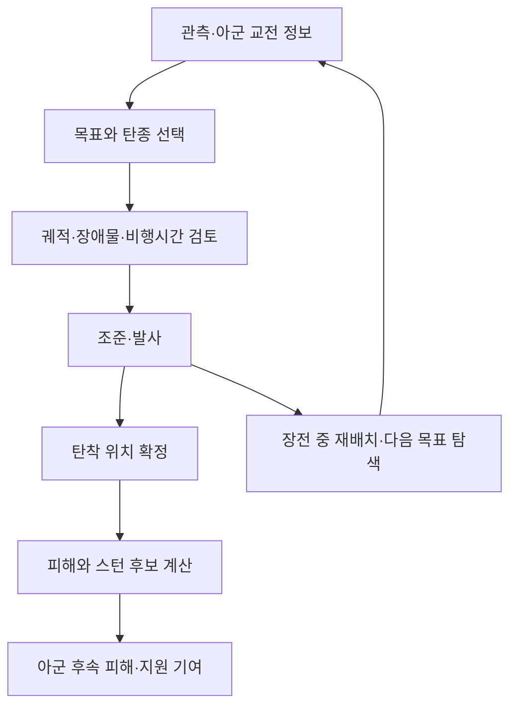

이 도식은 **[제안]** 분석 모델이다. 탄착·시야·피해 계산의 실제 서버 틱 순서를 주장하지 않는다.

### 2.1 기본 규칙과 현재 인원 제한

**[확인 C33]** 2.3 공식 패치 노트는 팀당 자주포 제한을 2대로 변경했다. 구버전의 팀당 3대를 현행 일반 규칙으로 쓰지 않는다. 별도의 이벤트 모드에는 자주포 금지나 다른 편성 조건이 있을 수 있다.

**[분석]** 인원 상한은 단순 대기열 옵션이 아니라 피격자가 얼마 동안 기동·사격 성능을 제한당할 수 있는지에 영향을 준다. 자주포 한 대의 피해량만 맞추고 중첩 노출 시간을 무시하면 체감 공정성을 설명할 수 없다.

## 3. 자주포 탄종의 기능 분리

**[확인 C21·C17]** 1.13은 다수 자주포의 탄을 스턴 HE, 대체 HE, 전술 AP/HEAT의 목적이 다른 선택지로 재구성했다. 모든 저단계 자주포가 동일한 탄 세트를 가진다고 일반화하지 않는다.

| 구분 | 확인된 기능 방향 | 선택 이유 — 분석 | 위험 — 분석 |
|---|---|---|---|
| 스턴 HE | 넓은 폭발 반경·스턴, 상대적으로 낮은 직접 피해·낮은 탄속·높은 궤적 | 아군이 집중 사격할 적 묶음 지원 | 비행 중 적 이탈, 직접 피해만 보면 낮은 성과 |
| 대체 HE | 스턴 없음, 더 작은 반경, 더 큰 피해/관통·더 빠르고 낮은 궤적 | 얇은 장갑이나 직접 피해 기회 | 좁은 범위와 지형 가림 때문에 실효 감소 |
| 전술 AP/HEAT | 스플래시·스턴 없는 단일 표적, 높은 관통·탄속·낮은 궤적 | 잘 맞힐 수 있는 표적에 관통 피해 | 빗나감·도탄·비관통이면 지원 효과까지 잃음 |

**[확인 C21]** 스턴 HE는 주장갑 비관통 시 내부 모듈·승무원 피해가 제한된다. 대체 HE와 동일한 내부 피해 정책을 쓰지 않는다.

**[분석]** “탄속이 빠르면 항상 좋은 자주포 탄”이 아니다. 높은 궤적으로 넘어가던 지형에 낮은 궤적이 막힐 수 있으며, 한 발의 피해량이 큰 탄은 아군이 활용할 스턴 기회를 줄일 수 있다. UI는 탄종의 포구 속도보다 실제 선택 위치까지 도달할 수 있는지와 예상 도착 시각을 보여주는 것이 중요하다.

## 4. 스턴의 상태와 중첩

**[확인 C24]** 스턴은 이동·회전·관측·조준·재장전 등 여러 성능을 일정 시간 저하시킨다. 실제 지속시간은 폭발 위치·받은 피해·보호 효과 등에 영향을 받으며, 복수 스턴을 단순히 모두 더하는 방식으로 설명할 수 없다. 구급킷은 스턴을 해제하는 수단이다.

### 4.1 분리해야 할 세 가지 상태

1. **현재 조작 제한**: 지금 유효한 성능 저하.
2. **각 공격의 효과 기간**: 어느 자주포의 스턴이 언제까지 유효한지.
3. **지원 피해 기여**: 효과 기간 중 아군 피해가 누구에게 귀속되는지.

위 분리는 **[제안]**이다. 성능 패널티 하나로 줄여 저장하면 실제 효과 종료와 기여 기간을 일관되게 처리하기 어렵다. 반대로 모든 효과를 곱하면 중첩 스턴이 과도한 행동 불능 상태를 만들 수 있다.

### 4.2 스턴과 영구 부상

**[분석]** 스턴은 시간이 지나면 끝나지만 승무원 부상은 별도의 치료 상태다. 같은 구급킷이 여러 상태를 해제하더라도 내부에서는 두 종류의 효과를 처리해야 한다. 스턴 해제 때 주포 자체 손상이나 현재 재장전 진행까지 초기화하면 다른 시스템의 규칙을 침범한다.

### 4.3 지원 피해

**[확인 C24]** 스턴 중 다른 아군이 준 피해는 지원 기여로 집계될 수 있으며, 자주포 자신의 직접 피해를 같은 의미의 지원 피해로 이중 계산하지 않는다. 복수 자주포 중첩의 구체 배분 계수는 최신 패치와 실제 결과창을 대조해야 한다.

**[분석]** 원작 재구성에서 필요한 것은 “스턴을 걸었다”는 사건만이 아니다. 각 후속 피해의 시각, 피해를 준 아군, 효과를 건 자주포, 중첩 효과와 해제 사건을 연결할 수 있어야 한다.

## 5. 자주포 대응과 피드백

**[확인 C21]** 1.13의 대응 수단에는 더 잘 보이는 탄 흔적, 미니맵의 포격 정보, Sound Detection과 관련한 경고가 포함된다. 이 기능의 존재와 실제 표적 위치를 완전히 공개하는 것은 다른 문제다.

**[분석]** 피격자에게 필요한 정보는 “위험이 예상되는 방향·시간·범위”다. 자주포의 모든 정확한 좌표를 공개하면 탐지 시스템을 무력화하고, 아무 정보도 주지 않으면 대응 행동이 없다. 전술 경고는 정보 정확도와 행동 시간을 함께 설계해야 한다.

| 피드백 | 플레이어 판단 | 설계 점검 |
|---|---|---|
| 탄착 위험 경고 | 이동 또는 엄폐 선택 | 늦게 표시되어 행동 불가능하지 않은가 |
| 스턴 타이머 | 구급킷 사용·재장전 기다림 | 종료 시각이 서버 결과와 일치하는가 |
| 피해·스턴 지원 수치 | 팀 지원 효과 이해 | 직접 피해와 중복 표기되지 않는가 |
| 탄도 차단 표시 | 목표/탄종 변경 | 작은 장애물·지형 변화에도 갱신되는가 |
| 비행시간 표시 | 이동 표적 예측 | 모드·탄종 변경 후 오래된 값이 남지 않는가 |

## 6. 고유 메커니즘을 분류하는 관점

**[분석]** 개별 전차의 이름을 외우는 방식보다 자원과 입력을 분류하면 새 전차를 추가해도 기본 사양을 재사용할 수 있다.

| 패턴 | 소비·축적하는 자원 | 바뀌는 행동 | 필요한 공통 인터페이스 — 제안 |
|---|---|---|---|
| 모드 전환 | 전환시간·이동 자유 | 정밀 사격/기동 중 선택 | 모드별 수정자·전환 취소 |
| 열 관리 | 발열 여유·냉각 시간 | 연사와 휴식 | 열량·과열 잠금·냉각 조건 |
| 충전 후 발사 | 기다린 시간·충전량 | 큰 한 발과 즉시 사격 | 충전 소비·발사 시 확정 |
| 명중 연계 | 연속 명중·처치 | 공격 성공이 다음 공격 강화 | 결과 이벤트·중첩 수·만료 |
| 추진·주행 보조 | 횟수·연료·입력 지속 | 접근·이탈·선회 개선 | 운동계 수정자·재충전 |
| 독립 보조 무장 | 별도 재사용 대기 | 주포 공백 보완 | 주포와 다른 무장 슬롯 |
| 정보 표식·탐지 | 활성화·명중·위험 노출 | 팀 전체의 발견·집중화력 | 정보 정책·표식 권한·만료 |
| 결과 적응형 탄 | 이전 발 결과 | 관통 실패/성공 뒤 다음 발 변화 | 사격 결과 참조·장전 연계 |

## 7. 기존 고유 무장을 혼동하지 않는 원칙

### 7.1 소련 쌍열과 영국 쌍열

**[확인 C11·C34]** 소련 쌍열은 동시 발사 준비와 발사 후 잠금이 특징인 반면, 영국 Selective Fire Modes는 단발/일제 모드의 성능 조합을 바꾸는 구조다. 영국 일제 모드는 순간 피해와 기동·조준의 교환을 가지며, 소련식 준비·잠금을 그대로 적용할 수 없다.

**[분석]** 외형이 주포 두 개라는 사실은 하나의 무장 로직을 공유할 근거가 아니다. UI는 모드 선택, 발사 준비, 포신별 장전, 잠금의 의미를 각 계통에 맞게 보여야 한다.

### 7.2 자동 재장전과 열 관리

**[확인 C35]** Ares 계통의 기관포는 발열에 따라 정확도가 나빠지고 과열 시 냉각까지 무장이 잠기는 구조로 소개되었다. **[분석]** 탄창식 전차의 “남은 탄 수를 모두 쓰고 숨기”와 열 관리의 “더 쏘면 곧 스스로 잠김”은 유사한 긴장감을 다른 자원으로 만든다. 최근 재조정이 있는 계통이므로 출시 당시 발열·냉각 수치를 현재 상수로 사용하지 않는다.

## 8. Tier XI 대표 메커니즘

표의 “확인된 작동 핵심”은 공식 소개 또는 현행 Tankopedia를 압축한 것이며, 구체 보너스와 시간값은 업그레이드·재조정으로 달라질 수 있다. “검증할 경계”는 **[제안]**이다. 이 표는 전체 전차 목록이 아니라 구현 유형을 넓게 포괄하는 사례집이다.

| 전차·기능 | 확인된 작동 핵심 | 검증할 경계 |
|---|---|---|
| T803 · Semi-Automatic Ammo Rack | 명중 시 일시적 장전 효율 단계 축적, 포탄으로 격파 시 추가 단계 **[C36]** | 관통하지 않은 명중도 인정하는지, 단계 만료와 발사 시각 |
| Taschenratte · Auxiliary Weapons | 주포 외 HE 성격의 보조 무장 **[C28]** | 주포 장전과 독립인지, 별도 탄·기여 처리 |
| KR-1 · Ramming Configuration | 충돌 공격 능력을 강화 **[C28]** | 활성 조건·접촉 피해·이동 제한·보호효과 |
| Object 432U · Thermo-Ballistic Overcharge | 시간을 들여 강화 사격을 준비 **[C29]** | 충전 취소·탄종 변경·피격·발사 때 소비 |
| Strv 107-12 · Pillbox Mode | 기동을 포기해 화력·조준 성능 강화 **[C30]** | 일반 구축 모드와의 전환·기동 명령 충돌 |
| AT-FV230 Breaker · Direct Drive | 전진을 지속하며 기동 보너스 증가 **[C30]** | 제동·후진·접촉·궤도 손상이 누적에 미치는 영향 |
| leKpz Borkenkäfer · Laser Target Designator | 활성화 후 명중 시 적의 발견 상태에 따라 표식 효과 분기 **[C37]** | 명중 시점의 탐지 상태와 효과가 일치하는지 |
| PTZ-78 · Sequential Rocket Thrusters | 좌우 추진기 독립 작동으로 기동 보조 **[C07]** | 좌우 입력·후진·회전의 조합 |
| STK-2 · Active Gun Cooling | 발사 후 재장전 중 냉각하며 정확도 회복 **[C07]** | 장전 완료와 냉각 완료의 시간 분리 |

**[확인 C30·C37]** 공식 소개는 명중 시점의 발견 상태로 효과를 나눈다고 설명한다. Borkenkäfer의 현행 Tankopedia는 발견된 적에게 명중하면 더 오래 드러나고 더 큰 피해를 받게 하는 표식, 발견되지 않은 적에게 명중하면 위치를 별도 표시하는 효과를 구분한다. **[분석]** 따라서 기본 “안 보이는 적을 맞혀도 피드백이 제한된다”는 정보 규칙에 예외가 생긴다. 능력 설명은 정보가 팀 전체에 어떻게 전달되는지까지 명세해야 한다.

### 8.1 2.4에서 추가된 기능 사례

**[확인 C32]** 2.4 공식 릴리즈에는 아래 기능이 명시되어 있다. 짧은 기능 요약 외 세부 전환시간·수치·예외는 검증 대상으로 남긴다.

| 사례 | 작동 핵심 | 분석상 중요한 연결 |
|---|---|---|
| WZ-219 · IRST | 전방 구역을 탐색하며 미발견 적을 찾아내면 자신도 발견되는 위험 | 정보 획득과 자기 위치 공개의 교환 |
| Ho-Ri Shugo · Coaxial Rocket Launcher | 주포와 독립 대기시간을 가진 로켓 보조 무장 | 주포 재장전 공백과 보조 피해의 상호작용 |
| Vz. 63P · Adjustable Fuze Setter | 첫 발 관통 결과에 따라 두 번째 탄이 피해 또는 관통 강화 | 이전 사격 결과를 다음 탄의 입력으로 사용 |
| BV-111 · External Ammunition Feed | 외부 탄 공급 모드로 피해를 늘리는 대신 기동·발사속도 비용 | 모드 전환과 위치 선정의 연결 |
| CAV 71 · Forced Loading Mechanism | 충전을 써 한 발 장전시간을 짧은 고정시간으로 변경 | 탄창 상태·충전 회복·순간화력의 결합 |
| 독일 신규 중전차 계통 · Shell Calibration | 발사 전 모드로 탄 성능을 바꿈 | 탄 자체 정의와 활성 수정자의 분리 |

**[분석]** 이 기능들은 무작위 전투를 단순히 능력치가 더 큰 전차끼리 싸우는 형태로 설명하기 어렵게 만든다. 상대가 다음 발에 어떤 성능을 갖는지 추론해야 하고, 이를 위한 시각·음향 신호가 없으면 학습 비용이 급증한다.

## 9. 상황 분석

### 상황 A: 스턴 피해가 더 낮아도 팀에 좋은 사격

**[제안 상황]** 아군 중전차 여러 대가 적의 돌파를 막고 있으며 적은 좁은 위치에 모여 있다. 스턴 HE로 여러 대를 제한하면 낮은 직접 피해라도 아군이 재장전·회피·집중 공격할 기회를 얻는다. 반대로 아군 사격이 전혀 닿지 않는 적에게 스턴만 걸면 지원 가치가 작다.

**[분석]** 자주포 AI나 튜토리얼이 “가장 많은 적이 모인 곳”만 고르면 부족하다. 아군이 효과 지속시간 안에 공격할 수 있는지, 적이 곧 엄폐하는지까지 포함해야 한다.

### 상황 B: 결과 적응형 두 번째 발

**[제안 상황]** 첫 발이 관통하면 다음 발의 높은 피해를 살려 낮은 HP 표적을 제거하고 싶다. 첫 발이 실패했다면 강화 관통을 같은 장갑에 쓰거나 다른 표적으로 돌릴 수 있다.

**[분석]** 구현에서는 “첫 발 발사 시점”, “서버의 관통 결과 확정 시점”, “두 번째 발 준비 시점”을 분리해야 한다. 비행시간이 긴 상황에서 첫 발 결과가 오기 전에 두 번째 발을 쏠 수 있는지, 효과가 어떤 탄에 붙는지가 중요한 경계다. 원작에 대한 답을 임의로 정하지 않고 Vz. 63P 통제 실험으로 확정한다.

### 상황 C: 탐지 능력을 켤까

**[제안 상황]** 수풀 뒤의 적을 찾을 수 있지만 자기 위치도 공개되는 능력이 준비되어 있다. 아군이 사격할 수 없는 상태라면 발견 이득보다 자신이 피격당할 위험이 클 수 있다. 아군이 조준을 끝냈다면 같은 사용이 돌파의 시작이 된다.

**[분석]** 이런 능력의 효과는 발견한 적 수보다 “자기 손실 대비 팀이 실제로 활용한 정보”로 측정해야 한다. 무조건 준비되자마자 쓰는 자동화는 전략적 선택을 제거한다.

## 10. 공통 상태기와 데이터 — 제안

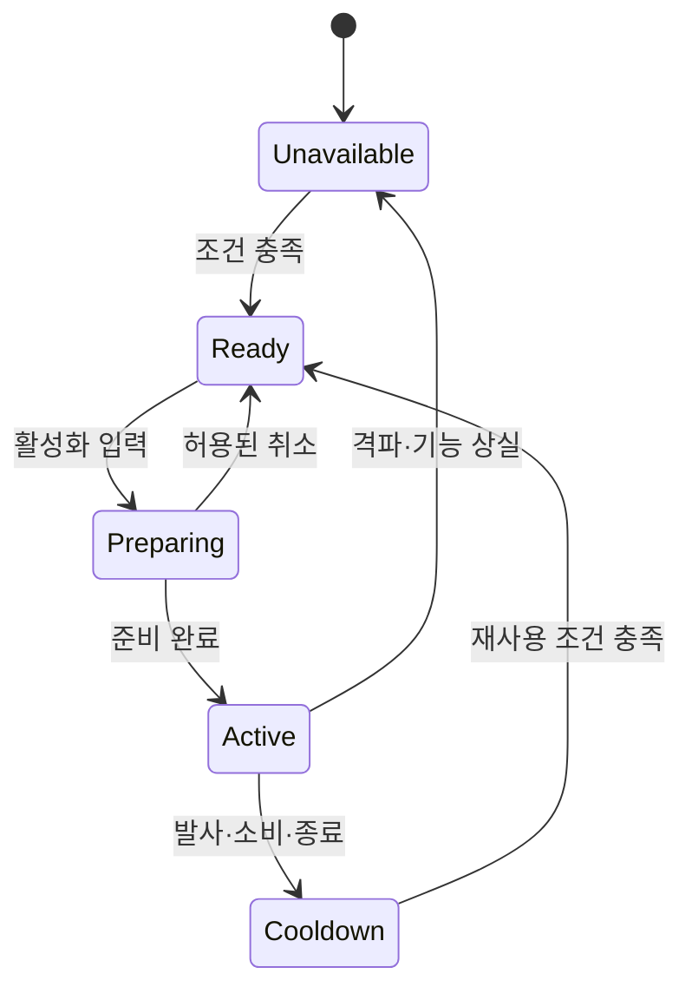

모든 능력에 준비·재사용 상태가 반드시 존재한다는 뜻은 아니다. 수동 버튼 없는 축적형은 이벤트 기반으로 상태를 갱신하고, 독립 보조 무장은 주포와 별도 상태기를 가진다.

```yaml
AbilityDefinition:
  id: vehicle_specific
  trigger: manual | on_hit | on_penetration | while_moving | while_reloading
  resource: charge | heat | stack | cooldown | none
  activationConditions: []
  cancelConditions: []
  modifierTargets: []
  consumePolicy: on_activation | on_fire | on_hit | over_time
  visibilityPolicy: owner | allies | spotted_enemies | public
  stackingPolicy: replace | refresh | accumulate | strongest
  battleModeOverrides: {}
AbilityRuntime:
  state: ready
  resourceValue: current
  effectEndTime: optional
  sourceShotId: optional
  affectedTargets: []
```

**[분석]** 수치 수정과 상태 전환을 분리하면 일시 효과가 끝났을 때 원본 제원을 다시 계산하기 쉽다. 단순한 “최종 공격력에 +25%를 더했다가 빼기”는 장비·승무원·다른 효과가 중간에 바뀌었을 때 오차가 생긴다.

## 11. QA와 밸런스 측정

| ID | 시험 | 확인할 결과 |
|---|---|---|
| SPC-01 | 자주포 동일 목표에 탄 세 종류 사용 | 도달 가능성·탄속·범위·스턴 정책을 별도 확인 |
| SPC-02 | 스턴 상태에서 두 번째 스턴·구급킷 | 지속시간·성능·지원 기여를 일관되게 갱신 |
| SPC-03 | 스턴 HE 비관통과 대체 HE 비관통 | 내부 모듈·승무원 정책을 혼용하지 않음 |
| SPC-04 | 자주포 발사 직후 목표 탐지 소실 | 이미 발사한 포탄과 관측 상태가 독립적 |
| SPC-05 | 소련·영국 쌍열 동시발사 비교 | 준비·잠금·모드 전환의 차이 유지 |
| SPC-06 | 기관포 발열 임계 직전 연사 중단 | 냉각 시작·과열 잠금·정확도 회복 조건 |
| SPC-07 | 명중 축적 능력으로 도탄/비관통/격파 | 효과를 유발하는 사건의 정확한 범위 |
| SPC-08 | 주포와 보조 무장 동시 입력 | 재사용 시간·탄약·피해 ID 충돌 없음 |
| SPC-09 | 충전 중 장전완료·피격·탄종변경 | 충전 소비/취소 규칙 일관 |
| SPC-10 | 탐지 표식 탄 발사 후 탐지 상태 변경 | 효과 분기 기준 시점 확정 |
| SPC-11 | 첫 발 결과보다 두 번째 발이 먼저 준비됨 | 적응형 탄의 이벤트 순서·지연 처리 |
| SPC-12 | 특수능력 활성 중 모드 전환·격파 | 수정자 잔존·유령 피해·충전 복제 없음 |

**[제안 지표]** 자주포 피격자의 행동 제한 시간/분, 스턴 후 실제 아군 피해 비율, 구급킷 강제 사용률, 능력 미사용률, 능력 종료 직후 격파율, 특수모드별 손익을 수집한다. 전차 승률 하나로 능력의 이해 가능성과 대응 가능성을 판단하지 않는다.

## 12. 출처와 해석 한계

- **C17** [Release Notes 1.13](https://worldoftanks.eu/en/content/docs/release_notes/release-notes-1-13/) — 자주포 탄 개편의 확정 릴리즈.
- **C21** [Changes to Vehicles and SPGs in Update 1.13](https://worldoftanks.eu/en/news/general-news/update-1-13-spg-changes/) — 탄도·스턴·대응 수단.
- **C24** [Stun Mechanic](https://wargaming.net/support/en/products/wot/article/19514/?lang=en&redirect_lang=en) — 스턴 상태·지원 기여. 상세 계수는 현행 재검증 대상으로 둠.
- **C33** [Release Notes 2.3](https://worldoftanks.eu/en/content/docs/release_notes/release-notes-2-3/) — 팀당 자주포 2대.
- **C11** [Colossal Double-Barreled Heavies Are Coming!](https://worldoftanks.eu/en/news/general-news/1-7-1-double-barreled/) — 소련 쌍열.
- **C34** [Meet the Twin-Barreled British Heavies!](https://worldoftanks.eu/en/news/general-news/1-27-1-british-heavy-tanks/) — 영국 쌍열의 별도 설계.
- **C35** [Fresh Steel: New Tier XI Tanks, U.S. Line, and Tier XI Rebalancing](https://worldoftanks.eu/en/news/general-news/update-2-1-1-tanks-overview/) — Ares 계통의 열 관리 설계.
- **C28** [Tier XI Heavy Tanks](https://worldoftanks.eu/en/news/general-news/update-2-0-tier-11-heavy-tanks/) — 보조 무장·충돌 강화 등 도입 구조.
- **C29** [Tier XI Medium Tanks](https://worldoftanks.eu/en/news/general-news/update-2-0-tier-11-medium-tanks/) — 충전형 사격 사례.
- **C30** [Tier XI TDs and LT](https://worldoftanks.eu/en/news/general-news/update-2-0-tier-11-tank-destroyers-light-tanks/) — 고정 모드·전진 강화 사례.
- **C36** [T803 Tankopedia](https://worldoftanks.eu/en/tankopedia/69153-A182_T803/) — 명중/격파에 따른 장전 효율.
- **C37** [leKpz Borkenkäfer Tankopedia](https://worldoftanks.eu/en/tankopedia/41233-G188_LeKpz_Borkenkafer/) — 명중 대상의 발견 상태별 표식.
- **C07** [Release Notes 2.1.1](https://worldoftanks.eu/en/content/docs/release_notes/release-notes-2-1-1/) — PTZ-78·STK-2.
- **C32** [Release Notes 2.4](https://worldoftanks.eu/en/content/docs/release_notes/release-notes-2-4/) — 2026 신규 특수 메커니즘.

**[검증 필요]** 각 전차의 현재 최대 보너스, 충전시간·횟수·냉각률, 업그레이드별 변화, 모든 보호효과와의 우선순위는 이 사례집의 확정 수치 목록이 아니다. 출시 소개는 동작 유형을 확인하는 데 사용했고, 나중 패치로 바뀔 수 있는 수치는 대부분 생략했다. 원작을 복제하려면 전차·포·탄·업그레이드 구성과 모드·서버 버전을 함께 기록해 재검증해야 한다.


---

<!-- Source document: 08_Spotting_Concealment_and_Radio.md -->

# 08. 시야·탐지·위장·무전 역기획

> 대상: Wargaming **World of Tanks PC**, 일반 무작위 전투를 기본값으로 사용. 작성 기준일: **2026-11-13 KST**. 공개 자료에서 2.4.1까지 확인했다. `[확인]`은 공식 문서가 설명한 규칙, `[분석]`은 규칙의 설계적 해석, `[제안]`은 재구현용 모델, `[검증 필요]`는 공개 자료만으로 확정하지 못한 부분이다. 게임 클라이언트 실험이나 서버 코드 열람 결과가 아니다.

관련 문서: [지도와 파괴](09_Maps_Terrain_and_Destruction.md) · [매칭과 소대](10_Matchmaking_and_Platoons.md) · [조작·HUD](11_Controls_HUD_and_Garage_UX.md) · [승무원](14_Crew_and_Perks.md)

## 1. 시스템의 역할

[분석] 월드 오브 탱크의 시야 시스템은 적의 존재를 화면에서 숨기는 장치이면서, 정찰·원거리 화력·기동을 연결하는 협동 시스템이다. 정찰 차량은 자신이 직접 피해를 주지 않아도 다른 차량에 공격 기회를 제공한다. 장거리 포격 차량은 자기 시야가 부족해도 정찰자의 정보를 받아 화력을 행사한다. 적을 발견했다는 사실과 적을 공격할 수 있다는 사실은 별도이다.

이 구조는 다음 네 가지 질문을 분리한다.

| 질문 | 담당 판단 | 설계상 결과 |
|---|---|---|
| 적이 탐지되었는가? | 관측자 시야·대상 위장·지형·특수 탐지 | 차량별 정찰 능력의 차이 |
| 그 정보를 내가 받는가? | 아군의 탐지 정보와 무전 공유 | 정찰과 원거리 지원의 연결 |
| 내 전투 화면에 모델을 표시하는가? | 정보 보유 여부와 표시 거리 | 미니맵 정보와 3D 화면의 차이 |
| 해당 위치를 사격할 수 있는가? | 포 사거리·발사선·탄도·장애물 | 탐지 상태와 탄환 충돌 판정의 분리 |

[제안] 구현에서는 `WorldExistence`, `Detection`, `Knowledge`, `Presentation`을 같은 불리언으로 합치지 않는다. 차량이 미탐지로 전환되어도 물리 월드에서 제거해서는 안 된다. 반대로 화면에 표시할 필요가 없다고 해서 미니맵 정보까지 삭제해서도 안 된다.

## 2. 공식 규칙의 기준값

[확인] 일반전 안내에서 근접 탐지는 50m, 자력 탐지의 상한은 445m, 차량 표시 거리는 565m이다. 시야 수치가 445m를 넘으면 탐지 상한이 늘어나는 대신 그 안에서 적 위장에 대응하는 데 도움이 된다. 공유 가능한 아군의 탐지 정보는 3D 표시 거리 밖에서도 미니맵에 나타날 수 있다. [V01]

| 구분 | 일반전 기준 | 혼동하면 생기는 오류 |
|---|---:|---|
| 근접 탐지 | 50m | 건물 뒤 차량이 가까워져 드러나는 현상을 버그로 판단 |
| 차량 시야 능력 | 차량·장비·승무원에 따른 값 | Garage 수치가 곧 실제 발견 거리라고 판단 |
| 자력 탐지 상한 | 445m | 시야 500m이면 500m에서 자력 발견한다고 판단 |
| 3D 표시 거리 | 565m | 지도에 표시된 모든 적을 화면에서 볼 수 있다고 판단 |
| 무전 공유 | 송수신 조건에 따른 정보 전달 | 내 눈으로 발견한 적과 아군이 발견한 적을 동일시 |

이 표의 값은 **일반전 규칙의 문서 기준**이다. 맵 크기, 포탄 사거리, 자주포 조준 화면, 이벤트 모드의 시야 규칙을 뜻하지 않는다.

[확인] 2.4 Onslaught의 특정 야간 맵은 최대 시야 315m, 표시 거리 445m, 정지·이동 위장 +15% 규칙을 별도로 사용한다. 같은 업데이트의 WZ-219는 IRST 탐지 기능을 도입했으며, 미탐지 적을 드러내면 사용 차량도 즉시 탐지된다. 일반전 기본 시야와 특수 능력은 구분해야 한다. [V05]

## 3. 입력·상태·출력

[제안] 아래는 공식 서버 구조를 주장하지 않는 재구성 명세이다.

| 영역 | 필요한 데이터 | 갱신 계기 |
|---|---|---|
| 관측자 | 차량 시야, 관측 장치 상태, 승무원/장비 효과 | 장착 변경, 피해, 상태 효과 |
| 피관측자 | 정지·이동·발포 위장, 차체 자세, 탐지 표본점 | 이동, 발포, 수풀 진입 |
| 환경 | 지형 차폐, 건물 차폐, 식생, 파괴 후 상태 | 위치 변경, 파괴 이벤트 |
| 통신 | 아군 공유 가능 여부, 무전 관련 상태 | 거리 변화, 장치 손상 |
| 탐지 관계 | 관측자, 대상, 최초·최근 발견 시각 | 탐지 성공·갱신 |
| 플레이어 지식 | 현재 발견, 마지막 확인 위치, 정보 출처 | 탐지 공유, 유지 시간 만료 |
| 표시 | 모델, 윤곽, 미니맵, 피탐 알림 | 지식 변경, 표시 거리 통과 |

출력은 `EnemySpotted`, `EnemyKnowledgeUpdated`, `EnemyLost`, `SixthSenseAlert`처럼 나누는 편이 추적하기 쉽다. 동일 차량이 세 명에게 탐지되면 마지막 관측자 한 명이 시야를 잃었다고 전체 팀 정보가 사라져서는 안 된다.

## 4. 위장과 식생

[확인] 공식 생존 가이드는 수풀·쓰러진 나무를 위장 요소로 설명한다. 포신이 수풀 밖으로 나오는 것은 예외이나 차량의 주요 부분이 가려져야 한다. 수풀과 15m 이내에서는 그 너머를 볼 수 있고, 발포는 차량 위장과 주변 15m 식생의 위장 효과에 불리하게 작용한다. 정지 중 포탑·포 회전은 위장에 영향을 주지 않으며, Tier V 이상 경전차는 이동·정지 위장값을 유지한다. [V02]

### 4.1 행동에 따른 선택 비용

[분석] 동일 수풀에 있는 두 차량도 다음 행동 선택에 따라 제공하는 가치가 달라진다.

| 행동 | 얻는 가치 | 발생하는 비용 | 플레이어가 확인할 것 |
|---|---|---|---|
| 수풀 안에서 정지 관측 | 적 이동 정보 유지 | 자기 화력 사용을 보류할 가능성 | 아군이 실제 사격 가능한 위치인가 |
| 수풀 뒤로 물러나 발포 | 식생을 사이에 둔 공격 기회 | 자신이 제공하던 직접 관측이 끊길 수 있음 | 다른 아군이 계속 관측하는가 |
| 능선을 넘는 능동 정찰 | 짧은 시간 넓은 구역 확인 | 노출·전복·궤도 파괴 위험 | 복귀 경로가 엄폐되는가 |
| 첫 발견 직후 사격 | 즉시 피해 기회 | 적에게 위치를 노출할 가능성 | 피해 기대값이 정보 가치보다 높은가 |
| 같은 수풀에서 반복 사격 | 계속 화력 지원 | 적의 예상 사격에 취약 | 마지막 노출 이후 이동했는가 |

[제안] `VehicleCamo`와 `FoliageCamo`를 따로 저장한다. 발포했다고 맵 전체 식생의 위장 효과를 무효화하거나, 차량 위장이 높다고 지형 차폐를 무시하게 만들면 안 된다. 여러 수풀의 합산, 최대 위장값, 발포 후 회복 곡선은 각각 별도 정책으로 둔다.

### 4.2 교육용 탐지 거리 모델

[제안] 위장과 시야의 상호작용을 설명하기 위한 간이 모델은 다음처럼 둘 수 있다. **실제 2.4.1 서버 식을 검증한 결과가 아니다.**

```text
D_model = clamp(V - (V - R_proximity) × C, R_proximity, R_max)
V = 보정된 관측자 시야
C = 이 설명용 모델의 유효 위장 계수(0~1)
R_proximity = 50m, R_max = 445m  // 일반전 기준 예시
```

예시로 `V=450m, C=0.20`이면 모델상의 거리는 `370m`이고, `V=500m`라면 `410m`이다. 두 값 모두 최대 탐지 거리보다 작다. 따라서 표시된 시야 능력이 상한을 넘는 것과 상한 밖의 적을 발견하는 것은 다른 문제임을 설명할 수 있다. 실제 장비·특전·식생·발포의 중첩 순서와 계수는 공개된 기본 가이드만으로 확정하지 않는다.

## 5. 탐지부터 HUD까지의 흐름

[제안] 다음은 의존 관계를 보여 주는 설계 흐름이다. 실제 서버의 검사 순서, 체크 주기, 레이 개수를 복원한 다이어그램이 아니다.

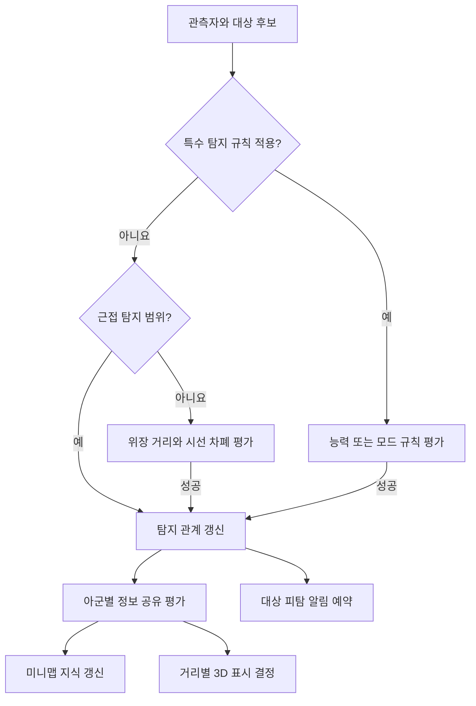

[분석] 탐지와 알림이 분리되어야 “알림이 켜지기 전에 피격되었다”는 경험을 설명할 수 있다. 알림은 적이 내 정보를 획득한 시점을 사후에 전달한다. 이 시스템이 허용하는 정보 비대칭 때문에 정찰자는 보이는 적만 계산해서 움직이면 늦는다.

[확인] 공식 Tank Coach는 Sixth Sense 기본 알림을 피탐 후 3초로 설명한다. Sixth Sense는 1.18.1부터 모든 전차장의 기본 기능이다. 현재 승무원 가이드가 특전 100% 훈련 기준으로 제시한 수치는 Signal Interception의 알림 지연 0.75초 감소와 Jamming의 피탐 유지 시간 1초 감소다. [V03][V04][V07]

[분석] 실제 적용값은 승무원 효율과 관련 수정자의 영향을 받을 수 있으므로 표의 수치를 고정된 최종값으로 취급하지 않는다. 학습 수준·직책 평균·효율의 차이는 [14번](14_Crew_and_Perks.md)을 참조한다.

### 5.1 시간축 설계

| 시간 상태 | 플레이어에게 보이는 정보 | 검증할 핵심 |
|---|---|---|
| 아직 탐지되지 않음 | 경고 없음 | 경고 없음이 안전을 보증하지 않음 |
| 적이 탐지했으나 경고 전 | 상대는 공격 준비 가능 | 서버 탐지와 클라이언트 알림의 시간 분리 |
| 경고 표시 | 현재 또는 최근 피탐 사실 | 어떤 적에게 들켰는지까지 알려 주는지 구분 |
| 엄폐 후 탐지 유지 | 상대가 계속 표시를 볼 수 있음 | 유지 시간을 단일 상수로 가정하지 않음 |
| 정보 소멸 후 | 마지막 위치만 참고 가능 | 예측 위치를 확정 정보처럼 표시하지 않음 |

[검증 필요] 기본 피탐 유지 시간, 특전 중첩, 최초 탐지와 재탐지의 갱신 방식, 서버 검사 주기와 지연 분포는 동일 버전 훈련방 실험 대상으로 남긴다. Blitz 문서에서 찾을 수 있는 검사 주기나 체크포인트 수를 PC 규칙으로 옮기지 않는다.

## 6. 무전과 팀 정보

[확인] 무전은 아군이 발견한 차량의 위치 정보 공유에 관여한다. 정보를 받는 차량의 표시 거리 밖에 있는 적도 미니맵으로 전달될 수 있다. [V01]

[분석] 정찰의 실질 가치는 `발견한 적 수`만으로 평가하기 어렵다. 적이 탐지된 시각에 아군의 포가 준비되어 있는지, 포신이 다른 방향인지, 발사선이 벽에 막혔는지, 자신의 위치와 적 사이가 너무 가까워 안전하게 대응할 수 없는지가 전부 중요하다.

[제안] 어시스트 분석에는 탐지 사건과 사격 기회 사건을 구분해 저장한다.

```text
SpotContribution {
    observerId, targetId, firstSeenAt, lastRefreshAt,
    detectionReason, shareRecipients,
    sourceRuleVersion
}
ShotOpportunity {
    shooterId, targetId, knownThroughObserver,
    gunReady, estimatedFireLineClear, observedAt
}
```

이 모델이면 정찰이 성공했지만 아군 지원이 불가능했던 장면과, 지원이 가능했으나 화력을 사용하지 않은 장면을 나누어 볼 수 있다. 공식 보상 계산식을 그대로 뜻하지는 않는다.

[검증 필요] 무전 거리를 합산하는 구체식, 여러 아군을 거치는 중계 여부, 무전 장치 손상과 정보 소멸의 정확한 순서는 별도 조사해야 한다. “아군 한 명이 보면 전원이 거리와 무관하게 항상 안다”라는 구현은 피한다.

## 7. 대표 상황 분석

### 상황 A: 아군이 본 적이 500m에 있다

[제안 사례] 자신의 시야 능력은 400m이고, 적은 자신과 500m 떨어져 있다. 전방 아군이 적을 발견하고 무전 공유 조건도 충족한다.

- 자력 발견 여부와 공유 정보 수신 여부를 따로 계산한다.
- 일반전 표시 거리 안이므로 표시 자격이 생길 수 있지만, 실제 지형 차폐와 조준 화면 조건까지 별도로 확인한다.
- 적이 자기 탐지 범위 밖에 있다는 이유로 사격 명령을 차단하지 않는다.
- 정찰 아군이 사라지면 즉시 적의 물리 실체를 삭제하지 말고 탐지 유지 정책을 따른다.

이 장면은 정찰을 기동·화력에 연결하는 핵심 협동이다. 표시된 적만을 공격 대상으로 사용하는 AI와 실제 탄환 물리 시스템을 같은 규칙으로 묶지 않도록 주의한다.

### 상황 B: 수풀 안 경전차의 첫 발

[제안 사례] 경전차는 수풀 뒤에서 적 두 대를 관측하고 있으며 아군 구축전차가 재장전 중이다. 지금 발포하면 적 하나를 손상시킬 수 있지만 정찰 위치를 잃을 가능성이 있다.

정찰자는 현재 한 발의 기대 피해, 자기 생존 확률, 아군 재장전 완료까지의 시간, 반대편 정찰자의 존재를 비교한다. 발포를 보류한 행동은 소극적인 플레이가 아니라 미래 공격 기회를 보존하는 선택일 수 있다. 역기획의 목표는 “정찰은 무조건 쏘지 않는다”는 공식을 만드는 것이 아니라, 발포의 기회비용을 설계 변수로 표현하는 것이다.

### 상황 C: 능력 탐지의 대가

[분석] IRST처럼 발견에 자기 노출이 연결된 능력은 정보 획득을 무료 이득으로 만들지 않는다. 적을 한 번 드러내는 가치와 자기 위치를 알려 주는 비용이 교환된다. 재구현 시 능력의 탐지 반경뿐 아니라 사용자의 정보 노출, 취소 지연, 재사용 대기시간, 능력 표시를 함께 정의해야 한다.

## 8. 재현 시험과 QA

다음은 실제 시험 결과가 아니라 **검증 계획**이다. 계측 시 클라이언트 영상 외에 가능하면 서버 사건 시각을 함께 기록한다.

| ID | 시험 조건 | 기대 확인 항목 |
|---|---|---|
| VIS-01 | 벽 양쪽에서 50m 경계 왕복 | 근접 탐지와 벽 차폐의 관계, 거리 기준점 |
| VIS-02 | 시야 장비 유무를 바꿔 445m 이상 표적 관측 | 시야 상한과 위장 대응 능력의 분리 |
| VIS-03 | 공유 적을 565m 안팎에서 관찰 | 3D 모델과 미니맵 정보의 분리 |
| VIS-04 | 같은 수풀에서 14.9m·15.1m 위치 발포 | 식생 기준점·경계 오차·발포 페널티 |
| VIS-05 | 정지·차체 회전·포탑 회전을 분리 | 위장 변화와 조준 분산 변화의 혼동 방지 |
| VIS-06 | 기본 전차장과 Signal Interception 비교 | 기본 경고와 보정 경고의 상대 지연 |
| VIS-07 | 두 아군 중 한 명만 관측을 잃음 | 다중 관측자 정보의 유지 |
| VIS-08 | Jamming 유무·재발견 시각을 교차 | 피탐 유지의 갱신 및 중첩 |
| VIS-09 | WZ-219로 이미 보이는 적/안 보이는 적 탐지 | 자기 노출 조건과 특수능력 예외 |
| VIS-10 | 일반 맵과 Onslaught 야간 맵 비교 | 모드별 시야 프로파일의 격리 |
| VIS-11 | 그래픽 식생 옵션만 변경 | 렌더 품질 변경이 탐지 판정을 바꾸지 않는지 |
| VIS-12 | 관측자 끊김·재접속·관전자 전환 | 지식 캐시 정리 및 과도한 정보 노출 방지 |

## 9. 설계 결론과 남은 불확실성

[분석] 좋은 정찰 시스템은 높은 시야값만으로 우위를 만들지 않는다. 자신의 정보를 보존하며 타인의 정보를 획득하는 위치 선정, 그 정보를 공격으로 바꾸는 아군 배치, 들킨 뒤 살아서 돌아오는 경로가 함께 중요하다. 반면 수풀·경고 지연·표시 거리의 원인을 UI가 설명하지 못하면 학습 가능한 전술이 불합리한 판정처럼 보인다.

[제안] 개발 도구에는 차량 간 `발견 실패 원인`을 표시하는 디버그 모드를 둔다. 원인은 `거리`, `지형 차폐`, `위장`, `공유 불가`, `표시 거리`, `모드 규칙`으로 나누고, 실제 플레이 UI에는 허용된 정보만 전달한다. 서버 성능 최적화는 이 의미적 구분을 유지한 상태에서 후보 검색·갱신 빈도·이벤트 갱신으로 수행한다.

## 10. 출처

모든 URL 확인 기준: 2026-11-13. 공개 페이지가 갱신되면 본문의 버전 표기와 함께 다시 확인해야 한다.

- **[V01]** Wargaming Player Support, [About: Spotting and Concealment](https://www.wargaming.net/support/en/products/wot/article/10222/?redirect_lang=en). 일반전 거리·무전·표시 구분. 작성일 미표시.
- **[V02]** World of Tanks, [How to Survive](https://worldoftanks.eu/en/content/guide/newcomers-guide/how_to_survive/). 식생·15m·차량 행동과 위장. 상시 갱신 가이드.
- **[V03]** World of Tanks, [Tank Coach: Spotting and View Range](https://worldoftanks.eu/en/content/guide/tank-coach-video-guides/tank-coach-spotting/). Sixth Sense 기본 지연 설명.
- **[V04]** World of Tanks, [Crew Training](https://worldoftanks.eu/en/content/guide/game-mechanics-and-achievements/crew-training/). Signal Interception·Jamming. 상시 갱신 가이드.
- **[V05]** World of Tanks, [Release Notes 2.4](https://worldoftanks.eu/en/content/docs/release_notes/release-notes-2-4/). 2026-09 업데이트: Onslaught 야간 규칙·WZ-219 IRST.
- **[V06]** World of Tanks, [Tank Coach: Light Tank Essentials](https://worldoftanks.eu/en/content/guide/tank-coach-video-guides/tank-coach-light-tanks/). 능동·수동 정찰의 공식 교육 범위.
- **[V07]** World of Tanks, [Sixth Sense: A Special Commander Feature](https://worldoftanks.eu/en/news/general-news/1-18-1-sixth-sense-perk/). 1.18.1부터 전차장 기본 기능화. 과거 도입 자료이며 현 승무원 가이드로 지속 여부를 교차 확인.


---

<!-- Source document: 09_Maps_Terrain_and_Destruction.md -->

# 09. 지도·지형·엄폐·파괴·전술 공간 역기획

> 대상: Wargaming World of Tanks PC. 기준일: **2026-11-13 KST**, 공개 자료상 **2.4.1** 지도 변경까지 반영. `[확인]` 공식 자료, `[분석]` 설계적 해석, `[제안]` 재구현 구조, `[검증 필요]` 미확정 항목. 지도 좌표별 실플레이 공략집이 아니라 전술 공간을 만드는 규칙과 제작·검증 방법을 분석한다.

관련 문서: [차량과 기동](03_Vehicle_Classes_and_Mobility.md) · [장갑·관통](05_Armor_Penetration_and_Damage.md) · [시야·위장](08_Spotting_Concealment_and_Radio.md) · [매칭](10_Matchmaking_and_Platoons.md)

## 1. 지도의 설계 역할

[분석] 지도는 차량 성능이 실제 전투 효율로 변환되는 조건을 만든다. 포탑 장갑이 두꺼워도 차체를 감출 높낮이가 없으면 장점을 쓰기 어렵고, 빠른 차량도 우회로가 없으면 기동력을 화력으로 전환하기 어렵다. 시야가 긴 차량도 수풀·경사·건물의 배치에 따라 정보 우위를 확보하는 시간이 달라진다.

따라서 지도 역기획의 기본 단위는 예쁜 지형 하나가 아니라 **이동·탐지·사격·퇴각의 연결 관계**이다.

| 공간의 기능 | 필요한 조건 | 그 조건을 활용하는 행동 | 실패 시 나타나는 문제 |
|---|---|---|---|
| 초기 정찰 | 안전한 접근과 관측 가능한 영역 | 적 배치 확인 | 먼저 도착한 팀의 일방적 정보 독점 |
| 근거리 교전 | 견고한 엄폐, 측면 진입의 제한 | 장갑·재장전 교환 | 두꺼운 전면 장갑만 지배 |
| 중거리 지원 | 아군 전선과 연결된 발사선 | 교차사격·견제 | 전선과 무관한 후방 저격 |
| 우회 | 시간과 위험을 감수하는 대체 경로 | 측후방 공격 | 기동 차량의 역할 소멸 |
| 퇴각 | 전진 경로와 다른 탈출 선택 | 피해 교환 후 생존 | 첫 진입이 사실상 확정 사망 |
| 기지 압박 | 전선 붕괴와 연결되는 접근로 | 승리 조건 전환 | 킬 경쟁과 승리 조건의 단절 |

## 2. 공식 자료에서 확인한 지도 변화

[확인] 2.4.1은 Nebelburg를 일반 무작위 전투에 맞게 재구성하며 크기를 1,400×1,400m에서 1,000×1,000m로 줄였다. Himmelsdorf·Ruinberg·Siegfried Line·Fisherman's Bay·Overlord도 조정했다. 예를 들어 Himmelsdorf는 남쪽 팀의 대응 위치, Ruinberg는 발사선, Siegfried Line은 지형과 벽의 개구부를 다듬었다. [M01]

[분석] 이런 변경은 지도 밸런스를 “양쪽 지형이 거울처럼 같은가”로만 평가하지 않음을 보여 준다. 각 팀이 비슷한 시간과 위험으로 대응 위치를 점유할 수 있는가, 한 차종의 강점이 다른 차종의 일방적 무력화를 초래하는가가 더 유용한 평가 기준이다.

과거 지도 공략의 격자 좌표는 최신 버전에서 의미가 달라질 수 있다. 좌표가 맞더라도 수풀 밀도, 작은 지형 굴곡, 창문 발사선 하나가 바뀌면 동일 전술이 재현되지 않을 수 있으므로, 공략 데이터를 `mapId + geometryVersion`으로 관리하는 것이 합리적이다.

## 3. 지형의 네 가지 의미층

[제안] 다음 구분은 재구현용 데이터 모델이다. 실제 WoT의 에셋 포맷을 의미하지 않는다.

| 층 | 주요 데이터 | 질문 |
|---|---|---|
| 이동층 | 경사, 통과 폭, 접지 재질, 물, 경계 | 어떤 차량이 얼마 만에 지나갈 수 있는가 |
| 사격층 | 포탄 충돌, 파괴 가능 여부, 천장·창문 | 어떤 탄도가 어느 방향으로 통과하는가 |
| 탐지층 | 지형 차폐, 식생, 관측 표본점 관계 | 보이지 않는 것과 관통 가능한 것을 구분하는가 |
| 표현층 | 메쉬, 파편, 먼지, 연기, 소리 | 플레이어에게 변화가 읽히는가 |

### 3.1 같은 물체가 서로 다른 규칙을 갖는 이유

[분석] 수풀은 정보를 가릴 수 있지만 두꺼운 벽처럼 탄환을 정지시키는 역할로 단순화하면 안 된다. 창문은 포탄이 통과할 수 있어도 차체가 통과하는 경로가 아닐 수 있다. 파괴 연출 뒤의 잔해는 화면상 많이 남아 있어도 실제 통과 가능 영역과 반드시 일치한다고 가정해서는 안 된다.

[제안] 에셋에는 다음 태그를 각각 명시한다.

```yaml
MapObject:
  object_id: stable_id
  gameplay_state: intact | damaged | destroyed
  vehicle_collision: policy_id
  projectile_collision: policy_id
  visibility_occlusion: policy_id
  concealment_provider: optional_id
  destruction_transition: optional_id
  visual_variant_by_quality: set_id
```

태그를 분리해야 “보이지 않는 벽”, “파편이 없는 저사양에서만 길이 뚫리는 현상”, “부서졌지만 여전히 시야를 막는 문”을 찾기 쉽다.

## 4. 이동선·발사선·정찰선의 그래프

[제안] 한 지도에 최소 세 개의 그래프를 겹쳐 분석한다.

- **이동 그래프:** 경로의 길이·폭·경사·차량별 통과시간을 기록한다.
- **발사선 그래프:** 두 위치 사이에 어느 차체 높이·포각·탄도로 공격할 수 있는지 기록한다.
- **정찰 그래프:** 어느 위치에서 어느 지역의 진입을 확인할 수 있는지 기록한다.

이 세 그래프의 간선은 서로 같지 않다. 정찰자가 보는 적을 지원 차량이 쏠 수 있어야 협동이 성립하고, 진입로를 관측할 수 없는데 교차사격만 가능한 구간은 이용자에게 예측하기 어려운 피해를 준다.

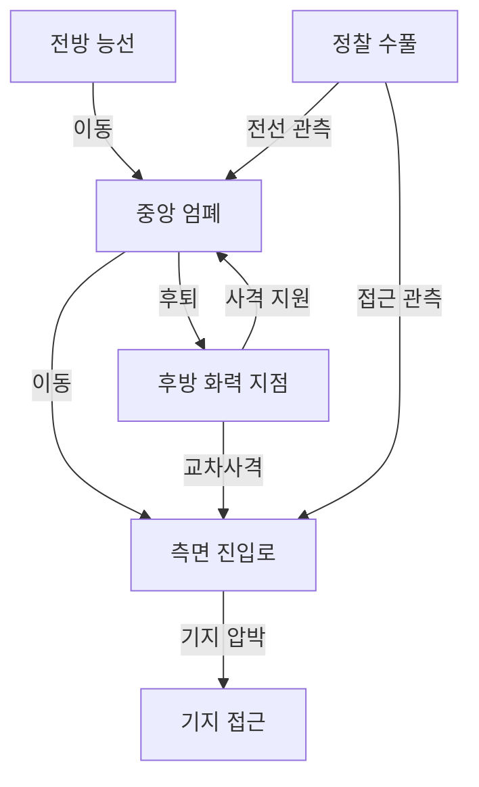

이 다이어그램은 특정 실제 맵의 좌표를 복사한 것이 아니라 전술 역할의 예시이다. 경로를 하나 추가하는 변경이라도 지원 사격과 관측 관계가 바뀌면 전선 전체가 이동할 수 있다.

### 4.1 기동력의 유효 가치

[제안] 각 차량의 목표 지점 도달 시간은 단순 최고속도 대신 다음을 샘플링해 비교한다.

```text
T_arrival = T_acceleration + Σ(path_segment_time) + T_turning + T_obstacle
Risk_arrival = exposed_duration × enemy_fire_opportunity
```

이 식은 계측 항목의 분해이며 WoT 물리식이 아니다. 같은 300m 경로라도 초반 급경사·좁은 회전·무른 지면·차량 병목이 있는 경우 실제 도착 순서가 바뀐다. 양 진영의 빠른 차량을 비교할 때는 스폰 위치 분포도 함께 고려한다.

## 5. 높낮이·포각·장갑의 연결

[분석] 지형의 작은 높이 차이는 전차의 노출 면적을 바꾸므로 장갑과 분리해서 평가할 수 없다.

| 공간 형태 | 전술적 효과 | 설계 검증 질문 |
|---|---|---|
| 완만한 능선 | 차체를 숨기고 포탑을 노출 | 포 내림각이 부족한 차량에도 대응 경로가 있는가 |
| 급한 능선 | 순간적으로 하부·바닥이 드러남 | 기동 중 예상하지 못한 취약부 노출인가 |
| 건물 모서리 | 차체 각도와 전후진 교환 | 측면 장갑 사용에 적절한 회전 공간이 있는가 |
| 좁은 길 | 차량 수적 우위가 제한됨 | 파괴된 차량 한 대로 영구 봉쇄되는가 |
| 상하 사격 | 상대 상판·하판 노출 변화 | 높은 곳이 모든 측면에서 무조건 유리한가 |
| 깊은 움푹한 지형 | 포탄·관측을 피하기 쉬움 | 빠져나올 경로와 반격 가능성이 있는가 |

[제안] “차체 은폐 가능”이라는 단일 태그 대신 차량별 포 높이·포 내림각·차체 길이를 적용한 샘플 자세를 저장한다. 테스트 대표 차량에는 낮은 포탑, 높은 차체, 고정 전투실, 긴 차체, 차륜 차량을 포함한다.

## 6. 파괴 가능한 엄폐와 Random Events

[확인] 1.23의 Random Events는 일부 맵에서 경로·엄폐·사격 위치를 변화시키는 기능으로 도입됐다. 이벤트는 전투 상황과 확률에 따라 발생하며 매 전투 발생을 보장하지 않는다. 위험 구역은 붉은 연기와 알림으로 표시되고 큰 물체와 충돌하면 차량이 파괴될 수 있다. [M02]

### 6.1 두 종류의 환경 변화

[분석] 작은 파괴물과 대규모 이벤트는 플레이어에게 다른 예측 방법을 요구한다.

| 구분 | 원인 | 시간 규모 | 판단 방식 |
|---|---|---|---|
| 개별 파괴물 | 공격·접촉 등의 국지 사건 | 즉시 또는 짧은 반응 | 엄폐가 몇 번의 교환을 버티는가 |
| 대규모 이벤트 | 맵의 이벤트 시나리오 | 경고와 진행 구간 | 변화 뒤 새 진입로를 누가 먼저 쓰는가 |
| 표현용 잔해 | 사건 결과의 시각화 | 짧은 연출 및 잔존 | 실제 충돌·시야 기능이 있는가 |

[제안] 이벤트 상태는 `대기 → 예고 → 위험 진행 → 지형 확정 → 종료`로 정의한다. 발동 여부의 무작위성과 발동 후 결과 지형의 재현성을 분리한다. 결과 지형까지 완전히 불규칙하면 경쟁전의 학습성이 약해지고, 모든 사건이 고정 시각에 반복되면 일회성 관전 연출로 느껴질 수 있다.

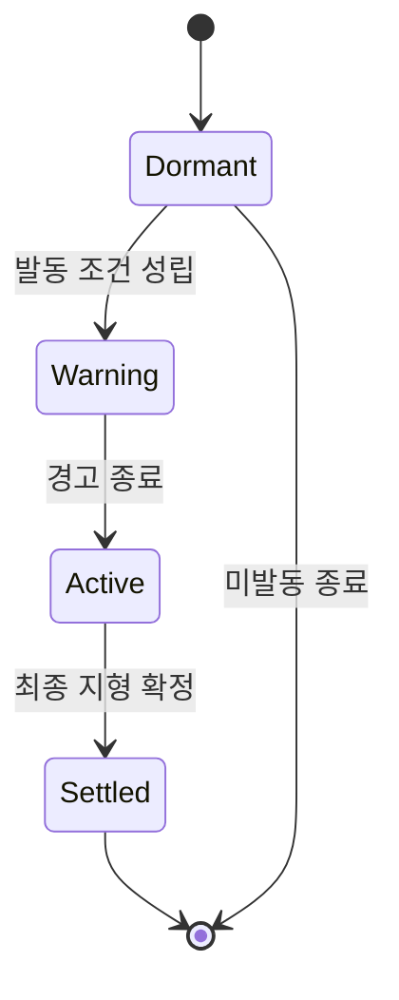

[확인] 2.4.1은 Random Events 허용 체크박스를 제거하여 모든 플레이어가 해당 맵 구성으로 매칭될 수 있게 했다. 이는 모든 경기에서 이벤트가 반드시 발생한다는 뜻과 다르다. [M03]

### 6.2 파괴를 실제 게임 규칙으로 연결하는 경계

[확인] 2018년 Update 1.0의 공식 그래픽 자료는 Havok Destruction을 통한 파괴 표현과 잔해를 설명한다. 이것만으로 2026년 현재 서버 물리의 엔진, 파편별 네트워크 방식, 모든 파편의 충돌 참여 여부를 단정할 수 없다. [M04]

[제안] 재구현 시 서버가 보장해야 하는 상태와 클라이언트가 자유롭게 표현할 수 있는 요소를 구분한다.

| 서버가 동일하게 유지할 상태 | 클라이언트에서 품질을 조절할 표현 |
|---|---|
| 통로 개폐, 엄폐 충돌, 위험 구역 판정 | 작은 파편 수, 먼지 입자 수 |
| 발동 사건 ID와 상태 전환 시각 | 흔들림, 세부 파괴 애니메이션 |
| 피해 대상과 피해 결과 | 오디오 반사·잔향의 품질 |
| 최종 게임플레이용 잔해 형상 | 작은 잔해의 수명·상세 메쉬 |

연출용 파편이 서버의 포탄을 임의로 막게 하거나, 낮은 그래픽 옵션에서 실제 엄폐 자체를 제거하는 구조는 피한다. 이 분리는 WoT의 비공개 구현 설명이 아니라 경쟁형 물리 게임을 위한 설계 제안이다.

## 7. 지도 유형별 플레이 패턴 분석

[분석] 아래 분류는 전차의 역할을 비교하기 위한 추상적 분석 틀이다. 각 실제 지도는 여러 유형을 섞는다.

| 유형 | 핵심 자원 | 강해지는 판단 | 반드시 제공할 대응 |
|---|---|---|---|
| 도시형 | 엄폐 모서리·짧은 이동거리 | 재장전 읽기·장갑 각도·교차사격 | 우회·복수 발사선·퇴각로 |
| 개활지형 | 수풀·능선·탐지 지속 | 정찰 유지·발포 절제·이동 타이밍 | 정보 상실 뒤 재접근 수단 |
| 혼합형 | 도시와 들판의 연결 | 전선 간 지원과 병력 이동 | 한 전선 승리가 다른 전선에 영향을 주는 경로 |
| 고저차형 | 능선 점유·포각 | 초기 도착·상하 노출 관리 | 고지 독점을 깨는 측면 또는 간접 공격 |
| 산업형 | 건물 내부·창문·긴 직선 | 발사선 학습·엄폐 내 재배치 | 지나친 관통 구멍·예상 밖 시야의 교정 |

시야 차량의 영향력은 수풀 수만으로 결정되지 않는다. 정찰 위치가 화력 지원 위치와 연결되는 비율이 더 중요하다. 마찬가지로 구축전차 위치를 많이 만든다고 구축전차 플레이가 건강해지지는 않는다. 후방 고정 사격이 승리에 기여하는 시점과 전진해야 하는 시점을 지도 구조가 드러내야 한다.

## 8. 대표 전술 장면

### 상황 A: 초기 능선 경쟁

[제안 사례] 양 팀의 빠른 차량이 중앙 능선에 도착하려고 한다. 한쪽은 거리가 짧지만 마지막 80m가 두 방향에서 공격받고, 다른 쪽은 길지만 완전히 가려져 있다.

도착 시간만 같게 맞추면 전자는 HP를 잃고 위치를 얻으며 후자는 온전한 상태로 같은 위치를 얻는다. 따라서 비교 지표는 `최초 도착 시간`, `도착 HP`, `후속 지원 도착`, `퇴각 가능 시간`의 네 가지여야 한다. 이 구조를 검증할 때 특정 고수 한 명의 성공 사례보다 여러 차량·스폰 조합의 분포를 보는 편이 낫다.

### 상황 B: 건물이 무너지며 발사선이 열린다

[제안 사례] 중앙 엄폐가 파괴되어 후방 지원 위치에서 측면 진입로가 보이기 시작한다. 이전에는 안전했던 복귀 경로가 위험해진다.

파괴는 단순한 통로 개방이 아니라 `관측 그래프`, `발사선 그래프`, `이동 비용`을 동시에 바꾸는 상태 전환이다. 미니맵과 공간 연출이 이 변화를 읽게 해야 한다. 특히 효과가 끝난 뒤 최종 충돌 형상이 정확히 일치하는지, 사건 직전에 발사된 포탄이 어떤 월드 상태로 판정되는지 확인해야 한다.

### 상황 C: 수적 열세 팀의 후퇴 지점

[분석] 수적 열세 팀이 방어할 수 있는 후방 위치는 역전 가능성을 남긴다. 그러나 전선과 무관하게 처음부터 그 위치에 머무는 것이 최선이면 수동적인 경기가 늘 수 있다. 좋은 방어 위치는 초반 영향력이 제한되고, 상대의 전진 이후에 가치가 커지며, 다른 경로로 압박받을 수 있는 형태가 바람직하다.

## 9. 제작용 데이터와 툴

[제안] 지도 변경은 에셋 수정과 함께 다음 검증 메타데이터를 보관한다.

```yaml
MapRevision:
  map_id: sample_map
  geometry_revision: revision_id
  allowed_modes: [random_standard]
  spawn_sets: [team_a, team_b]
  capture_areas: [base_a, base_b]
  gameplay_collision_hash: hash
  foliage_revision: revision_id
  event_scenarios: [scenario_id]
  balance_probes:
    - arrival_time_pairs
    - firing_lane_pairs
    - concealment_positions
    - escape_routes
```

경로마다 “누가 이 지점을 쓰는가”만 적지 말고 “누가 이 지점을 견제하는가”를 적는다. 전차 모델 변경도 지도 적합성에 영향을 주므로 테스트 차량의 충돌·포각·기동 프로파일 버전을 함께 기록한다.

## 10. QA와 계측

| ID | 검증 대상 | 방법과 합격 판단 |
|---|---|---|
| MAP-01 | 진영별 초기 접근 | 동일 역할 차량의 도착시간·HP·지원 도착 분포 비교 |
| MAP-02 | 포 내림각 의존성 | 대표 포각 3종 이상의 동일 능선 노출 비교 |
| MAP-03 | 차체 통과 | 좁은 길·교량·문에서 차량 크기별 진입·회전·퇴각 |
| MAP-04 | 포탄 충돌 일치 | 보이는 창·잔해와 실제 충돌 메시를 디버그 중첩 |
| MAP-05 | 탐지 차폐 일치 | 파괴 전후 같은 관측 관계의 변화를 기록 |
| MAP-06 | Random Event 안전 | 경고 시점, 진입·탈출, 큰 물체 충돌, 재접속 상태 복원 |
| MAP-07 | 그래픽 옵션 공정성 | 시각 품질만 바꾸고 이동·시야·피해 결과 동일성 확인 |
| MAP-08 | 잔해에 의한 영구 봉쇄 | 좁은 길에서 대형 차량 여러 대가 파괴되는 경우 |
| MAP-09 | 경계·끼임 | 지도 외부 진입, 급경사 정지, 지형 틈 탈출 시험 |
| MAP-10 | 변경 후 기존 공략 | 이전에 유효하던 핵심 사격 위치의 성공 조건 재검증 |
| MAP-11 | 후반 기지 압박 | 소수 생존 상황에서 양 진영의 복귀 시간 비교 |
| MAP-12 | 네트워크 사건 경계 | 파괴 시각 전후 포탄·차량의 충돌 결과 재현 |

[제안 KPI] 진영별 승률만 보면 문제를 놓치기 쉽다. 차량 역할·티어·초기 스폰·이벤트 발생 여부를 통제한 뒤 첫 피해 시각, 첫 정찰 기여, 전선별 체류 시간, 기지 도달 경로, 경직된 교착 시간, 막힘 발생률을 함께 본다. 승률 차이가 작아도 특정 역할이 게임에 참여할 공간이 없을 수 있다.

## 11. 출처와 검증 한계

- **[M01]** World of Tanks, [Update 2.4.1: Map Reworks and Rebalances](https://worldoftanks.eu/en/news/general-news/2-4-1-map-rebalance/). 2026-10 업데이트 지도 재구성. 구체 좌표·규모는 이 버전에서만 유효하다.
- **[M02]** World of Tanks, [Introducing Random Events in Update 1.23](https://worldoftanks.eu/en/news/general-news/random-events-new-gen-maps/). 2023-11-20. 도입 목적, 비보장 발동, 경고와 위험의 공식 설명.
- **[M03]** World of Tanks, [Release Notes 2.4.1](https://worldoftanks.eu/en/content/docs/release_notes/release-notes-2-4-1/). 2026-10. Random Events 설정과 매칭 변경. 직접 열기는 보안 페이지가 반환되어 검색 도구가 제공한 공식 페이지 인덱스 본문으로 확인.
- **[M04]** World of Tanks, [Update 1.0: Graphics Settings Explained](https://worldoftanks.eu/en/news/general-news/update-1-0-graphics-settings/). 2018년 역사 자료. Havok Destruction의 당시 표현 기능 근거이며 현재 서버 아키텍처의 근거로 사용하지 않음.
- **[M05]** World of Tanks, [Recon Mission 2023: The Results](https://worldoftanks.eu/en/news/general-news/recon-mission-2023-results/). 2023년 개발·검증 과정 참고. 테스트 결과를 2026년 일반전 통계로 쓰지 않음.

모든 출처 확인일: 2026-11-13. 본 문서의 경로 그래프·스키마·테스트와 세 전술 장면은 독자적 설계 분석이다. 실제 최신 맵의 모든 충돌 메시, 지형 저항값, 사건 발동 확률을 추출한 문서가 아니다.


---

<!-- Source document: 10_Matchmaking_and_Platoons.md -->

# 10. 매치메이킹·대기열·소대 역기획

> 대상: Wargaming World of Tanks PC, **일반 무작위 전투** 중심. 기준일: **2026-11-13 KST**. 2.0을 현재 규칙으로 고정하지 않고 **2.3 → 2.4 → 2.4.1**의 누적 변경을 반영했다. 2.4.2 Common Test는 라이브 기준에 포함하지 않았다. `[확인]` 공식 문서, `[분석]` 설계적 해석, `[제안]` 재구현 모델, `[검증 필요]` 미공개·충돌 항목을 뜻한다.

관련 문서: [차종·기동](03_Vehicle_Classes_and_Mobility.md) · [시야](08_Spotting_Concealment_and_Radio.md) · [모드](12_Modes_Competitive_and_Events.md) · [서버 구조](19_Server_and_Data_Architecture.md)

## 1. 매치메이킹이 해결하는 문제

[분석] 월드 오브 탱크의 매칭은 실시간 대기 중인 차량들을 모아 양 팀이 기능적으로 싸울 수 있는 전투를 만드는 문제다. 차량 수만 같아서는 충분하지 않다. 동일 티어라도 정찰 중심 경전차와 화력 중심 경전차, 돌파형 중전차와 지원형 중전차는 맵에서 제공하는 기회가 다르다. 동시에 이상적인 조합을 계속 기다리게 하면 이용자는 전투에 들어가지 못한다.

따라서 다음 목표가 충돌한다.

| 목표 | 강화했을 때 장점 | 지나치게 강화했을 때 비용 |
|---|---|---|
| 티어 근접성 | 정면 교전 격차 감소 | 큐 분할, 대기 증가 |
| 역할 대칭성 | 정찰·돌파·지원의 기회 균형 | 인기 없는 역할 차량의 대기 증가 |
| 소대 대응 | 협동 단위의 비대칭 완화 | 동시 접속 인구에 민감 |
| 같은 차량의 분산 | 단조로운 편성 감소 | 인기 차량 출시 직후 대기 증가 |
| 지도 다양성 | 연속 플레이 피로 감소 | 모든 참가자의 최근 기록을 만족시키기 어려움 |
| 빠른 시작 | 세션 전환 비용 감소 | 덜 이상적인 편성을 수용해야 함 |

[제안] 매칭 설계 문서에는 최적화 목표와 절대 금지 조건을 나눠 기록한다. “되도록 비슷한 역할을 맞춘다”는 목표를 “항상 완전히 같은 역할 수를 보장한다”는 계약으로 바꾸지 않는다.

## 2. 버전 변화와 현재 적용 기준

| 버전 | 확인된 변경 | 본 문서의 적용 |
|---|---|---|
| 2.0 / 2025-09 | 매칭 재구축, 고티어 역할 균형, 차종 제한, 큐 통합 | 도입 배경으로 사용 [Q01][Q02] |
| 2.3 / 2026-06 | SPG 최대 2, Tier VII–IX의 +2 전투 빈도 감소, 소대 균형 개선 | 이전 SPG 최대 3을 대체 [Q03] |
| 2.4 / 2026-09 | Tier VII+ 경전차 최대 2, 새 경전차 역할과 소대 제한 | 이전 고티어 경전차 최대 3을 대체 [Q04] |
| 2.4.1 / 2026-10 | 최근 지도 이력을 더 길게 고려, 인구 부족 시 적응, Random Events 큐 통합 | 현재 확인 기준 [Q05] |

[확인] 2.0은 Encounter·Assault·Grand Battles의 **일반 무작위 큐 운영을 중단**했다. 별도 기간제 모드에서 Encounter라는 규칙 이름이 사용되는 것까지 없어진 것은 아니다. Tier XI는 IX–X 차량과 매칭되도록 추가됐다. [Q01]

[분석] “월탱은 항상 3-5-7이다”, “SPG는 언제나 팀당 세 대다”, “최고 티어는 X다”처럼 오래된 설명을 하나의 고정 규칙으로 사용하는 것은 현재 서비스의 역기획에 맞지 않는다. 3-5-7은 역사적으로 알려진 편성 예시이며, 최신 공개 자료는 단일 고정 템플릿만으로 전체 전투를 설명하지 않는다.

## 3. 확인된 구성 제약

아래 표는 공개된 패치의 누적 결과이다. 특정 운영 지역·이벤트의 추가 제약은 별도 프로파일로 확인한다.

| 조건 | 확인된 규칙 | 근거·해석 경계 |
|---|---|---|
| SPG | 팀당 최대 2 | 2.3에서 변경 [Q03] |
| 경전차, Tier VII 이상 전투 | 팀당 최대 2 | 2.4의 제한 [Q04] |
| 경전차, Tier V–VI 전투 | 2.0에서 팀당 최대 3 도입 | 2.0에서 확인, 현재 유지 여부는 잠정 적용. 2.4의 명시적 변경은 VII 이상 [Q01][Q04] |
| 차륜 경전차, Tier VI | 팀당 최대 2 | 2.4 예외 [Q04] |
| 다른 티어의 차륜 경전차 | 팀당 최대 1 | 2.4 설명의 유지 규칙 [Q04] |
| 구축전차, Tier V 이상 전투 | 통상 최대 5, 드물게 6 | 2.0에서 확인, 현재 유지 여부는 잠정 적용. 조사한 후속 공개 변경에서 대체 규칙을 확인하지 못함 [Q01] |
| 역할 균형 | Tier VIII–XI에서 큐 인구를 고려해 조정 | 완전 대칭 보장이 아님 [Q02][Q04] |
| 티어 폭 | ±1 전투 확대 방향, ±2도 존재 | 모든 차량·모드가 동일한 허용표는 아님 [Q02][Q03] |
| Tier XI 편성 | Tier IX·X와 매칭 | Tier VIII가 XI를 만난다고 일반화하지 않음 [Q01] |

[검증 필요] 차량별 전투 티어 테이블, 같은 차량의 정확한 허용 대수, 제약 완화의 우선순위·대기시간 임계값, 각 지역 서버의 최신 운영 파라미터는 공개 소개만으로 확정할 수 없다. 표의 “후속 변경 미확인”은 비공개 변경이 절대 없다는 뜻이 아니다.

## 4. 차종과 역할의 차이

[확인] 2.4는 경전차에 Scout·Versatile·Support 역할을 부여하고, 매칭이 역할 차이를 고려하도록 변경했다. 역할 대응은 가용 인구의 영향을 받는다. 별도 경전차 개편 소개는 차륜 차량 중 VCS 6x6 TS 90을 Versatile 역할로 다루는 예외도 명시한다. 차륜이라는 외형만으로 매칭 분류를 결정하지 않는다. [Q06][Q10]

[분석] 차종은 큰 분류이고 역할은 실제 전술 기여의 분류이다. 같은 경전차 두 대라는 숫자만 맞추면 정찰 능력과 화력 능력이 다른 구성을 서로 대응시킬 수 있다. 이런 차이는 개활지에서 특히 크게 나타날 수 있으므로, 매칭의 결과를 차종 숫자만으로 평가해서는 안 된다.

[제안] 차량 데이터는 다음을 분리한다.

```yaml
MatchVehicleProfile:
  vehicle_id: stable_id
  tier: integer
  class: light | medium | heavy | td | spg
  role: role_id
  wheel_group: none | wheeled_light
  allowed_battle_tiers: data_table_ref
  preferential_rule: optional_rule_id
  duplicate_group: family_or_vehicle_id
  eligibility_version: patch_and_region
```

역할을 단순히 장갑 두께나 시야 수치 한 개로 자동 결정하지 않는다. 실제 역할이 변경되면 매칭·차고 필터·임무 분류·야전 개량·교육 문구를 함께 갱신해야 한다.

## 5. 소대의 구성과 준비 상태

[확인] 일반 무작위 소대는 최대 3명이며 같은 티어 차량을 선택한다. 소대장과 준비 상태를 가진다. 우대 매칭 차량이 일반 매칭 차량과 소대를 만들면 우대 조건을 유지하지 못할 수 있다. 전투 중 만드는 동적 소대는 큐 진입 전에 구성한 소대와 구분된다. [Q07]

[확인] 2.4 패치가 명시한 경전차 소대 제한은 Tier I–V 별도 제한 없음, Tier VI 최대 2대, Tier VII–XI 최대 1대이다. [Q04]

### 5.1 공개 문서 간 불일치 처리

[검증 필요] 상시 Platoons 가이드는 한때 사용하던 “Tier VII 이상에서 다른 역할의 경전차 두 대” 설명을 포함하고 있다. 이 문서에서는 이후의 명시적 변경인 **2.4 패치노트의 총 1대 제한**을 우선했다. 출처가 공식이라는 이유만으로 서로 다른 시점의 규칙을 섞지 않는다. [Q04][Q07]

### 5.2 상태 전이

[제안] 소대는 구성원 목록이 아니라 “출전 합의” 상태를 관리하는 단위로 모델링한다.

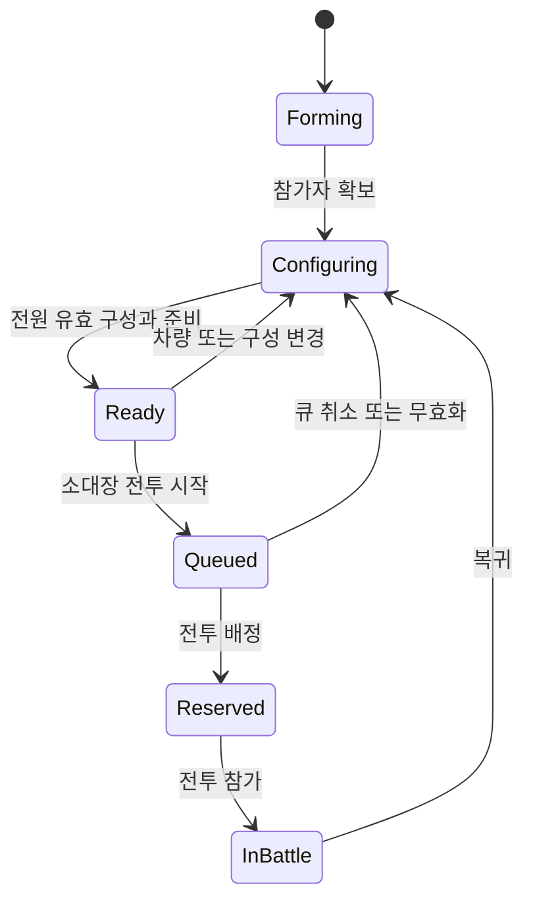

준비 완료 후 티어·장비·승무원·대여 만료·모드 자격이 바뀌면 준비를 해제하거나 다시 검증해야 한다. UI가 Ready로 보인다는 이유로 서버가 이전 차량 구성으로 배정하면 안 된다.

[분석] 동적 소대는 이미 만들어진 팀 안의 협동 관계이다. 전투 중 동적 소대가 생겼다고 적 팀을 다시 매칭할 수 없으므로, “큐 진입 소대의 균형”과 “경기 중 협동 그룹”을 동일한 정책으로 취급하지 않는다.

## 6. 소대 탐색과 전투 매칭의 구분

[확인] 자동 소대원 탐색은 WTR, 티어별 경험, 보유 차량, 같은 서버 등으로 함께 플레이할 사람을 찾는다. 2.3의 전투 매칭 개선은 상대 소대를 같은 티어로 대응시키는 방향이며, 당시 공식 소개는 Tier VIII–XI 소대 전투에서 약 90%의 티어 대응을 목표 결과로 설명했다. [Q07][Q08]

[분석] 자동 소대원 탐색에 WTR가 사용된다는 사실을 근거로 일반 무작위 전투가 모두 개인 실력 기반으로 팀을 나눈다고 결론내릴 수 없다. 다음 서비스는 서로 다른 문제를 푼다.

| 서비스 | 짝짓는 대상 | 결과 |
|---|---|---|
| 소대원 탐색 | 함께 플레이할 이용자 | 협동 그룹 생성 |
| 일반전 매칭 | 출전 차량·소대 등 대기 단위 | 양 팀 전투 구성 |
| 순위전 매칭 | 해당 모드의 경쟁 참가자 | 모드 전용 상대 구성 |
| 초보자 큐 | 보호 대상 이용자 | 학습 단계에 맞춘 전투 |

[검증 필요] 일반전의 내부 점수식·가중치·개인별 보정은 공개된 현재 자료에서 전부 확인되지 않았다. “연승하면 강제로 패배팀에 넣는다” 같은 설명은 이 문서의 규칙으로 채택하지 않는다.

## 7. 초보자 큐와 AI

[확인] 공식 저티어 가이드는 Tier I–V 초보자 큐와 필요할 때 AI 보충을 설명한다. 연구 가능한 Tier VII 이상 차량을 플레이한 경험 및 초보 큐 내 성과가 분류에 관여한다. 높은 티어 프리미엄 차량 구매만으로 저티어 초보 자격이 자동 소멸하는 것은 아니다. AI 사용은 지역·시각·대기 인구에 영향을 받는다. [Q09]

[분석] 이는 전체 서비스에서 하나의 균일한 매칭 알고리즘만 동작하지 않음을 뜻한다. 학습 구간은 조작·탐지·기본 전투를 익히는 목적이 강하며, 고티어 일반전과 같은 목표함수를 적용하기 어렵다.

[제안] 계정 분류와 차량 분류를 별도 보관한다. `playerExperienceBucket`와 `vehicleTier`를 하나의 값으로 합치면 대여 차량·프리미엄 구매·복귀 이용자 같은 상황에서 보호 정책이 잘못 적용된다. AI는 식별 가능하게 유지하고, 인간보다 더 많은 숨은 적 정보를 사용하지 않는지를 별도로 검증한다.

## 8. 지도 선택과 세션 다양성

[확인] 2.4.1 매칭은 더 긴 최근 지도 기록을 고려해 반복을 줄이며 인구가 적으면 기록을 고려하는 범위를 조절한다. Random Events 허용 설정 제거도 큐를 통합하는 변경이다. [Q05]

[분석] 지도 다양성은 한 명의 최근 기록이 아니라 최대 30명 참가자의 기록을 동시에 다루는 문제다. 모든 참가자가 서로 다른 지도를 많이 플레이했다면 교집합이 빠르게 줄어든다. 지도 반복 회피를 절대 규칙으로 만들면 대기열이 막힐 수 있다.

[제안] 지도 후보 점수는 다음처럼 분해할 수 있다.

```text
MapScore(m, players)
  = eligibility(m)
  - recent_repeat_penalty(m, players)
  - exclusion_conflict_penalty(m, players)
  - role_extreme_penalty(m, roster)
```

이 식은 자체 설계 예시이며 공식 WoT 점수식이 아니다. 실제 구현에서는 제외 지도·모드·티어·서버 설정을 먼저 검증하고, 어떤 지도에서 누구의 최근 기록 제약을 완화했는지 로그를 남기는 것이 좋다.

공식 발표의 “대부분 세션에서 지도 반복 감소”를 개별 이용자에게 반복이 절대 없다는 보증으로 사용하지 않는다. 인구·세션 길이·지도 풀·제외 설정에 따라 체감이 달라질 수 있다.

## 9. 매칭 처리의 재구성

[제안] 실제 매칭 서버 코드를 재현한 것이 아니라, 확인된 정책을 수용하는 논리적 파이프라인이다.

```text
1. 출전 요청 검증
   - 차량/티어/모드 자격, 소대 구성, 대여 만료 확인
2. 적절한 큐 프로파일 결정
   - 지역, 모드, 초보자 정책, 전투 티어 범위
3. 후보 전투 생성
   - 소대를 분리하지 않고 후보 단위를 묶음
4. 절대 제약 검증
   - 최대 인원, 금지 차종, 명시된 차종 상한
5. 균형 점수 평가
   - 역할, 소대 티어, 동일 차량 분포, 대기시간
6. 적응 가능한 제약만 단계적으로 완화
7. 지도 후보 평가 및 배정
8. 요청을 원자적으로 예약하고 중복 배정 방지
9. 로딩 실패/이탈을 정책에 따라 처리
```

[분석] 제약 완화는 품질 저하를 숨기는 장치가 아니라 서비스 가용성을 유지하는 선택이다. 다만 “대기시간이 길면 모든 제한 해제”처럼 정의하면 공식 하드캡도 깨질 수 있다. 규칙마다 `hard`, `soft`, `regionOverride`, `modeOverride`, `version`을 명시하는 것이 중요하다.

## 10. 대표 상황

### 상황 A: 소대에 경전차 두 대를 넣는다

[제안 사례] Tier VIII 차량 세 대로 소대를 만들려 하며 두 대가 경전차다. 2.4의 VII–XI 소대 제한을 기준으로 출전 가능 상태가 될 수 없다. UI는 “차량 선택이 잘못됨”보다 “이 티어 소대는 경전차 1대까지”처럼 원인을 표시해야 한다. 한 대를 바꾼 뒤에는 차량 자격과 전원 준비 상태를 다시 검증한다.

### 상황 B: 큐에 구축전차가 과도하게 많다

[제안 사례] 특정 신규 차량 출시로 구축전차가 몰린다. 대기시간을 낮추기 위해 모든 전투를 구축전차 다수로 만들면 역할 균형 정책의 의미가 약해진다. 반면 인기 차량을 계속 기다리게 하면 이용자가 나갈 수 있다. 운영자는 시간대별 큐 구성과 해당 역할의 대기시간 백분위, 제약 완화 빈도를 함께 봐야 한다. 이 사례의 해결값은 실제 운영 데이터 없이 수치로 확정하지 않는다.

### 상황 C: 지도 다양성과 낮은 인구가 충돌한다

[제안 사례] 몇 명은 방금 지도 A를 플레이했고 다른 몇 명은 B를 플레이했다. 현재 전투 티어와 제외 설정을 만족하는 맵은 A·B뿐이다. “최근 지도 회피”를 선호로 두고 한쪽 반복을 수용하면 전투가 성립하지만, 절대 금지로 두면 무한 대기가 가능하다. 반복 자체보다 같은 이용자에게 반복 부담이 집중되는지를 추적해야 한다.

## 11. QA와 운영 지표

| ID | 입력·상황 | 검증 항목 |
|---|---|---|
| MM-01 | SPG 요청 다수 | 팀당 최대 2 규칙이 대기 중에도 유지 |
| MM-02 | Tier VI와 VII 경계 | 경전차·차륜차 제한이 올바른 프로파일 선택 |
| MM-03 | 경전차 2대 소대 | VI 허용과 VII 이상 제한의 차이 |
| MM-04 | Tier IX·X·XI 후보 | XI 허용 범위와 VIII 혼입 방지 |
| MM-05 | 우대 차량+일반 차량 소대 | 우대 조건 변동을 사전에 설명 |
| MM-06 | 소대 준비 뒤 차량 변경 | 이전 준비 상태와 큐 요청 무효화 |
| MM-07 | 동일 차량 대량 대기 | 동일 차량 분산과 대기시간의 정책 기록 |
| MM-08 | 낮은 접속 인구 | 하드캡 보존, 소프트 조건만 완화 |
| MM-09 | 초보자와 고티어 프리미엄 | 계정 상태·현재 차량 티어의 분리 |
| MM-10 | 동적 소대 생성 | 현재 전투 구성 불변, 전투 후 그룹 처리 |
| MM-11 | 최근 지도 이력 상충 | 반복 회피 완화와 참가자별 부담 기록 |
| MM-12 | 배정 직전 취소·접속 종료 | 한 요청의 중복 배정·유실 방지 |

[제안 KPI] 큐 대기시간 P50/P90/P99, 차종·티어별 대기 이탈, 역할 불균형 빈도, 소대 티어 비대칭 빈도, 편성 인원 미달 비율, 지도 반복 간격, 초보자의 첫 세션 완료율을 함께 본다. 승률 하나로 매칭 품질을 평가하지 않으며, 짧은 패치 전후 기간의 변화에는 차량 출시·이벤트·요일·시간대가 섞여 있음을 표시한다.

## 12. 출처

- **[Q01]** [Release Notes 2.0](https://worldoftanks.eu/en/content/docs/release_notes/release-notes-2-0/). 2025-09. 도입 당시 차종 제한, Tier XI, 큐 통합.
- **[Q02]** [Update 2.0: Matchmaker Reforged](https://worldoftanks.eu/en/news/general-news/update-2-0-matchmaker/). 2025-09. 역할 균형·티어 폭·중복 차량·대기 논리의 목적.
- **[Q03]** [Release Notes 2.3](https://worldoftanks.eu/en/content/docs/release_notes/release-notes-2-3/). 2026-06. SPG 최대 2와 매칭 개선.
- **[Q04]** [Release Notes 2.4](https://worldoftanks.eu/en/content/docs/release_notes/release-notes-2-4/). 2026-09. 경전차·차륜 경전차·소대 제한.
- **[Q05]** [Release Notes 2.4.1](https://worldoftanks.eu/en/content/docs/release_notes/release-notes-2-4-1/). 2026-10. 지도 이력과 큐 통합.
- **[Q06]** [Matchmaker: Improvements Added in Update 2.4, and the Next Phase](https://worldoftanks.eu/en/news/general-news/2-4-matchmaker-update/). 2026-08-21. 준비된 변경과 테스트 계획을 구분해 설명.
- **[Q07]** [Platoons](https://worldoftanks.eu/en/content/guide/game-mechanics-and-achievements/platoons/). 상시 가이드. 소대 일반 규칙·자동 탐색. 경전차 제한은 구버전 설명이 남아 있어 Q04 우선.
- **[Q08]** [Matchmaker: Changes Ready to Deploy, With More Coming](https://worldoftanks.eu/en/news/general-news/matchmaker-changes-may-2026/). 2026-05. 소대 티어 대응 개선 발표. 당시 발표 비율을 현재 보장치로 쓰지 않음.
- **[Q10]** [Light Tanks Rebalanced: New Roles, Smarter Matchmaking](https://worldoftanks.eu/en/news/general-news/2-4-lt-roles-rebalance/). 2026년 2.4 경전차 개편, VCS 6x6 TS 90 예외.
- **[Q09]** [Matchmaker for Low-Tier Battles](https://worldoftanks.eu/en/content/guide/game-mechanics-and-achievements/matchmaker-for-low-tier-battles/). 초보자 큐·AI의 공식 설명.

모든 출처 확인일: 2026-11-13. 일부 EU 문서는 직접 열기에서 보안 페이지를 반환하여 검색 도구가 제공한 해당 공식 페이지의 인덱스 본문으로 확인했다. 내부 가중치·코드·운영 파라미터는 추정하여 실제 값처럼 기재하지 않았다.


---

<!-- Source document: 11_Controls_HUD_and_Garage_UX.md -->

# 11. 조작·카메라·전투 HUD·차고 UX 역기획

> 대상: Wargaming World of Tanks PC. 작성 기준일: **2026-11-13 KST**. 2.0 차고 재설계, 2.2 Armor Inspector 확장, 2.4.1 Spotlight 단축을 구분해 반영한다. `[확인]`은 공식 텍스트로 확인한 동작, `[분석]`은 UX 해석, `[제안]`은 재구현 명세, `[검증 필요]`는 실측·화면 검증이 필요한 항목이다. 실제 클라이언트를 조작하거나 최신 화면을 캡처해 검사하지 않았다.

관련 문서: [조준·사격](04_Aiming_Firing_and_Ammunition.md) · [장갑·관통](05_Armor_Penetration_and_Damage.md) · [시야](08_Spotting_Concealment_and_Radio.md) · [매칭](10_Matchmaking_and_Platoons.md)

## 1. UX의 중심 과제

[분석] 플레이어는 전투 중 이동, 시야, 장갑 방향, 조준, 재장전, 미니맵, 소모품 상태를 동시에 판단한다. 중요한 정보가 많이 보인다는 것만으로 좋은 HUD가 되지는 않는다. 지금 취할 수 있는 행동과 곧 잃게 될 기회를 구분해 알려 주어야 한다.

차고에서는 반대 문제를 해결한다. 긴 시간 동안 소유한 수많은 차량·승무원·장비·임무 중 “다음 전투에 무엇을 가져갈 것인가”를 빠르게 정해야 한다. 따라서 차고와 전투를 각각 별도 화면으로만 보지 않고 **준비 → 출전 → 피드백 → 수정**의 학습 루프로 다룬다.

## 2. 조작의 세 가지 방향

[확인] 기본 이동은 WASD, 사격은 마우스 왼쪽 버튼이다. 카메라 중앙 조준점과 실제 포의 조준 원은 다를 수 있으며, 포는 즉시 회전하지 않는다. 우클릭을 누른 채 주변을 보면 포를 돌리지 않고 시야를 바꿀 수 있다. X는 차량에 따라 차체 회전 잠금·해제 또는 이동/사격 모드 전환에 사용된다. [U01]

| 방향 | 플레이어가 기대하는 역할 | UX에서 보여 줄 것 |
|---|---|---|
| 카메라 방향 | 주변 상황을 살펴봄 | 현재 시선 |
| 포 방향 | 실제 발사 가능한 방향 | 포 표식·조준 원 |
| 차체 방향 | 이동과 장갑 노출을 결정 | 차체 실루엣·미니맵 방향 |

[분석] 마우스가 빠르게 이동했다고 포탄이 그 즉시 화면 중앙으로 발사되는 구조로 만들면 포탑 회전 속도라는 차량 성능이 사라진다. 반대로 두 방향의 차이를 시각적으로 설명하지 않으면 이용자는 입력 지연이나 조준 버그로 인식한다. 이 간격 자체가 숙련 요소이므로 숨기기보다 읽기 쉽게 보여 주는 것이 중요하다.

[제안] 입력을 `MoveIntent`, `CameraLook`, `GunAimIntent`, `FireIntent`, `ModeSwitchIntent`로 분리한다. 발사 가능 여부는 HUD 애니메이션이 아니라 전투 상태가 결정하고, UI는 그 상태를 설명한다.

## 3. 조준 모드와 상황 인식

[확인] 일반 카메라, 정밀 조준, 자주포용 상공 조준 및 탄도 시점이 구분된다. 자동 조준은 차량 중심을 향하며, 약점·이동 선행·지형 장애물까지 해결하는 기능은 아니다. 포가 제한 각도를 넘는 방향을 향하려면 차체 회전이 필요할 수 있다. [U01][U02]

[분석] 확대는 더 많은 정보를 주는 것이 아니라 특정 영역의 정보를 더 자세히 보여 주는 선택이다. 약점을 정확히 조준하는 동안 미니맵·측면 접근·자기 차체 노출을 놓칠 수 있으므로, 정밀 조준 모드에서 전투에 중요한 주변 상태를 최소한 유지해야 한다.

| 사용 목적 | 정보 우선순위 | UI 설계상 위험 |
|---|---|---|
| 짧은 거리 기동전 | 차체 위치·충돌·적 방향 | 큰 HUD가 전차 주변 지형을 가림 |
| 약점 사격 | 포 표식·분산·거리·재장전 | 카메라 조준점과 실제 포를 혼동 |
| 자주포 지원 | 탄도 차폐·목표 이동·아군 위치 | 상공 시점에서 고저차를 과소평가 |
| 주변 확인 | 미니맵·측면·퇴각 방향 | 카메라 이동이 의도치 않게 포를 돌림 |
| 대여·신규 차량 | 고유 능력 상태·조작 설명 | 기존 차량의 습관대로 잘못된 키 입력 |

[제안] 모드 전환은 카메라만 바꾸지 않는다. 포 잠금, 자동 조준, 목표 거리, 시야 배율, HUD 레이아웃이 어떤 상태를 유지하는지 명세한다. 특수 차량의 X 기능이 다르면 화면 하단에 현재 가능한 행동과 전환 제약을 표시하는 편이 안전하다.

## 4. HUD 정보 구조

다음은 화면의 정확한 픽셀 배치가 아니라 기능 단위의 역기획이다.

| 영역 | 전달하는 정보 | 갱신 빈도·우선순위 [제안] |
|---|---|---|
| 조준 중심 | 포 위치, 분산, 관통 가능성, 재장전 | 높은 빈도, 최상위 |
| 차량 상태 | HP, 모듈, 승무원, 화재, 스턴 | 사건 즉시, 위험도 순 |
| 탄약·소모품 | 선택 탄종, 잔량, 사용 가능, 재사용 시간 | 상태 변화 즉시 |
| 팀 패널 | 생존 차량, 차종, 팀 전력 | 격파·정보 변경 시 |
| 미니맵 | 관측된 적, 마지막 위치, 목표, 시야 원 | 허용된 정보만 갱신 |
| 전투 목적 | 남은 시간, 점령, 모드별 점수 | 승패에 가까워질수록 강조 |
| 피드백 로그 | 피해·도탄·어시스트·모듈 사건 | 누적하되 중앙 화면 점유 최소화 |
| 특수 능력 | 준비·진행·과열·쿨다운·전환 불가 원인 | 차량 메커니즘별 정책 |

[분석] 전차 피해 모델은 단일 HP 막대만으로 충분히 설명되지 않는다. 궤도가 끊겨 이동이 불가능한 상태, 탄약고 손상으로 공격 템포가 느려진 상태, 승무원 손상으로 성능이 바뀐 상태를 구분해야 한다. 각각의 아이콘을 보여 주더라도 조작 가능한 해결책으로 이어지지 않으면 학습 비용이 크다.

[제안] 손상 알림은 `무엇이 변했는가 → 어떤 행동이 제한되는가 → 지금 복구할 수 있는가` 순서로 연결한다. 예컨대 수리 도구를 쓰려는 순간 사용 불가 사유가 재사용 대기인지, 현재 모드의 금지인지, 키 입력이 다른 UI에 소비되었는지를 확인할 수 있어야 한다.

## 5. Armor Inspector와 Armor Flashlight

[확인] 2.2는 차고의 Armor Inspector에 공격 차량·포·탄 선택과 대상 포탑·포의 회전 기능을 확장했다. 명목 장갑·실효 장갑·관통 가능성을 살펴보는 학습 도구이다. [U03]

[확인] 전투 중 Armor Flashlight는 정밀 조준 모드에서 최대 300m 범위에 적용하며 기본 키는 Y다. 조준 영역의 빨강·노랑·초록으로 낮음·중간·높은 관통 가능성을 나타내고, 조준 후 약간의 지연을 두고 켜진다. [U02]

### 5.1 두 도구의 역할 분리

| 항목 | Armor Inspector | Armor Flashlight |
|---|---|---|
| 이용 맥락 | 차고에서 사전 학습 | 전투 중 빠른 판단 |
| 조작 여유 | 상대 구성과 각도 비교 | 제한된 거리·시점·시간 |
| 정보 가치 | “왜 이런 장갑 판정이 생기는가” | “지금 조준한 곳이 유리한가” |
| 설계상 위험 | 실제 전투 변수와 차이를 놓침 | 색을 확정 명중·확정 피해로 오해 |

[분석] 초록은 탄환이 화면 중심에 정확히 도달한다거나, 모든 입사각과 공간장갑 조건에서 최대 피해가 보장된다는 뜻이 아니다. 조준 분산·목표 이동·충돌 지점·탄도와 관통 결과는 여전히 구분해야 한다. 따라서 학습 UI는 “관통 가능성”과 “사격 성공 가능성”을 같은 용어로 표시하지 않는 편이 낫다.

[제안] 차고 검사기에서 사용한 공격 프로파일을 저장하고, 실제 전투의 관통 실패를 복기할 때 거리·탄종·피격 자세가 어떻게 달랐는지 비교하는 교육 경로를 제공할 수 있다. 이는 현재 제품에 모든 기능이 있다는 주장이 아니라 후속 개선안이다.

## 6. 차고의 정보 구조와 출전 준비

[확인] 2.0 차고는 세로 메뉴·확장 가능한 차량 목록·장갑 보기 등을 도입했다. 전투 결과는 개인 성과, 팀 성과, 금융 내역을 구분하고 임무·연구 트리 화면도 정리했다. [U04]

[분석] 차량을 수십 대 이상 소유한 이용자에게 핵심 탐색 단위는 국가·티어뿐만 아니라 “오늘 할 일”이다. 특정 임무, 친구와 소대 가능한 티어, 수익을 얻을 차량, 새로 연구한 차량처럼 목적이 다르다. 한 가지 필터 조합을 바꿀 때마다 이전 목적의 목록을 잃으면 출전 결정이 느려진다.

[제안] 차고 구성 정보는 세 층으로 나눈다.

| 층 | 예시 | 전환 시 보존할 정보 |
|---|---|---|
| 계정 | 통화, 이벤트, 임무, 전체 연구 | 전역 선택·진행 |
| 차량 | 포·탄약·장비·승무원·외형 | 차량별 로드아웃 |
| 세션 | 모드, 소대, 차량 필터, 비교 목록 | 다음 전투 목적 |

### 6.1 준비 완료 판정

```text
CanEnterBattle(vehicle, mode, platoon):
    차량 보유 및 대여 자격 유효
    모드의 차량/티어 조건 충족
    승무원·모듈 등 필수 구성 유효
    소대의 제한 조건 충족
    출전 불가 상태 아님
    서버 검증 시점의 구성 버전 일치
```

[제안] 탄약이 적거나 소모품 자동 보급이 꺼진 상태는 제품 정책에 따라 경고할 수 있으나, 경고와 출전 차단을 구분해야 한다. 모든 경고를 출전 차단으로 만들면 숙련자의 의도적 세팅을 방해하고, 모든 상태를 무시하면 신규 이용자가 빈 구성을 가지고 전투에 들어갈 수 있다.

### 6.2 변경의 되돌리기와 비용

[분석] 장비·탄약·승무원 변경은 전투 성능과 경제를 함께 바꾼다. UI는 변경 전후 스탯만 보여 주기보다 비용 발생 시점, 재사용 가능한 자원, 자동 보급 여부를 연결해야 한다. 플레이어가 세팅을 시도하는 과정에서 불필요한 클릭 비용과 학습 실패 비용이 누적되기 때문이다.

[제안] 구매·장착·보급·외형 적용은 별도 명령으로 기록한다. 화면에서 한 번의 Apply로 보이더라도 서버에서 실패한 일부 단계가 무엇인지 복구 가능해야 한다. 구성 미리보기 수치와 실제 확정 수치의 차이는 명확히 구분한다.

## 7. 전투 진입과 결과 화면

[확인] 2.4.1은 전투 전 Spotlight를 짧은 버전만 사용하도록 조정했다. 공식 설명은 참가자가 전투 전 상황을 평가할 시간을 확보하는 목적을 제시한다. [U05]

[분석] 전투 전 연출이 차량의 소유 만족을 높이더라도, 팀 구성과 지도를 읽는 시간을 지나치게 차지하면 핵심 전투 준비와 충돌한다. 전투 시작 직전에는 자신이 어떤 역할을 맡을지, 적의 정찰·자주포·중전차 구성은 어떤지, 소대원은 어디로 갈지 판단할 시간이 필요하다.

[제안] 전투 결과는 다음 질문에 순서대로 답하게 설계한다.

1. 팀은 왜 승리 또는 패배했는가?
2. 내 직접 피해·정찰·저지·점령 기여는 어떤 형태였는가?
3. 경험치·크레딧은 얼마나 얻었고 어떤 비용이 발생했는가?
4. 연구·승무원·임무에서 무엇이 진행되었는가?
5. 다음 전투 전에 수정할 것이 무엇인가?

위 질문은 현재 모든 화면이 이 순서를 사용한다는 관측이 아니라 역기획에서 평가할 체크리스트이다. 점수 합계만 강조하면 정찰·수비·시간 벌기의 역할이 가려질 수 있으므로, 승리 기여와 수익성을 같은 지표로 환원하지 않는다.

## 8. 입력·UI 상태 구조

[제안] 다음은 엔진에 독립적인 상태 모델이다.

```yaml
PlayerPresentationState:
  context: garage | loading | alive | destroyed | spectator | results
  input_layer: gameplay | map_interaction | modal | chat
  camera_mode: arcade | sniper | artillery | trajectory
  aim_state: target_point_and_gun_pose
  selected_ammo: slot_id
  hud_profile: vehicle_mechanic_and_mode
  accessibility_profile: color_scale_audio_preferences
```

`context`와 `input_layer`를 분리해야 채팅 입력 중 WASD가 차체를 움직이거나, 모달을 닫은 직후 이전 마우스 입력이 발사로 처리되는 문제를 줄일 수 있다. 파괴·관전 전환에서도 선택 탄종이나 모드 단축키가 다른 플레이어 차량의 명령으로 전달되어서는 안 된다.

[제안] 입력 충돌 해결 순서는 UI 포커스, 현재 게임 맥락, 차량별 동작, 일반 동작의 순서로 명세한다. 실제 WoT의 입력 처리 순서를 확인했다는 의미는 아니다. 키 재지정·언어별 키보드·접근성 장치를 고려해 화면 안내는 하드코딩 문자열이 아니라 현재 바인딩을 참조한다.

## 9. 대표 사용자 흐름

### 흐름 A: 처음 만나는 장갑에 계속 도탄된다

[분석] 원인 후보는 약점 선택, 탄종, 입사각, 분산, 공간장갑 등이다. HUD가 단지 “도탄”만 표시하면 학습은 외부 자료에 의존한다. 차고의 검사기로 상대 차량을 찾아 자세·공격 조건을 바꾸어 보는 흐름은 이 지식 격차를 줄일 수 있다.

[제안] 유저에게 필요한 정보는 특정 부위를 무조건 맞히라는 정답보다 “이번에 바꿀 수 있는 변수”이다. 탄종 변경, 거리 변경, 측면 이동, 아군에게 맡기기 중 어떤 선택이 가능한지 설명하는 교육을 연결할 수 있다.

### 흐름 B: 소대 출전 버튼이 활성화되지 않는다

[제안 사례] 소대원 모두 Ready를 눌렀지만 한 명의 차량이 현재 모드 티어 제한과 맞지 않는다. 전체 소대에 막연한 경고 하나를 띄우기보다 해당 구성원·차량·규칙을 연결해 보여 준다. 변경 가능한 차량 목록을 필터하면 해결까지의 화면 이동을 줄일 수 있다.

### 흐름 C: 특수 능력과 조준 HUD가 겹친다

[제안 사례] 과열 게이지, 재장전, 탄창 잔량, 능력 쿨다운이 중앙에 동시에 표시된다. 숫자를 모두 같은 크기로 표시하면 플레이어는 현재 발사가 가능한지부터 알기 어렵다. 가장 중요한 상태를 `지금 발사 가능`, `다음 발사까지 시간`, `지속 사용의 비용` 순서로 계층화하고, 상세 값은 부차 표시로 남긴다.

## 10. QA·접근성·계측

| ID | 시험 | 확인 기준 |
|---|---|---|
| UX-01 | 카메라를 급회전하며 발사 | 실제 포 위치와 화면 중앙 차이를 명확히 표시 |
| UX-02 | 포 회전 잠금 상태에서 주변 보기 | 차체·카메라·포 입력이 의도대로 분리 |
| UX-03 | 차체 회전 제한 차량의 조준 모드 전환 | 자동 회전·잠금·분산 상태가 일관됨 |
| UX-04 | 299m/301m에서 Flashlight 사용 | 거리 경계, 모드 조건, 비활성 이유 확인 |
| UX-05 | Flashlight 켜진 상태에서 탄종·목표 변경 | 이전 목표의 표시가 남지 않음 |
| UX-06 | Inspector 공격차량·탄·포탑 변경 | 미리보기 계산 프로파일이 함께 갱신 |
| UX-07 | 채팅·지도·모달 중 사격 입력 | 게임 입력의 의도치 않은 통과 방지 |
| UX-08 | 재접속·관전·결과 화면 전환 | 상태에 맞지 않는 명령 비활성 |
| UX-09 | 소대 자격 오류·대여 만료 | 막힌 원인과 해결 행동을 같은 화면에 연결 |
| UX-10 | 저해상도·큰 UI 배율·긴 번역문 | 조준·미니맵·중요 경고가 잘리지 않음 |
| UX-11 | 색각 대체·음량 제한 환경 | 색 하나·소리 하나에만 중요 사건을 의존하지 않음 |
| UX-12 | 전투 결과 비용과 자동 보급 | 보급 설정·순수익·다음 출전 구성의 일관성 |

[제안 KPI] 차고 진입부터 출전까지 걸린 시간, 차량 탐색 실패, 구성 수정 후 재출전율, 출전 불가 원인별 이탈, 전투 중 HUD 가림 피드백, 핵심 경고 인지율, Inspector 사용 후 관련 오류 감소를 본다. 클릭 수가 줄었다는 이유만으로 학습이 좋아졌다고 결론내리지 않고, 실제로 사용자가 자신의 변경 결과를 이해했는지 확인한다.

## 11. 출처와 미확인 범위

- **[U01]** World of Tanks, [Controls and Firing](https://worldoftanks.eu/en/content/guide/newcomers-guide/game_controls/). 조작·조준점·카메라·모드의 공식 설명.
- **[U02]** World of Tanks, [How to Survive](https://worldoftanks.eu/en/content/guide/newcomers-guide/how_to_survive/). 자동 조준의 한계, Armor Flashlight 조건·색 표시.
- **[U03]** World of Tanks, [Update 2.2: Power Up!](https://worldoftanks.eu/en/news/updates/wot-2-2/). 2026-03-04 라이브 업데이트, Armor Inspector 확장. Common Test 값을 최종값으로 사용하지 않음.
- **[U04]** World of Tanks, [Sleeker and Faster—Check Out the New Garage](https://worldoftanks.eu/en/news/general-news/update-2-0-garage-ux/). 2025-09, 차고·결과·임무·연구 화면 재설계.
- **[U05]** World of Tanks, [Update 2.4.1: Season of Action](https://worldoftanks.eu/en/news/updates/wot-2-4-1/). 2026-10-14, Spotlight 단축과 전투 준비 시간.

출처 확인일: 2026-11-13. 화면의 정확한 좌표·클릭 수·애니메이션 길이·HUD 정보 지연은 실측하지 않았다. 도식·상태 모델·세 사용자 흐름은 자체 재구성이다. 기본 단축키도 이용자의 재지정에 따라 달라질 수 있다.


---

<!-- Source document: 12_Modes_Competitive_and_Events.md -->

# 12. 전투 모드·경쟁전·기간 이벤트

> 대상: Wargaming PC · 기준일: 2026-11-13 KST  
> 기준: 라이브 2.4.1 계열과 실제 게시된 2026년 이벤트 안내. Common Test는 라이브 규칙으로 채택하지 않는다.  
> **[확인]** 공개 규칙 / **[분석]** 설계 해석 / **[제안]** 구현 재구성 / **[검증 필요]** 비공개·불명확 항목  
> 연관: [기본 전투](02_Battle_Rules_and_Lifecycle.md), [매칭](10_Matchmaking_and_Platoons.md), [미션·운영](17_Missions_Monetization_and_LiveOps.md), [클랜](18_Social_Clans_Replays_and_Fair_Play.md)

## 1. 모드 시스템을 분리해야 하는 이유

**[분석]** 모드는 맵과 인원만 바꾸는 옵션이 아니다. 부활, 회복, 점령 방식, 정보 전달, 사용 가능 차량, 보상과 소모 비용을 바꾼다. 같은 “적 전차 파괴”도 기본전에서는 상대 팀의 영구적인 전력 손실이지만, 무한 부활 이벤트에서는 일정 시간 동안 목표를 비우게 만드는 효과가 중심이 된다.

**[확인]** 2.0에서는 Encounter·Assault·Grand Battles가 무작위 전투의 별도 큐 모드로 중단되었다. 그러나 2026년 11월 Maneuvers는 Encounter 규칙을 사용한다. 따라서 “Encounter가 제품 전체에서 삭제됐다”는 설명도 부정확하다. 큐의 제공 여부와 규칙의 재사용을 구별해야 한다. [S01][S07]

## 2. 모드 비교

| 모드 | 참가 구조 | 핵심 경쟁 자원 | 세션 성장 | 운영 성격 |
|---|---|---|---|---|
| Standard Random | 대표 15v15 | 남은 전투력·기지·시간 | 전투 외 연구와 구성 | 기본 상시 경험 |
| Onslaught | 7v7, 적격 Tier X | 순위 점수·역할 기술·팀 구성 | 전투 내 기술 활용 | 시즌 경쟁전 |
| Frontline | 30v30, 해당 회차 Tier VIII | 구역·방어선·주요 목표 | 계급·전투 비축물자 | 주기적 대규모 이벤트 |
| Steel Hunter | 솔로 또는 2인 소대 | 생존·전리품·안전 구역 | 차량 내 즉석 업그레이드 | 배틀로얄 이벤트 |
| Black Signal | 7v7, Tier X, SPG 제외 | 안테나 보유와 점수 수입 | 부활 시 구성 적응 | 2026년 11월 신규 이벤트 |
| Maneuvers | 클랜 7v7, 해당 회차 Tier XI | 승리·명예 점수·차량 가용성 | 클랜 단계 및 수리 자원 | 기간 한정 클랜 경쟁 |
| PvE 이벤트 | 회차별 솔로 또는 협동 구성 | AI 파형·목표·생존 | 회차별 전용 성장 | 서사·도전·변칙 실험 |

근거: [S02]~[S08]. 이 표의 인원·티어는 특정 모드의 영구 불변 규칙이 아니라 확인한 가이드 또는 회차 기준이다. 이벤트가 현재 열려 있는지는 운영 일정과 권역을 별도로 확인해야 한다.

## 3. Onslaught: 승패를 순위 경쟁으로 연결

### 3.1 확인된 차이

**[확인]** 공식 가이드는 7v7, 적격 Tier X 차량, 순위 기반 매칭, 전투 전 편성 변경, 역할·전술 기술을 설명한다. 2026–27 Phoenix 첫 시즌에는 Super Platoon이 비활성화되었으며, 시간 만료 시 생존 차량 수 → 가한 피해 → 첫 격파 팀 순서로 우열을 판단한다. 세 기준으로도 승자를 정할 수 없으면 무승부다. 오래된 상시 가이드에 Super Platoon 설명이 남아 있어도 해당 시즌의 새 안내를 우선한다. [S02][S03]

**[확인]** 2.4의 지정 야간 맵은 최대 시야 315m, 표시 거리 445m, 위장 보정 +15%를 사용한다. 조명탄 효과도 일반전 탐지와 다른 별도 규칙이다. 이 변경을 모든 일반전 지도에 적용하면 안 된다. 상세 탐지 예외는 [08](08_Spotting_Concealment_and_Radio.md)을 따른다. [S04]

### 3.2 설계 해석

**[분석]** 순위 경쟁에서는 긴 무승부가 반복될 때 진행 정체를 느끼기 쉽다. 동률 해소 규칙은 종료 시점의 우세를 결과로 변환한다. 동시에 첫 격파가 마지막 기준이 되면 초반 사건이 후반 의사결정에 영향을 줄 수 있으므로, 플레이어가 우선순위를 알아야 한다.

**[제안]** HUD에는 일반전과 다른 시간 만료 조건을 표시한다. 시즌 설정은 `SeasonRuleSet`으로 버전 관리하고, 전투 후 순위 점수 계산과 일반 경제 정산을 별개 결과로 만든다. 같은 참가자의 실력 점수와 연구 경험치를 하나의 값으로 취급하지 않는다.

## 4. Frontline: 전선을 여러 단계로 나누는 대규모 전투

**[확인]** 2026년 11월 회차는 Tier VIII의 30v30 형식, 3km × 3km 규모 지도, 구역 확보와 주요 목표 파괴, 재보급 구역을 제공했다. 공격팀은 조건을 열고 다섯 주요 목표 중 세 개를 파괴하는 구조다. 회차에는 기본·작전 지원·운명의 장난 시나리오가 있으며 비축물자 획득·대기 규칙이 달라진다. [S05]

**[분석]** 기본전의 단일 전선 실패를 되돌리기 어렵다면, Frontline은 방어선 이동과 재출격으로 전투의 여러 국면을 만든다. 공격팀에는 현재 구역의 진입·점령이, 수비팀에는 완전한 격파보다 시간 지연이 더 큰 가치를 갖는 상황이 생긴다.

**[제안] 구역 상태 모델**

| 상태 | 공격 측 의미 | 수비 측 의미 | 데이터 요구 |
|---|---|---|---|
| Locked | 아직 진입·점령 대상 아님 | 미래 방어선 | 선행 구역 |
| Contestable | 현재 점령 가능 | 지연·격퇴 대상 | 점령 상태·시간 |
| Captured | 다음 단계 개방 | 후퇴 또는 재배치 | 점령 확정 사건 |
| ObjectiveOpen | 주요 목표 공격 가능 | 최종 방어 | 목표 HP·접근 조건 |

**[검증 필요]** 회차별 부활 대기, 재보급 재사용 제한, 전투 시간 추가, 차량 회수·재사용 규칙을 독립 실측한다. 이벤트 소개에 있는 대표값을 다른 회차에 일괄 적용하지 않는다.

## 5. Steel Hunter: 계정 성장과 전투 내 성장을 분리

**[확인]** 현재 공식 가이드는 특수 차량 8종, 솔로 15명 또는 소대 모드 총 20명, 최대 15분, 위험 구역의 점진적 축소를 설명한다. 차량은 전투 도중 I~VII 단계로 발전하며 최후 생존자 또는 소대가 목표다. [S06]

**[분석]** 이 모드의 업그레이드는 차고의 연구 계통도와 다른 자원 경제다. 지금 적과 싸워 성장 자원을 얻을지, 안전 구역으로 이동할지, 전리품을 둘러싸고 위험을 감수할지가 핵심 선택이다. 전차 수집 수준과 전투 내 빌드가 같은 역할을 하지 않는다.

**[제안]** `BattleUpgradeGraph`는 세션 소유 데이터로 두고 계정 영속 연구에 쓰기 접근을 주지 않는다. 전리품 획득, 모듈 선택, 안전 구역 변화, 전용 능력 사용을 별도 사건으로 기록한다. UI에는 업그레이드 선택 중에도 위험 구역과 적 접근을 인지할 수 있는 표현이 필요하다.

**[검증 필요]** 탐지·무전·파괴 후 복귀의 세부 정책은 모드 전용 설명으로 확인한다. 기본전의 수풀·시야 수치를 그대로 복사하는 것을 금지한다.

## 6. Black Signal: 점령이 회복과 재교전을 만든다

**[확인]** 2026년 11월 안내에서 승리 기준은 안테나 유지로 얻는 2,500점 또는 시간 종료 시 우세 점수다. 적이 점령 구역에 있으면 점령이 멈추며 아군을 더 넣어도 점령 속도가 빨라지지 않는다. 점령 시 점령 차량의 HP 25%를 회복하고 점령 구역 안의 아군 차량에도 회복을 제공한다. 아군의 정확한 회복 비율은 별도 검증 대상이다. 무한 재출격·20초 준비 후 자동 출격·출격 후 10초 피해 보호가 안내되며 사용한 탄은 전투 후 반환된다. [S08]

**[분석]** 기여 속도가 인원에 비례하지 않으면 전원이 한 점에 몰리는 것보다 여러 목표를 압박하는 편성이 유리해질 수 있다. 점령 회복은 체력 손실과 목표 플레이를 직접 연결한다. 사망은 영구 퇴장이 아니라 이동·재출격 시간의 손실로 바뀐다.

**[제안] 안테나 상태 머신**

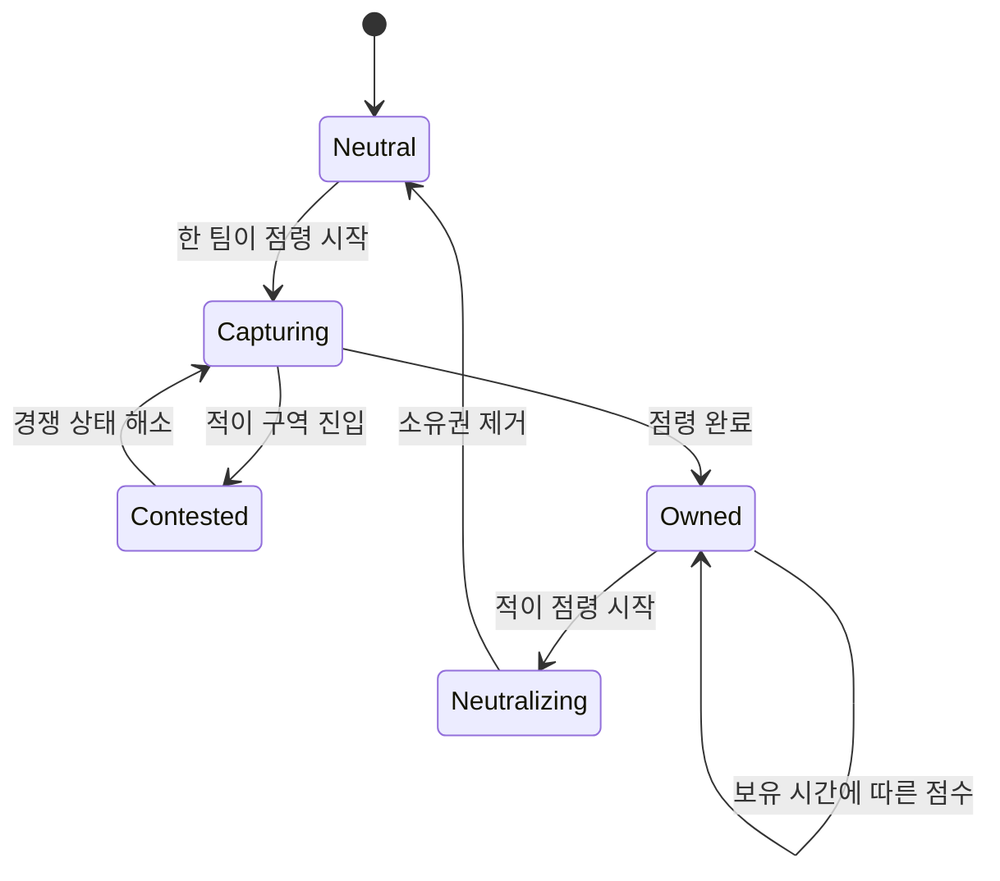

이 상태 머신은 문서화된 동작을 재구현하기 위한 제안이다. 중립화 시간, 점수 틱 간격, 동시 목표 확보로 임계값을 넘기는 순서 등은 라이브 실험으로 보완해야 한다. 회복·재출격·보호 상태를 같은 점령 시스템 안에 하드코딩하지 않고 효과 이벤트로 분리한다.

## 7. Maneuvers: 전투 결과가 다음 편성을 제한

**[확인]** 2026년 11월 회차는 클랜 7v7 Tier XI Encounter, 10분, 전장의 안개를 사용한다. 파괴되거나 패배한 편성의 차량은 Out of Commission 상태가 되어 단계 진행과 명예 점수 기여에 제약을 받는다. 클랜 단계 초기화와 수리 부품이 차량 가용성 복구에 연결된다. [S07]

**[분석]** 한 판의 강한 조합만 반복하는 문제를 차량 가용성이라는 장기 제약으로 다룬다. 개인 최고 성능과 클랜 전체의 차량 풀이 다른 자산이 되며, 지휘자는 승률뿐 아니라 다음 판의 편성 여유를 고려해야 한다.

**[제안]** 차량의 전투 중 파괴 상태와 이벤트의 Out of Commission 상태를 구분한다. 전자는 세션 종료와 함께 해제될 수 있는 임시 상태이고, 후자는 이벤트 규칙에 따라 남는 메타 상태다. 클랜 초기화 요청에는 권한, 영향 차량, 소비·획득 내역, 적용 버전을 기록한다.

## 8. PvE 이벤트의 재사용 가능한 부분

**[확인]** 2.4.1은 Babylon: Dark Tower를 포함해 협동 PvE, 전용 적과 보스, 진행 보상을 안내한다. 이는 기본 PvP의 상시 규칙으로 취급하지 않는다. [S09]

**[분석]** PvE는 동일한 이동·포탄·피해 기반 위에 AI 행동, 목표 스크립트, 전용 능력, 보상 진행을 얹는 실험 공간이다. 시각적으로 큰 파괴나 보스 행동이 있더라도, 기본전에서 모든 오브젝트가 같은 방식으로 파괴된다고 추론할 수 없다.

**[제안]** 기본 무기 판정은 재사용하되 AI 위협도, 공격 예고, 보스 단계 전환은 별도 시스템으로 둔다. 전용 피해 배율이나 무적 단계는 모드 조건으로 명시하며, 일반전 데이터에 역으로 흘러가지 않도록 한다.

## 9. 모드 규칙을 데이터로 표현하기

아래는 **[제안] 스키마**로, 실제 Wargaming 데이터 포맷이 아니다.

```yaml
mode_definition:
  id: example_mode
  revision: 1
  availability:
    realm: example
    begins_at_utc: null
    ends_at_utc: null
  eligibility:
    allowed_tiers: []
    allowed_classes: []
    rental_policy_id: null
  battle:
    team_size: null
    duration_seconds: null
    respawn_policy_id: null
    victory_rule_id: null
    tie_break_rule_id: null
    visibility_rule_id: null
    friendly_interaction_rule_id: null
  economy:
    repair_policy_id: null
    ammo_policy_id: null
    reward_formula_id: null
  progression:
    event_progression_id: null
    ranking_season_id: null
  map_pool_id: null
```

**[제안]** `null`은 “기본전 기본값으로 자동 상속”이 아니라 미설정 오류로 처리하는 편이 안전하다. 숨은 기본값은 복잡한 이벤트에서 탐지·보상 오류를 만들기 쉽다. 공통 기본값이 필요하면 상속 관계를 명시하고 최종 해석된 규칙표를 검토 가능하게 출력한다.

## 10. 운영 생명주기

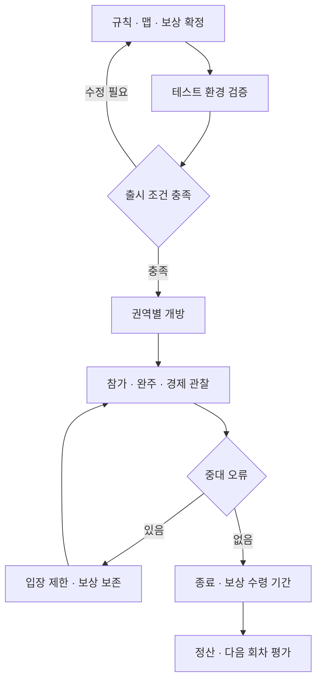

**[분석]** 이벤트 종료는 전투 입장 종료, 진행도 획득 종료, 보상 교환 종료가 다를 수 있다. 세 시점을 각각 정의해야 마지막 날의 진행 손실과 보상 미수령을 줄일 수 있다.

## 11. QA

| ID | 조건 | 확인점 |
|---|---|---|
| MOD-01 | 일반전에서 Onslaught로 전환 | 허용 차량·장비·규칙 재검증 |
| MOD-02 | 야간 Onslaught 지도 | 일반전 445/565 규칙의 오적용 없음 |
| MOD-03 | Onslaught 시간 종료 | 생존→피해→첫 격파 순서 확인 |
| MOD-04 | Black Signal 한 구역에 여러 아군 | 인원 증가가 점령 속도를 바꾸지 않음 |
| MOD-05 | Black Signal 보호 중 발사/이동 | 보호 해제 예외는 실측 결과로 확정 |
| MOD-06 | Frontline 다음 구역 개방 | 이전·현재 구역 접근 상태 일관성 |
| MOD-07 | Steel Hunter 전투 종료 | 전투 내 업그레이드가 영속 연구를 오염시키지 않음 |
| MOD-08 | Maneuvers 차량 파괴·패배 | Out of Commission 전이와 기여 제한 |
| MOD-09 | 이벤트 종료 시 전투 진행 중 | 진행도·보상 마감 정책 일관성 |
| MOD-10 | 탄약 반환 이벤트 | 반환과 일반 보급이 중복 실행되지 않음 |
| MOD-11 | 테스트 전용 차량 | 라이브 큐에 노출되지 않음 |
| MOD-12 | 지역별 일정 차이 | UI 현지시간과 서버 UTC 일치 |

## 출처

- [S01] [Release Notes 2.0](https://worldoftanks.eu/en/content/docs/release_notes/release-notes-2-0/)
- [S02] [Onslaught Guide](https://worldoftanks.eu/en/content/guide/modes-and-events/onslaught/) — 상시 가이드의 시즌 구형 항목은 S03/S04로 교정.
- [S03] [Onslaught: Year of the Phoenix Begins](https://worldoftanks.eu/en/news/general-news/onslaught-season-of-the-phoenix-1/)
- [S04] [Release Notes 2.4](https://worldoftanks.eu/en/content/docs/release_notes/release-notes-2-4/)
- [S05] [Frontline 2026: Autumn Launch](https://worldoftanks.eu/en/news/general-news/frontline-autumn-november-2026/)
- [S06] [Steel Hunter Guide](https://worldoftanks.eu/en/content/guide/modes-and-events/steel-hunter/)
- [S07] [Maneuvers: Rally Your Clan — November 2026](https://worldoftanks.eu/en/news/general-news/maneuvers-november-2026/)
- [S08] [Welcome Black Signal](https://worldoftanks.eu/en/news/general-news/black-signal-november-2026/)
- [S09] [Update 2.4.1: Season of Action](https://worldoftanks.eu/en/news/updates/wot-2-4-1/)


---

<!-- Source document: 13_Research_Progression_and_Tier_XI.md -->

# 13. 연구·차량 성장·Tier XI 업그레이드 역기획

> **대상:** Wargaming World of Tanks PC판. **자료 확인일:** 2026-11-13 KST. EU 공식 가이드를 우선하며 지역 이벤트 가격은 일반화하지 않는다. 2.0의 출시 사양과 이후 확장을 구분한다. 게임 클라이언트 실행·서버 코드 검증을 수행한 문서는 아니다.
>
> **표기:** `[확인]` 공식 공개 규칙, `[분석]` 규칙에서 도출한 설계 해석, `[제안]` 재구현을 위한 구조, `[검증 필요]` 공개 자료만으로 확정할 수 없는 내용.

## 1. 시스템 목적과 경계

[분석] 차량 성장은 단순한 레벨 상승이 아니라 **전투 경험을 특정 계통의 접근 권한으로 바꾸는 과정**이다. 플레이어는 경험치로 다음 선택지를 열고, 크레딧으로 소유하며, 모듈·장비·승무원 조합으로 실제 전투 성능을 완성한다. 따라서 연구 완료, 구매 완료, 출격 준비 완료는 서로 다른 상태여야 한다.

이 문서는 연구 계통도, 모듈 연구, 청사진, Elite 상태, Tier XI 성장에 집중한다. 장비와 현장 개량은 [15번](15_Equipment_Consumables_and_Field_Mods.md), 경험치·크레딧 정산은 [16번](16_Economy_and_Battle_Rewards.md), 승무원은 [14번](14_Crew_and_Perks.md)이 담당한다. 임무 보상 차량의 획득 경로는 [17번](17_Missions_Monetization_and_LiveOps.md)에서 다룬다.

## 2. 확인된 기본 규칙

### 2.1 연구와 소유를 분리한다

[확인] 일반 연구 차량은 선행 차량과 필수 모듈을 연구해야 다음 차량을 연구할 수 있다. 차량별 전투 경험치, 자유 경험치, 청사진을 성장에 사용하며, 연구한 차량은 크레딧으로 구매한다. 다음 차량으로 가는 데 필요한 모듈만 우선 연구할 수도 있다. 모든 모듈과 후속 차량을 연구하면 일반 차량은 Elite 상태가 되고, 이후 경험치는 승무원 가속 훈련이나 자유 경험치 전환에 사용할 수 있다. [P13-1]

[확인] 모듈은 연구 후 구매·장착하는 절차를 거친다. 교체한 이전 모듈은 판매하지 않으면 보관소로 보내진다. 주포·포탑·현가장치·엔진·무전기 등의 개선은 성능을 바꾸며, 대부분의 Tier X·XI 차량은 일반 하위 차량과 다른 모듈 구성을 가진다. 모든 차량에 동일한 개수의 모듈이 있다고 가정하면 안 된다. [P13-2]

| 구분 | 입력 | 보존할 상태 | 결과 |
|---|---|---|---|
| 연구 | 차량 XP, 자유 XP, 선행 조건 | 연구 해금 목록 | 구매·다음 연구 가능 |
| 차량 구매 | 크레딧, 선택한 초기 구성 | 차량 소유권 | 차고에 차량 생성 |
| 모듈 구매·장착 | 크레딧 또는 보관 모듈, 호환성 | 보관 수량, 장착 구성 | 차량 성능 변경 |
| 전투 참가 | 완성된 차량 구성 | 전투용 구성 스냅샷 | 차량별 전투 XP 획득 |
| 판매·재구매 | 소유 차량, 보관 선택 | 연구와 소유 상태를 별도로 취급 | 차량 운용 자산 재배치 |

표는 [분석]에 따른 기능 경계다. 판매 시 모든 관련 상태의 실제 보존 범위는 개별 항목별 확인이 필요하다.

### 2.2 청사진이 줄이는 비용

[확인] 공식 상시 가이드는 청사진을 Tier II–X 차량의 **차량 연구 XP 할인**으로 설명한다. 모듈 연구비를 할인하지 않으며, 선행 차량과 필요한 모듈의 연구 요건도 없애지 않는다. 차량 청사진 조각은 즉시 할인을 제공하고, 국가·범용 조각은 해당 차량 조각으로 조합할 수 있다. 완성 청사진은 차량 연구 XP를 없앨 수 있지만 차량 구매 크레딧을 대신하지 않는다. Tier XI에 동일하게 적용된다고 확대 해석하지 않는다. [P13-3]

[분석] 이 구조는 플레이어에게 세 종류의 부족함을 만든다. 필요한 연구가 남았는지, 구매 자금이 부족한지, 장착 구성이 미완성인지가 각각 다르다. UI가 이 셋을 모두 “해금되지 않음”으로 표시하면 청사진 보상을 받아도 진전이 없다고 느끼게 된다.

## 3. 차량 연구 상태 모델

다음은 [제안] 상태 모델이다. Wargaming 내부 클래스 구조를 의미하지 않는다.

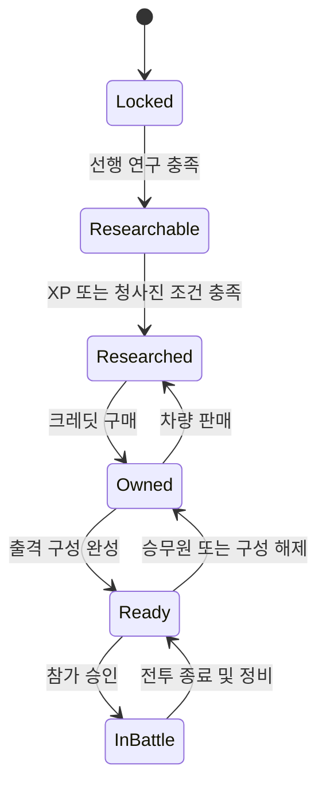

### 3.1 상태별 차고 UX

| 상태 | 주 행동 | 함께 보여줄 정보 | 실패 시 설명 |
|---|---|---|---|
| 선행 미충족 | 선행 연구 보기 | 가장 가까운 미해금 노드 | “선행 주포 연구 필요”처럼 원인 표시 |
| 연구 가능 | 연구 | 차량 XP/자유 XP 차감 내역 | 필요한 자원별 부족량 |
| 연구 완료 | 구매 | 차량값과 선택 구성 총액 | 차고 공간·자금 등 개별 원인 |
| 소유·미장착 | 장착 또는 정비 | 호환성·수량·성능 변화 | 상위 모듈이라는 이유만으로 자동 장착 금지 |
| 출격 가능 | 전투 시작 | 전투 구성·보급 설정 | 모드의 티어·차량 제한 |

[분석] “구매” 버튼을 누를 때 실제 운용 비용을 숨기면 새 차량을 얻은 직후 탄약·장비·승무원 준비 비용으로 좌절한다. 차량 기본값, 선택 구성비, 이후 매 전투 유지비를 서로 다른 행으로 보여주는 편이 이해하기 쉽다.

### 3.2 연구 그래프 규칙

[제안] 연구 계통도는 화면상의 화살표와 권한 판정을 분리한 유향 비순환 그래프로 표현한다. 모듈 연구와 다음 차량 연구는 같은 그래프의 서로 다른 노드 유형이다. 동일 노드의 연구 여부, 차량 소유 여부, 물리적인 모듈 재고 수량은 별도 데이터다.

- `prerequisite_ids`는 연구할 수 있는 조건이다.
- `compatible_mounts`는 장착할 수 있는 조건이다.
- `required_for_next_vehicle`은 플레이어에게 최단 진행 경로를 설명하는 메타데이터다.
- `research_unlock`은 권한이므로 한 번의 구매 요청 중복으로 두 번 차감하면 안 된다.
- 패치로 계통이 바뀌면 현재 보유자와 신규 진입자의 권한을 별도로 이관한다.

## 4. Tier XI의 성장 구조

### 4.1 출시 사양과 현재 범위

[확인] 2.0은 기존 Tier X 계통에서 이어지는 Tier XI와 별도 임무 보상 차량을 도입했다. 출시 당시에는 15대의 연구 차량과 1대의 임무 보상 차량이 소개되었다. 당시 안내의 일반 Tier XI 연구·구매 예시는 **325,000 XP / 7,400,000 크레딧**이다. Tier XI는 VI–X의 현장 개량 대신 전용 업그레이드 트리를 사용하며, 소형 10,000 XP·대형 20,000 XP·최종 25,000 XP 노드, 최대 25노드가 안내되었다. 수치는 **2.0 발표 사양**으로 기록한다. [P13-4]

[확인] 2.4에는 독일 중전차 계통과 추가 Tier XI 차량이 소개되었다. [P13-5]

[분석] 따라서 “Tier XI는 총 16대”라는 문장을 2026년 전체 보유 목록으로 사용하면 틀린다.

[제안] 개별 차량의 현재 가격·노드 수·구성은 해당 패치 데이터로 관리해야 한다.

| 성장 차원 | 일반 연구 차량 | Tier XI 전용 성장 |
|---|---|---|
| 핵심 진전 | 필수·선택 모듈, 다음 티어 | 차량 성능과 고유 메커니즘 업그레이드 |
| 기본 개조 구조 | 호환 모듈 연구·장착 | 차량별 업그레이드 노드 |
| 후반 조정 | 해당 차량의 현장 개량 | 전용 업그레이드로 분리 |
| 선택의 성격 | 당장 성능 개선과 빠른 다음 차량 진입 | 어떤 강점을 먼저 완성할지 결정 |
| 완성 이후 | Elite 경험치 활용·숙련 | 모든 성장 노드 완료 후 Elite·시각 보상 |

표의 선택 해석은 [분석]이다. Tier XI 전투 고유 동작은 [07번](07_Artillery_and_Special_Mechanics.md)을 참조한다.

### 4.2 업그레이드가 전투에 들어가는 시점

[제안] 업그레이드 적용은 차고 구성 변경으로 취급하고 전투 참가 시 고정한다. 전투 도중 플레이어가 다른 차량의 연구를 진행하더라도 이미 시작한 전투의 성능이 바뀌지 않아야 한다. 특수 메커니즘을 강화하는 노드는 단순 스탯 가산과 구분해 `mechanic_parameter_override`로 기록한다.

예를 들어 어떤 노드가 메커니즘 자원 충전 시간을 줄인다면 다음을 별도로 정의한다.

1. 기준 파라미터의 단위와 허용 범위.
2. 장비·승무원·모드 효과와 겹칠 때의 계산 정책.
3. 이미 충전 중인 상태를 재계산할 수 있는지 여부.
4. 차고 비교창과 전투 툴팁에 표시할 최종값.
5. 업그레이드 취소·보상 정책을 지원할지 여부.

실제 Tier XI 노드가 모두 이러한 구현을 사용한다는 뜻은 아니다. 공개된 “고유 메커니즘 강화”를 안전하게 재구성하기 위한 데이터 요구사항이다.

## 5. 성장 속도와 선택 비용

[분석] 플레이어가 느끼는 진행 속도는 총 경험치 하나로 설명되지 않는다. 전투당 XP, 전투 길이, 대기 시간, 승률, 차량 운용 숙련, 유지비, 할인 보유 여부가 함께 작용한다.

아래는 **가정한 연구 계획**이며 실제 전차의 비용·수익 예측이 아니다.

- 다음 차량에 필요한 잔여 연구비: 80,000 XP.
- 전투당 차량 XP의 계획값: 600 XP.
- 보유 자유 XP: 20,000 XP.
- 1회 전투·대기 합계: 8분.

모든 자유 XP를 연구에 쓴다고 가정하면 필요한 전투는 `ceil((80,000 - 20,000) / 600) = 100회`다. 이 계산은 13시간 20분의 전투 참여량을 뜻하지만, XP 보너스·일일 승리·실력 향상·일정 등의 영향을 반영하지 않는다. 따라서 고객에게 보장하는 완료 시간으로 사용하면 안 된다.

성능 개선 모듈에 12,000 XP를 먼저 쓰면 잔여 비용은 늘어난다. 그러나 생존과 피해 기여가 좋아져 전투당 XP가 상승한다면 장기적으로 진행이 빨라질 수 있다. 이 선택을 “모듈은 낭비”로 단순화하지 않고, 현재 차량에서 얼마나 더 싸울 예정인지와 함께 판단하게 하는 것이 성장 UX의 역할이다.

## 6. 구체 상황 분석

### 사례 A. 청사진 100%인데 다음 차량을 구매할 수 없다

[분석] 청사진은 한 종류의 비용만 제거한다. 확인 순서는 선행 차량 연구 → 필수 모듈 연구 → 대상 차량 연구 실행 → 구매 크레딧 → 출격 구성이다. 차량의 연구 XP가 0이라는 이유로 소유권까지 주어지지 않는다. 화면에는 “연구 XP 면제”와 “구매비 필요”를 동시에 보여줘야 한다.

[제안] QA용 테스트 계정에 청사진만 완성시키고 필수 모듈을 남겨 둔다. 구매 버튼의 비활성 사유가 재화 부족으로 잘못 표시되지 않는지 확인한다. 필수 모듈을 연구한 후에는 할인 적용이 누락되거나 자유 XP가 소비되지 않아야 한다.

### 사례 B. Tier X에 쌓인 XP와 새 Tier XI의 성장 XP

[분석] 이전 차량의 XP로 후속 차량을 해금하는 것과 새 차량을 운용하며 업그레이드하는 것은 서로 다른 성장 구간이다. “Tier X에서 325,000 XP를 쌓았으므로 Tier XI 업그레이드도 완료됐다”라는 기대가 생기지 않도록 연구·구매·업그레이드를 분리해서 설명해야 한다.

[검증 필요] 자유 XP의 Tier XI 각 노드 사용 가능 범위, 패치별 업그레이드 가격 변경, 보상 차량의 초기 노드 상태는 해당 차량 화면으로 확인한다. 일반 차량의 기존 동작을 그대로 확장하여 확정하지 않는다.

## 7. 재구현 데이터 계약

```yaml
# [제안] 설명용 스키마. 실제 클라이언트 데이터 형식이 아님.
VehicleProgression:
  vehicle_id: stable_id
  ruleset_version: patch_id
  progression_type: MODULE_TREE | TIER_XI_UPGRADES | REWARD_ONLY
  combat_xp: integer
  unlocked_research_nodes: [node_id]
  owned_vehicle: boolean
  blueprint_discount_basis_points: integer
  unlocked_upgrade_nodes: [node_id]
  elite_status: boolean
ResearchNode:
  id: stable_id
  kind: MODULE | NEXT_VEHICLE | UPGRADE
  prerequisites: [node_id]
  xp_cost: integer
  eligible_xp_wallets: [wallet_type]
  grant_id: stable_id
  mechanic_overrides: []
```

```text
# [제안] 중복 차감과 패치 혼선을 막는 처리 순서
Research(request):
    lock(account_progression)
    if request.id already committed: return stored_result
    rules = resolve(request.ruleset_version)
    validate_prerequisites(rules, account, request.node)
    quote = compute_cost(rules, account, request.node)
    require request.accepted_quote == quote
    require account.can_pay(quote)
    atomically debit wallets, grant node, record request.id
    emit ResearchCompleted(version, node, paid_amounts)
```

[분석] 연구 이벤트는 분석용 통계뿐 아니라 복구 근거다. 할인 이벤트 종료 직전 요청, 클릭 중복, 네트워크 재시도, 새 패치에 의한 노드 이동을 모두 처리하려면 **무엇을 어떤 규칙으로 얼마나 지불했는지**가 남아야 한다.

## 8. 검증 시나리오

| ID | 조건·행동 | 기대 결과 / 확인점 |
|---|---|---|
| P13-01 | 선행 모듈 미연구, 대상 차량 청사진 완성 | XP 면제와 선행 조건 미충족을 구분 |
| P13-02 | 연구비만 보유, 구매비 부족 | 연구는 가능하되 차량 소유는 부여하지 않음 |
| P13-03 | 연구 요청 네트워크 재전송 | XP 한 번 차감, 해금 한 번 발생 |
| P13-04 | 상위 모듈 구매 후 원래 모듈 보관 | 장착과 재고 수량이 일치 |
| P13-05 | 필수 모듈만 연구하여 다음 차량 진행 | 선택 모듈과 Elite 조건을 혼동하지 않음 |
| P13-06 | 할인 시작·종료 시각에 연구 요청 | 서버의 단일 규칙 시각과 견적 적용 |
| P13-07 | 패치로 새 후속 차량 추가 | 기존 Elite·XP 활용 정책의 이관 결과 확인 |
| P13-08 | XI 일반 차량과 임무 보상 차량 비교 | 획득 경로를 동일 구매 절차로 처리하지 않음 |
| P13-09 | 출격 이후 차고 성장 데이터 변경 | 이미 시작한 전투의 성능 스냅샷 유지 |
| P13-10 | 소유 차량 판매 후 재구매 | 연구·업그레이드·장비·승무원의 보존 범위를 개별 검증 |

이 표는 [제안] 검증 계획이다. 실제 실행한 테스트 결과가 아니다.

## 9. 설계 평가와 미확인 항목

[분석] 일반 차량의 연구는 계통 학습과 성능 개선을 결합한다. Tier XI는 다음 티어로 넘어가는 목표 대신 현재 차량의 고유 기능을 완성하는 동기를 제공한다. 두 구조를 같은 진행 막대로 합치면 어느 자원이 어디에 쓰이는지 불투명해진다. 연구 막대·보유 막대·숙련 보상은 서로 다른 의미로 유지해야 한다.

[분석] 주의할 운영 지표는 최고 티어 도달 속도뿐 아니라 **신규 차량 구매 후 첫 20전의 이탈률**, 기본 구성과 완성 구성의 성과 격차, 자유 XP 소진 후 플레이 중단, 다음 차량 직전 크레딧 부족률이다. 이 지표는 아직 숙련되지 않은 플레이어에게 강한 성능 격차를 오래 부담시키는 구간을 찾는 데 적합하다.

[검증 필요] 전체 현행 연구비 테이블, 모든 차량의 호환성 조건, Tier XI별 노드 상세, 청사진·할인의 예외, 판매 시 업그레이드 보존, 계통 변경 시 자동 보상은 별도 데이터 수집 대상이다. 본 문서의 출시 가격을 라이브 데이터 테이블 대신 사용하지 않는다.

## 10. 출처

- **P13-1** — [Purchase and Research Vehicles](https://worldoftanks.eu/en/content/guide/game-mechanics-and-achievements/purchase-and-research-vehicles/). 상시 공식 가이드. 선행 연구·구매·Elite 구조.
- **P13-2** — [Upgrading Your Vehicles](https://worldoftanks.eu/en/content/guide/newcomers-guide/upgrading_vehicles/). 상시 공식 가이드. 모듈 연구·장착·보관.
- **P13-3** — [Vehicle Blueprints](https://worldoftanks.eu/en/content/guide/game-mechanics-and-achievements/vehicle-blueprints/). 상시 공식 가이드. 할인 범위·선행 조건.
- **P13-4** — [Update 2.0: Under the Hatch of Tier XI](https://worldoftanks.eu/en/news/general-news/update-2-0-tier-11-overview/). 2.0 출시 안내, 2025년. 가격·노드는 당시 사양으로 한정.
- **P13-5** — [Update 2.4: Overdrive](https://worldoftanks.eu/en/news/updates/wot-2-4/). 2026년 9월 업데이트 안내. Tier XI 추가 확장.
- **P13-6** — [About: Experience](https://wargaming.net/support/en/products/wot/article/10223/). 공식 고객지원. 차량 XP·Elite XP·자유 XP 구분.

모든 출처는 2026-11-13 확인. 일부 공식 페이지의 직접 열기는 보안 페이지로 반환되어 검색 서비스에 제공된 공식 색인 본문으로 교차 확인했다. 오래된 매뉴얼을 현행 수치 근거로 사용하지 않았다.


---

<!-- Source document: 14_Crew_and_Perks.md -->

# 14. 승무원·특전·훈련·전차 간 이전 역기획

> **대상:** Wargaming World of Tanks PC판. **자료 확인일:** 2026-11-13 KST. 1.26 이후 특전 체계와 2026년 2.2 개선을 반영한다. 2026-02-25 개선 소개 글의 발행일과 2.2의 3월 적용 시점을 구분한다.
>
> `[확인]` 공식 문서 사실 / `[분석]` 설계 해석 / `[제안]` 재구현 설계 / `[검증 필요]` 실제 클라이언트 추가 검증 항목. 이 문서는 실플레이 측정이나 내부 코드 분석 결과가 아니다.

## 1. 시스템 역할

[분석] 승무원은 차량을 교체해도 플레이어가 유지하려는 **개인화된 성장 자산**이다. 연구 모듈이 차량 자체를 개선한다면 승무원은 같은 차량을 어떻게 운용할지 결정한다. 정찰, 교전 거리, 탄 교환, 피격 후 복구 등 전투 상황이 성장 선택으로 연결된다.

기획상 반드시 분리할 대상은 다섯 가지다.

| 대상 | 질문 | 데이터 의미 |
|---|---|---|
| 승무원 신원 | 누가 이 자산을 소유하는가? | 개체 ID·국가·초상·고유 음성 |
| 차량 적합성 | 어느 차량에 훈련되었는가? | 현재 차량 배치와 전문 차량 |
| 직책 | 어떤 역할을 맡는가? | 주 직책·겸직 |
| 특전 성장 | 무엇을 얼마나 배웠는가? | 선택 특전·훈련 XP·제로 특전 |
| 현재 효율 | 지금 효과가 얼마나 적용되는가? | 재훈련·부상·일시 효과 |

신원·학습 내용·현재 전투 효율을 한 수치로 저장하면 재훈련과 부상 처리에서 보존해야 할 경험치까지 손상될 수 있다. [분석]

## 2. 현재 체계의 핵심 규칙

[확인] 상시 가이드에서 기본 승무원 효율은 100%로 시작하며, 주 직책 특전은 **제로 특전을 포함하여 최대 6개**다. 선택 풀은 직책별 개별 특전 8개와 공통 특전 3개로 안내된다. 겸직 승무원은 **각 추가 직책마다 보너스 특전을 최대 3개** 훈련하며 주 직책 특전과 함께 절반 속도로 진행한다. 동일 직책 승무원이 복수이면 해당 개별 특전은 평균 훈련 수준을 사용하고, 공통 특전은 전체 승무원 평균을 사용한다. 제6감은 모든 전차장의 기본 기능으로 별도 취급한다. [P14-1][P14-7]

[분석] “최대 6개”는 승무원이 제공할 수 있는 모든 효과가 6개라는 뜻이 아니다. 겸직 보너스와 전차장 기본 기능을 별도 계층으로 봐야 한다. 동시에 “새 특전이 추가되었으므로 모든 승무원의 특전 슬롯이 증가한다”는 결론도 성립하지 않는다. 선택 풀이 늘고 슬롯이 유지되면 기존 빌드의 기회비용이 변한다.

### 2.1 직책과 전투 시스템 연결

[확인] 주요 직책은 전차장, 포수, 조종수, 장전수, 무전수다. 차량에 따라 한 승무원이 여러 직책을 겸하며 동일 직책이 여러 명일 수도 있다. 각 직책은 시야·조준·기동·장전·정보 전달과 관련된 특성을 담당한다. [P14-2]

| 직책 | 전투에서 볼 질문 | 설계상 주요 연결점 |
|---|---|---|
| 전차장 | 상황을 먼저 읽고 팀의 성능을 유지하는가? | 시야, 승무원 효율, 발각 알림, 복구 운용 |
| 포수 | 원하는 지점에 유효탄을 보내는가? | 분산, 조준, 포탑 회전, 관통·피해 관련 조건 |
| 조종수 | 원하는 위치와 자세를 제때 확보하는가? | 가속·선회·지형·충돌·현가장치 |
| 장전수 | 어떤 탄을 언제 쓸 수 있는가? | 장전, 탄 전환, 탄약고, 탄속 |
| 무전수 | 아군과 정보·지원 가치를 연결하는가? | 시야, 발각 유지, 근접 협력, 스턴 대응 |

표의 “질문”과 연결 해석은 [분석]이다. 특정 특전의 수치 목록을 대체하지 않는다.

## 3. 효율 수치의 구분

### 3.1 승무원 효율과 특전 효율

[확인] 2024년 개편은 `crew efficiency`와 `perk efficiency`를 분리했다. 전자는 승무원이 전차 성능에 주는 영향이며 장비·음식·전차장 등의 영향을 받는다. 후자는 학습한 특전의 실효성을 나타내고 기본값은 100%다. 무료·일부 크레딧 재훈련은 특전 효율을 낮출 수 있으며, 감소분은 승무원 XP로 회복한다. 당시 안내는 효율 풀 100,000 XP와 1%당 1,000 XP의 선형 회복을 제시한다. [P14-3]

[분석] 화면의 “100%”가 무엇인지 반드시 명시해야 한다. 기본 숙련이 100%여도 선택 특전의 훈련이 20%일 수 있고, 특전 훈련을 완료했어도 재훈련 후 효율이 낮을 수 있다. 차고 성능 비교는 배운 정도와 현재 효율의 결과를 함께 보여줘야 한다.

### 3.2 계산 정책

다음은 [제안]이며 실제 효과 합성 공식의 복원값이 아니다.

```text
effectivePerk = EvaluatePerk(
    learnedLevel,
    roleAggregation,
    retrainingEfficiency,
    crewEfficiency,
    battleCondition,
    directivePolicy,
    rulesetVersion
)
```

평균 훈련 수준을 먼저 집계하고 모든 값을 단순 곱하는 구현은 위험하다. 전우애, 일시 버프, 장비, 직책 겸임, 부상자의 대체 수행처럼 예외가 있기 때문이다. 효과 유형마다 `Additive`, `Multiplicative`, `Override`, `ConditionOnly`와 같은 계산 방식을 명시하고 최종 파라미터에 적용해야 한다.

- 재장전 **시간 감소**와 장전 **속도 증가**는 같은 단위가 아니다.
- 기본 시야 증가와 최대 탐지 거리 제한은 서로 다른 시스템이다.
- 소화 속도 향상은 화재 발생 자체를 반드시 막는 효과가 아니다.
- 분산 축소는 포탄 관통력 증가와 다르다.
- 부상 상태 해제와 계정의 재훈련 효율 회복도 다른 상태 변화다.

## 4. 특전 선택을 전투 행동으로 해석하기

[확인] 2026년 승무원 개선은 직책마다 두 개씩 총 10개의 특전을 더했다. 공식 소개에는 열세에서 승무원 효율을 올리는 `Hold the Line`, 구급킷 사용 후 효과를 주는 `Stay Sharp`, 가까운 적에게 작용하는 `Point Blank`, 주변 아군 부재 조건의 `Lone Wolf`, 주변 아군을 이용하는 `Field Support`, 피해 방어량을 조건으로 하는 `Bulletproof` 등이 포함된다. XP 손실 없는 특전 초기화도 100,000 크레딧으로 변경되었다. [P14-4]

아래 표는 해당 효과를 플레이 패턴으로 읽은 [분석]이다. 수치·발동 반경은 실제 특전 툴팁을 데이터로 가져와야 한다.

| 패턴 | 선택이 요구하는 행동 | 다른 시스템과 생기는 긴장 |
|---|---|---|
| 정보 우선 | 먼저 탐지하고 아군 사격을 연결 | 정찰 위치 노출 위험과 생존 필요 |
| 안정된 사격 | 멈춰서 조준·분산 조건을 완성 | 정지 시간이 길어지면 반격 기회 증가 |
| 근접 교전 | 짧은 거리에서 조건부 화력을 활용 | 장갑·피격·충돌 위험 증가 |
| 단독 운용 | 아군과 떨어져 독립 사선을 확보 | 도움을 받기 어려워지고 퇴로 중요 |
| 동료 지원 | 아군과 유효 거리 유지 | 한 지점 밀집으로 포격·사선 위험 |
| 위기 대응 | 피격·열세·저체력 조건을 활용 | 효과를 얻으려고 일부러 손해 보는 역유인 |
| 복구 주기 | 수리·구급·소화와 특전을 결합 | 소모품 슬롯·유지비와 경쟁 |

[분석] 조건부 특전은 수동 능력 버튼을 늘리지 않으면서 플레이 스타일을 바꾼다. 반면 여러 특전이 같은 순간에 켜지면 사용자는 왜 조준·장전이 빨라졌는지 알기 어렵다. HUD에는 발동 원인, 남은 시간, 중첩 여부를 최소한으로 표시해야 한다. 알림을 끈 사용자의 전투 성능 계산은 동일해야 한다.

## 5. 훈련·제로 특전·성장 완료

[확인] 특전은 훈련 XP를 쌓아 성장하며 다음 특전은 앞 특전보다 더 많은 XP를 요구한다. 제로 특전은 처음부터 완성되어 별도의 훈련 XP를 필요로 하지 않는다. 엘리트 차량의 승무원 가속 훈련, 자유 XP, 승무원 교본 등이 훈련 경로로 제공된다. 6개 주 특전을 완성한 승무원도 후속 성장에 XP를 쌓을 수 있다. [P14-1]

[분석] 제로 특전은 “무조건 별도의 7번째 슬롯”이 아니라 성장을 시작하는 비용 구조의 차이다. 지급 승무원을 비교할 때 특전 개수뿐 아니라 제로 여부와 남은 XP를 보여줘야 한다. 처음 얻은 승무원이 완성된 특전 몇 개를 보유하더라도, 이후 학습에 필요한 XP는 같은 표시 개수의 다른 승무원과 다를 수 있다.

### 5.1 교본과 멘토링의 거래 단위

[확인] 1.28은 멘토링 라이선스를 이용해 승무원 XP를 이전하는 작업을 도입했다. XP를 제공한 승무원은 계정에서 제거되는 절차이므로 일반적인 특전 초기화와 다르다. [P14-5]

[확인] 2.2 개선은 프리미엄 차량에 탑승 중인 승무원에게도 교본을 직접 사용하는 편의 기능을 안내한다. [P14-4]

[제안] 교본 사용은 아이템 수량 감소와 대상 승무원 XP 증가를 같은 거래로 처리한다. 멘토링은 제공자 제거·수신자 XP 증가·아이템 소모를 하나의 원자적 변경으로 묶는다. 제공자가 전투 중이거나 다른 요청에 의해 이전되었다면 재검증한다. 취소 버튼 뒤에서 이전을 먼저 실행하면 안 된다.

## 6. 이전·재훈련·초기화를 구별한다

| 작업 | 바꾸는 것 | 유지되어야 할 개념 | 대표 UX 설명 |
|---|---|---|---|
| 차량 배치 | 현재 탑승 위치 | 승무원 신원과 학습 기록 | “이 차량에 배치” |
| 차량 재훈련 | 전문 차량·필요시 직책 | 선택 특전과 보존 XP 정책 | “차량 적합성 변경” |
| 특전 초기화 | 선택한 특전 구성 | 비용 옵션에 따른 XP | “같은 경험치로 다시 선택” |
| 경험치 이전 | 성장 자산의 대상 | 수신자의 식별·이전 내역 | “제공 승무원 제거 후 XP 이전” |
| 해고 | 승무원 보유 상태 | 복원 가능 여부의 별도 정책 | “선택 자산 삭제” |

표는 [분석]에 따른 작업 구분이다.

[확인] 현재 특전 훈련 가이드는 첫 초기화 무료, 이후 무료·크레딧·재훈련 명령 등의 선택을 설명한다. 2026년 무손실 초기화 가격과 **차량 재훈련의 가격**을 같은 것으로 복사하면 안 된다. [P14-1][P14-4]

[검증 필요] 공식 상시 차량 가이드와 업데이트 요약 사이에 차량 재훈련의 금액 표현이 일치하지 않는 부분이 남아 있다. 따라서 본 문서는 차량 재훈련의 현행 무손실 가격을 고정하지 않는다. 실제 차고의 작업명·재화 아이콘·최종 확인창을 확인한 뒤 별도 가격 테이블로 수집해야 한다. 최신 무손실 **특전 초기화 100,000 크레딧**과 오래된 **차량 재훈련 200 골드** 문구를 혼합하지 않는다.

## 7. 구체 상황 분석

### 사례 A. 장전수가 두 명인 차량

[확인] 공식 가이드는 같은 직책 특전의 평균 수준을 적용한다고 설명한다. [P14-1]

[분석] 한 장전수에게 탄 전환 특전을 100%, 다른 장전수에게 다른 특전을 100% 훈련시켰다고 해서 두 특전이 모두 완전한 효과를 내지 않는다. UI는 각 승무원의 “100% 학습”과 차량의 “집계 적용 수준”을 다른 행에 보여주는 것이 적절하다.

[제안] 테스트에서는 두 장전수의 구성을 `100/0`, `100/100`, `50/50`으로 바꾸고 차고 표시 및 전투 결과를 비교한다. 직책이 두 명인 차량을 한 명의 승무원 데이터로 단순화하는 이관 코드가 있으면 특전 효과가 갑자기 강해질 수 있다.

### 사례 B. 새 전차로 이동한 숙련 승무원

[분석] 사용자는 같은 승무원을 옮겼는데 조준·재장전 성능이 떨어지는 상황을 버그로 느낄 수 있다. 확인해야 할 것은 새 전차의 기본 성능, 직책 구성, 차량 재훈련 완료 여부, 특전 효율, 장비·음식 변경이다. “전차가 나빠졌다”라는 하나의 설명으로 끝내면 원인을 해결할 수 없다.

[제안] 이전 전후 비교 화면에는 차량 차이와 승무원 적용 차이를 분리한다. 겸직이 사라져 특정 보너스 특전을 쓰지 못하는 경우도 설명한다. 새 차량의 기본 모듈 상태와 미완료 연구는 [13번](13_Research_Progression_and_Tier_XI.md)에 연결한다.

### 사례 C. 구급킷을 공격 준비 수단으로 사용하는 조건부 특전

[분석] 구급킷 사용 뒤 효과가 생기는 특전은 피해 복구와 공격 타이밍을 연결한다. 현재 부상자가 없어도 사용할 수 있는 특전 예외가 존재하면, “부상자 없음 → 버튼 항상 비활성”이라는 공통 로직을 그대로 쓰면 안 된다. 반대로 모든 승무원 구성에서 그 예외를 허용하면 소모품을 의미 없이 소비할 수 있다.

[제안] `CanActivateConsumable`은 기본 사용 조건과 특전이 추가한 허용 조건을 함께 평가하고, 확인 툴팁에 “치료 대상 없음, 특전 발동용 사용”을 보여준다.

## 8. 재구현용 데이터와 이벤트

```yaml
# [제안] 실제 서버 포맷이 아닌 분석용 계약
CrewMember:
  id: persistent_id
  nation: nation_id
  trained_vehicle: vehicle_id
  current_assignment: vehicle_id_or_null
  primary_qualification: role_id
  secondary_qualifications: [role_id]
  crew_xp: integer
  retraining_efficiency_pool: integer
  primary_perks: [{perk_id, learned_xp, is_zero}]
  bonus_perks: [{qualification_id, perk_id, progress}]
  reset_entitlements: []
PerkDefinition:
  id: stable_id
  ruleset_version: patch_id
  qualification: role_or_group
  trigger: event_or_continuous_condition
  effect: parameter_modifier
  aggregation: crew_or_role_policy
  duration_seconds: optional_number
  stacking_rule: explicit_policy
```

```text
# [제안] 조건부 효과 처리
on BattleEvent(event):
    update_perk_condition_state(event)
    for perk in affected_perks(event):
        was_active = perk.active
        perk.active = evaluate_trigger_and_duration(perk)
        if changed(perk):
            invalidate_only_affected_vehicle_parameters(perk)
            emit PerkStateChanged(perk.id, reason, end_time)
```

[분석] 전차의 모든 파라미터를 매 프레임 재계산할 필요는 없다. 주변 거리 임계값, 피해 누적, 아군 생존 수, 소모품 사용처럼 효과를 바꾸는 이벤트를 식별하면 계산과 HUD 설명을 함께 정리할 수 있다. 실제 WoT 구현 방식에 관한 주장은 아니다.

## 9. 검증 시나리오

| ID | 조건·행동 | 기대 결과 / 검증 목적 |
|---|---|---|
| P14-01 | 제로 특전을 포함하여 6개 선택 | 7번째 주 특전 선택 방지, 제6감 별도 보존 |
| P14-02 | 겸직 승무원의 주 특전 진행 | 보너스 직책 진행이 독립 XP를 중복 소모하지 않음 |
| P14-03 | 두 장전수의 특전 구성이 다름 | 동일 직책 평균 집계와 표시 일치 |
| P14-04 | 차량 재훈련 후 효율 회복 | 학습한 특전 XP와 효율 회복 XP 구분 |
| P14-05 | 일시 특전 조건 반복 충족 | 지속시간 갱신·중첩 정책을 명확히 적용 |
| P14-06 | 승무원 부상·치료·스턴 해제 | 서로 다른 상태가 올바르게 복구 |
| P14-07 | 초기화 확인창 중 결제 재시도 | 재화 한 번 차감, XP 한 번만 재분배 |
| P14-08 | 멘토링 요청 중 제공자 재배치 | 자산 잠금과 원자적 이전 보장 |
| P14-09 | HUD 특전 알림 비활성 | 효과 수치와 판정은 유지 |
| P14-10 | 프리미엄 차량에서 교본 사용 | 최신 허용 규칙과 국가·구성 조건 확인 |
| P14-11 | 완성 승무원 후속 성장 | 초과 XP·보상 경계에서 손실·중복 없음 |
| P14-12 | 버전 변경으로 특전 효과 조정 | 차고 비교값과 전투 스냅샷의 버전 일치 |

테스트 계획이며 실행 결과를 의미하지 않는다.

## 10. 설계 평가

[분석] 승무원 선택의 가치는 명목 퍼센트보다 **내가 그 조건을 실제로 얼마나 자주 충족하는가**에 달려 있다. 근접전·장거리 지원·수동 정찰에 같은 추천 구성을 강요하면 선택 시스템의 의미가 약해진다. 추천 UI는 인기 선택과 플레이어의 실제 발동 빈도를 구분해서 보여주는 것이 좋다.

[분석] 효과를 너무 많이 숨기면 초보자는 원인을 알 수 없는 성능 격차를 느낀다. 반대로 모든 조건 알림을 켜면 전투 정보가 과밀해진다. 전투 중에는 현재 영향을 주는 효과, 전투 후에는 발동 횟수·활성 시간·영향받은 행동을 요약하는 구조가 적합하다.

[검증 필요] 개별 특전의 현행 전체 수치, 복잡한 합성 순서, 부상 시 겸직·평균 집계, 특전 효율 회복과 후속 XP 분배, 모드별 특전 제한은 추가 실험 대상이다. 공식 영문 설명에서 “변동 폭을 얼마로 낮춘다”와 “얼마만큼 낮춘다”가 모호한 특전은 숫자를 복제하지 말고 실제 툴팁과 통계 실험으로 확인한다.

## 11. 출처

- **P14-1** — [Crew Training](https://worldoftanks.eu/en/content/guide/game-mechanics-and-achievements/crew-training/). 상시 공식 가이드. 6개 상한·겸직·평균·훈련 구조.
- **P14-2** — [Vehicle Crew](https://worldoftanks.eu/en/content/guide/game-mechanics-and-achievements/vehicle-crew/). 상시 공식 가이드. 직책·배치·재훈련. 가격 일부는 최신 패치와 교차 검증 필요.
- **P14-3** — [Crew Update April 2024](https://worldoftanks.eu/en/news/general-news/crew-update-april-2024/). 2024년 개편의 효율 분리 설명.
- **P14-4** — [Crew Rework Complete: New Perks and Final Improvements](https://worldoftanks.eu/en/news/general-news/crew-perks-expansion-2026/). 2026-02-25 게시. 2.2 개선 소개·추가 특전·무손실 초기화.
- **P14-5** — [Release Notes 1.28](https://worldoftanks.eu/en/content/docs/release_notes/release-notes-1-28/). 멘토링·특전 조정.
- **P14-6** — [Update 2.2: Power Up!](https://worldoftanks.eu/en/news/updates/wot-2-2/). 2026년 3월 업데이트 맥락.

- **P14-7** — [Update 1.26: Hailstorm](https://worldoftanks.eu/en/wot-1-26/). 각 추가 직책마다 보너스 특전 3개를 설명한 정식 출시 안내.

공식 검색 색인 본문과 업데이트 설명을 2026-11-13 교차 확인했다. 테스트 서버의 임시 가격·수치를 라이브 확정값으로 사용하지 않았다.


---

<!-- Source document: 15_Equipment_Consumables_and_Field_Mods.md -->

# 15. 장비·소모품·지휘명령·현장 개량 역기획

> **대상:** Wargaming World of Tanks PC판. **자료 확인일:** 2026-11-13 KST. 상시 공식 가이드와 확정 릴리스 노트를 사용한다. 1.26 이후 소형 수리·구급 규칙을 반영하고, VI–X 현장 개량과 XI 전용 업그레이드를 구분한다.
>
> `[확인]` 공개 규칙 / `[분석]` 설계 해석 / `[제안]` 재구현 구조 / `[검증 필요]` 미확정 범위. 가격은 할인·지역·버전에 따라 변할 수 있으며 여기의 기본값을 결제 견적으로 사용하지 않는다.

## 1. 네 가지 구성 계층

[분석] 장비와 소모품은 같은 슬롯형 UI를 쓰더라도 수명과 경제적 의미가 다르다. 현장 개량까지 단일 “강화 수치”로 합치면 구매, 장착, 소모, 영구 해금의 차이를 잃는다.

| 계층 | 기능 | 수명 | 주요 비용 성격 | 전투와 연결 |
|---|---|---|---|---|
| 장비 | 차량 강점 강화·약점 보완 | 차량에 장착하여 반복 사용 | 구매·개선·해체 | 시작 구성에 반영 |
| 소모품 | 복구·소화·전투 성능 보조 | 사용 또는 전투 단위 소모 | 전투 유지비 | 사용 조건·쿨타임 |
| 지휘명령 | 장비·특전의 추가 효과 | 한 전투 | 지속 지출 또는 보상 재고 | 적합한 장비·특전 필요 |
| 현장 개량 | 완성 차량의 운용 방향 조절 | 연구·구매한 개조 상태 | XP·크레딧 | 성능 교환·구성 선택 |

재구현 시 `ItemDefinition`과 `MountedItemInstance`, `BattleConsumableState`, `PermanentModification`을 별도로 관리한다. [제안]

## 2. 장비 시스템의 실제 규칙

[확인] 일반 장비에는 화력·생존·기동·정찰 범주가 있고, Tier VI부터 첫 슬롯에 차량 유형에 따른 범주가 지정된다. 범주가 일치하면 해당 일반 장비의 보너스가 증가하고, 불일치하면 기본 효과를 사용한다. 동일 효과의 장비를 여러 개 중복 장착할 수 없다. 현상금 장비와 실험 장비는 개선 가능하며, 현상금은 한 번, 실험 장비는 I–III 단계로 안내된다. [P15-1]

| 차량 유형 | 기본 첫 슬롯 범주 | 설계 해석 |
|---|---|---|
| 경전차 | 정찰 | 정보 역할을 낮은 비용으로 완성 |
| 중형전차 | 기동 | 위치 전환·기동 기여를 강화 |
| 중전차 | 생존 | 전선 유지와 교환 능력을 강화 |
| 구축전차·자주포 | 화력 | 사격 임무를 강화 |

범주 매핑은 [확인, P15-1], 설계 해석은 [분석]이다. 개별 특수 차량·모드·추가 슬롯의 예외를 이 표만으로 판정하지 않는다.

### 2.1 장비 유형과 기획 목적

| 유형 | 구별할 상태 | 선택이 만드는 비용·보상 구조 |
|---|---|---|
| 일반 장비 | 클래스·슬롯 범주 | 저비용 기본 구성과 슬롯 최적화 |
| 개선 장비 | 획득 재화·해체 규칙 | 희소 자원을 특정 차량에 집중 |
| 현상금 장비 | 개선 전·후 상태 | 보상 아이템에 추가 투자 |
| 실험 장비 | 개선 단계·주/부 효과·부품 | 여러 성능을 섞어 조정 |

표의 구조는 [분석]이며 모든 장비 가격·수치의 목록은 아니다.

[확인] 실험 장비는 여러 효과를 결합하고 부품으로 개선한다. 주 효과와 같은 장비의 중복 제한, 결합 효과의 장착 요건이 존재하며, 일반 장비와 달리 슬롯 범주 추가 보너스를 받지 않는다. 개선해도 효과 종류가 바뀌기보다는 해당 수치가 강화되는 구조다. 해체 비용 역시 단계별로 다르다. [P15-2]

### 2.2 스탯 비교에서 피해야 할 오류

[분석] “장비 A가 10%, 장비 B가 10%이므로 합계 20% 향상”은 일반 공식이 될 수 없다. 장전 시간, 조준 속도, 분산, 승무원 효율처럼 파라미터가 다르며, 같은 결과에 영향을 주어도 계산 단계가 다를 수 있다.

[제안] 장비 정의에는 `target_parameter`, `operation`, `stack_group`, `slot_bonus_policy`, `compatibility_predicate`를 명시한다. 비교창은 최종 결과와 함께 무엇이 바뀌었는지 설명해야 한다. 범주 이동만으로 효과가 변하는 일반 장비와 변하지 않는 실험 장비를 동일 애니메이션으로 표시하지 않는다.

## 3. 소모품: 발동과 전투 종료 소모를 분리

### 3.1 현재 복구 규칙

[확인] 1.26부터 소형 수리킷은 모든 손상 모듈을 수리하고, 소형 구급킷은 모든 부상 승무원을 치료하면서 스턴을 해제한다. 기본 재사용 대기시간은 각각 90초다. 대형 수리·구급킷, 자동 소화기의 기본 대기시간은 60초로 바뀌었다. 이전의 “소형은 한 부위·한 명만 선택” 규칙은 현행 설명에 사용하지 않는다. [P15-3]

[확인] 상시 소모품 가이드는 동일 아이템 두 개의 중복 장착은 금지하지만 소형과 대형 같은 서로 다른 대응품의 동시 장착은 허용한다. 수리·구급·소화는 한 전투에서 쿨타임 후 재사용할 수 있고, 한 번이라도 사용하면 전투 후 한 개를 보급한다. 음식·연료 등 자동 효과 소모품은 전투 단위로 소비된다. 기본 슬롯 키는 4·5·6이지만 재지정할 수 있다. [P15-4]

| 소모품 분류 | 발동 방식 | 지속 상태 | 주의할 설계 경계 |
|---|---|---|---|
| 수리킷 | 수동 발동 | 쿨타임 후 재사용 | 모듈 수리와 차량 HP 회복은 다름 |
| 구급킷 | 수동 발동 | 쿨타임 후 재사용 | 부상·스턴을 별도로 처리 |
| 수동 소화기 | 사용자 반응 | 쿨타임 | 반응 지연 동안 추가 화재 피해 가능 |
| 자동 소화기 | 조건 자동 발동 | 쿨타임·부가 효과 | 자동 조건과 사용자 입력 구별 |
| 음식·연료 | 전투 시작 효과 | 전투 전체 | 실제 전투 사용량과 무관한 유지비 |

표의 경계 설명은 [분석]이다. 기본 쿨타임에 특전·모드 효과가 적용되면 최종 시간은 달라질 수 있다.

### 3.2 슬롯 수와 보급

[확인] 소모품 슬롯은 Tier II 1개, III 2개, IV 이상 3개로 안내된다. 자동 보급은 전투 후 지정 소모품을 구매·장착한다. [P15-4]

[분석] 재고가 있는 것과 지갑에서 즉시 돈이 나가는 것은 다르다. 보관소에서 보급했다면 전투 후 현재 잔액은 줄지 않을 수 있지만 보유 자산은 소비된다. 경제 분석에서는 “현금 지출”과 “소비한 자산 가치”를 따로 집계해야 한다. 자세한 원장은 [16번](16_Economy_and_Battle_Rewards.md)을 참조한다.

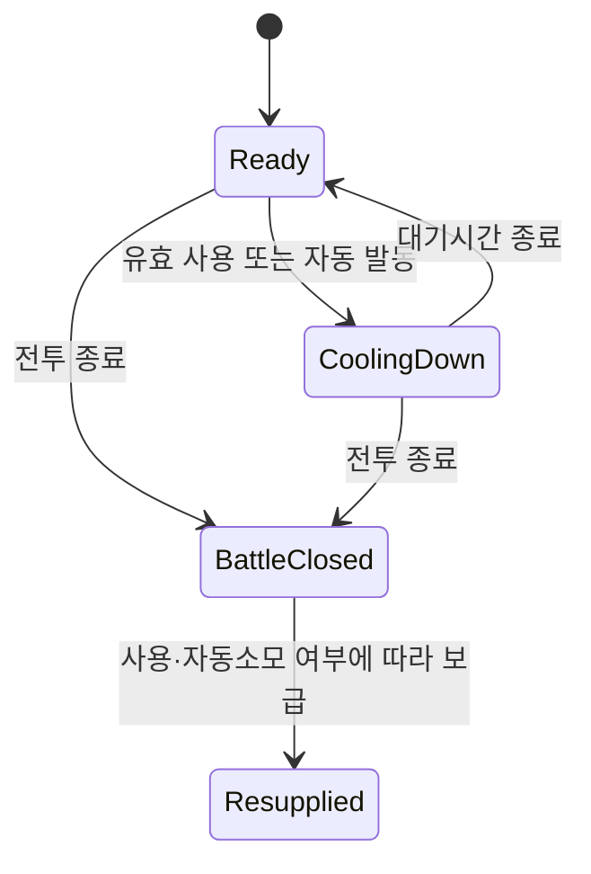

이 다이어그램은 [제안]이다. `used_at_least_once`와 `cooldown_end_time`을 별도로 저장해야 전투 중 3번 썼다는 이유로 아이템 3개를 잘못 차감하지 않는다.

## 4. 지휘명령

[확인] 지휘명령은 출격 전에 하나를 장착하며 한 전투 동안 효과가 있다. 장비용은 장착 장비의 효과를 늘리고, 승무원용은 관련 특전을 강화하거나 훈련되지 않은 특전을 활성화할 수 있다. 그러나 지휘명령이 주 특전 상한을 넘는 일곱 번째 특전을 만들어 주지는 않는다. 자동 보급을 설정할 수 있고, 이벤트 전용 명령은 보관 재고가 소진되면 계속 구입할 수 없는 경우가 있다. [P15-5]

[분석] 장비용 지휘명령은 독립적인 파워업이 아니라 **선행 구성에 의존하는 소비 효과**다. 장비를 제거하거나 대체 구성으로 전환했을 때 효과가 계속 붙는지, 명령이 소비되는지, 경고가 표시되는지 명확해야 한다.

[검증 필요] 지휘명령 가이드의 적용 티어 문구에는 과거 V–X 범위가 남아 있다. 이를 근거로 XI에서 모든 명령이 불가능하다고 결론 내리지 않는다. 개별 차량 슬롯과 최신 데이터에서 가능 여부를 검증한다. 같은 이유로 “시야 최대 445m”라는 명령 설명도 시야 수치와 탐지 상한을 혼동하지 않도록 [08번](08_Spotting_Concealment_and_Radio.md)과 함께 해석한다.

## 5. 현장 개량과 대체 구성

### 5.1 기본 구조

[확인] 현장 개량은 Elite 상태의 VI–X 차량에서 운용 성격을 조절하도록 도입되었다. XP로 수준을 올리고, 크레딧으로 양자택일 개조 및 관련 조정을 수행하는 구조다. 대체 탄약·소모품 구성과 대체 장비 구성, 추가 슬롯 범주 등 선택 기능도 포함된다. 개조는 차량의 전투 역할에 따라 달라지므로 같은 차종이라고 동일 트리가 아니다. [P15-6][P15-7]

[확인] Tier XI는 2.0에서 소개된 전용 업그레이드 체계를 사용한다. [P15-8]

[분석] XI에 VI–X의 장단점 교환형 현장 개량을 그대로 적용했다고 설명하지 않는다.

[확인] 2.4의 경전차 역할 재편은 현장 개량 트리에도 반영되었다. 변경의 영향을 받는 기존 개조는 자동 초기화되고 지출 크레딧을 전액 보상하도록 안내되었다. [P15-R24]

[제안] 패치 이관은 선택값의 보존뿐 아니라 초기화 대상과 보상 원장을 함께 관리한다.

### 5.2 개조의 선택 의미

[분석] 양자택일 개조는 모든 수치를 조금씩 올리는 성장과 다르다. 이득과 손실을 특정 환경에서 교환하게 한다. 사격 안정성을 늘리며 다른 조작성을 희생한다면 좁은 도시 지도와 개활지 지도에서 가치가 달라질 수 있다. 선택 평가의 단위는 전차 전체가 아니라 **플레이 패턴 × 지도 × 모드**다.

대체 구성은 매치 진입 전에 모르는 지도를 전투 준비 단계에서 확인한 뒤 대응하도록 하는 장치로 읽을 수 있다. 다만 해금 단계와 선택 가능한 구성 종류를 명시해야 한다. 출격 준비 후 서버가 잠근 구성은 전투 중 자유롭게 바꾸는 장비 교체와 구분된다.

### 5.3 재구현 시 잠금 시점

[제안] 구성 선택을 허용할 마지막 시점을 `LoadoutLockDeadline`으로 명시한다. 선택 요청에는 `loadout_revision`을 넣고 서버가 유효한 최신 구성인지 확인한다. 전투 시작 이후 도착한 요청은 거절하고 실제 적용 구성을 회신한다. 탄약 수량 합계, 보유 소모품, 장비 중복, 슬롯 범주를 최종 검증한다.

## 6. 구체 상황 분석

### 사례 A. 수리킷을 두 번 썼는데 전투 후 얼마를 내는가?

[확인] 재사용 소모품의 전투 후 보급은 전투 중 발동 횟수와 무관하게 사용된 아이템 한 개를 기준으로 한다. [P15-4]

[분석] 90초 기본 쿨타임 수리킷을 한 전투에서 두 번 사용했다고 두 개를 구매하지 않는다. 반대로 수리킷을 한 번도 쓰지 않았더라도 음식은 전투 단위로 소모될 수 있다. 결과 화면은 발동 횟수와 소모 아이템 수를 분리해야 한다.

[제안] `activation_count=2`, `consumed_units=1`을 저장한다. 상시 자동 효과는 `activation_reason=BATTLE_START`를 가진다. 사용 요청을 눌렀지만 대상도 없고 특전 예외도 없는 경우에는 승인되지 않은 사용을 소비로 세지 않는다.

### 사례 B. 실험 장비를 범주 슬롯으로 옮겼다

[확인] 실험 장비는 범주 슬롯 추가 보너스를 받지 않는다. [P15-2]

[분석] 일반 장비의 보너스를 기억한 사용자는 같은 변화가 생긴다고 기대하기 쉽다. 따라서 슬롯 드래그 시 강조색만 바꾸는 UI는 오해를 만든다. “장착 가능”과 “범주 추가 보너스 발생”을 서로 다른 아이콘으로 표현하는 편이 좋다.

### 사례 C. 정찰 구성에서 교전 구성으로 바꾼다

[분석] 개활지에서는 정찰 장비가 큰 기여를 할 수 있지만, 시야가 가려진 좁은 지도에서는 생존·사격 성능의 가치가 상대적으로 커질 수 있다. 대체 구성은 하나의 전차를 다른 클래스로 만드는 기능이 아니라 같은 기본 특성의 운용 중심을 조절하는 기능이다.

[제안] 구성 이름에 “최고 성능”을 붙이기보다 사용 목적과 바뀌는 핵심 값 3개를 보여준다. 보유하지 않은 소모품·명령이 들어 있다면 자동 보급에 필요한 자원까지 함께 알려야 한다.

## 7. 데이터 모델과 처리 순서

```yaml
# [제안] 설명용 구조
Loadout:
  vehicle_id: stable_id
  revision: integer
  equipment_slots: [{slot_category, equipment_instance_id}]
  shell_counts: {shell_id: integer}
  consumable_slots: [item_id]
  directive_id: optional_id
  field_mod_choices: {node_id: option_id}
  resupply_policy: {ammo: boolean, consumables: boolean, directive: boolean}
EquipmentDefinition:
  effect_groups: [group_id]
  modifiers: [{target, operation, value}]
  slot_bonus_policy: MATCHING_CATEGORY | NONE
  compatibility_rule: rule_id
  upgrade_path: optional_id
BattleConsumable:
  item_id: stable_id
  cooldown_end_time: server_time
  used_at_least_once: boolean
  activation_count: integer
  consumed_units: integer
```

```text
# [제안] 장착 승인
ValidateLoadout(vehicle, loadout, mode, rules):
    check_slot_count_and_vehicle_tier()
    check_item_ownership_or_authorized_purchase()
    check_vehicle_compatibility_and_duplicate_effects()
    check_consumable_identity_conflicts()
    check_directive_dependencies()
    check_field_mod_unlocks()
    compute_final_parameters_with_versioned_rules()
    return immutable_battle_configuration
```

[분석] 소모품 가격, 장비 해체 비용, 현장 개량 크레딧은 같은 지갑을 쓸 수 있지만 서로 다른 거래다. 일괄 장착 버튼은 사용자에게 총액을 보여주고, 구매 일부만 성공한 상태를 남길지 전체 취소할지 명시해야 한다. 서버 요청 재시도로 두 번 구매되는 문제도 막아야 한다.

## 8. 검증 시나리오

| ID | 조건·행동 | 기대 결과 / 확인점 |
|---|---|---|
| P15-01 | 일반 장비를 일치·불일치 범주에 배치 | 기본·범주 효과 정확히 구분 |
| P15-02 | 실험 장비를 같은 범주로 이동 | 범주 추가 보너스가 붙지 않음 |
| P15-03 | 같은 효과 장비 두 개 장착 시도 | 중복 그룹과 차량별 예외 판정 |
| P15-04 | 소형 수리킷으로 복수 모듈 손상 복구 | 현재 전체 수리 규칙 적용 |
| P15-05 | 소형 구급킷, 복수 부상과 스턴 | 치료와 스턴 해제가 함께 처리 |
| P15-06 | 한 소모품을 한 전투에서 여러 번 사용 | 발동 횟수와 전투 후 소모 수량 분리 |
| P15-07 | 소형과 대형 수리킷 동시 장착 | 서로 다른 아이템 허용 및 독립 쿨타임 확인 |
| P15-08 | 기본 쿨타임에 특전 적용 | 90/60초 원본과 최종 시간을 혼동하지 않음 |
| P15-09 | 장비 제거 후 대응 지휘명령 유지 | 비활성 사유와 소비 정책 확인 |
| P15-10 | 전투 시작 경계에 대체 구성 선택 | 서버 잠금 전후 결과 일관 |
| P15-11 | 자동 보급 중 자금·재고 부족 | 부족 항목 표시, 무단 대체 구매 없음 |
| P15-12 | 개선 장비 해체 후 다른 차량 장착 | 개선 단계·인스턴스·비용 보존 |

## 9. 설계 평가와 검증 한계

[분석] 이 시스템은 사용자가 “어떤 결함을 감수할 것인가”를 선택하게 한다. 수리·구급·소화의 안전 구성을 포기하고 음식 등 성능 효과를 택할 때에는 전투 성과와 경제적 부담이 함께 바뀐다. 그러므로 장비 추천은 승률만으로 평가하지 않고 평균 순수익, 모듈 장애로 잃은 시간, 부상·화재 이후 생존률을 함께 보는 것이 적합하다.

[분석] 현장 개량과 추가 구성은 숙련자에게 상황 대응 폭을 준다. 동시에 신규 차량을 막 해금한 플레이어와 충분히 투자한 플레이어 사이에 성능·정보 격차를 늘릴 수 있다. 동일 차량의 기본/완성 구성 성과를 따로 집계해야 차량 자체의 밸런스를 오판하지 않는다.

[검증 필요] 모든 장비의 정확한 수치·클래스 호환성, XI 지휘명령 적용, 모드별 무료 소모품, 기본 탑재 수리킷, 전투 후 보급 실패 우선순위, 대체 구성의 실제 잠금 시점은 추가 데이터 수집 대상이다. 공식 가이드의 오래된 티어 범위 문구를 전체 적용 제한으로 하드코딩하지 않는다.

## 10. 출처

- **P15-1** — [Equipment](https://worldoftanks.eu/en/content/guide/game-mechanics-and-achievements/equipment/). 장비 범주·슬롯·중복 제한·개선.
- **P15-2** — [Experimental Equipment Guide](https://worldoftanks.eu/en/news/general-news/experimental-equipment-guide/). 주/부 효과·슬롯 보너스·개선/해체.
- **P15-3** — [Release Notes 1.26](https://worldoftanks.eu/en/content/docs/release_notes/release-notes-1-26/). 소형 전체 복구, 대형 쿨타임, 연료 개편.
- **P15-4** — [Consumables](https://worldoftanks.eu/en/content/guide/game-mechanics-and-achievements/consumables/). 상시 소모품 규칙·보급.
- **P15-5** — [Directives](https://worldoftanks.eu/en/content/guide/game-mechanics-and-achievements/directives/). 지휘명령 구조. 티어 범위의 일부 표현은 추가 검증 필요.
- **P15-6** — [Improved Field Modification: How It Works](https://worldoftanks.eu/en/news/general-news/1-14-field-modification-how-it-works/). 도입 구조·대체 구성.
- **P15-7** — [Field Modification FAQ](https://worldoftanks.eu/en/news/general-news/field-modifications-faq/). XP·크레딧과 슬롯 범주.
- **P15-8** — [Update 2.0: Under the Hatch of Tier XI](https://worldoftanks.eu/en/news/general-news/update-2-0-tier-11-overview/). XI 전용 업그레이드 구분. 상세 성장 수치는 13번에서 다룬다.

- **P15-R24** — [Release Notes 2.4](https://worldoftanks.eu/en/content/docs/release_notes/release-notes-2-4/). 경전차 역할에 따른 개조 변경·초기화·크레딧 보상.

자료 확인일은 2026-11-13이며, 오래된 도입 문서는 현재 가이드·후속 업데이트와 충돌하지 않는 구조만 사용했다.


---

<!-- Source document: 16_Economy_and_Battle_Rewards.md -->

# 16. 전투 보상·경험치·재화·정비 경제 역기획

> **대상:** Wargaming World of Tanks PC판. **자료 확인일:** 2026-11-13 KST. 상시 공식 경제 가이드와 공개 지원 문서를 대조했다. 차량별 수익 계수와 서버 보상 산식 전체는 공개 검증되지 않았으므로 복원했다고 주장하지 않는다.
>
> `[확인]` 공개 규칙 / `[분석]` 설계 해석 / `[제안]` 재구현 구조 / `[가정 예시]` 임의 수치 계산 / `[검증 필요]` 현행 정확값 미확인.

## 1. 경제 시스템의 목적

[분석] 전투 경제는 플레이어에게 세 가지 질문을 반복하게 한다. 다음 차량을 얼마나 빨리 열 수 있는가, 지금 차량의 운용비를 감당할 수 있는가, 더 좋은 구성을 위해 희소 자원을 어디에 투자할 것인가. 승리와 개인 기여는 수입으로 연결되지만 탄약·정비·소모품 지출은 전투 결과와 별도로 발생한다.

따라서 전투 결과의 큰 숫자 한 개만으로 “돈을 벌었다”고 판단해서는 안 된다. **획득 총액, 지갑에서 실제 차감한 금액, 재고에서 소비한 자산, 최종 잔액 변화**를 구분해야 한다. 이 구분은 사용자 설명뿐 아니라 경제 밸런스·재화 복구·부정 행위 추적에도 필요하다.

## 2. 자원별 역할

[확인] 공식 경제 가이드는 경험치·크레딧·골드·채권을 주요 자원으로 설명한다. 전투 XP는 차량별 연구, 자유 XP는 차량·모듈 연구 및 승무원 훈련, 승무원 XP는 개인 훈련에 사용된다. 크레딧은 차량·장비·소모품과 유지비에, 골드는 프리미엄 서비스·전환 등 여러 기능에 사용된다. [P16-1]

| 자원 | 보유 단위 | 주요 수입 경로 | 주요 사용처 | 설계 목적 |
|---|---|---|---|---|
| Combat XP | 차량별 | 전투 | 모듈·후속 차량·해당 성장 | 계통별 플레이 경험 축적 |
| Free XP | 계정 | 전투·보상·전환 | 연구 부족분·훈련 등 | 성장 병목 완화 |
| Crew XP | 승무원별 | 전투·교본·훈련 | 특전·효율 회복 등 | 지속 자산 성장 |
| 크레딧 | 계정 | 전투·임무·판매 | 구매·정비·탄약·소모품 | 일상적인 수입·지출 순환 |
| 골드 | 계정 | 구매·일부 보상 | 상품·서비스·전환 | 유료·희소 편의 경로 |
| 채권 | 계정 | 해당 전투·이벤트·보상 | 개선 장비·차량·일부 명령 등 | 장기 보상 자원 |
| 시즌·이벤트 재화 | 지정 시즌/상점 | 해당 진행·보상 | 지정 교환처 | 기간별 목표와 운영 |

표에서 보유 단위·설계 목적은 [분석]을 포함한다. 시즌 토큰, 칩, 바우처, 실험 장비 부품을 채권이나 골드와 같은 단일 자원으로 합치지 않는다. 구체 획득 제한·만료는 [17번](17_Missions_Monetization_and_LiveOps.md)을 참조한다.

### 2.1 자유 XP와 Elite XP

[확인] 공식 지원 문서는 전투에서 얻은 Combat XP를 기준으로 5%의 Free XP를 얻는 구조와, Elite 차량에 축적된 XP를 골드로 자유 XP로 전환하는 기능을 설명한다. 승무원 가속 훈련은 별도의 선택 경로다. [P16-2]

[분석] 전투 후 자유 XP 획득과 유료 XP 전환은 다른 거래다. 전투 보상 5%를 “전투 XP의 일부를 잃고 옮기는 선택”으로 설명하면 안 된다. 반면 Elite XP 전환은 원본 XP와 골드를 사용하여 계정 자유 XP를 얻는 작업이므로, 원본 차량별 차감 내역이 필요하다. 전환 이벤트의 환율을 상시 환율로 저장하지 않는다.

## 3. 전투 기여와 보상 입력

[확인] 공식 XP 지원 안내는 피해, 최초 탐지, 탐지에 의한 아군 피해, 기지 점령과 방어, 승리 등을 경험치 기여 요인으로 든다. 정확한 모든 내부 가중치와 최신 예외는 공개되어 있지 않다. [P16-3]

[확인] 임무의 경험치 순위 판정은 프리미엄·일일 첫 승리·임무 보너스 등으로 부풀린 표시 XP와 구분되는 기본 경험치를 사용한다. 개인 임무 도움말은 관련 제외 항목을 명시한다. [P16-4]

| 전투 이벤트 | 보상이 장려하는 행동 | 집계 시 구분할 것 |
|---|---|---|
| 적 HP 피해 | 유효한 공격 기여 | 실제 손실 HP, 피해 출처, 초과 피해 |
| 적 탐지 | 정보 획득 | 최초 탐지와 유지 탐지 |
| 정찰·궤도·스턴 지원 | 다른 아군이 피해를 만들도록 도움 | 지원 종류·기여자·중복 시간 |
| 점령·방어 | 승리 조건 직접 수행 | 획득 점수·리셋·성공 여부 |
| 승리·패배 | 팀 목표 추구 | 개인 보상과 팀 결과 항목 |
| 임무·보너스 | 특정 행동·반복 참여 | 기본 전투 보상과 별도 보상 |

위 표는 [분석]용 입력 분류다. 지원 피해 세 유형을 무조건 모두 더한 값이 모든 보상·훈장·임무에 적용된다는 뜻은 아니다. 각 소비 시스템이 자기 집계 규칙을 가져야 한다. 특히 전투 원장과 전차별 숙련 표시는 서로 다른 목적의 통계다.

### 3.1 공개되지 않은 계수를 만드는 대신

[제안] 보상 재구현에 사용할 추상 계약은 다음과 같다.

```text
baseCreditReward = CreditPolicy(vehicle, mode, battleContribution, result)
baseExperience   = ExperiencePolicy(vehicle, mode, battleContribution, result)
bonusRewards     = BonusPolicy(entitlements, reserves, missions, time)
expenses         = MaintenancePolicy(damageState, firedAmmo, consumedItems)
```

이 함수 이름은 실제 Wargaming 구현을 나타내지 않는다. 공식 확인이 가능한 것은 입력의 종류와 사용자에게 보이는 결과이며, 함수 내부 계수는 실험·별도 설계 대상으로 남긴다.

[검증 필요] 고객지원의 크레딧 설명에는 2011년 계수라는 주석이 남아 있다. 해당 문서의 `X`, `Y`, `Z`, 차량 수익 계수 예시를 2026년 실제 서버 산식으로 옮기지 않았다. 오래된 공식 페이지라도 날짜가 최근 크롤링되었다는 이유만으로 현행 데이터가 되지는 않는다. [P16-5]

## 4. 프리미엄과 보너스 층

[확인] 공식 경제 안내는 WoT 프리미엄 계정의 전투 크레딧·XP 보너스를 50%로 설명한다. 프리미엄 계정에는 추가 경험치 적용, 크레딧 비축 등 별도 기능도 있다. WoT 프리미엄 계정, Wargaming 프리미엄 계정, WoT Plus는 이름이 비슷하지만 같은 상품이 아니다. [P16-1][P16-6]

[분석] 구현 시 모든 보너스를 하나의 `premium_multiplier`에 넣으면 조건을 설명하거나 오류를 수정하기 어렵다. 최소한 다음 항목을 분리하는 것이 좋다.

- 계정 권한에 의한 전투 보너스.
- 개인·클랜 비축 물자에 의한 기간 보너스.
- 일일 첫 승리와 임무별 보너스.
- 차량 고유 수익 특성.
- 소대와 구독 서비스의 혜택.
- 전투 결과 화면에서 추가 적용하는 보상.

[검증 필요] 보너스의 합산·곱셈 순서, 특정 보상이 Free XP 계산 기준에 포함되는지, 반올림 시점은 결과 화면과 실제 잔액으로 확인해야 한다. “모든 배율을 차례대로 곱한다”라는 공식을 일반 규칙으로 제시하지 않는다.

### 4.1 재화 전환 방향

[분석] 자원마다 전환 방향과 목적이 다르다. 전환이 허용되었다고 역방향까지 허용되는 것은 아니다. 예를 들어 골드로 자유 XP를 얻는 기능은 자유 XP를 현금성 가치로 돌려받는 기능과 다르다. 문서와 UI에는 **원본 자원 → 결과 자원 → 비용 → 적용 환율 → 만료 시각**을 한 줄에 표시하는 편이 좋다.

## 5. 전투 정산 원장

[제안] 정산 화면과 서버 원장을 다음 단계로 구성한다.

| 단계 | 기록 | 목적 |
|---|---|---|
| 1. 전투 확정 | 전투 ID·차량 구성·종료 원인 | 보상 중복 방지와 버전 식별 |
| 2. 기여 집계 | 공격·지원·점령 이벤트 | 기본 보상과 임무의 입력 |
| 3. 기본 보상 | XP·크레딧 | 개인 기여·팀 결과 반영 |
| 4. 추가 보상 | 계정·비축·임무별 항목 | 각 혜택의 원인 설명 |
| 5. 자산 소모 | 수리·탄약·소모품·명령 | 지갑 지출과 재고 소비 구별 |
| 6. 잔액 반영 | 차감·지급 거래 묶음 | 원자적 처리·복구 |
| 7. 진행 이벤트 | 연구·승무원·미션·시즌 | 다음 목표 갱신 |

[분석] 전투에서 먼저 파괴되어 다른 차량으로 다음 전투에 들어간 경우에도 이전 전투의 정산이 늦게 도착할 수 있다. UI의 현재 선택 차량에 보상을 붙이지 않고, 전투 ID에 연결된 차량 인스턴스와 계정 자산에 반영해야 한다.

### 5.1 자동 정비와 보관소

[확인] 공식 경제 가이드는 크레딧의 사용처에 전투 후 수리, 탄약·소모품 보급을 포함한다. 보관소와 상점은 장비·모듈·탄약·소모품 자산을 관리하는 별도 기능이다. [P16-7][P16-8]

[제안] 보급 단계는 보관소 재고 사용, 부족분 구매, 자금 부족 처리의 결과를 항목별로 남긴다. 실제 게임의 적용 순서·부족 시 우선순위는 [검증 필요]다. 탄약이 부족하다고 요청하지 않은 더 싼 탄으로 자동 대체하지 않는다. UI는 다음 출격 구성에서 부족 항목을 명확히 드러내야 한다.

## 6. 구체 계산 예시

### 사례 A. 큰 총수입인데 적자다

다음은 **[가정 예시]**다. 실제 특정 전차의 수익·비용·가격을 뜻하지 않는다.

| 항목 | 일반 계정 예시 | 50% 전투 수입 보너스만 적용한 예시 |
|---|---:|---:|
| 보너스 적용 대상 전투 크레딧 | 45,000 | 67,500 |
| 수리 비용 | −12,000 | −12,000 |
| 탄약 비용 | −16,000 | −16,000 |
| 소비 자산 비용 | −20,000 | −20,000 |
| 순자산 변화 | **−3,000** | **+19,500** |

[분석] 수입이 50% 늘었다고 순이익이 50% 늘어나는 것은 아니다. 비용이 고정되어 있을 때 손익분기점을 넘을 수 있기 때문이다. 반대로 비싼 탄약과 소모품 사용을 늘리면 추가 수입이 있어도 순이익이 줄 수 있다. 전투 성과와 경제 효율을 각각 보여줄 필요가 있다.

### 사례 B. 보급은 했는데 잔액이 줄지 않았다

[가정 예시] 플레이어가 이전 할인 기간에 구입한 소모품 10개를 갖고 있고 한 개를 소비했다. 이번 전투 후 지갑 차감은 0이지만 재고는 9개다. 현재 지갑 변화만으로는 이 전투의 유지비가 0으로 보인다.

[분석] 세 가지 지표를 구분한다. `wallet_delta`는 당장 지갑 변화, `inventory_delta`는 아이템 수 변화, `economic_cost_estimate`는 분석용 자산 비용이다. 마지막 값은 현재 정가·평균 구입가 등 어떤 기준을 쓰는지 명시해야 하며 실제 결제 내역으로 표현하지 않는다.

### 사례 C. 같은 표시 XP인데 임무 순위가 다르다

[분석] 한 플레이어의 결과 화면에는 프리미엄·임무 보너스가 많고 다른 플레이어는 기본 XP가 더 높을 수 있다. 임무가 기본 XP 순위를 요구하면 “최종 획득 XP가 더 큰데 왜 조건을 못 채웠는가?”라는 질문이 생긴다. 결과 화면에 기본 XP와 모든 보너스 항목을 분리하고 임무 진행 화면에서 어떤 XP를 사용했는지 연결해야 한다.

## 7. 보상 처리 데이터 계약

```yaml
# [제안] 설명용 정산 원장
BattleSettlement:
  settlement_id: unique_id
  battle_id: unique_id
  account_id: stable_id
  vehicle_instance_id: stable_id
  battle_ruleset_version: patch_and_mode
  reward_policy_version: version_id
  contribution_snapshot: immutable_reference
  base_rewards: [{resource, amount}]
  bonus_rewards: [{source_id, resource, amount}]
  inventory_consumption: [{item_id, units}]
  wallet_expenses: [{reason, resource, amount}]
  progression_events: []
  committed_at: server_timestamp
```

```text
# [제안] 정산과 재시도
SettleBattle(battleResult):
    if settlement_exists(battleResult.id): return existing_settlement
    policy = policy_for(battleResult.frozen_ruleset)
    entries = evaluate_reward_and_expense_entries(policy, battleResult)
    begin_account_transaction()
    assert settlement_not_committed_yet()
    apply_wallet_and_inventory_entries(entries)
    append_auditable_ledger(entries)
    mark_settlement_committed()
    commit()
    publish_progression_events_once()
```

[분석] 전투 서버 종료와 계정 서비스 지급은 시간상 분리될 수 있다. 정산 이벤트가 중복 도착하거나 처리 도중 연결이 끊겨도 계정별 한 번만 반영되는 것이 중요하다. 공개되지 않은 실제 아키텍처를 단정하는 것이 아니라, 동일 UX를 재현하는 데 필요한 일관성 조건이다.

## 8. 경제 밸런스 관점

[분석] 평균 순수익 하나로 전체 경제를 판단하면 플레이어 집단의 차이를 놓친다. 적어도 차량 티어·차종·플레이어 숙련·계정 혜택·탄종 사용·음식 사용·소대 여부별로 나눠 봐야 한다.

| 질문 | 볼 지표 | 해석 주의 |
|---|---|---|
| 고티어 유지가 가능한가? | 전투당 순크레딧 분포 | 보상 이벤트가 평시 적자를 숨길 수 있음 |
| 새 차량 구매가 막히는가? | 연구 후 구매까지 걸린 전투 수 | XP 부족과 크레딧 부족을 분리 |
| 특정 차량이 자금 획득용인가? | 시간당 순수익·플레이 비중 | 승률·플레이어 선호와 분리 |
| 고가 탄약 사용이 필수가 되었는가? | 상대 장갑별 탄종 선택률·관통 성공률 | 단순 평균 관통률로 강제성을 판단하지 않음 |
| 유료 혜택이 진행을 얼마나 바꾸는가? | 동일 조건의 성장 시간 차이 | 구성·숙련 차이로 인한 선택 편향 제거 |
| 자산 인플레이션이 있는가? | 발행·소각·저축량 추이 | 시즌 재화를 영구 재화와 합치지 않음 |

[분석] 수익 감소만으로 장비·탄약 선택을 제한하면 플레이어가 재미있는 전투를 위해 저티어·프리미엄 차량으로 자금 조달을 반복하게 될 수 있다. 이런 의무적 자금 획득 반복이 플레이 다양성을 만드는지, 선호 차량 플레이를 막는지를 구분해서 평가해야 한다.

## 9. 검증 시나리오

| ID | 조건·행동 | 기대 결과 / 검증 목적 |
|---|---|---|
| P16-01 | 같은 전투 결과를 두 번 수신 | 지급·소모 한 번만 반영 |
| P16-02 | 전투 종료 후 다른 차량 선택 | 원래 차량의 XP·정비에 반영 |
| P16-03 | 보관소에서 소모품 보급 | 지갑 지출과 재고 감소 분리 |
| P16-04 | 자동 보급 중 크레딧 부족 | 자산 음수 방지·부족 항목 설명 |
| P16-05 | 프리미엄 만료가 전투 종료와 겹침 | 권한 판정 시점을 명시하고 일관 적용 |
| P16-06 | 비축·일일·임무 보너스 동시 적용 | 원본 XP와 항목별 보너스 복구 가능 |
| P16-07 | 지원 피해 기여자가 여러 명 | 각 보상·임무 정책의 중복 규칙 확인 |
| P16-08 | 전투 서버 장애 후 정산 재시도 | 완료된 전투의 보상 유실·복제 방지 |
| P16-09 | 특수 모드의 무료 수리·탄약 | 일반전 유지비 정책을 잘못 적용하지 않음 |
| P16-10 | XP 전환 이벤트 종료 경계 | 확정 환율·차감 원본·결과 XP 일치 |
| P16-11 | 기본 XP 순위 임무 | 프리미엄·임무 보너스로 순위가 바뀌지 않음 |
| P16-12 | 정산 후 취소·복구 처리 | 이미 소비한 보상을 임의 삭제하지 않고 보정 원장 사용 |

## 10. 미확인 범위와 출처

[검증 필요] 차량별 수익 계수, 피해·지원 가중치, 현재 채권 일일/주간 상한, 전체 보너스 결합 순서, 손상 수준별 정확한 수리비, 이벤트 보급 예외, 지역별 실제 결제 가격은 이 문서의 확정 범위가 아니다.

- **P16-1** — [Economy in World of Tanks](https://worldoftanks.eu/en/news/general-news/currency-and-resources/). 자원 구분·일반 수입과 지출·계정 보너스.
- **P16-2** — [About: Experience](https://wargaming.net/support/en/products/wot/article/10223/). 자유 XP·Elite XP·승무원 가속 훈련.
- **P16-3** — [How do I earn Experience?](https://wargaming.net/support/en/products/wot/article/18960/). XP 기여 행동의 공개 설명. 최신 내부 가중치를 제공하는 문서로 보지 않음.
- **P16-4** — [How Do I Complete Personal Missions?](https://wargaming.net/support/en/products/wot/article/15110/). 임무 기본 XP 및 지원 조건.
- **P16-5** — [How do I earn Credits?](https://www.wargaming.net/support/en/products/wot/article/18956/). 오래된 2011년 계수 표현을 확인하기 위한 자료. **현재 수치 산식에는 사용하지 않음.**
- **P16-6** — [WoT Premium Account](https://worldoftanks.eu/en/news/general-news/premium-account/). 상품 권한과 다른 프리미엄 상품의 구분.
- **P16-7** — [In-Game Economy](https://worldoftanks.eu/en/content/guide/newcomers-guide/game_economy/). 수리·탄약·소모품 지출.
- **P16-8** — [In-Game Store and Depot](https://worldoftanks.eu/en/content/guide/economy/in-game-store-and-depot/). 상점과 보관소의 역할.

모든 자료 확인일은 2026-11-13. 정산 예시의 금액과 가상 데이터 계약은 공식 보상표가 아니다.


---

<!-- Source document: 17_Missions_Monetization_and_LiveOps.md -->

# 17. 임무·배틀 패스·상품·라이브 운영 역기획

> **대상:** Wargaming World of Tanks PC판. **자료 확인일:** 2026-11-13 KST. EU 공식 공개 규칙을 기준으로 한다. 2.4의 Operation Fossa와 2026년 WoT Plus Core/Pro를 반영했다. 시즌·상품·할인은 해당 안내의 유효 기간에만 적용한다.
>
> `[확인]` 공식 사실 / `[분석]` 설계 해석 / `[제안]` 재구현 구조 / `[검증 필요]` 확정하지 않은 항목. 출시 당시 캠페인 구성과 현재 추가 콘텐츠를 구분한다.

## 1. 운영 시스템의 역할

[분석] 라이브 운영은 기본 전투 규칙을 매번 새로 만들지 않고도 플레이 목표를 갱신한다. 일일 임무는 오늘의 짧은 목표, 주간 임무는 여러 날의 누적 목표, 개인 임무는 장기 도전, 배틀 패스는 시즌의 진행 단위다. 상점과 구독은 이 진행에 필요한 시간·자산·선택 폭을 조정한다.

이 문서의 중심은 이벤트 광고 문구가 아니라 **어떤 전투가 어떤 조건을 얼마나 진행시키고, 언제 무엇을 지급하는가**다. 실제 이벤트 전투 규칙은 [12번](12_Modes_Competitive_and_Events.md), 크레딧·XP 지급은 [16번](16_Economy_and_Battle_Rewards.md), 클랜 운영은 [18번](18_Social_Clans_Replays_and_Fair_Play.md)을 참조한다.

## 2. 목표 체계의 계층

| 계층 | 플레이 시간 척도 | 입력 | 보상 방식 | 설계 해석 |
|---|---|---|---|---|
| 일일 | 당일·몇 전투 | 전투 행동·누적량 | 개별 보상·보너스 임무 | 접속 후 첫 목표 제공 |
| 주간 | 여러 날 | 누적·제한 조건 | 재화·캠페인 진행 | 일일 의무감 완화·중기 목표 |
| 개인 임무 | 장기 | 지정 전투 성취·역할 | 차량·자산·명예 보상 | 여러 플레이 방식 학습 |
| 배틀 패스 | 시즌 | 포인트 | 단계별 기본/개선 보상 | 장기 성장을 짧은 성취로 분해 |
| 기간 이벤트 | 특정 기간 | 이벤트 모드·임무·수집 | 특별 자산·꾸미기 | 새로운 경험과 복귀 동기 |
| 업적·기록 | 계정 수명 | 누적 성과 | 표시·숙련 증명 | 성과의 사회적 의미 |

표는 [분석] 분류다. 각 시스템이 같은 피해량을 보더라도 누적 방식과 허용 모드는 다를 수 있다.

## 3. 일일·주간 임무

### 3.1 일일 임무

[확인] 상시 가이드는 난도가 다른 일반 일일 임무 3개를 동시에 진행할 수 있으며 완료 후 보너스 임무가 열린다고 설명한다. 원치 않는 일반 임무는 재추첨할 수 있고 다음 재추첨까지 4시간이 필요하다. 보너스 임무는 당일 만료되고 재추첨할 수 없다. 프리미엄 계정의 추가 임무 3개는 순서대로 진행하며 일반 보너스 임무 해금에는 합산하지 않는다. 완료 임무는 별도 장기 진행에 반영되고 45점 주기로 Epic Reward를 받는다. 진행 갱신은 전투 종료 후 이루어진다. [P17-1]

[분석] 일반 임무의 병렬 진행과 프리미엄 임무의 직렬 진행은 서로 다른 목표 구조다. 프리미엄 임무를 3개의 독립 조건으로 처리하면 한 전투가 순차 해금되지 않은 뒤 임무까지 동시에 완료시키는 오류가 생길 수 있다.

[제안] 재추첨은 기존 임무 ID를 유지하며 조건만 바꾸기보다 새 임무 인스턴스로 교체하고 `rerolled_from`을 기록한다. 전투 중인 차량이 있을 때 재추첨하면 어느 임무 버전에 전투 실적을 반영할지 명시해야 한다. 공식 가이드도 전투 중 재추첨 시 진행 손실 가능성을 주의시킨다. [P17-1]

### 3.2 주간 임무

[확인] 2.0 릴리스는 주초에 받는 3개의 주간 임무, 여러 전투에 걸친 조건, 국가·차종·역할 제한 가능성, 재화와 캠페인 포인트 보상을 소개했다. [P17-2]

[분석] 주간 조건은 특정 차종을 장시간 요구할 수 있으므로 현재 차고에서 완료 가능한지 알려주는 기능이 중요하다. 해당 티어·역할 차량을 보유하지 않은 플레이어에게 높은 보상만 노출하면 목표보다 장벽으로 느껴질 수 있다. “참가 가능한 보유 차량” 필터를 조건과 연결하는 것이 좋다.

## 4. 개인 임무 캠페인

### 4.1 캠페인별 진행 축

[확인] 현재 공식 가이드는 첫 캠페인을 차종, 둘째를 국가 집단, Sector 3를 역할 범주로 나눈다. 첫·둘째 캠페인은 함께 진행할 수 있지만 Sector 3와 동시에 진행하지는 않는다. 전환 시 중지된 진행은 보존된다. 일반적인 시리즈는 15개 임무이며, 임무는 순차 진행한다. 현행 가이드는 개인 임무의 전투를 무작위 전투로 제한한다. [P17-3]

[분석] 차종·국가·역할은 같은 조건이 아니다. 특히 역할은 차종 안에서 다시 나뉠 수 있어 “중형전차면 모든 해당 시리즈에 참가”하는 판정이 성립하지 않는다. 캠페인 설계는 차량 ID의 고정 목록보다 버전이 붙은 역할 정의를 참조해야 한다.

### 4.2 Sector 3의 기본 작전

[확인] 2.0 도입 시 Sector 3는 Windhund, Dravec, Black Rock의 기본 작전으로 안내되었다. 각각 Vanguard·Ambush·Assistance의 3시리즈를 갖고, 각 시리즈 15개로 작전당 45개 임무를 구성했다. 캠페인 포인트를 모아 차량의 부품을 조립하며 일일·주간 임무도 포인트를 제공한다. 최종 보상에는 Tier XI Black Rock이 포함된다. [P17-4]

[분석] 어려운 특정 임무 한 개를 통과해야만 장기 진행이 가능한 구조와, 여러 경로의 포인트로 차량을 조립하는 구조는 실패 경험이 다르다. 후자는 플레이어가 까다로운 임무에서 막혀도 작은 진전을 유지할 수 있다. 대신 차량 획득과 모든 임무의 명예 완료를 같은 완료 상태로 처리하면 안 된다.

### 4.3 Operation Fossa의 예외

[확인] 2.4는 별도 작전 Fossa를 추가했다. 3시리즈 × 21개, 총 63개 임무이며 다른 캠페인·작전의 완료 여부와 독립적으로 시작할 수 있다. 활성화하면 Sector 3의 나머지 기본 작전을 포함한 다른 캠페인 진행이 중지된다. 보상 차량은 Tier X Fossa VM 68이며 모든 임무 완료의 명예 보상은 별도로 존재한다. [P17-5]

| 상태 | 가능한 진행 | 보존해야 할 상태 |
|---|---|---|
| 첫·둘째 캠페인 활성 | 각 규칙에서 허용한 동시 진행 | 각 캠페인 진행 |
| Sector 3 기본 작전 활성 | 해당 기본 작전의 시리즈·포인트 | 중지한 이전 캠페인 |
| Fossa 활성 | Fossa의 시리즈·포인트 | 나머지 모든 캠페인·작전 |
| 다른 작전으로 복귀 | 저장된 지점부터 진행 | Fossa의 누적 상태 |

표는 확인 규칙을 재구현 상태로 정리한 [분석]이다. 임무별 상세 조건·보상표를 현재 클라이언트와 별도로 수집해야 한다.

[검증 필요] 2.0 소개 기사에는 모드 적용이 넓게 표현된 부분이 있지만 현재 상시 개인 임무 가이드는 무작위 전투만 명시한다. 본 문서는 현재 가이드를 우선하며 이벤트·경쟁 모드에서의 인정 여부는 개별 조건으로 확인한다. 2.4.1에서 조정된 일부 Fossa 임무 수치는 이전 기사에서 복사하지 않는다.

## 5. 배틀 패스

### 5.1 단계와 권한

[확인] 상시 가이드의 기본 구조는 3개 챕터 × 50단계이며 단계당 50포인트다. 챕터를 전환해도 기존 진행은 보존된다. 기본 보상과 개선 보상이 분리되고, 개선 패스를 나중에 구매하면 이미 완료한 해당 챕터 단계의 개선 보상도 지급된다. 모든 기본 챕터 완료 후에는 반복 가능한 Elite Circuit이 열리며 별도 단계 규칙을 사용한다. 선택형 보상은 시즌 종료 처리 정책도 갖는다. [P17-6]

[확인] 2026년 Season XXI 안내는 Tier XI 핵심 차량과 시즌 전용 꾸미기·토큰 보상을 소개한다. [P17-7]

[분석] 이는 시즌별 콘텐츠 표가 기존 배틀 패스 공통 구조 위에 올라가는 예다. 출시 초기의 Tier X 중심 설명을 모든 시즌에 고정하지 않는다.

### 5.2 포인트와 교환 재화의 차이

[분석] 배틀 패스 포인트는 단계 진행, 토큰은 지정 보상 교환, 칩은 과거 콘텐츠 상점 등 서로 다른 기능을 갖는다. 어떤 재화는 시즌에, 어떤 재화는 연간 주기에, 어떤 보상은 수령 시점에 묶일 수 있다. 모든 항목에 동일한 만료일을 적용하면 자산 손실과 잘못된 구매 유도가 발생한다.

[제안] 각 자원 정의에 `scope`, `earn_window`, `spend_window`, `expiry_policy`, `fallback_conversion`을 분리한다. 만료 없음도 명시적인 값이어야 한다. “시즌 종료”는 포인트 획득 종료, 미수령 보상 처리, 교환 상점 폐쇄가 모두 같은 순간이라는 뜻이 아니다.

### 5.3 진행 계산과 구매 단계

[분석] 유료 단계 구매가 존재하면 `earned_stage`와 `purchased_stage`의 출처가 다르더라도 플레이어에게 보이는 완료 상태는 일관되어야 한다. 동시에 구매할 수 없는 후속 반복 진행을 일반 단계와 같은 판매 로직으로 처리하면 안 된다. 플레이어의 시간 투입을 요약할 때도 획득 포인트와 구매 완료 단계를 분리하는 편이 정확하다.

## 6. 상품과 구독 구조

[확인] WoT 프리미엄 계정은 전투 보상과 추가 기능을 제공하는 상품이다. WoT Plus는 별도 구독이며 2026년 안내에는 Core와 Pro의 두 등급, Pro Boost·서비스 기록 꾸미기·추가 배틀 패스 관련 혜택 등이 소개된다. [P17-8][P17-9]

[제안] 두 상품을 하나의 프리미엄 상태로 통합하지 않는다.

| 상품·수익 경로 | 플레이어가 얻는 가치 | 분석해야 할 영향 |
|---|---|---|
| 프리미엄 계정 | 같은 플레이의 보상 확대 | 성장 시간·유지비 부담 변화 |
| 구독 서비스 | 반복 편의·지속 혜택 | 접속 주기·권한 만료 의존 |
| 프리미엄·보상 차량 | 다른 운용 경험·경제·수집 | 연구 차량과의 성능·획득 격차 |
| 개선 패스·단계 | 보상 확장·시간 단축 | 동일 시즌 내 진행 차이 |
| 외형 상품 | 취향·희소성·성과 표현 | 성능 효과가 있는 항목과 혼동 방지 |
| 확률형 패키지 | 가변 보상과 수집 | 확률·보장·중복·보상 가치 설명 |

표는 [분석]용 구분이다. 현재 판매 중인 모든 상품의 목록이나 구매 추천이 아니다.

[분석] 게임 내에서 크레딧으로 구입할 수 있는 고성능 탄약·장비가 있다는 사실과, 그 유지비 부담이 계정 혜택에 따라 달라진다는 사실은 함께 봐야 한다. 수익 모델의 영향은 직접적인 전투 성능 판매뿐 아니라 “좋은 구성을 얼마나 오래 유지할 수 있는가”에도 나타날 수 있다. 실제 영향은 동일 숙련·차량·구성 집단을 통제한 데이터로 평가해야 한다.

### 6.1 확률형 보상

[확인] 2026년 Last Stand의 Objects 안내처럼 보상 종류, 확률, 외형 지급·중복 순서를 별도 문서로 안내하는 이벤트 사례가 있다. 그 규칙은 해당 패키지의 사례이며 모든 상자에 적용되는 영구 규칙이 아니다. [P17-10]

[제안] 확률형 상품 정의에는 상품 버전, 보상 풀, 각 확률, 보장 카운터, 중복 보상 규칙, 지역 판매 조건을 함께 보관한다. 구매·개봉 시점 사이에 보상표가 바뀌어도 어떤 표를 적용하는지 설명할 수 있어야 한다. 이벤트 A의 확률·보장 횟수를 이벤트 B로 재사용하지 않는다.

## 7. 임무 판정과 보상 상태 모델

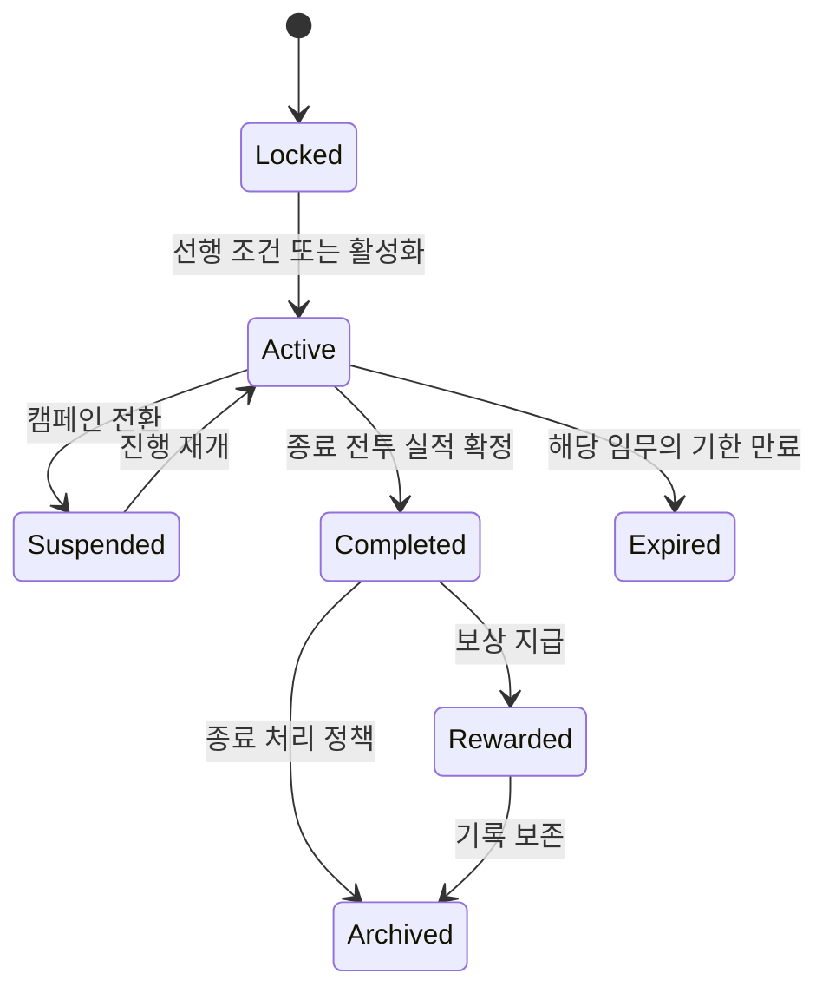

다이어그램은 [제안]이다. 장기 개인 임무의 무기한 진행과 당일 보너스 임무의 만료를 같은 `Expired` 정책으로 처리하지 않는다.

### 7.1 조건 표현

[제안] 임무 조건은 최소한 다음 요소를 갖는다.

- 인정할 모드·티어·차종·국가·역할.
- 한 전투 조건인지 여러 전투 누적인지.
- 피해·지원·발견·승리·생존·기본 XP 등의 입력 지표.
- `AND`, `OR`, 연속 달성, 팀 내 순위 등의 결합 방식.
- 전투 참가 시점과 종료 시점 중 어떤 임무 버전을 적용하는지.
- 자동 지급인지 선택형 수령인지.
- 추가 조건 또는 명예 완료의 별도 상태.

[분석] “피해 2,000 또는 지원 2,000”과 “피해+지원 합계 2,000”은 다른 임무다. “승리하고 생존”과 “승리 또는 생존”도 다르다. 문구 번역과 데이터 조건식이 일치하는지 자동으로 비교할 수 있어야 한다.

## 8. 구체 상황 분석

### 사례 A. 한 전투가 여러 목표를 진전시킨다

[분석] 한 전투의 피해·기본 XP가 일일 임무, 주간 임무, 배틀 패스, 활성 개인 임무에 함께 기여할 수 있다. 그러나 캠페인 상호 배타 규칙과 모드 제한은 각각 먼저 평가해야 한다. 전투 결과 화면은 “획득 XP 1개”를 복제하기보다 같은 전투에서 파생된 각 진행 이벤트를 별도 카드로 보여주는 것이 명확하다.

[제안] `battle_result_id`를 모든 진행 이벤트의 공통 부모로 두고, 각 시스템은 `consumer_policy_version`을 기록한다. 중복 배달되어도 각 소비자가 한 번만 적용하도록 한다.

### 사례 B. Fossa로 바꾼 뒤 이전 임무 실적이 멈췄다

[확인] Fossa 활성화는 다른 캠페인의 진행을 중지한다. [P17-5]

[분석] 이것은 누적치를 삭제하는 기능이 아니다. 전환 확인창은 무엇이 중지되고 무엇이 유지되는지 표시해야 한다. 특히 2개의 이전 캠페인을 병렬 진행하던 사용자는 손해를 예상하기 어렵다. 복귀 버튼에서 저장된 진행을 확인할 수 있어야 한다.

### 사례 C. 시즌 후반에 개선 패스를 산다

[확인] 완료한 해당 챕터 단계의 개선 보상을 소급 수령할 수 있다. [P17-6]

[분석] 구매 확인창은 즉시 받는 보상과 앞으로 단계를 완료해야 받는 보상을 분리해야 한다. 이미 수령한 보상을 다시 지급하지 않도록 보상 권한과 수령 여부를 각각 저장한다. 시즌 종료 직전 구매는 서버 시각과 상품의 유효 기간에 맞춰 판정한다.

## 9. 재구현 데이터 계약

```yaml
# [제안] 설명용 임무·시즌 구조
MissionDefinition:
  mission_id: stable_id
  ruleset_version: version_id
  eligibility: {modes: [], tiers: [], roles: [], nations: []}
  aggregation: SINGLE_BATTLE | SUM | STREAK | RANK
  objective_expression: typed_expression
  activation_group: campaign_group
  mutually_exclusive_groups: []
  schedule_id: optional_id
  reward_bundle_id: stable_id
MissionProgress:
  account_id: stable_id
  definition_version: version_id
  state: ACTIVE | SUSPENDED | COMPLETE | REWARDED | EXPIRED
  counters: {}
  consumed_battle_ids: []
  reward_transaction_id: optional_id
SeasonEntitlement:
  season_id: stable_id
  chapter_id: stable_id
  improved_access: boolean
  achieved_stages: integer
  granted_reward_ids: []
```

[제안] 무한히 커지는 `consumed_battle_ids`는 실제 구현에서 보존 기간이 있는 중복 제거 저장소나 처리 순서 커서로 대체할 수 있다. 보상 거래의 감사 기록은 별도로 유지한다. 공개된 실제 WoT 서버 저장 구조는 아니다.

## 10. 운영 검증 시나리오

| ID | 조건·행동 | 기대 결과 / 확인점 |
|---|---|---|
| P17-01 | 일반 일일 임무 3개와 프리미엄 임무 진행 | 병렬·직렬 차이를 정확히 적용 |
| P17-02 | 전투 중 일일 임무 재추첨 | 어느 임무 버전에 실적을 적용했는지 추적 |
| P17-03 | 보너스 임무 완료와 일일 초기화 동시 | 서버 시각·지급 순서 일관 |
| P17-04 | 첫·둘째 캠페인에서 Sector 3로 전환 | 기존 진행 중지·보존 |
| P17-05 | Fossa 활성 후 기존 작전 실적 발생 | 금지된 동시 진행 차단 |
| P17-06 | OR 조건과 합계 조건 테스트 | 의도한 논리식대로 판정 |
| P17-07 | 배틀 패스 챕터 전환 | 이전 단계·포인트 보존 |
| P17-08 | 개선 패스 후반 구매·재시도 | 소급 보상 한 번씩 지급 |
| P17-09 | 시즌 종료 시 미선택 보상 존재 | 정의된 기본 지급 정책 적용 |
| P17-10 | 이벤트 재화 획득 종료 후 상점 유지 | 서로 다른 일정 정확히 적용 |
| P17-11 | 구독 만료·등급 변경 | 혜택별 권한 회수·유지 구분 |
| P17-12 | 상품 보상표 변경 중 미개봉 아이템 | 적용 상품 버전·보장 카운터 일관 |
| P17-13 | 최신 패치로 임무 조건 완화 | 기존 누적 진행 이관·보상 중복 방지 |

## 11. 설계 평가와 운영 지표

[분석] 라이브 운영의 성공은 참여 횟수만으로 평가할 수 없다. 조건 때문에 팀 승리에 불리한 행동을 반복한다면 임무 완료율은 높아도 전투 경험은 나빠진다. 특정 훈장을 요구하는 임무, 특정 차종만을 강제하는 주간 임무, 생존과 피해 목표가 충돌하는 조건을 별도로 추적해야 한다.

권장 지표는 목표 활성 후 전투 참가율, 임무별 포기·재추첨률, 완료까지 전투 수의 중앙값과 상위 분위수, 캠페인 전환 빈도, 일일 초기화 직전 몰림, 시즌 종료 미수령 비율, 구독 만료 후 구성 손실 경험이다. 성과 분석에서는 신규/숙련, 차고 규모, 티어, 과금 상태의 차이를 분리한다. [제안]

[분석] 플레이어의 장기 목표를 유지하려면 “오늘 하지 않으면 모두 잃는다”는 압박보다 누적 진전의 보존과 이해 가능한 선택이 중요하다. 실제 WoT의 내부 운영 목표를 단정하는 설명은 아니며 공개된 목표 체계에서 도출한 개선 관점이다.

## 12. 출처와 미확인 범위

- **P17-1** — [Daily Missions](https://worldoftanks.eu/en/content/guide/game-mechanics-and-achievements/daily-missions/). 일일·재추첨·보너스·프리미엄·45점 주기.
- **P17-2** — [Release Notes 2.0](https://worldoftanks.eu/en/content/docs/release_notes/release-notes-2-0/). 주간 임무 도입.
- **P17-3** — [Personal Missions](https://worldoftanks.eu/en/content/guide/game-mechanics-and-achievements/personal-missions/). 현재 캠페인 전환·모드·시리즈 규칙.
- **P17-4** — [Update 2.0: Personal Missions—Sector 3](https://worldoftanks.eu/en/news/general-news/update-2-0-personal-battle-missions-3-0/). 기본 작전 출시 구성·캠페인 포인트.
- **P17-5** — [Release Notes 2.4](https://worldoftanks.eu/en/content/docs/release_notes/release-notes-2-4/), [Operation Fossa](https://worldoftanks.eu/en/news/general-news/2-4-personal-battle-missions/). 63개 임무·독립 작전·다른 진행 중지.
- **P17-6** — [Battle Pass](https://worldoftanks.eu/en/content/guide/modes-and-events/battle-pass/). 기본·개선 보상·챕터·후속 진행·소급 지급.
- **P17-7** — [Battle Pass Season XXI: Into the Forgotten](https://worldoftanks.eu/en/news/general-news/battle-pass-season-21/). 2026년 시즌 사례. 보상·기간은 해당 시즌 한정.
- **P17-8** — [WoT Premium Account](https://worldoftanks.eu/en/news/general-news/premium-account/). 계정 혜택과 상품 구분.
- **P17-9** — [WoT Plus Guide](https://worldoftanks.eu/en/news/general-news/wot-plus-guide/), [Update 2.2](https://worldoftanks.eu/en/news/updates/wot-2-2/). Core·Pro 구독 구조.
- **P17-10** — [Last Stand: Invasion's Objects—What's Inside?](https://worldoftanks.eu/en/news/general-news/objects-spring-2026/). 확률형 보상 문서의 2026년 사례.

[검증 필요] 각 서버의 초기화 시각, 실제 판매 가격·세금·결제 수단, 시즌 교환 재화의 세부 만료, 개별 상자의 확률·보장, 현재 Fossa 임무 전체 조건은 별도 라이브 데이터로 검증해야 한다. 테스트 서버의 임시 판매 가격을 정식 상품 가격으로 사용하지 않았다.


---

<!-- Source document: 18_Social_Clans_Replays_and_Fair_Play.md -->

# 18. 협동·클랜·전적·리플레이·공정 플레이

> 대상: Wargaming PC · 기준일: 2026-11-13 KST  
> **[확인]** 공개 규칙 / **[분석]** 설계 해석 / **[제안]** 재구성 구조 / **[검증 필요]** 내부 판정·운영 세부  
> 연관: [소대·매칭](10_Matchmaking_and_Platoons.md), [경쟁 모드](12_Modes_Competitive_and_Events.md), [경제](16_Economy_and_Battle_Rewards.md), [미션](17_Missions_Monetization_and_LiveOps.md)

## 1. 시스템의 목적

**[분석]** 팀 전투는 개인 조작만으로 협업이 완성되지 않는다. 플레이어가 다음 행동을 짧게 공유하고, 함께 플레이할 사람을 유지하며, 전투 결과를 자신의 실력과 팀 기여로 해석할 수 있어야 한다. 이 문서는 그 연결을 담당하는 기능을 묶는다.

협동 UI는 전투 속도를 해치지 않아야 하고, 기록 UI는 서로 다른 평가 기준을 혼동하지 않게 해야 한다. 제재는 게임 규칙의 일부이지만, 실제 탐지 임계값이나 제재 알고리즘을 공개 자료만으로 복원할 수는 없다.

## 2. 전투 중 의사소통

**[확인]** 공식 가이드는 팀 채팅과 소대 채팅, 상황에 따른 빠른 명령, 지형·전차·기지와 연동되는 핑, 미니맵 상호작용을 제공한다. 예시 기본 키는 채팅 Enter, 상황 핑 T, 응답 Z, 미니맵 커서 Ctrl이다. 키 바인딩은 사용자가 변경할 수 있는 입력값으로 취급한다. [S01]

### 2.1 정보 유형별 설계

| 메시지 유형 | 필요한 정보 | 긴급도 | 표현 방식에 대한 분석 |
|---|---|---|---|
| 목표 집중 | 대상·행동 | 높음 | 현재 표적과 연계해 해석 비용 축소 |
| 지원 요청 | 위치·요청자·상황 | 높음 | 미니맵과 월드 표시를 연결 |
| 이동 계획 | 예정 위치 | 중간 | 출발 전 중복 역할을 줄임 |
| 동의·응답 | 원래 요청 식별자 | 중간 | 대화 대신 짧은 수락 표시 |
| 재장전 등 상태 | 가용성·남은 시간 | 상황 의존 | 집중 공격 타이밍 조정 |
| 자유 채팅 | 텍스트·채널 | 낮음~중간 | 전투 정보와 잡담의 주의 경쟁 |

**[제안]** `PingEvent`에 생성자, 팀, 대상, 월드 위치, 만료 시각, 응답 대상 ID를 넣는다. 화면에 남아 있는 핑은 현재 사실이 아니라 누군가의 의도일 수 있으므로, 적 실제 위치·마지막 발견 위치·아군 요청을 서로 다른 시각 기호로 표시한다.

### 2.2 과도한 정보의 비용

**[분석]** 핑이 많을수록 협업이 좋아지는 것은 아니다. 무관한 반복 핑은 위협 표시와 같은 주의 자원을 소모한다. 요청의 위치·유효기간·빈도 제한, 사용자의 음소거 선택을 함께 설계해야 한다.

**[검증 필요]** 현재 전투 모드별 채팅 채널, 핑 횟수 제한, 차단 범위, 팀 밖 노출 여부는 UI 실험을 통해 확인한다. 원작의 서버 rate limit 숫자를 임의로 정하지 않는다.

## 3. 소대와 클랜의 서로 다른 역할

| 구분 | 소대 | 클랜 |
|---|---|---|
| 목표 | 당장 함께 한 판 플레이 | 장기 조직과 공동 목표 |
| 핵심 상태 | 구성원·준비·현재 차량 | 구성원·직책·권한·조직 자원 |
| 주요 제약 | 인원·티어·차종·큐 | 가입·권한·이벤트 참가 |
| 결과 귀속 | 개인 전투 결과 중심 | 개인 결과와 클랜 성과 병존 |
| 연결 문서 | 10장 | 이 장 및 12장 |

**[분석]** 같은 친구 관계라도 소대는 세션 편성이고 클랜은 영속 조직이다. 초대를 수락했다고 클랜 자원 권한이 생겨서는 안 되며, 클랜에 속한다고 현재 소대의 준비 상태가 자동으로 결정되어서도 안 된다.

## 4. 요새와 클랜 자원

**[확인]** Industrial Resource는 요새의 건설·개선·비축물자 준비에 쓰이는 별도 자원이다. 공식 가이드는 Skirmishes·Advances와 Tour of Duty 등을 획득 경로로 안내한다. 비축물자는 경제 보너스와 전투 효과 등의 계열로 나뉜다. [S02][S03]

**[분석]** 클랜 자원은 개인 연구의 크레딧과 다른 공동 의사결정 문제를 만든다. 자원을 모으는 구성원과 사용 권한이 있는 구성원이 다를 수 있다. 그래서 잔액뿐 아니라 누가 어떤 목적으로 사용했는지 보여 주는 이력이 중요하다.

### 4.1 권한 모델 제안

| 작업 | 권한 범주 예시 | 기록할 정보 |
|---|---|---|
| 구성원 조회 | 일반 구성원 | 조회 범위 |
| 비축물자 활성화 | 운영 담당 | 종류·효과 기간·사용자 |
| 시설 개선 | 자원 관리 담당 | 비용·선행 단계·적용 시각 |
| 구성원 직책 변경 | 인사 권한 | 이전·새 직책·행위자 |
| 이벤트 진행 초기화 | 이벤트 지휘 권한 | 영향 단계·차량·확인 시점 |

**[제안]** 위 직책은 원작의 직책 목록이 아니라 기능별 권한 설계 예시다. 클랜 잔액 변경에는 원자적 원장을 사용하고, 개인 크레딧 원장과 다른 계정 범위를 둔다. 동시 활성화 요청이 중복 자원 소비를 일으키지 않도록 요청 ID를 보존한다.

**[검증 필요]** Global Map·Advances 등 특정 콘텐츠의 현재 운영 여부는 권역과 시즌에 따라 별도 확인한다. 상시 가이드가 존재한다는 사실만으로 2026-11-13에 모든 큐가 개방되어 있다고 쓰지 않는다.

## 5. 전적과 성취: 세 가지 다른 질문

### 5.1 WTR: 전반적 기여의 요약

**[확인]** 공식 WTR 설명은 차량별 지표를 기반으로 계정 성과를 구성하며, 승패 자체를 차량 평가 계산에 직접 넣지 않는다고 설명한다. 피해·도움 피해, 격파, 방어, 생존 등 사용 지표는 차량에 따라 달라진다. 1.21에서 표시 체계가 정비되었다. [S04]

**[분석]** WTR은 팀 승률과 같은 지표가 아니다. 승률은 15명의 행동, 매칭, 편성, 지도, 우연을 함께 반영하고, 개인 지표는 관측 가능한 기여를 압축한다. 어느 하나가 다른 하나를 완전히 대체한다고 해석하지 않는다.

### 5.2 숙련도 배지: 한 판의 뛰어난 수행

**[확인]** PC 공식 성취 안내는 같은 차량의 최근 7일 성과와 한 전투 경험치를 비교하여 숙련도 배지를 부여한다고 설명한다. 표시 기준은 III급 50%, II급 80%, I급 95%, Ace 99% 비교 구간이다. 이는 고정 경험치 임계값이 아니다. [S05]

**[분석]** 드물게 매우 잘한 한 판을 인정하는 목표는 장기 평균 목표와 다른 동기를 만든다. 차량별 비교는 서로 다른 전투 역할·티어를 하나의 절대 피해량으로 비교하는 문제도 줄인다.

### 5.3 화력의 증표: 특정 차량의 지속적 수행

**[확인]** 지원 문서는 같은 차량의 비교 성과에 따라 65%·85%·95%에 해당하는 단계의 증표를 설명한다. 도움 피해는 정찰·궤도·스턴을 모두 합치는 대신 그중 최대값을 사용한다고 안내하며, 획득한 증표는 유지된다. [S06]

**[검증 필요]** 지원 문서의 최근 전투 설명을 그대로 단순 산술평균 코드로 구현하지 않는다. 실제 누적·평활·비교 모집단·갱신 경계의 상세 알고리즘은 추가 확인 대상이다.

### 5.4 비교표

| 구분 | 중심 질문 | 평가 단위 | 변화 성격 |
|---|---|---|---|
| 승률 | 우리 팀이 얼마나 자주 이겼는가? | 전투 결과의 누적 | 팀·환경 영향 포함 |
| WTR | 차량별 역할에 따른 기여는 어떠한가? | 차량 평가 → 계정 | 성과에 따라 변동 |
| 숙련도 배지 | 한 판을 얼마나 잘했는가? | 단일 전투 | 특정 순간의 성취 |
| 증표 | 같은 차량으로 꾸준히 잘하는가? | 최근 수행 비교 | 진행률 변화·획득 표시 유지 |
| 시즌 순위 | 해당 경쟁 규칙에서 어느 위치인가? | 시즌·모드 | 시즌 규칙과 초기화 영향 |

**[제안]** 각 지표 화면에 계산 범위와 기준 기간을 보인다. “상위 5%”를 전체 계정 인구의 상위 5%처럼 읽지 않도록 차량·권역·기간의 비교 대상을 명확히 표시한다.

## 6. 리플레이와 학습

**[확인]** 공식 지원은 전투 기록 설정, `.wotreplay` 파일, 게임 클라이언트를 통한 재생을 안내한다. 기록 당시의 클라이언트 버전과 연결되므로 업데이트 뒤 과거 기록이 재생되지 않을 수 있다. [S07]

**[분석]** 리플레이는 두 목적을 가진다. 플레이어에게는 왜 피탄했는지 학습할 근거이고, QA와 운영에는 사건 순서를 재구성할 자료다. 화면 녹화만으로는 조준 입력·탐지 시각·확정 피해 사건을 분리하기 어렵지만, 게임 기록 역시 표시되지 않은 서버 내부 모든 정보를 담는다고 가정할 수 없다.

**[제안] 리플레이 메타데이터**

```text
ReplayHeader:
  client_build
  ruleset_revision
  map_revision
  battle_id
  local_player_id
  coordinate_convention
  event_schema_version
  required_asset_manifest
```

**[제안]** 디버그용 전체 상태 기록과 일반 사용자 리플레이를 구분한다. 사용자용 기록이 당시 보지 못한 적의 정확한 실시간 위치를 전투 중 노출하는 경로가 되어서는 안 된다. 이 권한 설계는 실제 리플레이 파일 구조를 주장하는 것이 아니다.

## 7. 공정 플레이가 시스템 설계에 주는 요구

**[확인]** 공식 정책은 원래 제공하지 않는 적 위치·재장전 정보의 노출, 더 강한 자동 조준, 게임 규칙 변경 등을 금지 범주로 설명한다. 2026년 발사 자동화 관련 공지와 현재 정책은 화력 최적화를 위한 자동 발사 입력 제어와 동등 기능의 매크로를 제한한다. [S08][S09]

**[분석]** 정보 제한형 전투에서 공정성은 명중 판정만의 문제가 아니다. 보이지 않는 적 위치가 클라이언트에 불필요하게 전달되면 UI를 숨겨도 추가 프로그램이 활용할 수 있다. 공개 UI가 제공하는 정보 범위, 서버 전송 범위, 허용 확장 기능이 일관되어야 한다.

**[제안]** 서버는 다음을 독립적으로 검증한다.

- 이동·발사·소모품 명령의 실행 가능 여부.
- 클라이언트에 전달할 관측 정보의 권한.
- 보상과 미션에 사용할 확정 사건.
- 반복적 팀 방해를 추적할 사건 이력.

실제 탐지 로직, 임계값, 제재 우회 가능성을 추정해 기재하지 않는다. 해당 정책의 운영 세부는 원문을 따른다.

## 8. 데이터 및 이벤트 계약 제안

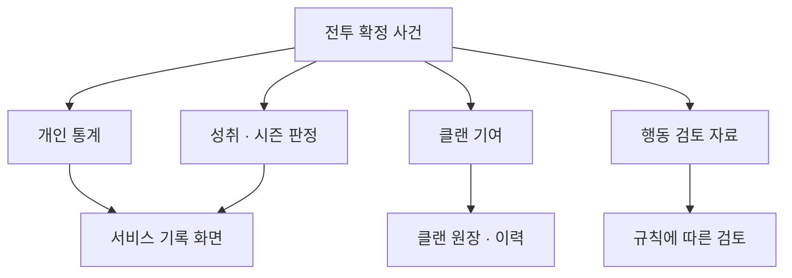

**[제안]** 금전·자원 반영의 안정된 식별키는 `battle_id + account_id + settlement_kind`로 유지하고 계산·처리기 버전은 메타데이터로 저장한다. 수정 결과는 이전 원장과의 차액만 별도 `correction_id`로 원자 적용한다. 통계처럼 재구축 가능한 파생 자료는 버전별 집계 후 교체할 수 있지만, 이를 신규 보상 지급으로 연결하지 않는다. 전적 재계산 때문에 크레딧이 다시 지급되거나, 제재 수정 때문에 기존 증표가 의도치 않게 삭제되지 않도록 각 결과의 소유자를 분리한다.

## 9. 상황 예시

### 예시 A: 같은 피해량, 다른 성취

가상의 두 플레이어가 각각 직접 피해 2,000을 기록했다. 한 명은 중요한 정찰 정보를 오래 제공했고, 다른 한 명은 장갑으로 전선을 버텼다.

**[분석]** 기여를 한 값으로 보여 주면 서로 다른 역할이 가려질 수 있다. 종합 지표와 함께 직접 피해·정보 기여·방어·생존 같은 원시 지표를 남겨야 플레이어와 설계자가 결과를 해석할 수 있다. 이 예시의 수치는 실제 전투 로그가 아니다.

### 예시 B: 클랜 비축물자 활성화가 중복 요청됨

운영 담당의 요청 후 네트워크 응답이 늦어 재요청이 발생한다.

**[제안]** 두 번째 요청이 같은 요청 ID라면 첫 결과를 반환한다. 새로운 요청이라면 잔액·중복 효과·사용 권한을 다시 평가한다. UI는 “처리 중” 상태와 결과를 명시하여 무의식적인 반복 조작을 줄인다.

## 10. QA

| ID | 시험 | 기대 또는 검증점 |
|---|---|---|
| SOC-01 | 팀·소대 채팅 전환 | 수신 범위와 색·명칭 일치 |
| SOC-02 | 여러 핑에 연속 응답 | 응답이 올바른 원래 핑에 연결 |
| SOC-03 | 만료된 적 위치에 핑 | 현재 탐지 정보처럼 표시되지 않음 |
| SOC-04 | 소대 초대 중 차량 변경 | 참가 준비 상태 재검증 |
| SOC-05 | 클랜 권한 해제와 자원 요청 경합 | 서버 권한 기준으로 승인 |
| SOC-06 | 비축물자 요청 재전송 | 이중 지출·이중 효과 없음 |
| SOC-07 | 같은 결과 재처리 | 통계·성취·클랜 기여 중복 없음 |
| SOC-08 | 숙련도 기준 집계 갱신 | 고정 XP 표처럼 오해할 UI 제거 |
| SOC-09 | 과거 버전 리플레이 재생 | 호환 실패를 명확히 안내 |
| SOC-10 | 차단·음소거 적용 | 전투 필수 시스템 알림과 사용자 채팅 구별 |
| SOC-11 | 일반전 외 이벤트 결과 | WTR·증표 등 집계 포함 여부 확인 |
| SOC-12 | 제재 수정 또는 이의 처리 | 변경 이력과 관련 결과의 일관성 |

## 출처

- [S01] [In-Game Communication](https://worldoftanks.eu/en/content/guide/newcomers-guide/communication/)
- [S02] [Industrial Resource](https://worldoftanks.eu/en/content/strongholds_guide/industrial_resource/)
- [S03] [Stronghold Reserves](https://worldoftanks.eu/en/content/strongholds_guide/reserves/)
- [S04] [Updated Stats and Combat Achievements, 1.21](https://worldoftanks.eu/en/news/general-news/1-21-updated-stats-combat-achievements/)
- [S05] [Awards and Achievements](https://worldoftanks.eu/en/news/general-news/awards-and-achievements/)
- [S06] [How Are Marks of Excellence Earned?](https://www.wargaming.net/support/en/products/wot/article/15060/)
- [S07] [Battle Replays: Save, Watch and Upload](https://www.wargaming.net/support/en/products/wot/article/10411/)
- [S08] [Prohibited Mods](https://worldoftanks.eu/en/content/guide/fair-play/prohibited-mods/)
- [S09] [Fair Play Update: New Prohibited Mods and Bans, 2026-01-14](https://worldoftanks.eu/en/news/general-news/ban-wave-jan-2026/)


---

<!-- Source document: 19_Server_and_Data_Architecture.md -->

# 19. 서버·데이터·물리·이벤트 구조 재구성

> 대상: Wargaming PC의 공개 규칙을 구현하기 위한 설계 모델  
> 기준일: 2026-11-13 KST  
> **핵심 한계:** 이 장의 구조·스키마·의사코드는 모두 **[제안]**이다. 원작 서버 코드, 패킷, DB, 틱레이트, 현재 물리 엔진을 확인한 결과가 아니다.  
> 연관: [전투 상태](02_Battle_Rules_and_Lifecycle.md), [탄도](04_Aiming_Firing_and_Ammunition.md), [관통](05_Armor_Penetration_and_Damage.md), [시야](08_Spotting_Concealment_and_Radio.md), [경제](16_Economy_and_Battle_Rewards.md)

## 1. 공개 사실에서 말할 수 있는 범위

**[확인]** 9.14의 공식 이동 물리 소개는 당시 개선된 차량 물리를 서버에서 계산한다고 설명했다. 이것은 역사적 서버 권한 근거이며, 2026년의 엔진·솔버·작업 스케줄러·네트워크 주기를 확정하는 자료는 아니다. [S01]

**[확인]** 공개 개발자 API에는 계정·차량 성과와 직접 피해·정찰 도움·궤도 도움·스턴 도움 같은 통계 필드가 있다. 이는 외부 통계 인터페이스의 존재를 보여 줄 뿐 내부 전투 DB나 이벤트 버스의 실제 구조를 의미하지 않는다. [S02]

**[확인]** 리플레이는 기록한 클라이언트 버전과 연결되며, 최신 모드에서는 기본전과 다른 시야·부활·점수 규칙을 사용한다. 따라서 아래 재구성은 버전과 모드별 계약을 명시하는 데 중점을 둔다. [S03][S04]

## 2. 설계 목표

**[제안]**

1. 전투 결과는 서버에서 확정한다.
2. 정보 공개 범위와 물리 세계의 존재를 분리한다.
3. 차량 구성은 전투 시작 시 불변 스냅샷으로 만든다.
4. 장갑·피해·탐지·보상은 버전이 있는 독립 규칙으로 관리한다.
5. 같은 전투 결과를 재처리해도 보상은 중복되지 않는다.
6. 게임플레이 충돌과 화면용 파괴 효과는 다른 비용 구조로 관리한다.
7. 경계값·모드 예외를 자동 또는 통제된 실험으로 검증할 수 있게 기록한다.

이는 원작이 반드시 이렇게 구성되어 있다는 진술이 아니라, 공개된 경험을 일관되게 재현하기 위한 요구사항이다.

## 3. 논리 시스템 분해

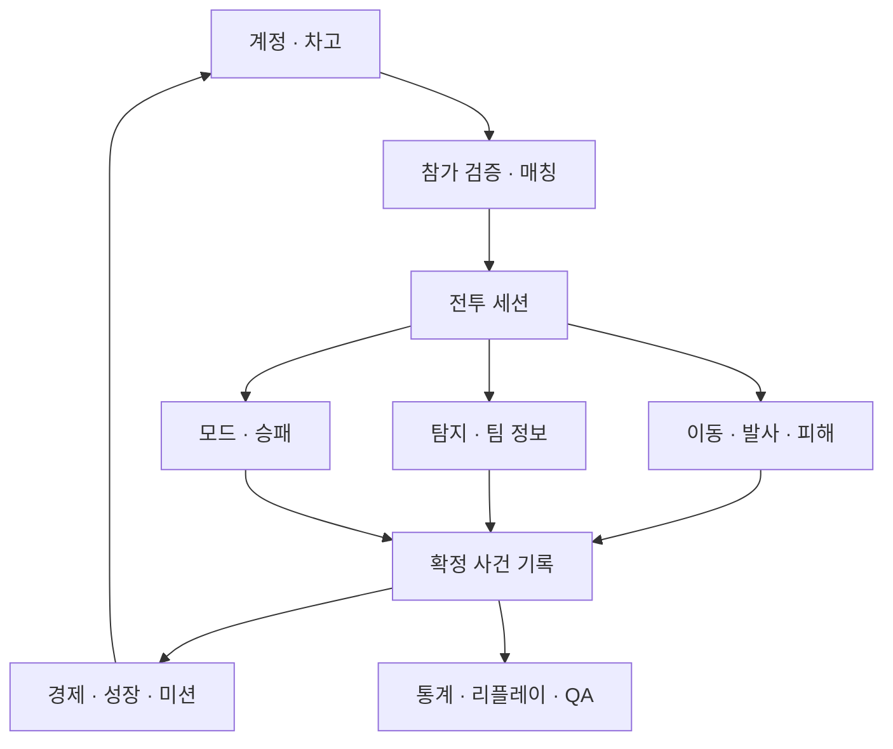

**[제안]** 위 도식의 상자는 독립 서버 프로세스를 의미하지 않는다. 초기 재구현에서는 하나의 프로세스 안의 모듈로 구현할 수 있다. 실제 프로세스·서비스 분리는 성능, 장애 격리, 배포 요구가 확인된 뒤 결정한다.

## 4. 데이터 소유권

| 데이터 | 제안 소유자 | 변경 시점 | 주요 불변 조건 |
|---|---|---|---|
| 계정 재화·차량 보유 | 영속 계정 | 구매·정산 | 잔액 변경이 원장과 일치 |
| 차량 정의·장갑판 | 콘텐츠 카탈로그 | 패치 | ID·참조 무결성 |
| 승무원·장비 구성 | 차고 | 편집·전투 준비 | 허용 슬롯·차량 조건 |
| 전투 구성 스냅샷 | 세션 | 입장 확정 | 전투 도중 외부 편집 불가 |
| 위치·HP·재장전 | 전투 시뮬레이션 | 매 처리 단계 | 유효 범위와 상태 전이 |
| 관측 권한 | 탐지·무전 | 관측 상태 변경 | 권한 없는 정보를 전송하지 않음 |
| 점령·모드 점수 | 모드 규칙 | 목표 사건 | 모드 버전과 일치 |
| 최종 결과 | 결과 확정 계층 | 종료 시 한 번 | 마지막 사건 시퀀스 고정 |
| 전적·미션 | 파생 처리 계층 | 확정 결과 처리 | 중복 처리 방지 |

## 5. 차량 정의와 실행 상태

### 5.1 정적 정의

```text
VehicleDefinition
  vehicle_id, nation_id, tier, class_id, role_id
  hull_definition_id, turret_definition_ids
  gun_definition_ids, suspension_definition_id
  engine_definition_id, radio_definition_id
  armor_layout_id, module_layout_id, crew_layout_id
  special_mechanic_definition_id
  research_graph_id, compatible_equipment_rules
```

**[제안]** 외형 메시, 장갑판, 내부 모듈, 탄도 충돌, 이동 충돌의 ID를 구별한다. 보여 주는 전차 형태가 모든 판정 형상과 완전히 같다고 가정하지 않는다.

### 5.2 전투 실행 상태

```text
VehicleRuntime
  entity_id, team_id, build_snapshot_id
  pose, linear_velocity, angular_velocity
  hp, modules, crew_status
  loaded_shell, reserve_ammo, reload_state, aiming_state
  consumable_cooldowns
  special_mechanic_state
  alive_state, last_processed_input_sequence
```

**[제안]** 차체·포탑·포 방향을 별도로 보존한다. 포신 외형의 흔들림과 실제 발사 방향이 어떤 관계를 갖는지는 명시적 규칙으로 둔다. 시각적 흔들림을 물리적 조준 분산과 자동으로 연결하지 않는다.

## 6. 효과와 최종 성능 계산

장비, 승무원, 소모품, 모듈 손상, 특수 기능, 모드 보정은 같은 성능에 영향을 줄 수 있다.

**[제안]**

```text
StatModifier
  source_id
  target_stat
  operation: Add / Multiply / Override / Clamp
  magnitude
  activation_condition
  stacking_group
  priority
  duration_policy
```

계산 순서는 명세에 적고 테스트한다. 예를 들어 기본 재장전, 승무원 보정, 장비 효과, 부상 페널티, 모드 보정은 곱셈의 순서만으로 끝나지 않을 수 있다. 중간 반올림과 상한, 예외 장비 금지, 조건 활성화 여부가 결과를 바꾼다.

**[검증 필요]** 이 자료만으로 실제 원작의 모든 수치 결합 공식을 복원하지 않는다. “기본값에 퍼센트를 전부 더한다” 같은 임의 공식은 설명용 예시로도 원본과 명확히 구분해야 한다.

## 7. 한 번의 서버 갱신을 구성하는 제안

| 논리 단계 | 책임 | 주의점 |
|---|---|---|
| 입력 수집 | 입력 시퀀스·발사·소모품 요청 | 중복·오래된 요청 검증 |
| 상태 갱신 | 이동·회전·재장전·특수 기능 | 확정된 서버 시간 사용 |
| 접촉·탄도 처리 | 이동 충돌·포탄 경로·명중 | 고속 포탄의 충돌 누락 방지 |
| 피해 처리 | 관통·HP·모듈·부상·파괴 | 명목 피해와 유효 피해 구별 |
| 정보 갱신 | 탐지·무전·표시 유지 | 발포와 탐지 순서의 영향 |
| 모드 처리 | 점령·점수·승패 후보 | 동시 사건 충돌 해결 |
| 상태 배포 | 허용된 정보만 전송 | 관측 권한에 따른 분리 |
| 기록 | 사건·계측 | 결과 재현과 성능 비용의 균형 |

**[제안]** 위 순서는 후보 구조다. 병렬화 가능한 계산과 반드시 순서를 지켜야 하는 커밋을 나눈다. 실제 WoT의 틱 순서라고 읽어서는 안 된다. 실험 결과를 맞추기 위해 순서를 바꿀 때는 룰 버전과 재현 테스트도 같이 갱신한다.

## 8. 발사와 피해 이벤트

### 8.1 입력은 의도, 출력은 확정 사실

```text
FireRequest:
  input_sequence
  requested_aim_direction
  selected_shell_slot

ShotAccepted:
  shot_id, shooter_id, server_time
  gun_id, shell_id, muzzle_pose
  aiming_state_snapshot

ImpactResolved:
  shot_id, target_id, surface_id
  result_category
  nominal_damage, effective_hp_damage
  module_damage_events, crew_events
  penetration_rule_revision
```

**[제안]** 클라이언트가 “이 적에게 400 피해”라는 결과를 제출하게 하지 않는다. 발사 요청의 가능 조건을 서버가 검사하고, 가려진 적을 향한 눈먼 사격도 목표 ID 없이 세계 공간에서 판정할 수 있게 한다.

### 8.2 피해 회계의 구분

| 필드 | 의미 |
|---|---|
| nominal_damage | 굴림 또는 규칙으로 산출된 명목 피해 |
| effective_hp_damage | 남은 HP를 고려한 실제 감소량 |
| overkill | 실제 감소량을 넘는 부분 |
| module_damage | 외부·내부 모듈에 대한 별도 변화 |
| assisted_damage_claim | 정찰·궤도·스턴 등 기여 후보 |
| credited_reward_damage | 해당 보상 규칙이 인정한 값 |

**[제안]** 이 값들을 구분해야 과잉 피해 보상, 모듈 손상만 발생한 명중, 여러 도움 유형의 중복 합산을 막을 수 있다. 원작의 보상 계수나 실제 저장 필드명은 아니다.

## 9. 탐지와 네트워크 전송

```mermaid
flowchart TD
    A["서버의 실제 차량 상태"] --> B["관측 · 무전 규칙"]
    B --> C{"관찰자 권한"}
    C -->|"모델 표시 가능"| D["차량 상태와 화면 표시"]
    C -->|"지도 정보만 가능"| E["허용된 미니맵 정보"]
    C -->|"현재 정보 없음"| F["숨김 또는 마지막 정보"]
    D --> G["클라이언트 UI"]
    E --> G
    F --> G
```

**[제안]** 다음 세 개를 분리한다.

- `WorldExistence`: 전차는 실제 시뮬레이션에 존재하며 탄과 충돌할 수 있다.
- `ObservationKnowledge`: 누가 어떤 시각의 정보를 알 수 있는가.
- `PresentationState`: 모델·실루엣·미니맵·마지막 위치를 어떻게 표시하는가.

화면에서 사라진 적이 월드에서 사라지는 것은 아니다. 반대로 월드에 존재한다고 해서 모든 클라이언트에 정밀 위치를 계속 보낼 필요도 없다.

## 10. 물리·충돌·시각 파괴의 분리

**[분석]** 같은 건물이 “보인다”, “탄을 막는다”, “차량을 막는다”, “시야를 막는다”, “무너진다”는 다섯 조건은 독립적으로 검증해야 한다. 파편 수와 시각 품질이 클라이언트마다 달라도 게임플레이 결과는 일관되어야 한다.

**[제안]**

| 계층 | 권한과 목적 | 예시 |
|---|---|---|
| GameplayCollision | 서버 확정 | 길이 막혔는지, 포탄이 통과하는지 |
| VisibilityOccluder | 탐지 규칙 | 관측선을 차단하는지 |
| DestructionState | 공통 상태 | Intact → Damaged → Destroyed |
| VisualDebris | 클라이언트 표현 | 작은 파편·먼지·흔들림 |
| AudioEvent | 지각 피드백 | 파괴음·피탄음·방향 정보 |

이것은 실제 WoT의 엔진 구현을 확인한 결론이 아니다. 비슷한 전술 게임을 재구현할 때 성능과 판정 일관성을 함께 관리하는 구조다.

### 10.1 엔진에 적용할 때의 경계

**[제안]** Unreal 또는 다른 엔진에서는 차량 본체, 포탑, 포, 판정 형상, 표면·장갑 데이터, 연출 구성요소를 분리한다. 프레임마다 바뀌는 전투 상태와 콘텐츠 정의를 같은 에셋에 쓰지 않는다. 일반 강체 접촉에서 얻은 충격량을 곧바로 원작의 충돌 피해라고 간주하지 말고 별도 게임 규칙으로 변환한다.

## 11. 정산과 중복 방지

```text
BattleResultFinalized
  -> RewardLedger
  -> ResearchProgress
  -> CrewProgress
  -> MissionProgress
  -> Statistics

각 처리:
  key = battle_id + account_id + settlement_kind
  if key already_applied:
      return stored_result
  calculate_delta()
  commit_delta_and_key_atomically()
  # 계산·결과 버전은 지급 식별키가 아닌 메타데이터로 보존
  # 확정 후 정정은 correction_id별 차액 거래로 처리
```

**[제안]** 결과가 늦게 도착하거나 재시도되어도 보상은 한 번만 적용한다. 계산기 버전이 바뀌어도 원래 지급의 식별자는 유지한다. 정정이 필요하면 이전 원장과 재계산 결과의 차액만 별도 식별자로 적용한다. 원장이 먼저 쓰이고 처리 마커가 나중에 쓰이면 장애 중복 지급이 가능하므로 둘의 일관성을 보장한다. 자동 보급은 전투 보상의 입금과 별도 지출로 기록한다.

## 12. 버전 관리

| 버전 키 | 필요한 이유 |
|---|---|
| client_build | 리플레이·UI·에셋 호환 |
| ruleset_revision | 관통·탐지·특수 기능 규칙 |
| map_revision | 지형·수풀·파괴물 변경 |
| vehicle_catalog_revision | 차량 성능·장갑 변경 |
| reward_revision | 경제·미션·이벤트 변화 |
| season_id | 경쟁 순위·보상 범위 |

**[제안]** 한 전투는 시작 시 선택된 버전을 끝까지 사용한다. 진행 중 전투를 바꾸는 긴급 패치가 꼭 필요하다면 전용 마이그레이션 규칙을 둔다. 기본 정책 없이 최신 전역 설정을 즉시 읽는 구조를 피한다.

## 13. 성능 예산과 계측

**[제안]** 수치 목표는 실제 하드웨어·접속 분포를 측정한 뒤 정한다. 이 문서에서는 WoT의 실제 처리량을 제시하지 않는다.

| 부하 | 측정 단위 | 개선의 후보 |
|---|---|---|
| 차량 이동·접촉 | 세션당 시간·접촉 수 | 넓은 단계 필터·안정된 단순 판정 형상 |
| 포탄 충돌 | 포탄당 처리·최대 구간 | 연속 충돌·표면 필터 |
| 탐지 | 관찰자×대상 후보·추적 횟수 | 공간 분할·거리 기반 후보 축소 |
| 상태 복제 | 수신자별 바이트·변경 빈도 | 허용 정보·변경량·우선순위 |
| 효과 계산 | 갱신 횟수·캐시 적중 | 상태 변할 때 재계산 |
| 결과 처리 | 지연·재시도·중복 | 불변 결과·독립 처리 |

## 14. 장애와 재현

**[제안]** QA 기록에는 사건의 논리 순서와 플레이어가 본 표현 시각을 함께 저장한다. “포탄이 사라졌다”는 신고는 발사 거절, 화면 지연, 탐지 소실, 장애물 충돌, 서버 판정 등 여러 원인을 가질 수 있다. 원인별 로그가 없으면 시각적 증상만으로 결론을 내리게 된다.

## 15. 검증 항목

| ID | 위험 | 확인 |
|---|---|---|
| ARC-01 | 차고 편집이 진행 중 전투에 영향 | 구성 스냅샷 불변 |
| ARC-02 | 발사 요청 재전송 | 탄약·피해가 한 번만 발생 |
| ARC-03 | 고속 포탄 터널링 | 얇은 판정면·저프레임에서도 충돌 |
| ARC-04 | 숨은 적 정보 노출 | 전송 정보와 관측 권한 비교 |
| ARC-05 | 표시 소실 후 눈먼 사격 | 서버 충돌과 HUD 분리 |
| ARC-06 | 탐지와 발사 동시 발생 | 룰 버전별 사건 순서 |
| ARC-07 | 파편 품질 차이 | 게임플레이 충돌 동일 |
| ARC-08 | 결과 저장 중 장애 | 중복·누락 없이 재시도 |
| ARC-09 | 이벤트 보상 오류 재처리 | 전적·크레딧의 이중 적용 없음 |
| ARC-10 | 패치 후 리플레이 | 버전 불일치 식별 |
| ARC-11 | 수치 효과 중복 | 중첩 그룹·상한·반올림 |
| ARC-12 | 지도 파괴 중 재접속 | 확정 파괴 상태 재동기화 |

## 출처

- [S01] [Version 9.14: Improved Vehicle Movement Physics and Sounds](https://worldoftanks.eu/en/news/general-news/version-914-sounds-physics/) — 역사적 서버 계산 설명. 현재 엔진의 증거로 확대하지 않음.
- [S02] [Wargaming Public API: Player Personal Data](https://developers.wargaming.net/reference/all/wot/account/info/) — 공개 통계 필드. 내부 구현과 구분.
- [S03] [Battle Replays](https://www.wargaming.net/support/en/products/wot/article/10411/)
- [S04] [Release Notes 2.4](https://worldoftanks.eu/en/content/docs/release_notes/release-notes-2-4/) — 모드별 규칙 차이의 사례.


---

<!-- Source document: 20_Balance_KPIs_and_Validation.md -->

# 20. 밸런스·계측 지표·통합 검증 계획

> 대상: Wargaming PC 공개 규칙에 대한 역기획 및 재현 설계  
> 기준일: 2026-11-13 KST  
> 이 장의 KPI·실험 절차·목표 선정법은 **[제안]**이다. 실제 WoT의 사내 지표·실험 결과·목표값을 입수한 것이 아니다.  
> 연관: [핵심 루프](01_Product_Overview_and_Core_Loops.md), [매칭](10_Matchmaking_and_Platoons.md), [경제](16_Economy_and_Battle_Rewards.md), [데이터 구조](19_Server_and_Data_Architecture.md)

## 1. 검증의 순서

**[분석]** 승률이 비슷하다고 장갑 판정이 맞는 것은 아니며, 평균 피해가 같다고 모든 지도가 공정한 것도 아니다. 규칙 정확성, 사용자 이해, 차량 역할, 매칭 품질, 경제 지속성을 서로 다른 시험으로 검증해야 한다.

**[제안] 우선순위**

1. 판정 일관성: 같은 입력·같은 조건에서 의도된 결과 범위를 만드는가.
2. 규칙 이해: 플레이어가 결과의 이유를 알 수 있는가.
3. 역할 차별화: 전차별 강점이 유효한 상황이 존재하는가.
4. 팀 구성: 큐의 제약과 완화가 전투의 질을 유지하는가.
5. 진행·경제: 성장 과정이 플레이 선택과 자원 흐름을 유지하는가.
6. 운영: 패치·이벤트가 기존 모드의 계약을 깨뜨리지 않는가.

## 2. 측정 단위와 필수 태그

**[제안]** 모든 지표에는 최소한 다음 맥락을 붙인다.

```text
realm, build, ruleset_revision, mode_id, season_id
map_id, map_revision, spawn_side
vehicle_id, tier, class_id, role_id
module_state, crew_configuration, equipment_loadout
player_experience_bucket, party_size
battle_id, result, queue_wait_bucket
```

**[분석]** 차량 A의 승률이 높아졌다면 차량 성능 개선 때문인지, 숙련자 비중이 높아졌는지, 지도 구성이 바뀌었는지 구분해야 한다. 모드·패치·차량 구성 없이 합친 평균은 원인 분석을 어렵게 만든다.

## 3. 전투 품질 지표

| 지표 | 제안 정의 | 해석 | 같이 확인할 항목 |
|---|---|---|---|
| 전투 길이 | 시작~결과 확정 시간 | 지나친 조기 종료·긴 정체 | 인원·지도·티어 |
| 첫 손실 시간 | 첫 전차 파괴까지 시간 | 초반 접촉 위험 | 차종·진입 경로 |
| 초반 체력 격차 | 정해진 경과 시각의 양팀 HP 차 | 일방 전개 시작점 | 정찰 손실·편성 |
| 생존 곡선 | 시간에 따른 생존 차량 수 | 전력 감소 속도 | 클립·집중 사격 |
| 사격 기회 | 유효 표적·발사 가능 상태 시간 | 실전 화력 활용 | 노출·위장·지형 |
| 피해 교환율 | 받은 피해 대비 가한 유효 피해 | 위험 감수의 성과 | 도움 기여·역할 |
| 점령 압박 | 점령 발생·저지·복귀 패턴 | 기지 목표의 활용 | 지도 크기·기동 |
| 정보 단절 | 적 정보 없이 이동한 구간 | 불확실성과 함정 | 정찰차 생존 |

**[제안]** “정해진 경과 시각”과 HP 정규화 방식은 시험 설계에서 선택한다. 본 문서가 특정 분·퍼센트를 WoT의 실제 내부 지표라고 제시하는 것은 아니다.

## 4. 차량 밸런스를 보는 방법

### 4.1 한 숫자 대신 조건별 비교

| 비교 축 | 통제해야 하는 조건 | 잘못된 해석 |
|---|---|---|
| 승률 | 플레이어 숙련·소대·티어 위치 | 숙련자 전용 차량을 무조건 강하다고 결론 |
| 피해량 | 교전 거리·체류 시간·차량 HP | 역할이 다른 정찰차와 직접 비교 |
| 관통 성과 | 탄종·표적·거리·각도 | 총 관통률만으로 포를 평가 |
| 장갑 성과 | 피격 방향·상대 탄·엄폐 | 방어량만 높으면 생존성이 좋다고 단정 |
| 기동 성과 | 지형·가속·회전·후진 | 최고 속도로 도착 시간을 계산 |
| 정찰 성과 | 아군 발사선·표적 위치 | 발견 수가 많으면 좋은 정찰이라고 단정 |
| 초기 구성 | 모듈·승무원·장비 완성도 | 최종 구성 평균으로 연구 구간 평가 |

**[확인]** 공식 2.0 안내는 대규모 차량 재조정에서 초기·완성 구성과 오래된 모듈 구조까지 다루었다. 이는 차량 밸런스가 최종 수치 한 묶음에만 해당하지 않는 사례다. [S01]

### 4.2 실전 화력과 이론 화력

**[분석]** 단발 피해 `a`, 재장전 `r`초인 단순 무기의 이론 DPM은 `60a/r`로 계산할 수 있다. 하지만 실전에서는 표적이 보이는 시간, 조준, 비관통, 이동, 엄폐 때문에 이 값을 계속 사용하지 못한다.

**[분석]** 가상의 HP 2,000 표적에 유효 피해 400을 항상 주고 첫 발이 즉시 가능하다면 다섯 발이 필요하다. 재장전이 10초일 때 첫 발부터 마지막 발까지는 40초다. 여기서 50초라고 계산하면 첫 발 이전 재장전을 중복 계상한 것이다. 반대로 조준·발사 지연과 관통 실패가 있으면 실제 소요시간은 늘어난다. 이 수치는 예시이며 실제 전차 데이터가 아니다.

**[제안]** 자동장전·재장전식·기관포는 탄창 내 간격, 완전 재장전, 부분 장전, 열 상태까지 별도 시간선으로 계산한다. 단순 DPM 비교만으로 순간 제거 능력을 판단하지 않는다.

## 5. 매치메이킹 지표

| 지표 | 측정 목적 |
|---|---|
| 대기시간 p50/p90/p99 | 평균에 가려진 긴 대기 확인 |
| 티어 위치 분포 | 하위·동티어·상위 경험의 편중 확인 |
| 역할 비대칭 빈도 | 양팀 정찰·돌파·지원 차이 |
| 차종 제한 완화율 | 저인구·특정 시간대의 제약 변화 |
| 소대 대칭성 | 협업 집단의 편중 |
| 지도 반복률 | 한 세션에서의 경험 다양성 |
| 비정상 소규모 편성 비율 | 대표 15v15에서 벗어난 빈도 |
| 매칭 후 전개 속도 | 큐 품질과 전투 품질의 연결 |

**[확인]** 2.4.1은 지도 반복 완화와 Random Events 선택 옵션 제거를 묶어 발표했다. 큐를 나누는 사용자 옵션과 반복 억제의 효율 사이에 제품 차원의 관계가 있음을 보여 주는 사례다. 공식 발표의 개선 수치를 독립 측정 결과로 재인용하지 않는다. [S02]

**[제안]** 매칭 변경은 대기시간과 전투 품질을 동시에 관찰한다. 역할 대칭만 극대화하면 적은 접속자 시간대의 대기가 늘 수 있고, 대기만 줄이면 편성 제약이 자주 풀릴 수 있다. 어느 쪽을 허용하는지는 명시적 제품 결정으로 남긴다.

## 6. 지도 지표

| 관측 | 제안 분석 방법 |
|---|---|
| 진영별 승률 | 지도×패치×티어×편성으로 분해 |
| 첫 교전 위치 | 주요 경로별 시간 분포 |
| 사망 집중 지점 | 한 번의 유행과 지속적 구조 문제 분리 |
| 엄폐 사용 | 피해·탐지·발사선과 함께 해석 |
| 정찰 지속 시간 | 위치별 얻는 정보와 생존 비용 |
| 복귀 시간 | 기지 위협 이후 실질 대응 가능 시간 |
| 파괴물 영향 | 파괴 전후 이동선·사격선·관측선 변화 |
| 무활동 지역 | 쓸모없는 공간인지 우회·종반 기능인지 구분 |

**[분석]** 이동 히트맵이 비어 있다고 해당 공간을 반드시 제거할 필요는 없다. 드물게 사용되는 복귀 경로가 일방적인 승리를 막을 수도 있다. 위치의 사용량과 전략적 대체 가능성을 함께 평가한다.

## 7. 경제와 성장 지표

| 지표 | 제안 정의 | 해석상의 주의 |
|---|---|---|
| 전투 순수익 | 수입−정비−소모 비용 | 표시 총수입과 구분 |
| 비용 부담률 | 소모·정비/수입 | 손실 판의 극단값과 평균 분리 |
| 연구 소요 전투 | 목표까지의 실제 세션 수 | 프리미엄·보너스·숙련도 구분 |
| 초기 구성 이탈 | 연구 병목 전후 잔존 변화 | 차량 선호와 비용 모두 확인 |
| 장비 구성 다양성 | 차량별 장비 조합 분포 | 인기 조합과 강제 조합 구분 |
| 자동 보급 실패 | 잔액 부족 등으로 준비 불완전 | UI 오해와 경제 문제 분리 |
| 이벤트 통화 잔여 | 종료 시 미사용 자원 | 교환 마감·보상 접근성 |
| 보상 수령 지연 | 자격 달성~반영 | 정산 오류·UI 지연 |

**[제안]** 유료 기능의 효과를 평가할 때 진행 속도, 준비 비용, 전투 성능의 직접·간접 변화를 분리한다. 공개 자료 없이 실제 매출·구매 전환율·이탈률을 채워 넣지 않는다.

## 8. 통계적 판단의 한계

**[분석]** 승률은 표본 변동을 가진다. 독립 베르누이 시행이라는 단순 가정 아래 표준오차는 `sqrt(p(1-p)/n)`이다. 그러나 실제 게임은 같은 플레이어의 반복 참가, 소대, 시간대, 지도 분포가 있어 독립 가정이 약해질 수 있다.

**[제안]** 다음을 함께 확인한다.

- 전체 표본 수보다 조건별 유효 표본 수.
- 같은 플레이어·차량의 반복 측정.
- 패치 직후 숙련자 유입과 적응 효과.
- 신규 전차의 초기 연구·승무원 편차.
- 평균 외 분포, 극단, 특정 지도·진영의 집중 문제.
- 많은 차량을 동시에 비교할 때 우연한 이상치.

어느 승률 차이가 “너프해야 할 차이”인지는 이 문서가 일률적으로 정하지 않는다. 효과의 크기와 플레이 경험, 데이터 신뢰도를 함께 평가한다.

## 9. 규칙 재현 실험의 공통 절차

1. 제품·권역·빌드·모드를 기록한다.
2. 차량·포·탄종·승무원·장비·소모품·특수 기능을 고정한다.
3. 거리·장갑 부위·각도·수풀·이동 상태를 기록한다.
4. 하나의 변수만 바꾸는 조건과 대조 조건을 둔다.
5. 난수가 있는 결과는 반복 횟수와 분포를 남긴다.
6. 화면 녹화·리플레이·가능한 로그를 연결한다.
7. 사실, 해석, 미확인을 구분하여 규칙 문서에 반영한다.

**[제안]** 테스트는 통제된 훈련 환경 또는 재구현 환경을 사용한다. 실제 이용자의 정상 경기를 실험 대상으로 방해하지 않는다. 이 문서는 클라이언트 자동 조작이나 금지된 모드를 권하는 지침이 아니다.

## 10. 통합 검증 매트릭스

아래 기대값은 출처로 확정한 규칙과 재구현 계약을 구분하여 적용한다.

| ID | 분야 | 시험 조건 | 목적·관측 |
|---|---|---|---|
| QA-01 | 제품 구분 | PC/Blitz 자료 섞임 검사 | 다른 제품 수치 제외 |
| QA-02 | 패치 | 2.0/2.4/2.4.1 비교 | 역사적 상한의 현재 오기 방지 |
| QA-03 | 조준 | 정지·주행·선회·포탑만 회전 | 분산 입력 분리 |
| QA-04 | 발사 | 재장전 완료 전후 입력 | 한 발 승인 경계 |
| QA-05 | 관통 | 장갑 법선 부근 각도 스윕 | 도탄·정규화 경계 |
| QA-06 | 구경 | 장갑 두께 대비 구경 변화 | 두 배·세 배 규칙 혼동 방지 |
| QA-07 | 공간장갑 | 동일 위치에 AP/HEAT/HE | 외부층과 주장갑 분리 |
| QA-08 | HE | 일반·SPG·기관포 | 서로 다른 폭발·파편 모델 |
| QA-09 | 모듈 | 궤도만 피격 vs 차체 관통 | HP와 모듈 피해 구별 |
| QA-10 | 수리 | 소형·대형·쿨다운 경계 | 1부위 수리라는 구형 규칙 배제 |
| QA-11 | 기동 | 한쪽 궤도·바퀴 손상 | 무조건 정지로 단순화하지 않음 |
| QA-12 | 시야 | 50m 전후·장애물 | 근접 탐지 경계 |
| QA-13 | 시야 | 445m 전후·과잉 시야 | 탐지 상한과 위장 대응 분리 |
| QA-14 | 표시 | 565m 전후·아군 관측 | 직접 탐지와 드로우 구분 |
| QA-15 | 수풀 | 15m 전후·발포 | 수풀과 전차 위장 변화 |
| QA-16 | 육감 | 탐지 직후 이동·특전 | 경고 지연과 실제 탐지 분리 |
| QA-17 | 라디오 | 공유 연결 유무 | 팀 탐지와 개인 표시 차이 |
| QA-18 | 지도 | 파괴 전후 이동·사격·탐지 | 파괴와 충돌·시야의 독립성 |
| QA-19 | 매칭 | VII+ 경전차 소대 | 최신 총인원 제한 |
| QA-20 | 매칭 | 저인구 시간대 | 완화 조건·대기시간 |
| QA-21 | 점령 | 1~4명·피격·이탈 | 속도·기여·리셋 실측 |
| QA-22 | 종료 | 전멸·점령 동시 | 한 번만 결과 확정 |
| QA-23 | 연구 | 선행 노드 미충족 | 연구·구매·장착 분리 |
| QA-24 | Tier XI | 전용 업그레이드 | VI~X 현장개량과 혼용 방지 |
| QA-25 | 승무원 | 직책·겸직·재훈련 | 효과·비용·완성도 검증 |
| QA-26 | 경제 | 보유탄 사용·재구매 | 전투 소비와 현금 지출 구분 |
| QA-27 | 미션 | 서로 다른 캠페인 활성 | Fossa와 동시 진행 충돌 |
| QA-28 | 이벤트 | 탄비 반환·HP 회복 | 일반전 경제·전투와 분리 |
| QA-29 | 통계 | 도움 피해 중복 유형 | 지표별 집계 규칙 분리 |
| QA-30 | 서버 | 종료 결과 재송신 | 중복 보상 방지 |
| QA-31 | 리플레이 | 패치 전후 재생 | 버전 호환성 |
| QA-32 | UX | 색각·음소거·해상도 | 필수 상태의 중복 신호 |
| QA-33 | Onslaught | 야간 지도·시간 종료 | 특수 시야·동률 순서 |
| QA-34 | 클랜 | 이벤트 차량 가용 상태 | 전투 파괴와 메타 상태 분리 |
| QA-35 | 입력 | 지연·중복·순서 역전 | 승인된 입력과 UI 피드백 |
| QA-36 | 운영 | 테스트 기사만 있는 기능 | 라이브 확정으로 오기하지 않음 |

## 11. MVP 검증 단계

| 단계 | 구현 범위 | 다음 단계로 넘어갈 증거 |
|---|---|---|
| A. 전투 실험실 | 차량 2종·평면·단일 포 | 명중·관통·피해 설명 가능 |
| B. 정보 실험실 | 시야·수풀·엄폐·팀 공유 | 표시에 대한 재현 가능한 규칙 |
| C. 소규모 팀 전투 | 기본 승패·기지·역할 | 전투 종료·협업·기여 기록 |
| D. 구성과 성장 | 연구·승무원·장비·정산 | 준비값과 전투 결과의 연결 |
| E. 편성과 지도 | 매칭 제약·여러 지도 | 역할별 기회와 큐 품질 |
| F. 모드 확장 | 하나의 부활형 모드 | 기본전 계약을 깨지 않는 확장 |

**[제안]** MVP 전차 수나 인원은 실제 서비스 구성을 복제한다는 뜻이 아니다. 복잡한 룰이 맞는지 확인하는 데 필요한 최소 장면부터 시작하는 검증 계획이다.

## 12. 미확인 항목을 작업으로 전환

| 항목 | 현재 상태 | 다음 증거 |
|---|---|---|
| 정규화 세부 공식 | 최신 PC 1차 근거 부족 | 현행 공식 설명 또는 통제 실험 |
| 분산 확률 분포 | 개략만 공개 | 동일 조건 반복 사격 분포 |
| 모듈 내부 판정 세부 | 규칙 일부만 확인 | 표적·피격선 통제 실험 |
| 탐지 체크 주기 | 타 제품 자료 혼재 위험 | PC 시간 측정 |
| 점령 완료 유예 | 역사적 설명과 UI 차이 | 동시 사건 녹화·리플레이 |
| 서버 틱·복제 주기 | 비공개 | 공식 기술 발표 없으면 추정으로 유지 |
| 보상 계수 | 차량·상태별 미공개 | 경제 원장 예시만 제안으로 유지 |
| 매칭 내부 목적함수 | 비공개 | 공개 제약과 관측 결과만 문서화 |

## 출처

- [S01] [Release Notes 2.0 — Rebalance](https://worldoftanks.eu/en/content/docs/release_notes/release-notes-2-0/)
- [S02] [Release Notes 2.4.1 — Matchmaker](https://worldoftanks.eu/en/content/docs/release_notes/release-notes-2-4-1/)
- 각 QA의 확정 규칙과 세부 출처는 03~18장의 해당 시스템 문서를 따른다. 이 장의 실험 결과는 아직 수집하지 않았으며, 모두 실행할 검증 계획이다.


---

<!-- Source document: 21_Sources_Versions_and_Glossary.md -->

# 21. 출처·버전 기준·검증 한계·용어집

> 자료 확인일: **2026-11-13 KST**  
> 분석 대상: **Wargaming World of Tanks PC판**  
> 이 문서는 각 시스템의 근거 수준을 관리하는 공통 부록이다. 개별 문서의 출처 ID는 해당 문서 안에서 해석한다.

## 1. 조사 방법

공식 게임 가이드, Wargaming 지원 문서, 확정 릴리스 노트, 공식 Tankopedia, 출시·이벤트 안내를 조사했다. 규칙이 바뀐 시스템은 최신 공지와 이전 도입 문서를 비교했다. 게임과 이름이 비슷한 Blitz·콘솔판, Lesta 서비스의 정보를 PC Wargaming 사양으로 가져오지 않았다.

### 1.1 사용자가 제공한 링크

[나무위키 — 월드 오브 탱크](https://namu.wiki/w/%EC%9B%94%EB%93%9C%20%EC%98%A4%EB%B8%8C%20%ED%83%B1%ED%81%AC)

**접근 결과:** 검색 도구에서 본문을 열지 못했다. 따라서 이 링크는 요청 범위를 설명하는 참고 주소일 뿐, 문서의 세부 사실을 뒷받침하는 열람 출처가 아니다. 원문 문장을 복제하거나 해당 문서를 읽었다고 전제한 내용은 넣지 않았다.

### 1.2 공식 자료의 접근 한계

일부 World of Tanks 웹페이지는 직접 열기에서 쿠키·스크립트 관련 보안 안내를 반환했다. 이 경우 검색 도구가 반환한 **공식 페이지의 색인 본문**을 사용하고, 관련 가이드·다른 공식 공지와 교차 확인했다. 검색 결과가 짧거나 상충하면 수치 확정을 보류했다.

자료의 검색 확인일은 실제 패치 적용일과 다르다. 오래된 문서가 최근 크롤링되었다는 이유로 현재 규칙이라고 판단하지 않는다.

## 2. 증거의 우선순위

| 우선순위 | 자료 | 사용 원칙 |
|---|---|---|
| 1 | 해당 라이브 버전의 확정 패치·마이크로패치 | 실제 변경 범위를 확인 |
| 2 | 해당 시즌·이벤트의 공식 최종 안내 | 그 시즌·모드에만 적용 |
| 3 | 현재 상시 가이드·지원 문서·Tankopedia | 최신 공지와 충돌하는 항목 점검 |
| 4 | 이전 공식 출시·패치·기술 설명 | 도입 배경·역사적 규칙으로 표시 |
| 5 | Common Test·Supertest | 예정·테스트 상태로만 사용 |
| 참고 | 추가 시청 영상·접근 불가 URL | 직접 확인한 범위를 넘겨 사실 근거로 사용하지 않음 |

**주의:** 최신 게시일만으로 우선순위를 결정하지 않는다. 특정 시즌의 예외는 일반 규칙을 덮을 수 있지만 다른 모드까지 바꾸지 않는다. 공식 자료끼리 충돌하면 범위·시점·문구를 함께 기록한다.

## 3. 버전 기준표

| 시기·버전 | 문서에서 사용하는 의미 | 현재와의 연결 |
|---|---|---|
| 8.6 | APCR 정규화 등 역사적 변경 기록 | 현재 모든 탄의 세부 수식으로 확대하지 않음 |
| 9.14 | 서버에서 처리한 이동 물리의 역사적 설명 | 현재 엔진·틱레이트를 증명하지 않음 |
| 1.6 | 기본 무작위 전투의 아군 직접 피해 비활성화 도입 | 팀 방해·스턴 등의 현재 정책과 함께 읽음 |
| 1.13 | 일반 HE와 자주포 탄 체계의 개편 | 기관포 등 후속 예외와 분리 |
| 1.26 | 승무원 특전 체계와 소모품 복구 개선 | 2026년 특전 추가와 누적 적용 |
| 2.0 / 2025년 9월 | Tier XI, 차고·매칭·다수 차량 재조정 | 출시 당시 수치와 이후 변경 구분 |
| 2.2 / 2026년 3월 | 승무원 특전·편의·장갑 검사 등 개선 | 2월 소개 기사 발행일과 구분 |
| 2.3 / 2026년 6월 | SPG 제한 등 매칭 개편 | 2.0의 예전 상한을 대체 |
| 2.4 / 2026년 9월 | 경전차 역할·제한, 새 기믹, Onslaught 등 | 현재 관련 시스템 문서에 반영 |
| 2.4.1 / 2026년 10월 | 지도·반복 완화·미션·11월 모드 준비 | 이번 자료의 라이브 기준 계열 |
| 2.4.1_4 / 2026-11-05 | 확인한 마이크로패치 | 더 최신 세부 수정이 전혀 없다는 뜻은 아님 |
| 2.4.2 Common Test / 2026-11-05 공지 | 테스트 환경 | 라이브 규칙으로 채택하지 않음 |

버전별 상세 근거는 아래 출처 목록과 해당 시스템 문서에서 확인한다. 하나의 “최신 버전” 문자열로 서비스 권역·모드·시즌의 모든 차이를 덮지 않는다.

## 4. 잘못 가져오기 쉬운 규칙과 처리

| 혼동 위험 | 문서에서의 처리 | 관련 문서 |
|---|---|---|
| 10티어가 전체 최종 단계 | 11티어 존재와 성장 체계 반영 | 07·13 |
| 출시 16대가 현재 11티어 총수 | 출시 당시 수량으로만 기록 | 07·13 |
| 소형 수리·구급은 한 대상만 복구 | 현재 전체 복구와 대기시간 차이로 정리 | 06·15 |
| 모든 HE가 같은 폭발 피해 | 일반·자주포·기관포 분리 | 04·05·07 |
| 정규화는 인터넷 통설대로 확정 | 역사 근거·현행 미확인 공식 분리 | 05 |
| 시야 445m와 화면 표시 565m가 같은 개념 | 탐지·공유·표시를 분리 | 08 |
| 50/445/565m를 모든 모드에 적용 | Onslaught 야간 등 별도 규칙 | 08·12 |
| 육감 알림 시점이 피탐 시작 시점 | 실제 탐지와 경고 지연을 구분 | 08·14 |
| 매칭이 고정 3-5-7만 사용 | 공개 제약과 유동 큐 구조로 설명 | 10 |
| SPG 3대·고티어 경전차 3대 고정 | 후속 패치의 제한 변경 반영 | 07·10 |
| Encounter 규칙이 제품 전체에서 소멸 | 무작위 큐 중단과 클랜 이벤트 사용 분리 | 02·12 |
| 6특전 상한에 육감·모든 겸직을 포함 | 주 직책과 겸직별 보너스 구분 | 14 |
| 특전 초기화와 차량 재훈련 가격을 동일시 | 작업·효과·재화 분리 | 14 |
| VI–X 현장개량을 XI에 그대로 적용 | XI 전용 업그레이드로 분리 | 13·15 |
| 모든 개인미션을 동시에 진행 | 캠페인·작전 활성 규칙과 Fossa 예외 | 17 |
| 프리미엄 계정과 Plus가 같은 상품 | 독립 상품과 혜택으로 표현 | 16·17 |
| 총수입을 순수익으로 읽음 | 탄·정비·보급의 지출 원장 분리 | 16 |
| 서버 권한=현재 물리 엔진 확정 | 역사 사실과 구현 제안 분리 | 19 |

## 5. 확인하지 못한 내부 사양

| 항목 | 왜 확정하지 않았는가 | 후속 확인 방법 |
|---|---|---|
| 실제 서버 틱·복제 주기 | 공개 기술 자료만으로 현행 값 부족 | 공식 기술 발표 또는 권한 있는 계측 |
| 현행 물리 엔진·솔버 | 역사적 발표를 현재로 확대할 수 없음 | 현재 기술 문서 확인 |
| 포탄 분산 내부 분포 | 범위·표현과 표본 알고리즘은 다름 | 통제 사격·통계·공식 해설 |
| 정규화·구경 경계의 정확한 수식 | 다른 제품·과거 테스트 자료 혼재 | 현행 PC 자료·장갑 검사·훈련방 |
| 내부 모듈 HP·손상 확률 | 일부 역할 설명만 공개 | 출처 있는 데이터·통제된 실험 |
| 탐지 체크 주기·체크포인트 전체 | Blitz 자료를 잘못 쓰기 쉬움 | PC 전용 검증 |
| 점령 확정 유예·동시 사건 순서 | UI와 서버 확정 시각이 다를 수 있음 | 영상·리플레이·실험 |
| 차량별 경제 계수 | 오래된 지원 문서 수치 혼재 | 현재 정산 사례와 공식 기준 |
| 매칭 목적함수·완화 임계값 | 공개 제약이 내부 알고리즘 전체가 아님 | 공식 자료 범위 내 분석 |
| 모든 전차의 최신 가격·제원 | 전차 카탈로그 전체 수집은 별도 과제 | 해당 패치 Tankopedia·클라이언트 |

숫자를 모른다고 시스템 설명을 생략하지 않았다. 대신 어떤 입력·상태·출력이 필요하며 어떤 실험이 답을 줄 수 있는지 [20번](20_Balance_KPIs_and_Validation.md)에 정리했다.

## 6. 용어집

| 용어 | 이 문서에서의 뜻 |
|---|---|
| PC판 | Wargaming이 서비스하는 World of Tanks 컴퓨터용 제품 |
| Tier / 티어 | 연구·매칭·성능·콘텐츠 범위의 차량 단계 |
| Class / 차종 | 경전차·중형전차·중전차·구축전차·자주포 분류 |
| Role / 역할 | 같은 차종 안에서도 구별되는 전투 기능 |
| Alpha | 한 발의 대표 피해량 |
| DPM | 일정 조건에서 분당 낼 수 있는 이론 피해 |
| Burst | 짧은 시간에 집중되는 피해 |
| Clip / Magazine | 여러 발을 묶어 운용하는 탄창·장전 구조 |
| Autoloader | 탄창 내 발사와 탄창 재장전이 나뉜 계열 |
| Autoreloader | 탄을 순차적으로 보충하는 재장전 계열 |
| Autocannon | 연속 발사·열 등 별도 상태를 가질 수 있는 기관포 계열 |
| Dispersion | 포탄이 겨냥점에서 퍼질 수 있는 범위·상태 |
| Aim time | 조준 수렴 특성을 나타내는 지표; 완전 수렴 시간과 혼동 금지 |
| AP | 철갑탄 |
| APCR | 고속철갑탄 계열 |
| HEAT | 성형작약탄 |
| HE | 고폭탄; 무장군별 피해 정책을 함께 확인 |
| Normalization | 경사장갑 판정에서 다루는 각도 보정 |
| Ricochet | 각도·탄종·구경 규칙에 따른 도탄 |
| Nominal armor | 해당 부위의 명목 장갑 두께 |
| Effective armor | 탄 경로와 판정 규칙을 고려한 유효 장갑 |
| Spaced armor | 주장갑과 분리된 외부 장갑층 |
| Overmatch | 구경 대비 장갑 두께와 관련된 관통·도탄 논의; 단일 자동 피해 규칙으로 단순화 금지 |
| Hull-down | 차체를 숨기고 주로 포탑을 노출하는 교전 |
| Side-scraping | 엄폐와 측면 각도를 활용하는 방어 행동 |
| Track | 궤도; HP와 별도의 모듈 손상 대상 |
| Ammo rack | 탄약고 모듈 |
| Stun | 일정 시간 전투 성능을 낮추는 상태 |
| View range | 차량이 관측에 사용하는 시야 성능 |
| Spotting | 상대 차량을 발견하는 판정 |
| Concealment | 차량·상태·식생 등이 탐지를 어렵게 하는 효과 |
| Draw distance | 다른 전차 모델을 화면에 표시하는 거리 범위 |
| Radio range | 아군 관측 정보를 공유하는 무전 관련 거리 |
| Sixth Sense | 발견되었다는 사실을 지연하여 알려 주는 전차장 기본 기능 |
| Assistance | 정찰·기동 제한·스턴 등으로 다른 아군 피해에 기여 |
| Platoon | 함께 전투에 참가하는 소규모 편성 |
| Elite | 해당 차량의 연구·업그레이드 완료와 연결된 상태 |
| Field Modification | 주로 VI–X의 후반 운용 조정 체계 |
| Upgrade | XI 전용 성장에서 사용하는 개선 노드 |
| Directive | 장비·승무원 효과와 연결되는 지휘명령 |
| Bonds | 크레딧·골드와 구별되는 별도 재화 |
| Base XP | 프리미엄·미션 등 부가 보너스와 구분되는 기본 전투 경험치 |
| WTR | 공식 전투 성과 평가 체계 |
| Mastery Badge | 같은 차량의 단일 전투 성과를 인정하는 숙련도 배지 |
| Marks of Excellence | 특정 차량의 지속 수행과 연결되는 화력의 증표 |
| Snapshot | 특정 시점에 확정하여 보존한 구성·상태 |
| Authority | 결과를 최종 승인하는 주체 |
| Idempotency | 같은 요청을 다시 처리해도 같은 효과만 발생하는 성질 |
| Ledger | 재화 증감의 근거를 기록하는 원장 |
| Rule set | 모드·패치에 따라 선택하는 규칙 묶음 |

## 7. 문서 개선 기록

- 기본전과 특별모드의 규칙을 분리했다.
- 오래된 상시 가이드의 표현을 최신 확정 패치와 비교했다.
- 전투·성장·정보·매칭·경제 문서 사이의 교차 검토를 수행했다.
- 서버·스키마·의사코드에 원작 구현이 아닌 제안이라는 표시를 넣었다.
- 금전 정산의 버전 변경 재처리가 중복 지급을 만들지 않도록 안정된 식별키와 차액 정정 모델을 명시했다.
- 검증 계획과 실제 게임에서 실행한 결과를 구분했다.
- 개별 문서의 내부 링크와 코드 펜스, ZIP 내용의 일치 여부를 검사했다.

## 8. 전체 출처 목록

아래 목록은 개별 문서에 연결된 자료의 URL을 통합한 것이다. 같은 페이지의 언어 설정·추적 쿼리 차이는 중복을 줄였으며, 표에 표시한 링크는 조사에 사용한 실제 주소를 유지했다. 각 자료의 상세 인용 맥락·시점·확인 범위는 연결된 시스템 문서를 따른다.

표에 추가 시청용 영상이 있으면 실제 발언 확인의 증거와 구별한다. 나무위키는 접근 실패로 이 사실 근거 목록에 포함하지 않았다. 테스트 공지는 테스트라는 범위 확인에만 사용했다.

**통합 출처: 113개 URL** — 동일 페이지 중복 제거. 확인일은 2026-11-13이다.

| ID | 자료 | 관련 문서 |
|---|---|---|
| SRC-001 | [Wargaming Public API: Player Personal Data](https://developers.wargaming.net/reference/all/wot/account/info/) | [19](19_Server_and_Data_Architecture.md) |
| SRC-002 | [Wargaming Reveals World of Tanks 2.0](https://wargaming.com/en/news/world-of-tanks-2-0-update/) | [00](00_README.md) · [21](21_Sources_Versions_and_Glossary.md) |
| SRC-003 | [Armor Penetration](https://wargaming.net/support/en/products/wot/article/10220/?lang=en) | [04](04_Aiming_Firing_and_Ammunition.md) · [05](05_Armor_Penetration_and_Damage.md) |
| SRC-004 | [About: Spotting and Concealment](https://www.wargaming.net/support/en/products/wot/article/10222/?redirect_lang=en) | [08](08_Spotting_Concealment_and_Radio.md) |
| SRC-005 | [About: Experience](https://wargaming.net/support/en/products/wot/article/10223/) | [13](13_Research_Progression_and_Tier_XI.md) · [16](16_Economy_and_Battle_Rewards.md) |
| SRC-006 | [Battle Replays: Save, Watch and Upload](https://www.wargaming.net/support/en/products/wot/article/10411/) | [18](18_Social_Clans_Replays_and_Fair_Play.md) · [19](19_Server_and_Data_Architecture.md) |
| SRC-007 | [High-Explosive (HE) Shells](https://wargaming.net/support/en/products/wot/article/15053/) | [05](05_Armor_Penetration_and_Damage.md) |
| SRC-008 | [How Are Marks of Excellence Earned?](https://www.wargaming.net/support/en/products/wot/article/15060/) | [18](18_Social_Clans_Replays_and_Fair_Play.md) |
| SRC-009 | [How Do I Complete Personal Missions?](https://www.wargaming.net/support/en/products/wot/article/15110/?redirect_lang=en) | [02](02_Battle_Rules_and_Lifecycle.md) · [06](06_Modules_Crew_Damage_and_Repair.md) · [16](16_Economy_and_Battle_Rewards.md) |
| SRC-010 | [What Happens When a Shell Hits a Vehicle?](https://wargaming.net/support/en/products/wot/article/15762/) | [06](06_Modules_Crew_Damage_and_Repair.md) |
| SRC-011 | [How do I earn Credits?](https://www.wargaming.net/support/en/products/wot/article/18956/) | [16](16_Economy_and_Battle_Rewards.md) |
| SRC-012 | [How do I earn Experience?](https://wargaming.net/support/en/products/wot/article/18960/) | [16](16_Economy_and_Battle_Rewards.md) |
| SRC-013 | [Stun Mechanic](https://wargaming.net/support/en/products/wot/article/19514/?lang=en&redirect_lang=en) | [06](06_Modules_Crew_Damage_and_Repair.md) · [07](07_Artillery_and_Special_Mechanics.md) |
| SRC-014 | [Unfairly Leaving a Battle: Desertion and Warnings](https://wargaming.net/support/en/products/wot/article/31581/) | [02](02_Battle_Rules_and_Lifecycle.md) |
| SRC-015 | [How Equipment 2.0 Works](https://wargaming.net/support/en/products/wot/article/33291/?lang=en&redirect_lang=en) | [06](06_Modules_Crew_Damage_and_Repair.md) |
| SRC-016 | [Tank Academy: Armour Angling and Side-Scraping](https://worldoftanks.asia/en/content/tank-academy/armour-angling-side-scraping/) | [05](05_Armor_Penetration_and_Damage.md) |
| SRC-017 | [Arcade Cabinet: Battle in Railgun and Element of Surprise!](https://worldoftanks.asia/en/news/general-news/arcade-cabinet-railgun-eos-feb-2025/) | [05](05_Armor_Penetration_and_Damage.md) |
| SRC-018 | [Update 1.26: Hailstorm](https://worldoftanks.asia/en/wot-1-26/) | [06](06_Modules_Crew_Damage_and_Repair.md) |
| SRC-019 | [World of Tanks 공식 매뉴얼 PDF](https://worldoftanks.eu/dcont/fb/manuals/world_of_tanks_game_manual_eu_web.pdf) | [02](02_Battle_Rules_and_Lifecycle.md) |
| SRC-020 | [Update 1.6](https://worldoftanks.eu/en/1.6/) | [02](02_Battle_Rules_and_Lifecycle.md) |
| SRC-021 | [Update History](https://worldoftanks.eu/en/content/docs/release_notes/) | [00](00_README.md) · [21](21_Sources_Versions_and_Glossary.md) |
| SRC-022 | [Release Notes 1.13](https://worldoftanks.eu/en/content/docs/release_notes/release-notes-1-13/) | [05](05_Armor_Penetration_and_Damage.md) · [07](07_Artillery_and_Special_Mechanics.md) |
| SRC-023 | [Release Notes 1.26](https://worldoftanks.eu/en/content/docs/release_notes/release-notes-1-26/) | [15](15_Equipment_Consumables_and_Field_Mods.md) |
| SRC-024 | [Release Notes 1.28](https://worldoftanks.eu/en/content/docs/release_notes/release-notes-1-28/) | [14](14_Crew_and_Perks.md) |
| SRC-025 | [Release Notes 2.0](https://worldoftanks.eu/en/content/docs/release_notes/release-notes-2-0/) | [02](02_Battle_Rules_and_Lifecycle.md) · [10](10_Matchmaking_and_Platoons.md) · [12](12_Modes_Competitive_and_Events.md) · [17](17_Missions_Monetization_and_LiveOps.md) · [20](20_Balance_KPIs_and_Validation.md) |
| SRC-026 | [Release Notes 2.1.1](https://worldoftanks.eu/en/content/docs/release_notes/release-notes-2-1-1/) | [03](03_Vehicle_Classes_and_Mobility.md) · [07](07_Artillery_and_Special_Mechanics.md) |
| SRC-027 | [Release Notes 2.3](https://worldoftanks.eu/en/content/docs/release_notes/release-notes-2-3/) | [07](07_Artillery_and_Special_Mechanics.md) · [10](10_Matchmaking_and_Platoons.md) |
| SRC-028 | [Release Notes 2.4](https://worldoftanks.eu/en/content/docs/release_notes/release-notes-2-4/) | [03](03_Vehicle_Classes_and_Mobility.md) · [07](07_Artillery_and_Special_Mechanics.md) · [08](08_Spotting_Concealment_and_Radio.md) · [10](10_Matchmaking_and_Platoons.md) · [12](12_Modes_Competitive_and_Events.md) · [15](15_Equipment_Consumables_and_Field_Mods.md) · [17](17_Missions_Monetization_and_LiveOps.md) · [19](19_Server_and_Data_Architecture.md) |
| SRC-029 | [Release Notes 2.4.1 — Matchmaker](https://worldoftanks.eu/en/content/docs/release_notes/release-notes-2-4-1/) | [00](00_README.md) · [09](09_Maps_Terrain_and_Destruction.md) · [10](10_Matchmaking_and_Platoons.md) · [20](20_Balance_KPIs_and_Validation.md) |
| SRC-030 | [공식 Full Guide](https://worldoftanks.eu/en/content/guide/) | [01](01_Product_Overview_and_Core_Loops.md) |
| SRC-031 | [In-Game Store and Depot](https://worldoftanks.eu/en/content/guide/economy/in-game-store-and-depot/) | [16](16_Economy_and_Battle_Rewards.md) |
| SRC-032 | [Prohibited Mods](https://worldoftanks.eu/en/content/guide/fair-play/prohibited-mods/) | [18](18_Social_Clans_Replays_and_Fair_Play.md) |
| SRC-033 | [Teamkill](https://worldoftanks.eu/en/content/guide/fair-play/teamkill/) | [02](02_Battle_Rules_and_Lifecycle.md) |
| SRC-034 | [Consumables](https://worldoftanks.eu/en/content/guide/game-mechanics-and-achievements/consumables/) | [06](06_Modules_Crew_Damage_and_Repair.md) · [15](15_Equipment_Consumables_and_Field_Mods.md) |
| SRC-035 | [Crew Training](https://worldoftanks.eu/en/content/guide/game-mechanics-and-achievements/crew-training/) | [08](08_Spotting_Concealment_and_Radio.md) · [14](14_Crew_and_Perks.md) |
| SRC-036 | [Daily Missions](https://worldoftanks.eu/en/content/guide/game-mechanics-and-achievements/daily-missions/) | [17](17_Missions_Monetization_and_LiveOps.md) |
| SRC-037 | [Directives](https://worldoftanks.eu/en/content/guide/game-mechanics-and-achievements/directives/) | [15](15_Equipment_Consumables_and_Field_Mods.md) |
| SRC-038 | [Equipment](https://worldoftanks.eu/en/content/guide/game-mechanics-and-achievements/equipment/) | [15](15_Equipment_Consumables_and_Field_Mods.md) |
| SRC-039 | [Matchmaker for Low-Tier Battles](https://worldoftanks.eu/en/content/guide/game-mechanics-and-achievements/matchmaker-for-low-tier-battles/) | [10](10_Matchmaking_and_Platoons.md) |
| SRC-040 | [Personal Missions](https://worldoftanks.eu/en/content/guide/game-mechanics-and-achievements/personal-missions/) | [17](17_Missions_Monetization_and_LiveOps.md) |
| SRC-041 | [Platoons](https://worldoftanks.eu/en/content/guide/game-mechanics-and-achievements/platoons/) | [10](10_Matchmaking_and_Platoons.md) |
| SRC-042 | [Purchase and Research Vehicles](https://worldoftanks.eu/en/content/guide/game-mechanics-and-achievements/purchase-and-research-vehicles/) | [13](13_Research_Progression_and_Tier_XI.md) |
| SRC-043 | [Vehicle Blueprints](https://worldoftanks.eu/en/content/guide/game-mechanics-and-achievements/vehicle-blueprints/) | [13](13_Research_Progression_and_Tier_XI.md) |
| SRC-044 | [Vehicle Crew](https://worldoftanks.eu/en/content/guide/game-mechanics-and-achievements/vehicle-crew/) | [14](14_Crew_and_Perks.md) |
| SRC-045 | [Vehicle Types and Functions](https://worldoftanks.eu/en/content/guide/game-mechanics-and-achievements/vehicle-types-and-functions/) | [03](03_Vehicle_Classes_and_Mobility.md) |
| SRC-046 | [Battle Pass](https://worldoftanks.eu/en/content/guide/modes-and-events/battle-pass/) | [17](17_Missions_Monetization_and_LiveOps.md) |
| SRC-047 | [Onslaught Guide](https://worldoftanks.eu/en/content/guide/modes-and-events/onslaught/) | [12](12_Modes_Competitive_and_Events.md) |
| SRC-048 | [Steel Hunter Guide](https://worldoftanks.eu/en/content/guide/modes-and-events/steel-hunter/) | [12](12_Modes_Competitive_and_Events.md) |
| SRC-049 | [In-Game Communication](https://worldoftanks.eu/en/content/guide/newcomers-guide/communication/) | [18](18_Social_Clans_Replays_and_Fair_Play.md) |
| SRC-050 | [Controls and Firing](https://worldoftanks.eu/en/content/guide/newcomers-guide/game_controls/) | [04](04_Aiming_Firing_and_Ammunition.md) · [11](11_Controls_HUD_and_Garage_UX.md) |
| SRC-051 | [In-Game Economy](https://worldoftanks.eu/en/content/guide/newcomers-guide/game_economy/) | [16](16_Economy_and_Battle_Rewards.md) |
| SRC-052 | [How to Survive](https://worldoftanks.eu/en/content/guide/newcomers-guide/how_to_survive/) | [05](05_Armor_Penetration_and_Damage.md) · [08](08_Spotting_Concealment_and_Radio.md) · [11](11_Controls_HUD_and_Garage_UX.md) |
| SRC-053 | [Upgrading Your Vehicles](https://worldoftanks.eu/en/content/guide/newcomers-guide/upgrading_vehicles/) | [04](04_Aiming_Firing_and_Ammunition.md) · [05](05_Armor_Penetration_and_Damage.md) · [13](13_Research_Progression_and_Tier_XI.md) |
| SRC-054 | [Tank Coach: Light Tank Essentials](https://worldoftanks.eu/en/content/guide/tank-coach-video-guides/tank-coach-light-tanks/) | [08](08_Spotting_Concealment_and_Radio.md) |
| SRC-055 | [Tank Coach: Spotting and View Range](https://worldoftanks.eu/en/content/guide/tank-coach-video-guides/tank-coach-spotting/) | [08](08_Spotting_Concealment_and_Radio.md) |
| SRC-056 | [Industrial Resource](https://worldoftanks.eu/en/content/strongholds_guide/industrial_resource/) | [18](18_Social_Clans_Replays_and_Fair_Play.md) |
| SRC-057 | [Stronghold Reserves](https://worldoftanks.eu/en/content/strongholds_guide/reserves/) | [18](18_Social_Clans_Replays_and_Fair_Play.md) |
| SRC-058 | [공식 게임 소개](https://worldoftanks.eu/en/game/) | [01](01_Product_Overview_and_Core_Loops.md) · [02](02_Battle_Rules_and_Lifecycle.md) |
| SRC-059 | [Improved Field Modification: How It Works](https://worldoftanks.eu/en/news/general-news/1-14-field-modification-how-it-works/) | [15](15_Equipment_Consumables_and_Field_Mods.md) |
| SRC-060 | [Sixth Sense: A Special Commander Feature](https://worldoftanks.eu/en/news/general-news/1-18-1-sixth-sense-perk/) | [08](08_Spotting_Concealment_and_Radio.md) |
| SRC-061 | [Updated Stats and Combat Achievements, 1.21](https://worldoftanks.eu/en/news/general-news/1-21-updated-stats-combat-achievements/) | [18](18_Social_Clans_Replays_and_Fair_Play.md) |
| SRC-062 | [Meet the Twin-Barreled British Heavies!](https://worldoftanks.eu/en/news/general-news/1-27-1-british-heavy-tanks/) | [07](07_Artillery_and_Special_Mechanics.md) |
| SRC-063 | [Colossal Double-Barreled Heavies Are Coming!](https://worldoftanks.eu/en/news/general-news/1-7-1-double-barreled/) | [04](04_Aiming_Firing_and_Ammunition.md) · [07](07_Artillery_and_Special_Mechanics.md) |
| SRC-064 | [Update 2.4.1: Map Reworks and Rebalances](https://worldoftanks.eu/en/news/general-news/2-4-1-map-rebalance/) | [09](09_Maps_Terrain_and_Destruction.md) |
| SRC-065 | [Light Tanks Rebalanced: New Roles, Smarter Matchmaking](https://worldoftanks.eu/en/news/general-news/2-4-lt-roles-rebalance/) | [03](03_Vehicle_Classes_and_Mobility.md) · [10](10_Matchmaking_and_Platoons.md) |
| SRC-066 | [Matchmaker: Improvements Added in Update 2.4, and the Next Phase](https://worldoftanks.eu/en/news/general-news/2-4-matchmaker-update/) | [10](10_Matchmaking_and_Platoons.md) |
| SRC-067 | [Operation Fossa](https://worldoftanks.eu/en/news/general-news/2-4-personal-battle-missions/) | [17](17_Missions_Monetization_and_LiveOps.md) |
| SRC-068 | [Awards and Achievements](https://worldoftanks.eu/en/news/general-news/awards-and-achievements/) | [18](18_Social_Clans_Replays_and_Fair_Play.md) |
| SRC-069 | [Fair Play Update: New Prohibited Mods and Bans, 2026-01-14](https://worldoftanks.eu/en/news/general-news/ban-wave-jan-2026/) | [18](18_Social_Clans_Replays_and_Fair_Play.md) |
| SRC-070 | [Battle Pass Season XXI: Into the Forgotten](https://worldoftanks.eu/en/news/general-news/battle-pass-season-21/) | [17](17_Missions_Monetization_and_LiveOps.md) |
| SRC-071 | [Welcome Black Signal](https://worldoftanks.eu/en/news/general-news/black-signal-november-2026/) | [12](12_Modes_Competitive_and_Events.md) |
| SRC-072 | [Crew Rework Complete: New Perks and Final Improvements](https://worldoftanks.eu/en/news/general-news/crew-perks-expansion-2026/) | [14](14_Crew_and_Perks.md) |
| SRC-073 | [Crew Update April 2024](https://worldoftanks.eu/en/news/general-news/crew-update-april-2024/) | [14](14_Crew_and_Perks.md) |
| SRC-074 | [Economy in World of Tanks](https://worldoftanks.eu/en/news/general-news/currency-and-resources/) | [16](16_Economy_and_Battle_Rewards.md) |
| SRC-075 | [Experimental Equipment Guide](https://worldoftanks.eu/en/news/general-news/experimental-equipment-guide/) | [15](15_Equipment_Consumables_and_Field_Mods.md) |
| SRC-076 | [Field Modification FAQ](https://worldoftanks.eu/en/news/general-news/field-modifications-faq/) | [15](15_Equipment_Consumables_and_Field_Mods.md) |
| SRC-077 | [Frontline 2026: Autumn Launch](https://worldoftanks.eu/en/news/general-news/frontline-autumn-november-2026/) | [12](12_Modes_Competitive_and_Events.md) |
| SRC-078 | [Maneuvers: Rally Your Clan — November 2026](https://worldoftanks.eu/en/news/general-news/maneuvers-november-2026/) | [12](12_Modes_Competitive_and_Events.md) |
| SRC-079 | [Matchmaker: Changes Ready to Deploy, With More Coming](https://worldoftanks.eu/en/news/general-news/matchmaker-changes-may-2026/) | [10](10_Matchmaking_and_Platoons.md) |
| SRC-080 | [Last Stand: Invasion's Objects—What's Inside?](https://worldoftanks.eu/en/news/general-news/objects-spring-2026/) | [17](17_Missions_Monetization_and_LiveOps.md) |
| SRC-081 | [Onslaught: Year of the Phoenix Begins](https://worldoftanks.eu/en/news/general-news/onslaught-season-of-the-phoenix-1/) | [12](12_Modes_Competitive_and_Events.md) |
| SRC-082 | [WoT Premium Account](https://worldoftanks.eu/en/news/general-news/premium-account/) | [16](16_Economy_and_Battle_Rewards.md) · [17](17_Missions_Monetization_and_LiveOps.md) |
| SRC-083 | [Introducing Random Events in Update 1.23](https://worldoftanks.eu/en/news/general-news/random-events-new-gen-maps/) | [09](09_Maps_Terrain_and_Destruction.md) |
| SRC-084 | [Recon Mission 2023: The Results](https://worldoftanks.eu/en/news/general-news/recon-mission-2023-results/) | [09](09_Maps_Terrain_and_Destruction.md) |
| SRC-085 | [Update 1.0: Graphics Settings Explained](https://worldoftanks.eu/en/news/general-news/update-1-0-graphics-settings/) | [09](09_Maps_Terrain_and_Destruction.md) |
| SRC-086 | [Changes to Vehicles and SPGs in Update 1.13](https://worldoftanks.eu/en/news/general-news/update-1-13-spg-changes/) | [05](05_Armor_Penetration_and_Damage.md) · [07](07_Artillery_and_Special_Mechanics.md) |
| SRC-087 | [Sleeker and Faster—Check Out the New Garage](https://worldoftanks.eu/en/news/general-news/update-2-0-garage-ux/) | [11](11_Controls_HUD_and_Garage_UX.md) |
| SRC-088 | [Update 2.0: Matchmaker Reforged](https://worldoftanks.eu/en/news/general-news/update-2-0-matchmaker/) | [10](10_Matchmaking_and_Platoons.md) |
| SRC-089 | [Update 2.0: Personal Missions—Sector 3](https://worldoftanks.eu/en/news/general-news/update-2-0-personal-battle-missions-3-0/) | [17](17_Missions_Monetization_and_LiveOps.md) |
| SRC-090 | [Tier XI Heavy Tanks: Set the Path with New Giants](https://worldoftanks.eu/en/news/general-news/update-2-0-tier-11-heavy-tanks/) | [07](07_Artillery_and_Special_Mechanics.md) |
| SRC-091 | [Tier XI Medium Tanks: Versatility at Max Velocity](https://worldoftanks.eu/en/news/general-news/update-2-0-tier-11-medium-tanks/) | [07](07_Artillery_and_Special_Mechanics.md) |
| SRC-092 | [Update 2.0: Under the Hatch of Tier XI](https://worldoftanks.eu/en/news/general-news/update-2-0-tier-11-overview/) | [01](01_Product_Overview_and_Core_Loops.md) · [13](13_Research_Progression_and_Tier_XI.md) · [15](15_Equipment_Consumables_and_Field_Mods.md) |
| SRC-093 | [Tier XI TDs and LT: Strike First and Vanish Fast](https://worldoftanks.eu/en/news/general-news/update-2-0-tier-11-tank-destroyers-light-tanks/) | [03](03_Vehicle_Classes_and_Mobility.md) · [07](07_Artillery_and_Special_Mechanics.md) |
| SRC-094 | [Fresh Steel: New Tier XI Tanks, U.S. Line, and Tier XI Rebalancing](https://worldoftanks.eu/en/news/general-news/update-2-1-1-tanks-overview/) | [07](07_Artillery_and_Special_Mechanics.md) |
| SRC-095 | [Update 9.20: Grand Battle](https://worldoftanks.eu/en/news/general-news/update-920-grand-battles/) | [02](02_Battle_Rules_and_Lifecycle.md) |
| SRC-096 | [Widespread Vehicle Rebalancing in Update 1.26](https://worldoftanks.eu/en/news/general-news/vehicle-rebalances-1-26/) | [04](04_Aiming_Firing_and_Ammunition.md) |
| SRC-097 | [Version 9.14: Improved Vehicle Movement Physics and Sounds](https://worldoftanks.eu/en/news/general-news/version-914-sounds-physics/) | [03](03_Vehicle_Classes_and_Mobility.md) · [19](19_Server_and_Data_Architecture.md) |
| SRC-098 | [WoT Plus Guide](https://worldoftanks.eu/en/news/general-news/wot-plus-guide/) | [17](17_Missions_Monetization_and_LiveOps.md) |
| SRC-099 | [T54 Heavy Tank Review](https://worldoftanks.eu/en/news/guides-reviews/how-to-play-t54-heavy-tank/) | [03](03_Vehicle_Classes_and_Mobility.md) |
| SRC-100 | [Update 2.4.2: Join the Common Test](https://worldoftanks.eu/en/news/updates/2-4-2-CT/) | [00](00_README.md) · [21](21_Sources_Versions_and_Glossary.md) |
| SRC-101 | [Micropatch Release on November 5](https://worldoftanks.eu/en/news/updates/micro-patch-2-4-1_4/) | [00](00_README.md) · [21](21_Sources_Versions_and_Glossary.md) |
| SRC-102 | [Update 2.1.1: Fresh Tier XI Firepower](https://worldoftanks.eu/en/news/updates/wot-2-1-1/) | [04](04_Aiming_Firing_and_Ammunition.md) · [06](06_Modules_Crew_Damage_and_Repair.md) |
| SRC-103 | [Update 2.2: Power Up!](https://worldoftanks.eu/en/news/updates/wot-2-2/) | [11](11_Controls_HUD_and_Garage_UX.md) · [14](14_Crew_and_Perks.md) · [17](17_Missions_Monetization_and_LiveOps.md) |
| SRC-104 | [Update 2.4: Overdrive](https://worldoftanks.eu/en/news/updates/wot-2-4/) | [13](13_Research_Progression_and_Tier_XI.md) |
| SRC-105 | [Update 2.4.1: Season of Action](https://worldoftanks.eu/en/news/updates/wot-2-4-1/) | [11](11_Controls_HUD_and_Garage_UX.md) · [12](12_Modes_Competitive_and_Events.md) |
| SRC-106 | [leKpz Borkenkäfer Tankopedia](https://worldoftanks.eu/en/tankopedia/41233-G188_LeKpz_Borkenkafer/) | [07](07_Artillery_and_Special_Mechanics.md) |
| SRC-107 | [T803 Tankopedia](https://worldoftanks.eu/en/tankopedia/69153-A182_T803/) | [07](07_Artillery_and_Special_Mechanics.md) |
| SRC-108 | [Update 1.26: Hailstorm](https://worldoftanks.eu/en/wot-1-26/) | [14](14_Crew_and_Perks.md) |
| SRC-109 | [Release Notes 8.6](https://worldoftanks.eu/hu/content/docs/release_notes/release-notes-86/) | [05](05_Armor_Penetration_and_Damage.md) |
| SRC-110 | [Get Ready for Italian Tanks](https://worldoftanks.eu/hu/news/general-news/italian_tanks/) | [04](04_Aiming_Firing_and_Ammunition.md) |
| SRC-111 | [Release Notes 1.6](https://worldoftanks.eu/uk/content/docs/release_notes/Release-Notes-1-6/) | [03](03_Vehicle_Classes_and_Mobility.md) |
| SRC-112 | [American Yoh Tanks Are Here!](https://worldoftanks.eu/uk/news/general-news/brand-new-yoh-tanks/) | [03](03_Vehicle_Classes_and_Mobility.md) · [06](06_Modules_Crew_Damage_and_Repair.md) |
| SRC-113 | [Explaining Mechanics: Armor Penetration — Official Video](https://www.youtube.com/watch?v=RqVfdeGCov4) | [05](05_Armor_Penetration_and_Damage.md) |

