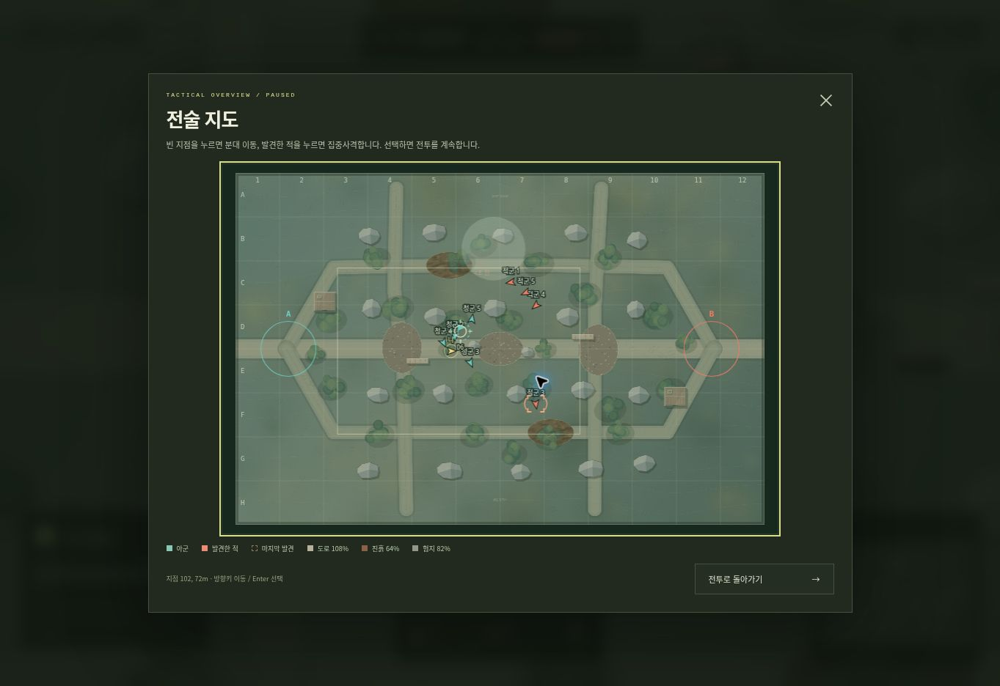
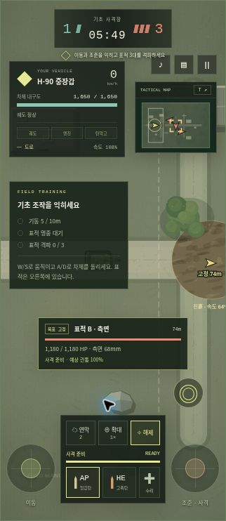
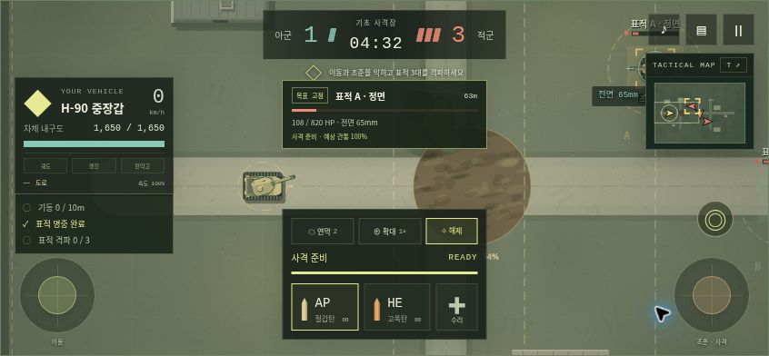

# IRON FRONT 3.0 실행 검증 기록

기록일: 2026-11-14. 대상: 표적 고정·집중 사격·전술 지도·지형별 기동을 갖춘 JavaScript 싱글플레이 2D 전술 프로토타입.

## 현재 확인 상태

| 검증 | 상태 |
| --- | --- |
| JavaScript 구문 검사 | 게임 모듈 7개 모두 통과 |
| 전투·전적 행동 테스트 48개 | v3 통합 소스에서 모두 통과, 실패 0 |
| 세 전장 전체 전투 시뮬레이션 | v3 통합 소스에서 모두 통과 |
| `npm test` 전체 실행 | 총 49개 통과, 실패 0 — 행동 48개 + 시뮬레이션 파일 1개 |
| v3 데스크톱 브라우저 조작 | 카운트다운 연속 입력, 고정 사격·격파, 지도 키보드·지점 이동·집중 사격 확인 |
| v3 모바일 크기·터치 UI | 320×740·390×844·844×390 프레임에서 HUD·지도·입력 UI 확인 |
| v3 단일 HTML 생성·브라우저 실행 | 최종 298,977바이트, HTTP로 다시 열어 출격·이동·고정·표적 HUD 확인 |
| v3 브라우저 런타임 오류 | 확인 범위의 `IRON FRONT` 런타임 오류 0건 |
| 사이트 배포·접근 범위 | 소스·아카이브 확정 후 배포 시스템 응답으로 확인 |

자동 검증은 아래 명령을 실제 실행한 결과다. 브라우저 항목은 v3에서 직접 조작한 범위만 기록하며, v2에서 확인한 브라우저 동작을 v3의 확인 결과로 사용하지 않는다.

## 재현 명령

프로젝트 루트에서 Node.js로 실행한다. 외부 패키지 설치는 필요하지 않다.

```sh
npm test
npm run check
npm run build:offline
npm start
```

`npm test`는 `node --test tests/*.mjs`를 실행하며 이번 결과는 **49개 통과, 실패 0개**다. 행동 테스트 48개 외에 `simulation-smoke.mjs`가 하나의 파일 단위 하위 테스트로 집계된다. 세 전장 시나리오는 그 파일 안에서 실행한다.

분리 실행은 다음과 같다.

```sh
node --test tests/engine.test.mjs tests/engine-v2.test.mjs tests/engine-v3.test.mjs tests/career.test.mjs
node tests/simulation-smoke.mjs
```

`npm run check`는 app·maps·geometry·engine·renderer·audio·career의 게임 모듈 7개를 모두 검사했고 통과했다. `build:offline`은 원본 모듈과 스타일을 단일 HTML로 묶고 합친 스크립트를 구문 검사한다. 구문 검사·엔진 시뮬레이션·실제 브라우저 조작은 서로 다른 검증 범위다.

## 행동 테스트: 48개

| 파일 | 개수 | 검증 범위 |
| --- | ---: | --- |
| `tests/engine.test.mjs` | 14 | 초기 편성, 재장전·격파 후 발사 제한, 장갑 방향과 도탄, 이동·포탄·시야의 엄폐 충돌, 발견·은폐, AP 피해, HE 폭발·차폐·명중 중복 방지, 궤도 수리, 점령, 전멸 종료와 결과 고정 |
| `tests/engine-v2.test.mjs` | 12 | 차종별 대칭 편성, 탄종 변경 전체 장전, 연막의 시야 차단·소모·만료·포탄 통과, 아군 관측 유지, 엔진·탄약고 손상과 수리, 지원 이동·명령 만료, 훈련 수료·시간 초과, 일시 정지·잘못된 시간 입력, 장갑 예측·미발견 적 보호, 실제 사격의 정찰 지원 집계 |
| `tests/engine-v3.test.mjs` | 15 | 근접 포구 충돌과 실제 장갑 면, 미발견 잔해의 재발견·기억, 고정 획득·유효성·포탑 속도·발사 제한·해제, 집중 사격의 실제 피해 대상·독립 명령·만료, 안전한 지점 보정과 아군 이동, 지형 영역·가속·최고속도·선회·엔진 손상 조합, 아군 차단 시 AI 사선 재확보 |
| `tests/career.test.mjs` | 7 | 모든 작전 선택 가능, 손상된 저장 데이터 정규화, 차종에 얽매이지 않는 목표·훈장, 진행 중 전투 제외, 최근 기록 범위를 넘는 중복 집계 방지, 훈련 제외, 패배·무승부·식별자 없는 결과 처리 |

기존 행동 테스트 33개를 그대로 통과했다. v3 기능에 맞추려고 기존 피해·승패 기대값을 완화하지 않았다. 새 15개는 내부 함수 호출 여부보다 실제 포탄 충돌·피해·발사 수·시야·차량 이동 결과를 확인한다.

### v3의 핵심 회귀·기능 검증

| 사례 | 재현 조건과 확인한 결과 |
| --- | --- |
| 밀착 전차를 건너뛰는 포탄 | 시드 3의 중전차와 중심 간격 45u인 정찰형을 배치한다. 명목 포구가 표적보다 앞에 있어도 한 발이 실제 차체를 맞히고 피해를 준다. |
| 포신 내부 생성으로 잘못 고른 장갑 면 | 같은 근접 배치를 반대쪽으로 옮긴다. 실제 진입 면은 측면이며 `hitZone='side'`, `ricochet=true`로 판정하고 HP를 줄이지 않는다. |
| 끝내 발견되지 않는 숨겨진 잔해 | 시야 밖의 HP 1 적을 사격해 격파한다. 위치를 즉시 공개하지 않고, 다른 건물이 차폐하면 계속 숨긴다. 건물을 제거한 뒤 근접 탐지 밖의 정상 시야 거리에서 잔해를 발견하며, 이후 멀어져도 알려진 잔해로 남는다. |
| 정렬·사선 없이 나가는 고정 사격 | 표적과 90° 다른 방향의 포탑, 단단한 벽, 아군 차체를 각각 배치한다. 발사를 누르고 있어도 조건을 만족할 때까지 발사 수가 0이고 사선이 열리면 한 발을 발사한다. |
| 집중 사격과 이동 명령의 독립 | 지점 이동 명령을 낸 뒤 더 먼 적을 집중 대상으로 선택한다. 아군이 가까운 다른 적보다 지정한 적에게 실제 피해를 주고, 15초 집중 만료 후에도 25초 이동 명령은 유지된다. |
| 지형 감속이 매 틱 누적되는 구현 | 평지·도로·진흙·험지에서 가속과 최고속도를 비교한다. 진흙+엔진 손상은 배율을 한 번씩 적용하고, 수 초를 더 달려도 속도가 계속 줄지 않는다. 지형을 벗어나면 정상 주행 값으로 돌아온다. |
| 아군에 막힌 AI의 정지 | 사격 가능한 거리에서 아군 차체가 정면 사선을 가리게 배치한다. AI가 실제로 이동해 다른 사선을 확보하고 적에게 피해를 준다. |

고정 대상이 숨거나 사거리 밖으로 나가거나 격파되면 참조가 해제되는 것도 확인했다. 집중 명령은 훈련·정지·종료·플레이어 사망·미발견 적에서 거부한다. 지점 이동은 NaN·Infinity를 거부하고 건물 내부 지점을 중전차 여유 반경을 확보한 근처 위치로 보정한다.

훈련 시간 초과 회귀도 유지했다. 표적 2대를 격파하고 마지막 표적 HP가 1만 남아 있더라도 360초가 지나면 `winner=null`로 훈련을 종료하며 수료하지 않는다. 일반 전투의 잔존 내구도 우세를 훈련 수료에 적용하지 않는다.

## 세 전장 전체 전투 시뮬레이션

표준 난이도, 1/60초 간격, 플레이어 무입력 조건으로 종료까지 진행한다. 최대 실행 범위는 시뮬레이션 시간 362초이며 일반 전투 제한 시간은 360초다.

| 전장 / 플레이어 차종 | 시드 | 첫 발사 | 첫 명중 | 종료 | 결과 |
| --- | ---: | ---: | ---: | ---: | --- |
| 메마른 계곡 / M-47 기동형 | 11 | 7.9초 | 8.3초 | 79.1초 | 아군 전멸 |
| 강철 보급소 / H-90 중장갑 | 42 | 5.9초 | 6.3초 | 68.2초 | 아군 전멸 |
| 안개 능선 / R-41 정찰형 | 117 | 5.2초 | 5.6초 | 57.4초 | 아군 전멸 |

위 값은 v3 지형·AI·충돌 변경이 반영된 실행값이다. 플레이어가 조작하지 않는 조건이므로 실제 플레이 승률이나 평균 경기 시간을 뜻하지 않는다.

| 전장 | 발사 이벤트 | 명중 이벤트 | 최대 동시 포탄 | 최대 효과 | 최대 연막 | AI 누적 이동 범위 |
| --- | ---: | ---: | ---: | ---: | ---: | --- |
| 메마른 계곡 | 66 | 44 | 4 | 7 | 2 | 978~5,413u |
| 강철 보급소 | 52 | 37 | 4 | 6 | 2 | 1,115~4,391u |
| 안개 능선 | 52 | 41 | 2 | 8 | 4 | 1,006~3,951u |

시뮬레이션은 다음 조건을 자동 검사한다.

- 전투가 종료되고 모든 AI가 시작 위치에서 누적 100u 이상 이동할 것.
- 첫 발사 45초 미만, 첫 명중 75초 미만으로 교전이 시작될 것.
- 차량 위치·내구도·통계가 유한값이며 차량이 전장 경계를 벗어나지 않을 것.
- 연막 수량·재사용 대기·남은 장전 시간이 음수가 되지 않을 것.
- 동시 포탄 100개 미만, 효과 500개 미만, 연막 10개 이하로 일시 객체가 제한될 것.

세 시나리오 모두 통과했다. 이는 고정 시드에서 실제 교전·이동·종료가 이루어지는지 검사하며, 모든 전술 상황의 경로 완전성이나 난이도 균형을 평가한 결과는 아니다.

## v3 데스크톱 브라우저 검증

PC 관리형 미리보기에서 다음 동작을 직접 확인했다.

| 영역 | 실제 확인한 동작 |
| --- | --- |
| 출격 연속 입력 | 훈련 카운트다운 중 W를 누른 채 유지하고, GO 이후 키를 다시 누르지 않아도 실제 이동 |
| 고정·사격·격파 | R로 표적 고정, Space 유지 사격, 재장전·피해 갱신과 표적 B 격파 |
| 지도·도움말·초점 | T로 지도, H로 도움말, Esc로 복귀한 뒤 방향키로 지도 커서 이동 |
| 지점 이동 | 일반 안개 능선에서 T → 방향키 → Enter로 지점 이동 확정, 25초 명령 표시 |
| 집중과 이동의 독립 | 지도에서 발견된 적을 클릭해 15초 집중 사격 지시, 기존 이동 명령의 남은 22초와 동시 유지 |

UI를 통한 명령 전달·시간 표시·사격 흐름을 확인한 결과이며, 모든 지도·차종·명령 조합을 수동으로 완주한 결과는 아니다. 기존 전투 규칙과 세 전장의 종료는 별도 자동 시뮬레이션으로 검증했다.



## v3 모바일 배치·터치 UI 검증

단일 HTML을 HTTP로 열고 데스크톱 브라우저 안의 320×740·390×844·844×390 프레임에서 터치 UI와 반응형 배치를 재현했다.

- 터치 조준 스틱으로 약 63m 거리의 표적 A를 가리켜 장갑 HUD가 표적을 판독하는 것을 확인했다. 화면의 짧은 조준점 거리로 예측이 끊기지 않았다.
- 표적을 고정한 뒤 별도 발사 버튼을 조작해 표적 HP가 820에서 108로 감소하는 것을 확인했다.
- 320×740 크기에서는 표적 카드 하단 y=526과 발사 버튼 상단 y=537 사이의 11px 간격을 확인했다. 무장 패널 x=85~235, 왼쪽 스틱 x=8~78, 오른쪽 스틱 x=242~312로 양쪽 7px 간격을 확보했다.
- 390×844 지도 모달은 `scrollHeight=clientHeight=489`였고, 지도 캔버스는 320×213이었다. 모달 내용에 스크롤이나 잘림이 없었다.
- 844×390 가로 지도 모달은 화면 안의 y=15~375에 배치됐고 `scrollHeight=clientHeight=358`이었다. 전투로 돌아온 뒤 고정 표적 카드·무장·두 스틱 표시를 확인했다.
- 최종 단일 HTML을 다시 로드한 320×740 프레임에서도 훈련 출격, W 이동, R 고정, 약 75m 거리의 표적 정보 표시를 재확인했다.

프레임 안에서 스틱과 별도 사격 버튼을 조작한 결과이며, 실제 Android/iOS 하드웨어의 동시 멀티터치·GPU 성능을 시험한 결과는 아니다. 브라우저 확인 범위에서 `IRON FRONT` 런타임 오류는 0건이었다.





## v3 단일 HTML 실행

`dist/iron-front-offline.html`을 최종 원본 소스에서 다시 생성했고 크기는 **298,977바이트**다. 스타일·아이콘·게임 코드를 한 파일에 포함한다. 이 최종 파일을 HTTP로 다시 열어 320×740 훈련 출격·이동·고정·표적 HUD를 확인했으며, 테스트용 반응형 HTML은 배포 소스에서 제거했다.

검증 브라우저에서 `file://` 직접 실행은 확인하지 않았다. 따라서 위 결과는 단일 HTML의 HTTP 실행 확인이며 파일 프로토콜로 열었을 때의 별도 확인을 뜻하지 않는다.

## 이전 버전 브라우저 기록

v2에서는 1363×936 Chrome HTTP 미리보기에서 사격장 진입·사격·확대·연막·명령·일시 정지·일반전 격파 및 관전·승리 결과·다음 작전·새로고침 후 기록 유지까지 확인했다. 당시 [승리 결과 화면](iron-front-v2-result.jpg)과 [가로 터치 UI](iron-front-v2-mobile.jpg)는 **v2 자료**이며 현재 v3의 확인 결과와 구분한다.

## 배포 대상과 절차

배포 대상은 [IRON FRONT 사이트](https://iron-front-tank-ops.taru00.chatgpt.site)다. 이 문서는 소스·배포 아카이브에 포함되므로 배포 전에 확정한 검증 기록이며, 실제 배포 결과는 배포 시스템의 응답과 완료 보고에서 확인한다.

검증한 소스를 Git에 푸시한 뒤 동일한 커밋에서 생성한 `dist/` 아카이브를 배포한다. 기존 계정 소유자만 접근할 수 있는 범위를 유지한다. 관리형 미리보기·단일 HTML 실행, 배포 성공 응답, 로그인 후 운영 사이트 직접 확인은 각각 구분해서 기록한다.
