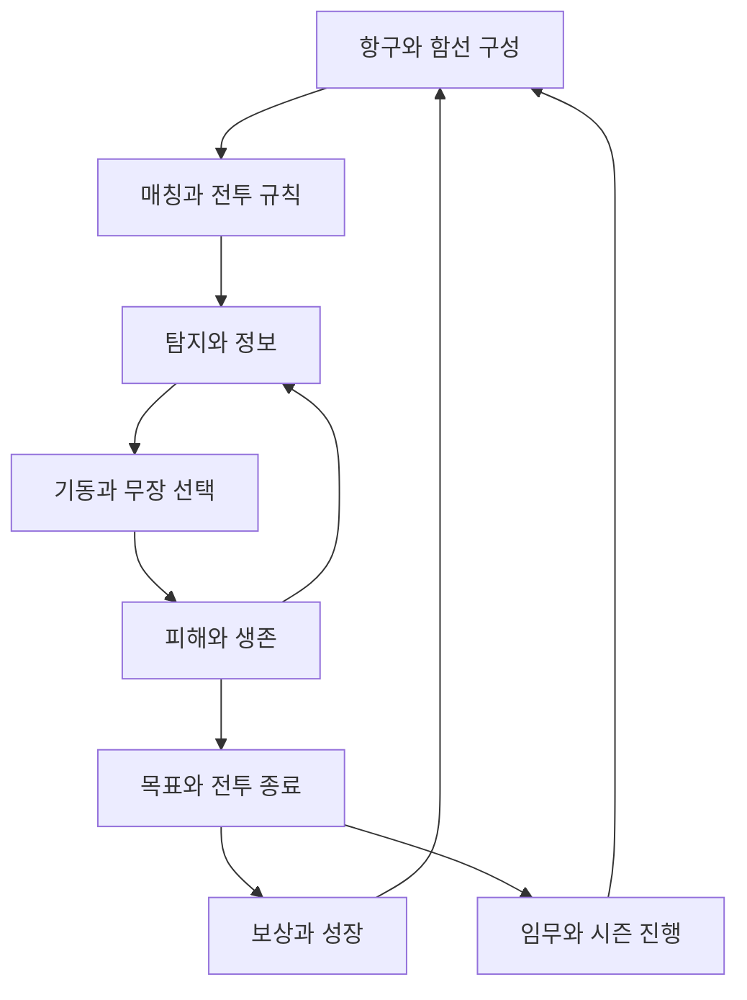

# 00. 분석 범위·근거 등급·버전 기준

> 문서 유형: 공개 자료 기반 역기획서
> 기준일: **2026-11-13, 한국 시간**
> 대상: **World of Warships PC / Wargaming 글로벌 서비스**
> 기준 릴리스: 공식 배포 공지로 확인한 **15.10**. 모든 함선의 클라이언트 데이터 전체를 추출한 명세는 아니다.

[전체 목차](README.md) · [출처·미확인 항목](20_glossary_sources_and_open_questions.md)

## 1. 이 역기획서가 답하는 질문

월드 오브 워쉽을 함선 수집 게임, 조준 게임, 장갑 시뮬레이션 중 하나로만 설명하면 핵심 연결이 빠진다. 본 문서는 **정보 획득 → 위치 선정 → 무장 사용 → 피해·생존 → 승리 조건 → 보상·성장 → 다음 출격**의 관계를 복원한다.

문서의 사용 목적은 세 가지다.

1. 기획자가 시스템의 규칙, 예외, 상호작용을 한곳에서 검토한다.
2. 개발자가 공개 규칙을 재현할 때 필요한 상태와 데이터 경계를 찾는다.
3. QA와 밸런스 담당자가 검증해야 할 경계 조건과 측정 항목을 만든다.

게임 클라이언트를 직접 실행하거나 패킷·소스 코드·데이터 아카이브를 분석한 결과라고 주장하지 않는다. 서버 내부 구현, 실제 수치 적분 방식, 비공개 경제 계수는 **미확인**으로 남긴다.

## 2. 제품 범위

| 구분 | 포함 여부 | 처리 원칙 |
|---|---|---|
| PC 글로벌 라이브 | 포함 | 공통 전투·성장·경제를 주 분석 대상으로 삼는다 |
| 북미·유럽·아시아 | 공통 규칙 중심 | 이벤트 시작 시각·상품·운영 제한은 지역별로 구분해야 한다 |
| World of Warships: Legends | 제외 | 함장·티어·진행·조작 규칙을 PC 규칙에 혼합하지 않는다 |
| World of Warships Blitz | 제외 | 모바일 제품의 전투 시간을 가져오지 않는다 |
| Mir Korabley | 제외 | 별도 서비스의 패치와 수치를 PC 글로벌 최신 규칙으로 인용하지 않는다 |
| 공개 테스트·개발 블로그 | 비교 자료 | 출시 공지로 재확인하기 전에는 예정 규칙이다 |
| 과거 이벤트 | 사례 포함 | 현재 플레이 가능한 모드와 구별한다 |
| 모든 함선의 개별 제원 | 전수 목록 제외 | 구조와 대표 예외를 다루며 개별 함선은 별도 데이터 검증 대상으로 둔다 |

공식 15.10 공지는 2026년 11월 배포와 현재 이벤트를 확인하는 기준 자료다. 15.11 관련 공개 테스트 공지는 이미 검색되지만 본 문서의 라이브 기준에 포함하지 않았다. [R01][R02]

## 3. 문장에 붙이는 근거 등급

| 표기 | 뜻 | 문서를 읽는 방법 |
|---|---|---|
| **[확인]** | 공식 배포 문서·가이드·공식 운영 위키에서 확인 | 출처의 적용 범위를 함께 읽는다 |
| **[버전 의존]** | 함선·모드·시즌·패치마다 달라지는 값 | 하드코딩하지 않고 설정으로 취급한다 |
| **[분석]** | 공개 규칙에서 도출한 설계 해석 | 개발사의 공식 의도라고 인용하지 않는다 |
| **[제안]** | 재현용 데이터·알고리즘·UX·QA 설계 | 원작 내부 구현과 동일하다는 뜻이 아니다 |
| **[미확인]** | 공개 근거가 부족하거나 충돌하는 세부 | 추가 확인 전까지 실제 규칙으로 구현하지 않는다 |

본문에 별도 표기가 없어도, **데이터 구조·의사코드·구현 순서·측정 설계·개선안은 제안**이다. 계산 예제는 입력값이 실제 제원인지, 설명용 가정인지 각각 명시한다.

## 4. 근거의 우선순위

1. 해당 규칙을 변경한 **정식 배포 공지**와 공식 지원 문서.
2. 최신 공식 가이드와 공식 채널의 설명.
3. 공식 운영 위키의 현재 문서. 단, 문단마다 실제 작성 시점이 다를 수 있다.
4. 이전 공식 가이드·영상. 구조 설명에 사용하되 변경 이력을 확인한다.
5. 공개 테스트·개발 계획. 현행 규칙이 아니라 변경 의도를 확인하는 자료다.
6. 커뮤니티 설명. 쟁점을 찾는 단서로만 사용하며 검증 없이 핵심 판정값을 확정하지 않는다.

공식 위키의 전체 페이지가 최근에 수정되었어도 모든 문단이 최신은 아니다. 실제로 장갑 문서의 옛 유폭 설명, 항모 자동 소모품 설명, 구 대공 구역 설명이 최신 패치와 충돌하는 사례를 확인했다. 구체적 교정 근거는 [06](06_survivability_modules_and_dot.md), [09](09_carriers_aircraft_and_aa.md), [11](11_consumables_and_tactical_cycles.md)에 있다.

## 5. 사용자 제공 자료의 처리

요청에 포함된 나무위키 주소는 다음과 같다.

- [월드 오브 워쉽 — 나무위키](https://namu.wiki/w/%EC%9B%94%EB%93%9C%20%EC%98%A4%EB%B8%8C%20%EC%9B%8C%EC%89%BD)

이번 조사 환경에서는 원문을 열 수 없었다. 따라서 그 문서의 세부 내용을 읽거나 검증했다고 표시하지 않으며, 문장·표·구성을 가져오지 않았다. 공개 접근 가능한 공식 자료로 분석 범위를 구성했다.

## 6. 구버전 설명을 그대로 사용하면 틀리는 영역

아래 표는 상세 문서를 읽기 위한 변경 위치 안내다. 수치와 예외는 연결된 문서가 소유한다.

| 주제 | 위험한 과거 설명 | 이번 문서의 처리 |
|---|---|---|
| 유폭 | 탄약고 폭발로 즉사하는 현재 시스템 | 제거 변경을 반영하고 시타델 대피해와 구별 |
| 모듈 | 주포·어뢰·대공포가 전투 내 영구 파괴 | 14.8 이후 손상·치명적 손상과 복구로 구분 |
| 항공 피탐 | 주포 발포가 항상 항공 피탐도 확대 | 14.7 이후 규칙을 별도 적용 |
| 전투기 | 모든 전투기가 정찰 제공 | 15.0 이후 변경을 반영 |
| 대공 | 좌·우현 우선구역, 구 방어 대공 소모품 | 15.7의 360도 대공 우선·집중 대공·대체 소모품 반영 |
| 경제 보너스 | 소모성 보너스는 네 등급으로 고정 | 15.7 Legendary 추가와 Epic 자유 경험치 조정 반영 |
| 작전 | 중간 티어 일부만 참가 | 15.8 저티어 작전 확장 구분 |
| UI | 옛 로딩·TAB 화면 배치 | 15.10 정보 화면 개편 반영 |
| 이벤트 | 과거 조선소를 현재 진행 중으로 기재 | 종료 사례와 현재 이벤트를 별도 표기 |

## 7. 역기획 단위

각 시스템을 다음의 계약으로 읽는다.

| 항목 | 질문 | 예시 |
|---|---|---|
| 입력 | 누가 어떤 정보를 제공하는가 | 발사 명령, 탄종, 포탑 상태 |
| 전제 | 언제 명령을 받아들이는가 | 재장전 완료, 발사각 유효 |
| 상태 | 시간이 지나며 무엇이 바뀌는가 | 장전 잔여, 화재, 점령 기여 |
| 출력 | 어떤 다른 시스템에 영향을 주는가 | 피탐 증가, 피해 이벤트, 점수 |
| 예외 | 기본 규칙이 언제 달라지는가 | 함종, 특수 탄종, 이벤트 전용 무장 |
| 피드백 | 사용자가 결과를 어떻게 이해하는가 | 리본, 아이콘, 사운드, 미니맵 |
| 검증 | 어떤 관측으로 규칙을 확인하는가 | 조건을 고정한 반복 전투 |

예를 들어 “포탄이 10,000 피해를 준다”는 문장만으로는 구현할 수 없다. 표시 최대 피해, 탄종, 관통 결과, 명중 구획, 포화 상태, 대상별 상한, 회복 가능 피해를 분리해야 한다.

## 8. 시스템 경계



[분석] 전투의 핵심 병목은 단순 조작 속도가 아니라 **되돌리기 어려운 선택의 시간 차이**다. 함선의 전진·선회, 긴 장전, 탄 비행, 피탐 유지, 소모품 쿨다운이 서로 다른 시계로 동작한다. 문서별 분석도 이 시계들의 상호작용을 중심에 둔다.

## 9. 수치 기록 규약

- 거리, 속도, 시간은 표시 단위를 붙인다. 게임 표시 노트를 실제 m/s와 임의로 일치시키지 않는다.
- 각도는 장갑 표면 기준인지 법선 기준인지 명시한다.
- 피해는 표시 최대값·실제 HP 감소·회복 가능량을 구분한다.
- 확률은 기본값·적용 후 값·실측 빈도를 구분한다.
- 경제의 `+100%`는 기본량 포함 `2배`다. `100배`가 아니다.
- 시간 기반 자원과 사용 횟수 기반 소모품을 같은 자료형으로 축약하지 않는다.
- 함선 레벨, 계정 접근 단계, 함장 스킬 포인트, 이벤트 레벨을 별도 축으로 둔다.
- 계산식의 반올림과 경계 비교는 미확인일 때 별도 검증 항목으로 남긴다.

## 10. 문서 갱신 방법

[제안] 패치가 나오면 전체 문서를 다시 쓰기보다 다음 순서로 갱신한다.

1. 릴리스 노트에서 변경한 시스템과 대상 함선 집합을 뽑는다.
2. `규칙 ID / 기존값 / 새값 / 적용 버전 / 모드 / 출처`로 변경 레코드를 만든다.
3. 같은 규칙을 참조하는 문서·예제·QA 시나리오를 함께 수정한다.
4. 수치가 바뀌어도 유지되는 설계 해석은 독립적으로 검토한다.
5. 공개 테스트 수치를 라이브에 반영할 때 정식 배포 근거를 추가한다.
6. 문서 기준 버전과 미확인 목록을 갱신한다.

예시:

```yaml
rule_change:
  id: example_aa_rule
  product: wows_pc_global
  applies_to: configured_ship_set
  previous_version: archived
  effective_version: verified_release
  source_status: live_release_note
  affected_documents: [09, 11, 16, 19]
  verification: training_room_boundary_cases
```

## 11. 이번 산출물의 완료 범위와 한계

**포함**: 시스템별 상세 규칙 정리, 중요 변경 이력, 계산 예시, 설계 의도 해석, 데이터 모델 예시, 재현·QA 항목, 문서 간 상대 링크와 출처.

**추가 검증 필요**: 함선 전수 제원, 현재 계정의 상품 가격·확률표, 전투별 서버 설정, 비공개 매칭 우선순위, 실제 탄도 계수·RNG 분포, 프레임·틱 단위 동시 판정 순서.

이는 문서의 누락을 숨기기 위한 단서가 아니라, 공개 자료에서 확정할 수 있는 범위와 실제 구현 검증이 필요한 범위를 명확히 나눈 것이다.

## 12. 이 문서의 출처

| ID | 자료 | 적용 범위 |
|---|---|---|
| R01 | [Update 15.10: Horror From the Abyss](https://worldofwarships.com/en/news/game-updates/update-1510-horror-from-the-abyss/) | 2026-11-02 공식 라이브 공지, 기준 릴리스 |
| R02 | [공식 뉴스 목록](https://worldofwarships.com/en/news/) | 2026-11-13 열람, 15.11은 Work in Progress로 구분 |

세부 변경의 근거는 각 소유 문서 및 [통합 출처](20_glossary_sources_and_open_questions.md)에 기록했다.
