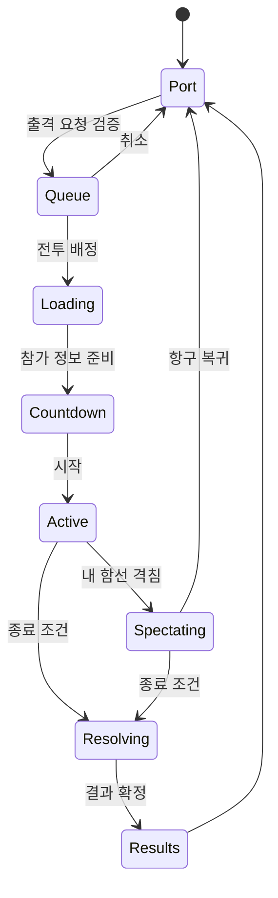

# 01. 핵심 플레이 루프·전투 수명주기·승리 판정

> 범위: 일반 PC 수상 전투를 중심으로 한 공통 구조. 특수 모드·작전은 별도 규칙을 사용한다.
> [확인]은 공개 규칙, [분석]은 설계 해석, [제안]은 재현용 명세다.

[전체 목차](README.md) · [맵·모드](12_maps_modes_and_objectives.md) · [매칭](13_matchmaking_ranked_and_clans.md)

## 1. 시스템의 목적

[분석] 한 전투의 목적은 적에게 최대 피해를 주는 행동 자체가 아니라 **팀의 승리 조건 달성 확률을 높이는 것**이다. 피해량은 적의 화력과 점령 능력을 줄이는 수단이며, 생존은 미래의 탐지·사격·점령 기여를 유지하는 자산이다.

이 관점에서 플레이 루프는 다음 세 층으로 나뉜다.

| 시간 범위 | 반복하는 선택 | 소모하는 자원 | 얻는 피드백 |
|---|---|---|---|
| 짧은 교전 | 조준·발포·탄종·타이밍 | 장전 기회·노출·포탑 방향 | 명중 결과·피해·탐지 상태 |
| 전투 전체 | 이동·점령·퇴각·집중 사격 | HP·위치·소모품·남은 시간 | 팀 점수·함선 수·맵 통제 |
| 여러 전투 | 함선 연구·함장·빌드·임무 | 경험치·크레딧·재화·시간 | 새 선택지·숙련·수집 진행 |

## 2. 외부로 드러나는 전투 흐름

[확인] 항구에서 함선과 전투 종류를 선택하고 매칭을 거쳐 전투에 진입한다. 전투 후 보상과 전적을 확인하고 다시 출격한다. 신규 계정에는 기능과 전투 종류가 단계적으로 열리는 구조가 있다. [R03][R04]

[제안] 이를 재현하는 상태는 다음과 같이 분리할 수 있다.



위 도식은 제안 상태 머신이다. 특히 사용자가 항구로 돌아온 뒤 전투가 계속되는 경우에는 **개인 화면 상태와 전투 서버 상태가 분리**되어야 한다.

## 3. 입력·상태·출력 계약

| 구분 | 주요 항목 | 연결 시스템 |
|---|---|---|
| 입력 | 참가 계정·함선·빌드·팀·맵·규칙 프로필 | 항구·매칭 |
| 시간 상태 | 준비시간·경과시간·남은시간 | HUD·목표 |
| 함선 상태 | 생존·HP·위치·전투 참여 상태 | 기동·피해 |
| 팀 상태 | 점수·생존 전력·점령 영역 | 목표·승패 |
| 정보 상태 | 탐지·마지막 위치·공유 가능 정보 | 탐지·UI |
| 종료 출력 | 승/패/무승부·종료 사유·종료 시각 | 결과·경제 |
| 지속 출력 | 전투 행동 기록·임무 진척 입력 | 통계·이벤트 |

[제안] 전투 생성 시 `RuleSetVersion`과 참가 함선 구성의 스냅샷을 보존해야 한다. 항구에서 이후 장비를 바꾸었다고 진행 중인 전투에 반영해서는 안 된다.

## 4. 승리 판정의 기본 축

[확인·버전 의존] 일반 점수제 전투의 대표 구조는 제한 시간, 팀 점수, 생존 함선 수다. 공개 위키는 전형적인 20분 제한, 1,000점 도달, 상대 점수 0, 상대 전멸, 시간 종료 시 우세 팀을 설명한다. 동점 시간 종료는 무승부다. 작전·한정 모드에는 그대로 일반화하지 않는다. [R05]

| 종료 조건 | 필요한 관측 | 플레이어에게 요구되는 판단 |
|---|---|---|
| 목표 점수 도달 | 현재 점수·거점 수익 | 교전을 멈추고 시간 확보가 가능한가 |
| 상대 점수 고갈 | 격침·점수 차감 | 적 한 척 격침으로 끝낼 수 있는가 |
| 상대 전력 제거 | 생존 판정 | 추격과 점수 유지 중 무엇이 안전한가 |
| 시간 제한 | 종료 시 점수 | 추격 대신 생존해야 하는가 |
| 모드 고유 목표 | 호위·목표물·시나리오 상태 | 킬보다 목표 수행이 우선인가 |

**동시 사건의 정확한 서버 처리 순서는 공개 근거로 확정하지 않는다.** 동일 틱 양팀 격침·동시 점수 도달·종료 직전 투사체는 재현 구현에서 명시해야 할 별도 규칙이다.

## 5. 팀 점수와 피해량의 관계

[분석] 점수는 화력을 승리로 환산하는 별도 계층이다. HP 1을 깎는 것은 보통 즉시 팀 점수로 바뀌지 않지만, 생존한 적의 HP를 0으로 만들면 화력 제거와 점수 변동이 동시에 발생한다. 따라서 마지막 일격의 **전술 가치**와 개인 보상에서의 **경제 가치**를 같은 계수로 설명하면 안 된다.

함선별 격침 점수와 거점 수익은 [12번](12_maps_modes_and_objectives.md)의 `ModeRuleProfile`로 분리한다. 일반 무작위 전투의 일부 맵에도 별도 점수 설정이 있으므로, 함종별 점수 한 표를 모든 전투에 적용하지 않는다. [R05]

### 5.1 가정 계산: 지금 추격할 것인가

다음은 실제 특정 맵 제원이 아닌 판단 구조 설명용 가정이다.

- 아군 820점, 적군 760점.
- 아군은 초당 1점, 적군은 초당 0.5점 획득.
- 남은 시간 120초.
- 추가 격침과 거점 변화는 없다고 가정.

종료 예상 점수는 아군 940점, 적군 820점이다. 이때 위험한 추격은 승리에 필요하지 않다. 반대로 적이 거점을 빼앗아 수익이 역전되면 같은 HP·같은 함선 수라도 행동이 달라진다.

### 5.2 가정 계산: 1,000점까지 필요한 시간

```text
time_to_target = (target_score - current_score) / net_team_gain
```

아군 880점, 유지되는 순수 거점 수익이 초당 1.2점이라면 100초가 필요하다. 실전에서는 수익이 주기적으로 지급되고, 격침과 점령 중단이 개입하므로 이 식은 **계획용 근사**다. 서버 판정은 정수 점수 이벤트로 처리하는 편이 적합하다.

## 6. 생존의 기회비용

[분석] 생존은 결과 화면에 남는 숫자 이상의 의미를 가진다.

1. 살아 있는 함선은 적의 예상 경로를 제한한다.
2. 발포하지 않아도 탐지·점령·교차 사격 위협을 제공할 수 있다.
3. 장전 중인 함선도 다음 공격 가능성을 가진다.
4. 반대로 뒤에서 생존만 하며 유효 사거리·탐지에 기여하지 않으면 팀의 실질 전력은 증가하지 않는다.

따라서 생존 가치의 설계 모델은 다음처럼 볼 수 있다.

```text
생존 가치 ≈ 남은 시간 동안 제공 가능한 화력
          + 탐지·목표 기여
          + 적 경로를 제한하는 위협
          - 현재 안전한 위치를 고수하는 기회비용
```

이 식은 점수 산정식이 아니라 의사결정 설명용이다.

## 7. 전투의 단계별 선택

| 단계 | 정보 수준 | 권장되는 설계상 질문 | 실패 형태 |
|---|---|---|---|
| 시작 | 상대 구성은 알지만 배치는 불확실 | 어느 방향에 레이더·어뢰·교차 사격이 생길까 | 목적 없이 최단거리 전진 |
| 첫 접촉 | 일부 적 탐지 | 언제 발포해 은폐를 포기할까 | 조준만 보고 전선 고립 |
| 전력 교환 | 적 장전·소모품 정보 누적 | HP를 어떤 목표와 교환할까 | 무의미한 피해 교환 |
| 국지 우세 | 일부 적 격침·퇴각 | 추격·거점·측면 중 무엇이 큰가 | 승리한 측면에 전력 과밀 |
| 후반 | 점수·시간이 결정적 | 싸우지 않는 것이 승리인가 | 점수 우세 중 불필요한 노출 |

위 표는 플레이를 규정하는 강제 튜토리얼이 아니라, 전투 시스템이 만들어 내는 판단 구조의 분석이다.

## 8. 전투 참여와 격침 이후

[제안] 다음 상태를 분리해 설계한다.

- `Alive`: 조작과 전투 행동이 유효하다.
- `Destroyed`: 더 이상 함선 명령을 수락하지 않는다.
- `Observing`: 허용된 시점과 정보만 보여 준다.
- `ReturnedToPort`: 개인 UI는 항구이나 해당 전투 결과는 미확정일 수 있다.
- `BattleResolved`: 보상·임무·전적 반영의 근거가 확정된다.

격침 전에 발사한 포탄·어뢰를 함선 액터와 같은 생명주기에 묶어 자동 제거하는 설계는 재현 오류를 만들 수 있다. 실제 지속 여부와 종료 이후 무효화 시점을 무기별로 테스트해야 한다.

## 9. 제안 데이터 구조

```yaml
BattleSession:
  battle_id: opaque_id
  product: wows_pc_global
  rule_version: snapshot_id
  map_variant_id: data_id
  phase: active
  start_time: server_time
  time_limit: configured_seconds
  teams:
    - team_id: team_a
      score: integer
      surviving_units: set_of_ids
  result:
    resolved: false
    reason: null
    winner: null

ModeRuleProfile:
  target_score: configured_integer
  timeout_policy: compare_score
  elimination_policy: configured
  ship_loss_score_table: data_reference
  objective_score_table: data_reference
  simultaneous_end_policy: explicit_rule
```

## 10. 판정 이벤트 순서: 재현용 제안

```text
1. 유효한 전투 명령을 적용한다.
2. 이동·무장·탐지·피해 이벤트를 계산한다.
3. 동일 처리 구간의 격침과 목표 이벤트를 모은다.
4. 규칙 프로필에 따라 점수 변동을 적용한다.
5. 승리 조건과 동시 충족 정책을 평가한다.
6. 종료가 확정되면 결과 ID를 한 번만 발행한다.
7. 경제·임무·전적 처리기가 해당 ID를 멱등하게 처리한다.
```

이 순서는 원작의 실제 틱 순서가 아니다. 원작과 동일한 경계 판정을 원하는 경우 전용 실험이 필요하다.

## 11. QA 시나리오

| ID | 조건 | 확인할 결과 |
|---|---|---|
| CORE-01 | 목표 점수 직전 거점 수익 발생 | 목표를 넘겨도 종료 한 번만 발생 |
| CORE-02 | 상대 마지막 함선 격침과 시간 종료가 같은 구간 | 정의된 우선순위로 동일 결과 |
| CORE-03 | 양팀 마지막 함선 동시 제거 | 무승부·점수 비교 정책 일관성 |
| CORE-04 | 개인이 항구 복귀 후 전투 종료 | 보상 누락·중복 지급 없음 |
| CORE-05 | 종료 후 지연 도착한 피해 이벤트 | 종료 스냅샷을 바꾸지 않음 |
| CORE-06 | 재접속 | 생존·관전·결과 상태를 서버 기준으로 복구 |
| CORE-07 | 특수 모드의 목표물만 제거 | 일반 전멸 규칙과 혼동하지 않음 |
| CORE-08 | 다른 버전의 리플레이·규칙 | 호환 여부를 명시적으로 구분 |
| CORE-09 | 참가자가 임무 완료 전에 격침 | 전투 전체 확정과 개인 종료를 분리 |
| CORE-10 | 같은 결과를 두 번 수신 | 동일 결과 ID의 중복 반영 방지 |

## 12. 관찰·측정 계획

[제안] 전투 단위로 `첫 접촉 시간`, `첫 격침 시간`, `유효 교전 시간`, `점수 역전 횟수`, `목표 점수 종료 비율`, `시간 종료 비율`, `전멸 종료 비율`을 기록한다.

평균 전투 시간만 보면 문제를 놓칠 수 있다. 같은 평균 12분이라도, 전반 격침이 몰리고 남은 시간이 추격으로 소비되는 전투와 마지막까지 거점 경쟁이 지속되는 전투는 다른 경험이다. [18번](18_balance_metrics_and_validation.md)에서 분포와 조건별 분석으로 확장한다.

## 13. 출처

| ID | 출처 | 범위·열람일 |
|---|---|---|
| R03 | [Game Basics](https://wiki.worldofwarships.com/Ship:Game_Basics) | 항구·출격·신규 이용자 구조, 2026-11-13 |
| R04 | [Access Levels](https://wiki.worldofwarships.com/Ship:Access_Levels) | 단계적 기능 해금. 세부 횟수는 구문 혼재로 채택하지 않음, 2026-11-13 |
| R05 | [Game Modes](https://wiki.worldofwarships.com/Ship:Game_Modes) | 대표 승리 조건·점수 예외. 특정 모드에 한정, 2026-11-13 |
