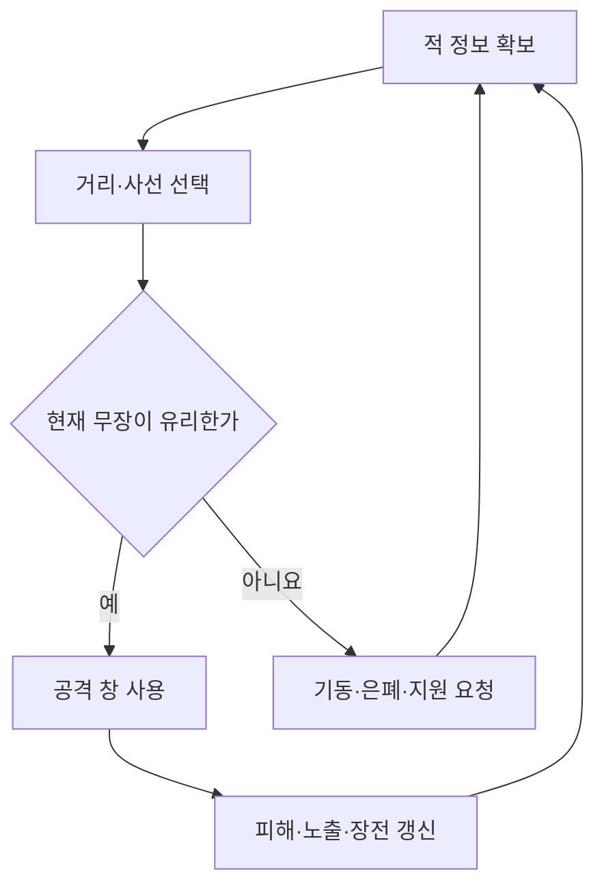

# 02. 함종·국가·연구 계통과 전술 역할

> 대상: World of Warships PC 글로벌 서비스. 기준일: 2026-11-13, 라이브 기준선 15.10.  
> 문서 성격: 공개 규칙을 바탕으로 한 역기획. `[확인]`은 출처에서 확인한 규칙, `[버전 의존]`은 함선·패치별 값, `[분석]`은 설계 해석, `[제안]`은 재현용 설계다.  
> 관련 문서: [전체 목차](README.md) · [기동](03_navigation_and_maneuvering.md) · [포격](04_gunnery_ballistics_and_aiming.md) · [어뢰](07_torpedoes_and_area_denial.md) · [성장·빌드](14_progression_commanders_and_builds.md)

## 1. 시스템의 목적과 경계

함종 시스템은 함선의 외형을 분류하는 데 그치지 않는다. 플레이어에게 **어떤 위험을 감수하고, 어떤 시간 간격으로, 어떤 방식의 전장 영향력을 행사할 것인지**를 제시한다. 국가와 연구 계통은 같은 함종 안에서 이 선택을 세분한다. `[분석]`

| 구분 | 입력 | 출력 | 다른 시스템과의 계약 |
| --- | --- | --- | --- |
| 함선 선택 | 보유 함선, 모드 제한, 연구 상태 | 출전 가능한 함선 | 매칭에 함종·단계·함선 ID 전달 |
| 전투 역할 | 무장, 피탐지, 기동, 생존, 특수 기능 | 교전 거리·표적·진입 시점 선택 | 전투 규칙을 변경하지 않고 능력 조합 제공 |
| 국가·계통 | 연구 그래프, 국가, 분기 | 학습 가능한 장기 성장 경로 | 함장·모듈·경제와 연결 |
| 빌드 | 함장 기술, 강화 장치, 신호, 소모품 구성 | 세부 역할의 강화·변형 | 기본 함선 식별과 전투 구성 식별을 분리 |

이 문서는 모든 함선의 스펙 사전을 만들지 않는다. 동일한 이름의 함선도 연구 모듈, 빌드, 게임 모드, 밸런스 패치에 따라 전투 능력이 달라지므로 **규칙과 역할을 읽는 틀**을 정의한다. 함선별 전수 수치는 별도 버전 데이터가 필요하다. `[제안]`

## 2. 기본 함종과 역할의 차이

공개 함종 분류에는 구축함·순양함·전함·항공모함·잠수함이 존재한다. 구축함은 은폐·기동·포 및 어뢰, 순양함은 다양한 화력과 지원 수단, 전함은 대구경 주포와 생존력, 항공모함은 편대, 잠수함은 잠항과 어뢰를 중심으로 구성된다. 세부 예외는 함선별이다. `[확인: A01–A05]`

아래 역할 표현은 실제 팀 구성을 분석하기 위한 저자의 분류이며, 공식 직업명이나 강제 역할 지정은 아니다. `[분석]`

| 함종 | 주된 의사결정 | 팀에 제공하는 가치 | 대표적 실패 원인 | 역할을 보완하는 동료 |
| --- | --- | --- | --- | --- |
| 구축함 DD | 발포로 위치를 공개할지, 은폐를 유지할지 | 전방 정보, 거점 압박, 어뢰 위협 | 지원 없이 탐지 수단 범위에 진입 | 탐지된 적을 처리할 순양함·전함 |
| 순양함 CA/CL | 사격 지속과 위치 보존의 균형 | 지속 화력, 구축함 견제, 구역 지원 | 여러 방향에서 집중 포격을 받음 | 교차 사격을 분담할 전함, 전방 탐지함 |
| 전함 BB | 어느 진입로를 봉쇄하고 언제 전진할지 | 일제사격 위협, 장갑 각도 강요, 체력 교환 | 늦은 후퇴, 어뢰 진입로 노출 | 어뢰를 먼저 발견할 전방함·측면 지원함 |
| 항공모함 CV | 편대 목표와 모함 위치를 함께 관리 | 떨어진 구역에 영향력 투사, 항공 지원 | 편대 손실 누적, 모함 접근 위협 방치 | 모함을 엄호할 전선, 적 위치를 유지할 동료 |
| 잠수함 SS | 심도·잠항 자원·공격 노출의 교환 | 은폐 접근, 어뢰 공격, 이동 경로 압박 | 출구 없이 깊게 침투, 대잠 공격에 노출 | 상대를 전방에 묶는 수상함 |

### 2.1 함종 표기와 실제 역할을 분리한다

구축함을 모두 어뢰정, 순양함을 모두 대공함, 전함을 모두 전방 탱커로 다루면 콘텐츠가 늘어날수록 설명이 무너진다. 같은 함종 안에서도 은폐 어뢰형, 개방 수역 포격형, 근접전형, 지원형이 존재하며 서로 다른 위치 선정이 필요하다. `[분석]`

역기획용 역할 축을 다음처럼 둔다. 각 축은 0~5점의 내부 분석 척도로 사용할 수 있지만, 실제 게임의 공식 능력치가 아니다. `[제안]`

| 역할 축 | 높을 때 발생하는 선택 | 측정할 관측값 |
| --- | --- | --- |
| 정보 유지 | 발포보다 생존·탐지 유지가 중요해짐 | 유효 탐지 시간, 아군 사격 가능 시간 |
| 순간 화력 | 짧은 취약 창에 공격을 집중 | 첫 10초 피해, 일제사격 표적 전환 시간 |
| 지속 화력 | 사격 가능한 위치를 오래 유지 | 유효 사격 시간당 피해, 사선 유지율 |
| 공간 통제 | 실제 명중 이전에 적 항로를 바꿈 | 적 진입 지연, 회피 후 측면 노출 |
| 자력 생존 | 단독 위치를 더 오래 유지 | 집중 공격 중 철수 성공률 |
| 전선 전환 | 반대편 구역에 빠르게 합류 | 구역 이동 시간, 이동 중 화력 손실 |
| 팀 지원 | 동료의 공격·생존 기회를 확대 | 지원 중 아군 생존·사격 시간 변화 |

## 3. 국가보다 연구 분기 단위로 읽는다

아래 표는 대표 계통을 설명하는 요약이다. 국가 전체에 일괄 적용되는 패시브 목록이 아니다. 프리미엄·특별 함선과 신규 분기는 예외가 많다. 원자료의 오래된 대공·소모품 설명은 이 표에 옮기지 않았다. `[분석]`

| 국가·진영 | 확인 가능한 대표 계통·기능 | 전술적 해석 | 출처 |
| --- | --- | --- | --- |
| 미국 | 순양함이 경순양함·중순양함으로 분기하며, 상위 정규 계통에 레이더 운용 함선 존재 | 지형과 탐지 창을 활용하는 구역 지원 설계 | A06 |
| 일본 | 구축함 목록에 Shimakaze와 Harugumo 계통이 병존 | 같은 DD 안에서 어뢰 압박과 포격 지속을 분리해서 학습 | A07 |
| 독일 | Z-52 방향과 Elbing 방향의 구축함 역할 차이, 일부 계통의 강화된 음향 탐지 | 근접 구역 통제와 포격 역할을 분기별로 설계 | A08 |
| 영국 | 정규 경순양함의 AP 중심 구성, 구축함·일부 순양함의 단발 어뢰 발사 | 목표 장갑 상태를 읽고 발사 패턴을 세밀하게 조절 | A09 |
| 프랑스 | Kléber 계열 포격 구축함의 고속·주포 재장전 가속 운용 | 기동으로 방어하며 짧은 화력 우위를 집중 | A10 |
| 소련 | 포격 구축함 계통의 높은 탄속·개방 수역 교전 성향 | 장거리 조준 부담과 은폐·기동의 대가를 교환 | A11 |
| 이탈리아 | 구축함·순양함의 SAP, 배기식 연막을 활용하는 계통 | 짧은 진입 창에 직접 피해를 집중한 뒤 이탈 | A12 |
| 범아시아 | 여러 국가 해군이 하나의 게임 진영에 포함 | 역사적 국가와 게임 내 함장·연구 분류를 분리 | A13 |
| 범유럽 | 여러 국가 함선의 묶음이며, 15.10에 첫 정규 순양함 계통 얼리액세스 | 진영 이름만으로 무장이나 소모품을 추정할 수 없음 | A14, A15 |
| 스페인 | 일부 함선에 Burst Fire 존재 | 지속 사격과 짧은 공격 창 사이의 선택 추가 | A16 |
| 범아메리카 | 일부 함선에서 Combat Instructions 사용 | 행동을 축적해 다음 전술 창을 만드는 능력 구조 | A17 |
| 네덜란드 | 독립 진영에 구축함·순양함·전함·잠수함 항목 존재 | 한 국가를 하나의 공습 기믹으로만 정의하지 않음 | A18 |

### 3.1 최신 계통 사례: 수동 부포 독일 순양함

Deutschland에서 Prinz Adalbert로 이어지는 신규 독일 순양함 계통은 주포와 수동 부포를 전환해 사용한다. 자동 모드의 부포 운용도 유지되며, 수동 모드에서 사거리가 달라질 수 있다. 이 기능은 모든 순양함에 적용되는 기본 조작으로 일반화하면 안 된다. `[확인·버전 의존: A19]`

이 사례는 함종을 추가하지 않아도 **플레이어가 시간을 배분하는 방식**을 바꿔 새 콘텐츠를 만들 수 있음을 보여준다. 긴 주포 재장전 사이에 부포 조준을 넣으면 대기 구간이 능동 조작 구간으로 바뀐다. 동시에 두 무장을 효율적으로 쓰려면 주포 사격 후에도 적과 가까운 거리를 유지해야 하므로 위치 리스크가 생긴다. `[분석]`

## 4. 상대 관계는 조건부 그래프로 설계된다

`구축함 > 전함 > 순양함 > 구축함` 같은 순환 관계만으로는 실제 전투를 설명하기 어렵다. 상대 함종보다 **현재 탐지 여부, 거리, 장전 상태, 지원 사선, 탈출로**가 먼저 결과를 바꾼다. `[분석]`

| 교전 | 우위를 만드는 조건 | 우위가 깨지는 조건 | 필요한 정보 |
| --- | --- | --- | --- |
| 구축함 → 전함 | 접근 항로 예측, 어뢰 준비, 적 탐지망 공백 | 레이더·음향·항공 탐지, 지원 순양함 등장 | 적 마지막 위치와 탐지 수단 |
| 순양함 → 구축함 | 탐지 유지, 짧은 탄 비행 시간, 지원 사격 | 적 전함의 측면 사선, 탐지 종료 | 적 DD 노출 시간과 아군 사선 |
| 전함 → 순양함 | 측면 노출·회피 공간 부족·장전 완료 | 도탄 각도, 은폐 이탈, 사선 차단 | 탄종, 적 회전 방향, 장갑 부위 |
| 항공모함 → 수상함 | 진입 각도 확보, 고립 표적, 반복 접근 가능 | 대공 중첩, 회피, 전투기·지원 개입 | 접근 경로와 방어 수단 |
| 수상함 → 잠수함 | 위치 단서와 대잠 무장 투사 범위가 겹침 | 깊이·도주 경로·정보 공백 | 마지막 관측 위치와 경과 시간 |

이 표는 공식 피해 상성 배율을 뜻하지 않는다. 적합한 교전 조건을 만들었을 때 능력 조합이 유리해진다는 분석이다.



## 5. 단계와 특수 분류

초군함은 일부 연구 계통의 상위에 위치한 별도 콘텐츠이며, 함종 자체가 새로 생기는 것은 아니다. 세부 해금·가격·유지비는 [경제](15_economy_rewards_and_monetization.md)와 [성장](14_progression_commanders_and_builds.md)에서 관리한다. 공개 위키의 초군함 문서에는 오래된 경제 설명이 남아 있으므로 여기서는 분류 구조만 사용했다. `[확인: A20]`

| 구분 축 | 뜻 | 잘못된 동일시 | 설계상 저장 방법 `[제안]` |
| --- | --- | --- | --- |
| 함종 | 매칭과 전투 역할의 기본 분류 | 대형 함체는 모두 전함 | `ship_class` |
| 단계 | 전투 성능·매칭의 진행 구간 | 단계가 높으면 모든 스펙 우위 | `tier`와 `is_supership` |
| 국가·진영 | 연구·함장·콘텐츠 묶음 | 진영이 같으면 특수 기능 동일 | `nation_id` |
| 연구 계통 | 성장 연결과 역할의 연속성 | 같은 국가의 함종은 단일 계통 | `branch_id`, `parent_ship_ids` |
| 획득 분류 | 연구·프리미엄·특별·대여 등 | 유료 함선은 항상 더 강함 | `acquisition_class` |
| 전투 변형 | 모드 전용 함선·보정 | 일반 함선 수치와 항상 동일 | `mode_override_id` |

전투 중 하이브리드 무장을 가진 함선도 기본 함종과 조작 기능을 분리해 표현해야 한다. 항공 편대 기능이 있다는 이유만으로 전함을 매칭상 항공모함으로 재분류하는 식의 추론은 금지한다. 실제 제한은 모드 설정을 확인한다. `[제안]`

## 6. 플레이어 선택을 재구성하는 사례

### 6.1 은폐 어뢰형과 포격형 구축함

다음은 실함 수치를 복제하지 않은 설계 비교 예다. `[제안·가정]`

| 항목 | 가상 구축함 T | 가상 구축함 G |
| --- | --- | --- |
| 설계 목표 | 탐지되지 않은 상태의 압박 | 노출 상태의 지속 화력 |
| 주 공격 리듬 | 긴 재장전마다 항로 예측 | 짧은 재장전마다 회피·조준 |
| 소모하는 자원 | 위치 정보의 비대칭, 어뢰 준비 시간 | 체력, 회피 공간, 아군 지원 |
| 승리 기여 | 적 진입 지연과 거점 유지 | 상대 구축함 퇴각·격침 |
| 역효과 | 장거리 무효 어뢰를 반복하면 영향력 공백 | 포격만 지속하면 전방 정보가 끊김 |
| QA 초점 | 미탐지 발사·거리 판단·발사관 상태 | 포 회전·사선·발포 탐지·기동 |

두 함선을 단순 DPM으로 비교하면 T의 공간 통제 가치를 잃고, 평균 생존 시간만으로 비교하면 G의 공격적 교환 가치를 놓친다. 비교 지표는 역할에 맞는 행동 기회가 실제 승리에 얼마나 연결되는지까지 포함해야 한다. `[분석]`

### 6.2 팀 편성 예

가상의 5척 소규모 전장에서 전함 1·순양함 2·구축함 2를 배치한다고 가정한다. 이것은 실제 특정 모드의 정원 규칙이 아니다. `[제안·가정]`

1. 구축함 A는 거점 가까이에서 정보를 유지하고 무리한 포격을 삼간다.
2. 순양함 A는 구축함 A가 노출한 표적을 즉시 공격할 사선을 잡는다.
3. 전함은 상대가 순양함 A에 측면을 보이며 진입하지 못하도록 다른 각도를 만든다.
4. 구축함 B는 적의 우회와 어뢰 접근을 견제한다.
5. 순양함 B는 전선이 무너지거나 기회가 열린 방향으로 이동한다.

이 편성의 취약점은 배의 수가 아니라 **탐지와 화력의 연결이 끊어지는 위치 배치**다. 아군 순양함이 섬 뒤에서 포격할 수 없는데 구축함만 진입하면 명목상 지원 전력이 있어도 실제 교환은 불리하다. `[분석]`

## 7. 재현용 데이터 모델

아래는 새로운 프로젝트에서 유사한 역할 분화를 구현하기 위한 예시다. 실제 WoWS 클라이언트·서버의 클래스나 필드 이름을 뜻하지 않는다. `[제안]`

```yaml
ship_definition:
  id: prototype_cruiser_01
  ship_class: cruiser
  nation_id: fictional_faction_a
  branch_id: support_cruiser
  tier: 8
  is_supership: false
  acquisition_class: researchable
  role_tags: [zone_support, sustained_gunnery]
  components:
    hull_profile: hull_c01
    movement_profile: movement_c01
    main_battery_profile: guns_c01
    torpedo_profile: null
    concealment_profile: conceal_c01
    consumable_loadout: support_set_a
  allowed_modes: [prototype_random, training]
  mechanic_flags:
    manual_secondaries: false
    burst_fire: false
    combat_instructions: false
    player_squadron: false
  evidence:
    source_revision: prototype_v1
    status: proposed
```

`role_tags`는 매칭상의 강제 조건으로 곧바로 사용하지 않는다. 태그의 평가 방식이 바뀌어도 함선의 실체와 보유 기록이 변하지 않도록 분리한다. 기능 존재 여부와 기능 파라미터도 분리해야 `burst_fire: true`만으로 모든 연발 함선에 같은 지연을 적용하는 오류를 막을 수 있다. `[제안]`

## 8. 콘텐츠 제작·검증 규칙

| 검증 ID | 입력 조건 | 확인할 결과 | 설계 의도 |
| --- | --- | --- | --- |
| CL-01 | 같은 함종·단계에서 다른 계통 선택 | 서로 다른 의사결정이 반복되는가 | 이름만 다른 복제 방지 |
| CL-02 | 같은 국가의 신규 분기 추가 | 기존 분기 기능이 잘못 상속되지 않는가 | 국가별 하드코딩 방지 |
| CL-03 | 무어뢰 구축함 데이터 | UI가 어뢰 슬롯을 만들어내지 않는가 | 함종과 장비 분리 |
| CL-04 | 수동 부포 기능 없는 순양함 | 수동 전환 입력이 노출되지 않는가 | 선택적 기능 검사 |
| CL-05 | 동일 함선의 일반·이벤트 변형 | 모드별 파라미터와 기록이 구분되는가 | 이벤트 보정의 본편 누출 방지 |
| CL-06 | 같은 함선, 다른 빌드 | 비교 UI에 변경된 값만 명확히 보이는가 | 선택 비용 설명 |
| CL-07 | 함선 이름·국가 현지화 변경 | 보유·연구·전적이 동일 ID를 유지하는가 | 표시명과 식별 분리 |
| CL-08 | 초군함이 금지된 모드 | 대기열 진입 전에 제한 이유가 보이는가 | 늦은 실패 방지 |
| CL-09 | 지원형 함선의 낮은 직접 피해 | 정보·지원·거점 기여가 평가되는가 | 역할별 지표 정합성 |
| CL-10 | 동일 국가의 여러 분기 업데이트 | 분기별 변경점과 재학습 정보 표시 | 라이브 콘텐츠 확장성 |

## 9. 관측 지표와 설계 판단

승률은 최종 결과 지표지만 함종별 설계 판단에 단독으로 쓰기 어렵다. 숙련도·소대·매칭·보유자 편향을 분리한 뒤 같은 역할을 수행할 기회가 어느 정도 있었는지 비교해야 한다. 아래는 분석 제안이며 공개된 실제 운영 대시보드가 아니다. `[제안]`

| 질문 | 지표 후보 | 함께 확인할 조건 |
| --- | --- | --- |
| 역할이 뚜렷한가 | 위치별 사격·탐지·어뢰 사용 분포 | 지도, 단계, 숙련도 |
| 역할 수행이 보상되는가 | 기여 행동 후 승리 확률·보상 변화 | 생존 시간·아군의 후속 행동 |
| 특정 능력이 대체 불가능한가 | 능력 유무별 편성 성공률 | 중복 수량, 모드 제한 |
| 대처가 가능한가 | 위협 인지부터 대응까지의 시간 | 경고 UI, 탐지 수단, 탈출 공간 |
| 새 계통이 학습 가능한가 | 단계 상승 후 성과 회복까지 전투 수 | 기존 계통 경험, 모듈 미완성 |

## 10. 출처와 적용 범위

모든 웹 출처 열람일은 2026-11-13이다. 공식 Wiki는 Wargaming 또는 승인된 기여자가 관리하는 자료지만, 페이지 갱신일만으로 모든 문단이 최신이라고 판단하지 않았다. 아래는 각 출처에서 필요한 분류·기능만 요약한 것이다.

| ID | 출처 | 적용 범위·주의 |
| --- | --- | --- |
| A01 | [Ship:Destroyers](https://wiki.worldofwarships.com/Ship:Destroyers) | 구축함 개요; 오래된 절대적 표현 미채택 |
| A02 | [Ship:Cruisers](https://wiki.worldofwarships.com/Ship:Cruisers) | 순양함 개요; 과거 대공 평가는 미채택 |
| A03 | [Ship:Battleships](https://wiki.worldofwarships.com/Ship:Battleships) | 전함 개요 |
| A04 | [Ship:Aircraft Carriers](https://wiki.worldofwarships.com/Ship:Aircraft_Carriers) | 편대 중심 기본 분류만 사용; 전투기 탐지·수동 조작은 09 참조 |
| A05 | [Ship:Submarines](https://wiki.worldofwarships.com/Ship:Submarines) | 잠수함 분류와 전용 규칙 연결 |
| A06 | [Ship:Ships of U.S.A.](https://wiki.worldofwarships.com/Ship:Ships_of_U.S.A.) | 대표 순양함 분기·레이더 |
| A07 | [Ship:Ships of Japan](https://wiki.worldofwarships.com/Ship:Ships_of_Japan) | 대표 구축함 계통 |
| A08 | [Ship:Ships of Germany](https://wiki.worldofwarships.com/Ship:Ships_of_Germany) | Z-52·Elbing 분기와 음향 탐지 |
| A09 | [Ship:Ships of U.K.](https://wiki.worldofwarships.com/Ship:Ships_of_U.K.) | 경순양함 AP·일부 함선 단발 어뢰; 국가 전체 일반화 금지 |
| A10 | [Ship:Ships of France](https://wiki.worldofwarships.com/Ship:Ships_of_France) | 기존 포격 구축함 계통의 대표 성격 |
| A11 | [Ship:Ships of U.S.S.R.](https://wiki.worldofwarships.com/Ship:Ships_of_U.S.S.R.) | 기존 포격 구축함 계통의 대표 성격 |
| A12 | [Ship:Ships of Italy](https://wiki.worldofwarships.com/Ship:Ships_of_Italy) | SAP·배기식 연막의 계통 사례 |
| A13 | [Ship:Ships of Pan-Asia](https://wiki.worldofwarships.com/Ship:Ships_of_Pan-Asia) | 다국가 진영 분류 |
| A14 | [Ship:Ships of Europe](https://wiki.worldofwarships.com/Ship:Ships_of_Europe) | 다국가 진영 분류 |
| A15 | [European Cruisers Early Access and Event Pass](https://worldofwarships.com/en/news/general-news/european-cruisers-early-access-and-event-pass/) | 2026-11-03 공식 안내, 15.10 계통 추가 확인 |
| A16 | [Ship:Ships of Spain](https://wiki.worldofwarships.com/Ship:Ships_of_Spain) | 일부 함선 Burst Fire |
| A17 | [Ship:Ships of Pan-America](https://wiki.worldofwarships.com/Ship:Ships_of_Pan-America) | 일부 함선 Combat Instructions |
| A18 | [Ship:Ships of Netherlands](https://wiki.worldofwarships.com/Ship:Ships_of_Netherlands) | 현재 진영 내 여러 함종 목록 |
| A19 | [New German Cruisers: Early Access](https://worldofwarships.eu/en/news/general-news/new-german-cruisers-early-access/) | 2025년 공식 안내, 수동 부포 동작과 14.10 정규화 |
| A20 | [Ship:Superships](https://wiki.worldofwarships.com/Ship:Superships) | 상위 콘텐츠 분류만 사용; 경제 수치는 여기서 사용하지 않음 |

## 11. 후속 실측 질문

- 특정 함선의 대표 역할이 실제 플레이에서도 유지되는지, 같은 단계·숙련도·모드로 표본을 맞춰 검증한다.
- 국가별 평균이 신규 분기·프리미엄 함선 때문에 왜곡되는지 확인한다.
- 수동 부포·연발·전투 지침이 조작 부담을 늘리는 정도와 초심자 학습 비용을 분리해 측정한다.
- 모드 제한에서 하이브리드 함선을 어떻게 분류하는지는 해당 시즌의 규칙으로 별도 확인한다.
