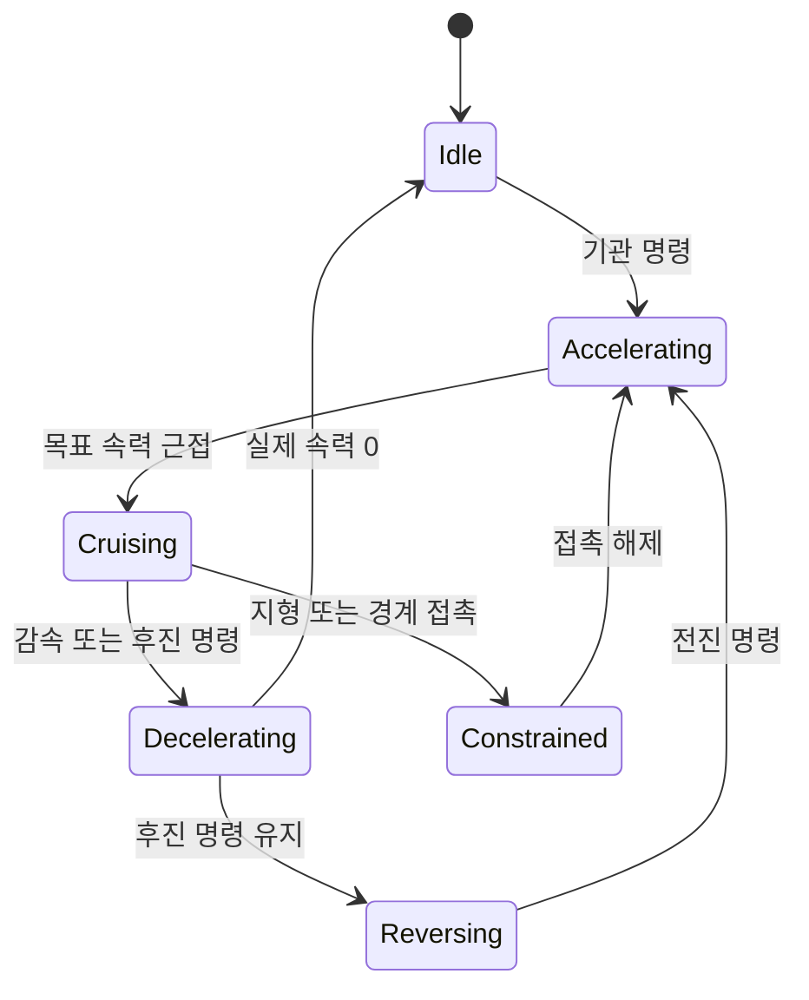

# 03. 함선 이동·조타·관성·충돌

> 대상: World of Warships PC 글로벌, 2026-11-13 / 15.10 기준선.  
> `[확인]` 공개 규칙 · `[버전 의존]` 함선·패치별 값 · `[분석]` 역기획 해석 · `[제안]` 재현용 설계 · `[미확인]` 공개 근거 부족.  
> 관련 문서: [전체 목차](README.md) · [함종](02_ship_classes_and_nations.md) · [포격](04_gunnery_ballistics_and_aiming.md) · [어뢰](07_torpedoes_and_area_denial.md) · [모듈 피해](06_survivability_modules_and_dot.md)

## 1. 핵심 설계 의도

이동은 명령을 즉시 위치 변화로 바꾸지 않는다. 조타와 속력 변화에 시간이 필요하므로, 플레이어는 현재 피격뿐 아니라 다음 포격·어뢰·거점 상황을 예상해야 한다. 큰 함선의 무게감은 외형 애니메이션보다 **명령과 결과 사이의 지연**에서 만들어진다. `[분석]`

이 역기획에서는 함선의 이동 반응을 입력·목표 상태·실제 상태로 나눈다. 실제 제품이 어떤 물리 엔진이나 유체 해석식을 쓰는지는 공개 자료만으로 확정하지 않는다. `[제안·미확인]`

| 층 | 입력·상태 | 플레이어가 느끼는 결과 |
| --- | --- | --- |
| 명령 | 기관 출력 단계, 조타 명령, 자동 항해 경유점 | 앞으로 갈지, 멈출지, 어느 방향으로 돌지 |
| 응답 | 가속·감속, 타각 이동, 속력별 회전 성능 | 미리 움직여야 하는 지연과 관성 |
| 제약 | 섬, 다른 함선, 지도 경계, 모듈 상태 | 가능한 항로와 회피 공간 |
| 연출 | 함체 기울기, 항적, 물보라, 카메라 | 속력·회전·충돌에 대한 피드백 |

## 2. 확인된 기본 조작

공개 조작·기동 설명 기준으로 기관 명령은 후진, 정지, 전진 1/4·1/2·3/4·전속의 단계로 구성된다. W/S는 단계를 바꾸고, A/D는 누르는 동안 조타하며, Q/E는 조타 단계를 유지하는 명령이다. 정지 명령은 이미 가진 속력을 즉시 없애지 않는다. `[확인: A21, A22]`

| 기능 | 기본 입력 | 의미 | 구현 시 혼동 방지 `[분석]` |
| --- | --- | --- | --- |
| 기관 명령 증가·감소 | W / S | 목표 출력 단계 변경 | 현재 속력을 직접 대입하지 않음 |
| 연속 조타 | A / D | 좌·우 조타 입력 | 버튼 해제와 실제 직진 복귀는 다름 |
| 단계 조타 | Q / E | 지정한 조타 상태 유지 | 키를 떼어도 명령이 남는 방식 |
| 전술 지도 | M | 넓은 전장과 항로 확인 | 포격 카메라와 구분 |
| 자동 항해 | 지도에서 위치 지정 | 경유점을 따라 이동 | 위험 판단까지 대신해 주는 기능은 아님 |

실제 키는 사용자 재지정이 가능하며, 본 표는 공개 자료의 기본 설정 설명이다. 자동 항해 경유점 편집과 수동 조타에 의한 해제는 공식 Wiki 조작 문서에 설명되어 있다. `[확인: A21]`

### 2.1 속력 표시와 명령 표시를 분리해야 하는 이유

후진을 명령한 직후에도 배는 앞쪽으로 이동할 수 있다. 플레이어에게 `후진 명령`만 표시하면 이미 후진 중이라고 오해할 수 있다. 따라서 기관 명령, 실제 속력, 조타 명령, 실제 타각을 별개의 정보로 읽을 수 있어야 한다. `[분석]`

| 예시 상황 | 실제 상태 | 예상 오해 | 필요한 피드백 `[제안]` |
| --- | --- | --- | --- |
| 전속에서 정지 | 전진 속력 감소 중 | 즉시 멈췄다고 판단 | 속력 숫자·항적 지속 |
| 전진에서 후진 | 아직 전진 중 | 뒤쪽 어뢰만 경계 | 속력 방향과 기관 명령 구분 |
| 좌회전 후 우조타 | 타각이 좌측에서 중앙을 통과 중 | 조작 입력이 무시됨 | 타각 막대 이동 |
| 저속 급조타 | 회전 반응이 제한됨 | 선회 반경만으로 결과 예측 | 현재 회전 추세 표시 |
| 모듈 기능 저하 | 정상 명령에 제한된 반응 | 네트워크 문제로 인식 | 기관·조타 상태 아이콘 |

## 3. 기동 스펙을 읽는 방법

최대 속력, 선회 반경, 조타 시간은 서로 다른 측면을 표현한다. 공개 Wiki의 선회 반경 설명은 전속 명령·최대 조타 이후 일정한 속력에 도달한 선회를 기준으로 한다. 이 값 하나로 초기 회두나 저속 선회를 모두 예측할 수는 없다. `[확인: A22]`

| 스펙 | 묻는 질문 | 직접 답하지 못하는 질문 |
| --- | --- | --- |
| 최대 속력 | 안정적으로 얼마나 빨리 이동하는가 | 정지에서 그 속력까지 몇 초인가 |
| 조타 시간 | 타각 명령에 얼마나 빨리 응답하는가 | 선체가 90도 돌 때까지 몇 초인가 |
| 선회 반경 | 안정 선회에 어느 정도 공간이 필요한가 | 선회 시작 순간의 경로는 어떤가 |
| 가속 특성 | 속력 변경 명령이 얼마나 빨리 반영되는가 | 포탑이 선체 회전을 따라갈 수 있는가 |
| 선회 중 속력 유지 | 선회하면 속력을 얼마나 잃는가 | 직진 시 최고 속력은 얼마나 높은가 |

가속 특성이 다른 함선은 최대 속력이 같아도 섬 뒤에서 출발하거나 어뢰를 회피할 때 전혀 다르게 느껴진다. 반대로 빠른 함선이라도 선회 반경이 크면 좁은 수로에서 더 어려울 수 있다. `[분석]`

### 3.1 측정 기준을 고정한다

재현 테스트에서는 함선·연구 모듈·함장·강화 장치·소모품·손상 상태를 기록한다. 다른 빌드의 결과를 섞으면 기동 모델보다 세팅 차이를 측정하게 된다. `[제안]`

| 측정 항목 | 초기 조건 | 기록값 |
| --- | --- | --- |
| 정지 → 전속 | 실제 속력 0, 직진, 기능 정상 | 25/50/75/90% 속력 도달 시간 |
| 전속 → 정지 | 안정 직진 | 정지까지 시간·이동 거리 |
| 전속 → 후진 | 안정 직진 | 속력 0 통과 시각·후진 안정 시각 |
| 전속 → 최대 조타 | 안정 직진 | 15/45/90도 회두 시간, 속력 손실 |
| 좌 최대 → 우 최대 | 안정 좌선회 | 타각 0·최대 반대 타각·회두 방향 전환 시각 |
| 같은 위치 자동·수동 항해 | 동일한 초기 상태 | 항로 차이·장애물 여유·도착 시간 |

## 4. 전투와의 결합

### 4.1 각도 선택은 공격과 방어를 동시에 바꾼다

전투 중 회전은 함체 위치만 바꾸지 않는다. 적에게 드러나는 장갑 면, 아군 포탑의 사격 가능 여부, 어뢰에 노출되는 선체 폭, 후퇴 방향을 동시에 바꾼다. `[분석]`

| 행동 | 얻는 것 | 지불하는 것 |
| --- | --- | --- |
| 적을 향해 접근 | 거리를 줄이고 일부 표적 폭을 축소 | 탈출이 어려워지고 어뢰 접근 시간을 줄임 |
| 측면을 열어 일제사격 | 더 많은 포문·발사관 사용 기회 | 장갑 측면과 선체 면적 노출 |
| 후퇴 각도 유지 | 퇴로 보존, 추격 적을 아군 사선으로 유도 | 거점 접근과 일부 포문 사용 제한 |
| 섬 뒤 정지 | 특정 사선 차단 | 이동 재개 지연, 어뢰·공습 회피 공간 감소 |
| 속력 변화 반복 | 상대의 일정 속도 예측을 흔듦 | 전선 이동·사격 안정성·경유점 도달 지연 |

자함이 움직인다는 이유만으로 주포 정확도가 직접 나빠지는 방식은 공개 포격 설명에 제시되지 않는다. 자체 속력·기동과 포탄 산포를 동일 변수로 묶지 않는다. `[확인: A23]`

### 4.2 이동 예약 비용

전함이 한쪽으로 크게 전진하면 잘못된 선택을 되돌리는 데 오랜 시간이 걸린다. 이 비용은 현재 받은 피해와 별개다. 아직 맞지 않았더라도, 안전한 회두 공간을 잃었다면 선택지가 줄어든 것이다. `[분석]`

재현 분석에서는 `탈출 가능한 경로의 수`, `은폐 이탈까지 필요한 시간`, `회두 중 측면 노출 시간`을 추적하면 기동 실수를 단순 충돌보다 일찍 설명할 수 있다. 이 값들은 제안 지표이며 실제 게임의 숨은 점수라고 주장하지 않는다. `[제안]`

## 5. 지형·함선·경계 충돌

| 접촉 대상 | 확인된 내용 또는 범위 | 재현 시 처리 `[제안]` |
| --- | --- | --- |
| 섬·지형 | 일반적인 지형 충돌은 자체 피해를 주지 않는 것으로 Wiki 기동 문서에 설명 | 이동 제한과 피해 이벤트를 분리 |
| 적 함선 | 충각 피해가 있으며, 최대 HP와 상대속도 등 조건이 관여 | 별도 충각 규칙 호출 |
| 아군 함선 | 0.10.5 이후 아군 충돌로 직접 피해를 주지 않음 | 이동 방해와 비매너 처리는 별도 |
| 지도 경계 | 이동 응답을 제한하는 별도 영역 | 단순 반사벽·섬과 분리해 실측 |

지형 관련 근거는 A22, 충각의 기본 구분은 A24, 아군 피해 제거는 A25를 사용한다. 충각 Wiki에 남아 있는 과거 아군 피해 문장은 현행 근거로 사용하지 않았다. `[확인·버전 의존: A22, A24, A25]`

### 5.1 충각을 실제 운동에너지 공식으로 단정하지 않는다

충각 피해를 `0.5 × 질량 × 상대속도²`로 그대로 계산한다고 주장할 근거는 확보하지 않았다. 공개 Wiki에도 추정적 표현과 실험 사례가 섞여 있다. 최대 HP와 현재 HP의 역할을 분리하고, 저속 접촉·고속 충돌·신호 효과·접촉 지속의 세부는 별도 측정해야 한다. `[미확인]`

### 5.2 경계 사례

다음은 동일한 충돌처럼 보여도 다른 결과를 만들 수 있는 검증 항목이다. `[제안]`

- 섬의 수면 위 시각 메시와 수중 충돌 경계가 다른 경우.
- 좁은 수로에서 선회 중 함미가 섬에 닿는 경우.
- 두 함선이 같은 방향으로 거의 같은 속도로 접촉하는 경우.
- 충돌 직전에 한쪽 함선이 격침되어 잔해 상태로 전환되는 경우.
- 자동 항해 중 목표점 주변에 아군이 정지한 경우.
- 지도 경계와 섬 사이에 선체가 동시에 걸리는 경우.

## 6. 재현용 기동 상태 모델

실제 WoWS 구현을 복원했다는 의미가 아니라, 공개 행동을 재현하기 좋은 최소 모델이다. 파도와 선체 흔들림은 별도 연출 계층으로 만들 수 있다. 실제 제품의 부력·유체·접촉 솔버 구성은 미확인이다. `[제안]`



조타는 위 상태와 병렬이다. `Turning` 하나를 이동 상태 목록에 넣으면 감속하면서 선회하는 경우를 처리하기 어렵다. 따라서 기관 상태·실제 속력·타각·회두 속도·접촉 제약을 직교 변수로 관리한다. `[제안]`

```yaml
movement_profile:
  forward_speed_by_throttle: [0.25, 0.50, 0.75, 1.00]
  # 위 값은 명령 비율의 예시이며 실제 속력 비율을 보장하지 않는다.
  forward_speed_curve: speed_curve_id
  reverse_speed_curve: reverse_curve_id
  acceleration_curve: acceleration_id
  braking_curve: braking_id
  rudder_response_curve: rudder_id
  turn_rate_by_speed_and_rudder: turn_surface_id
  turn_speed_loss_curve: loss_id
  collision_shape: hull_proxy_id
movement_state:
  throttle_command: full_ahead
  rudder_command: 0.0
  actual_rudder: 0.0
  longitudinal_speed: 0.0
  yaw_rate: 0.0
  autopilot_waypoints: []
  constraint_state: free
  engine_state: functional
  steering_state: functional
```

### 6.1 응답식 예시

아래는 자체 프로토타입용 식이다. 실제 게임의 상수나 단위 환산은 아니다. `[제안]`

\[
v_{next}=v+\operatorname{clamp}(v_{target}-v,-a_{brake}\Delta t,a_{accel}\Delta t)
\]

\[
r_{next}=\operatorname{MoveTowards}(r,r_{command},s_{rudder}\Delta t)
\]

\[
\dot{\psi}=F(v,r,profile),\qquad x_{next}=x+Forward(\psi)\,v\Delta t
\]

실제 같은 감각을 내려면 고정 가속도보다 실측 곡선을 사용하는 편이 낫다. 전진·후진 전환, 선회 중 감속, 기관 손상은 각각 다른 곡선을 적용할 수 있다. 위 식은 구조를 설명하기 위한 출발점이다. `[제안]`

## 7. 수치 예: 조타 시간과 회두 시간의 차이

가상의 프로토타입에서 안정 선회 반경이 700 m이고 게임 내부 속력이 50 m/s라고 가정한다. 원운동 근사에서 각속도는 `v/R ≈ 0.0714 rad/s`, 즉 약 4.09도/s다. 이미 안정 선회 중이라면 90도 회두는 약 22초다. `[제안·가정]`

하지만 조타 명령 직후에는 타각이 이동하고 속력이 변하므로 최초 90도 회두 시간이 22초라고 보장되지 않는다. 이 예는 표시된 조타 시간과 실제 방향 전환 시간이 다른 개념임을 설명한다. **50 m/s는 실제 WoWS 함선의 표시 노트를 환산한 값이 아니다.**

실제 재현에선 표시 거리·함선 크기·표시 속력·실시간 사이의 스케일을 각각 측정해야 한다. 현실의 `1 knot = 0.5144 m/s`만 적용해 게임 화면의 도착 시간을 계산하는 방식은 검증 없이 사용하지 않는다. `[제안]`

## 8. QA 시나리오

| ID | 조건·행동 | 기대 검증 | 오류 징후 |
| --- | --- | --- | --- |
| MV-01 | 정지 상태에서 전진 각 단계 입력 | 명령 단계와 실제 속력의 점진 변화 | 속력 순간 점프 |
| MV-02 | 전속에서 후진 | 0 통과 전에는 전진 이동 지속 | 명령 즉시 역방향 순간 이동 |
| MV-03 | A/D 해제와 Q/E 해제 비교 | 순간 조타와 유지 조타의 차이 | 두 입력을 같은 처리로 구현 |
| MV-04 | 최대 좌타에서 최대 우타 | 타각이 중간을 통과 | 즉시 회두 방향 반전 |
| MV-05 | 같은 최대 속력, 다른 가속 곡선 | 정지 출발 성능 차이 | 포트 스펙이 같다고 완전 동일 반응 |
| MV-06 | 같은 반경, 다른 조타 응답 | 선회 시작 구간 차이 | 90도 회전 시간이 항상 동일 |
| MV-07 | 지형에 접근·후진 탈출 | 충돌 제약과 피해 판정 분리 | 지형 접촉에 근거 없는 피해 발생 |
| MV-08 | 자동 항해 중 수동 조타 | 자동 제어의 해제·인계 일관성 | 두 제어기가 동시에 회두 명령 |
| MV-09 | 엔진·조타 모듈 상태 변경 | 상태별 응답 프로필 적용 | 일반 수리와 치명적 손상을 혼동 |
| MV-10 | 동일 입력을 다른 렌더 FPS에서 재생 | 권위 상태의 경로 일관성 | 고FPS에서 회두가 빨라짐 |
| MV-11 | 좁은 수로에서 후방 포탑 사용 | 선체 회전과 포탑 회전의 독립성 | 포탑이 함체와 같이 즉시 회전 |
| MV-12 | 지도 경계에 비스듬히 접촉 | 경계 동작을 별도 캡처와 비교 | 섬 접촉과 동일하다고 가정 |

모듈의 현행 상태 전이와 수리 방식은 [06 문서](06_survivability_modules_and_dot.md)를 단일 기준으로 사용한다. 특히 포탑·발사관의 과거 영구 파괴와 현재 임시 무력화 설명을 혼합하지 않는다.

## 9. 데이터 수집과 튜닝 우선순위

1. 직진 가속·감속·후진 응답을 먼저 맞춘다.
2. 속력별 최대 타각의 안정 회전 곡선을 맞춘다.
3. 좌우 조타 전환과 선회 중 속력 변화를 맞춘다.
4. 모듈 피해·강화·소모품 효과를 조합한다.
5. 지형·함선·경계 제약을 별도로 검증한다.
6. 카메라·기울기·물보라 연출은 조작 예측을 해치지 않도록 추가한다.

이 순서는 구현 제안이다. 외형 흔들림부터 맞추면 화면상 무게감은 생겨도, 어뢰 회피와 포격 타이밍을 결정하는 이동 응답이 다른 게임이 될 수 있다. `[분석]`

## 10. 출처·불확실성

| ID | 출처 | 사용 범위·주의 |
| --- | --- | --- |
| A21 | [Ship:Controls](https://wiki.worldofwarships.com/Ship:Controls) | 기본 키·자동 항해; 대공 관련 오래된 키 설명은 사용하지 않음 |
| A22 | [Ship:Maneuvering](https://wiki.worldofwarships.com/Ship:Maneuvering) | 기관·조타·선회 반경 정의·지형 충돌. 문서 자체가 미완성 표기이므로 세부 경험식은 채택하지 않음 |
| A23 | [Ship:Gunnery and Aiming](https://wiki.worldofwarships.com/Ship:Gunnery_and_Aiming) | 자함 움직임과 포격 정확도의 기본 구분만 사용 |
| A24 | [Ship:Ramming](https://wiki.worldofwarships.com/Ship:Ramming) | 적 충각의 기본 존재·HP/상대속도 구분. 추정 운동에너지 식·과거 아군 피해는 채택하지 않음 |
| A25 | [Ship:Update 0.10.5](https://wiki.worldofwarships.com/Ship:Update_0.10.5) | 2021년 라이브 변경: 아군 직접 피해 제거. 세부 제재 횟수는 현재 규칙으로 단정하지 않음 |

열람일: 2026-11-13. 실제 해수 유체 해석, 부력 계산, 강체 질량, 서버 이동 적분기, 경계 감속 상수는 본 조사로 확인하지 않았다. 이 문서의 상태 모델·식·QA는 공개된 행동을 재현하기 위한 제안이다.
