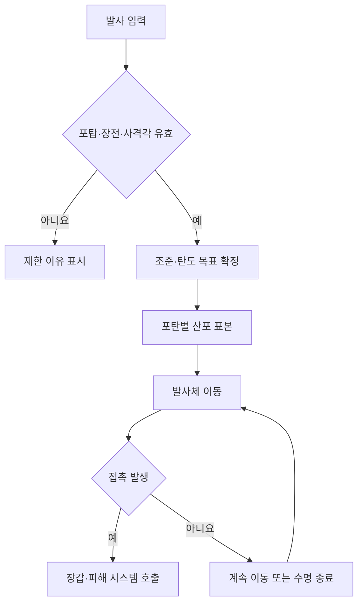

# 04. 주포·부포·탄도·조준·산포

> 대상: World of Warships PC 글로벌, 2026-11-13 / 15.10 기준선.  
> `[확인]` 공개 규칙 · `[버전 의존]` 함선·패치별 값 · `[분석]` 역기획 해석 · `[제안]` 재현용 설계 · `[미확인]` 검증되지 않은 내부 세부.  
> 관련 문서: [전체 목차](README.md) · [기동](03_navigation_and_maneuvering.md) · [관통·피해](05_armor_penetration_and_damage.md) · [모듈](06_survivability_modules_and_dot.md) · [탐지](08_detection_vision_and_information.md)

## 1. 포격 시스템의 핵심

주포 포격의 핵심은 조준점에 적을 맞추는 조작보다 **포탄 도착 시점의 위치와 장갑 상태를 예상하는 것**이다. 발사 전에 적이 보이더라도 도착 전 선회할 수 있고, 선체에 명중하더라도 탄종·입사각·부위에 따라 결과가 달라진다. `[분석]`

따라서 시스템을 다음 네 구간으로 분리한다.

| 구간 | 입력 | 출력 | 해당 문서 |
| --- | --- | --- | --- |
| 사격 준비 | 무장 선택, 포탑 방향, 장전, 사거리 | 발사 가능한 포문 | 본 문서 |
| 조준·탄도 | 조준점, 탄종, 표적 잠금, 포탄 특성 | 발사체 경로·도착 시각 | 본 문서 |
| 산포 | 거리, 무장 특성, 적용 효과 | 각 포탄의 실제 경로 차이 | 본 문서 |
| 접촉·피해 | 충돌 부위, 각도, 속도, 장갑 | 도탄·관통·피해·상태 이상 | 05·06 문서 |

**명중 실패와 피해 실패를 구분하는 것**이 UI·밸런스·디버깅의 공통 요구다. 명중률이 높아져도 관통 가능한 부위를 맞히지 못하면 실효 화력이 오르지 않는다. `[분석]`

## 2. 확인된 기본 사격 조작

공식 교육 자료는 3인칭·쌍안경 시점, 이동 표적에 대한 선행 조준, 단발 입력·누르고 연속 사격·더블 클릭 일제사격을 설명한다. 많은 포문을 쓰기 위해 측면을 열면 자신도 측면 공격에 노출된다는 교환이 존재한다. `[확인: A26]`

| 플레이어 동작 | 결과 | 반복 의사결정 `[분석]` |
| --- | --- | --- |
| 목표를 따라 조준 | 포탑이 사격 방향으로 이동 | 포 회전 완료를 기다릴지 선체를 돌릴지 |
| 단발 사격 | 준비된 포탑의 일부 화력 사용 | 거리·속도 판단을 먼저 보정할지 |
| 순차 사격 | 시간차가 있는 포격 | 회피 표적에 연속 압박할지 |
| 일제사격 | 짧은 순간에 화력 집중 | 적 측면이 열리는 창을 사용할지 |
| 탄종 예약 | 다음 재장전 이후 탄종 변경 | 현재 장전을 쓰고 바꿀지 |
| 즉시 탄종 전환 | 재장전 절차를 통해 변경 | 현재 탄종의 기회를 포기할지 |

탄종을 한 번 선택해 다음 장전을 예약하는 것과, 두 번 선택해 즉시 교체 절차를 시작하는 것은 구분된다. 함장 기술·특수 발사 모드의 전환 시간은 별도 파라미터다. `[확인·버전 의존: A21]`

### 2.1 총구가 적을 향했어도 발사가 안 되는 이유

실제 역기획·프로토타입에서는 다음 제한 사유를 구분해 표시해야 한다. 아래는 구현용 검사 목록이지 공개된 내부 함수 순서가 아니다. `[제안]`

1. 전투 주체가 살아 있고 해당 무장을 조작할 수 있는가.
2. 포탑이 정상 기능 중인가.
3. 필요한 장전 진행이 끝났는가.
4. 현재 조준 방향이 포탑의 회전·사격 허용 각도 안인가.
5. 사거리·고각 등의 무장 제약을 만족하는가.
6. 자기 함체 등 발사 안전 제약을 만족하는가.
7. 입력 중복이나 이미 확정된 발사 요청은 아닌가.

`CanFire=false` 하나만 내려주면 사용자도 QA도 원인을 구분할 수 없다. `Reloading`, `Traversing`, `OutsideArc`, `ModuleUnavailable` 같은 이유를 별도 값으로 두는 편이 좋다. `[제안]`

## 3. 탄도와 선행 조준

공개 조준 설명은 포탄 비행 시간, 표적의 이동 방향·속력, 선행 조준을 연결한다. 비행 시간은 조준 UI에서 확인할 수 있으며, 같은 함선도 탄종에 따라 다를 수 있다. 자함의 움직임을 실제 해군 사격 안정화 문제처럼 그대로 정확도 페널티로 해석해서는 안 된다. `[확인: A23]`

### 3.1 조준 판단의 세 층

| 판단 | 플레이어가 추정하는 것 | 흔한 오차 |
| --- | --- | --- |
| 수평 선행 | 포탄 도착까지 적이 전후로 이동할 양 | 현재 속력을 과거 속력으로 오인 |
| 거리·높이 | 수면선·상부 구조물·갑판 중 어디를 맞힐지 | 적이 접근·이탈하는 것을 무시 |
| 자세 변화 | 도착할 때 적의 장갑 각도가 어떤지 | 발사 순간의 측면 상태만 판단 |

높은 탄도는 특정 지형 너머로 사격할 가능성을 주지만 비행 시간이 길면 적이 회피할 시간이 늘어난다. 낮은 탄도는 먼 표적의 이동 예측을 쉽게 할 수 있으나 지형이 사선을 가릴 수 있다. 이는 탄도 특성과 지형의 상호작용에 대한 분석이며, 모든 함선의 우열 판정은 아니다. `[분석]`

### 3.2 수치 예: 일정 속도 가정

다음은 게임 내부 실제 스케일을 복제하지 않은 2D 프로토타입 예다. 표적이 화면 기준 횡방향으로 18 내부 단위/s 이동하고, 포탄 비행 시간이 8초라면 단순 선행량은 `18 × 8 = 144 내부 단위`다. `[제안·가정]`

표적이 3초 뒤 감속한다면 이 예측은 빗나간다. 그래서 사격 결과에는 플레이어의 읽기 능력과 표적의 회피 선택이 함께 들어간다. 실제 WoWS의 표시 노트·km를 현실 단위로 바꿔 위 식에 넣는 것만으로 정확한 조준값을 얻을 수 있다고 주장하지 않는다.

### 3.3 정적 조준점과 표적 잠금

표적 잠금은 조준 보조와 산포 설명에서 별도 요소로 다뤄진다. 공개 Wiki는 잠금하지 않은 사격이 산포에 불리하다고 설명하지만, 본 문서는 고정 배율을 확정하지 않는다. `[확인·미확인: A23, A30]`

표적 A에서 B로 잠금을 바꿀 때 조준점, 거리 기준, 포탑 회전, UI 이름표가 같은 목표를 가리켜야 한다. 이 계약이 깨지면 조준은 B를 향하지만 탄도 보정은 A에 묶이는 것처럼 느껴질 수 있다. `[제안]`

## 4. 산포와 시그마

포탄 착탄은 하나의 점이 아니라 분포를 이루며, 산포 타원과 중심 집중도인 시그마는 구분된다. 시그마가 높다는 이유만으로 타원의 크기까지 자동으로 작아진다고 해석하지 않는다. 공개 공식 영상은 이 요소들을 별개 항목으로 설명한다. `[확인: A30]`

| 요소 | 의미 | 단독 비교의 한계 |
| --- | --- | --- |
| 수평 산포 | 조준 방향의 좌우 퍼짐 | 종방향·입사각 정보 없음 |
| 종방향 산포 | 조준 거리 앞뒤의 퍼짐 | 갑판·측면에 투영된 분포와 다름 |
| 시그마 | 중심에 모이는 경향 | 포문 수·타원 크기와 함께 봐야 함 |
| 포문 수 | 한 번의 공격 표본 수 | 표본이 많아도 같은 부위에 유효 명중하지 않을 수 있음 |
| 탄 비행 시간 | 회피에 쓸 수 있는 시간 | 산포가 좋아도 표적이 조준점에서 벗어날 수 있음 |

### 4.1 산포 수치를 피해 기대값으로 읽는 절차

아래는 분석 절차의 제안이다.

1. 같은 거리·조준 부위·표적 자세를 고정한다.
2. 조준 오차를 제거한 상태에서 산포 표본을 모은다.
3. 선체에 닿은 표본과 빗나간 표본을 나눈다.
4. 명중 표본에 장갑·탄종 판정을 적용한다.
5. 모듈·포화·회복 가능 피해까지 반영해 유효 피해를 계산한다.
6. 실제 표적 회피와 조준 오차를 추가해 전투 성능을 평가한다.

정확한 난수 분포 함수, 시드 정책, 표본의 상관관계, 내부 산포 보정 순서는 본 조사로 확인되지 않았다. Wiki에 실험 기반 설명과 오래된 도표가 있으므로 이를 그대로 서버 코드 사양으로 취급하지 않는다. `[미확인]`

### 4.2 과장된 해석을 피한다

- 포트의 산포 숫자 하나를 실제 표준편차·최대 반지름·명중률로 임의 변환하지 않는다.
- 서로 다른 최대 사거리에서 표시된 산포를 같은 거리의 성능처럼 비교하지 않는다.
- 1회 일제사격의 운 나쁜 결과를 곧바로 조준 시스템 오류로 판단하지 않는다.
- 반대로 통계적 편차라는 이유로 잠금·좌표·지형 오류를 무시하지 않는다.

이 항목들은 검증 지침이다. 수치 자체를 알아도 어디에서 어떤 방식으로 측정했는지 없으면 비교가 불가능하다. `[제안]`

## 5. 주포 재장전과 전술 리듬

명목 DPM은 `사용 가능한 포문 수 × 탄당 최대 피해 × 60 / 재장전 시간`으로 계산할 수 있는 비교용 값이다. 실제 전투 피해에는 명중·관통·부위·가동률·회피·포화가 들어가므로 명목 DPM과 다르다. `[분석]`

\[
E[D_{minute}]\approx N_{shells}\cdot D_{nominal}\cdot P_{hit}\cdot E[M_{damage}]\cdot U_{firing}
\]

여기서 `N_shells`는 분당 이론 발사 탄수, `P_hit`는 명중 확률이다. `M_damage`에 도탄·과관통·일반 관통·집중 방호 구역 등의 결과를 반영하고, `U_firing`에 무장 사각·은폐 대기·표적 부재·모듈 무력화를 반영한다. 변수들은 분석용 집계이며 실제 게임의 보상식이나 피해 함수가 아니다. `[제안]`

### 5.1 숫자가 같은 무장도 다른 이유

| 가상 무장 | 명목 피해/사이클 | 사용 패턴 | 필요한 판단 |
| --- | --- | --- | --- |
| A: 30초마다 30,000 | 1,000/초 | 큰 일제사격 | 적 측면 노출 창 |
| B: 5초마다 5,000 | 1,000/초 | 잦은 보정·누적 | 표적 유지와 지속 사선 |

가정상 명목 DPM은 같지만 A는 짧은 노출 창에 유리하고 B는 오차 수정과 낮은 체력 표적 마무리에 유리하다. 포문 회전이 느리거나 포탑 사각이 크면 이 차이가 더 커진다. `[분석·가정]`

### 5.2 현행 모듈 상태와 장전

14.8 변경에서는 주포·발사관이 기능을 잃었을 때 장전을 초기화하기보다 일시 정지하는 방향으로 개편했다. 영구 파괴를 기본 전제로 한 과거 설명과 섞지 않는다. 구체적인 일반 손상·치명적 손상·회복은 06 문서를 따른다. `[확인·버전 의존: A27, A28]`

## 6. 부포와 수동 부포

일반적인 부포는 사거리·사격각 등 조건에 따라 자동 공격하며, 우선 표적 지정 기능이 있다. 다만 현재는 일부 함선에 직접 조준하는 수동 부포가 있으므로 “부포는 항상 자동”이라는 전제는 맞지 않는다. `[확인·버전 의존: A19, A31]`

### 6.1 선택적 수동 부포 기능

신규 독일 순양함 공식 안내는 주포와 부포 조작 전환, 미조작 시 자동 부포, 수동 조작 중 조준점을 따라가는 주포, 모드별 성능 차이, 수동 조준 방향에 사격각이 없는 부포의 자동 타겟 공격 제한을 설명한다. `[확인: A19]`

| 모드 | 조준 책임 | 사격 개시 | 설계상 의미 `[분석]` |
| --- | --- | --- | --- |
| 자동 부포 | 게임 로직 | 조건 충족 시 자동 | 주포·기동에 집중할 수 있음 |
| 자동 부포 + 우선 표적 | 게임 로직, 표적은 사용자 지정 | 조건 충족 시 자동 | 어떤 적에 압력을 줄지 선택 |
| 직접 수동 부포 | 사용자 | 무장별 입력 | 주포 장전 공백에 다른 조준 과제 추가 |

수동 부포는 함장 기술의 자동 부포 정확도 강화와 동일 개념이 아니다. UI와 데이터에서 `manual_control_supported`와 `secondary_accuracy_modifier`를 분리해야 한다. `[제안]`

## 7. 특수 발사 모드

스페인 일부 함선에 Burst Fire가 존재하며, 초군함이나 다른 계통도 함선별 특수 기믹을 가진다. 특정 함선의 연발 횟수·간격·후속 장전 시간을 모든 특수 발사에 공통 적용하지 않는다. `[확인·버전 의존: A16, A20]`

| 기능 | 분리할 데이터 `[제안]` | 균형 조절 질문 `[분석]` |
| --- | --- | --- |
| 연발 사격 | 연발 횟수, 내부 간격, 종료 후 장전 | 짧은 취약 창의 보상이 과한가 |
| 재장전 가속 | 배율, 지속 시간, 적용 조건 | 적이 대응할 시간을 남기는가 |
| 전투 지침 | 축적 조건, 감소 조건, 발동 효과 | 행동 유도가 팀 승리에 연결되는가 |
| 수동 부포 | 지원 여부, 모드별 사거리·산포 | 조작 부담이 추가 화력에 비례하는가 |

15.10 공식 패치는 연발 모드·탄종 전환과 재장전의 상호작용 오류 수정도 포함한다. 즉, 특수 발사와 탄종·장전 상태를 각각 테스트한 것만으로 전체 조합이 안전하다고 볼 수 없다. `[확인·분석: A29]`

## 8. 재현용 무장 데이터·상태

아래는 프로토타입 설계이며 실제 WoWS 코드 구조가 아니다. `[제안]`

```yaml
gun_definition:
  caliber_mm: 203
  shells: [prototype_he, prototype_ap]
  traverse_profile: turret_medium
  firing_arc: arc_fore_a
  reload_profile: reload_standard
  dispersion_profile: dispersion_cruiser_a
  ballistic_profile_by_shell:
    prototype_he: trajectory_he_a
    prototype_ap: trajectory_ap_a
  special_mode: null
turret_state:
  module_state: functional
  current_azimuth: 0.0
  current_elevation: 0.0
  loaded_shell_id: prototype_ap
  queued_shell_id: prototype_he
  reload_progress: 0.75
  reload_paused: false
  fire_block_reason: reloading
```

발사체 이벤트에는 발사자·무장·탄종·발사 시각·권위 위치·방향·표적 잠금 상태·적용 프로필 버전을 남긴다. 표적이 뒤늦게 다른 장비로 교체되었다는 이유로 이미 발사된 탄의 성능이 바뀌지 않도록 스냅샷 규칙을 정하는 것이 좋다. 이는 재현 설계 제안이다.

## 9. 처리 흐름 제안



실제 엔진이 착탄점을 먼저 정하는지, 초기 속도를 표본화하는지, 탄도 표를 사용하는지는 확인하지 않았다. 위 다이어그램은 **논리적 책임 분해**만 나타낸다. `[미확인·제안]`

## 10. QA 시나리오

| ID | 시험 | 관측할 결과 |
| --- | --- | --- |
| GN-01 | 동일 표적·거리에서 단발/순차/일제사격 | 발사 포문·시각·장전 상태 일치 |
| GN-02 | 다른 탄종을 한 번/두 번 선택 | 예약과 즉시 교체의 차이 |
| GN-03 | 포 회전 중 연속 발사 입력 | 준비되지 않은 포문이 잘못 발사하지 않음 |
| GN-04 | 최대 사각 경계에서 선체 선회 | 사격 가능 표시와 실제 허용의 일치 |
| GN-05 | 표적 A/B 잠금을 빠르게 전환 | 조준·이름표·거리·권위 타겟 일치 |
| GN-06 | 잠금/비잠금 동일 조건 표본 | 평균·분산 차이와 문서 설명 비교 |
| GN-07 | 같은 거리에서 서로 다른 탄종 | 비행 시간·착탄 위치의 정의 일치 |
| GN-08 | 수천 발의 고정 조건 사격 | 산포 범위·중심 편향·비정상 축 편향 |
| GN-09 | 같은 설정에서 정지/직진/선회 | 근거 없는 이동 정확도 페널티 여부 |
| GN-10 | 장전 중 포탑 손상·회복 | 장전 진행의 일시 정지·재개 |
| GN-11 | 수동 부포 선택·해제 | 자동 복귀와 모드별 사거리 적용 |
| GN-12 | 수동 부포 사각 밖의 다른 적 | 지원하지 않는 자동 교차 공격 발생 여부 |
| GN-13 | 연발 사격 중 탄종·모드 전환 | 무료 장전·장전 단축·중복 발사 방지 |
| GN-14 | 적 격침·미탐지·재탐지 | 남은 탄·잠금·조준 UI 상태의 일관성 |
| GN-15 | 섬 근처 높은 탄도 사격 | 표적 시야·포탄 경로·지형 접촉의 분리 |

난수 시스템 검증은 모든 발이 같은 곳에 떨어지는지 검사하는 방식이 아니다. 고정 조건에서 분포가 의도한 범위에 있고, 잘못된 좌표 변환으로 한 방향에만 쏠리지 않는지를 검사한다. `[제안]`

## 11. 출처와 재검증 항목

| ID | 출처 | 사용 범위 |
| --- | --- | --- |
| A16 | [Ship:Ships of Spain](https://wiki.worldofwarships.com/Ship:Ships_of_Spain) | 일부 함선 Burst Fire |
| A19 | [New German Cruisers: Early Access](https://worldofwarships.eu/en/news/general-news/new-german-cruisers-early-access/) | 수동 부포 기능의 공식 설명 |
| A20 | [Ship:Superships](https://wiki.worldofwarships.com/Ship:Superships) | 특수 기능을 가진 상위 콘텐츠 분류 |
| A21 | [Ship:Controls](https://wiki.worldofwarships.com/Ship:Controls) | 탄종 예약·즉시 교체 입력 |
| A23 | [Ship:Gunnery and Aiming](https://wiki.worldofwarships.com/Ship:Gunnery_and_Aiming) | 비행 시간·선행 조준·잠금·움직임. 실험 기반 분포 상수는 채택하지 않음 |
| A26 | [Controls and Firing](https://worldofwarships.com/en/content/education/game_controls/) | 공식 기본 사격·시점 설명; 검색에 노출된 본문 확인 |
| A27 | [Ship:Modules](https://wiki.worldofwarships.com/Ship:Modules) | 최신 상태·장전 정지 설명만 채택; 같은 페이지의 오래된 영구 파괴 문구 제외 |
| A28 | [Ship:Update 14.8](https://wiki.worldofwarships.com/Ship:Update_14.8) | 라이브 모듈 개편 기록 |
| A29 | [Update 15.10: Horror From the Abyss](https://worldofwarships.com/en/news/game-updates/update-1510-horror-from-the-abyss/) | 현재 패치의 특수 모드·장전 버그 수정 |
| A30 | [How It Works: Firing and Dispersion](https://www.youtube.com/watch?v=NHtQ2s3XOGE) | 공식 채널, 2021-08-18. 검색으로 확인한 설명·챕터 범위; 영상을 직접 재생해 실험한 것은 아님 |
| A31 | [Ship:Secondary Armament](https://wiki.worldofwarships.com/Ship:Secondary_Armament) | 자동 부포·우선 표적의 기본 개념 |

열람일: 2026-11-13. 정확한 탄도 방정식·난수 알고리즘·서버 발사 처리 순서·틱 빈도는 미확인이다. 함선별 산포 공식과 예외 수치는 버전별 데이터와 훈련실 실측으로 별도 검증해야 한다.
