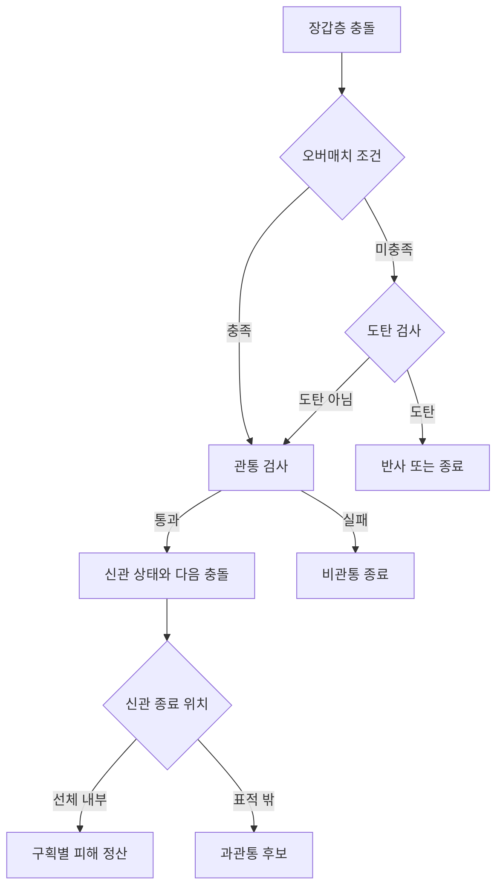

# 05. 장갑·관통·피해 판정 시스템

> 대상: World of Warships PC 글로벌판. 조사 기준: 2026-11-13 / 라이브 15.10 계열.
> [확인]은 인용 자료에서 확인한 규칙, [버전 의존]은 함선·탄종·패치별 값, [분석]은 설계 해석, [제안]은 재구현용 명세다.
> 원작의 소스코드나 서버 계산식을 입수한 문서가 아니다. 아래 처리 순서는 관찰 가능한 결과를 재현하기 위한 제안이다.

## 1. 시스템의 역할과 경계

[분석] 명중률만으로 승패가 결정되지 않도록, 명중 이후에도 탄종·입사각·피격 위치에 따라 결과를 나누는 시스템이다.
같은 위치를 맞혀도 사수의 구경과 표적의 자세가 달라지면 효율이 달라진다.
방어자는 조타로 피격 확률을 줄이는 동시에 장갑의 유효성을 높일 수 있다.
공격자는 목표의 HP만 보지 않고 현재 노출된 장갑면과 다음 선회 방향을 읽어야 한다.

| 구분 | 입력 | 출력 | 연결 문서 |
|---|---|---|---|
| 명중 전 | 탄도, 분산, 표적 이동 | 충돌 위치·속도·방향 | [04 함포와 조준](04_gunnery_ballistics_and_aiming.md) |
| 장갑 판정 | 장갑판·탄종·구경·각도 | 도탄·비관통·통과 | 본 문서 |
| 신관과 구획 | 작동 조건·지연·통과 경로 | 과관통·일반 관통·집중방호구역 명중 | 본 문서 |
| 피해 정산 | 탄 피해·구획 상태·특수 제한 | 실제 선체 HP 감소 | 본 문서 및 [06 생존](06_survivability_modules_and_dot.md) |
| 후속 효과 | 폭발·발화 조건·모듈 접촉 | 모듈 손상·화재 | 06 문서 |

전투 중 표시되는 명중 결과는 방어자의 전체 장갑 구조를 공개하는 디버그 정보가 아니다.
[제안] 재구현 시에는 플레이어용 리본과 개발자용 판정 추적 로그를 분리한다.
하나의 리본을 서버 내부 분기 하나와 반드시 일대일로 대응시키려 하지 않는다.

## 2. 장갑을 하나의 방어력 수치로 만들지 않는 이유

[확인] 원작은 외판과 내부 방호 등 여러 장갑층을 구분하며, 집중방호구역에 대한 유효 타격은 큰 피해로 이어진다.[B01]
따라서 “장갑 300” 같은 단일 수치만으로 전투 결과를 설명할 수 없다.

[분석] 장갑 배치는 다음 네 가지 질문을 만들어 낸다.

1. 맞은 위치가 선수·선미·상부구조·갑판·측면 중 어디인가?
2. 그 위치의 외판을 통과했는가?
3. 통과 이후 내부의 중요한 구획까지 도달했는가?
4. 그 구획에서 실제로 폭발했는가?

| 형상·구획 | 설계에서 만드는 선택 | 재구현 시 필요한 표현 |
|---|---|---|
| 선수·선미 외판 | 정면으로 버틸 수 있는 상대 구경 구분 | 장갑 패치별 두께 |
| 측면 장갑대 | 측면 노출의 비용 | 면 법선·두께·내부 구획 |
| 갑판 | 낙각과 장거리 교전의 차이 | 수평·경사 장갑 패치 |
| 상부구조 | 소구경 무장의 유효 조준점 | 별도 손상 구획 |
| 내부 방호 | 외판 관통과 치명타의 분리 | 다음 장갑층 질의 |
| 공간장갑·벌지 | 명중 표시와 실피해의 차이 | 무피해 공간과 선체 구획 구분 |

[제안] 시각 메시의 모든 삼각형에 임의의 방어력을 붙이는 방식보다, 장갑 판정용 단순화 메시와 구획 볼륨을 별도 저작한다.
아트 LOD가 바뀌어도 장갑 판정이 변하지 않도록 충돌 자산의 버전을 고정한다.
얇은 판 사이의 간격은 고속 탄환이 한 프레임에 여러 층을 통과해도 검출돼야 한다.

## 3. AP: 각도·관통력·신관을 분리한 판정

### 3.1 공개 규칙의 최소 요약

[확인] 일반 AP의 도탄 구간은 장갑면의 법선 기준 45°부터 확률 구간, 60°부터 강제 도탄이다.
개선 도탄각을 가진 탄은 별도 값을 쓴다.
정규화는 경사 장갑에 대한 관통 계산의 각도 보정 규칙으로 다룬다.
AP의 일반 관통·과관통·집중방호구역 피해는 기본적으로 표시 최대 피해의 33%·10%·100%이며 추가 제한이 적용될 수 있다.[B01]

여기서 0°는 장갑면에 수직으로 들어오는 방향이다.
함선의 선수 방향과 탄의 수평각을 그대로 이 각도로 대입하면 경사 장갑·갑판에서 잘못된 결과가 나온다.

### 3.2 오버매치

[확인] AP 오버매치의 비교는 `구경 > 14.3 × 장갑 두께`다.
해당 장갑판에 대한 도탄을 무시하는 조건이지, 모든 내부 장갑을 무시하거나 집중방호구역 피해를 보장하는 조건은 아니다.[B02]

[분석/계산] 아래는 공개 비교식에 실제 구경을 대입한 결과이며, 특정 함선의 전체 방호 성능 평가가 아니다.

| 구경 | 구경 ÷ 14.3 | 비교할 장갑 | 오버매치 조건 |
|---:|---:|---:|---|
| 380 mm | 약 26.57 mm | 26 mm / 27 mm | 전자는 충족, 후자는 미충족 |
| 406 mm | 약 28.39 mm | 27 mm / 30 mm | 전자는 충족, 후자는 미충족 |
| 457 mm | 약 31.96 mm | 30 mm / 32 mm | 전자는 충족, 후자는 미충족 |
| 460 mm | 약 32.17 mm | 32 mm | 충족 |

이 때문에 457 mm와 460 mm는 수치 차이보다 큰 상성 차이를 만들 수 있다.
[제안] UI에는 단순 구경 증가뿐 아니라 주요 장갑 임계값 통과 여부를 함께 보여준다.
수치 계산은 반올림한 표시값이 아니라 원래 값으로 수행해야 한다.

### 3.3 신관의 독립성

[확인] AP는 신관이 작동할 만큼의 저항을 만나야 하며, 작동 후 지연이 끝나기 전에 표적을 빠져나가면 과관통이 발생할 수 있다.
신관 작동 두께와 지연은 탄별 변수다.[B01]

[분석] 큰 구경이 얇은 표적에 항상 큰 피해를 주지 않는 이유가 된다.
대구경 AP의 표기 피해량을 낮추지 않고도 경장갑 목표에 대한 효율을 제어할 수 있다.
반대로 짧은 신관은 작은 목표 내부에서 폭발하기 쉬워질 수 있지만, 깊은 내부 방호구역 도달에는 다른 결과를 낼 수 있다.

[가정 예제] 감속을 생략한 국소 모델에서 관통 후 속도가 500 m/s라면:

- 신관 지연 0.030초의 이동 거리는 15 m다.
- 지연 0.010초의 이동 거리는 5 m다.
- 이 예제의 속도·지연은 교육용 가정이며 특정 함선 데이터가 아니다.
- 실제 계산에서는 장갑 통과와 수중 진입 등에 따른 속도 변화까지 필요하다.

### 3.4 제안 처리 흐름



[제안] 이 도식은 기획용 분기다.
원작에서 정규화·신관 활성화·관통력 감산·다중 충돌이 실행되는 정확한 함수 순서를 뜻하지 않는다.
동일 탄이 둘 이상의 구획과 상호작용할 때의 중복 정산도 독립 정책으로 검증한다.

## 4. HE와 SAP: 다른 조건으로 피해를 확보하는 탄종

[확인] HE는 접촉 시 폭발하고 도탄·과관통이 없으며, 비관통이어도 발화나 폭발 범위의 모듈 피해 가능성이 남는다.
SAP는 정해진 관통값과 도탄 조건을 함께 사용하며, 발화·과관통이 없고 여러 장갑층을 AP처럼 연속 관통하지 않는다.
SAP에는 IFHE가 적용되지 않는다.[B03]

| 비교축 | AP | HE | SAP |
|---|---|---|---|
| [분석] 주된 숙련 요구 | 노출 각도·내부 경로 | 얇은 부위·화재 관리 | 관통 가능한 부위·도탄각 |
| [분석] 피해 안정성 | 좋은 각에서 큰 보상 | 직접 피해와 지속 피해 분산 | 발화 없이 직접 피해 집중 |
| [분석] 약점 | 과관통·도탄·내부 방호 | 두꺼운 장갑에 직접 피해 제한 | 공간장갑·각도·지속 피해 부재 |
| [제안] 데이터 핵심 | 관통 모델·신관·각도 | 고정 관통값·발화·폭발 | 고정 관통값·각도·특수 제한 |

[버전 의존] HE 관통값은 모든 탄에 `구경/6`을 일괄 적용하면 안 된다.
국가·함선 계통·구경에 따른 계수가 있으며, 최종 관통값을 데이터로 보관하는 편이 안전하다.[B01]
[확인] IFHE는 HE 관통을 25% 늘리고 기본 발화 확률을 절반으로 낮추는 구조로 개편되었다.
별도로 더해지는 발화 보너스까지 일괄 절반으로 줄이는 규칙은 아니다.[B23]

[가정 예제] 기본 HE 관통값을 30 mm로 설정한 테스트 탄은 IFHE 적용 후 `floor(30 × 1.25) = 37 mm`다.
이 예제에서는 32 mm 표적에 대한 직접 피해 가능성이 생기지만, 원래부터 뚫던 25 mm 표적에는 관통 임계값을 새로 넘는 이득이 없다.
[분석] 이 스킬의 가치는 평균 관통력 상승률보다 “상대하는 표적의 어떤 판을 새로 뚫는가”로 평가해야 한다.

## 5. 피해 포화와 특수 피해 제한

[확인] 반복 피격은 해당 구획과 공유 선체 풀을 소모시켜 일반 관통 효율을 낮춘다.
공개 설명에서는 일반 관통의 33%에서 일부 포화 시 16.5%, 완전 포화 시 10% 수준으로 구분한다.
과관통·집중방호구역·화재·침수는 같은 구획 소모 경로를 쓰지 않는다.
구획 구성에는 함선별 예외가 있다.[B04]

[분석] 포화는 HP가 낮은 함선의 생존 시간을 일부 늘리면서 사수에게 조준점 이동을 요구한다.
따라서 포화 상태는 “방어자가 갖는 추가 장갑”으로 이해하기보다 “이미 파괴한 영역에서 더 얻을 수 있는 전투 효과의 감소”로 이해하는 편이 적절하다.

[가정 예제] 최대 피해 12,000인 일반 AP를 별도 저항 없는 테스트 표적에 정산한다.

| 결과 | 계산 | 예제 HP 감소 |
|---|---:|---:|
| 일반 관통 | 12,000 × 0.33 | 3,960 |
| 한쪽 피해 풀이 소진된 상태 | 12,000 × 0.165 | 1,980 |
| 완전 포화의 단순 모델 | 12,000 × 0.10 | 1,200 |
| 집중방호구역 유효 폭발 | 12,000 × 1.00 | 12,000 |

경계에서 풀이 일부만 남았으면 위 세 단계 사이의 값이 나올 수 있다.
위 표를 실제 서버의 모든 예외를 포함한 완전한 계산식으로 사용하지 않는다.

[확인] 280 mm 이상 AP·SAP의 구축함 피해에는 최대 피해의 10% 상한이 적용된다.
과거 예외였던 Khabarovsk·Harugumo도 0.9.11에서 이 제한에 포함되었다.[B06]
[분석] 같은 10%라도 과관통과 함종 보호 상한은 원인이 다르므로 개발 로그에서는 분리해야 한다.

## 6. 재구현 데이터 계약

다음은 모두 [제안]이며 원작 내부 데이터 형식이 아니다.

```yaml
ProjectileDamageProfile:
  id: test_ap_406
  rule_set: pc_global_15_10_reference
  caliber_mm: 406
  nominal_damage: 12000
  ammo_family: AP
  ricochet_start_deg: 45
  ricochet_guaranteed_deg: 60
  overmatch_ratio: 14.3
  normalization_deg: data_defined
  fuze_arming_mm: data_defined
  fuze_delay_s: data_defined
  penetration_model_id: versioned_curve
  damage_caps: [large_caliber_vs_destroyer]

ArmorPatch:
  id: bow_outer_01
  thickness_mm: 32
  collision_mesh_id: armor_collision_v3
  compartment_id: bow
  permits_hull_damage: true
  next_layer_policy: geometric_query

DamageResolution:
  projectile_id: unique_id
  armor_contacts: ordered_records
  terminal_reason: ricochet_or_shatter_or_explosion_or_exit
  affected_compartment: compartment_id
  nominal_damage: scalar
  saturation_adjustment: scalar
  special_cap_adjustment: scalar
  applied_hull_damage: scalar
```

| 불변 조건 | 이유 |
|---|---|
| 정산 후 HP는 음수가 되지 않는다 | 동시 타격·격침 중복 방지 |
| 장갑 표시 단위와 계산 단위 변환은 한 곳에서 수행한다 | cm/mm 혼용 방지 |
| 동일 피해 이벤트를 재수신해도 다시 적용하지 않는다 | 네트워크 재전송 대비 |
| 규칙 버전과 함선 데이터 버전을 함께 기록한다 | 패치 이후 리플레이 분석 |
| 리본과 HP 정산값은 같은 이벤트를 근거로 생성한다 | 설명 불가능한 피드백 최소화 |
| 면 법선 기준을 저작 도구와 엔진에서 통일한다 | 도탄각 뒤집힘 방지 |

## 7. 대표 QA 시나리오

아래는 실행 완료 보고가 아니라 [제안] 검증 명세다.

| ID | 준비·입력 | 기대 검증 |
|---|---|---|
| ARM-01 | 표준 AP를 법선 0°·44°·45°·59°·60°에 충돌 | 경계 정책 및 확률 구간 확인 |
| ARM-02 | 동일 판에 구경만 오버매치 경계 전후 변경 | 도탄 경로만 조건에 맞게 변화 |
| ARM-03 | 얇은 외판 뒤 두꺼운 내부판 | 외판 통과가 집중방호구역 보장이 아님 |
| ARM-04 | 관통 후 표적 폭·신관 지연 변경 | 내부 폭발과 과관통 전환 |
| ARM-05 | HE가 관통 불가능한 갑판에 충돌 | 선체 직접 피해와 발화 판정 분리 |
| ARM-06 | 같은 HE가 공중의 모듈 근처 수면에 폭발 | 폭발 범위 정책·선체 피해 분리 |
| ARM-07 | SAP에 IFHE 장착 상태만 변경 | SAP 관통값 불변 |
| ARM-08 | 동일 구획을 반복 타격한 뒤 다른 구획 타격 | 지역 포화와 공유 선체 풀 구분 |
| ARM-09 | 완전 포화 후 화재 적용 | 구획 포화가 DoT 면역을 만들지 않음 |
| ARM-10 | 구축함에 대구경 AP, 신관은 정상 작동 | 함종 상한의 별도 적용 |
| ARM-11 | 2개 탄 동시 명중으로 HP가 0 통과 | 격침·보상·리본의 단일 확정 |
| ARM-12 | 장갑 LOD만 변경 | 판정 동일성 |
| ARM-13 | 재연결 후 이전 피해 이벤트 재전달 | 피해 중복 적용 없음 |

## 8. 설계 평가와 개선 실험

[분석] 이 시스템의 장점은 기동과 사격을 같은 의사결정으로 묶는 데 있다.
한 플레이어가 측면 포문을 더 쓰기 위해 선회하면, 상대에게는 장갑 취약면을 노릴 기회가 생긴다.
이 상호작용이 명확하면 긴 재장전 중에도 상대의 다음 행동을 읽는 플레이가 유지된다.

[제안] 성능 평가 지표는 명중률 외에 다음을 함께 수집한다.

- 탄종별 발사 → 명중 → 관통 → 유효 HP 피해 전환율.
- 함종·거리·표적 자세별 비관통 및 과관통 비율.
- 포화된 구획에 연속 조준한 시간과 이후 조준점 이동.
- 표적 HP 손실 중 회복 가능한 몫과 회복 불가능한 몫.
- 신규 플레이어가 실패 리본을 본 뒤 탄종·위치를 바꾸는 비율.
- 오버매치 임계값을 바꾸었을 때 정면 교전 생존 시간의 변화.

[미확인] 원작의 정확한 관통력 식, 난수 분포, 다중 충돌 정산 순서, 리본 우선순위 전부를 공개 자료만으로 확정하지 않았다.
정밀 복제 단계에서는 고정 조건의 훈련방 반복 실험과 현행 클라이언트 데이터 검증이 필요하다.

## 9. 관련 문서와 출처

- 선체 HP·모듈·수리반: [06 생존성](06_survivability_modules_and_dot.md)
- 수중 무장과 포화의 상호작용: [07 어뢰](07_torpedoes_and_area_denial.md)
- 구현 공통 기준: [19 아키텍처와 QA](19_implementation_architecture_and_qa.md)

모든 웹 자료 열람일: **2026-11-13**. 공식 호스팅 위키는 편집 시차가 있으므로 최근 라이브 패치가 우선한다.

| ID | 자료 | 사용 범위·주의 |
|---|---|---|
| B01 | [World of Warships Wiki — Armor Penetration](https://wiki.worldofwarships.com/Ship:Armor_Penetration) | 장갑·AP 기본 규칙. 유폭 관련 옛 설명은 사용하지 않음. IFHE 계산 예시의 1.3 표기는 개편 규칙과 불일치하여 채택하지 않음 |
| B02 | [World of Warships Wiki — Armor thresholds](https://wiki.worldofwarships.com/Ship:Armor_thresholds) | 오버매치 임계 비교 |
| B03 | [World of Warships Wiki — Ammo](https://wiki.worldofwarships.com/Ship:Ammo) | HE·SAP의 기능 차이 |
| B04 | [World of Warships Wiki — Damage Saturation](https://wiki.worldofwarships.com/Ship:Damage_Saturation) | 구획·공유 선체 풀·포화 |
| B06 | [Update 0.9.11: Winter Trophies](https://worldofwarships.eu/en/news/game-updates/update-0911-winter-trophies/) | 대구경 AP/SAP의 구축함 상한 예외 해소 |
| B23 | [World of Warships Wiki — Update 0.9.2](https://wiki.worldofwarships.com/Ship:Update_0.9.2) | IFHE 개편의 역사적 기준, 현재 Ammo와 교차 확인 |

