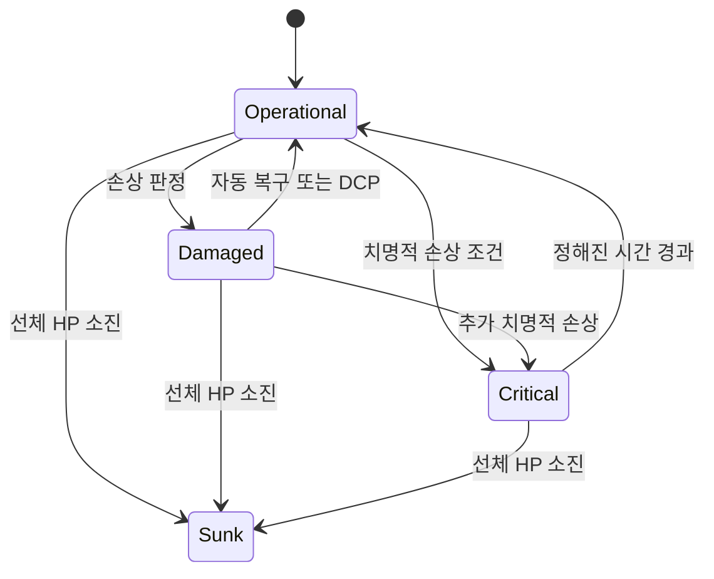

# 06. 생존성·모듈·화재·침수·회복 시스템

> 대상: World of Warships PC 글로벌판. 조사 기준: 2026-11-13 / 라이브 15.10 계열.
> 표기: [확인] 공개 규칙, [버전 의존] 함선별·패치별 값, [분석] 해석, [제안] 재구현 명세.
> 핵심 갱신점: **13.11 유폭 제거**, **14.8 모듈 영구 파괴 제거**를 반영한다. 옛 영상의 모듈 파괴 규칙을 현행 규칙으로 사용하지 않는다.

## 1. 생존성을 구성하는 서로 다른 자원

[분석] 생존성을 “HP가 얼마나 큰가”로만 평가하면 실제 전투 시간을 설명하지 못한다.
회복 가능한 피해인지, 기동 장치가 작동하는지, 피해 복구반이 준비됐는지에 따라 같은 HP의 함선도 위험도가 다르다.

| 자원·상태 | 플레이어가 얻는 기능 | 소모·악화 경로 | 주요 대응 |
|---|---|---|---|
| 현재 선체 HP | 격침까지 남은 여유 | 직접 피해·지속 피해 | 회피·장갑 활용·수리반 |
| 회복 가능한 피해 | 향후 되돌릴 수 있는 손실 | 수리반으로 회복하며 감소 | 회복량과 생존 시간을 함께 판단 |
| 무장 모듈 상태 | 실제 발사 능력 | 모듈 피격·폭발 | 복구·시간 경과·다른 무장 사용 |
| 기관·조타 상태 | 이동·선회 자유도 | 모듈 손상 | 복구·관련 스킬 |
| 화재·침수 슬롯 | 시간에 따른 추가 손실 | 상태 효과 부여 | 피해 복구반·지속시간 종료 |
| 복구반 가용성 | 다음 위험에 대한 대응권 | 사용·재사용 대기 | 적 공격 주기 예측 |
| 수리반 가용성 | 재교전 가능한 HP | 사용 횟수·재사용 대기 | 엄폐·비탐지·회복 시점 관리 |

[제안] HUD와 로그에서 `HP`, `회복 가능량`, `행동 불능 상태`를 서로 다른 데이터로 취급한다.
“수리”라는 단어가 같더라도 선체 HP 회복과 모듈 기능 복구는 별개의 효과다.

## 2. 선체 HP와 회복 가능 피해

[확인] 수리반은 손실 HP를 일정 시간에 걸쳐 회복한다.
화재·침수·과관통 등 회복 적격률이 높은 피해와 일반 관통·집중방호구역 피해의 회복률은 다르며, 실제 비율과 회복 속도는 함선별로 다르다.[B11][B05]

### 2.1 회복 장부 모델

아래는 공개 규칙을 계산하기 위한 [제안]이며 원작의 저장 구조를 뜻하지 않는다.

```text
피해 이벤트 발생
  적용된 실제 선체 피해 D를 확정한다.
  피해 종류와 함선의 회복 규칙으로 회복 적격률 q를 선택한다.
  현재 HP에서 D를 차감한다.
  회복 가능 장부에 D × q를 더한다.

수리반의 짧은 시간 구간 dt
  회복량 = min(초당 회복량 × dt, 회복 가능 장부, 최대 HP - 현재 HP)
  현재 HP에 회복량을 더한다.
  장부에서 같은 양을 뺀다.
```

“회복 적격률 100%”는 해당 손실을 회복 대상으로 인정한다는 뜻이다.
회복 횟수·작동 시간·생존 시간이 충분하지 않으면 실제로 모두 되돌릴 수는 없다.

### 2.2 가정 수치 예제

[가정] 최대 HP 60,000, 직접 피해 12,000의 적격률 50%, 화재 피해 6,000의 적격률 100%, 집중방호구역 피해 10,000의 적격률 10%인 테스트 함선을 둔다.

| 항목 | 받은 피해 | 회복 적격 피해 |
|---|---:|---:|
| 일반 직접 피해 | 12,000 | 6,000 |
| 화재 피해 | 6,000 | 6,000 |
| 집중방호구역 피해 | 10,000 | 1,000 |
| 합계 | 28,000 | 13,000 |

현재 HP는 32,000이다.
수리반을 초당 최대 HP의 0.5%, 28초로 **가정**하면 한 번의 이론 용량은 8,400이다.
추가 피해 없이 완주했을 때 HP는 40,400, 남은 회복 적격 장부는 4,600이다.
이는 특정 함선의 라이브 수치를 복제한 예제가 아니라 회복 제한을 보여 주는 산술 예제다.

[버전 의존] 미국 일반 전함 계통의 회복 속도와 일부 고성능 수리반은 위 예제와 다르다.
공개 수리반 데이터에는 일반·특화·장기 작동형 등이 따로 구분된다.[B05]

### 2.3 실제 판단으로의 연결

[분석] 사수에게는 피해량뿐 아니라 회복을 차단할 수 있는 시간이 중요하다.
수리반이 돌아오기 전에 침몰시킬 수 있는 5,000 피해는, 오래 쉬면 상당 부분 회복되는 10,000 피해보다 승리에 크게 기여할 수 있다.
방어자에게는 피격을 줄이며 재사용 대기를 끝낼 공간이 사실상 추가 HP처럼 작동한다.

## 3. 모듈 손상: 14.8 이후 규칙

### 3.1 현행 상태

[확인] 14.8에서 모듈 영구 파괴가 제거되었다.
일반 손상은 자동 복구 또는 피해 복구반으로 해소할 수 있다.
치명적 손상은 즉시 수동 복구할 수 없으며 일정 시간 후 모듈 HP 일부와 기능이 돌아온다.
주포·어뢰 발사관 손상 시 진행 중이던 장전은 초기화가 아니라 일시 정지한다.
모듈 최대 HP의 전투별 무작위 편차도 제거되었다.[B08][B30]

| 상태 | 기능 | 복구 경로 | [분석] 플레이어에게 남는 선택 |
|---|---|---|---|
| 정상 | 해당 모듈 사용 가능 | 해당 없음 | 평상시 운영 |
| 손상 | 기능 중단 또는 관련 성능 제한 | 자동 복구·DCP | 즉시 복구할 가치 판단 |
| 치명적 손상 | 일정 시간 기능 상실 | 정해진 자동 회복 | 다른 무장·엄폐·기동으로 시간 확보 |
| 격침 | 함선의 전투 종료 | 일반 전투에서는 복귀 불가 | 모듈 손상과 별도 종결 |

[확인] 모듈 HP가 낮아지면 손상 가능성이 높아질 수 있고, 관련 스킬·강화장치는 손상 위험이나 복구에 영향을 준다.
기관·조타 손상 때 Last Stand는 제한된 기능을 유지하게 한다.[B07]

“모듈 HP가 고정”과 “모듈 손상이 항상 결정론적으로 발생”은 같은 말이 아니다.
[분석] HP 초기값의 무작위성을 제거해도 손상 판정에 남은 확률과 피격 위치의 차이는 존재할 수 있다.

### 3.2 모듈별 전술 효과

| 모듈 | [분석] 직접 손실 | [분석] 간접 손실 | [제안] UI 요구 |
|---|---|---|---|
| 주포탑 | 발사 가능한 포문 감소 | 측면을 더 열어야 할 유혹 | 포탑별 복구·장전 진행 표시 |
| 어뢰 발사관 | 어뢰 공격 시점 지연 | 압박·견제 공백 | 남은 장전과 정지 이유 구분 |
| 기관 | 가속·이탈 능력 저하 | 연속 피격·포위 위험 | 입력은 수신되지만 성능 제한됨을 표현 |
| 조타기 | 회피·자세 변경 제약 | 측면·어뢰 노출 | 현재 타각과 입력 제약 표시 |
| 대공포 | 방공 효율 감소 | 항공 공격 대응 부담 | 남은 기능과 회복 가능성 표시 |
| 부포 | 근접 지속 화력 감소 | 근접 교전 손익 변경 | 좌우·사거리별 가용 화력 표시 |
| 잠수함 소나 | 핑 운용 제한 | 유도 공격 주기 변화 | 무장 재장전과 다른 상태 표현 |

[제안] 정상 모듈과 기능이 복구된 저HP 모듈을 내부적으로 구분한다.
겉으로 작동해도 다시 손상될 위험이 같은지 여부를 데이터와 툴팁으로 일관되게 정의해야 한다.

### 3.3 상태도



[제안] 이 상태도는 공통 데이터 모델이다.
모듈 종류마다 허용 전이와 복구 수치를 다르게 설정한다.
치명적 손상 도중 DCP를 눌렀다는 이유만으로 자동 회복 타이머를 초기화하지 않는다.

## 4. 화재

[확인] 일반 수상함은 네 화재 구역을 가지며, 전함의 화재 예방 관련 효과는 중앙 구역을 합쳐 최대 화재 수를 줄일 수 있다.
잠수함의 동시 화재는 하나다.
일반 수상함 화재는 최대 HP 비례 피해이며, 대표 기본값은 전함 60초, 보통 순양함·구축함 30초, 초당 0.3%다.
대형 순양함 등 예외가 있다.[B09]

| 대표 기본 프로필 | 초당 최대 HP 비율 | 기본 지속 | 한 구역을 끝까지 방치한 비율 |
|---|---:|---:|---:|
| 일반 전함 | 0.3% | 60초 | 18% |
| 일반 순양함·구축함 | 0.3% | 30초 | 9% |
| 잠수함 | 1.0% | 30초 | 30% |

[버전 의존] 항모는 이 표에서 제외한다.
14.7에서 화재 지속시간·초당 피해·피해 복구반의 시간값이 바뀌었다.[B14]
Fire 위키에는 옛 항모 본문과 새 표가 동시에 남아 있어, 구버전의 “5초·초당 1%”를 현재 공통 규칙으로 옮기지 않았다.
정밀 시뮬레이터에는 현행 함선 데이터에서 확인한 프로필을 입력해야 한다.

[확인] 표기 발화 확률은 명중 한 발의 최종 실전 확률과 같지 않다.
표적의 화재 저항과 관련 수정값을 거치며, 지속시간 감소 효과는 곱셈으로 결합된다.[B09]

[가정 예제] 60초 화재에 각각 15%, 20% 지속시간 감소만 적용하면 `60 × 0.85 × 0.80 = 40.8초`다.
두 효과를 더해 35% 감소라고 계산하면 39초가 되어 다른 결과가 나온다.
[제안] 빌드 비교 화면은 각 효과가 확률·지속시간·구역 수 중 어디를 바꾸는지 구분해 표시한다.

## 5. 침수

[확인] 어뢰, 충각, 잠수함에 대한 폭뢰가 침수 원인이 될 수 있다.
수중에 들어온 포탄이 선체 피해를 주더라도 그 자체로 침수를 일으키는 규칙은 아니다.
일반 수상함은 선수·선미에 최대 두 침수, 잠수함은 하나가 적용되며, 침수는 HP 손실과 추진 성능 저하를 함께 일으킨다.
DCP 작동 중에는 침수가 억제된다.[B10]

[분석] 침수는 단순히 더 강한 화재가 아니다.
이동 성능 저하로 다음 어뢰나 포탄을 피하기 어려워져, 직접 DoT 이외의 손실을 유발한다.
좁은 수로에서 침수한 함선과 개방 해역에서 침수한 함선의 위험도는 달라야 한다.

| 판단 상황 | [분석] 고려 사항 |
|---|---|
| 침수 하나, 곧 엄폐 가능 | 남은 HP·추가 피격·복구반 재사용 대기 비교 |
| 침수와 조타 손상 동시 | 회피 불능으로 인한 추가 피해 위험이 큼 |
| 어뢰 여러 발이 순차 도착 | 첫 타격 직후 복구 시 뒤의 침수 위험 |
| 복구반 보호 시간 중 추가 어뢰 | 직접 피해와 상태 효과를 분리하여 해석 |
| 잠수함 피격 | 수심·기름 흔적·추가 대잠 공격까지 고려 |

[버전 의존] 침수의 지속시간·HP 비례율·방뢰 구역 보정은 함선 종류별로 관리한다.
단일 공식을 모든 수상함과 잠수함에 복사하지 않는다.
어뢰 자체의 명목 침수 확률도 방뢰 구역 명중 후 최종 확률과 동일하지 않다.[B10]

## 6. 피해 복구반과 수리반의 시간 싸움

[확인] DCP는 화재·침수·일반 모듈 손상과 소나 핑을 처리하고, 작동 시간 동안 관련 재적용을 막는 기능을 가진다.
일반적으로 무제한 횟수형이지만, 횟수가 제한된 빠른 복구형도 있다.[B11]
치명적 모듈 손상은 14.8 규칙에 따라 별도로 취급한다.[B08]
아군 항공 지원의 소화·회복은 [09 항공과 대공](09_carriers_aircraft_and_aa.md)에서 다룬다.
[제안] 외부 지원 회복에 자체 수리반의 적격 장부 정책을 자동 적용하지 말고, 각 지원 효과의 회복 대상을 따로 명세한다.

[가정 전술 타임라인] 다음 시간값은 원작 특정 함선이 아닌 분석용이다.

| 시각 | 상태 | 공격자의 판단 | 방어자의 판단 |
|---:|---|---|---|
| 0초 | 첫 화재 발생 | 복구 사용 여부 관찰 | 즉시 사용과 방치 손익 비교 |
| 5초 | DCP 사용, 10초 보호 가정 | 상태 효과보다 위치 압박 | 어뢰 진입로 확인 |
| 15초 | 보호 종료 | 후속 HE·어뢰 타이밍 확보 | 집중사격 노출 줄이기 |
| 25초 | 다시 화재 발생 | 재사용 대기 동안 압박 | 수리 가능량과 이탈 시간 비교 |
| 35초 | 수리반 가동 | 짧은 시간 내 마무리 가능성 판단 | 회복보다 빠른 폭발 피해 회피 |

[분석] “한 화재에는 무조건 DCP를 쓰지 않는다”는 절대 규칙으로 가르치면 안 된다.
남은 HP가 적거나, 그 불 때문에 피탐지된 채 집중사격을 받거나, 전투가 곧 끝나면 즉시 사용의 가치가 커질 수 있다.
다음 위협의 도착 시간과 현재 생존 여유를 함께 평가하는 규칙이 필요하다.

## 7. 제거된 규칙과 자료 충돌

[확인] 탄약고 유폭은 13.11에서 제거되었다.[B13]
집중방호구역에 큰 피해를 받는 것과 과거 유폭으로 즉시 격침되는 것은 서로 다른 규칙이다.

| 옛 설명 | 본 문서의 처리 |
|---|---|
| 주포·발사관·대공포가 영구 파괴되어 전투 내내 복구 불가 | 14.8 이후 자동 회복 가능한 상태 모델로 갱신 |
| 포탑 손상 시 장전 처음부터 다시 시작 | 일시 정지 후 재개로 갱신 |
| 모듈 HP가 매 전투 무작위 | 고정 최대값으로 갱신 |
| 유폭 방지 신호기가 필수 | 13.11 제거 사실 반영 |
| 항모 화재·DCP는 오래된 고정값 사용 | 14.7 이후 프로필 재확인 |
| 수리반은 모든 손실 HP를 즉시 회복 | 적격률·초당량·작동시간·횟수로 분리 |

## 8. 제안 데이터와 QA

```yaml
SurvivabilityState:
  hull_hp: scalar
  maximum_hp: scalar
  recoverable_damage_by_type: map
  active_fires: per_zone_list
  active_floods: per_zone_list
  damage_control:
    active_until: server_time
    ready_at: server_time
    charges_remaining: finite_or_unlimited

ModuleState:
  module_id: stable_id
  maximum_hp: fixed_from_ship_data
  hp: scalar
  status: operational_or_damaged_or_critical
  recover_at: server_time
  dcp_repair_allowed: bool
  reload_progress_paused: scalar
```

| ID | [제안] 검증 | 기대 결과 |
|---|---|---|
| SUR-01 | 회복 불가 피해만 받은 뒤 수리반 | 허용된 장부만큼만 회복 |
| SUR-02 | HP는 낮지만 회복 장부가 없음 | 최대 회복량 착시를 만들지 않음 |
| SUR-03 | 선체와 모듈에 같은 폭발 이벤트 | HP·기능 손상 정산의 중복 없음 |
| SUR-04 | 일반 손상과 치명적 손상에 DCP | 즉시 복구 가능 여부가 다름 |
| SUR-05 | 장전 80%에서 발사관 손상 | 복구 후 이전 진행률에서 재개 |
| SUR-06 | 전투 재시작 여러 번 | 같은 설정의 모듈 최대 HP 일정 |
| SUR-07 | 화재 최대 구역 수 도달 후 추가 피격 | 초과 슬롯 생성 없음 |
| SUR-08 | 선수·선미 침수 동시 | 위치별 슬롯·지속시간 독립 |
| SUR-09 | DCP 작동 중 어뢰 명중 | 직접 피해는 별도, 침수 부여는 억제 |
| SUR-10 | HP 0과 회복 틱이 같은 시간 | 정의된 순서로 격침이 일관됨 |
| SUR-11 | 연속 패치의 리플레이 재생 | 당시 모듈·화재 프로필 유지 |
| SUR-12 | 항모 구버전 화재 프로필 로드 | 현행 규칙세트 검증에서 차단 |

[제안] 지표는 최종 피해량 외에 DCP 사용 후 30초 생존율, 치명적 모듈 손상으로 잃은 공격 횟수, 수리반 미사용 잔여량, 회복 장부 낭비량을 기록한다.
개편 효과는 피해량 감소만으로 판단하지 말고 기능 상실 구간의 길이와 전투 참여 회복률도 비교한다.

## 9. 관련 문서와 출처

- [05 장갑과 피해](05_armor_penetration_and_damage.md)
- [08 탐지와 정보](08_detection_vision_and_information.md)
- [11 소모품 운용](11_consumables_and_tactical_cycles.md)
- [18 밸런스와 검증](18_balance_metrics_and_validation.md)

자료 열람일: **2026-11-13**.

| ID | 자료 | 근거·주의 |
|---|---|---|
| B05 | [Wiki — Repair Party Data](https://wiki.worldofwarships.com/Ship:Repair_Party_Data) | 회복률·작동시간의 함선별 차이 |
| B07 | [Wiki — Modules](https://wiki.worldofwarships.com/Ship:Modules) | 현재 상태 절. 일부 부포·대공포 단락에는 옛 영구파괴 표현이 남아 있어 패치로 교정 |
| B08 | [World of Warships 공식 Steam — Update 14.8 발표](https://store.steampowered.com/news/posts/?appids=552990&enddate=1757159607&feed=steam_community_announcements) | 출시 공지의 모듈 개편 확인. WIP 단락과 출시 단락을 구분 |
| B09 | [Wiki — Fire](https://wiki.worldofwarships.com/Ship:Fire) | 화재 구역·대표 수상함 값. 항모 본문과 표 충돌은 채택 보류 |
| B10 | [Wiki — Flooding](https://wiki.worldofwarships.com/Ship:Flooding) | 원인·구역·추진 영향 |
| B11 | [Wiki — Consumables](https://wiki.worldofwarships.com/Ship:Consumables) | DCP와 수리반의 역할. 옛 전투기 탐지·대공 설명은 미사용 |
| B13 | [Wiki — Update 13.11](https://wiki.worldofwarships.com/Ship:Update_13.11) | 유폭 제거 |
| B30 | [Wiki — Update 14.8](https://wiki.worldofwarships.com/Ship:Update_14.8) | 모듈 상태·고정 최대 HP·장전 일시 정지에 관한 출시 기록 |
| B14 | [Update 14.7: In the Name of Tomorrow](https://worldofwarships.eu/es/news/game-updates/update-14-7-in-the-name-of-tomorrow/) | 라이브 항모 화재·DCP 변경. 공식 페이지에서 추출 가능한 영문 본문 사용 |

