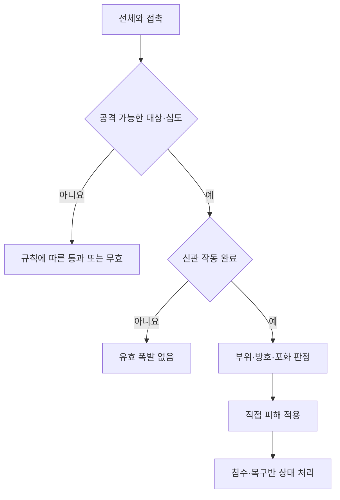

# 07. 어뢰·발사관·유도·지역 통제

> 대상: World of Warships PC 글로벌, 2026-11-13 / 15.10 기준선.  
> `[확인]` 공개 규칙 · `[버전 의존]` 함선·패치·모드별 규칙 · `[분석]` 역기획 해석 · `[제안]` 재현 모델 · `[미확인]` 추가 검증 필요.  
> 관련 문서: [전체 목차](README.md) · [기동](03_navigation_and_maneuvering.md) · [피해](05_armor_penetration_and_damage.md) · [침수·수리](06_survivability_modules_and_dot.md) · [탐지](08_detection_vision_and_information.md) · [잠수함·대잠](10_submarines_and_asw.md)

## 1. 핵심 설계 의도

어뢰는 높은 직접 피해와 긴 도착 지연을 결합한 무기다. 플레이어는 현재 표적 위치보다 **미래 항로**를 선택해 공격한다. 표적은 어뢰를 맞지 않더라도 감속·선회·후퇴하면서 다른 위험을 떠안을 수 있다. 따라서 명중 피해와 이동 선택을 제한하는 가치를 나눠 분석해야 한다. `[분석]`

| 구간 | 공격자의 선택 | 방어자의 선택 | 결과 |
| --- | --- | --- | --- |
| 발사 전 | 발사 위치·각도·발사 수량 | 적 어뢰함 위치 추정 | 정보의 비대칭 |
| 접근 중 | 다른 표적 공격·재배치 | 예상 항로 변경·음향 탐지 | 공간 통제 |
| 발견 후 | 후속 포격·추가 어뢰 | 감속·선회·피격 부위 선택 | 즉시 대응 시험 |
| 명중 후 | 침수·수리 상태를 보고 후속 공격 | 복구반·수리반 사용 판단 | 피해 누적과 재사용 대기시간 교환 |

여기서 지역 통제는 공식 별도 점수나 디버프 이름이 아니다. 적에게 안전한 이동 선택이 줄어드는 전술적 결과를 표현한 분석 용어다.

## 2. 기본 규칙의 짧은 정리

공개 어뢰 설명에 따르면 발사에는 발사관 사각·회전·장전과 최소 신관 작동 거리가 관여한다. 일반 수상함의 어뢰 발사는 주포 발사처럼 함선 피탐지 반경을 늘리지 않는다. 어뢰는 자체 발견 거리를 가지며 한 번 발견된 어뢰의 표시가 유지되는 규칙이 설명되어 있다. `[확인: A32]`

| 항목 | 규칙·구분 | 설계상 영향 `[분석]` |
| --- | --- | --- |
| 사거리 | 정해진 주행 범위 | 현재 거리만으로 도달 여부를 판단할 수 없음 |
| 속력 | 어뢰별 성능값 | 이동 표적을 따라잡는 시간에 영향 |
| 발견 거리 | 어뢰별 탐지 특성 | 방어자가 갖는 최종 반응 시간에 영향 |
| 신관 작동 거리 | 너무 가까운 충돌은 유효 폭발이 아님 | 근접 돌진의 최소 간격 필요 |
| 발사 사각 | 발사관 위치별 허용 각도 | 측면 노출·회두 비용 발생 |
| 발사 패턴 | 넓은/좁은 확산 또는 단발 등 | 집중 명중과 항로 봉쇄의 선택 |
| 장전 단위 | 함선·발사관·장전 기구에 따라 구분 | 모든 튜브가 한꺼번에 준비되는 것은 아님 |

이 표의 성능 수치는 항구의 무장 세부 정보와 현재 버전 데이터로 입력한다. 표시 사거리·노트·발견 거리만으로 실제 시간 스케일을 임의 확정하지 않는다. `[제안]`

## 3. 어뢰 종류와 표적 자격

공식 Wiki의 어뢰 데이터는 일반 어뢰, 심해 어뢰, 음향 유도 어뢰를 구분한다. 심해 어뢰는 공격 가능한 함종이 제한되며 종류에 따라 순양함까지 제외한다. 음향 유도는 잠수함의 소나 표식과 연결된다. `[확인: A33]`

| 종류 | 기본 특성 | 필수 예외 처리 |
| --- | --- | --- |
| 일반 수상 어뢰 | 수상 표적에 사용하는 직진 어뢰 | 잠수함의 심도·충돌 위치 조건 별도 |
| 심해 어뢰 | 지정된 함종에만 명중 가능한 변형 | 모든 심해 어뢰의 허용 함종이 같다고 가정 금지 |
| 음향 유도 어뢰 | 소나 표식과 연결된 유도 | 유도 종료 거리·표식 제거·심도 조건 별도 |
| 투하 어뢰 | 항공기가 투하하는 어뢰 | 투하 지점·신관 작동·항공 공격 절차 별도 |
| 초기 선회 어뢰 | 발사 후 선택 방향으로 회전하는 기능 | 유도 표적 추적과 동일시 금지 |

초기 선회 기능은 신규 영국 전함 계통 안내와 0.11.5 공식 패치에서 확인된다. 발사 직후 정해진 방향으로 회전한 뒤 진행하는 동작과, 표적의 움직임에 맞춰 계속 방향을 바꾸는 유도는 별개다. `[확인: A34, A35]`

### 3.1 함종 제한과 공간 충돌을 분리한다

표적 자격은 두 질문으로 나눈다. `[제안]`

1. 이 어뢰가 규칙상 해당 함종을 공격할 수 있는가.
2. 현재 어뢰 깊이·표적 심도·선체 충돌 형상이 실제로 겹치는가.

일반 어뢰 데이터에 “모든 함종”이라고 쓰였다고 해서 깊게 잠항한 잠수함까지 자동 추적·명중하는 것은 아니다. 실제 잠수함 상호작용은 [10 문서](10_submarines_and_asw.md)의 심도 규칙과 함께 판단한다.

## 4. 발사관 배치와 조작 비용

공개 설명은 현측·중앙선·전방·함수/함미 등 발사관 배치를 구분한다. 영국 등 일부 함선의 단발 발사는 남은 어뢰를 보유할 수 있고, 잔탄이 있는 동안의 재장전 시작 입력이 별도로 존재한다. `[확인·버전 의존: A32]`

| 배치 | 가능한 선택 | 불리해지는 상황 `[분석]` |
| --- | --- | --- |
| 중앙선 | 좌우 교전에 공통 발사관 사용 | 반대편 전환에 시간이 필요 |
| 현측 | 좌우 탄약·장전 주기를 따로 이용 | 한 방향에 모든 발사관을 쓸 수 없음 |
| 전방 제한 사각 | 접근 방향으로 공격 가능 | 측면 교전에서 각도 확보가 어려움 |
| 함수·함미 | 전후 방향 공격 조합 | 선체 방향과 무장 방향의 결합이 강함 |

발사관 개수와 한 방향 최대 발사 수량을 구분해서 표시해야 한다. 예를 들어 좌우에 각각 4문이 있어도 한쪽으로 8발을 즉시 쏠 수 있다고 안내하면 오해를 만든다. 이 예는 가상 배치다. `[제안·가정]`

### 4.1 발사각과 장갑각의 갈등

좋은 포격 방어 각도를 유지해도 어뢰 발사각이 나오지 않을 수 있다. 어뢰를 쏘려고 선체를 더 돌리면 상대의 AP 공격 기회를 줄 수 있다. 따라서 어뢰 DPM만 비교해서 근접전 능력을 평가하지 말고, **발사를 위해 노출해야 하는 각도와 시간**을 함께 기록해야 한다. `[분석]`

## 5. 조준 보조와 미래 항로 추정

어뢰 조준 보조는 선택한 표적이 현재 속력·방향을 유지할 때의 예측 방향을 보여준다. 표적이 계속 그 조건을 유지한다는 보장은 없으므로 자동 명중 지점이 아니다. `[확인: A32]`

| 관측 정보 | 가능한 추정 | 오판 위험 |
| --- | --- | --- |
| 현재 방향·속력 | 일정 운동 가정의 도착 위치 | 감속·선회에 취약 |
| 섬 사이 좁은 길 | 앞으로 통과할 통로 | 정지·후퇴 가능 |
| 적의 후방 포탑 방향 | 다음 교전 목표와 선회 의도 | 카메라·포 회전만 보고 과신 |
| 거점 점수·시간 | 적이 진입해야 할 압박 | 적이 진입을 포기할 수도 있음 |
| 마지막 발견 위치 | 가능한 이동 영역 | 시간이 지날수록 영역 확대 |

### 5.1 한 번의 넓은 발사와 두 번의 분산 발사

다음은 전술 선택의 분석이며 특정 함선에 고정된 정답이 아니다.

| 선택 | 이점 | 비용 |
| --- | --- | --- |
| 좁은 확산 집중 | 예상 항로에서 다수 명중 가능 | 예측이 틀리면 모두 빗나가기 쉬움 |
| 넓은 확산 | 넓은 항로에 대응 강요 | 간격이 커져 작은 표적이 통과 가능 |
| 서로 다른 선행량으로 분할 | 가속·감속의 여러 결과를 덮음 | 한 위치의 최대 피해 감소 |
| 시간차 발사 | 첫 회피 후 방향을 다시 압박 | 발사 위치 체류·노출 시간 증가 |
| 일부 발사관 보유 | 근접 위협·다음 표적에 대응 | 현재 공격의 밀도 감소 |

## 6. 반응 시간과 사거리 계산

### 6.1 자체 프로토타입용 근사

거리 단위와 시간 단위를 일치시킨 뒤, 정지 표적의 단순 반응 시간은 `발견 거리 / 어뢰 속력`으로 근사할 수 있다. 표적이 어뢰 쪽으로 이동하면 상대 접근 속력이 증가해 시간이 짧아진다. 이는 일반적인 운동학 분석이며 WoWS의 내부 환산 상수를 뜻하지 않는다. `[분석]`

\[
t_{reaction}\approx\frac{d_{detect}}{v_{torpedo}+v_{target,closing}}
\]

가상 내부 단위에서 발견 거리 1,200, 어뢰 속력 180, 표적 접근 속력 20이라면 `1,200 / 200 = 6초`다. 표적이 반대 방향으로 20의 속력으로 멀어지면 `1,200 / 160 = 7.5초`다. `[제안·가정]`

### 6.2 사거리 안에 보여도 도달하지 않을 수 있다

가상 어뢰가 10,000 단위를 주행할 수 있고, 현재 표적 거리가 9,000이어도 표적이 도주하는 동안 1,500 더 멀어지면 최초 위치를 겨냥한 단순 추격은 실패할 수 있다. 반대로 접근하는 표적은 발사 순간 사거리 밖에 있어도 나중에 주행 범위 안으로 들어올 수 있다. `[분석·가정]`

### 6.3 실제값 적용 주의

공개 Wiki에는 커뮤니티 측정에서 얻은 속력 환산과 오래된 예제가 있다. 본 문서는 그 상수를 15.10의 모든 어뢰·모드에 확정 적용하지 않는다. 재현하려면 알려진 두 지점 사이의 실제 이동 시간과 화면의 거리·속력 표시를 함께 측정해야 한다. `[미확인·제안: A32]`

## 7. 명중·피해·침수의 연결

어뢰 명중 이후에는 신관 작동, 표적 자격, 명중 부위, 어뢰 방호, 피해 포화, 침수 판정 등의 구분이 필요하다. 정확한 피해 감소·침수율·회복 가능 비율은 [05](05_armor_penetration_and_damage.md)·[06](06_survivability_modules_and_dot.md)에서 관리한다. 아래 순서는 책임을 나눈 재현 모델이며 실제 서버 코드의 실행 순서를 확정한 것이 아니다. `[제안]`



### 7.1 아군은 피해를 안 받아도 발사 경로를 막을 수 있다

0.10.5 변경은 아군 직접 피해를 제거했지만 무장이 아군을 통과해 적에게 도달하는 기능을 주지는 않았다. 따라서 “아군 뒤에서 어뢰를 쏘면 팀킬”이라는 과거 설명도, “아군이 있어도 어뢰가 그대로 통과”라는 반대 설명도 사용하지 않는다. 제재 세부는 현행 비매너 정책을 별도로 확인한다. `[확인: A25]`

### 7.2 잠수함 근거리 어뢰와 모드 예외

잠수함 어뢰의 근거리 피해 규칙을 일반 수상함 어뢰에 적용해서는 안 된다. 또한 14.8 작전 관련 변경에는 잠수함의 근거리 어뢰 피해 제한을 다르게 적용하는 사례가 있으므로 일반 PvP와 작전 설정을 분리해야 한다. `[확인·버전 의존: A28]`

어뢰의 명칭이 같아도 모드에서 성능이 보정될 수 있다. 기준 함선 데이터에 모드 예외를 덮어쓰는 구조로 관리하고, 본편 값 자체를 수정하지 않는 것이 안전하다. `[제안]`

## 8. 지역 통제의 구조

어뢰가 단 한 발도 맞지 않았다는 결과만으로 발사 선택이 무효였다고 판단하기 어렵다. 적 전함이 회피하려고 측면을 열어 아군 포격을 받거나, 거점에 늦게 도착하면 공격은 간접 가치를 만들었다. `[분석]`

| 어뢰가 만드는 제약 | 후속 기회 | 잘못된 평가 방식 |
| --- | --- | --- |
| 진입로 통과 지연 | 거점 점수 확보 | 직접 피해 0이므로 무가치 |
| 특정 방향으로 선회 | 동료 전함에 측면 노출 | 어뢰 명중만 집계 |
| 감속·정지 | 항공·포격의 예측 용이 | 피해를 다른 공격자만의 기여로 해석 |
| 위험 구역 우회 | 다른 전선에 적 전력 도착 지연 | 발사자 개인 전적만 확인 |
| 복구반 사용 강요 | 후속 화재·침수 누적 | 첫 직접 피해만 비교 |

이 효과를 보상에 직접 연결하면 의도적 무효 발사로 점수를 얻는 악용이 생길 수 있다. 따라서 먼저 분석용 지표로 추적하고, 실제 보상은 검증 가능한 기여와 결합하는 편이 낫다. `[제안]`

## 9. 발사관·어뢰 데이터 모델

실제 WoWS 자료구조가 아니라 재현 프로젝트의 예시다. `[제안]`

```yaml
torpedo_definition:
  id: prototype_torpedo_a
  movement_profile: straight_after_initial_turn
  max_travel_distance: range_profile_a
  speed_profile: speed_a
  arming_distance: arming_a
  detectability_profile: detection_a
  eligible_ship_classes: [destroyer, cruiser, battleship, carrier, submarine]
  depth_collision_profile: surface_collision_a
  initial_turn_profile: null
  homing_profile: null
  damage_profile: torpedo_damage_a
  flooding_profile: flooding_a
launcher_definition:
  tube_count: 4
  mount_type: centerline
  firing_arc: launcher_arc_a
  traverse_profile: traverse_a
  launch_modes: [narrow_spread, wide_spread]
  reload_policy: group_reload
launcher_state:
  loaded_count: 4
  reload_progress: 1.0
  module_state: functional
  reload_paused: false
  selected_mode: narrow_spread
```

`eligible_ship_classes`는 깊이 충돌을 대체하지 않는다. 잠수함을 목록에 넣더라도 수상 어뢰가 모든 심도를 관통하는 결과가 나오면 안 된다. `initial_turn_profile`과 `homing_profile`도 분리해 초기 회전을 표적 추적으로 오해하지 않도록 한다.

## 10. 발사관 상태 전이

현행 모듈 시스템은 장전 진행의 일시 정지와 재개를 고려해야 한다. 발사관이 손상될 때마다 장전 전체가 초기화된다는 과거 규칙을 재현하지 않는다. 자세한 상태는 06 문서가 기준이다. `[확인·버전 의존: A27, A28]`

| 상태 | 허용 입력 | 전이 조건 | 보존해야 할 정보 `[제안]` |
| --- | --- | --- | --- |
| 장전 완료 | 조준·발사·모드 전환 | 발사 | 발사 시 어뢰 종류·분포 |
| 일부 잔탄 | 지원 함선의 추가 단발·재장전 명령 | 잔탄 소진·명시적 재장전 | 잔탄 수와 발사관별 준비 |
| 재장전 중 | 조준·다른 무장 선택 | 장전 완료 | 진행도 |
| 일반 손상 | 지원하는 수리·대기 | 자동 수리·소모품 | 장전 진행·잔탄 정책 |
| 치명적 손상 | 제한된 입력·대기 | 정의된 회복 | 별도 회복 타이머 |

잔탄을 가진 발사관이 무력화됐을 때의 잔탄 보존 등 세부는 함선별 클라이언트 실측 항목이다. 이 표의 상태 저장 제안이 확인하지 않은 실제 게임 결과를 대신하지 않는다.

## 11. QA 시나리오

| ID | 시험 조건 | 기대 검증 |
| --- | --- | --- |
| TP-01 | 최소 신관 거리 직전·직후 명중 | 유효 폭발 경계와 UI 일치 |
| TP-02 | 사거리 끝에 정지·접근·도주 표적 | 현재 거리와 실제 도달의 구분 |
| TP-03 | 넓은/좁은 확산 같은 조건 발사 | 발사 수·각도·패턴 데이터 일치 |
| TP-04 | 단발 지원 함선에서 일부 발사 | 잔탄·재장전 시작 조건 일치 |
| TP-05 | 반대 현측으로 무장 전환 | 발사관별 장전·회전 독립성 |
| TP-06 | 심해 어뢰로 각 함종·심도 공격 | 표적 자격과 공간 충돌 분리 |
| TP-07 | 어뢰 발사 직전·직후 함선 피탐지 | 근거 없는 주포식 발포 탐지 증가 없음 |
| TP-08 | 어뢰 최초 발견 후 관측함 이탈 | 발견 지속 규칙과 팀 정보 일치 |
| TP-09 | 아군이 발사 경로를 가림 | 아군 피해와 무장 차단을 분리 |
| TP-10 | 발사관 장전 중 손상·회복 | 장전 초기화가 아닌 정지·재개 검증 |
| TP-11 | 소나 표식 변경·복구반 사용 | 유도·직진 전환은 10문서와 일치 |
| TP-12 | 초기 선회 어뢰와 유도 어뢰 비교 | 초기 선회가 지속 추적으로 오작동하지 않음 |
| TP-13 | 수상함·잠수함, PvP·작전 비교 | 근거리 피해 제한의 잘못된 공통 적용 없음 |
| TP-14 | 같은 시간에 다수 어뢰 접촉 | 포화·침수·직접 피해의 순서 일관성 |
| TP-15 | 표적 잠금 변경과 발사 동시 입력 | 조준 보조 대상과 확정된 발사 방향 일치 |

## 12. 지표·재현 우선순위

기본 프로토타입은 직진 어뢰·그룹 장전·좁은/넓은 확산·최소 신관 거리부터 시작할 수 있다. 이후 심해 표적 제한, 단발 발사, 초기 선회, 잠수함 유도, 모드 보정을 추가한다. 이는 새 프로젝트를 위한 구현 순서 제안이다.

| 목적 | 지표 후보 `[제안]` | 주의 |
| --- | --- | --- |
| 명중 기회 평가 | 발사 수 대비 명중률, 발사 거리별 명중률 | 숙련도·모드·표적 함종 보정 |
| 대응 가능성 | 발견부터 피격까지 시간 | 표적 접근 속력·초기 조타 상태 포함 |
| 발사 비용 평가 | 발사각 확보 중 받은 피해 | 생존자 편향 주의 |
| 지역 통제 평가 | 적 회피·지연·항로 변경 | 어뢰가 원인인지 분리 필요 |
| 시스템 공정성 | 경고 후 아무 입력으로도 피할 수 없는 비율 | 이미 잘못 진입한 상황과 구분 |

## 13. 출처와 적용 범위

| ID | 출처 | 범위·주의 |
| --- | --- | --- |
| A25 | [Ship:Update 0.10.5](https://wiki.worldofwarships.com/Ship:Update_0.10.5) | 아군 직접 피해 제거와 무장 차단 유지 |
| A27 | [Ship:Modules](https://wiki.worldofwarships.com/Ship:Modules) | 현행 장전 정지·모듈 상태 설명 |
| A28 | [Ship:Update 14.8](https://wiki.worldofwarships.com/Ship:Update_14.8) | 모듈 개편, 작전 잠수함 예외 |
| A32 | [Ship:Torpedoes](https://wiki.worldofwarships.com/Ship:Torpedoes) | 조준 보조·발사관·신관·발견·발포 피탐지·단발 장전. 오래된 대공·아군 피해·환산 예제는 현행 규칙으로 채택하지 않음 |
| A33 | [Ship:Torpedo Data](https://wiki.worldofwarships.com/Ship:Torpedo_Data) | 어뢰 종류와 표적 제한, 성능 필드 |
| A34 | [Overview of the New British Battleships](https://worldofwarships.com/en/news/general-news/overview-of-the-new-british-battleships/) | 초기 선회 어뢰의 공식 설명 |
| A35 | [Update 0.11.5: U.S. Independence Day](https://worldofwarships.com/en/news/game-updates/update-0115/) | 초기 선회와 음향 유도의 구분 |

열람일: 2026-11-13. 모든 어뢰별 최신 수치, 잠수함 유도 계수, 접촉 판정 순서, 거리·시간 환산 상수는 본 문서에서 전수 검증하지 않았다. 수치표를 확장할 때는 함선·어뢰 모델·모드·패치를 함께 저장해야 한다.
