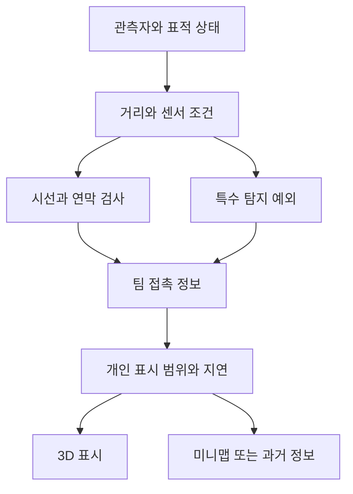

# 08. 탐지·시야·연막·정보 공유 시스템

> 대상: World of Warships PC 글로벌판. 조사 기준: 2026-11-13 / 라이브 15.10 계열.
> [확인] 공개 규칙, [버전 의존] 개별 수치·예외, [분석] 설계 해석, [제안] 재구현 명세.
> “위치를 짐작함”, “미니맵에 표시됨”, “3D 화면에서 보임”, “직접 탐지함”을 구분한다.

## 1. 시스템 목표

[분석] 탐지 시스템은 긴 사거리 전투에서 공격 기회와 안전한 이동 시간을 배분한다.
포탄을 피하는 능력뿐 아니라, 적이 나를 조준할 수 있는 시점을 관리하는 능력이 생존성을 만든다.
전방 함선이 제공하는 정보는 후방 함선의 무장 성능을 실제 전투 성과로 바꾼다.
따라서 탐지는 개별 함선의 은폐 스탯과 팀 전체의 정보망을 함께 설계하는 시스템이다.

| 주요 행위 | [분석] 얻는 것 | [분석] 지불하는 것 |
|---|---|---|
| 전방 정찰 | 적 진로·점령 정보 | 자신이 먼저 노출될 위험 |
| 주포 발사 | 즉시 공격 기회 | 은폐 상태 유지 기회 |
| 연막 사용 | 시야 차단·이탈 시간 | 자신의 직접 관측 능력 |
| 레이더 사용 | 강제 탐지 시간 | 다음 교전을 위한 충전 |
| 음파 탐지 사용 | 근접 정보·어뢰 대응 시간 | 작동 시간·재사용 대기 |
| 공격 중단 | 비탐지 전환·재배치 | 당장의 피해 기회 |

이 문서의 구현안은 화면에서 안 보이게 하는 렌더링 기능만을 뜻하지 않는다.
서버가 누구에게 어떤 정보를 보낼 것인지 결정하는 게임 규칙이 함께 필요하다.

## 2. 용어와 정보 상태

| 용어 | 의미 | 혼동하면 생기는 오류 |
|---|---|---|
| 피탐지 거리 | 적 관측자가 나를 발견할 수 있는 거리 조건 | 내 함선의 시야 거리로 오해 |
| 관측·표시 거리 | 내가 목표를 화면에서 확인할 수 있는 범위 | 적의 은폐가 무조건 무시된다고 오해 |
| 직접 탐지 | 내 센서 조건이 적을 발견 | 팀원이 발견한 적을 내 탐지로 집계 |
| 팀 공유 탐지 | 아군이 제공한 현재 위치 정보 | 모든 구성원이 항상 동일한 3D 표시라고 오해 |
| 마지막 확인 위치 | 과거 관측 시점의 위치 | 현재 위치처럼 표기하여 오판 |
| 간접 위치 단서 | 방향·핑·기름 흔적 등 | 완전한 탐지 상태로 잘못 승격 |

[제안] 내부 정보 상태는 다음처럼 분리한다.

```text
Unknown             : 현재 적 위치 정보 없음
LastKnown           : 마지막 관측 위치와 시각만 있음
DirectionalCue      : 방향 또는 지역 단서만 있음
TeamMinimapContact  : 현재 팀 정보가 있지만 3D 표시는 제한
WorldVisible        : 해당 관측자에게 3D 표현 허용
DirectSensorContact : 직접 탐지 기여를 별도 플래그로 기록
```

하나의 열거형만으로 모든 조합을 담기 어렵다면 접촉 정보와 표시 권한을 분리한다.
예를 들어 직접 레이더로 본 표적은 자신의 3D 화면에는 즉시 보이면서 동료에게는 다른 표시 시점을 가질 수 있다.

## 3. 기본 탐지와 발포 노출

### 3.1 공개 규칙

[확인] 일반 수상·항공 탐지는 거리와 시선 조건을 사용한다.
수상함의 수상 피탐지와 항공 피탐지는 별도 값이다.
기본 확정 탐지 거리는 2 km로, 일반 수상 상호작용에서 연막·지형을 무시하지만 최대 수심 잠수함에는 같은 방식으로 적용되지 않는다.[B15]

[확인] 연막 밖 주포 발포는 수상 피탐지 범위를 현재 주포 사거리까지 확대한다.
이 확대 때문에 탐지됐다면 통상 20초가 적용되며, 시선이 끊긴 경우의 짧은 초기화 예외가 있다.
미탐지 발포와 탐지된 발포를 같은 타이머로 처리하면 안 된다.[B15]
[확인] 14.7 이후 주포 발포는 항공 피탐지 거리 증가를 일으키지 않는다.[B14]

| 행동·상황 | 현행 취급 | 근거 |
|---|---|---|
| 수상 주포 발사 | 조건부 수상 피탐지 확대 | B15 |
| 주포 발사에 따른 항공 피탐지 확대 | 제거됨 | B14 |
| 정지·저속 항해 | 그 자체로 피탐지 감소 효과 없음 | B15 |
| 어뢰 발사 | 일반 주포 발포 확대를 발생시키지 않음 | B15 |
| 일반 수상함 부포 사격 | 일반 주포와 같은 확대를 일괄 적용하지 않음 | B15 |
| 대공포 사격 | 항공 탐지와의 별도 상호작용 존재 | B15 |
| 잠수함 수심 변화 | 수심별 별도 센서 규칙 | [10 잠수함](10_submarines_and_asw.md) |

[버전 의존] 잠수함의 부포 등 특수 예외는 일반 수상함 규칙으로 덮어쓰지 않는다.
이 문서는 잠수함 감지표 전체를 중복하지 않고 10 문서로 연결한다.

### 3.2 비탐지 재배치

[가정 예제] 수상 피탐지 6 km, 주포 사거리 12 km인 테스트 함선이 9 km의 적 앞에서 주포를 쏜다.
적 관측자가 시선·표시 조건을 만족한다면 발포 노출이 탐지 원인이 될 수 있다.
같은 함선이 13 km의 적만 상대한다면 이 발포 하나가 그 적에게 탐지를 보장하지 않는다.
이 수치는 가정이며 특정 구축함의 성능값이 아니다.

[분석] 은폐 운용은 “항상 공격하지 않는 시간”도 전술적 행동으로 만든다.
사수는 다음 일제사격의 예상 피해와 그 발사 때문에 추가로 노출될 시간을 비교한다.
방어자는 엄폐 뒤에서 단순히 멈추는 것보다, 어떤 관측자의 시선을 끊었는지를 판단해야 한다.

## 4. 연막: 양방향 시야 차단과 별도 노출값

[확인] 연막은 여러 연막 구체를 생성하며 생성 시간과 각 구체의 잔존 시간은 별개다.
연막의 안팎에서 일반 시야가 차단되므로 내부 함선은 아군 관측의 도움을 받을 수 있다.
연막 안 주포 발사에는 함선별 연막 사격 피탐지 값이 있고, 발포 흔적만 보고도 비탐지 표적을 추정 사격할 수 있다.[B16]

| 개념 | [제안] 필요한 데이터 | 이유 |
|---|---|---|
| 연막 생성 | 생성 주기·구체 반경·발생 위치 | 이동하면서 실제 덮이는 영역 결정 |
| 잔존 | 구체별 만료 시각 | 앞서 만든 구체부터 사라질 수 있음 |
| 함선 내부 판정 | 함선 위치·연막 범위 규칙 | 화면상 연기와 서버 판정 일치 |
| 관측 차단 | 관측자와 목표 사이의 차폐 | 연막 뒤·안의 다른 상황 처리 |
| 발포 노출 | 함선별 연막 사격 피탐지 값 | 큰 주포의 연막 악용 제어 |
| 예외 센서 | 레이더·음파·확정 탐지 | 연막을 절대 무적 상태로 만들지 않음 |

[확인] 완전히 연막 안에 있는 함선은 일반 항공 관측으로 보이지 않는다.[B15]
[분석] 이는 연막 뒤에 서 있는 함선과 동일한 상황이 아니다.
높이·위치와 센서 종류를 구분해야 하며, “화면에서 연기가 앞에 보인다”만으로 은폐 성공을 판정할 수 없다.

### 연막 운용의 의사결정

[분석] 연막 사용자는 다음 세 질문을 순서대로 판단한다.

1. 아군이 앞으로도 적을 보고 있을 것인가?
2. 적의 레이더·음파 탐지 범위에 들어가는가?
3. 연막이 끝나기 전에 탈출할 공간이 있는가?

[제안] 전투 튜토리얼에는 혼자 연막에 들어가 적 시야도 잃는 장면을 포함한다.
연막 사용 성공을 “피해를 받지 않음”으로만 측정하지 말고, 팀의 사격 기회와 이탈 성공을 함께 평가한다.

## 5. 레이더·음파 탐지·항공 정보

### 5.1 서로 다른 센서가 제공하는 정보

[확인] 레이더는 장애물을 무시하고 함선을 탐지하지만 어뢰 탐지용이 아니다.
음파 탐지는 함선과 어뢰를 대상으로 한다.
두 소모품의 탐지 반경·시간은 함선별로 다르므로 하나의 공통 10 km/5 km 규칙으로 고정하면 안 된다.[B15][B21][B24]

| 센서 | [분석] 제공하는 핵심 가치 | 주요 한계 |
|---|---|---|
| 일반 수상 관측 | 지속적인 전선 정보 | 상대 은폐·시선 |
| 레이더 | 은폐 의존 함선의 짧은 행동 창 차단 | 작동 시간·충전·어뢰 미탐지 |
| 음파 탐지 | 근접 진입과 어뢰 대응 | 상대적으로 제한된 교전 반경 |
| 항공 공격 편대 관측 | 먼 지역의 정보 접근 | 편대 위험·표시 규칙 |
| 전투기 | 대공 지원 | 현행 함선 정찰 수단으로 취급하지 않음 |
| 방향·흔적 정보 | 다음 탐색 지역 축소 | 표적의 정확한 현재 위치를 보장하지 않음 |

[확인] 전투기의 함선 정찰 기능 제거는 2026 공식 회고에서 이미 적용된 변화로 확인된다.[B18]
“항모의 모든 항공 정보가 제거됐다”는 뜻으로 확대 해석하지 않는다.

### 5.2 레이더 팀 공유 지연

[확인] 레이더 사용자 자신은 목표를 즉시 확인한다.
아군은 미니맵에서 먼저 확인하고, 목표가 계속 레이더 구역에 남으면 6초 후 3D 화면에서 확인한다.[B17]

[분석] 짧은 지연은 은폐형 함선에 반응 시간을 주면서, 레이더 사용자의 직접 공격 가치는 유지한다.
따라서 레이더 지속시간을 늘리는 효과는 단순 비례로 팀 피해량이 늘어나는 것과 다를 수 있다.
처음 6초에 아군 포탑 회전과 재장전이 완료되는지에 따라 실질 공격 창이 크게 달라진다.

[가정 예제] 20초 레이더와 6초 공유 지연만 단순화하면, 동료가 3D 표적을 확인하는 시간은 최대 14초다.
하지만 동료 포가 18초 뒤에 준비되면 실질 일제사격 기회는 제한된다.
[제안] 레이더 성과는 탐지 수뿐 아니라 “아군이 사격할 수 있었던 시간”으로도 평가한다.

### 5.3 데이터 예시의 한계

[버전 의존] 공개 음파 표에는 Bismarck의 함선 탐지 5 km·어뢰 탐지 3.5 km, Z-52의 6 km·4 km가 기재된다.[B21]
이는 기본 설정의 대표 사례이며 장비·스킬·패치까지 합친 전투 중 최종값을 대체하지 않는다.
[분석] 센서의 두 반경을 한 숫자에 합치면 어뢰 방어용 성능과 구축함 사냥 성능을 구분할 수 없다.

## 6. 날씨와 표시 범위

[확인] 일반 사이클론은 표시·관측 범위를 단계적으로 줄이며 최대 효과에서 수상함의 범위는 8 km다.
범위 밖에서 아군이 탐지한 적은 미니맵 정보로 남을 수 있다.[B20]

[분석] 날씨는 은폐 스탯 변경과 다른 방법으로 교전 거리를 줄인다.
모든 함선의 피탐지 값을 8 km로 덮어쓰면, 아군 미니맵 정보나 특수 센서와의 관계를 잘못 구현하게 된다.
[버전 의존] 특수 이벤트의 날씨·섬 변화·시야 규칙은 일반 사이클론과 분리한다.
Ocean의 15.9 날씨 변형 역시 일반 8 km 사례로 덮어쓰지 않으며 [12 맵·모드](12_maps_modes_and_objectives.md)의 별도 프로필로 취급한다.

[제안] 정보 처리 파이프라인은 아래처럼 구성한다.



이 도식은 성능·보안·기획을 함께 검토하기 위한 제안이며 원작의 정확한 처리 순서가 아니다.
특수 센서에 시선 검사를 생략할 수 있도록 설계하되, 모든 센서가 같은 예외를 공유하게 만들지 않는다.

## 7. 서버와 클라이언트의 정보 계약

다음은 [제안]이다.

```yaml
ContactRecord:
  target_id: opaque_id
  source_observer_id: observer_id
  source_kind: visual_or_radar_or_hydro_or_air_or_cue
  first_detected_at: server_time
  last_confirmed_at: server_time
  current_position_authorized: bool
  last_known_position: optional_vector
  team_minimap_visible: bool
  world_visible_for_recipient: bool
  world_visible_after: optional_server_time
  expires_at: optional_server_time
  source_rule_version: ruleset_id
```

| 구현 선택 | 목적 |
|---|---|
| 탐지 판정은 서버 권위 | 클라이언트마다 서로 다른 발견 상태 방지 |
| 수신자별 표시 권한 계산 | 레이더 지연·날씨 등 개인 차이 지원 |
| 과거 위치와 현재 위치를 다른 필드로 저장 | 미니맵 잔상 정보의 잘못된 갱신 방지 |
| 숨은 표적의 실시간 좌표 전송 최소화 | 화면 은폐와 정보 은폐의 일치 |
| 최소 유지시간·경계 히스테리시스 관리 | 거리 경계에서 깜박이는 표시 완화 |
| 탐지 기여 원인별 로그 | 보상·분석·버그 재현에 사용 |

[미확인] 원작이 실제로 숨은 함선 데이터를 어떤 패킷 단위로 전달하는지, 탐지 질의를 몇 Hz로 실행하는지는 공개 자료만으로 확정하지 않았다.
위 설계는 구현 권고이며 원작 네트워크 구조에 대한 사실 주장이 아니다.

## 8. QA와 계측

| ID | [제안] 시나리오 | 검증 포인트 |
|---|---|---|
| VIS-01 | 두 수상함을 피탐지 경계 안팎으로 이동 | 거리·시선·표시 조건의 분리 |
| VIS-02 | 피탐지 안쪽에서 섬 뒤로 이동 | LoS 단절과 타이머 처리 |
| VIS-03 | 사거리 안 적에게 발포 후 중단 | 수상 발포 확대와 만료 |
| VIS-04 | 발포 시 적 관측자가 없음 | 불필요한 발포 탐지 유지 없음 |
| VIS-05 | 14.7 이후 항공 관측 중 주포 발사 | 옛 항공 발포 페널티 미적용 |
| VIS-06 | 연막 안·뒤·경계에서 관측 | 연막 공간 판정 구분 |
| VIS-07 | 연막 안 함선에 레이더·음파 적용 | 일반 은폐와 특수 탐지 분리 |
| VIS-08 | 레이더 접촉 5초 후 이탈 | 팀 3D 공유 지연 조건 유지 |
| VIS-09 | 두 아군이 시간차로 레이더 | 접촉 원인·유효기간 중복 처리 |
| VIS-10 | 사이클론 범위 밖 아군 탐지 | 미니맵 정보와 3D 표시 분리 |
| VIS-11 | 전투기만 적 함선 위에 배치 | 제거된 함선 정찰 동작 없음 |
| VIS-12 | 접속 복구 후 마지막 위치 표시 | 과거 시각 정보가 현재값으로 변하지 않음 |
| VIS-13 | 깊은 잠수함 2 km 접근 | 일반 확정 탐지와 잠수함 예외 분리 |
| VIS-14 | 관측자가 격침된 직후 표적 상태 | 접촉 원인 종료와 남은 아군 센서 확인 |

[제안] 밸런스 지표는 탐지 피해·평균 노출 시간·최초 발견 위치·은폐 재획득 횟수·레이더 종료 후 생존율을 함께 쓴다.
정보 제공이 적을 실제로 공격 가능한 상황을 만들었는지까지 측정한다.
미니맵에만 표시된 시간을 3D 가시 시간과 합산하면 센서 성능을 과대평가할 수 있다.

## 9. 관련 문서와 출처

- [09 항모·항공기·대공](09_carriers_aircraft_and_aa.md)
- [10 잠수함·대잠](10_submarines_and_asw.md)
- [11 소모품 주기](11_consumables_and_tactical_cycles.md)
- [12 맵과 목표](12_maps_modes_and_objectives.md)

열람일: **2026-11-13**. 위키의 옛 전투기 탐지 문장보다 최신 공식 적용 내역을 우선한다.

| ID | 자료 | 사용 범위 |
|---|---|---|
| B14 | [Update 14.7: In the Name of Tomorrow](https://worldofwarships.eu/es/news/game-updates/update-14-7-in-the-name-of-tomorrow/) | 항공 발포 페널티 제거 |
| B15 | [Wiki — Detection](https://wiki.worldofwarships.com/Ship:Detection) | 기본 탐지·발포·확정 탐지·센서 차이 |
| B16 | [Wiki — Smoke Screens](https://wiki.worldofwarships.com/Ship:Smoke_Screens) | 연막 생성·잔존·사격 정보 |
| B17 | [Wiki — Update 0.8.1](https://wiki.worldofwarships.com/Ship:Update_0.8.1) | 레이더 팀 공유 6초 지연 도입; 현재 Detection과 교차 확인 |
| B18 | [Roadmap 2026: Part 2](https://worldofwarships.com/en/news/general-news/roadmap-2026-part-2/) | 이미 적용된 전투기 정찰 제거 확인 |
| B20 | [Wiki — Cyclones](https://wiki.worldofwarships.com/Ship:Cyclones) | 날씨의 표시 범위 제한 |
| B21 | [Wiki — Hydroacoustic Search Data](https://wiki.worldofwarships.com/Ship:Hydroacoustic_Search_Data) | 함선·어뢰 탐지 범위 분리 사례 |
| B24 | [Wiki — Surveillance Radar Data](https://wiki.worldofwarships.com/Ship:Surveillance_Radar_Data) | 함선별 레이더 데이터의 존재와 차이 |

