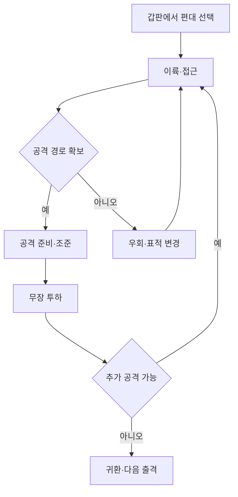

# 09. 항공모함·함재기·대공 시스템 역기획

> 대상: World of Warships PC 글로벌 / 조사일: 2026-11-13 / 기준 릴리스: 15.10.
> **[확인]**은 인용 자료에 명시된 동작, **[버전 의존]**은 함선·패치별 설정, **[분석]**은 역기획 해석, **[제안]**은 재현용 설계다. 실제 클라이언트 조작·서버 코드 확인 없이 작성했다.

## 1. 시스템의 목적과 경계

**[분석]** 항공모함은 함체의 위치와 항공대의 위치를 분리하여, 수상함이 접근하기 어려운 전장에 공격·정보·지원 능력을 투사한다. 항공모함 플레이의 비용은 탄약만이 아니라 왕복시간, 갑판의 출격 가능한 기체, 편대 손실, 모함의 노출 위험이다.

| 구분 | 입력 | 출력 | 연결 시스템 |
|---|---|---|---|
| 편대 운용 | 항공대 선택, 이동·공격·귀환 입력 | 비행 경로, 투하, 잔존 기체 | 기동·공격 판정 |
| 무장 | 투하 위치·방향·시점 | 탄두·어뢰·폭탄의 명중 결과 | 장갑·피해·화재·침수 |
| 대공 | 적 편대 진입, 강화 입력, 대공포 상태 | 항공기 피해, 격추, 공격력 감소 | 모듈·소모품 |
| 정보 | 항공 탐지 조건 | 팀 정보·미니맵 갱신 | 탐지 시스템 |
| 지원 | 아군 대상 지정, 자원·재사용 대기 | 방공·소화·회복 지원 | 아군 생존·전선 유지 |

항공기를 보유한 하이브리드 함선과 네덜란드식 공습도 관련되지만, 항모의 상시 출격 자원 모델과 동일시하지 않는다. 해당 함선별 출격 방식과 제한을 별도 데이터로 다룬다.

## 2. 2026년 기준으로 수정해야 하는 구설명

다음 표는 오래된 공략이나 위키 문단을 그대로 구현할 때 생길 오류를 막기 위한 것이다.

| 쟁점 | 문서에 적용한 상태 | 근거 |
|---|---|---|
| 전투기의 정찰 | 15.0부터 Fighters는 적 함선 탐지를 하지 않는다 | [C03] |
| 편대 수리 | 해당 Repair를 가진 편대는 15.2에 Evasive Maneuvers로 교체 | [C04] |
| 순찰 전투기 | 15.2부터 편대 위치를 기준으로 제한 거리 내 전술지도 지정 가능 | [C04] |
| 모함 DCP·전투기 | 15.2부터 자동/수동 선택 가능 | [C04] |
| 방향별 대공 우선구역 | 현재는 전방위 AA Defense Priority | [C05] |
| 집중 대공 | 충전형 Concentrated AA Fire를 우선대공과 함께 관리 | [C05] |
| 기존 DFAA | Auxiliary and Torpedo Weaponry Coordination으로 교체 | [C05] |
| 대공 폭발구름 제거 | 테스트 개념이었으며 라이브에서 제거된 것으로 보지 않는다 | [C07] |

**[버전 의존]** 2026년 공식 로드맵의 실적 설명으로 라이브 적용 여부를 교차확인했다. 로드맵의 향후 계획을 출시 완료로 처리하지 않는다. 최신 위키에도 과거 전투기 정찰·항모 자동조작 전용 설명이 남아 있어, 위 표와 충돌하는 문장은 채택하지 않았다. [C07]

## 3. 항공대의 종류와 공격 판정

**[확인]** 공격기에는 HE/AP 로켓, 폭격기에는 HE/AP 폭탄 등 탄두 차이가 있다. 뇌격기는 투하 후 무장되는 어뢰를 사용하며, 무장거리 전에 맞은 어뢰는 피해를 주지 않는다. 공습 항공기는 지정 지점에 지연 도착하는 별도 공격 방식이다. [C01]

| 무장 계열 | [분석] 선행 판단 | 실패가 발생하기 쉬운 조건 | 재현 시 필요한 입력 |
|---|---|---|---|
| HE 로켓 | 얇은 표적 부위와 회피 방향 | 발사 확정 이후 급선회 | 준비시간, 분산, HE 관통 |
| AP 로켓 | 측면 장갑·신관 조건 | 예각 접근, 지나치게 얇은 부위 | 도탄·신관·관통 파라미터 |
| HE 폭탄 | 투하 타원과 함체 길이의 겹침 | 작은 표적·경로 변경 | 투하 분포, 직접 피해·발화 |
| AP 폭탄 | 갑판·상부 장갑·시타델 경로 | 장갑층·신관 불일치 | 입사각, 다층 장갑, 신관 |
| 항공 어뢰 | 어뢰 무장 후 만나는 교차점 | 너무 가까운 투하·선회 | 투하 방향, 무장거리, 수면 이동 |
| 도약 폭탄 등 | 해당 무장의 특수 궤적 | 일반 급강하폭격과 같은 조준 | 개별 무장 프로파일 |

이 표의 유불리는 고정 상성표가 아니다. 예컨대 같은 폭탄 계열이라도 분산·투하 편대 수·장갑 관통값에 따라 유효 표적이 달라진다.

## 4. 출격부터 귀환까지의 상태 모델

**[확인]** 갑판에서 즉시 사용할 수 있는 기체는 제한되며, 손실 후 복구에는 시간이 든다. 따라서 장기적으로 기체가 보충된다는 설명을 “매번 최대 편대로 출격할 수 있다”로 해석하면 안 된다. [C02]



**[제안]** 위 상태도는 구현용 추상화다. 원작의 정확한 내부 FSM 명칭·프레임 순서를 의미하지 않는다.

| 상태 | [제안] 진입 조건 | 상태 중 제한 | 종료 조건 |
|---|---|---|---|
| DeckReady | 선택한 기종의 출격 가능 수 > 0 | 보유 기체 수 상한 적용 | 출격 확정 |
| Transit | 편대 생성 완료 | 무장 종류별 속도·선회 | 공격 준비 또는 귀환 |
| Aiming | 공격 가능한 기체·무장 존재 | 조준 수렴 및 기동 페널티 | 발사·시간 만료·취소 |
| Commit | 투하 입력 승인 | 이미 발사된 무장은 취소 불가 | 무장 분리 완료 |
| Egress | 공격 후 이탈 | 공격 완료 기체와 잔여 기체 분리 | 재공격 또는 귀환 |
| Return | 귀환 결정 | 조작·피격 규칙을 별도 설정 | 착함·손실 |

기체 손실은 “항공대 HP 하나 감소”만으로 끝내지 않는다. 공격 가능한 기체 수와 다음 출격 가능 수를 함께 바꾸므로 현재와 미래의 화력을 동시에 낮춘다.

## 5. 공격 템포의 역기획

**[분석]** 모함이 너무 멀면 생존은 쉬워지지만 접근시간이 늘어난다. 반대로 전진하면 출격 주기가 짧아지는 대신 측면 돌파·어뢰·장거리 포격에 노출된다. 이 거리 선택이 항모의 전략적 기동이다.

실험용 공격 처리량을 다음처럼 분해할 수 있다.

\[
R_{strike}=\frac{E[D_{direct}]+E[D_{DoT}]+V_{support}}{T_{approach}+T_{aim}+T_{reposition}+T_{next}}
\]

여기서 지원가치를 피해와 같은 단위로 합치는 것은 **[제안] 분석용 환산**이며, 게임의 경험치 산식이 아니다. 실제 통계에서는 직접 피해·정찰 피해·지원 행동을 분리하여 보존한다.

### 가정 예제

- 경로 A: 접근 45초, 공격·재진입 20초, 다음 편대 준비 영향 10초, 기대 유효 피해 9,000.
- 경로 B: 접근 30초, 공격·재진입 20초, 다음 편대 준비 영향 10초, 기대 유효 피해 7,800.
- 단순 처리량은 A가 초당 120, B가 초당 130이다.
- 그러나 B가 모함을 위험에 노출하면 지속 가능한 출격 횟수는 감소할 수 있다.
- 이 계산은 실제 함선 수치나 서버 항공기 복구식이 아니라, 안전성과 회전율을 비교하는 실험 설계다.

## 6. 대공은 공간 점유와 입력 타이밍의 결합

**[확인]** 대공에는 범위 내 지속 피해와 폭발구름에 들어간 기체에 가해지는 피해가 있다. AA Defense Priority는 방향과 무관하게 적용되며, Concentrated AA Fire는 충전과 공통 재사용 대기를 관리한다. 집중 대공은 지속 피해·폭발 피해 강화와 편대 대상의 순간 피해 요소를 가진다. [C05]

**[분석]** 따라서 대공 성능을 항구의 단일 숫자로 평가하면 다음 차이가 사라진다.

| 평가 축 | 의미 | 관찰해야 할 결과 |
|---|---|---|
| 외곽 진입 비용 | 표적에 도달하기 전에 지불하는 손실 | 첫 투하 전 격추 수 |
| 근접 체류 비용 | 재공격을 위해 머무르는 비용 | 두 번째 공격 성립률 |
| 회피 가능 피해 | 조작으로 줄일 수 있는 부분 | 폭발구름 피격 빈도 |
| 강화 타이밍 | 입력이 실제 교전과 겹치는가 | 활성 중 적 편대 체류시간 |
| 집단 방공 | 여러 아군의 방공 범위 조합 | 고립 표적 대비 공격 성공률 |
| 모듈 상태 | 대공포의 현재 가동 능력 | 가동 포 수·회복 시점 |

대공포 피해와 회복은 [모듈 문서](06_survivability_modules_and_dot.md)의 최신 상태 규칙을 따른다. 구버전의 “한번 손실한 대공포는 전투 끝까지 복구 불가”를 전제로 전투 후반 대공을 모델링하지 않는다.

### 집중 대공의 구현용 상태 분리

**[제안]** `charge`, `cooldown`, `active_mode`를 독립 필드로 둔다. 충전 완료와 재사용 가능은 같은 조건이 아니다.

| 입력 상황 | 제안 검증 순서 | 예상 피드백 |
|---|---|---|
| 기본 우선대공 입력 | 가동 대공포 → 쿨다운 → 모드 | 활성 또는 거절 사유 |
| 집중 대공 입력 | 위 조건 + 완충 조건 | 충전 부족/대기/활성 구분 |
| 교전 중 충전 | 교전 대상의 유효성 확인 | 게이지 증가 |
| 적 편대 이탈 | 교전 판정 종료 | 필요 시 감소 대기 |
| 대공포 전부 비가동 | 실제 효과 가능성 재검사 | 기능 없음 표시 |

정확한 충전율·지속시간·감소시간은 함선/패치별 파라미터로 두고, 이 문서의 상태모델에 상수로 박지 않는다.

## 7. 회피기동과 지원 소모품

**[확인]** Evasive Maneuvers는 손실한 HP를 소급 복구하는 기능이 아니다. 활성 시간에 들어오는 대공·전투기 피해를 줄이는 방식이며, 15.2 안내는 대다수 편대 70%, Hildebrand 60% 회피량을 명시했다. 이는 해당 릴리스값으로 보관하고 현재 함선 설정에서 재검증한다. [C04]

**[확인]** Firefighting Assistance는 선택 아군의 화재를 제거하고 잠시 발화를 막는다. Repair Assistance는 선택 아군의 HP를 시간에 걸쳐 회복한다. 대상 지정 거리·지원 도착시간이 있으며 동일 종류의 지원은 중첩되지 않는다. 도입된 함선 계통·편대가 제한되므로 모든 항모의 공통 능력으로 처리하지 않는다. [C06]

**[분석]** 지원기는 공격을 포기하고 완전히 수비로 전환하는 역할만이 아니다. 전선의 아군 한 척이 추가 일제사격을 하거나 점령을 유지하도록 시간을 사주는 역할이므로, 단순 회복량보다 “지원 후 생존시간·전선 이탈 여부”가 설계 평가에 가깝다.

### 선택 상황의 예

| 상황 | 가능한 결정 | 비용과 목적 |
|---|---|---|
| 아군이 다중 화재, 적 포격 지속 | 소화 지원 | DCP 보존과 다음 발화 지연 |
| 아군이 즉사 위험의 집중 사격 아래 | 회복만으로 충분한지 판단 | 지원 도착 전 침몰 가능성 |
| 전투기를 멀리 보낼 수 있음 | 이동 경로 앞에 방공 지정 | 도착시간 때문에 즉시 방어는 아님 |
| 공격대가 반복 공격을 준비 | 회피기동 사용 여부 | 현재 피해 회피와 다음 교전의 공백 교환 |

## 8. 정보 시스템과의 연결

전투기·정찰기·공격대·공습기를 모두 `Aircraft`라는 이유로 같은 탐지 제공자로 구현하면 안 된다. 탐지 가능 여부, 직접 렌더링, 미니맵 정보, 아군 공유를 각각 분리한다. 최신 공중 피탐 변화와 수상함 발포의 관계는 [08 문서](08_detection_vision_and_information.md)를 기준으로 한다.

**[제안]** 항공 개체에 `can_detect_ship`, `can_detect_aircraft`, `share_contact`, `is_player_controlled`를 별도 속성으로 둔다. 전투기 정찰 제거와 같은 변경이 공격 무장·방공 능력까지 바꾸지 않도록 한다.

## 9. 데이터 계약 제안

```yaml
# 원작 데이터 추출물이 아닌 프로토타입 스키마
CarrierAirGroup:
  ship_id: string
  aircraft_type_id: string
  deck_capacity: integer
  ready_count: integer
  restoration_seconds: number
  squadron_size: integer
  attack_flight_size: integer
  flight_model_id: string
  payload_profile_id: string
  detection_profile_id: string
  consumable_profile_ids: []
AAProfile:
  aura_bands: []
  flak_profile_id: string
  active_mount_fraction: number
  priority_profile_id: string
  concentrated_profile_id: string
  ruleset_version: string
```

각 공격 결과에는 `launch_id`, `squadron_id`, `attack_id`, `payload_id`, `damage_event_id`를 연결한다. 한 번의 투하가 여러 명중·모듈 피해·침수로 분리되어도 출격 단위 성과를 재구성할 수 있어야 한다.

## 10. QA 시나리오

아래는 **[제안] 검증 계획**이며 이번 조사에서 실행한 테스트가 아니다.

| ID | 조건·행동 | 확인할 불변조건 |
|---|---|---|
| CV-01 | 불완전 편대로 출격 | 갑판·공중 기체 수가 음수가 되지 않음 |
| CV-02 | 공격 직전 기체 격추 | 이미 파괴된 기체에서 무장 생성 금지 |
| CV-03 | 어뢰를 무장거리 안쪽에 투하 | 명중 연출과 피해 판정의 모순 없음 |
| CV-04 | 같은 표적을 연속 공격 | 대공 충전·쿨다운이 정의대로 누적 |
| CV-05 | 반대 방향에서 동시 편대 진입 | 전방위 우선대공이 옛 방향 제한을 사용하지 않음 |
| CV-06 | 전투기만 적 수상함 주변에 배치 | 전투기가 정찰 정보를 생성하지 않음 |
| CV-07 | 회피기동 사용 전후 같은 피해 | 과거 손실 회복과 피해 감소를 혼동하지 않음 |
| CV-08 | 지원 대상이 도착 전에 침몰 | 잘못된 회복·새 대상 자동 전이 없음 |
| CV-09 | 동일 지원을 동시에 2회 요청 | 중복 적용 정책이 일관됨 |
| CV-10 | 모함 수동/자동 DCP 전환 | 중복 사용·재사용 시간 초기화 없음 |
| CV-11 | 모함 침몰 후 잔존 항공대 | 해당 모드의 잔존 조작 종료 조건 준수 |
| CV-12 | 대공포 전체 비가동/회복 | 실제 효과와 HUD 가능 상태 일치 |

## 11. 설계적 결론과 재현 우선순위

**[분석]** 항모를 잘 재현하려면 “비행하는 무기”보다 반복 출격의 경제를 먼저 만든다. 1차 프로토타입은 한 종류 항공대·한 종류 무장·지속 대공으로 시작하고, 2차에서 기체 손실과 복구, 3차에서 폭발구름·지원·집중 대공을 추가한다.

전투 피해만 맞추고 대공 피드백을 생략하면 수상함은 방어가 작동하는지 판단하기 어렵다. UI가 생존 메커니즘의 일부라는 점을 [16 UI 문서](16_port_battle_ui_and_onboarding.md)와 함께 검토한다.

## 출처

모든 자료 열람일은 2026-11-13. 위키는 Wargaming 또는 승인된 기여자가 관리하는 공개 자료지만 페이지별 갱신 차이가 있다. 인용 범위는 해당 문서의 제한된 규칙 요약이며 표·스키마·QA·분석 예제는 직접 작성했다.

- **[C01]** [World of Warships Wiki — Aircraft](https://wiki.worldofwarships.com/Ship:Aircraft): 항공 무장 종류·항공 어뢰 무장거리. 전투기 정찰 관련 구문은 채택하지 않음.
- **[C02]** [World of Warships Wiki — Aircraft Carriers](https://wiki.worldofwarships.com/Ship:Aircraft_Carriers): 갑판 기체와 복구시간의 관계. 구 자동조작 전용 설명은 제외.
- **[C03]** [World of Warships Wiki — Update 15.0](https://wiki.worldofwarships.com/Ship:Update_15.0): Fighters의 정찰 제거와 공습 방어 변경.
- **[C04]** [World of Warships Wiki — Update 15.2](https://wiki.worldofwarships.com/Ship:Update_15.2): 원격 전투기·Evasive Maneuvers·수동 소모품, 2026년 3월 라이브 업데이트 요약.
- **[C05]** [World of Warships Wiki — Anti-Aircraft Fire](https://wiki.worldofwarships.com/Ship:Anti-Aircraft_Fire): 현행 우선대공·집중대공·DFAA 대체. 과거 방향별 배율 표는 확정값으로 사용하지 않음.
- **[C06]** [World of Warships Wiki — Consumables](https://wiki.worldofwarships.com/Ship:Consumables): 표적 지정 소화·회복 지원.
- **[C07]** [World of Warships — Roadmap 2026: Part 2](https://worldofwarships.com/en/news/general-news/roadmap-2026-part-2/): 2026년 변경 실적과 폭발구름 유지 확인. 향후 계획은 현행 규칙과 구분.
