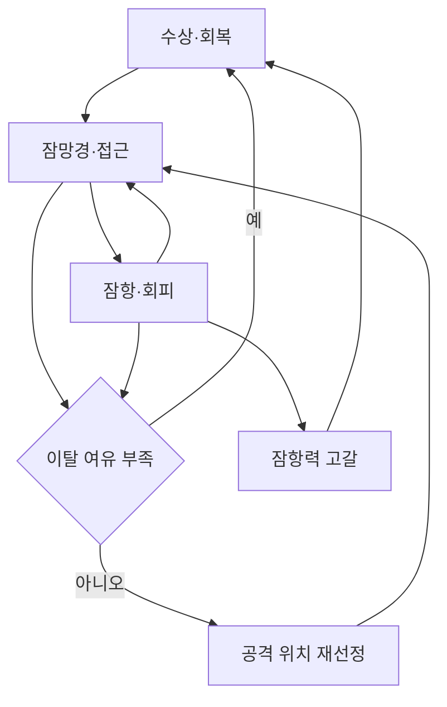

# 10. 잠수함·수중 전투·대잠 시스템 역기획

> 대상: World of Warships PC 글로벌 / 조사일: 2026-11-13 / 기준 릴리스: 15.10.
> 사실·패치별 설정은 **[확인]/[버전 의존]**, 설계 해석은 **[분석]**, 신규 재현 모델은 **[제안]**으로 구분한다. 실기 테스트 및 원작 내부 구현 검증은 수행하지 않았다.

## 1. 핵심 개념

**[분석]** 잠수함은 체력이 낮은 어뢰 플랫폼만으로 설명되지 않는다. 수심을 바꾸어 탐지·공격·점령 조건을 전환하고, 제한된 잠항 자원 안에서 노출 시간을 배분하는 함종이다. 상대에게는 보이지 않는 표적의 정확한 좌표보다 핑·기름 유출·마지막 탐지 위치를 조합하는 수색 문제가 주어진다.

| 하위 시스템 | 입력 | 출력 | 설계 질문 |
|---|---|---|---|
| 수심 제어 | 상승·하강·추진 | 깊이, 피탐 상태, 공격 가능성 | 지금 숨을 것인가, 시야를 확보할 것인가 |
| 잠항력 | 깊이·시간·소모품 | 잔여 자원, 부상 압력 | 돌아갈 경로가 남는가 |
| 음향 유도 | 핑·어뢰 발사·표적 기동 | 유도 상태, 최종 진입선 | 유도를 얻는 대신 단서를 노출할 것인가 |
| 대잠 탐색 | 정보·소모품·시각 단서 | 추정 위치 또는 탐지 | 확인할 것인가, 추정 위치에 공격할 것인가 |
| 대잠 공격 | 폭뢰·공습·포격 | 범위 피해·상태 변화 | 표적의 미래 위치를 얼마나 예측하는가 |

수면 전투의 정보 비대칭을 세 번째 공간 축으로 확장한 시스템이다. 다만 바닷물의 물리적 부력·압력·침수량 전체가 시뮬레이션된다는 근거는 없으므로 그런 구현을 원작 규칙으로 주장하지 않는다.

## 2. 수심별 기능 행렬

**[확인]** 공식 잠수함 가이드는 수상·잠망경·완전 잠항의 세 상태를 구분한다. 수상에서 잠항력을 회복하고 거점을 점령하며, 잠망경 상태에서는 상대의 항공 피탐거리를 기준으로 수상함을 발견한다. 잠긴 상태는 점령이 불가능하다. 레이더는 수상 상태에만 유효하고, 깊이 잠긴 잠수함에 대한 일반 음향 탐지는 제한된다. [C08]

| 상태 | [확인] 핵심 효용 | [분석] 대가 | 재현에 필요한 별도 값 |
|---|---|---|---|
| 수상 | 자원 회복·점령·수상 시야 | 포격·탐지에 취약 | 수상 피탐, 회복률, 점령 허용 |
| 잠망경 | 낮은 노출로 공격 위치 확보 | 자원 소모·시야 축소 | 항공 피탐 기반 관측, 잠망경 깊이 |
| 완전 잠항 | 직접 수상 탐지를 피하며 이동 | 자체 정보 감소·자원 압박 | 수중 탐지 프로파일, 렌더 범위 |
| 상승·하강 중 | 상태 간 이동 | 전환 지연 중 취약 구간 | 깊이 경계, 수직 이동 응답 |

**[버전 의존]** 위 행렬은 개념 모델이다. 속도·시야·특수 탐지 예외·최대 수심·전환속도는 함선과 규칙 세트에 따라 확인한다. 공식 초기 가이드의 특정 국가 두 계통 설명을 2026년 모든 잠수함에 확대하지 않는다.

**[확인]** 기본 키 안내는 `C` 하강, `F` 상승, `G` 우선 유도 표적 해제다. 키는 사용자 설정에 따라 달라진다. [C12]

## 3. 잠항력의 자원 모델

**[확인]** 잠항력은 수면 아래에서 줄어들며, 모두 소모하면 자동 부상한다. [C08]

**[분석]** 이 자원은 공격 횟수보다 “안전하게 노출을 피할 수 있는 시간”을 제한한다. 남은 잠항 시간이 충분해도 적과 가까운 곳에서 자원이 소진되면 부상 직후 생존이 어려우므로, 실효 잔여량에는 귀환 시간이 포함되어야 한다.

\[
T_{usable}=T_{remaining}-T_{exit}-T_{reserve}
\]

위 식은 **[제안] 의사결정 보조 지표**다. 원작 HUD의 공식 산식이 아니다.

### 가정 예제

- 현재 자원으로 유지 가능한 잠항시간을 120초로 가정한다.
- 안전한 수역까지 이동 55초, 상승·오차 대비 여유 20초가 필요하다.
- 공격에 실제로 배분할 수 있는 시간은 45초다.
- 적이 항로를 막아 이탈시간이 90초가 되면 공격 여유는 10초로 급감한다.
- 같은 잔여 자원이라도 지형과 적 위치에 따라 공격 가능성이 달라진다는 설명용 예다.

### 상태 전이 제안



자원 고갈 직전에 잠항 명령을 반복해 부상 규칙을 우회하는 상태 진동이 발생하지 않도록, 재잠항 허용량과 강제 부상 상태를 분리하는 것을 권한다.

## 4. 음향 핑과 유도 어뢰

**[확인]** 음향 어뢰는 핑을 적중시킨 구역을 향해 유도되며, 동일 구역의 두 번째 핑은 강화 표식으로 전환한다. 이때 표식 유지시간·유도 효과·유도 종료거리의 변화는 잠수함·어뢰·표적 프로파일별로 확인한다. 유도는 충돌 직전까지 무한히 계속되지 않고 정해진 거리에서 끝난다. 일반 어뢰와 음향 어뢰의 보유 여부도 잠수함마다 다르다. [C09]

**[분석]** 핑은 조준 보조이면서 정보 거래다. 유도 정밀도를 얻는 순간 상대는 공격 방향과 잠수함 존재에 관한 단서를 얻는다. 무유도 발사는 예측 난도를 높이는 대신 핑 단서 노출을 줄이는 선택이 될 수 있다.

| 단계 | 입력·조건 | 결과 | 중요한 예외 |
|---|---|---|---|
| 핑 발사 | 소나 준비, 방향 선택 | 이동하는 핑 신호 | 지형·표적 이동을 고려 |
| 첫 적중 | 유효 표적 구역 적중 | 유도 표식 생성 | 방어 소모품의 억제 상태 |
| 후속 핑 | 같은 표식 구역 적중 | 강화 표식 | 다른 구역 적중과 구분 |
| 어뢰 접근 | 표식·유효 어뢰 | 경로 수정 | 회전 한계와 잔여 주행시간 |
| 유도 종료 | 종료거리 진입·표식 제거 등 | 이후 직선 진행 | 어뢰가 사라지는 것이 아님 |

이 표는 공개 규칙을 묶은 **[제안] 논리 단계**이며, 원작이 매 프레임 같은 순서로 처리한다는 뜻은 아니다.

### 수상함의 대응

**[확인]** DCP는 핑 표식을 제거하며 활성 중 새 표식을 막는다. 이미 날아오는 어뢰는 소멸하지 않으므로, 표식 제거 후에도 변침·변속이 필요하다. [C08]

**[분석]** 너무 이른 DCP는 어뢰 도착 전에 방어 시간이 끝나 재유도를 허용할 수 있다. 너무 늦은 사용은 유도를 없애더라도 어뢰의 현재 진행선과 함체가 이미 겹칠 수 있다. 따라서 좋은 사용 시점은 핑 표시 순간만으로 결정되지 않는다.

## 5. 근거리 어뢰 피해 제한과 모드 예외

**[확인]** 일반 전투용 잠수함 어뢰는 처음 2.9km 주행 구간에서 최대 피해의 10%만 가하고, 2.9~3.0km에서 100%까지 증가한다. 기준은 **어뢰의 주행거리**다. 단순히 발사한 잠수함과 현재 표적의 거리로 계산하는 규칙이 아니다. [C09]

**[버전 의존]** 14.8에 잠수함이 작전에 들어오면서 작전의 다수 잠수함에서는 이 근거리 피해 제한이 제거되었다. 이를 PvP에서도 삭제되었다는 뜻으로 적용하면 안 된다. 작전용 기동·지원 장비도 일반 전투 설정과 분리한다. [C11]

| 예시 조건 | 계산 | 해석 |
|---|---|---|
| 가정 최대 피해 14,000, 주행 2.8km | 14,000 × 0.1 = 1,400 | 다른 방호·피해 보정 전 거리 단계 |
| 같은 어뢰, 주행 3.2km | 14,000 × 1.0 = 14,000 | 다른 보정 전 정상 단계 |
| 주행 2.95km | 실제 보간 곡선 확인 필요 | 이 문서에서 선형 55%로 확정하지 않음 |
| 근거리 제한이 없는 작전 프로파일 | 별도 규칙 적용 | PvP 표를 재사용하지 않음 |

**[분석]** 이 제한은 “잠수함의 어뢰가 가까울수록 피하기 어렵다”는 이점에 피해 대가를 붙인다. 반대로 대잠함은 근접해도 즉사 위험이 전혀 없다고 판단해서는 안 된다. 피해 누적·다른 적의 사격·모드 예외가 남는다.

## 6. 탐지 정보와 단서의 구분

**[확인]** Hydrophone은 수상·잠망경 표적의 위치 단서를 제공하지만 일반적인 탐지 상태를 부여하지 않는다. Submarine Surveillance는 해당 깊이의 잠수함을 실제 탐지하며 아군에게 공유한다. 제공 장비·범위·준비시간은 함선별이다. [C06]

**[제안]** 수중 표적 정보는 다음처럼 분리한다.

| 정보 유형 | 정밀도 | UI 사용 | 서버·클라이언트 계약 |
|---|---|---|---|
| 현재 탐지 | 현재 위치의 유효한 접촉 | 표적 지정·표시 | 탐지 만료까지 추적 허용 |
| 마지막 탐지 | 과거 좌표 | 미니맵 유령 표식 | 시각에 따른 노후화 |
| 핑 흔적 | 공격 방향·추정 구역 | 수색·공습 조준 | 함체 좌표와 동일시하지 않음 |
| 기름 유출 | 잠수함 행동의 표면 흔적 | 이동 경로 추정 | 흔적 생성시간 보존 |
| Hydrophone 실루엣 | 일시적인 위치 단서 | 사격 전 추정 | 일반 탐지 이벤트와 별도 |

탐지되지 않은 함체의 정확한 현재 위치를 단서 UI가 내부적으로 계속 따라가면, 원래 존재해야 하는 불확실성이 사라진다. 자세한 권한 분리는 [08 탐지 문서](08_detection_vision_and_information.md)와 [19 구현 문서](19_implementation_architecture_and_qa.md)를 함께 따른다.

## 7. 대잠 무장

**[확인]** 주요 대잠 수단은 함상 폭뢰와 폭뢰 공습이다. 폭뢰는 직접 충돌뿐 아니라 주변 범위 피해를 사용한다. 폭뢰 공습은 지정 지역에 지연 도달하며, 항모의 대잠 공습은 자동 방어 형태가 존재한다. 수면·잠망경의 표적에는 일반 무장도 활용 가능하지만 모든 수심에서 동일하게 맞는 것은 아니다. [C10]

| 수단 | [분석] 사용 비용 | 강점 | 실패 요인 |
|---|---|---|---|
| 함상 폭뢰 | 함체를 표적 가까이 이동 | 여러 투하 지점으로 수색 구역 압박 | 적 수상함의 교차 사격 |
| 폭뢰 공습 | 탄착까지 시간·횟수 사용 | 거리를 유지한 공격 | 오래된 좌표·잘못된 진행 방향 |
| 포탄·항공 무장 | 해당 무장의 기회비용 | 노출된 잠수함에 즉시 압박 | 수심·효과 반경 불일치 |
| 음향 어뢰 | 핑 노출·어뢰 자원 | 잠수함 간 교전 | 유도 종료·회피·지형 |

**[분석]** 폭뢰 공습의 핵심은 정확한 현재 좌표를 클릭하는 것보다, 지연 후 표적이 있을 영역에 공격 면적을 배치하는 것이다. 수직 깊이와 수평 오차를 함께 가진 범위 무장으로 모델링해야 한다.

### 재현용 범위 피해 모델

\[
D=D_{base}\cdot f(\lVert p_{explosion}-p_{target}\rVert)\cdot M_{target}
\]

**[제안]** `f`는 무장별 거리 구간표다. 일반적인 폭발을 구현하기 위한 예시로, 원작 폭뢰의 모든 반경·감쇠·모듈 판정을 재현한 공식이 아니다. HP 피해 영역과 모듈 이상을 일으키는 영역이 다를 수 있으므로 별도 곡선이 필요하다.

### 수색 오차 예제

- 8초 전 얻은 위치 단서가 있다.
- 내부 시뮬레이션 좌표에서 잠수함의 가능한 수평 속력을 초당 20m로 가정한다.
- 그동안 이동 가능한 거리는 최대 160m다.
- 여기에 공습 도착 지연을 더하면 단일 점이 아니라 후보 영역을 공격해야 한다.
- 예제 속력은 실제 함선 노트 값을 변환한 것이 아니다. 화면상 거리·시간 압축과 SI 단위를 섞지 않기 위한 가정이다.

## 8. 비대칭 상호작용의 설계 분석

| 잠수함의 결정 | 수상함의 결정 | 재미를 만드는 긴장 |
|---|---|---|
| 핑으로 유도 강화 | DCP를 지금 사용할지 보존 | 양측 쿨다운 추정 |
| 깊게 잠항 | 탐지 도구·폭뢰를 언제 쓸지 | 시야와 방어의 교환 |
| 무유도 어뢰 사용 | 직선 항로 유지 여부 | 숨겨진 공격 의도 |
| 잠항력을 공격에 소비 | 도주 경로 차단 | 장기 자원 대 단기 압박 |
| 기름 유출을 처리 | 단서를 따라갈지 후퇴 | 정보 노출과 생존 자원 |

**[분석]** 대잠 플레이가 일방적으로 느껴지는지 보려면 피해량뿐 아니라 “상대 위치에 대한 정보가 생긴 시간”과 “그 정보를 공격으로 전환할 수 있었던 시간”의 겹침을 측정해야 한다.

## 9. 데이터·상태 설계 제안

```yaml
# 공개 규칙을 재현하기 위한 제안 스키마
SubmarineRuntime:
  depth_m: number
  requested_depth_state: enum
  dive_capacity: number
  forced_surface: boolean
  sonar_reload_remaining: number
  oil_trace_state: object
SubmarineRules:
  depth_profiles: []
  capacity_drain_profile: string
  surface_recharge_profile: string
  ping_effect_profile: string
  homing_stop_profile: string
  torpedo_distance_damage_curve: string
  weapon_depth_permissions: []
  mode_overrides: []
  ruleset_version: string
```

어뢰에는 `distance_travelled`를 누적 보관한다. 핑에는 `target_id`, `sector_id`, `hit_level`, `expires_at`을 두고, 단서 이벤트에는 실제 탐지와 다른 `knowledge_type`을 둔다.

## 10. QA 체크리스트

| ID | 조건 | 검증할 결과 |
|---|---|---|
| SS-01 | 잠항력 0 직전 반복 하강 | 강제 부상 우회 없음 |
| SS-02 | 잠망경에서 점령지 진입 | 해당 깊이의 점령 제한 준수 |
| SS-03 | 레이더 중 수심 경계 통과 | 깊이별 탐지 갱신 일관 |
| SS-04 | Hydrophone만 위치 제공 | 일반 탐지·표적 잠금으로 오인되지 않음 |
| SS-05 | DCP로 핑 제거 | 어뢰는 남고 유도만 규칙대로 종료 |
| SS-06 | 다른 구역에 두 번째 핑 | 동일 구역 강화와 구별 |
| SS-07 | 유도 종료거리 경계 통과 | 표적 선회에 무한 추종하지 않음 |
| SS-08 | 2.899·2.900·2.999·3.000km 주행 | 경계의 피해 곡선·단위 일치 |
| SS-09 | 발사 후 잠수함이 반대로 이동 | 피해 보정이 발사함 현재 거리와 무관 |
| SS-10 | 같은 함선으로 PvP/작전 진입 | 모드별 근거리 제한·기동값 분리 |
| SS-11 | 공습 도착 전 표적 수심 변경 | 실제 폭발 위치와 범위 판정 일치 |
| SS-12 | 함체가 미탐지인데 흔적만 존재 | 흔적이 실시간 추적기로 바뀌지 않음 |
| SS-13 | 깊은 수심에서 일반 무장 발사 | 무장별 수심 허용표 준수 |
| SS-14 | 항모 자동 대잠과 수동 입력 병행 | 중복 탄약 소비·중복 공격 없음 |

위 표는 **[제안] 테스트 명세**다. 원작 클라이언트에서 경계값을 실측했다는 뜻은 아니다.

## 11. 최소 재현 범위

**[분석]** 첫 프로토타입에서는 수심 세 상태, 잠항력, 일반 어뢰, 함상 폭뢰부터 검증하는 편이 상호작용을 설명하기 쉽다. 그 다음 핑·유도 해제·정보 단서를 추가하고, 마지막에 국가별 소모품·공습·작전 예외를 확장한다.

유도 어뢰만 먼저 넣으면 수상함에 필요한 탐지·대응 수단이 빠져 밸런스 평가가 왜곡된다. 반대로 대잠 공격만 강하게 만들면 잠수함의 노출 비용을 조정할 여지가 줄어든다.

관련: [07 어뢰](07_torpedoes_and_area_denial.md), [08 탐지](08_detection_vision_and_information.md), [11 소모품](11_consumables_and_tactical_cycles.md), [12 모드](12_maps_modes_and_objectives.md).

## 출처

열람일: 2026-11-13. 오래된 공식 가이드는 원리 설명에 한정했고 현재 수치 전수표로 사용하지 않았다.

- **[C08]** [World of Warships — Submarine Guide](https://worldofwarships.com/en/news/game-guides/submarine-guide/): 초기 도입기의 공식 안내. 수심·잠항력·DCP와 유도의 기본 관계만 채택.
- **[C09]** [World of Warships Wiki — Torpedoes](https://wiki.worldofwarships.com/Ship:Torpedoes): 유도 종료·2.9~3km 피해 규칙. 함선별 수치 및 일부 표의 일반화는 피함.
- **[C10]** [World of Warships Wiki — Anti-Submarine Warfare](https://wiki.worldofwarships.com/Ship:Anti-Submarine_Warfare_(ASW)): 대잠 수단·범위 판정·자동 항모 대잠.
- **[C11]** [World of Warships Wiki — Update 14.8](https://wiki.worldofwarships.com/Ship:Update_14.8): 2025년 작전의 잠수함 도입 및 모드별 예외.
- **[C12]** [World of Warships Wiki — Controls](https://wiki.worldofwarships.com/Ship:Controls): 잠수함 기본 입력.
- **[C06]** [World of Warships Wiki — Consumables](https://wiki.worldofwarships.com/Ship:Consumables): Hydrophone과 Submarine Surveillance의 차이.
