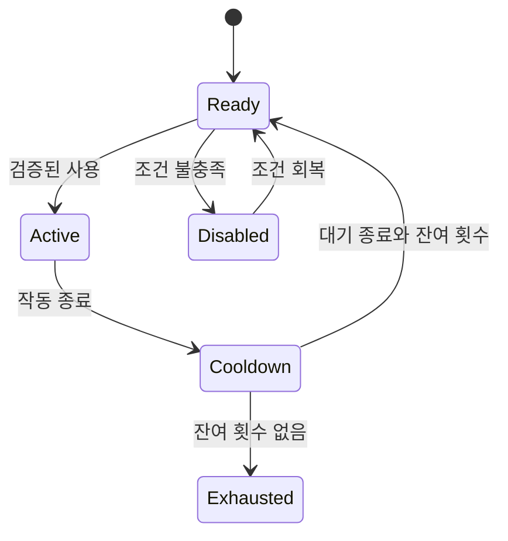

# 11. 소모품·전술 능력·재사용 주기 시스템

> 대상: World of Warships PC 글로벌판. 조사 기준: 2026-11-13 / 라이브 15.10 계열.
> [확인] 공개 규칙, [버전 의존] 함선·패치별 수치, [분석] 해석, [제안] 구현 명세.
> 여기서 소모품은 전투 중 사용하는 능력을 가리킨다. 모든 능력이 유료 재구매 품목이거나 같은 충전 방식을 쓰는 것은 아니다.

## 1. 시스템 목적

[분석] 기본 무장은 반복 가능한 행동을 제공하고, 소모품은 그 반복의 효율이나 조건을 잠시 바꾼다.
레이더가 켜진 동안의 점령 접근, 재장전 가속이 남아 있는 적의 측면 노출, 복구반 사용 직후의 지속 피해 등은 서로 다른 시간 창을 만든다.
따라서 소모품 밸런스는 효과량뿐 아니라 언제 적용할 수 있는지와 다음 기회까지 얼마나 기다려야 하는지로 결정된다.

| 구성 요소 | 기획 질문 |
|---|---|
| 사용 조건 | 언제 누를 수 있고 언제 거부되는가? |
| 효과 대상 | 자기 함선·주변 지역·지정 아군 중 누구인가? |
| 효과량 | 어떤 능력치를 어떻게 바꾸는가? |
| 작동 시간 | 효과가 얼마나 유지되는가? |
| 재사용 대기 | 다음 사용까지 얼마나 걸리는가? |
| 자원 형태 | 횟수·시간 풀·축적 게이지 중 무엇을 소비하는가? |
| 장착 제약 | 어떤 대체 능력과 같은 슬롯을 공유하는가? |
| 정보 제공 | 자신·아군·적이 어느 상태까지 알 수 있는가? |

[확인] 강화 소모품을 크레딧으로 매번 구매하던 구분은 0.9.4에서 무료 강화 소모품으로 통합되었다.[B29]
구버전 경제 구조를 현재의 소모품 소진 규칙으로 기술하면 안 된다.

## 2. 능력 분류와 선택 의미

아래 효과의 수치·보유 여부는 함선별로 다르다. 표의 전술적 의미는 [분석]이다.

| 계열 | 공개 기능의 요약 | 전술적으로 바꾸는 것 | 연결·근거 |
|---|---|---|---|
| Damage Control Party | 상태 이상·일반 모듈 손상 처리 | 즉시 생존과 다음 위협 대비 | [06 생존](06_survivability_modules_and_dot.md), B11 |
| Repair Party | 회복 적격 HP를 시간에 걸쳐 회복 | 재교전 가능한 여유 | 06 문서, B05 |
| Smoke Generator 계열 | 시야 차단 영역 생성 | 노출 시간·팀 관측 의존성 | [08 탐지](08_detection_vision_and_information.md), B16 |
| Surveillance Radar | 범위 내 함선 강제 탐지 | 짧은 집중사격 창 | 08 문서, B24 |
| Hydroacoustic Search | 함선·어뢰 탐지 | 근접 정보·회피 시간 | 08 문서, B21 |
| Engine Boost | 기관 출력·속력 강화 | 이동·이탈·거리 선택 | [03 기동](03_navigation_and_maneuvering.md), B25 |
| Main Battery Reload Booster | 한정 시간 장전 효율 강화 | 적의 실수에 대한 순간 처벌 | B26 |
| Torpedo Reload Booster | 어뢰 장전 시간을 크게 단축 | 연속 어뢰파와 항로 압박 | [07 어뢰](07_torpedoes_and_area_denial.md), B27 |
| Spotting Aircraft 계열 | 주포 사거리·조준 시점 등 지원 | 먼 표적·장애물 뒤 조준 기회 | B28 |
| 항공·대공 관련 능력 | 현행 대공·편대·지원 기능 | 공습과 아군 지원 | [09 항공과 대공](09_carriers_aircraft_and_aa.md) |
| 잠수함 전용 능력 | 수중 정보·잠항 운용 등 | 수심과 정보의 교환 | [10 잠수함](10_submarines_and_asw.md) |

[확인] 2026 대공 개편에서 기존 Defensive AA Fire는 Auxiliary and Torpedo Weaponry Coordination으로 교체되었다.[B18]
[분석] AA Defense Priority나 Concentrated AA Fire까지 과거의 대공 소모품 한 종류로 합치면 입력 방식·게이지·재사용 정책이 잘못된다.
세부 현행 규칙은 09 문서에서 분리한다.

## 3. 슬롯 선택은 전투 전 역할 선택

[확인] 현재 Buffalo 자료에서는 음파 탐지와 Auxiliary and Torpedo Weaponry Coordination이 같은 슬롯의 선택지다.
다른 슬롯에는 레이더·전투기·관측기가 대안으로 제시된다.[B12]

[분석] 이는 단순 성능 증가가 아닌 역할의 교환이다.
음파 탐지를 고르면 어뢰 접근에 대응하기 쉬워지는 대신, 다른 능력이 제공하는 교전 이득을 포기한다.
이 선택은 팀 조합·맵·분대 전술에 따라 가치가 달라진다.

| [제안] 장착 검증 | 목적 |
|---|---|
| 같은 슬롯에는 한 능력만 선택 | 대체 관계 유지 |
| 함선·선체 모듈별 허용 능력 검증 | 보유하지 않은 능력 장착 방지 |
| 변경 후 키 배치 재확인 | 습관적 오입력 완화 |
| 선택 능력의 조건을 전투 진입 전에 표시 | 항공 위협·점령 임무와의 적합성 판단 |
| 모드 제한을 별도 적용 | 특수 이벤트 능력의 일반 전투 유출 방지 |

[제안] 능력의 기본 슬롯 번호와 사용자 키 바인딩을 서로 다른 식별자로 저장한다.
새 슬롯이 추가되거나 대체 능력이 바뀌어도 사용자의 의도와 전투 입력이 불필요하게 뒤섞이지 않게 한다.

## 4. 시간 모델: 작동 시간·대기시간·잔존 효과

### 4.1 횟수형 능력

[확인] 일반 소모품은 작동 시간·재사용 대기·횟수를 가지며, 예외적으로 무제한 횟수인 것도 있다.
소모품 보정은 함장 스킬·신호기·강화장치의 영향을 받을 수 있다.[B11]

[제안] 표준 횟수형은 다음 상태를 가진다.



[제안] 실제 능력에 따라 최초 준비시간·중도 종료·무한 횟수 예외를 추가한다.
“마지막 한 번 사용 후 작동이 끝나면 Exhausted가 되는가” 같은 UI 전이는 효과 지속과 별개로 정의한다.
소모품 활성화 요청 재전송은 같은 사용 한 번으로 정산한다.

### 4.2 생성기와 생성물의 수명 분리

[확인] 연막 생성기의 작동 종료와 이미 만들어진 연막 구체의 소멸은 같은 시점이 아니다.[B16]
[분석] 생성기를 켠 시간이 짧아도 남은 연막이 전선을 계속 바꿀 수 있으므로 단순 버프 모델로 충분하지 않다.

| 시간 | [제안] 변수 |
|---|---|
| 생성기 활성 구간 | `generator_active_until` |
| 다음 연막 생성 시각 | `next_emit_at` |
| 각 연막 구체 만료 | `puff.expires_at` |
| 생성기 다음 사용 가능 | `generator_ready_at` |

[제안] 항공기 소환과 지역 효과도 이처럼 “능력의 상태”와 “생성된 객체의 상태”를 분리해 검토한다.

### 4.3 시간 풀 방식

[확인] Sibir는 사용 시간을 풀로 보유하는 수리반 사례다.[B19]
[분석] 횟수형과 달리 사용을 짧게 나누면 낭비를 줄일 수 있지만, 잔여 시간을 읽고 종료를 결정하는 부담이 생긴다.

[제안] 공통 능력 데이터는 `resource_mode = charges | time_pool | buildup`를 지원한다.
모든 능력을 억지로 “3회 사용”으로 환산하면 켜기·끄기·부분 소비·축적 게이지의 의미를 잃는다.
각 자원 형태의 전환 규칙과 UI 표시는 별도 정책으로 둔다.

## 5. 재장전 가속의 세부 분석

### 5.1 주포 재장전 가속

[확인] Main Battery Reload Booster는 작동 중인 시간에 장전 보너스를 적용한다.
장전 도중 시작하거나 끝나면 남은 장전 시간이 그 효과에 맞게 변한다.
함선별로 감소율·지속시간·횟수가 다르다.[B26]

[분석] “장전시간 50% 감소”는 작동 중 장전 처리량이 두 배가 된다는 뜻이다.
그러나 한 번 켰을 때 실제 추가 발사 횟수는 시작 시점·남은 장전·표적 노출 시간에 따라 달라진다.
능력 사용 횟수보다 적의 취약 시간에 얼마나 많은 유효 발사를 넣었는지가 중요하다.

[가정 예제] 기본 장전 12초, 가속 50%, 가속 지속 15초인 테스트 무장을 둔다.
0초에 발사 직후 가속을 켜면, 6초·12초에 추가 발사가 가능하다.
15초에 가속이 끝날 때는 다음 장전이 절반 진행된 상태이며, 남은 일반 장전은 6초다.
따라서 다음 발사는 21초다.
이 예제는 명령 입력 지연과 포탑 정렬을 생략했으며 특정 함선의 전투 결과를 보장하지 않는다.

### 5.2 어뢰 재장전 가속

[확인] 공개 표에는 어뢰 가속 후 장전시간이 5초·8초·30초 등 서로 다른 값으로 제시된다.[B27]
[분석] 주포 가속의 비율 버프와 어뢰 가속의 짧은 재장전 완료시간을 같은 구현으로 단정할 수 없다.

[제안] 두 정책을 구분한다.

- 지속 장전 속도 배율: 작동 중 정규화된 장전 진행률의 증가율을 변경한다.
- 장전 완료시간 재설정: 허용된 발사관의 남은 장전을 설정된 짧은 시간으로 조정한다.

어떤 정책을 채택하는지는 실제 능력의 명세로 결정한다.
14.8 이후 모듈 손상으로 장전이 멈추는 상태와 가속 효과의 잔여 시간도 함께 테스트해야 한다.

## 6. 기동·관측 능력의 전술 가치

[확인] Engine Boost의 속력 보너스와 작동 시간은 함선별로 다르다.
공개 표에는 8%·15%·20% 등 여러 프로필이 존재한다.[B25]
[분석] 속력 보너스를 전투 피해 증가율로 곧바로 치환하면 가치를 놓친다.
먼저 점령 지역에 도착하거나, 상대의 탄이 날아오는 동안 예상 이동 위치를 바꾸거나, 다음 교전까지의 공백을 줄이는 효과가 있다.

[확인] 관측기에는 일반형 외에 빠른 재사용형과 고정밀형이 있으며, 고정밀형은 사거리와 분산을 함께 바꾸는 사례다.[B28]
[분석] 사거리만 늘면 항상 이득인 것은 아니다.
목표의 회피 가능 시간이 길어지고, 발포 노출 범위와 교전 참여 방향을 함께 판단해야 한다.

| 능력 유형 | [제안] 단일 수치 외에 측정할 지표 |
|---|---|
| 기동 강화 | 목표 도달 시간·생존 이탈률·추격 종료 거리 |
| 사거리 지원 | 실제 사격 가능한 표적 수·장거리 유효 명중률 |
| 분산 개선 | 탄약 종류별 유효 피해 증가·표적 자세별 보상 |
| 빠른 재사용 | 교전 창 중 가용 상태 비율·낭비된 작동 시간 |
| 연막 변형 | 전진·정지·후퇴 상황별 은폐 유지율 |

## 7. 소모품 연계와 대응

다음 표는 공개 효과를 바탕으로 한 [분석]이며 최적 공략을 보장하는 고정 순서가 아니다.

| 상황 | 연계 의도 | 실패하기 쉬운 조건 |
|---|---|---|
| 레이더와 재장전 가속 | 짧은 노출 창에 화력 집중 | 아군 포·자기 포가 준비되지 않음 |
| 연막과 외부 정찰 | 노출을 낮추며 사격 유지 | 유일한 정찰 함선이 연막 안으로 들어옴 |
| 음파 탐지와 근접 진입 | 어뢰 대응 시간을 확보 | 탐지 거리를 과신하여 선회 공간을 잃음 |
| DCP 이후 이탈 | 재적용 위험 구간을 숨음 | 이탈 시 측면을 과도하게 노출 |
| 수리반 이후 재진입 | 회복 자원을 전투 참여로 전환 | 회복 중 폭발 피해를 감당하지 못함 |
| 어뢰 가속과 두 파형 | 첫 회피 뒤의 진로 압박 | 모든 어뢰를 같은 예측선으로 중복 발사 |
| 항공 지원과 아군 생존 | 지역 전투력을 유지 | 지원 조건·거리·대상 선택 실패 |

### 가용성은 숨은 팀 자원이다

[분석] 두 레이더 함선이 동시에 켜면 정보가 중복될 수 있다.
반대로 위협이 급박하면 동시에 켜더라도 서로 다른 지역을 덮는 편이 유리하다.
“항상 교대로 사용”이 아니라 목표 지역·예상 이탈 경로·아군 사격 준비를 기준으로 연계를 결정해야 한다.

[제안] 팀 UI에는 아군이 명시적으로 공유한 준비·사용 정보를 지원하되, 적의 정확한 재사용 대기를 자동으로 공개하지 않는다.
적 능력 사용 추정은 관찰과 기억의 영역으로 남길 수 있다.

## 8. 제안 데이터 명세

```yaml
AbilityDefinition:
  id: example_radar
  allowed_ship_profiles: list
  slot_group: tactical_sensor
  resource_mode: charges
  maximum_charges: data_defined
  initial_preparation_s: data_defined
  action_duration_s: data_defined
  cooldown_s: data_defined
  activation_checks: list
  target_policy: self_area
  cancellation_policy: data_defined
  effects: list
  modifier_tags: [sensor, duration, charges]
  ruleset_version: pc_global_reference

AbilityRuntime:
  owner_id: ship_id
  state: ready_or_active_or_cooldown_or_exhausted
  resource_remaining: scalar
  activated_at: server_time
  active_until: server_time
  ready_at: server_time
  request_sequence: monotonic_id
  spawned_effect_ids: list
```

| 검증 규칙 | 이유 |
|---|---|
| 음수 재사용 대기와 음수 자원 차단 | 다중 보정·데이터 오류 대응 |
| 효과 대상과 시전자를 별도 저장 | 아군 지원 능력 확장 |
| 종료 이유를 기록 | 자연 종료·사용자 종료·격침을 구분 |
| 시간값은 서버 기준으로 정산 | 클라이언트 프레임과 무관한 가용성 |
| 능력 이름보다 식별자로 연결 | 번역·개편·대체 능력 지원 |
| 현재 능력과 과거 능력을 별도 버전으로 보존 | 리플레이·패치 회귀 분석 |

## 9. QA 시나리오와 계측

| ID | [제안] 입력 | 검증 내용 |
|---|---|---|
| CON-01 | 준비·활성·대기·소진 상태에서 연속 입력 | 유효 사용 한 번만 차감 |
| CON-02 | 활성화 응답이 늦어 요청 재전송 | 자원 중복 소모 없음 |
| CON-03 | 장전 도중 가속 시작·종료 | 진행률·완료시간 일관성 |
| CON-04 | 가속 중 포탑 손상 | 장전 일시 정지와 버프 시간 처리 |
| CON-05 | 연막 생성기 종료 | 기존 구체는 각 만료시간까지 유지 |
| CON-06 | 시간 풀 능력 반복 켜기·끄기 | 소모량·재사용 정책 일치 |
| CON-07 | 슬롯 대체 후 기존 키 입력 | 선택된 실제 능력만 발동 |
| CON-08 | 함장·강화장치 변경 | 최종 작동시간·횟수 재계산 |
| CON-09 | 마지막 충전 사용 중 격침 | 효과 종료 정책과 자원 정산 |
| CON-10 | 항공 지원의 대상이 먼저 격침 | 잘못된 아군·적에게 효과 전이 없음 |
| CON-11 | 옛 DFAA 설정을 현행 함선에 로드 | 데이터 마이그레이션 검증 |
| CON-12 | 특수 이벤트 능력을 일반 모드에 장착 | 모드 허용 목록에서 차단 |

[제안] 계측에는 능력 보유 대비 사용률, 활성 시간 중 실제 효과가 발생한 비율, 남긴 자원, 재사용 가능 후 사용까지의 지연을 포함한다.
승률이 높은 숙련자만 능력을 사용하는 선택 편향을 분리해야 한다.
새 능력의 사용률이 낮을 때는 효과 수치를 올리기 전에 버튼·충전 상태·대상 선택의 가독성을 확인한다.

## 10. 관련 문서와 출처

- 빌드와 능력 보정: [14 성장과 함장](14_progression_commanders_and_builds.md)
- 전투 HUD: [16 UI와 온보딩](16_port_battle_ui_and_onboarding.md)
- 사용률·승률 평가: [18 밸런스 검증](18_balance_metrics_and_validation.md)

열람일: **2026-11-13**. 영문 능력명은 식별을 위해 병기했으며 한국어 클라이언트의 정확한 번역 문자열을 추출한 것은 아니다.

| ID | 자료 | 사용 범위 |
|---|---|---|
| B05 | [Wiki — Repair Party Data](https://wiki.worldofwarships.com/Ship:Repair_Party_Data) | 회복 능력 프로필 |
| B11 | [Wiki — Consumables](https://wiki.worldofwarships.com/Ship:Consumables) | 일반 자원·보정 구조 |
| B12 | [Wiki — Buffalo](https://wiki.worldofwarships.com/Ship:Buffalo) | 현재 대체 슬롯의 구체 사례 |
| B16 | [Wiki — Smoke Screens](https://wiki.worldofwarships.com/Ship:Smoke_Screens) | 생성 시간과 구체 수명 |
| B18 | [Roadmap 2026: Part 2](https://worldofwarships.com/en/news/general-news/roadmap-2026-part-2/) | 구 대공 소모품 교체 확인 |
| B19 | [Wiki — Sibir](https://wiki.worldofwarships.com/Ship:Sibir) | 시간 풀 수리반 |
| B21 | [Wiki — Hydroacoustic Search Data](https://wiki.worldofwarships.com/Ship:Hydroacoustic_Search_Data) | 센서 능력 자료 |
| B24 | [Wiki — Surveillance Radar Data](https://wiki.worldofwarships.com/Ship:Surveillance_Radar_Data) | 레이더 능력 자료 |
| B25 | [Wiki — Engine Boost Data](https://wiki.worldofwarships.com/Ship:Engine_Boost_Data) | 기동 능력 프로필 |
| B26 | [Wiki — Main Battery Reload Booster Data](https://wiki.worldofwarships.com/Ship:Main_Battery_Reload_Booster_Data) | 장전 진행 중 효과 변경 |
| B27 | [Wiki — Torpedo Reload Booster Data](https://wiki.worldofwarships.com/Ship:Torpedo_Reload_Booster_Data) | 짧은 장전시간형 능력. 표의 개별 함선 값은 현행 클라이언트 추가 확인 필요 |
| B28 | [Wiki — Spotting Aircraft Data](https://wiki.worldofwarships.com/Ship:Spotting_Aircraft_Data) | 관측기 변형 |
| B29 | [Update 0.9.4: Soviet Cruisers](https://worldofwarships.com/en/news/game-updates/update-094-soviet-cruisers/) | 전투 소모품 무료 통합 |

