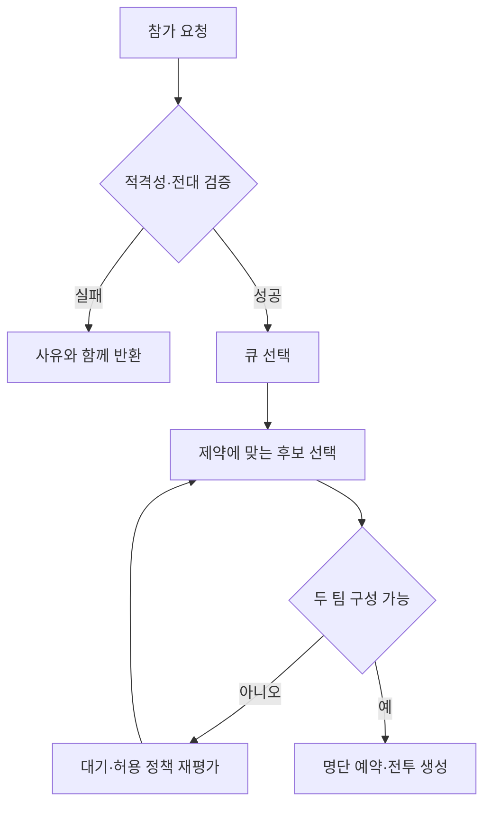

# 13. 매치메이킹·전대·랭크·클랜전 역기획

> 대상: PC 글로벌 / 조사일: 2026-11-13 / 라이브 기준: 15.10.
> **[확인]** 공개 규칙, **[버전 의존]** 모드·시즌별 설정, **[분석]** 설계 해석, **[제안]** 재현 설계, **[미확인]** 공개 자료로 확정할 수 없는 사항을 구분한다.

## 1. 매칭의 목표

**[분석]** 매칭은 완벽한 두 팀을 찾는 단일 최적화가 아니다. 대기시간, 함종 구성, 단계 차이, 전대의 묶음, 초보 보호, 지역별 인구, 시즌 제한을 함께 만족시키는 제약 문제다. 함선 간 전투력이 같아도 정찰·레이더·대공 같은 역할 분포가 다르면 체감 공정성은 달라진다.

| 시스템 | 주요 입력 | 결과 | 충돌하기 쉬운 목표 |
|---|---|---|---|
| 일반 매칭 | 함선 단계·함종·전대·대기 | 양 팀 명단·전투 단계 | 구성 균형 대 빠른 시작 |
| 초보 보호 | 전투 수·선택 단계 | 보호 큐 또는 일반 큐 | 학습 보호 대 인구 규모 |
| 랭크 | 리그·시즌·함선 적격성 | 개인 별·랭크 진행 | 팀 승리 대 개인 별 보존 |
| 클랜전 | 팀·레이팅·시즌 제한 | 팀 상대·레이팅 변동 | 경쟁성 대 상대 다양성 |
| 제재 | AFK·비매너 상태 | 제한된 참여·보상 처리 | 악용 방지 대 오탐 최소화 |

**[확인]** 공개 게임 모드 설명은 무작위 전투의 팀 구성에 플레이어 실력을 사용하지 않는다고 명시한다. 따라서 이 문서는 무작위 전투에 승률 기반 SBMM이 있다고 가정하지 않는다. [C26]

**[미확인]** 실제 서버의 가중치, 난수 시드, 비공개 타이브레이커, 현재 모든 제한 완화 순서는 알 수 없다. 이하 의사코드는 원작 코드의 복원이 아니다.

## 2. 단계 범위와 전투 단계

**[확인]** 전투 단계는 그 전투의 최고 함선 단계다. 공개 매칭 위키의 일반 최대 범위는 I단계 단독, II~IV는 자기 단계+1, V~IX는 +2, X~★는 ★까지다. 전대가 다른 단계로 구성되면 최고 단계 함선의 범위를 적용하므로 개별 함선의 평소 범위를 벗어날 수 있다. [C13]

| 선택 함선 단계 | 일반 최대 전투 단계 | 주의할 해석 |
|---|---|---|
| I | I | 모든 저단계가 ±1인 것은 아님 |
| II~IV | 자기 단계+1 | 상한 설명이며 하한 공식이 아님 |
| V~IX | 자기 단계+2 | 전대·모드 예외 확인 |
| X~★ | ★ | ★를 편의상 XI로 표기하는 자료 존재 |

**[버전 의존]** 이 표는 공개 일반 규칙이다. 랭크·클랜·난투·작전의 참가 단계는 별도 설정을 따른다. 특정 시즌의 허용 단계나 테스트 매칭을 전역 규칙으로 승격하지 않는다.

### 전대의 영향

**[확인]** 일반 전대는 최대 3척이며 단계 간격·항모 수 제한을 가진다. 단순히 전대원별로 다른 매치를 골라 배치하지 않고 전대를 한 묶음으로 취급한다. [C13]

**[분석]** 같은 단계 전대를 권장하는 이유는 전투력만이 아니다. 낮은 단계의 전대원은 높은 단계 전대원의 허용 상한으로 끌려가므로, 개인의 “최근 상위 단계 전투 비율”만으로 체감 난도를 설명하기 어렵다.

## 3. 강제 제약과 완화 제약

공개 매칭 자료는 팀의 함종·단계를 맞추려는 규칙과 대기시간에 따라 느슨해지는 규칙을 구별한다. 특정 함종의 한도는 전투 단계와 대기시간에 따라 달라진다. [C13][C14]

| 분류 | [제안] 제약 예시 | 완화 가능성 | 실패 시 처리 |
|---|---|---|---|
| 참가 적격성 | 모드·시즌의 허용 함선 | 없음 | 큐 진입 거절 |
| 전대 보존 | 같은 전대는 같은 팀 | 일반적으로 보존 | 다른 후보 탐색 |
| 팀 규모 | 양 팀 인원 균형 | 소규모 시작 프로파일 | 대칭 규모로 생성 |
| 단계 허용 | 후보들의 유효 전투 단계 교집합 | 모드 정책에만 의존 | 후보 제거 |
| 함종 균형 | 전함·구축함·항모·잠수함 분포 | 일부 시간별 완화 | 다음 정책 단계 |
| 최근 경험 | 반복 상위 단계 전투 억제 | 공개 범위 내 관리 | 후보 우선순위 조정 |

표의 분류는 설계용이다. 실제 서버가 같은 이름의 하드/소프트 필드를 사용한다는 의미는 아니다.

**[확인/역사적 수치]** 지원 문서의 0.11.5 변경 내역은 VI~IX의 최근 16전 중 +2 전투 비율을 최대 37.5%로 설명한다. 0.11.7은 구축함+잠수함 합계 제한의 완화 시점을 25초로 변경했다고 기록한다. [C14]

**[버전 의존]** 위 수치는 정책의 공개 사례다. 2026년 모든 큐·전대·교정 구간에 동일한 보장을 적용한다는 전수 확인은 하지 않았다. 문서 상단의 더 오래된 20전·40% 규칙과 혼용하지 않는다.

## 4. 초보 보호 큐

**[확인]** 지원 안내는 전투 수 200회 이하이면서 I~IV 함선으로 참여하는 플레이어를 초보 큐 대상으로 설명한다. V 이상이면 일반 큐에 들어가고, 전대도 전원이 보호 조건을 만족해야 한다. [C14][C27]

| 상황 | 공개 규칙에 따른 분류 | [분석] UX 과제 |
|---|---|---|
| 150전, III단계 | 보호 큐 | 학습 단계라는 설명 |
| 150전, V단계 | 일반 큐 | 구매·진행이 보호를 끝낼 수 있음 고지 |
| 201전, III단계 | 일반 큐 | 계정 경험과 함선 단계 분리 |
| 조건 만족 2명+고경험 1명 전대 | 일반 큐 | 리더만 확인하면 안 됨 |

봇 보충·대기시간 정책은 보호 큐와 일반 저단계 큐를 각각 가진다. 봇이 등장했다는 사실만으로 다른 플레이어가 없는 서비스라고 판단하거나, 모든 전투가 봇 전투라고 일반화하지 않는다.

## 5. 매칭 처리 흐름 제안



**[제안]** 중요 단계는 명단 예약이다. 동시에 여러 매치를 생성할 때 한 계정 또는 전대가 두 전투에 중복 포함되지 않도록 원자적 예약을 수행한다.

```text
ticket = validate_and_snapshot(account, ship, division, ruleset)
queue = select_queue(ticket)
policy = policy_for_oldest_wait(queue)
candidates = eligible_group(queue, policy)
teams = solve_constraints(candidates, policy)
if teams exists:
    reserve_all_tickets_atomically(teams)
    create_battle(teams, immutable_ruleset_version)
```

상태 스냅샷에는 큐 진입 당시의 함선 구성·모드·버전을 기록한다. 대기 중 함장·강화가 바뀌었다면 재검증하거나 구성을 잠그는 규칙이 필요하다.

## 6. 랭크 진행 구조

**[확인]** 랭크는 Bronze·Silver·Gold 리그와 기간별 Sprint를 사용한다. 개인 단위로 참여하고 전대는 허용되지 않는다. 승리로 별을 얻고, 패배·별 보존·불가역 랭크·승급 조건에 따라 진행이 변한다. 참가 단계·팀 규모·별 보존은 시즌 규칙이다. [C15]

**[확인/15.10]** 시즌 32의 공개 안내에서 Bronze는 7대7, VIII단계이며, 모든 리그에서 패배 팀의 최고 XP 획득자 1명은 별을 유지한다. [C16]

**[미확인]** 이번 수집에서 시즌 32의 Silver·Gold 세부 표는 웹 추출에 완전히 나타나지 않았다. 이전 시즌의 단계를 대입하지 않았으며 게임 내 시즌 규칙 화면에서 확인할 대상으로 남겼다.

| 진행 요소 | [분석] 기능 | 부작용 가능성 |
|---|---|---|
| 승리 별 | 팀 승리를 직접 보상 | 팀 편차에 대한 좌절 |
| 패배 별 손실 | 일정 실력 이상 요구 | 반복 실패 후 이탈 |
| 별 보존 | 좋은 개인 성과의 완충 | 승리보다 개인 XP를 노리는 행동 |
| 불가역 랭크 | 실패 비용의 상한 | 해당 구간의 참여 질 편차 |
| Sprint 보상 | 복귀와 재도전 주기 | 기간 말 몰림 |
| 리그 선택·승급 | 난도와 보상의 분화 | 높은 리그에서 큐 축소 |

### 별 기대값의 분석 예제

승률을 `p`, 패배했을 때 별을 지킬 조건부 확률을 `s`라 하고, 무승부·불가역 랭크·승급전은 제외한다.

\[
E[\Delta Star]=p-(1-p)(1-s)
\]

**[분석/가정]** `p=0.5`, `s=0.2`라면 전투당 기대 별은 +0.1이다. 따라서 랭크는 단순 승률만이 아니라 참여량·별 보존·진행 완충의 합성 결과다. 이 식은 원작이 숨겨진 점수를 계산하는 방법이 아니다.

## 7. 클랜전의 팀 경쟁

**[확인]** 클랜전은 미리 팀을 만들고 비슷한 클랜 레이팅의 상대를 찾는 형식이다. 시즌마다 단계·함종·함선 제한·활동시간·용병 허용이 달라질 수 있다. 특수 함장의 조건부 재능과 강화된 기본 스킬도 동일하게 취급되지 않으며, 클랜전에서는 조건부 재능 제한이 존재한다. [C17]

**[분석]** 개인 랭크와 달리 클랜전은 전투 전의 조합 구성도 경쟁의 일부다. 함선별 단독 성능보다 특정 조합이 만들어내는 탐지 창·집중 사격·점령 압력이 중요해진다.

| 전투 전 결정 | 연결되는 전투 요소 | 데이터 검사 |
|---|---|---|
| 전함 수 | 견제 화력과 공간 점유 | 함종 최대 수 |
| 레이더·정찰 조합 | 구축함의 접근 가능 영역 | 같은 능력의 연속 사용 가능성 |
| 기동 조합 | 측면 전개·재배치 | 지도별 이동 시간 |
| 회복·연막·지원 | 생존과 점령 유지 | 조건부 능력 허용 정책 |
| 금지·묶음 제한 | 조합의 독점 억제 | 개별 금지와 그룹 상한 분리 |

**[미확인]** 조사일의 클랜 위키는 “현재 시즌” 부분에 과거 시즌 32가 남아 있었다. 최신 시즌 36의 금지함·함종 수를 그 표에서 가져오지 않는다. 최신 시즌 공지와 클라이언트 표시를 별도 수집해야 한다.

## 8. 팀 피해와 비매너 판정의 분리

**[확인]** 0.10.5부터 아군에게 직접 피해를 입히는 기능이 제거되었지만, 아군에 탄이 맞는 것과 비매너 추적은 남아 있다. 아군 함체를 통과하여 뒤의 적을 공격할 수 있다고 해석하면 안 된다. [C18]

**[분석]** 구현에서는 `friendly_collision`, `friendly_damage`, `conduct_event`를 분리해야 한다. 피해를 0으로 만들었다는 이유로 모든 피격 이벤트를 지우면 의도적 방해를 감지하기 어렵다. 제재 임계값은 공개된 과거 숫자를 그대로 영구 정책으로 채택하지 않는다.

## 9. 운영 관측 지표

아래는 모두 **[제안] 운영 지표**이며 실제 운영사가 같은 지표를 사용한다고 단정하지 않는다.

| 지표 | 분해 축 | 문제가 의미하는 것 |
|---|---|---|
| 대기시간 P50/P95/P99 | 지역·시간·단계·함종·전대 | 평균에 가려진 희소 집단 |
| 단계 격차 분포 | 개인·전대·최근 N전 | 불리한 전투의 반복 |
| 팀 구성 차이 | 단계별 함종·전대 수 | 제약 완화의 부작용 |
| 초반 일방전 비율 | 조합·지도·모드 | 매칭과 맵의 상호작용 |
| 참가 거절 원인 | 금지함·기간·구성 | UI 설명 부족 |
| 별 보존 행동 | 역전 가능성·XP 활동 | 팀 승리와 보상 유인의 충돌 |
| 클랜 재대전 빈도 | 시간대·레이팅 | 고랭크 상대 부족 |
| 취소·재진입 비율 | 대기 경과시간 | 큐 체감 불만·회피 행동 |

**[버전 의존/예정]** 2026년 후반 로드맵의 일반 교차 서버 매칭은 다음 해 작전부터 시작하는 계획이다. 이를 조사일 현재 모든 무작위 전투가 서버 간 통합되었다는 뜻으로 쓰지 않는다. 기존 클랜전의 서버 간 정책과도 구분한다. [C07]

## 10. 설정 스키마 제안

```yaml
# 원작의 서버 설정 파일이 아닌 재현용 구조
MatchPolicy:
  mode_id: string
  season_id: optional_string
  starts_at_utc: timestamp
  ends_at_utc: timestamp
  eligible_tiers: []
  ship_bans: []
  group_limits: []
  class_limits: []
  division_limits: object
  newcomer_policy: object
  relaxation_stages: []
  reward_policy_id: string
  ruleset_version: string
```

시즌 변경 시 이미 전투에 들어간 매치는 시작 당시 버전을 유지한다. 새 정책을 적용한 큐와 구 정책의 결과 정산을 섞지 않는다.

## 11. QA 시나리오

| ID | 테스트 입력 | 기대 검증 |
|---|---|---|
| MM-01 | 동일 계정의 동시 참가 요청 | 티켓 하나만 유효 |
| MM-02 | 전대원 하나가 취소 | 예약된 전대가 쪼개지지 않음 |
| MM-03 | 200전/201전, IV/V 경계 | 보호 큐 조건 정확 |
| MM-04 | 단계가 다른 전대 | 최고 단계 기준 및 경고 표시 |
| MM-05 | 대기시간 완화 경계 | 정책 단계가 일관되게 전환 |
| MM-06 | 항모·잠수함 희소 큐 | 허용 범위를 넘는 조합 금지 |
| MM-07 | 시즌 종료 순간 매치 생성 | 참가 적격성과 정산 버전 일치 |
| MM-08 | 랭크 패배·동률 XP | 공식 동률 처리 규칙을 별도 확인 |
| MM-09 | 불가역 랭크에서 패배 | 별·랭크 하한 준수 |
| MM-10 | 금지함과 그룹 제한 동시 만족 실패 | 정확한 거절 사유 |
| MM-11 | 아군에게 무장 명중 | 피해·충돌·비매너 이벤트 분리 |
| MM-12 | 결과 재전송 | 별·레이팅·보상 중복 반영 없음 |

이 표는 테스트 설계이며 실행 결과가 아니다. 전투 결과의 멱등성은 [19 구현 문서](19_implementation_architecture_and_qa.md)와 함께 검증한다.

## 출처

열람일: 2026-11-13. 지원 문서는 여러 시대의 변경 내역을 한 페이지에 담으므로 최신 구간과 과거 구간을 구별했다.

- **[C13]** [World of Warships Wiki — Matchmaking](https://wiki.worldofwarships.com/Ship:Matchmaking): 단계·전대·제약의 기본 구조.
- **[C14]** [Wargaming Player Support — How does Matchmaker work?](https://www.wargaming.net/support/en/products/wows/article/15454/): 대기시간·초보 보호·0.11.5/0.11.7 변경 이력.
- **[C15]** [World of Warships Wiki — Ranked Battles](https://wiki.worldofwarships.com/Ship:Ranked_Battles): 리그·Sprint·별 구조. 과거 시즌별 보존 규칙은 현행값으로 사용하지 않음.
- **[C16]** [World of Warships — Update 15.10: Horror From the Abyss](https://worldofwarships.com/en/news/game-updates/update-1510-horror-from-the-abyss/): 시즌 32 Bronze 형식과 별 보존 확인, 2026-11-02.
- **[C17]** [World of Warships Wiki — Clan Battles](https://wiki.worldofwarships.com/Ship:Clan_Battles): 팀 레이팅·시즌 제한·함장 재능. 과거 시즌 32 표를 현재 시즌으로 채택하지 않음.
- **[C18]** [World of Warships Wiki — Update 0.10.5](https://wiki.worldofwarships.com/Ship:Update_0.10.5): 아군 피해 제거와 충돌·비매너 판정의 구분.
- **[C26]** [World of Warships Wiki — Game Modes](https://wiki.worldofwarships.com/Ship:Game_Modes): 무작위 전투에서 플레이어 실력을 매칭에 사용하지 않는다는 한정된 확인.
- **[C27]** [Wargaming Player Support — How can I wipe or reset my account?](https://www.wargaming.net/support/en/products/wows/article/15732/): 초보 보호 큐의 전대원 전체 조건.
- **[C07]** [World of Warships — Roadmap 2026: Part 2](https://worldofwarships.com/en/news/general-news/roadmap-2026-part-2/): 향후 교차 서버 매칭 계획의 적용 시기 구분.
