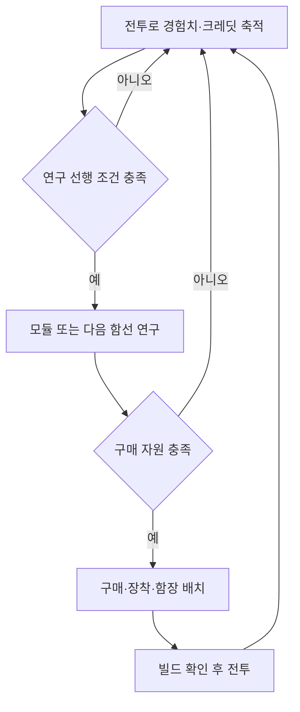

# 14. 연구·함장·강화·빌드 성장 시스템 역기획

> 대상: PC 글로벌 / 조사일: 2026-11-13 / 기준 릴리스: 15.10.
> **[확인]** 공개 설명, **[버전 의존]** 함선·패치별 수치, **[분석]** 설계 해석, **[제안]** 구현·검증 모델을 뜻한다. 원작 데이터베이스나 계정 상태를 읽은 문서가 아니다.

## 1. 성장의 세 축

**[분석]** 월드 오브 워쉽의 성장은 하나의 레벨 숫자가 아니다. 새 함선을 해금하는 수직 성장, 같은 함선의 운용법을 바꾸는 빌드 성장, 여러 계통을 보유하여 모드·임무에 대응하는 함대 확장이 결합한다.

| 축 | 플레이어가 얻는 것 | 소모·투자 | 반복을 만드는 이유 |
|---|---|---|---|
| 함선 연구 | 다음 단계·계통 선택 | 함선 XP·자유 XP·크레딧 | 새로운 전투 역할 |
| 모듈 연구 | 선택 함선의 장비 변화 | XP·크레딧 | 현재 함선 완성 |
| 함장 | 스킬 포인트·조건부 효과 | 함장 XP·정예 XP·재훈련 | 장기 자산 축적 |
| 강화 장치 | 슬롯별 성능 조정 | 크레딧·특수 자원 | 약점 보완·특화 |
| 신호기 | 전투별 성능 보조 | 재고·재보급 | 필요한 전투에 투자 |
| 연구처 | 재진행에 대한 별도 보상 | 계통 초기화·재연구 | 중간 단계 재방문 |

경제 보너스의 정확한 등급·보상 계산·유료화는 [15 경제 문서](15_economy_rewards_and_monetization.md)에서 다룬다. 여기서는 전투 빌드와 계정 진행 상태에 집중한다.

## 2. 용어를 먼저 분리한다

| 용어 | 의미 | 혼동하면 생기는 오류 |
|---|---|---|
| 연구 모듈 | 선체·포·어뢰 등 해당 함선의 연구 가능한 구성 | 강화 슬롯과 같은 재고로 취급 |
| 강화 장치 | 정해진 슬롯에 장착하는 성능 조정 장비 | 새 선체 연구를 슬롯 교체로 처리 |
| 소모품 | 전투 중 발동하는 능력 | 일반 재고 신호기와 동일시 |
| 함장 스킬 | 포인트 예산으로 선택한 지속·조건부 효과 | 선체 원본 능력치에 영구 덮어쓰기 |
| 신호기 | 사용 후 소모되는 전투 보너스 | 장식 깃발과 혼동 |
| 위장 | 외형 선택 | 과거의 경제·피탐 효과를 현행에 재삽입 |
| 경제 보너스 | 전투 후 수입을 바꾸는 계열 | 전투 중 공격력 증가로 처리 |

이 표는 뒤의 데이터 구조에서 서로 다른 엔터티를 사용해야 하는 이유다.

## 3. 함선·모듈의 연구 흐름

**[확인]** 연구 모듈은 함선 XP와 자유 XP를 사용하여 해금하고, 크레딧을 지불하여 장착한다. 상위 모듈이 모든 수치를 일방적으로 개선하는 것은 아니며, 예를 들어 사거리와 속력 사이의 교환이 가능하다. [C22]



**[제안]** 연구 완료, 구매 완료, 장착 완료를 각기 다른 상태로 저장한다. 연구가 완료되어도 크레딧이 부족하면 보유하지 않을 수 있고, 보유한 모듈이 현재 장착된 모듈과 같을 필요도 없다.

| 상태 | 영속 데이터 | 가능한 행동 |
|---|---|---|
| 미연구 | 선행 노드·필요 XP | 선행 연구, 부족량 확인 |
| 연구 완료·미보유 | 해금 플래그 | 구매 |
| 보유·미장착 | 인벤토리 수량 | 장착·매각 |
| 장착 | 함선 구성 슬롯 | 교체·전투 준비 |
| 연구 계통 초기화됨 | 초기화 기록·보상 태그 | 재연구 |

### 연구 선택의 분석

**[분석]** 플레이어는 현재 함선을 완성할지, 다음 함선으로 빠르게 이동할지 선택한다. 이 갈등이 의미 있으려면 다음 함선의 XP 경로와 현재 모듈의 효용을 한 화면에서 비교할 수 있어야 한다. 모든 연구가 순수 필수라면 선택은 경로가 아니라 비용 지불 순서만 된다.

## 4. 함장은 함선과 분리된 장기 자산

**[확인]** 함장 레벨의 최대는 21이며, 현재는 전함·순양함·구축함·항모·잠수함의 다섯 스킬 세트를 가진다. 포인트를 다섯 함종에 나눠 쓰는 것이 아니라, 각 함종 세트가 함장의 전체 포인트 한도를 사용한다. 스킬 비용은 1~4포인트이며 상위 행을 선택하려면 아래 단계의 선행 선택이 필요하다. [C19]

| 함장 데이터 | 의미 | [제안] 데이터 경계 |
|---|---|---|
| 경험치·레벨 | 성장량 | 계정의 자유 XP와 별도 원장 |
| 국적 | 배치 가능한 함선군 | 함선 호환성 규칙 |
| 전문 함선 | 일반 연구 함선의 숙련 대상 | 현재 탑승 함선과 별도 |
| 재훈련 | 새 전문 함선에 적응하는 진행 | 일반 레벨 XP와 별도 상태 |
| 함종별 스킬 | 각 함종의 선택 목록 | 5개의 독립 포인트 배분 |
| 특수 재능 | 조건부 특수 효과 | 모드 허용·발동 조건 |

**[버전 의존]** 일부 특별 함장은 처음 배치할 때 국적을 정하는 등 예외를 가진다. 일반 함장을 국적 제한 없이 모든 함선으로 이동시키는 기능으로 확대하지 않는다. [C03]

## 5. 함장 성장 곡선

공개 함장 표의 일부 누적 XP는 다음과 같다. 전체 비용표의 복제 대신 성장 곡선을 설명하는 지점만 제시한다. [C19]

| 포인트 | 누적 함장 XP | [분석] 의미 |
|---|---:|---|
| 10 | 183,000 | 1+2+3+4 스킬 경로를 처음 완성 가능한 예산 |
| 19 | 1,708,000 | 대부분의 핵심 선택을 확보한 장기 성장 |
| 20 | 2,208,000 | 추가 1포인트의 비용이 크게 증가 |
| 21 | 2,908,000 | 최대 성장 후 다른 함장 지원 자산으로 전환 |

**[확인]** 최대 단계가 아닌 함장은 일반적으로 획득 함장 XP의 5%에 해당하는 정예 함장 XP를 추가로 얻는다. 최대 단계 함장은 획득량이 정예 XP로 들어가는 구조다. 재훈련 상태는 별도 처리이므로 무조건 5%를 더하는 산식으로 구현하지 않는다. [C20][C19]

**[분석]** 후반 성장 비용이 큰 이유는 최종 1~2포인트를 장기 목표로 남기기 위해서라고 해석할 수 있다. 동시에 초기 핵심 스킬을 가진 함장과 최대 함장의 격차가 실제 전투에서 어느 정도인지 별도 검증해야 한다. 총 XP 비율이 그대로 전투력 비율이 되지는 않는다.

### 포인트 예산 예제

- 10포인트 빌드: 비용 1·2·3·4의 스킬을 하나씩 선택한다.
- 21포인트 빌드: 비용 1·2·3·3·4·4·4인 일곱 스킬의 합이 21이다.
- 이 예제는 예산과 선행 행 조건을 설명하는 가상의 조합이다.
- 특정 함선의 추천 스킬명·현재 메타 빌드를 뜻하지 않는다.

## 6. 배치·재훈련·프리미엄 함선

**[확인]** 일반 연구 함선의 전문 대상을 바꾸면 재훈련이 필요하며, 재훈련 중 해당 연구 함선에서는 스킬 효과가 비활성화된다. 같은 국적의 프리미엄/특별 함선에는 재훈련 없이 배치할 수 있으며, 기존 전문 대상과 탑승 함선을 분리해서 관리한다. [C19]

**[분석]** 프리미엄 함선의 가치는 수입뿐 아니라 함장을 재사용할 수 있는 계정 편의에도 있다. 이 구조 때문에 함장은 여러 함선의 빌드 선택에 영향을 주지만, 같은 함종의 다른 함선마다 자동으로 별도의 스킬 프리셋을 가지는 것과는 다르다.

| 이동 상황 | 확인해야 할 것 | [제안] UI 표시 |
|---|---|---|
| 전문 함선으로 복귀 | 전문 대상 일치 | 스킬 정상 사용 |
| 다른 연구 함선으로 이동 | 재훈련 자원·상태 | 예상 비용·비활성 효과 |
| 같은 국적 프리미엄으로 이동 | 호환성 | 전문 대상 유지 안내 |
| 다른 함종으로 이동 | 해당 함종 스킬 세트 | 미배분 포인트 경고 |
| 특수 함장 배치 | 국적·모드·재능 조건 | 사용할 수 없는 재능 설명 |

재훈련 비용과 스킬 초기화 비용은 다른 행위다. 둘을 같은 “재설정” 버튼으로 감추면 사용자는 무엇을 잃고 무엇이 유지되는지 이해하기 어렵다.

## 7. 강화 장치와 빌드의 기회비용

**[확인]** 강화 장치는 지정 슬롯에 하나씩 장착하며, 함선의 단계·함종·개별 제한에 따라 선택지가 달라진다. 장착 해제·매각은 서로 다른 처리이고, 특별 강화는 취득 경로가 다를 수 있다. [C21]

**[분석]** 같은 슬롯에 경쟁하는 장비를 넣으면 순수 성능 합계보다 운용 방향을 선택하게 된다.

| 빌드 방향 | 얻으려는 가치 | 놓치기 쉬운 비용 | 필요한 관측 |
|---|---|---|---|
| 은폐 중심 | 먼저 보거나 교전을 끊기 | 화력·기동 슬롯 포기 | 최초 탐지·재은폐 성공 |
| 기동 중심 | 회피·측면 재배치 | 사격·생존의 다른 강화 포기 | 회피 피해·포각 유지 |
| 주포 중심 | 명중률·재장전·사거리 | 근접 대응·탐지 비용 | 유효 사격 횟수 |
| 부포 중심 | 근접 공간 압박 | 접근 전 생존 필요 | 실제 교전 거리·가동시간 |
| 대공·대잠 | 특정 위협 대응 | 위협이 없는 판의 기회비용 | 해당 위협 등장률·방어 기여 |
| 생존 중심 | 회복 가능 시간 확보 | 공격력 투자 감소 | 집중 공격 후 생존시간 |

이 표는 특정 빌드가 강하다는 추천이 아니라, 강화 선택의 효용을 검증할 평가 틀이다.

### 보정 합산 예제

**[제안/가정]** 30초 재장전에 서로 곱하는 10%·12% 감소를 적용한다면 `30 × 0.90 × 0.88 = 23.76초`다. 단순 합산의 23.4초와 다르다. 동일 피해의 이론적 발사 빈도는 `30 / 23.76 ≈ 1.263`배다.

이 예제는 실제 모든 함장·강화 보너스가 곱연산이라는 선언이 아니다. 원작의 각 효과가 가산·곱산·상한·조건부 중 무엇인지 확인하고 보정 단계에 저장해야 한다.

## 8. 신호기·장식·경제 보너스

**[확인]** 전투 신호기는 최대 8개를 함께 장착하며 사용 후 소모된다. [C25]

**[확인]** 위장은 외형 요소다. 0.11.6의 개편으로 외형과 경제 보너스 선택이 분리되었다. 따라서 위장 장착 여부를 현대 빌드의 경제 보너스 또는 전투 성능과 자동 연결하지 않는다. [C24][C28]

**[분석]** 전투 준비 UI는 다음 세 결과를 분리해서 보여줘야 한다.

1. 전투 능력치가 어떻게 변하는가.
2. 전투 후 보상량이 어떻게 변하는가.
3. 전투가 끝나면 어떤 재고가 소비되는가.

경제 보너스는 패치로 등급이 늘 수 있으므로 4등급 고정 배열로 설계하지 않는다. 2026년 변경된 경제 등급은 [15 문서](15_economy_rewards_and_monetization.md)의 시점별 표를 참조한다.

## 9. 연구처의 재진행 구조

**[확인]** 연구 계통 초기화 기능은 연구 가능한 X단계 함선 5척을 해금하여 자격을 얻는 구조다. 이미 X단계까지 연구한 계통을 초기화하고, 해당 함선을 다시 연구·구매한 뒤 지정 전투 조건을 충족하여 연구 포인트를 회수한다. 초기화 시 함선·모듈·XP·함장·강화 처리 규칙이 함께 작동한다. [C23]

**[분석]** 연구처는 소유한 함선을 단순 삭제하는 기능이 아니라, 계정의 완성된 계통을 재도전 목표와 교환하는 거래다. 재진행 비용이 존재하기 때문에 초기화 전 예상 크레딧·해제 자산·남는 장식·함장 상태를 구체적으로 보여줄 필요가 있다.

| 초기화 대상 상태 | [제안] 사전 미리보기 | 처리 후 확인 |
|---|---|---|
| 연구한 함선 | 다시 잠기는 목록 | 해금 플래그·보상 태그 |
| 보유 함선·모듈 | 매각 또는 회수될 자산 | 크레딧 원장 |
| 함장 | 이동될 위치 | 전문 대상·스킬 보존 |
| 강화 장치 | 장착 해제 결과 | 인벤토리 회수 |
| 함선 XP | 이동 대상 | 총량 보존·거래 로그 |
| 영구 장식·보너스 | 귀속 유지 규칙 | 재구매 시 복원 |

**[버전 의존]** 연구처 페이지 접근 자격과 계통 초기화 자격은 역사적으로 변경된 적이 있다. “포인트를 얻었으므로 모든 초기화 기능도 열린다”는 규칙으로 단순화하지 않는다.

### 원자적 처리 제안

```text
preview = compute_reset_effects(account, line, ruleset)
assert account_version == preview.expected_version
begin transaction
  lock target line and related assets
  apply resource movements
  preserve commander and permanent entitlement records
  attach research reward eligibility
  mark research nodes as locked
  append one reset ledger entry
commit transaction
```

클라이언트가 응답을 받지 못해 다시 요청하더라도 같은 초기화가 두 번 적용되지 않도록 거래 ID를 사용한다.

## 10. 전투 빌드의 계산 파이프라인 제안

**[제안]** 전투 시작 시 아래 단계의 결과를 불변 스냅샷으로 만든다.

| 단계 | 내용 | 보존해야 할 근거 |
|---|---|---|
| 원본 | 함선·선체·무장 기본 파라미터 | 함선 데이터 버전 |
| 장착 | 연구 모듈·강화 | 아이템 ID·슬롯 |
| 함장 | 해당 함종 스킬·재훈련 상태 | 함장 상태·스킬 ID |
| 소모성 | 신호기·전투용 옵션 | 재고 차감 거래 |
| 모드 | 작전·난투·시즌 보정 | 규칙 세트 버전 |
| 전투 중 | 재능·버프·모듈 이상 | 발동·만료 이벤트 |

항구 능력치와 실제 전투값이 다르면 어떤 단계에서 차이가 생겼는지 설명할 수 있어야 한다. 이름이 비슷한 효과를 텍스트 문자열로 판단하지 말고 효과 ID·적용 대상·연산을 사용한다.

```yaml
# 재현용 스키마, 원작 내부 구조가 아님
Commander:
  nation_rule_id: string
  level: integer
  commander_xp: integer
  specialization_ship_id: string
  assigned_ship_id: optional_string
  retraining: optional_object
  skill_sets_by_class: object
ShipBuild:
  ship_id: string
  researched_module_ids: []
  equipped_module_ids: []
  upgrades_by_slot: object
  signal_ids: []
  commander_id: optional_string
  cosmetic_ids: []
  economic_bonus_ids: []
  build_revision: integer
```

## 11. QA 시나리오

| ID | 입력·상황 | 확인할 불변조건 |
|---|---|---|
| PR-01 | 연구 완료·크레딧 부족 | 해금과 소유가 혼동되지 않음 |
| PR-02 | 자유 XP 일부 사용 | 원장 우선순위·차감량 일치 |
| PR-03 | 10포인트를 두 함종에 배분 | 각 세트가 독립 예산 사용 |
| PR-04 | 선행 행 없이 4포인트 스킬 선택 | 잘못된 빌드 거절 |
| PR-05 | 재훈련 중 출전 | 스킬 활성 상태 정확 |
| PR-06 | 프리미엄 배치 후 전문 함선 복귀 | 전문 대상이 뜻밖에 변경되지 않음 |
| PR-07 | 21포인트 달성 전후 보상 | 함장 XP·정예 XP 이중 적립 없음 |
| PR-08 | 강화 교체·매각·해제 | 동일 장치 중복 소유·유실 없음 |
| PR-09 | 같은 빌드에 위장만 교체 | 전투 보정값이 변하지 않음 |
| PR-10 | 신호기 재고 마지막 1개 | 소비·자동 보급·다음 출전 표시 일치 |
| PR-11 | 연구 계통 초기화 중 응답 손실 | 재요청 시 중복 매각·보상 없음 |
| PR-12 | 특수 함장으로 클랜전 | 금지 재능과 기본 스킬 구분 |
| PR-13 | 패치로 스킬 삭제·효과 변경 | 빌드 이관·포인트 반환 정책 적용 |
| PR-14 | 항구 표시값과 전투 스냅샷 비교 | 구성·모드 보정 차이를 추적 가능 |

위 QA는 실행한 결과가 아닌 검증 명세다.

## 12. 평가 지표와 설계 해석

**[제안]** 빌드별 승률만 비교하지 말고 함장 포인트·함선 숙련·모드·매칭 단계를 통제한다. 높은 포인트의 함장을 오래 쓰는 플레이어가 더 숙련되었을 수 있으므로, 함장 효과와 플레이어 효과를 분리해야 한다.

| 지표 | 의미 |
|---|---|
| 첫 핵심 빌드 완성까지 전투 수 | 학습 단계의 성장 부담 |
| 연구 후 구매 지연 | XP와 크레딧 병목의 차이 |
| 재훈련 중 전투 비율 | 스킬 비활성으로 인한 체감 손해 |
| 슬롯별 선택 집중도 | 선택지가 실제로 경쟁하는지 |
| 초기화 직후 이탈률 | 초기화 결과 설명의 충분성 |
| 계통 재진행 완료율 | 연구처의 장기 동기 효과 |
| 빌드 오류·사용 불가 스킬 장착률 | 항구 피드백의 품질 |

**[분석]** 성장의 의미는 수치가 늘어나는 것뿐 아니라 플레이어가 배운 운용법에 맞는 선택지가 열리는 데 있다. 진행 초반에는 이해하기 쉬운 기본 빌드를, 후반에는 명확한 기회비용을 가진 특화를 제공하는 구조로 해석할 수 있다.

관련: [02 함종](02_ship_classes_and_nations.md), [11 소모품](11_consumables_and_tactical_cycles.md), [13 경쟁 모드](13_matchmaking_ranked_and_clans.md), [16 항구 UI](16_port_battle_ui_and_onboarding.md).

## 출처

열람일: 2026-11-13. 표·도식·거래 설계·분석 예제·QA는 직접 작성했다. 가격·상점 수량·모든 스킬의 현행 수치표는 포함하지 않았다.

- **[C19]** [World of Warships Wiki — Commander](https://wiki.worldofwarships.com/Ship:Commander): 포인트·함종별 세트·일부 누적 XP·전문 함선·재훈련의 공개 규칙.
- **[C20]** [World of Warships — Update 0.10.0: Commander Skills Update](https://worldofwarships.com/en/news/game-updates/update-0100-commander-skills-update/): 최대 21포인트와 정예 함장 XP 구조의 도입 설명. 현재 함종 수는 최신 위키와 대조.
- **[C21]** [World of Warships Wiki — Upgrades](https://wiki.worldofwarships.com/Ship:Upgrades): 슬롯·장착·해제 구조. 구체적인 개별 효과 수치의 오기 가능성 때문에 수치 전재는 하지 않음.
- **[C22]** [World of Warships Wiki — Modules](https://wiki.worldofwarships.com/Ship:Modules): 연구 모듈 구매와 성능의 상충 관계.
- **[C23]** [World of Warships Wiki — Research Bureau](https://wiki.worldofwarships.com/Ship:Research_Bureau): 초기화 자격·재진행·자산 처리의 기본 구조.
- **[C24]** [World of Warships Wiki — Camouflage](https://wiki.worldofwarships.com/Ship:Camouflage): 외형 시스템.
- **[C25]** [World of Warships Wiki — Flags](https://wiki.worldofwarships.com/Ship:Flags): 전투 신호기 수와 소모성. 구 DFAA 관련 신호기 수치는 채택하지 않음.
- **[C28]** [World of Warships Wiki — Update 0.11.6](https://wiki.worldofwarships.com/Ship:Update_0.11.6): 외형·경제 보너스 분리.
- **[C03]** [World of Warships Wiki — Update 15.0](https://wiki.worldofwarships.com/Ship:Update_15.0): 특정 국적 미지정 특별 함장의 초기 배치 예외.
