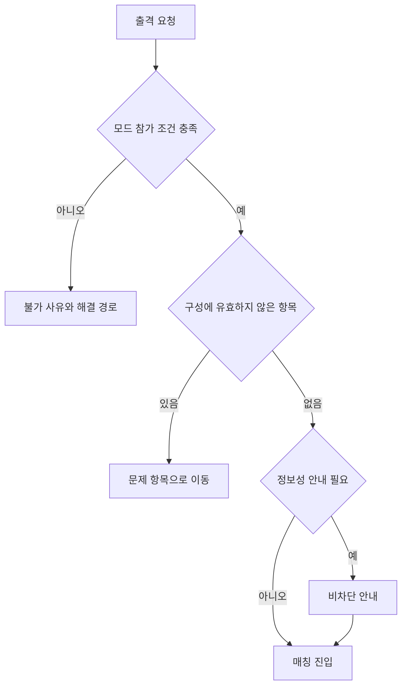

# 16. 항구·전투 UI/UX·조작·온보딩

> 공개 문서에 나타난 화면 기능을 분석했다. 현재 클라이언트를 직접 조작해 캡처한 UI 감사 보고서는 아니다.
> 위치·기능의 개요는 확인 사항, 정보 우선순위·개선안·데이터 계약은 분석 또는 제안이다.

[전체 목차](README.md) · [기동](03_navigation_and_maneuvering.md) · [탐지](08_detection_vision_and_information.md) · [경제](15_economy_rewards_and_monetization.md)

## 1. UI의 핵심 과제

[분석] 플레이어는 항구에서 수십 개의 장기 선택을 하고, 전투에서는 몇 초 안에 생존에 영향을 주는 선택을 한다. 같은 정보라도 두 화면에서 필요한 형태가 다르다.

- 항구: 비교·구성·획득 조건·자원 비용을 자세히 설명한다.
- 전투: 현재 상태·사용 가능성·즉각적인 위협을 우선한다.
- 전투 결과: 무엇이 보상을 만들었으며 다음에 무엇을 바꿀지 연결한다.

지표가 많다는 것과 판단하기 쉽다는 것은 다르다. 특히 조준 화면을 보는 동안 미니맵·피탐·진행 점수를 함께 읽게 만드는 구조가 중요하다.

## 2. 항구 정보 구조

[확인] 항구는 함선 선택, 연구·장비, 함장, 제원·장갑 보기, 경제 보너스, 임무·이벤트, 전투 진입을 연결하는 중심 화면이다. 함선 목록과 제원 패널, 전투 버튼이 반복 작업의 중심이다. [R18]

| 영역 | 사용자 질문 | 연결 데이터 | 분석상 우선순위 |
|---|---|---|---|
| 선택 함선 | 지금 어떤 배를 준비하는가 | 함선 ID·티어·함종 | 항상 명확해야 함 |
| 전투 종류 | 이 구성으로 어디에 참가하는가 | 모드 조건·팀 상태 | 출격 버튼과 함께 |
| 함장·장비 | 능력과 운용이 어떻게 달라지는가 | 스킬·강화·모듈 | 결과 제원 변화 표시 |
| 제원·장갑 | 왜 잘 맞고 왜 잘 뚫리는가 | 상세 수치·장갑층 | 요약에서 상세로 확장 |
| 경제 | 얼마나 벌고 무엇을 소모하는가 | 지갑·보너스·자동 보급 | 전투 구성과 연결 |
| 임무·행사 | 이번 전투가 어디에 기여하는가 | 조건·기한·진척 | 현재 함선 적합성 |
| 함선 목록 | 원하는 함선을 어떻게 찾는가 | 필터·정렬·즐겨찾기 | 대규모 보유에서도 유지 |

이 표는 픽셀 단위 현행 배치 명세가 아니다. 항구 문서에는 오래된 가격·소모품 예시도 남아 있어, 해당 값을 UI 요구사항으로 복사하지 않았다.

## 3. 출격 준비의 검증 흐름

[제안] 출격 전에 확인할 항목을 오류와 경고로 나눈다.



- 참가 불가능한 티어·함종은 오류다.
- 보너스 미장착은 사용자의 의도일 수 있으므로 무조건 차단하지 않는다.
- 기본 모듈도 유효 구성이라면 '최고급이 아님'을 오류로 취급하지 않는다.
- 함장 재훈련·특수 스킬 비활성은 기능과 이유를 표시한다.

## 4. 제원 비교와 오해 방지

[분석] '포격', '생존' 같은 요약 점수만으로 함선의 성능을 설명하면 실제 판정의 조건을 잃는다. 대표적인 예는 다음과 같다.

| 단순 표시 | 숨겨지는 차이 | 유용한 상세 설명 |
|---|---|---|
| HP | 회복 가능한 피해·장갑·피탐 | 회복 조건과 장갑 보기 |
| 사거리 | 탄속·탄도·명중 분산 | 비행 시간·포탑 사용각 |
| 어뢰 피해 | 피탐·무장 거리·대상 제한 | 어뢰별 유효 조건 |
| 은폐 | 수상·항공·발포·연막 상태 | 상태별 피탐값 |
| 대공 | 지속 피해·폭발·능동 기능 | 사거리와 현재 사용 가능 기능 |
| 기동 | 최고속도·가속·선회·타력 | 현재 빌드의 세부 응답 |

장갑 보기는 수치표를 공간에 연결하는 학습 도구다. '왜 같은 포로 같은 배를 쏴도 결과가 다른가'를 함선 단면과 입사 방향으로 이해하게 한다.

## 5. 전투 HUD의 정보 우선순위

[분석] HUD는 다음 세 층으로 설계 목적을 나눌 수 있다.

| 우선순위 | 정보 | 판단 지연의 비용 |
|---|---|---|
| 즉시 | 어뢰 경고·탐지·화재·침수·조타/기관 손상 | 회피·피해 방지 기회 상실 |
| 수 초 | 장전·발사각·소모품 상태·대공 충전 | 공격 창·방어 창 상실 |
| 수십 초 | 미니맵·마지막 위치·팀 구성·점수·시간 | 경로와 목표 선택 오류 |

높은 우선순위의 경고가 계속 울리면 사용자는 결국 무시한다. 따라서 '지금 작동해야 하는 상태'와 '이미 알고 있는 지속 상태'를 구분해 시각·음향 빈도를 설계해야 한다.

## 6. 조준 피드백 계약

[제안] 입력과 실제 발사 결과 사이의 상태를 명확히 보여 준다.

| 상황 | 플레이어가 볼 필요가 있는 이유 |
|---|---|
| 조준점은 맞지만 포탑 회전 미완료 | 카메라 방향과 무장 방향이 다름 |
| 일부 포탑만 발사 가능 | 총 포문 수와 현재 유효 포문 수가 다름 |
| 목표 선택이 해제됨 | 탄착·조준 동작에 영향을 줄 수 있음 |
| 섬으로 발사 경로 차단 | 목표 거리만으로 명중 가능 여부를 판단할 수 없음 |
| 재장전 중 손상으로 일시 정지 | 단순 카운트다운과 다른 무장 상태 |
| 탄종 변경 예약 | 현재 장전 탄종과 다음 탄종이 다름 |

관통·도탄·과관통·비관통 등 결과 리본은 [05번](05_armor_penetration_and_damage.md)의 판정 결과와 일치해야 한다. 리본 표시를 클라이언트가 화면상 충돌만으로 추측하면 서버 판정과 어긋날 수 있다.

## 7. 기본 조작: 의미 중심 요약

[확인·기본 키 예시] 키는 변경할 수 있고 함종별로 의미가 달라진다. 다음은 수상함 조작의 대표 예다. [R19]

| 입력 | 의미 | 학습해야 할 구분 |
|---|---|---|
| W / S | 추진 단계 변경 | 키를 떼어도 즉시 정지하지 않음 |
| A / D | 조타 입력 | 함선 이동 방향과 선체 방향의 변화 |
| Q / E | 조타 고정 단계 | 순간 입력과 지속 명령 |
| Shift | 쌍안경 시점 | 조준 확대 중 주변 정보 손실 |
| 마우스 우클릭 유지 | 자유 시점 | 카메라와 무장 방향 분리 |
| X | 대상 선택·해제 | 카메라 중심과 표적 상태 분리 |
| M | 전술 지도 | 경로와 전체 전황 확인 |
| Ctrl | 커서 표시 | 전투 입력과 UI 조작의 전환 |
| P | 부포·대공 작동 전환 | 은폐·자동 공격의 상충 |
| Tab | 전투 정보 | 참가자·목표·상황 확인 |

[버전 의존] 15.7 이후 대공의 O / ~ 입력은 360도 AA Defense Priority와 길게 누르는 Concentrated AA Fire의 관계로 설명해야 한다. 옛 좌·우현 구역 조작 설명을 그대로 보여 주면 안 된다. [R14]

항모·잠수함 조작은 [09](09_carriers_aircraft_and_aa.md), [10](10_submarines_and_asw.md)에 별도로 설명한다.

## 8. 미니맵은 별도 정보 화면이다

[분석] 미니맵의 목적은 월드 화면을 축소하는 것이 아니다. 월드에서 여러 번 카메라를 돌려야 얻는 정보를 한눈에 비교하게 하는 것이다.

필요한 정보 범주:

- 현재 아군 위치·진행 방향.
- 적의 현재 탐지와 마지막 관측의 차이.
- 주포·어뢰·피탐 등 의미가 다른 범위.
- 거점 소유·경합·위험 구역.
- 경로와 사격 방향을 정하는 지형.
- 팀원 핑과 의사소통 대상.

마지막 관측 위치를 현재 위치처럼 움직이면 정보 규칙이 깨진다. 영역별 정보 권한은 [08번](08_detection_vision_and_information.md)의 관측 상태에서 가져와야 한다.

## 9. 15.10의 정보 화면 변경

[확인] 15.10은 전투 전 로딩 화면과 전투 중 TAB 정보 화면을 개편했다. 팀·목표·조건을 모으고 상세 정보를 확장하며, 작전에서는 주·부가 목표 상태를 보여 준다. 로딩 화면과 전투 중 화면의 미니맵 제공 여부는 다르다. [R01]

[분석] 변경의 설계 가치는 '이번 판에서 무엇을 해야 하는가'와 '내 배가 무엇을 할 수 있는가'를 출격 전후 같은 정보 체계로 연결하는 데 있다. 새로운 모드나 특수 규칙이 늘어날수록 이 화면의 설명 품질이 진입 난도를 좌우한다.

## 10. 신규 이용자 학습 순서

[확인] 기능을 단계적으로 여는 계정 접근 단계가 있다. 본 문서에서는 오래된 해금 횟수를 현행 상수로 사용하지 않는다. [R04]

[제안] 학습 목표는 실제 판단의 선행 조건에 따라 구성한다.

1. 추진·조타·타력으로 원하는 위치에 도달한다.
2. 움직이는 목표에 선행 조준한다.
3. 탄종과 명중 결과가 달라짐을 이해한다.
4. 탐지 상태와 발포의 관계를 이해한다.
5. 거점·점수·시간으로 승리 여부를 판단한다.
6. 손상 복구와 HP 회복의 차이를 이해한다.
7. 어뢰·항공·잠수함의 서로 다른 위협을 식별한다.
8. 함장·장비·경제 보너스의 효과를 비교한다.

첫 전투에서 모든 화폐와 이벤트를 설명하면 조작 학습을 방해한다. 반대로 고티어에 도달할 때까지 피탐·장갑을 설명하지 않으면 손실의 이유를 학습하지 못한다.

## 11. 오류 피드백 예시

다음은 **재현 UI용 제안 문구**이며 원작의 실제 한국어 문자열이 아니다.

| 상태 | 제안 메시지 |
|---|---|
| 사격 불가 | '우현 후방 포탑은 현재 발사각 밖입니다.' |
| 일반 손상 | '어뢰 발사관 수리 중: 장전 진행이 일시 정지되었습니다.' |
| 치명적 모듈 손상 | '자동 복구를 기다려야 합니다. 피해 복구반으로 복구할 수 없습니다.' |
| HP 회복 제한 | '잃은 HP 중 현재 회복 가능한 양이 부족합니다.' |
| 잘못된 임무 함선 | '이 임무는 선택한 전투 종류에서 진행되지 않습니다.' |
| 보너스 재고 부족 | '출격은 가능하며, 해당 경제 보너스는 적용되지 않습니다.' |

## 12. 제안 UI 데이터 계약

```yaml
BattleHudSnapshot:
  server_time: timestamp
  own_ship_state: authoritative_projection
  observation_state: allowed_contacts_only
  weapon_states: chamber_and_reload_and_angles
  consumable_states: active_cooldown_charges_or_time
  objective_state: score_progress_and_timer
  recent_feedback: confirmed_event_ids

UiCommand:
  command_id: id
  intended_action: typed_action
  target: optional_entity_or_world_point
  input_mode: navigation_or_aiming_or_ui
```

서버 상태와 무관한 카메라 이동·패널 표시를 전투 명령과 분리한다. 같은 키가 화면 모드에 따라 다른 기능을 갖는다면 입력 우선순위를 명시한다.

## 13. QA와 사용성 측정

| ID | 실험 | 확인 기준 |
|---|---|---|
| UI-01 | 함선 변경 직후 출격 | 이전 함선 제원·보너스가 남지 않음 |
| UI-02 | 손상·장전·소모품이 동시 변화 | 각 상태를 구별 가능 |
| UI-03 | 색 구분이 어려운 설정 | 색 이외 모양·텍스트로 의미 전달 |
| UI-04 | 낮은 해상도·UI 확대 | 점수·피탐·장전이 가려지지 않음 |
| UI-05 | 채팅 중 전투 키 입력 | 의도하지 않은 발포·소모품 사용 없음 |
| UI-06 | 탐지 소실과 아이콘 업데이트 | 월드·미니맵의 정보 권한 일치 |
| UI-07 | 자동 재보급 켜고 재고 소진 | 비용과 적용 상태를 정확히 표시 |
| UI-08 | 작전 목표 단계 전환 | 이전 목표가 현행으로 남지 않음 |
| UI-09 | 키 재지정 | 툴팁·도움말·화면 표시도 갱신 |
| UI-10 | 복귀 이용자 옛 대공 조작 | 새로운 입력·효과를 설명 |

[제안] 사용성은 클릭 수만으로 평가하지 않는다. `출격 준비 오류율`, `왜 피해를 받았는지 설명 가능한 비율`, `위협 감지→반응 시간`, `임무 조건 오인 비율`, `점수 우세 상황의 판단 정확도`가 더 직접적이다.

## 14. 출처

| ID | 출처 | 범위·열람일 |
|---|---|---|
| R18 | [Port](https://wiki.worldofwarships.com/Ship:Port) | 항구 기능 구조. 구가격·구소모품 예시는 제외, 2026-11-13 |
| R19 | [Controls](https://wiki.worldofwarships.com/Ship:Controls) | 기본 조작. 대공은 최신 공지로 교정, 2026-11-13 |
| R01 | [Update 15.10](https://worldofwarships.com/en/news/game-updates/update-1510-horror-from-the-abyss/) | 전투 전·중 정보 화면 개편 |
| R14 | [공식 Steam: Update 15.7](https://store.steampowered.com/news/posts/?appgroupname=World+of+Warships&appids=552990&enddate=1787997652&feed=steam_community_announcements) | 대공 조작 변경 |
| R04 | [Access Levels](https://wiki.worldofwarships.com/Ship:Access_Levels) | 단계적 해금 구조 |
