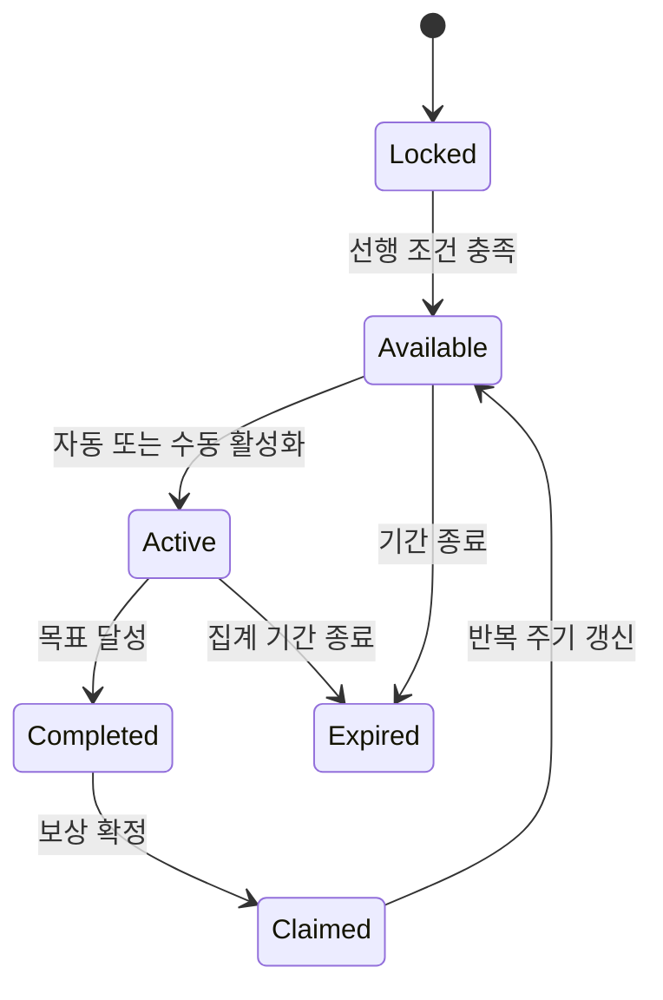

# 17. 임무·캠페인·이벤트·수집·라이브 운영

> 전투 바깥의 목표를 만드는 시스템. 실제 행사 사례는 기준일의 진행·종료 상태를 구분한다.

[전체 목차](README.md) · [경제](15_economy_rewards_and_monetization.md) · [매칭·클랜](13_matchmaking_ranked_and_clans.md)

## 1. 목적과 반복 주기

[분석] 같은 전투 규칙을 오래 즐기게 하려면 모든 이용자가 동일한 최종 목표만 추구할 필요는 없다. 전투 성과, 특정 함선 운용, 장기 수집, 친구와의 활동을 여러 진척으로 연결하면 같은 한 판이 다른 사용자에게 다른 의미를 갖는다.

| 반복 범위 | 시스템 예 | 만들어 내는 질문 | 위험 |
|---|---|---|---|
| 한 판 | 특정 조건·최고 기록 | 이번에는 무엇을 시도할까 | 승리보다 임무만 추구 |
| 하루 | 일일 보상·누적 플레이 | 오늘 어디까지 할까 | 지나친 접속 의무감 |
| 주간 | 단계별 임무 해금 | 다음 구간을 준비할까 | 막판에 과도한 부담 |
| 업데이트 | 패스·얼리 액세스 | 어떤 보상을 목표로 할까 | 동시 이벤트 정보 과부하 |
| 장기 | 캠페인·컬렉션·클랜 | 다음 수집·협력 목표는 무엇인가 | 신규·복귀자 목표 혼란 |

이 표는 현행 모든 이벤트의 운영 일정표가 아니라 시스템을 시간 범위로 분해한 분석이다.

## 2. 임무의 기본 구성

[확인] 전투 임무와 행사 보상은 전투 종류·함선 조건·기간·요구 성과에 따라 구분된다. 패스와 조선소는 이러한 임무 진척을 단계 보상에 연결하는 사례다. [R06][R15]

[제안] 개별 임무는 최소한 다음 정보를 가진다.

```yaml
MissionDefinition:
  mission_id: id
  revision: integer
  schedule:
    starts_at: server_time
    progress_ends_at: server_time
    claim_ends_at: server_time
  eligibility:
    battle_types: set
    ship_tiers: set
    ship_types: set
    nations: optional_set
    division_condition: optional
  objective:
    metric: base_xp_or_damage_or_capture_or_other
    operator: sum_or_max_or_count_or_all
    target: configured_number
    single_battle_required: boolean
    victory_required: boolean
  prerequisites: mission_or_stage_ids
  repeat_policy: once_or_periodic_or_repeatable
  reward_table_id: id
```

'피해 50,000 달성'도 누적과 한 전투 달성이 다르다. '승리 전투에서만 집계'와 '승리를 한 번 달성'도 다른 조건이다.

## 3. 진척 집계의 판정 순서

[제안]

1. 전투 결과가 정상적으로 확정되었는지 확인한다.
2. 해당 전투의 시각과 임무 활성 구간을 비교한다.
3. 모드·함선·계정·분대 조건을 판정한다.
4. 승리 조건 등 전투 결과 필터를 적용한다.
5. 지표를 정의한 연산자로 누적한다.
6. 목표 달성 시 완료 상태를 기록한다.
7. 보상 지급과 후속 단계 해금을 멱등하게 처리한다.

종료 시각을 '매칭 진입', '전투 시작', '전투 종료' 중 어디에 적용하는지는 서비스 정책이다. 원작의 모든 행사에 동일한 경계 정책이 있다고 단정하지 않는다.

## 4. 임무 상태 머신



[제안] 자동 지급 행사에는 `Completed → Claimed`가 한 트랜잭션으로 처리될 수 있다. 수동 수령 UI가 있는 경우 완료와 수령은 다른 상태다. 지급 애니메이션을 봤는지와 실제 지갑 반영을 같은 값으로 저장하지 않는다.

## 5. 캠페인: 긴 목표를 선택 가능한 과제로 분할

[확인] 캠페인은 과제를 통해 핀을 모으고 최종 과제를 열어 다음 단계로 진행한다. 일부 과제는 반복하여 핀을 다시 얻을 수 있지만 일반 과제 보상까지 매번 반복 지급되는 구조는 아니다. [R20]

[분석] 이 구조는 서로 다른 숙련도와 보유 함선을 가진 사용자에게 경로 선택을 준다.

| 요소 | 역할 | 재현 시 필요한 구분 |
|---|---|---|
| 단계 | 큰 목표의 순서 | 선행 단계 완료 |
| 과제 | 사용자가 선택하는 행동 | 활성 슬롯·진척 |
| 핀 | 단계 해금 수단 | 중복 과제로 재획득 가능 여부 |
| 과제 보상 | 첫 완료 보상 | 핀 반복과 별도 원장 |
| 최종 과제 | 다음 단계의 관문 | 요구 핀과 활성 조건 |
| 최종 보상 | 장기 목표 | 계정 소유·중복 처리 |

반복 가능한 쉬운 과제가 있다는 점은 '모든 과제를 완료해야 진행한다'는 오해를 줄여 준다. 반면 UI가 반복과 보상 재지급을 구분하지 못하면 보상 버그로 오인하기 쉽다.

## 6. 컬렉션: 누락 목록을 다음 목표로 바꾸기

[확인] 컬렉션은 요소를 모아 부분·전체 완성 보상을 받는 구조다. 같은 컬렉션의 중복 요소를 미보유 요소로 교환할 수 있으며, 교환 조건은 컬렉션마다 다르다. 일부는 추가 수집 경로가 별도로 존재한다. [R21]

[분석] 확률 수집만 존재하면 완성 직전의 기대 대기 시간이 길어진다. 중복 교환은 그 구간을 완화하고, 쓸모없어 보이는 중복 보상에도 앞으로의 가치를 부여한다.

### 6.1 자체 예제

총 12종, 10종 보유, 중복 6개, 미보유 1종을 얻는 데 중복 3개가 필요하다고 가정한다.

- 부족한 2종을 각각 교환하면 완성 가능하다.
- 하지만 완료 보상과 중복 정산을 각각 독립 처리하면 중복을 이중 환급할 위험이 있다.
- 교환 승인 → 중복 차감 → 요소 추가 → 완성 판정 → 보상 확정을 하나의 거래로 묶는다.

숫자는 설명용이며 실제 특정 컬렉션의 제원이 아니다.

## 7. 이벤트 패스·배틀 패스·조선소의 차이

| 구조 | 진척 원천 | 보상 방식 | 핵심 데이터 |
|---|---|---|---|
| 선형 이벤트 패스 | 행사 XP·임무 점수 | 단계별 경로 | 단계·무료/추가 보상 |
| 경로 선택형 패스 | 점수로 지역·칸 해금 | 선택 경로 | 노드·연결·잠금·영역 업그레이드 |
| 조선소 | 전용 임무·구매 단계 | 함선 건조 단계 | 무료 가능 단계·유료 필요 단계 |
| 얼리 액세스 | 패스·번들·특정 보상 | 연구 계통의 선행 획득 | 일반 해금 전환·모듈·상품 |

[확인·버전 사례] 15.6에는 지도 경로를 선택하는 패스 형식이 소개되었고, 15.10에는 Black Friday Event Pass가 운영된다. 패스의 형식을 영구적으로 하나라고 고정하면 안 된다. [R14][R01]

[분석] '패스'는 화면 모양보다 조건과 보상 연결을 먼저 모델링해야 한다. 그래야 선형 경로와 지도 경로가 같은 임무·보상 기반을 재사용할 수 있다.

## 8. 2026년 11월 기준 행사 사례

| 사례 | 기준일 상태 | 시스템적으로 참고할 내용 |
|---|---|---|
| Horror From the Abyss | 15.10 행사 | 전용 작전·함선 구성·주차별 진척 |
| 유럽 순양함 얼리 액세스 | 15.10 행사 | 신규 계통과 패스·교환 연결 |
| Black Friday 2026 | 현재 시즌 사례 | 고정 상품·컨테이너·수집 동기 |
| Marlborough B 조선소 | 종료 | 무료 단계와 유료 완성 조건의 분리 |

행사 존재·상태 근거는 [R01][R15][R16]이다. 각 행의 시스템 해석은 분석이다.

15.10의 Horror From the Abyss에는 전용 무장·모듈 조합이 있다. 이를 일반 무작위 전투의 기본 함선 조립·방어막·즉시 명중 무장이라고 설명하지 않는다. [R01]

## 9. 이벤트 전용 데이터의 격리

[제안] 다음 세 층으로 구분한다.

- 공통 전투 엔진: 이동·피해·효과·목표·UI 기반.
- 규칙 확장: 이벤트 전용 무장·방어막·강화·목표.
- 운영 콘텐츠: 단계 해금·주간 일정·보상·한정 재화.

공통 무장 타입을 수정해 이벤트를 구현하면 종료 이후 일반전의 밸런스까지 바뀔 수 있다. 공통 기능은 재사용하되, 실제 적용 대상과 계수는 이벤트 프로필에서 제한하는 구조가 적합하다.

## 10. 소셜·클랜·신규·복귀 연결

[분석] 소셜 시스템은 채팅 기능만으로 설명되지 않는다.

| 관계 | 전투에 주는 가치 | 운영에 주는 가치 | 주의할 점 |
|---|---|---|---|
| 분대 | 의사소통·역할 조합 | 재방문 약속 | 솔로와의 체감 격차 |
| 클랜 | 정기적 조직 활동 | 장기 소속·공동 목표 | 활동 시간·역할 부담 |
| 신규 초대 | 경험 공유·학습 도움 | 신규 진입 | 보상만을 위한 형식적 관계 |
| 복귀 | 과거 보유 함선 재활용 | 휴면 사용자 재진입 | 변경된 규칙 안내 부족 |
| 커뮤니티 행사 | 시청·대회·콘텐츠 소비 | 전투 밖 접점 | 실제 플레이 보상과 조건 혼동 |

구체적인 현재 모집 보상·지급 조건은 행사별로 달라지므로 고정 수치로 복제하지 않는다. 분대·클랜 전투의 실제 조건은 [13번](13_matchmaking_ranked_and_clans.md)에 연결한다.

## 11. 라이브 운영에서 관리해야 할 마찰

[분석]

1. 여러 행사가 같은 행동을 보상하면 효율적인 겹치기 경로가 생긴다.
2. 서로 반대되는 행동을 요구하면 승리와 임무 사이 갈등이 커진다.
3. 특정 함종만 쉬운 임무는 매칭의 함종 구성을 흔들 수 있다.
4. 짧은 기한의 고난도 과제는 마지막 구간에 참여를 몰리게 한다.
5. 이벤트 재화를 여러 종류로 나누면 목표는 선명해지지만 잔여 재화의 가치가 읽기 어려워진다.
6. 복귀 이용자에게 과거 스킬·위장·대공 설명을 그대로 보여 주면 학습 비용이 커진다.

따라서 임무 난도는 완료 시간만이 아니라 **팀 승리에 미치는 행동 변화**로 함께 평가해야 한다.

## 12. 분석 지표

[제안] 실제 원작 운영 지표가 아니라 재현 프로젝트의 측정안이다.

| 지표 | 계산 단위 | 해석 |
|---|---|---|
| 임무 유효 전투 비율 | eligible / attempted | 조건을 이해하고 있는가 |
| 단계별 이탈 | 단계 진입자 대비 다음 단계 진입 | 부담이 갑자기 커지는 구간 |
| 남은 기한별 완료 속도 | 일자·시간 코호트 | 막판 몰림·미완성 |
| 보상 수령 지연 | 완료→수령 | UI 이해·보상 가시성 |
| 목표 충돌 | 임무 참여/비참여의 승리 기여 차이 | 임무가 플레이를 왜곡하는가 |
| 이벤트 후 잔존 | 다음 행사·일반전 참여 | 보상이 활동 지속으로 이어지는가 |
| 재화 미사용 잔액 | 행사 종료 시 잔액 분포 | 교환 UX·가격·기한 이해 |

## 13. QA

| ID | 조건 | 확인할 결과 |
|---|---|---|
| LIVE-01 | 전투 한 번으로 여러 임무 완료 | 각각 집계하되 같은 임무 중복 지급 없음 |
| LIVE-02 | 누적과 단판 최고 기록 혼재 | 지표 연산자가 맞게 적용 |
| LIVE-03 | 기간 종료 직전 전투 | 행사별 시간 정책으로 일관 판정 |
| LIVE-04 | 캠페인 반복 과제 | 핀과 1회 보상을 분리 |
| LIVE-05 | 컬렉션 교환으로 마지막 요소 획득 | 중복 차감·완성 보상 원자 처리 |
| LIVE-06 | 패스 업그레이드 후 이전 단계 수령 | 소급 보상 대상과 이미 지급분 구분 |
| LIVE-07 | 무료 단계 전부 완료한 조선소 | 완성 가능 여부 정확 표시 |
| LIVE-08 | 서버 시간대와 로컬 날짜가 다름 | 리셋·기간 표시 일관성 |
| LIVE-09 | 동일 보상 요청 네트워크 재시도 | 재화·함선·기간 중복 없음 |
| LIVE-10 | 이벤트 종료 후 일반전 | 전용 무장·수치·아이템 효과가 남지 않음 |

## 14. 출처

| ID | 자료 | 범위·열람일 |
|---|---|---|
| R20 | [Campaigns](https://wiki.worldofwarships.com/Ship:Campaigns) | 캠페인 핀·반복·완료, 2026-11-13 |
| R21 | [Collections](https://wiki.worldofwarships.com/Ship:Collections) | 수집·중복 교환, 2026-11-13 |
| R01 | [Update 15.10](https://worldofwarships.com/en/news/game-updates/update-1510-horror-from-the-abyss/) | 현행 행사와 전용 규칙 |
| R06 | [Update 15.8](https://worldofwarships.com/en/news_ingame/news/game-updates/update-158-11-years-of-glory) | 임무·패스·조선소 연결 사례 |
| R14 | [공식 Steam 업데이트 모음](https://store.steampowered.com/news/posts/?appgroupname=World+of+Warships&appids=552990&enddate=1787997652&feed=steam_community_announcements) | 15.6 경로 선택형 패스 사례 |
| R15 | [Marlborough B Dockyard](https://worldofwarships.com/en/news/general-news/dockyard-marlborough-b/) | 종료일·무료 단계·완성 조건 |
| R16 | [Black Friday 2026](https://worldofwarships.com/en/news/sales-and-events/black-friday-2026/) | 현행 시즌 보상 사례 |
