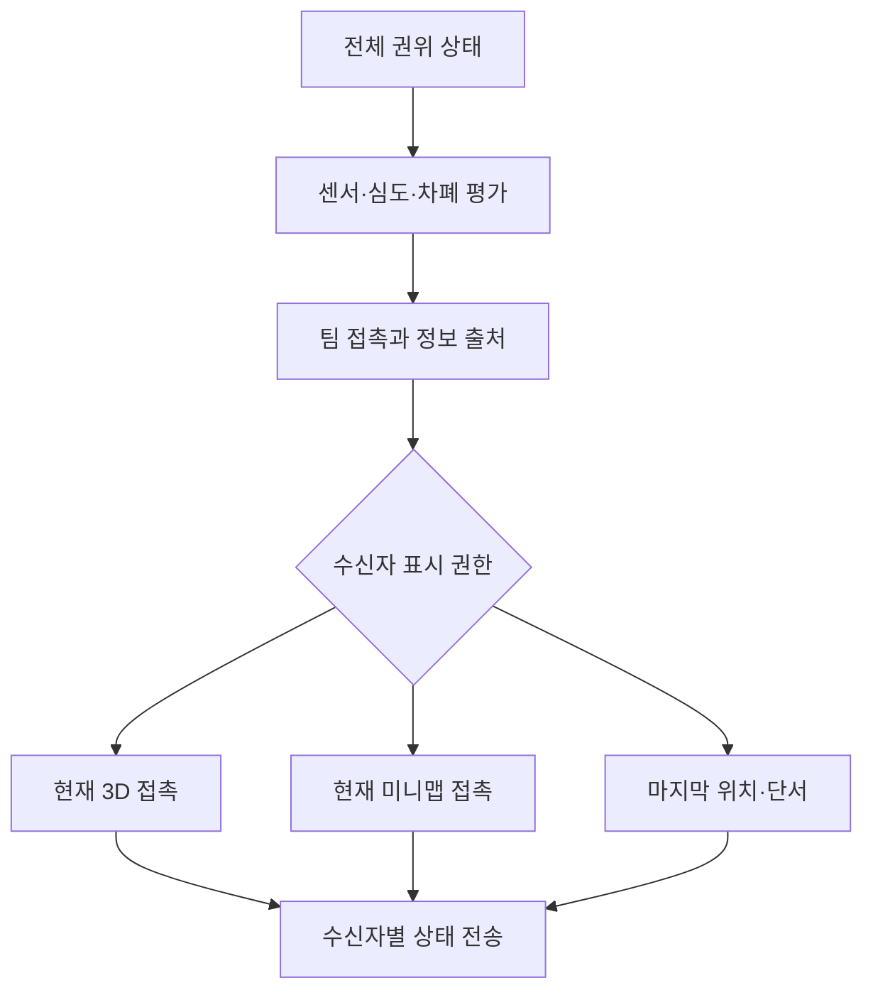

# 19. 재현용 구현 구조·데이터 계약·통합 QA

> **문서 전체는 공개 규칙을 재현하기 위한 구현 제안이다. 원작의 내부 구현·소스코드·네트워크 프로토콜을 확인한 문서가 아니다.**  
> 기준 규칙: World of Warships PC 글로벌, 2026-11-13 / 15.10 계열. 원작 규칙의 근거는 각 시스템 문서의 출처를 따른다.  
> 이 문서의 상태·필드·처리 순서·검증 게이트는 모두 `[제안]`이다. 실제 테스트를 실행하거나 원작과의 동등성을 입증한 결과가 아니다.  
> 관련: [전체 목차](README.md) · [범위·근거](00_scope_evidence_and_version.md) · [밸런스·검증](18_balance_metrics_and_validation.md)

## 1. 재현 목표와 비목표

목표는 동일한 입력과 조건에서 설명 가능한 전투 결과를 얻고, 함선별 예외와 패치 변경을 데이터로 추적할 수 있는 구조다. 화면을 비슷하게 만드는 것과 판정의 원인을 재현하는 것은 별도의 작업이다.

| 목표 | 구체적 산출물 | 동등성 판단 방법 |
| --- | --- | --- |
| 규칙 재현 | 장갑·탐지·상태·승패의 명세 | 경계 사례별 공개 규칙과 비교 |
| 조작 재현 | 기관·조타·포 회전·발사 응답 | 동일 초기 조건의 입력·궤적 비교 |
| 정보 재현 | 직접 탐지·공유·미니맵·단서 | 수신자별 보이는 정보 비교 |
| 확장성 | 함선·계통·모드별 정의 | 신규 예외 추가 시 기존 데이터 회귀 검사 |
| 결과 정합성 | 전투 결과·보상·진행 상태 | 재전송·재접속·중복 수신 검사 |

원작의 서버 틱 빈도, 물리 엔진, 지연 보상, 난수 알고리즘, 멀티스레드 분할 방식은 확인하지 않았다. 본 문서에서 특정 엔진이나 수치를 선택하더라도 그것은 새 프로젝트의 선택이며 원작을 설명하는 사실이 아니다.

## 2. 권위 서버와 클라이언트 책임

전투의 최종 판정은 하나의 권위 주체가 확정하도록 제안한다. 클라이언트는 입력을 보내고 조작 피드백을 즉시 표현하되, HP·관통·탐지·보상을 스스로 확정하지 않는다.

| 주체 | 책임 | 주고받는 계약 |
| --- | --- | --- |
| 입력 클라이언트 | 조타·기관·조준·무장·능력 입력 | 순번 있는 명령, 마지막 확인 순번 |
| 전투 권위 서버 | 이동·발사·피해·센서·승패 | 상태 변화, 허용된 이벤트 |
| 표시 클라이언트 | 보간·카메라·음향·시각 효과 | 수신한 권위 상태의 시각화 |
| 결과 서비스 | 확정 결과의 보상·임무 반영 | 불변 결과 ID와 멱등 처리 |
| 운영 데이터 | 검증된 함선·규칙·모드 정의 | 버전·내용 해시·호환성 |

조준 카메라와 입력 피드백은 빠르게 반응시킬 수 있다. 실제 선체 위치를 예측할지, 어느 상태를 보간할지, 발사 효과를 낙관적으로 표현할지는 측정된 네트워크 조건에 맞춰 별도 결정한다. 히트 판정을 과거로 되돌리는 지연 보상은 기본 사실로 가정하지 않는다.

### 명령 최소 형식

```yaml
InputCommand:
  battle_id: stable_id
  controlled_entity_id: ship_or_squadron_id
  sequence: monotonic_integer
  client_sample_time: diagnostic_only
  input_kind: throttle_or_rudder_or_aim_or_fire_or_ability
  payload: typed_parameters
  last_received_state_sequence: integer
```

서버는 소유권·현재 조작 대상·상태·사거리·장전·입력 순서를 검증한다. 중복 순번은 다시 실행하지 않는다. 클라이언트 시각은 진단과 동기화에 쓰되, 클라이언트가 임의의 과거 시점으로 발사 결과를 바꿀 수 있는 권한으로 취급하지 않는다.

## 3. 전투 시작 시 규칙과 구성 고정

전투 도중 라이브 데이터가 바뀌어도 이미 시작한 전투의 조건이 섞이지 않도록 규칙 스냅샷을 고정한다. 계정의 현재 장착 상태를 매번 조회하는 대신 전투 입장 시 승인한 구성을 사용한다.

```yaml
BattleRuleSnapshot:
  battle_id: stable_id
  ruleset_version: explicit_version
  content_manifest_hash: content_hash
  map_revision: map_and_collision_revision
  mode_profile: mode_id_and_revision
  participants: approved_loadout_snapshots
  rng_policy_version: version
  simulation_policy_version: version
  outcome_policy_version: version
```

| 고정할 항목 | 이유 |
| --- | --- |
| 함선·선체·무장 정의 | 전투 중 연구·구매가 성능에 영향을 주지 않음 |
| 함장·강화 장치·신호·소모품 구성 | 전투 결과와 실제 사용 빌드를 재현 |
| 지도 충돌·장갑 자산 | 패치 후 리플레이에서 충돌 위치가 달라지는 문제 방지 |
| 게임 모드 보정 | 잠수함의 일반 전투·작전 예외를 분리 |
| 보상·임무 판정 버전 | 늦게 도착한 결과도 해당 전투 조건으로 정산 |

연결 규칙: [함종·함선 분류](02_ship_classes_and_nations.md), [잠수함의 모드 예외](10_submarines_and_asw.md), [성장·장착](14_progression_commanders_and_builds.md).

## 4. 정의 데이터와 런타임 상태

공유 정의는 읽기 전용이며, 전투 중 변화는 인스턴스에 저장한다. 함선 이름·국가를 코드 분기의 조건으로 사용하기보다 기능과 규칙 프로파일을 명시한다.

| 객체 | 핵심 필드 | 불변 조건 |
| --- | --- | --- |
| `ShipDefinition` | ID, 함종, 국가, 단계, 구성 요소 참조, 기능 태그 | 표시 이름이 바뀌어도 ID 유지 |
| `LoadoutSnapshot` | 선체·무장·함장·강화·신호·능력·모드 보정 | 허용 슬롯·중복·필수 조건 검증 완료 |
| `ShipRuntime` | 팀, 생명 상태, 위치, 속력, 방향, 현재 HP, 구성 요소 ID | 정의 데이터 자체를 수정하지 않음 |
| `MovementRuntime` | 기관 명령, 실제 속력, 명령·실제 타각, 회두 속도, 접촉 | 입력과 응답 상태 분리 |
| `WeaponRuntime` | 포탑·발사관별 방향, 탄종, 발사 준비 상태, 장전 진행, 발사 모드 | 손상 상태와 장전 진행 독립 |
| `AmmoDefinition` | 탄종, 구경, 탄도·산포·신관·피해·표적 자격 참조 | 발사 후 적용 프로필 불변 |
| `ArmorVolume` | 부위 ID, 판 두께, 법선, 재질 규칙, 내부 구획 연결 | 시각 LOD와 독립 |
| `ModuleRuntime` | 모듈 HP, 정상·손상·치명적 손상, 복구 시각 | 영구 파괴를 기본 상태로 두지 않음 |
| `RepairLedger` | 피해 원인별 실제 손실, 회복 적격량, 소비량 | 회복 시 같은 양을 장부에서 차감 |
| `SensorDefinition` | 대상 종류, 거리, 심도, 차폐, 공유·표시 정책 | 일반 탐지와 단서 구분 |
| `ContactRuntime` | 관측자·팀·목표, 원인, 유효 시각, 마지막 위치, 정보 수준 | 정보가 만료되면 실시간 추적 중단 |

HP·구획 포화·모듈 HP·회복 적격 장부는 서로 다른 자원이다. 탄 하나가 선체와 모듈 양쪽에 영향을 줄 수 있으므로 하나의 `Damage` 숫자만으로 모든 상태를 대체하지 않는다. 계약의 공개 규칙 기준은 [05](05_armor_penetration_and_damage.md)·[06](06_survivability_modules_and_dot.md)이다.

## 5. 예외 적용의 우선순위

데이터 적용 순서를 다음처럼 제안하되, 수학 연산 순서까지 단순한 마지막 값 덮어쓰기로 통일하지 않는다.

1. 공통 규칙과 탄종·센서·무장 계열의 기본값을 읽는다.
2. 함선·연구 모듈·개별 장비의 명시적 예외를 적용한다.
3. 입장 시 고정한 빌드의 보정을 적용한다.
4. 모드·시나리오에서 허용하는 덮어쓰기를 적용한다.
5. 전투 중 상태·능력 효과를 적용한다.
6. 최종 허용 조건과 수치 범위를 검증한다.

| 연산 종류 | 저장할 정보 | 예시 |
| --- | --- | --- |
| 가산 | 단위·적용 대상 | 추가 횟수 |
| 곱셈 | 배율·결합 그룹 | 재장전 처리량 보정 |
| 교체 | 원본 필드·우선순위 | 모드 전용 근거리 어뢰 피해 프로필 |
| 상한·하한 | 비교 기준·적용 단계 | 특정 대상에 대한 피해 제한 |
| 기능 제한 | 조건·사유 | 해당 모드에서 능력 사용 불가 |

각 최종값에 `원본 → 적용 효과 → 최종값`의 추적 정보를 남긴다. 동시에 적용된 두 효과가 충돌하면 우연한 로딩 순서로 결과를 정하지 말고 데이터 빌드 단계에서 오류로 드러내는 편이 좋다.

## 6. 이동: 평면 전투와 시각 파도 분리

첫 수상함 프로토타입은 수평 위치·방향·속력·타각을 권위 상태로 두고 높이·기울기·파도 응답을 표시 계층에서 구성할 수 있다. 잠수함에는 실제 게임 규칙에 필요한 깊이 상태를 추가한다. 이는 구현 선택이며 원작이 동일한 방식을 쓴다는 주장이 아니다.

| 필요한 현상 | 권장 첫 구현 | 실제 부력·유체가 필요한지 판단 |
| --- | --- | --- |
| 가속·감속·선회 | 측정한 곡선 기반 이동 | 입력 응답 재현만으로 충분할 수 있음 |
| 함체 흔들림·항적 | 시각 메시·효과의 별도 갱신 | 시각 표현만이면 판정에 넣지 않음 |
| 섬·함선 접촉 | 판정용 선체 형상과 접촉 제약 | 강체 접촉은 후보지만 유체 해석과 별개 |
| 잠수·부상 | 깊이 상태·전환 곡선 | 전투 심도 규칙 재현과 부력 계산은 별개 |
| 파도에 의한 사선·피격 변화 | 요구사항과 실측으로 결정 | 실제로 게임 규칙에 영향이 있어야 도입 |

표시된 선체가 크게 흔들리는데 판정 형상이 고정되어 있다면 오차 허용 범위를 정해야 한다. 반대로 연출의 매 프레임 흔들림이 장갑 입사각을 무작위로 바꾸면 조준·도탄 결과의 설명성이 나빠질 수 있다. 우선 [03 기동](03_navigation_and_maneuvering.md)의 입력 응답부터 검증한다.

## 7. 탄도·다층 장갑·어뢰의 권위 판정

각 논리 구간에서 발사체의 이전 위치와 다음 위치 사이를 질의한다. 빠른 포탄을 점 위치의 겹침만으로 검사하면 얇은 장갑을 통과해 버릴 수 있으므로 선분 추적 또는 적절한 크기의 sweep을 검토한다. trace/sweep의 선택은 판정 형상과 성능 목표에 따른 제안이다.

| 단계 | 입력 | 저장해야 할 출력 |
| --- | --- | --- |
| 발사 확정 | 승인된 입력·무장 상태 | 발사 이벤트 ID, 무장·탄종 스냅샷 |
| 경로 갱신 | 탄도 프로필·이전 상태 | 새 위치·속도·누적 이동 거리 |
| 후보 접촉 | 이동 구간·판정 채널 | 접촉 거리순 후보와 부위 ID |
| 장갑 처리 | 입사 방향·속도·판·신관 | 도탄·정지·통과·신관 상태 |
| 다음 층 탐색 | 통과 위치·남은 이동 구간 | 내부 판·구획 접촉 |
| 피해 확정 | 유효 폭발·부위·포화·보호 규칙 | 선체·모듈·회복 장부 이벤트 |

다층 판정에서는 같은 판을 수치 오차로 반복 검출하지 않도록 접촉 식별과 재진입 정책을 둔다. 한 발이 여러 층을 지났다는 이유로 최대 피해를 층마다 반복 적용하지 않는다. 워터라인·수중 진입·공간장갑 등의 예외는 [05](05_armor_penetration_and_damage.md)의 별도 프로필로 둔다.

어뢰는 신관 작동 거리·누적 주행 거리·표적 함종·심도·초기 선회·유도를 분리한다. 잠수함 근거리 피해의 기준을 발사자와 표적의 현재 거리로 잘못 계산하지 않도록 `distance_travelled`를 유지한다. 아군 무장 차단과 아군 직접 피해 허용 여부도 별도 정책이다. 연결: [07](07_torpedoes_and_area_denial.md)·[10](10_submarines_and_asw.md).

### 격침과 이미 발사된 객체

발사 확정 후의 포탄·어뢰는 독립 수명으로 처리하는 정책을 우선 제안한다. 발사자 격침 시 발사체를 일괄 삭제하지 않고, 격침 이후 새 발사 요청은 차단한다. 실제 원작의 무장·모드별 예외는 실측으로 확인해야 한다.

`source_player_id`, `source_ship_id`, `spawn_event_id`를 남기면 발사자 객체가 제거되어도 피해·격침·보상 귀속을 유지할 수 있다. 모함 격침 후 잔존 편대의 조작 종료는 포탄 수명과 다른 규칙으로 정의한다. 관련: [09 항공](09_carriers_aircraft_and_aa.md).

## 8. 항공·잠수함·대잠의 서로 다른 위상

| 객체·위상 | 독립 상태 | 재사용하면 안 되는 단순화 |
| --- | --- | --- |
| 공격 편대 | 출격·접근·공격 준비·투하·이탈·귀환 | 모든 항공기를 수상함처럼 처리 |
| 전투기 | 배치·대기·요격·종료 | 전투기를 일반 정찰 센서로 복제 |
| 대공 | 지속 피해·폭발 구름·우선대공·집중대공 | 주포 탄환과 완전히 같은 처리로 고정 |
| 잠수함 | 수상·잠망경·잠항·깊이 전환·잠항 자원 | 단순히 렌더링만 숨기는 기능 |
| 음향 어뢰 | 무유도·유도·유도 종료 | 표식 제거 시 어뢰 자체 삭제 |
| 대잠 공격 | 투사·접근·폭발·깊이별 영향 | 일반 포탄의 수면 충돌로 종료 |

이 표는 구현용 위상 분해다. 2026 전투기의 정찰 제거와 현행 대공 입력·충전 구조는 [09](09_carriers_aircraft_and_aa.md), 잠수함의 심도별 탐지·공격·점령은 [10](10_submarines_and_asw.md)을 기준으로 한다. 공격 종류가 달라도 최종 피해 이벤트 계약은 공유할 수 있다.

## 9. 모듈·DCP·회복 장부

14.8 이후 재현 기준에는 정상·손상·치명적 손상을 사용한다. 일반 손상과 치명적 손상에 같은 DCP 즉시 복구 로직을 적용하지 않는다. 포탑·발사관 무력화 시에는 장전 진행을 보존하고 정지 상태를 기록한다. 공개 규칙과 예외는 [06](06_survivability_modules_and_dot.md)을 따른다.

| 처리 | 계약 |
| --- | --- |
| 일반 손상 복구 | 자동 복구·허용된 DCP 경로를 평가 |
| 치명적 손상 | 정해진 회복 경로 사용; 일반 DCP 효과로 건너뛰지 않음 |
| 장전 정지 | 진행률과 정지 원인을 별도 저장 |
| 장전 가속과 손상 동시 발생 | 가속의 시간과 장전의 진행 시간을 각각 갱신 |
| 수리반 | 회복 가능 장부·회복 속도·최대 HP에 의해 제한 |
| 격침 확정 | 이후 회복이 HP를 되살리지 않도록 생명 상태 검증 |

동일 논리 구간에 피격·DCP·화재 발생·수리반 회복·격침이 겹칠 때의 정산 순서를 명시적으로 고정한다. 그 순서는 새 프로젝트의 판정 정책이며 원작의 실행 순서를 확인했다는 뜻이 아니다. [11 소모품](11_consumables_and_tactical_cycles.md)의 상태 수명과 함께 검증한다.

## 10. 탐지 권한과 수신자별 복제

권위 서버가 모든 적의 위치를 아는 것과 모든 클라이언트에 그 위치를 보내는 것은 별개다. 접촉 평가 뒤에 수신자별 정보 필터를 적용하도록 제안한다.



| 정보 수준 | 보낼 수 있는 데이터 예 | 주의 |
| --- | --- | --- |
| 현재 3D 접촉 | 허용된 현재 위치·방향·상태 | 표시 범위·공유 지연 반영 |
| 미니맵 현재 접촉 | 정책에 맞는 현재 지도 위치 | 숨은 정밀 상태 전체를 함께 보내지 않음 |
| 마지막 발견 | 마지막 좌표·발견 시각 | 이후 실제 위치로 계속 갱신하지 않음 |
| 방향·핑·기름 단서 | 단서 위치·형태·발생 시각 | 실제 함체 추적기로 바꾸지 않음 |
| 접촉 없음 | 허용된 존재·명단 정보만 | 적 장전·소모품·정밀 위치의 누출 방지 |

레이더의 팀 공유 지연, 연막, 사이클론, 항공 피탐지, 잠수함 단서는 [08](08_detection_vision_and_information.md)·[10](10_submarines_and_asw.md)의 서로 다른 정책을 참조한다. 재접속 시에도 같은 필터로 초기 상태를 만들며, 개발자용 전지적 로그와 플레이어용 표시 데이터를 분리한다.

## 11. 난수·로그·재현성

난수 정책은 버전으로 고정하고 전투·행동·무장·표본을 식별할 수 있게 한다. 예를 들어 발사 이벤트 ID와 포탄 번호에서 난수 스트림을 선택하면 다른 무장의 처리 순서가 바뀌었다고 산포 결과까지 달라지는 문제를 줄일 수 있다. 이는 제안이며 원작의 RNG 구조가 아니다.

| 로그 묶음 | 필수 기록 |
| --- | --- |
| 재현 헤더 | 규칙·콘텐츠·맵 버전, 난수 정책, 초기 상태 해시 |
| 명령 | 순번, 수신·적용 시각, 검증 결과, 거절 사유 |
| 공격 | 발사 ID, 탄종, 적용 보정, 잠금 상태, 산포 표본 식별 |
| 판정 | 접촉 부위·각도, 장갑 결과, 신관, 피해·포화·회복 장부 변화 |
| 정보 | 접촉 원인·시작·종료·수신자 권한 변화 |
| 결과 | 종료 원인, 결과 ID, 보상 처리 상태 |

다른 CPU·실행 환경에서 비트 단위 재현까지 요구할지는 별도 결정한다. 우선 같은 빌드·동일 데이터에서 이벤트와 결과가 반복되는지 검증하고, 이후 허용 오차와 수치 정밀도 정책을 정한다. 전체 로그를 매 프레임 남기는 대신 사건 기록과 주기적 체크포인트를 조합할 수 있다.

## 12. 승패 확정과 경제 결과의 멱등성

전투 결과를 `진행 중 → 종료 판정 → 결과 확정 → 계정 반영 → 확인 응답`으로 나눈다. 종료 후 클라이언트의 결과 화면이 열리지 않았다는 이유로 보상 확정을 다시 계산하지 않는다.

`result_id = (battle_id, participant_id)`처럼 불변 정산 식별자를 두고, `outcome_revision`은 별도 버전으로 저장한다. 계정 원장에 이미 반영된 같은 버전이면 같은 처리 결과를 반환한다. 결과 정정이 필요하면 새 버전의 전체 보상을 다시 지급하지 않고 기존 원장에 연결한 차액·보정 거래를 사용한다.
재시도는 허용하되 크레딧·경험치·임무 카운터가 중복 증가하지 않아야 한다. 원작의 DB 구현을 추정한 것이 아니라 재현 서비스의 계약이다.

| 실패 상황 | 제안 처리 |
| --- | --- |
| 결과 저장 직후 응답 유실 | 같은 결과 ID 조회·재전송 |
| 크레딧 반영 후 임무 서비스 장애 | 반영 완료 단계 기록 후 미완료 단계만 재시도 |
| 결과 메시지 중복·역순 도착 | 버전·상태 전이 검증, 동일 원장 키 중복 차단 |
| 전투 중 연결 종료 | 서버 전투 결과로 정산; 화면 접속 상태와 분리 |
| 운영 데이터 업데이트 | 해당 전투의 결과·보상 정책 버전 적용 |

관련 규칙: [승패](01_core_loop_and_victory.md), [경제·보상](15_economy_rewards_and_monetization.md), [임무·이벤트](17_missions_events_and_liveops.md).

## 13. 단계별 MVP와 통과 게이트

| 단계 | 포함 범위 | 다음 단계 진입 조건 |
| --- | --- | --- |
| M1 입력·기동 | 평면 이동, 조타·기관, 단일 지도 | 같은 입력의 경로가 반복되고 충돌 탈출 가능 |
| M2 수상 포격 | 포탑, 탄도, 탄종, 단순 장갑·HP | 명중 전후의 실패 원인이 로그로 설명됨 |
| M3 피해·복구 | 다층 장갑, 포화, 모듈, DoT, DCP·수리반 | 경계 피해·장전 정지·회복 장부 불변식 통과 |
| M4 정보·어뢰 | 탐지·연막·거점, 직진·심해 어뢰 | 수신자별 정보와 아군 무장 차단 검증 |
| M5 비대칭 함종 | 편대·대공, 심도·핑·대잠 | 공격 수단과 대응 수단을 함께 검증 |
| M6 메타 연결 | 장착 스냅샷·결과·보상·재접속 | 중복 결과·데이터 업데이트에도 계정 정합성 유지 |

각 게이트는 아래 시험의 명세를 뜻하며 본 작업에서 통과했다는 뜻이 아니다. 성능 테스트는 기능별 실제 후보 수·활성 발사체·센서 질의량을 측정한 뒤 목표 하드웨어와 동접 규모를 정해 수행한다. 근거 없는 서버 틱·대역폭·세션 수 목표를 원작 사양으로 제시하지 않는다.

## 14. 통합 QA 시나리오

| ID | 재현 조건·행동 | 기대 검증 |
| --- | --- | --- |
| INT-01 | 같은 발사 입력 순번을 두 번 전송 | 포탄 생성·발사 기록·장전 시작이 한 번만 발생 |
| INT-02 | 조타 명령 재전송·역순 수신 | 확정된 명령 순서와 일관된 기동 |
| INT-03 | 전투 중 계정 장착 변경·패치 데이터 배포 | 진행 중 전투의 구성·규칙은 스냅샷 유지 |
| INT-04 | 고속 탄이 한 구간에 얇은 외판·내부판을 통과 | 두 층 검출, 중복 피해·터널링 없음 |
| INT-05 | 오버매치 가능 외판 뒤 두꺼운 내부판 | 외판 통과가 집중방호구역 피해를 보장하지 않음 |
| INT-06 | 포화 직전 부위에 다수 포탄 동시 명중 | 이벤트 순서·구획 잔량·실제 피해 일관 |
| INT-07 | 장전 80%에서 일반 손상 후 DCP | 진행 보존과 허용된 복구 경로 확인 |
| INT-08 | 치명적 손상 상태에 DCP, 동시에 가속 만료 | 부당한 즉시 복구·장전 초기화·시간 정지 없음 |
| INT-09 | 화재·관통·회복이 같은 구간에 발생 | HP와 회복 장부가 정의한 순서로 정산 |
| INT-10 | 발사 확정 직후 발사자 격침 | 독립 발사체 수명·피해 귀속, 새 발사 차단 |
| INT-11 | 아군을 관통하는 경로로 어뢰 발사 | 아군 직접 피해와 무장 차단 정책 분리 |
| INT-12 | 어뢰가 표적 근처에서 크게 선회 | 주행거리 기준과 직선거리 기준 혼동 없음 |
| INT-13 | 동일 잠수함으로 PvP·작전 규칙 실행 | 근거리 피해·기동 보정의 모드 분리 |
| INT-14 | 레이더 직후 두 아군의 서로 다른 표시 조건 | 사용자·동료·미니맵 권한과 지연 일치 |
| INT-15 | 마지막 발견만 남은 적이 방향 변경 | 마지막 표식이 실제 위치를 몰래 추적하지 않음 |
| INT-16 | 주포 발포 중 항공 관측, 전투기만 존재하는 관측 | 제거된 항공 발포 페널티·전투기 정찰 부활 없음 |
| INT-17 | 핑 단서만 존재하거나 DCP로 유도 표식 해제 | 단서와 탐지 분리, 어뢰는 정책에 맞게 계속 이동 |
| INT-18 | 같은 난수·명령을 재생하고 무관한 객체 처리 순서 변경 | 정의한 재현성 범위에서 결과 유지 |
| INT-19 | 격침·종료 순간 재접속 후 결과 메시지 중복 수신 | 올바른 종료 상태와 보상 1회 반영 |
| INT-20 | 보상 일부 처리 후 서비스 실패·재시도 | 원장·임무·경험치가 누락·중복 없이 수렴 |

## 15. 표준 재현 절차와 완료 조건

1. 실패한 테스트 ID, 기대 규칙의 시스템 문서, 실제 관측 차이를 기록한다.
2. 규칙 스냅샷·콘텐츠 해시·맵·함선·빌드·모드·초기 상태를 고정한다.
3. 최소한의 참가자·무장·센서만 남겨 원인을 분리한다.
4. 입력 명령·적용 시각·난수 식별·판정 로그·수신자별 표시를 함께 수집한다.
5. 같은 조건을 반복해 항상 실패하는지, 확률적으로 실패하는지 구분한다.
6. 수정 후 원래 실패 사례와 직접 연결된 인접 경계만 재검증한다.
7. 규칙 변경인지 구현 결함 수정인지 기록하고 데이터·문서 버전을 함께 갱신한다.
8. 해당 게이트의 미해결 항목이 없고 로그로 결과를 설명할 수 있을 때 다음 범위로 확장한다.

이 계획의 완료 조건은 “원작과 같은 엔진을 썼다”가 아니라 **공개 규칙과 관측 가능한 행동을 재현하고, 미확인 영역을 숨기지 않으며, 새 예외가 기존 결과를 깨뜨리지 않는 것**이다. 본 문서에는 실행된 테스트 결과나 측정된 성능 수치가 포함되어 있지 않다.
