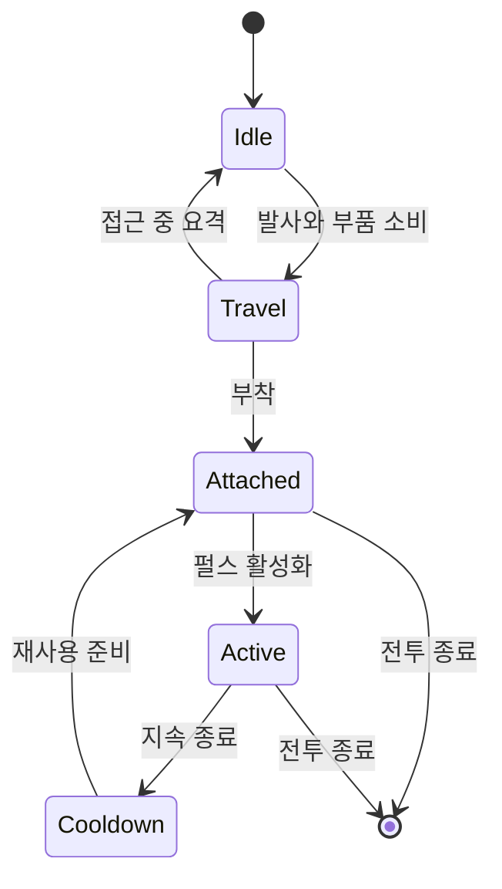

# STARWARD v6 — 발사 명령·텔레포트·특수 능력

> 작성 기준: 2026-11-16. 이 문서는 실제 v6 구현 규칙을 기록합니다. 실행 시험·브라우저 확인 결과는 [검증 문서](v6_validation_and_compatibility.md)에서 확정합니다.

## 1. 발사할 수 있는 상태를 읽기

무기는 전력, 실제 충전, 탄약, 표적과 전투 상태를 모두 사용합니다. 조준은 방을 지정하는 명령이고 발사는 탄을 생성하는 명령입니다. 충전 중에도 단발을 예약할 수 있으며 정지 중 명령은 전투 시간을 진행하지 않습니다. 조건을 갖춘 예약은 재개 후 충전이 끝나면 한 번 실행됩니다.

`getWeaponFireStatus(id)`는 UI와 명령에서 함께 사용할 상태를 반환합니다. 조회는 자원·충전·난수·로그를 바꾸지 않습니다.

| 필드 | 의미 |
|---|---|
| `ok`, `code`, `message` | 현재 상태와 구체적인 안내 |
| `powered` | 실제 전력을 공급받는가 |
| `ready`, `chargeRemaining` | 실제 발사 준비와 남은 충전 시간 |
| `canQueue`, `queued` | 예약할 수 있는가, 이미 예약했는가 |
| `paused` | 실제 시간 진행을 기다리는가 |

충전 게이지가 반올림되어 READY에 가깝게 보이는 것만으로 실행을 허용하지 않습니다. 전력 부족·탄약 없음·표적 미지정·상대 은폐·이미 예약됨을 구분합니다. 실패한 명령은 탄약·투사체·ID·난수를 소비하지 않습니다.

### 1.1 단발·자동·일제 명령

`fireWeapon(id)`는 충전 중인 유효 무기의 단발 예약 또는 준비된 무기의 실제 발사를 처리하고 `{ok, queued, message}`를 반환합니다. 같은 예약을 반복 접수하지 않습니다. `cancelWeaponOrder(id)`로 취소할 수 있습니다. `fireAllReady()`는 이름을 유지하면서 각 무기의 실제 접수 결과와 `count`를 반환합니다.

자동 사격은 표적을 유지하며 충전마다 반복합니다. 수동은 완충을 유지하고 단발 명령을 기다립니다. 두 모드 모두 실제 발사 때 탄약을 차감합니다. 빔은 상대 함선의 실제 도면에 시작·끝 방을 지정하고, 정해진 길이 안에서 통과하는 방을 판정합니다. 공간 판정은 [v5 이동·빔 명세](v5_navigation.md)를 유지합니다.

### 1.2 조작 경로에서의 문제

이전 화면에서는 무기 모드 버튼을 누른 뒤 Space를 누르면 브라우저의 버튼 기본 동작이 실행될 수 있었습니다. 전투는 정지한 채 자동/수동만 바뀌는 실제 경로가 확인되었습니다. v6의 전투 Space는 입력 필드·대화창 등의 예외를 제외하고 전역 정지/재개로 처리하며 버튼의 기본 활성화를 막습니다.

프레임마다 갱신되는 무기 카드가 누름과 뗌 사이에 교체되는 문제도 수정했습니다. 브라우저가 정규화한 `innerHTML` 대신 마지막 생성 문자열을 `WeakMap`에 기억하여 동일 내용의 반복 교체와 입력 초점 이탈을 막습니다. 단위 시험의 강제 완충 성공만으로 UI 발사를 검증했다고 하지 않습니다. 실제 출항·조준·재개·충전·발사·적 상태 변화를 브라우저와 공개 명령에서 확인합니다.

## 2. 전송실 집결과 강습

텔레포터는 선택한 승무원을 아무 방에서 바로 빼내는 기능이 아닙니다. 기본 송신실은 의료실이며 `ship.teleportRoomId`와 `ship.teleportCapacity`가 명시됩니다. 일반 기본 정원은2명입니다. 레이아웃이 정원4를 명시하더라도 실제 방 크기와 맞아야 합니다.

1. 승무원을 선택하고 `stageTeleport(ids)`로 송신실 집결을 명령합니다.
2. 실제 문 경로를 따라 송신실 안에서 이동을 마칩니다. 집결 명령의 목적지는 방 중심이지만 전송 검사는 방 내부의 정지 상태를 허용합니다. 정지 중에는 좌표가 변하지 않습니다.
3. `getTeleportStatus('send', ids, roomId)`로 대상·전력·정원·집결·재사용 대기를 확인합니다.
4. 준비된 인원만 `teleportCrew(ids, roomId)`로 보냅니다.

송신 인원은 본함에 있는 생존 소유 인원이며 송신실에 도착해 이동을 마쳐야 합니다. 잘못된 인원이나 초과 정원은 일부만 이동시키지 않고 거절합니다. 송신 후 소유 배열은 유지되고 `shipId`만 실제 위치를 가리킵니다. 적선에서의 문·산소·전투·이동은 상대 도면을 사용합니다.

| 실효 전력 단계 | 송신 또는 회수 후 재사용 대기 |
|---:|---:|
| 1 | 20초 |
| 2 | 15초 |
| 3 | 10초 |

### 2.1 회수

`recallCrew(ids)`는 **같은 적 방**에 모인 인원을 회수합니다. 여러 방에서 임의로 골라 한 번에 모으지 않습니다. 송신 패드2명과 회수 상한을 동일시하지 않으며, 본함 방이 수용할 수 있으면 한 번에4명까지 회수합니다. UI는 선택 인원의 위치와 회수 가능 사유를 보여주어야 합니다.

상대 은폐는 송신·회수를 막습니다. 상대 특수 실드는 송신을 막지만 이미 건너간 아군의 귀환까지 가로막지는 않습니다. 선체 파괴·함선 도약으로 강습대를 잃는 위험은 유지합니다. 적 승무원을 모두 제압해 확보한 배에서는 생존 강습대를 정상적으로 정리합니다.

## 3. 은폐

가동 전력1/2/3은5/10/15초 은폐를 제공합니다. 회피에60%p를 더하고 상대 일반 무기 충전을 멈추지만 이미 비행 중인 탄을 삭제하지 않습니다. 정지가 아니라 시간이 흐르는 방어 능력입니다.

일반 무기의 한 차례 발사는 현재 가동 단계의 최대 은폐 시간20%를 차감합니다. 예를 들어2단계 은폐에서는 한 차례 발사마다2초를 차감합니다. 여러 발이 포함된 한 무기 일제사격을 탄 수만큼 중복 차감하지 않습니다. 빔은 이 차감에서 제외합니다. 은폐가 끝나면20초 재사용 대기가 시작됩니다. 정지 중 예약만 했을 때는 발사 페널티가 발생하지 않습니다.

## 4. 해킹

해킹은 장비 발사와 시스템 교란을 구분합니다. `launchHacking(roomId)`에서 부품1개를 사용하고, 접근 중인 기체는 준비된 방어 드론이 요격할 수 있습니다. 도착한 기체는 그 전투의 표적에 부착됩니다. 이후 펄스마다 부품을 다시 소비하지 않습니다. 요격되어 재발사하면 새 부품이 필요합니다.

부착된 해킹에 전력이 있으면 표적 방 경계문의 통과 권한이 바뀝니다. 피격 함선의 인원은 문 앞에서 파괴해야 하며 공격 측 인원은 통과할 수 있습니다. 문의 원래 `manualOpen`과 임시 잠금 소유권을 혼동하지 않습니다. `getDoorLockOwner(shipOrId, doorId)`가 현재 잠금을 조회합니다.

| 단계 | 활성 펄스 | 종료 후 재사용 대기 |
|---:|---:|---:|
| 1 | 4초 | 20초 |
| 2 | 7초 | 20초 |
| 3 | 10초 | 20초 |

| 실제 표적 | 펄스의 핵심 효과 |
|---|---|
| 무기 | 충전 역행·발사 제한 |
| 실드 | 층의 순차 배출·재생 제한 |
| 산소 | 선내 산소 감소 |
| 의료 | 피격 함선 인원을 회복하는 대신 피해 |
| 함교·기관 | 기본 회피와 FTL 충전 제한 |

은폐·특수 실드·부품·전력·이미 부착된 표적을 확인한 뒤 발사합니다. 교전 도중 임의로 부착 기체를 새 표적에 무료 이동시키지 않습니다. 원작의 모든 시스템별 예외를 구현했다는 뜻은 아닙니다.

## 5. 정신 지배

`activateMindControl(crewId)`는 상대 승무원의 원래 소유권을 바꾸지 않고 `controlledBy`에 임시 진영을 기록합니다. `getEffectiveFaction(crew)`가 실제 전투·치료·방 통과의 진영을 반환합니다. 플레이어가 지배한 적을 자기 소유 인원처럼 직접 이동시키지 않으며 AI가 행동합니다.

지속시간은 가동 단계별14/20/28초이고 종료 후20초 대기합니다. 자신의 인원이 적 정신 지배를 받은 경우 같은 능력으로 해제할 수 있습니다. 사망·만료·전투 종료 시 지배 관계를 정리합니다. 종료 뒤 소유 배열이나 물리 좌표가 임의로 재배치되지 않아야 합니다.

| 가동 단계 | 지속 | 임시 HP | 근접 피해 배수 |
|---:|---:|---:|---:|
| 1 | 14초 | 0 | ×1 |
| 2 | 20초 | +15 | ×1.25 |
| 3 | 28초 | +30 | ×2 |

`mindBonusHp`는 현재·최대 체력에 더한 임시 값을 기록합니다. 만료·전력 차단·카운터·사망·전투 종료는 같은 회수 경로를 사용합니다. 최대 체력은 원래 값으로 돌아갑니다. 이미 사망한0HP는0으로 유지하고, 생존자의 보너스 회수 결과가0 이하라면1HP를 남깁니다. 따라서 회수만으로 죽이거나 사망자를 살리지 않습니다. 피해 배수는 종족·숙련 계산 뒤 적용됩니다. 실제 HP 변화·근접 피해 비율·활성 상태 저장 복원을 시험했습니다.

현재 게임의 시야 모델에서는 일반 비콘의 적 인원을 탐지합니다. 성운에서는 같은 적 방의 물리적 아군 또는 전력이 공급된 부착 해킹이 시야를 제공합니다. 본함 침입자는 확인 가능합니다. 상대 특수 실드가 남으면 공격 정신 지배를 거절하지만 자기 인원의 카운터 해제는 허용합니다. 보유하지 않은 원작 종족을 이 규칙을 위해 가짜로 추가하지 않습니다. 센서·종족·원작의 모든 시야 예외는 별도 구현 범위입니다.

## 6. 보조 배터리

`activateBattery()`는 반응로 자체를 강화하지 않고30초 동안2/4칸의 임시 전력을 제공합니다. 배터리는 일반 시스템 전력 배분을 요구하지 않습니다. 종료 후20초 대기하며 반복 활성화로 지속시간을 쌓지 않습니다.

배터리 전력은 이온 폭풍에서도 온전히 더합니다. 만료·손상 등으로 임시 전력이 사라지면 실제 배분을 가용 예산 이내로 조정합니다. 명목 반응로, 일반 가용 전력, 임시 전력을 따로 계산해 영구 반응로 증가나 음수 잔여 전력이 생기지 않도록 합니다.

## 7. 원작과 구현의 경계

이 문서는 STARWARD v6 규칙입니다. 원작 FTL의 공식 제품 설명은 전력·표적·일시정지 명령 구조를 확인하는 근거이며, 공개 공식 수치 매뉴얼은 확인하지 못했습니다. 세부 시간값은 기존 역기획서와 커뮤니티 메커니즘 자료를 대조해 계약으로 선택했습니다. 원작의 모든 종족·능력 상호작용·상점·업적·해금·버그를 복제했다는 주장은 하지 않습니다.

- [Subset Games의 공식 제품 설명](https://store.steampowered.com/app/212680/FTL_Faster_Than_Light/)
- [개발자 v1.5.10 패치 기록](https://subsetgames.com/forum/viewtopic.php?t=23727): 자신의 정신 지배 해제·만원인 방·저장 경계의 실제 수정 사례.
- 커뮤니티 수치 교차자료: [텔레포터](https://ftl.fandom.com/wiki/Crew_Teleporter), [은폐](https://ftl.fandom.com/wiki/Cloaking), [해킹](https://ftl.fandom.com/wiki/Hacking), [정신 지배](https://ftl.fandom.com/wiki/Mind_Control), [배터리](https://ftl.fandom.com/wiki/Backup_Battery). 공식 문서와 구분하며, 오래된 가이드와 상충한 정신 지배 수치는 현재 위키와 구현 계약을 우선했습니다.
- [engine.js](../dist/engine.js): 이 게임의 명령·상태·실행 규칙.
- [corev6.test.cjs](../tests/corev6.test.cjs): 준비 상태·예약·전송·능력·호환 검증.
