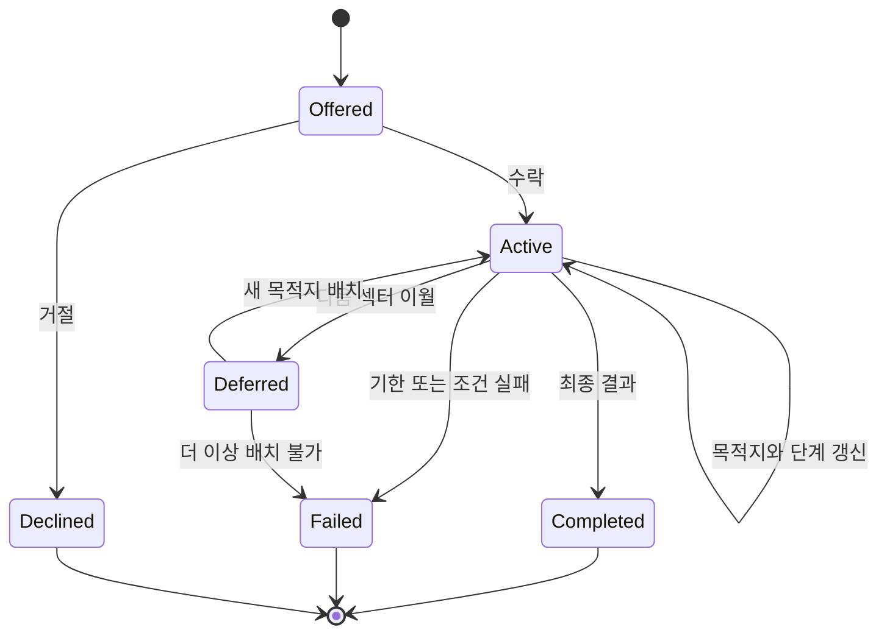

# STARWARD v6 — 월드맵·비콘·이벤트·퀘스트

> 기준: 2026-11-16. v6 새 항해의 실제8섹터 캠페인 규칙을 기록합니다. 통합 검증과 남은 차이는 [검증·호환 문서](v6_validation_and_compatibility.md)에서 확정합니다.

## 1. 월드와 지역을 구분하기

새 항해는8섹터로 진행합니다. 월드맵은 총20개 노드로 구성되며 첫째·여덟째 깊이는 하나, 중간 여섯 깊이는 각각 세 대안을 갖습니다. 노드마다 다음 깊이의 선택 가능한 이웃이 있고, 현재 선택과 지나온 경로를 저장합니다. 이전 섹터로 돌아가 재화를 반복 수집하는 구조가 아닙니다.

각 섹터 안에는 시작점·6열×3행·출구의20개 비콘이 있습니다. 지역 링크는 양방향이며 이미 방문한 곳에도 도약할 수 있습니다. 같은 행을 직선으로 따라야 하는 일방향11비콘 지도였던 이전 버전과 다릅니다.

| 구분 | 월드맵 | 지역 비콘 지도 |
|---|---|---|
| 한 노드 | 하나의 섹터 선택 | 하나의 조우 위치 |
| 이동 | 출구에서 다음 깊이 선택 | 실제 연결된 이웃으로 도약 |
| 되돌아가기 | 이전 섹터로 복귀하지 않음 | 방문 비콘 재방문 가능 |
| 저장 | 현재 월드 ID·경로·전체 노드 | 방문·횟수·해결·점령·발견·재고 |
| API | `getWorldMap()`, `advanceSector(id)` | `getJumpStatus(id)`, `jump(id)` |

출구에 도착하면 `mode='map'` 안에서 `campaign.pendingSectorChoice`가 다음 섹터 선택을 나타냅니다. 별도의 임시 모드를 만들어 저장 로더의 기존 상태 목록과 어긋나지 않게 합니다. 월드 선택을 열거나 닫고 비콘을 살펴보는 행동만으로 연료나 추격 시간이 흐르지 않습니다.

## 2. 비용과 재방문

일반 지역 도약은 연료1개를 사용하고 반군 전선을 전진시킵니다. 출구의 다음 섹터 이동도 별도로 연료1을 사용합니다. 실행 직전에 현재 위치·연결·자원·모드를 검사합니다. 선택 화면을 열 때의 자원이 충분했다는 이유만으로 뒤늦은 실행을 허용하지 않습니다.

`getJumpStatus(nodeId)`는 도약 가능 여부·사유·연료 비용·재방문·점령·환경을 반환합니다. 미리보기는 실제 도약이 아닙니다. `visited`와 `resolved`는 구분합니다. 방문한 비콘의 전투나 사건이 이미 해결되었다면 다시 자원·치료·장비를 지급하지 않습니다. 상점은 처음 생성한 상품과 잔여 재고를 유지합니다.

재방문은 길 선택의 여지를 주지만 연료와 추격 비용이 있습니다. 점령되기 전에 상점이나 퀘스트로 되돌아갈지, 새 비콘을 탐색할지 판단해야 합니다. 잘못된 목적지는 비용이나 난수를 소비하지 않습니다. 연료0으로 유효 이웃 도약을 요청하면 도약은 거절하되 구조 사건을 엽니다. 이는 새로운 목적지로 이동한 결과가 아닙니다.

## 3. 반군 전선과 점령

전선은 실제 이동에 따라 움직입니다. 기본 시작 전선은-2열, 기본 도약당 전진은0.75열이며 `state.fleet`가 누적 전진량을 기록합니다. 일반 지역의 성운 도착은0.5배, 성운 섹터의 성운 도착은0.8배입니다. 지연량이 남으면 먼저 소진합니다. `getFleetInfo()`는 현재 전선 열·다음 이동량·지연·점령 노드 목록을 제공합니다. 성운과 지연 사건이 전진량에 영향을 줍니다.

전선에 삼켜진 비콘은 원래의 안전한 상점·조우를 그대로 사용할 수 없습니다. 그 위치에 가면 점령 상태에 맞는 전투가 발생합니다. 이미 방문한 상점의 재고가 남아 있어도 점령된 상황에서 자유 거래를 허용하지 않습니다. 점령과 비콘의 원래 종류를 따로 보존해 지도 표시와 실행 결과가 일치해야 합니다.

FTL 도주도 지도와 연결합니다. `getEscapeStatus()`는 전투의 실제 FTL 충전·기관·조타 조건을 검사하고, `escapeTo(nodeId)`는 목적지·연결·연료를 검사합니다. 성공한 도주는 도약 비용을 한 번만 적용합니다. 코어 도주와 캠페인 도약에서 각각 연료를 차감하지 않습니다.

## 4. 사건 선택의 실행 단위

사건은 설명문을 읽고 즉시 보상을 받는 것만으로 구성되지 않습니다. 일반 선택, 자원 비용, 장비·능력·종족·숙련 조건, 전투 시작, 후속 목적지, 실패 결과를 조합합니다. 조건 선택은 `style='blue'`로 표시하고 왜 가능한지 또는 막혔는지를 함께 보여줍니다.

| 단계 | 실행 책임 |
|---|---|
| 진입 | 해당 비콘의 사건과 현재 분기를 확정 |
| 표시 | 선택지와 현재 조건·비용·비활성 사유 제공 |
| 실행 | 선택 ID·현재 단계·조건·자원 재검사 |
| 결과 | 비용과 보상·전투·플래그·목적지를 한 번 반영 |
| 저장 | 현재 사건·확정된 결과·이후 진행 상태 보존 |

중복 클릭이나 저장 후 재개로 같은 결과를 두 번 받을 수 없어야 합니다. 무작위 결과는 실제 선택 시점에 결정하고 저장 상태와 함께 유지합니다. 조건이 바뀐 선택은 화면의 예전 활성 여부와 관계없이 다시 검사합니다.

v6의 사건은 자체 작성 콘텐츠입니다. [data.js](../dist/data.js)에 실제 사건 정의15개·선택55개가 있고, 이와 별도로 퀘스트 단계 선택을 구성합니다. 중계·피난민·상인·폐선·진료·매복·공방·조난·관측소·검역·검문·밀수·밀수 후속·반응로·설계도로 구성됩니다. 처리와 조건은 [campaign.js](../dist/campaign.js)에 있습니다. 원작의 수백 이벤트 원문이나 모든 분기를 그대로 이식한 것은 아닙니다.

## 5. 다단계 퀘스트

퀘스트는 대화 한 번 뒤 사라지는 보너스가 아니라 수락·현재 단계·목적 비콘·진행 기록·완료/실패를 가진 상태입니다. `getQuestLog()`는 이를 UI가 표시할 수 있는 목록으로 반환합니다. `campaign.mapTurns`는 실제 이동이나 구조 대기에서만 증가하여 기한과 기록의 기준이 됩니다.

새 항해에서 세 퀘스트의 도입은 자연스러운 지도 경로에 배치됩니다.

| 시작 섹터·비콘 | 도입 사건 | 시작 선택 ID |
|---|---|---|
| 1 · `s1-1-1` | 중계 신호 | `relay_quest` |
| 2 · `s2-1-1` | 피난민 | `refugee_quest` |
| 3 · `s3-1-1` | 설계도 | `blueprint_quest` |

목적지는 현재 섹터의 유효 비콘에 놓거나 다음 섹터로 이월합니다. 상점·출구·다른 퀘스트를 무심코 덮어쓰지 않습니다. 지도상으로 도달할 수 없는 목적지에 성공 문구만 표시하지 않습니다. 마지막 섹터에는 일반 무작위 퀘스트를 만들지 않으며, 이월 불가·기한 초과·점령·목적지를 남긴 채 섹터 이탈을 명시적인 실패/포기로 기록합니다. 필수 인원이나 장비가 사라지면 해당 선택이 막히고 다른 유효 선택이나 포기를 사용할 수 있습니다.

위는 공통 상태 관계입니다. 실제 퀘스트마다 조건·분기·전투·보상은 다릅니다. 완료를 기록한 뒤에는 재방문·중복 선택·재로드로 다시 지급하지 않습니다. 진행 중 저장은 현재 목적지와 이월 여부를 정확히 복원해야 합니다.

## 6. 저장되는 상점

상점의 상품은 `stock`, `soldOut`, 비활성 사유를 갖습니다. 연료·미사일·부품은 각각4팩, 무기·드론·종족별 고용은 각각1개입니다. 수리·시스템 강화는 `stock=null`이며 자체 한도로 제한됩니다. 구매는 가격·현재 재고·현재 화물/설치 공간·강화 한도·승무원 정원을 함께 확인합니다. 실패는 돈이나 재고를 먼저 감소시키지 않습니다. 구매 후 다시 방문해도 같은 재고가 유지되며 저장·로드로 새 장비를 다시 뽑지 않습니다.

장비의 실제 수령·화물·교환·판매는 [v4 장비 명세](v4_equipment.md)의 인스턴스 ID와 원자성을 유지합니다. 새 특수 시스템도 실제 상품이나 조건 보상으로 접근 가능해야 하며 문서에만 존재하는 능력은 완료로 보지 않습니다.

## 7. 마지막 섹터

여덟째 섹터는 연방 기지와 반군 기함의 실제 위치를 가진 별도 상황입니다. 기지는 `s8-3-1`, 기함의 시작 위치는 `s8-6-1`입니다. 기함의 세 단계를 각각 승리한 후에는 지도에 돌아와 다음 위치를 추적합니다. 전투를 한 화면에서 세 번 자동 교체하는 이전 캠페인과 구분합니다.

기함은 지도2턴마다 `s8-6-1 → s8-5-1 → s8-4-1 → s8-3-1`로 접근합니다. 기지에서3턴을 버티면 패배합니다. 현재 기함 비콘으로 정확히 도약한 턴에는 추가 이동/기지 카운트를 먼저 진행하지 않고 교전합니다. 단계1 승리 후에는5열, 단계2 승리 후에는 기지로 이동하되 현재 플레이어 위치와 겹치면4열로 대체합니다.

`engageFlagship()`은 같은 비콘의 기함과 연료·지도 턴0으로 교전합니다. `waitAtBeacon()`은 최종 지도에서만 지도1턴을 진행하고 연료·도약 통계·회복·보상을 만들지 않습니다. 기다리다 기함이 도착하면 전투가 열리고 기지가 함락되면 패배합니다.

기함의 기지 접근과 패배 조건은 지도 상태로 저장합니다. 열린 지도에서 잠시 생각하는 것만으로 패배 시간이 흐르지 않습니다. 지도 행동과 실제 전투 종료에 따른 갱신을 구분합니다. 마지막 단계 승리는 항해 종료로 한 번만 처리합니다.

## 8. 원작 참고와 차이

FTL 공식 제품 설명은 다양한 해결책을 가진 텍스트 조우와 무작위 진행을 명시합니다. 실제 작가 Tom Jubert는 사전 작성 사건의 선택·결과, 섹터별 고유 사건과 숨은 경로를 설명했습니다. 이러한 설계 방향을 이 게임의 월드·퀘스트 구조로 구현합니다. 원작과 동일한 지도 생성 난수 순서·모든 비콘 분포·전체 퀘스트·함선 해금은 범위 밖입니다.

- [공식 제품 설명](https://store.steampowered.com/app/212680/FTL_Faster_Than_Light/)
- [작가 Tom Jubert의 FTL 개발 기록](https://tom-jubert.blogspot.com/2012/06/project-announcement-ftl.html)
- [개발자 저장·퀘스트 수정 기록](https://subsetgames.com/forum/viewtopic.php?t=23727)
- [campaign.js](../dist/campaign.js), [data.js](../dist/data.js): 실제 콘텐츠와 실행 정의.
