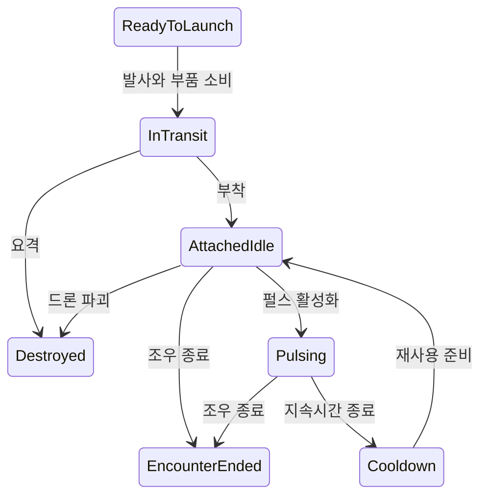

# 13. Advanced Edition 전술 시스템 역기획

> 범위: 해킹·정신 지배·클론실·보조 배터리를 중심으로 AE가 기존 규칙을 바꾸는 방식. 확인일: 2026-11-13.\
> 은폐는 기본 게임의 시스템이며, AE 추가 시스템으로 잘못 분류하지 않는다.

## 1. 확장 설계의 방향

[확인] Advanced Edition은 해킹·정신 지배·클론실·보조 배터리와 새 장비·종족·함선·이벤트를 추가했다. 현재 제품에 포함된 무료 확장이다.[S1][S2]

[해석] AE의 핵심은 새로운 피해 숫자보다 기존 자원의 의미를 바꾸는 데 있다.

| 추가 시스템 | 기존 질문 | 새로 생기는 질문 |
|---|---|---|
| 해킹 | 어느 방을 파괴할까? | 어느 기능을 언제 일정 시간 역전시킬까? |
| 정신 지배 | 승무원 몇 명이 필요한가? | 잠시 적 인력을 내 자원으로 바꿀 수 있는가? |
| 클론실 | 인원을 어떻게 죽지 않게 할까? | 죽음과 복구 설비의 위험을 어떻게 교환할까? |
| 보조 배터리 | 전력이 총 몇 칸 필요한가? | 짧은 고출력을 어느 순간에 쓸까? |

AE 켜짐 상태는 콘텐츠 생성 조건이다. 기본 UI·품질 개선과 추가 콘텐츠 토글을 임의로 동일시하지 않아야 한다.

## 2. 해킹(Hacking)

### 2.1 입력과 상태

[확인] 해킹은 부품을 사용해 드론을 적 시스템에 부착하고, 이후 펄스를 활성화해 해당 기능을 방해한다. 접근 중 요격될 수 있으며 졸탄 실드가 남아 있으면 발사를 할 수 없다. Zoltan Shield Bypass도 이 제한을 없애지 않는다.[S3]

[재구성안] 상태는 다음과 같이 나눈다.

**부착됨**과 **펄스가 켜짐**을 구분한다. 문·시야 등 부착 효과와 시스템을 교란하는 능동 효과는 같은 타이머로 묶지 않는다.

### 2.2 확정된 기본 수치

| 가동 수준 | 펄스 지속 | 펄스 종료 후 재사용 대기 |
|---|---:|---:|
| 1 | 4초 | 20초 |
| 2 | 7초 | 20초 |
| 3 | 10초 | 20초 |

[확인] 위 시간은 정상 상태 기준이다.[S3] 일시 이온·전력·점프·비정상 상호작용을 모두 덮는 절대 주기라고 해석하지 않는다.

### 2.3 표적별 주요 교란

| 표적 | 능동 효과 요약 | 기획적 사용 목적 |
|---|---|---|
| 무기·함포 | 충전 역행·발사 방해 | 첫 공격과 재공격 지연 |
| 실드 | 층을 순차적으로 방전 | 빔·일제 사격 창 확보 |
| 엔진·조타 | 기본 회피와 FTL 충전 제한 | 명중 보조·도주 저지 |
| 산소 | 산소 감소 | 질식과 탑승 연계 |
| 의료실 | 의료실 내 해킹 측 적대 인원 피해 | 회복하러 모인 인원 공격 |
| 클론실 | 복제 기능 정지 | 사망의 영구화 |
| 드론 제어 | 드론 정지·파괴 가능 | 자동 공방 해체 |
| 텔레포터 | 침입자 강제 귀환 | 탑승 압력 해소 |
| 은폐 | 활성 은폐 종료·진입 방해 | 공격 시간 창 회복 |
| 정신 지배 | 지배 관계 역전·해제 | 인원 전투 전환 |
| 해킹 | 상대 교란 종료·드론 파괴 가능 | 반격 |
| 문·센서 | 통행·정보 기능 제한 | 공간과 정보 통제 |

[확인] 위는 표적별 핵심 효과의 요약이다.[S3] 엔진·조타 해킹이 은폐의 독립적인 회피 보너스까지 제거한다는 뜻은 아니다.

### 2.4 실드 해킹의 시간 해석

[확인] 실드 방전은 한 번에 전층 제거가 아니라 시간에 따른 처리다.[S3]

[검증 필요] 1레벨 4초 펄스를 “실드 정확히 2층 제거 보장”으로 명세화하지 않는다. 공개 자료가 경계 프레임에 따른 차이를 기록하고 있다. 재현 테스트에서는 펄스 시작 시각·프레임률·실드 초기 상태를 함께 기록한다.

[해석] 이 차이는 빔을 자동 발사할지 실제 실드 감소를 보고 발사할지에 영향을 준다. UI가 보여주는 결과와 공략에서 사용하는 평균 기대를 구분해야 한다.

### 2.5 재구성 데이터

~~~json
{
  "hacking": {
    "targetShipId": "enemy_1",
    "targetSystemId": "shields",
    "attachmentState": "attached",
    "pulseState": "idle",
    "poweredLevel": 2,
    "remainingPulse": 0,
    "remainingCooldown": 0,
    "dronePartSpent": true
  }
}
~~~

[재구성안] 해킹 대상은 방 ID뿐 아니라 시스템 ID를 보관한다. 시스템 교체·파괴·전투 종료 이후 잘못된 방에 효과가 남지 않도록 세션 소유권을 둔다.

## 3. 정신 지배(Mind Control)

### 3.1 제어권의 정의

[확인] 정신 지배는 대상 한 명의 소속을 일시적으로 바꾸지만, 플레이어가 그 인원을 자기 승무원처럼 직접 이동 명령하는 기능은 아니다. 슬러그는 면역이며, 적 함선의 인원을 대상으로 하려면 필요한 시야 조건을 충족해야 한다.[S4][S2]

[해석] 소속 변경은 직접 피해 없이도 여러 효과를 만든다.

- 운용 인원이 자리를 비우거나 자기 함선을 공격한다.
- 다른 적 승무원이 교전·수리로 묶인다.
- 수적으로 불리한 탑승 전투의 국지적 균형이 바뀐다.
- 침입자 하나가 잠시 방어 인력 역할을 한다.

### 3.2 수치와 제약

| 가동 수준 | 정상 지속시간 | 강화된 전투 효과 |
|---|---:|---|
| 1 | 14초 | 기본 지배 |
| 2 | 20초 | 추가 체력·전투 능력 |
| 3 | 28초 | 더 큰 전투 강화 |

[확인] 소유 승무원의 적 정신 지배를 자기 정신 지배로 해제할 수 있다. 1레벨도 높은 수준의 적 지배에 대응할 수 있다. 졸탄 실드·시야·대상 종족 조건은 따로 검사한다.[S4]

### 3.3 재구성 상태 모델

[재구성안] originalFaction과 effectiveFaction을 분리한다. 종료 때 무조건 “적”으로 바꾸지 않고 원래 소속으로 복원한다. 저장에는 효과 제공자·잔여시간·부가 HP·전투 보정·AI 재평가 필요 여부를 포함한다.

~~~text
적법한 대상 확인
→ 지배 효과 적용
→ 기존 작업 중단/재평가
→ 임시 진영으로 AI 수행
→ 종료 또는 해제
→ 원래 진영·정상 수치 복원
→ 작업 재평가
~~~

[검증 필요] 추가 HP가 제거될 때 현재 체력 정규화, 도중 사망, 텔레포트, 여러 대상이 같은 방에 있을 때의 표적 선택은 원작의 세부 정책을 검증해야 한다.

### 3.4 버전 주의

[확인] 초기 AE 패치에는 적 특수 실드가 있을 때 자기 인원의 정신 지배를 해제하지 못하는 문제의 수정 기록이 있다.[S5] 과거 영상의 동작을 현재 규칙으로 가져올 때 패치 시점을 확인해야 한다.

## 4. 클론실(Clone Bay)

### 4.1 의료실과의 교환

[확인] 클론실과 의료실은 동시에 설치하지 않는다. 클론실은 사망 승무원을 복제하고 도약 시 회복을 제공하지만, 의료실처럼 방 안에서 상시 치료하는 공간은 아니다.[S6]

[해석] 교환되는 것은 생존률뿐 아니라 회복의 시간 구조다.

| 의료실 중심 | 클론실 중심 |
|---|---|
| 전투 중 퇴각·치료·재투입 | 사망 후 복제·재투입 |
| 부상 관리 | 사망 큐·설비 생존 관리 |
| 인원을 잃지 않게 하는 방어 | 설비가 살아 있는 동안 위험 허용 |
| 치료 방으로의 동선 중요 | 복제 시간과 인원 복귀가 중요 |

### 4.2 기본 수치

| 수준 | 1명 복제 시간 | 도약당 회복량 |
|---|---:|---:|
| 1 | 12초 | 8 HP |
| 2 | 9초 | 16 HP |
| 3 | 7초 | 25 HP |

[확인] 여러 사망자는 순차 복제된다. 복제에는 숙련도 손실이 있고, 시스템이 가동되지 않는 시간이 이어지면 대기 인원은 영구 손실될 수 있다. Backup DNA Bank는 해당 위험을 완화하지만 모든 인원 손실 사건을 되돌리는 장치는 아니다.[S6]

### 4.3 죽음과 실종을 구분

[확인] 적 함선에 남겨둔 채 한쪽이 도약한 승무원은 일반적인 사망 복제와 다르며 복구되지 않는다. 이벤트의 인원 손실도 모두 동일하게 복제되는 것은 아니다.[S6]

[재구성안] CrewLossReason을 명시한다.

~~~text
combat_death
suffocation_death
fire_death
ship_destruction_death
left_behind_on_jump
event_death_revivable
event_loss_irrecoverable
~~~

이 enum은 재구성안이다. 실제 원작 이벤트마다 어느 분기를 타는지는 별도 데이터 검증이 필요하다.

### 4.4 전투 종료와 클론 큐

[해석] 화면에 살아 있는 인원이 없다는 사실과 “남아 있는 생존 경로가 없다”는 사실은 다르다. 따라서 플레이어 패배와 적 승무원 제거 보상을 판단할 때 클론 큐·가동 가능성·보호 장비를 고려해야 한다.

[재구성안] 큐 항목에는 crewSnapshot·deathReason·복제 가능 여부·남은 복제 시간·데이터 손실 상태를 보관한다. 선체 파괴 뒤 복제 기능이 생존을 보장하는 것으로 처리하면 안 된다.

### 4.5 추가 검증

[검증 필요] 복제 시간은 사망 애니메이션 직후부터 계산되는 등 표현 타이밍의 영향을 받는다. “죽음 클릭 시점부터 정확히 12초 후 출현”으로 단정하지 않는다. 도약 회복은 무전력과 완전 손상·완전 이온 상태를 구분해야 한다.

## 5. 보조 배터리(Backup Battery)

### 5.1 전력의 시간 대여

[확인] 배터리는 보조 시스템으로, 1/2레벨에 2/4칸을 30초 제공한다. 정상 종료 후 재사용 대기는 20초다. 배터리 종료 시 임시 전력이 회수되며, 배터리 전력은 이온 폭풍에서 일반 반응로와 같은 방식으로 반감되지 않는다.[S7]

[해석] 배터리는 총량이 부족한 함선에 영구적인 무료 반응로를 주는 대신, 짧은 구간의 고출력을 허용한다. 은폐·해킹·정신 지배와 공격 주기를 맞추면 효율이 커진다.

### 5.2 전력 회수 계약

[재구성안]

1. 임시 전력에 출처 ID를 붙인다.
2. 종료 시 해당 전력만 제거한다.
3. 일반 반응로로 대체할 수 있는지 검사한다.
4. 대체되지 않은 장치의 가동 상태를 갱신한다.
5. 능동 시스템의 지속시간·재사용 대기 전환을 처리한다.
6. UI에 종료 예고와 실제 탈락 장치를 표시한다.

[검증 필요] 임시 전력이 걸린 능력의 잔여 지속시간이 어떻게 줄어드는지는 시스템별 정책으로 확인한다. 모두 즉시 종료 또는 모두 유지라고 통합하면 안 된다.

## 6. 기본 은폐와의 연동

[확인] 은폐는 가동 수준에 따라 5/10/15초이며 회피를 60%p 늘린다. 상대의 무기 충전을 지연시키지만 이미 발사된 공격을 삭제하지 않는다. 발사가 은폐 시간을 줄일 수 있고 빔·함포·Stealth Weapons에는 예외가 있다.[S8]

[해석] 해킹과 은폐는 피해 감소가 아니라 적이 유효한 공격을 할 기회 자체를 줄인다. 강한 조합의 밸런스를 평가할 때 평균 피해보다 “적의 충전이 실제로 전진하는 시간”을 측정하는 것이 유용하다.

## 7. 시스템 조합 시나리오

### 7.1 해킹 + 빔

1. 특수 실드를 먼저 제거한다.
2. 해킹 드론을 실드 시스템에 부착한다.
3. 빔 충전 완료 시점에 맞춰 펄스를 켠다.
4. 실제 실드 층 감소를 확인한다.
5. 여러 방을 통과하도록 빔을 발사한다.

### 7.2 정신 지배 + 탑승

1. 적 회복 설비·종족·시야를 확인한다.
2. 방 안의 일부 적을 지배해 전투 숫자를 바꾼다.
3. 지배 종료 후 원래의 수적 구도가 돌아올 시간을 계산한다.
4. 아군이 퇴각하거나 교전을 끝낼 수 있도록 귀환 수단을 확보한다.

### 7.3 클론실 + 위험한 탑승

1. 복제 설비와 전력을 확보한다.
2. 사망을 감수한 공격과 단순 실종을 구분한다.
3. 자기 함선 복제 설비가 피격될 위험을 평가한다.
4. 재생성된 인원이 다음 파견에 합류할 시간을 고려한다.

### 7.4 배터리 + 은폐

1. 적의 위협 공격 직전에 배터리와 은폐를 가동한다.
2. 일반 반응로는 무기·실드 등 필요한 곳에 유지한다.
3. 배터리 종료가 은폐·다른 능력의 잔여 상태에 미칠 영향을 확인한다.

위 예시는 [해석]이며 특정 장비 조합을 반드시 구매해야 한다는 정답표가 아니다.

## 8. AE 통합 QA

| ID | 조건 | 기대 결과 |
|---|---|---|
| AE-01 | AE OFF 새 런 | AE 전용 생성 항목이 섞이지 않음 |
| AE-02 | 특수 실드 + Bypass + 해킹 | 해킹 발사 허용으로 잘못 확장하지 않음 |
| AE-03 | 해킹 부착만 완료 | 펄스 효과가 자동 상시 적용되지 않음 |
| AE-04 | 1레벨 실드 해킹 | 층 제거 경계 사례를 기록 |
| AE-05 | 슬러그 정신 지배 시도 | 대상 면역 피드백 |
| AE-06 | 정신 지배 중 저장·재개 | 원래 진영·잔여시간·AI 일치 |
| AE-07 | 적 지배에 걸린 자기 승무원에 지배 사용 | 해제 처리와 신규 적 지배를 구분 |
| AE-08 | 여러 인원 동시 사망 | 복제 큐 순차 처리·중복 복제 없음 |
| AE-09 | 적 함선에 승무원을 남기고 도약 | 사망 복제로 자동 구조하지 않음 |
| AE-10 | 의료실↔클론실 상점 교체 | 상호 배타성·설비 수준 이전 처리 검증 |
| AE-11 | 배터리 종료·졸탄 이동 동시 | 전력 이중 계산·음수 잔여량 없음 |
| AE-12 | 은폐 중 빔 발사 | 일반 발사와 동일 페널티로 일괄 처리하지 않음 |

## 9. 출처와 확정하지 않은 항목

- [S1] [Subset Games — FAQ](https://subsetgames.com/faq.html): AE의 제품상 위치.
- [S2] [FTL Wiki — Advanced Edition](https://ftl.fandom.com/wiki/FTL:_Advanced_Edition): 추가 시스템과 기능 범위.
- [S3] [FTL Wiki — Hacking](https://ftl.fandom.com/wiki/Hacking): 부착·펄스·대상별 효과.
- [S4] [FTL Wiki — Mind Control](https://ftl.fandom.com/wiki/Mind_Control): 제어권·지속시간·해제.
- [S5] [Subset Games — v1.5.10 Patch Notes](https://subsetgames.com/forum/viewtopic.php?t=23727): 초기 AE 버그 수정.
- [S6] [FTL Wiki — Clone Bay](https://ftl.fandom.com/wiki/Clone_Bay): 복제·회복·영구 손실 예외.
- [S7] [FTL Wiki — Backup Battery](https://ftl.fandom.com/wiki/Backup_Battery): 임시 전력·지속시간·폭풍 예외.
- [S8] [FTL Wiki — Cloaking](https://ftl.fandom.com/wiki/Cloaking): 기본 은폐와 AE 조합에 필요한 규칙.

원작 버그의 완전 복제 여부, 동일 프레임의 효과 순서, 모든 이벤트 복제 예외, 정신 지배 HP 보정의 세부 계산은 구현 전에 별도 실험으로 결정한다.

**자료 접근 범위:** 커뮤니티 위키의 일부 페이지는 직접 열기가 제한되어 검색 결과가 제공한 본문·표를 확인했다. 이 문서는 원작 실행 파일이나 전체 게임 데이터를 추출한 결과가 아니며, 검증하지 않은 세부 규칙은 별도로 표시했다.

[목차로 돌아가기](README.md)
