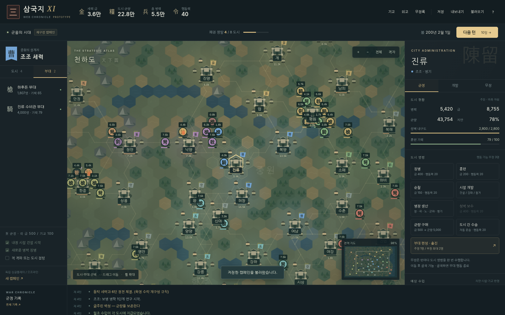

# 삼국지 11 · 군웅의 시대 — JavaScript 웹 프로토타입 v1.0

> 실제로 플레이할 수 있는 **비공식·재구성 싱글플레이 전략 게임**입니다. 기존 v5 역기획 자료의 도시 목록과 일부 무장 수치를 바탕으로 새 엔진과 화면을 작성했습니다. 원작의 완전 복원판, 공식 제품, 원본 실행파일을 웹으로 이식한 제품은 아닙니다.



## 가장 간단한 실행

압축을 **모두 해제**한 다음 `PLAY.html`을 Chrome / Edge / Firefox 등 최신 데스크톱 브라우저로 엽니다. JavaScript, CSS, 데이터가 모두 들어 있는 단일 파일이며 인터넷·로그인·Node.js 설치가 필요하지 않습니다. Windows에서는 `START_GAME.bat`으로 기본 브라우저에서 열 수 있습니다.

`index.html`도 실행 진입점입니다. 이 파일은 `js/`와 `css/` 폴더를 함께 유지해야 합니다. 폴더 구조를 바꾸지 마세요. ZIP 미리보기 안에서 실행하지 말고 먼저 압축을 해제하세요.

회사 보안 정책이 로컬 HTML 실행을 막는 경우 Node.js 18 이상이 설치된 환경에서 `START_LOCAL_SERVER.bat`, 또는 다음 명령을 사용합니다.

```bash
node server.cjs
```

출력되는 로컬 주소를 브라우저로 엽니다. 기본 주소는 `http://127.0.0.1:8080`이며 외부 컴퓨터에는 공개하지 않습니다. 브라우저의 보안 정책 자체를 변경하거나 우회하지 않습니다.

## 처음 플레이

조조·유비·손책 중 하나를 선택하고 `깃발을 올리다`를 누릅니다. 난이도는 입문 / 보통 / 어려움, 승리 목표는 8도시 / 42도시입니다. 연대는 200년부터 시작하지만 모든 인물과 배치는 역사 시나리오가 아닌 가상 집결입니다.

처음부터 전위대 1개가 출진해 있습니다. 지도에서 전위대 또는 왼쪽 `부대` 목록을 선택하고, 밝은 헥스를 클릭하여 이동하세요. `공격`이나 `전법`을 누른 뒤 적을 클릭합니다. 부대는 이동한 다음 공격할 수 있으며, 공격 이후에는 그 턴에 다시 이동할 수 없습니다.

도시를 선택하면 오른쪽에서 건설·징병·훈련·순찰·병장 생산·출진을 할 수 있습니다. 명령마다 해당 도시의 금과 세력 행동력, 아직 행동하지 않은 무장 한 명을 사용합니다. 도시별 자원을 관리하므로 상단의 세력 총금과 선택 도시의 금을 구분하세요.

`다음 턴`을 누르면 다른 세력이 행동하고 10일이 지납니다. 매 3턴에 금 수입, 매 9턴에 군량 수입이 들어옵니다. 야전 부대의 군량이 떨어지기 전에 아군 도시 옆에서 보급하거나 입성하세요.

## 구현 내용

| 영역 | 이 버전의 구현 |
|---|---|
| 지도 | 43×35 헥스, 42도시, 평지·숲·구릉·산악·수면·여울, 도로, 확대/축소, 드래그, 미니맵 |
| 세력 | 8개 주요 세력, 조조·유비·손책 플레이, 공백지 수비대와 산적 |
| 무장 | 실행 상태 100명: v5 표본 12명 + 재구성 인물 프리셋 45명 + 가상 수비관 42명 + 산적 두목 1명 |
| 내정 | 시장·농장·조폐·곡창·병영·대장간·마구간·공방, 건설·강화·철거, 헥스 인접 보너스 |
| 도시 명령 | 징병, 훈련, 순찰, 성벽 수리, 병장 생산, 군량 구매, 도시 간 자동 수송 |
| 부대 | 주장 1명·부장 최대 2명, 1,000~10,000명, 병장·군량 차감, 이동·보급·입성 |
| 병과 | 창·극·노·기병·충차·정란·검병, 지형 비용, 적 인접 시 이동 정지 |
| 전투 | 통상 공격·반격, 12전법, 밀기·당기기·범위·관통·돌파·혼란·화재, 성벽 공격과 점령 |
| 계략·특기 | 교란·화계, 통찰·귀모·백출·비장·극신·기신·화신·능리 일부 효과 |
| 성장·외교 | 재구성 5계열×4단계 연구, 6턴 정전 |
| 이벤트 | 신규 작성 선택 이벤트 4개, 첫 개발·징병·전과 목표 3개 |
| AI | 내정·징병·시장/농장 확장, 부대 편성, 공격 목표 선택, 이동·전법·보급·입성·연구 |
| 진행 | 8도시 패권 / 42도시 통일, 도시·부대 모두 상실 시 패배 |
| 저장 | 명령 후 자동 저장, 브라우저 수동 저장, JSON 내보내기/불러오기, 저장 데이터 검사 |

**AI가 무기 생산 명령까지 실행하는 것은 아닙니다.** AI의 초기 병장 비축이 부족해지면 검병을 출진시킵니다. 위 ‘생산 기반 확장’은 시장·농장 건설을 뜻합니다. 자동 도시 간 수송은 플레이어 명령이며 AI 수송 정책은 없습니다.

## 조작

| 입력 | 기능 |
|---|---|
| 도시·부대 클릭 | 선택 / 정보 확인 |
| 드래그 / 휠 | 지도 이동 / 확대·축소 |
| M / A / T | 이동 / 통상 공격 / 전법 |
| C / F | 교란 / 화계 |
| N / H / G | 다음 행동 가능 부대 / 수도 / 격자 |
| Enter | 다음 턴 |
| Esc / 우클릭 | 창 닫기 또는 이동 모드 |

작은 화면에서는 상단 `메뉴`에서 연구·외교·무장록·저장에 접근합니다. 부대의 `정보` 버튼으로 상세 명령 패널을 열고 ×로 닫습니다. 데스크톱 가로 화면을 우선 설계했습니다.

## 저장과 복구

브라우저 저장은 사용 환경에 따라 차단되거나 삭제될 수 있습니다. 중요한 진행은 `내보내기`로 JSON 파일을 보관하고, `불러오기`로 복구하세요. 다른 브라우저나 `index.html` ↔ `PLAY.html` 간 이전에도 JSON을 사용합니다. 저장 데이터에 계정·개인정보를 포함하지 않습니다. 이 프로그램은 서버로 데이터를 전송하지 않습니다.

## 개발 및 검증

```bash
# 외부 npm 패키지 설치 불필요
npm test
npm run build
npm start
```

`data/game-data.json`이 데이터 원본입니다. 변경한 뒤 `npm run build`를 실행하면 `js/data.js`와 `PLAY.html`이 함께 재생성됩니다. 분리형 실행은 `index.html`, 단일 파일 실행은 `PLAY.html`입니다.

엔진 테스트 60개·서버 테스트 5개와 브라우저 UI 검사 32개를 통과했습니다. 브라우저 검사는 Chromium headless에 단일 번들 HTML을 주입해 수행했습니다. **작업 환경의 브라우저 정책이 `file://`와 localhost 탐색을 차단하여, 이 환경에서는 더블클릭 실행과 HTTP 페이지 탐색 자체를 직접 검증하지 못했습니다.** 서버는 별도 HTTP 응답 검사로 검증합니다. 실제 운영 브라우저 전체에 대한 호환성 인증은 아닙니다.

## 원작과의 차이

원작의 실제 지도·시나리오 초기값·내부 피해 수식·AI·전체 특기·원문 대사는 확보하지 못했습니다. 현재 코드는 이를 임의로 ‘복원 완료’라 하지 않고 재구성으로 표시합니다. 원작 PK 시설 합병 대신 비용 기반 시설 강화, 원작 외교 판정 대신 확정 정전, 물리 수송대 대신 시간 지연 수송을 사용합니다.

관문·항구·수전, 일기토·설전, 역사 이벤트, 전체 특기, 포로·인재 등용·인간관계, 군단 위임, 원작의 전체 연구 트리, 온라인 멀티플레이는 미구현입니다. 장기 밸런스·AI 전략 수준도 추가 플레이 테스트가 필요합니다.

## 파일 안내

```text
PLAY.html                    설치 없이 여는 단일 실행본
index.html                   분리형 실행 진입점
START_GAME.bat               Windows 실행
START_LOCAL_SERVER.bat       선택적 로컬 서버 실행
js/data.js                   브라우저/CommonJS용 생성 데이터
js/engine.js                 DOM과 분리된 게임 규칙·AI·저장 검증
js/renderer.js               Canvas 지도·도시·부대·전투 연출
js/ui.js                     명령창·입력·저장·접근성
css/style.css                데스크톱·작은 화면 레이아웃
data/game-data.json          데이터 원본
game.json                    플랫폼 목록용 최소 메타데이터 (SDK 연동 아님)
server.cjs                   로컬 정적 서버
tools/build.mjs              데이터 변환·단일 HTML 생성
tests/                       엔진·브라우저 QA와 결과
reference/                   기존 v5 CSV/출처/원본 ZIP 보존
docs/                        조작·설계·수치·정확도·검증 문서
```

자세한 규칙: [규칙 명세](docs/RULES.md) · [구조 및 확장](docs/ARCHITECTURE.md) · [원작 일치도](docs/FIDELITY.md) · [검증 결과](docs/TEST_REPORT.md) · [권리 및 출처](NOTICE.md)
