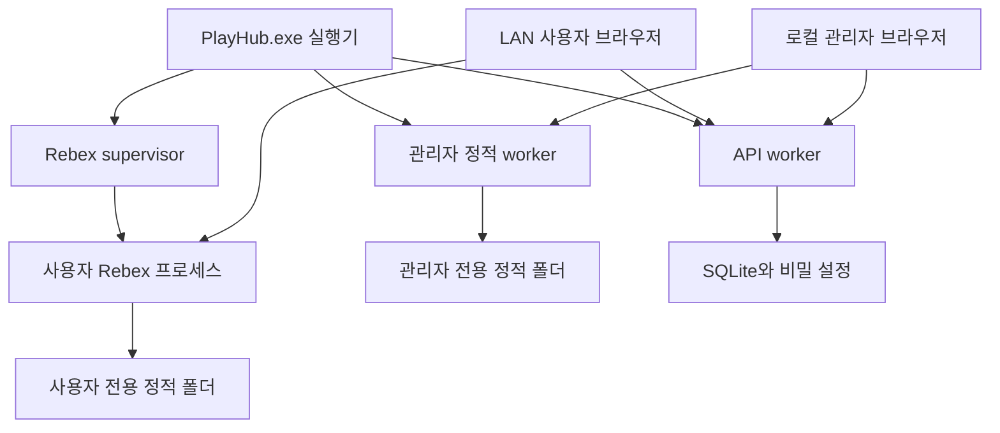

# PlayHub Portable 설계와 실행 수용 기준

이 문서는 v0.2 게임 플랫폼을 Windows용 `PlayHub.exe` 실행 진입점으로 전환하는 구조와 검증 경계를 정의한다. 게임 규칙·저장 충돌·지표 계약은 기존 구현을 유지하며, IIS 설치를 요구하던 배포 방식을 내장 Node 24 런타임과 사용자 보유 Rebex를 이용하는 방식으로 바꾼다. 실제 Windows·Rebex·브라우저 실행 결과가 없는 검사는 `not_run`으로 남긴다.

## 1. 목표와 결정

| 요구 | 결정 |
|---|---|
| 사용자가 EXE 한 번 실행 | Node 24 SEA 기반 `PlayHub.exe`가 준비·기동·관측을 담당 |
| SQL 서버 설치 없음 | API 프로세스의 내장 SQLite 사용 |
| Node·IIS 설치 없음 | 필요한 Node 런타임을 실행 파일에 포함; IIS와 URL Rewrite 설치 경로 사용하지 않음 |
| 기존 Rebex 활용 | 같은 폴더 EXE를 탐색하고 없으면 최초 파일 선택; 사용자 원본 설정은 변경하지 않음 |
| 사용자/관리자 사이트 분리 | 독립 정적 루트·서버 프로세스·포트 |
| 관리자 로컬 제한 | 관리자 정적 서버는 별도 Node worker에서 127.0.0.1 bind |
| 사용자 정적 서버 | 사용자가 제공한 Rebex EXE를 로컬 작업 폴더에서 시작 |
| 동적 기능 | 별도 API worker가 사용자 API와 loopback 관리자 API 제공 |
| 지속 데이터 | %LOCALAPPDATA%\PlayHub 하위; 모든 정적 루트 밖 |
| Google | 기존 실제 OAuth 계약 유지; 미설정 시 게스트 사용 |
| 재배포 | Rebex 바이너리는 우리 배포물에 포함하지 않음 |

초기 구상인 ‘Rebex 두 개’에서 관리자 서버만 Node worker로 조정한 이유는 **Rebex 공식 설정에 IP bind 제한 키가 확인되지 않았기 때문**이다. 관리자 화면까지 loopback으로 제한하는 요구를 코드로 충족하기 위해 역할을 분리한다. 사용자·관리자 모두가 Rebex로 실행된다고 설명하지 않는다.

## 2. 런타임 관계

다이어그램의 API worker는 내부적으로 public/admin listener를 분리한다. LAN 브라우저가 관리자 API를 사용할 수 있다는 의미가 아니다. Public listener는 `/api/admin/*`에 404를 반환한다. Admin listener와 관리자 정적 worker는 loopback으로만 bind한다.

시작 보고서의 자식 역할은 `api`, `admin`, `rebex-user`, `rebex-supervisor` 네 가지다. supervisor는 사용자 제공 Rebex를 Windows Job에 연결하고 자신의 입력 파이프가 닫히면 소유한 Rebex 수명을 정리한다. 세 가지 서비스 역할과 이를 감시하는 프로세스를 구분한다.

| 면 | 기본 주소 | 콘텐츠/기능 | 경계 |
|---|---|---|---|
| 사용자 정적 | http://호스트:8080/ | 카탈로그·상세·게임·공용 스크립트 | user 전용 root |
| 관리자 정적 | http://127.0.0.1:8081/ | 관리자 화면 | 별도 admin root + loopback |
| 사용자 API | http://호스트:8090/api/ | 세션·플레이·저장·이벤트 | public listener |
| 관리자 API | http://127.0.0.1:8091/api/admin/ | 로그인·지표·공개 상태 | admin listener + 별도 인증 |

포트·주소는 현재 실행 보고서의 실제 값을 검증한다. 위 표의 기본값만으로 서버가 실행 중이라고 판단하지 않는다. Cookie는 포트별 격리 수단이 아니므로 서로 다른 세션 이름·listener 검사·Origin 허용 목록·CSRF를 함께 유지한다.

## 3. 파일과 데이터 수명

실행기는 쓰기 가능한 `%LOCALAPPDATA%\PlayHub` 아래에 런타임과 정적 사이트를 준비한다. 정적 루트에는 브라우저가 받아야 할 파일만 들어간다. 설정·DB·백업·보고서·관리자 초기 인증 정보는 정적 루트 밖에 둔다. 릴리스 자산과 지속 데이터의 수명을 구분하여 새 실행 파일로 교체해도 기존 게임 저장을 유지한다.

정확한 기본 레이아웃은 아래와 같다. 초기 관리자 비밀번호는 무작위 생성하여 실행 창으로만 전달하고 평문 파일·보고서에 저장하지 않는다. 설정에는 해시와 salt를 보관한다. 이후 실행은 기존 Google 설정과 관리자 해시를 유지한다.

| 인스턴스 하위 경로 | 용도 |
|---|---|
| app/<payload-hash>/ | 검증된 SEA 내장 앱 자산 추출본 |
| workspace/games/ | 최초 seed 후 보존되는 편집 가능 게임 |
| workspace/catalog/games.json | 보존되는 중앙 게임 목록 |
| workspace/web/, workspace/shared/ | 패키지 버전으로 갱신되는 앱 원본 |
| sites/user/ | 사용자 정적 root |
| sites/admin/ | 관리자 정적 root |
| private/config/local.json | 관리자 해시·Google 설정·포트 |
| private/data/platform.sqlite | SQLite 데이터베이스 |
| servers/user/ | 사용자 Rebex의 로컬 작업용 복사본과 config |
| reports/startup-report.json | 실행 상태와 자식·주소·경로 계약 |
| reports/portable-acceptance.json | Windows 관측 결과 |
| reports/portable-http.json | 선택 QA HTTP 결과 |

| 분류 | 포함 | 제외·주의 |
|---|---|---|
| 사용자 정적 root | 사용자 HTML/CSS/JS, 생성 카탈로그, 게임별 자산 | 관리자 화면, 서버 소스, DB, Google secret |
| 관리자 정적 root | 관리자 HTML/CSS/JS, 공개 연결 설정 | API 비밀번호·secret·DB |
| API 자산 | 서버 모듈·카탈로그·스키마 | 인터넷 정적 다운로드 대상 아님 |
| 지속 데이터 | SQLite, 비밀 설정, 사용자 저장, 백업 | 임시 추출 폴더와 같은 삭제 정책 적용 금지 |
| 실행 관측 | 시작 보고서, worker 상태, 실제 URL, PID | 비밀번호·쿠키·CSRF·OAuth 토큰 기록 금지 |
| Rebex 작업 폴더 | 사용자 제공 EXE의 로컬 복사본과 생성 config | 사용자 원본 EXE.config 변경 금지 |

경로는 정규화하여 root끼리 동일하거나 상하위 관계가 되지 않도록 검사한다. 정적 파일 응답에서는 URL 디코딩·경로 정규화 후 root 밖 접근을 거부한다. 민감한 파일을 root 밖에 둔 사실과 실제 HTTP 요청으로 노출되지 않은 사실을 모두 확인한다.

## 4. 시작·실패·종료

준비 과정은 자산 검증, 사용자 EXE 발견, 데이터·설정 준비, 포트 사용 가능 여부, worker 시작, health와 정적 응답 확인 순서로 진행한다. 성공 보고서는 필요한 구성 요소가 준비됐을 때만 작성한다. 시작 과정에서 실패하면 이번 실행이 만든 프로세스를 정리하고 원인과 `failed` 상태를 남긴다.

이미 사용자가 별도로 띄운 Rebex나 이름이 같은 다른 Node 프로세스를 종료하지 않는다. 종료는 실행기가 소유한 PID·실행 ID·경로를 기준으로 처리한다. 가능하면 정상 종료를 먼저 요청하고 제한 시간 뒤 필요한 자식만 정리한다. DB를 사용하는 API worker 종료와 파일 정리의 순서를 지킨다.

Rebex는 GUI 프로그램이고 `autoStart=true`는 프로세스 실행 후 서버 시작을 자동화한다. 실행 파일을 단일 진입점으로 만들더라도 자동 Windows 서비스 설치나 재부팅 후 무인 실행 기능을 제공한다는 의미는 아니다.

## 5. Rebex 설정과 버전

공식 확인 키는 `webRootDir`, `httpPort`, `httpsPort`, `defaultFile`, `autoStart`, `minimizeOnStart`, `minimizeToTray`, `decodeUri`, `logLevel`이다. `root`, `httpPorts`, `httpBindings` 같은 미확인 키를 사용하지 않는다. 설정 파일은 EXE와 같은 폴더의 `RebexTinyWebServer.exe.config`에 둔다.

HTTP portable 구성은 `httpsPort`를 빈 값으로 설정하여 기본 11443 listener를 만들지 않는다. `defaultFile=index.html`을 유지하고 이미 생성한 `/play/<id>/index.html`을 사용한다. SPA rewrite 지원을 추정하지 않는다. 상대 경로 기준은 공식 1.0.3부터 EXE 위치로 수정되었으며, 최소화 옵션은 1.0.6부터 추가되었다.

2026-11-16 조사에서 공식 latest ZIP의 PE 버전은 `1.0.9.0`이었으나 제품 페이지 이력 최상단은 `1.0.8`이었다. 설치된 사용자 EXE의 실제 버전과 SHA-256을 관측하여 보고서에 남긴다. ZIP의 모든 과거·미래 버전과 동작이 같다고 가정하지 않는다.

| 공식 조사 자료 | 직접 관찰값 |
|---|---|
| ZIP 크기 | 1,491,899 bytes |
| ZIP SHA-256 | eb3055fe8eb2309cb2cf2fbf1fc50d040bf97633a5aba87a7ba8a10c823266ae |
| EXE FileVersion | 1.0.9.0 |
| EXE SHA-256 | a4a797cbfa7e0097c579e9d6d1201ed4ced01abdc69120f16102bf0bb5115351 |
| ZIP 구성 | EXE, config, README, LICENSE; 별도 DLL 없음 |

이 해시는 사용자 EXE에 반드시 일치해야 하는 유일한 허용 값이라는 뜻이 아니다. 조사한 공식 파일을 식별하는 값이다. 실제 실행 버전의 기능·바인딩·MIME 응답은 실행 수용 검사에서 확인한다.

## 6. 정적 웹 보안과 게임 실행

관리자 Node 정적 worker는 loopback 바인딩과 응답 헤더를 직접 제어한다. Rebex의 커스텀 헤더 기능은 확인되지 않아 사용자 HTML에 필요한 meta CSP를 포함하는 방식을 사용한다. meta CSP는 HTTP CSP 헤더의 모든 기능을 대체하지 않는다. `frame-ancestors`, `sandbox`, report-only는 meta로 전달할 수 없다.

게임 iframe은 기존 `sandbox="allow-scripts"`를 유지한다. opaque origin의 초기 메시지는 source·nonce를 확인하고 MessageChannel을 전달하며, 저장·이벤트는 포털 broker가 API로 중계한다. Google token·세션 cookie·CSRF를 게임에 넘기지 않는다. 게임 코드가 서버 권한을 얻는 구조로 바꾸지 않는다.

`.js`, `.css`, `.json`, `.svg`, `.html`은 실제 응답 Content-Type을 확인한다. IIS용 `web.config`가 Rebex에서도 헤더·rewrite·MIME 설정으로 적용된다고 가정하지 않는다. 등록 게임은 빌드 카탈로그와 manifest로 확정하고 실행 시 API의 공개 상태를 우선한다.

## 7. API·저장·지표의 유지 범위

포터블 전환은 기존 API의 권한 모델을 완화하지 않는다. 게스트 저장은 주체·게임·슬롯·revision을 검사하며 충돌 시 412로 보존한다. 별도 슬롯·복원 전 백업·삭제 전 백업·멱등성 계약도 유지한다. 관리자 cookie와 사용자 cookie를 혼용하지 않는다.

실제·QA·예제 지표를 구분하고, QA는 새 익명 세션에서 전용 endpoint를 통해 서버가 분류한다. 검사 도구가 이벤트 body에 `is_test`를 넣는 방식으로 분류를 위조하지 않는다. 기간은 KST이며 리텐션의 최초일은 전체 이력을 기준으로 한다. 포장 방식 변경만으로 D30 실제 성과나 Google 실인증을 검증 완료로 기록하지 않는다.

Google 설정은 데이터 영역의 서버 설정에서 읽고 정적 파일에는 넣지 않는다. 미설정은 `googleEnabled:false`이며 게스트 플레이는 계속된다. Google OAuth 설정과 실제 계정 consent는 포터블 파일만으로 자동 완성할 수 있는 단계가 아니다.

## 8. Windows 실행 수용 검사 명세

`portable/windows-acceptance.ps1`은 **이미 실행 중인 인스턴스**를 검사한다. 설치·서비스 등록·방화벽 변경·재시작·DB 직접 수정·다른 프로세스 종료를 하지 않는다. 기본 검사는 관측 및 HTTP 읽기이며, 선택 QA 검사만 새 QA 세션과 게임 저장 데이터를 만든다.

### 입력과 증거

실행기가 작성한 `startup-report.json`을 입력받아 실제 origin·root·PID·실행 상태를 읽는다. 임의 보고서의 성공 플래그만 믿지 않고 OS 프로세스·listener·HTTP 응답을 다시 관측한다. 보고서 경로가 없거나 필수 필드가 누락되면 통과가 아니다. 실행 보고서의 정확한 필드 계약은 실행기와 같은 릴리스에서 고정한다.

현재 계약은 `schemaVersion:1`, `version:0.3.0`, `mode:portable-rebex`이며 `runId`, `status`, `generatedAt`, `environment`, `mainPid`, `paths`, `ports`, `urls`, `children`, `rebex`, `security`, `checks`를 포함한다. paths는 instanceRoot/appRoot/workspaceRoot/userRoot/adminRoot/configPath/dataDir/executable을, ports는 user/admin/publicApi/adminApi를 제공한다. 사용자 정적 root의 `playhub-ready.json` runId도 보고서와 대조하여 다른 실행의 페이지를 성공으로 인정하지 않는다.

출력은 JSON과 사람이 읽을 수 있는 HTML 또는 콘솔 요약이며, 각 항목에 `pass`, `fail`, `not_run`, 필요한 경우 `skip`을 유지한다. 검사 시각·실행 ID·호스트 OS·검사 도구 버전·관측 URL·비밀을 제외한 결과를 기록한다. 원본 보고서에 비밀이 있어도 이를 그대로 재직렬화하지 않는다.

### 필수 기본 검사

| ID | 검증 내용 | 통과 근거 |
|---|---|---|
| PORTABLE-WINDOWS | 실제 Windows / Windows PowerShell 5.1 이상 | OS·버전 직접 관측 |
| PORTABLE-REPORT | 해당 인스턴스의 시작 보고서와 실행 식별 | JSON 필수 구조·준비 상태·검사 대상 |
| PORTABLE-PROCESSES | 실행기와 역할별 자식이 살아 있음 | PID 및 해당 실행의 경로·명령·부모 관계 가능한 범위 |
| PORTABLE-ROOTS | 사용자·관리자 정적 root와 data가 물리적으로 분리 | 정규화된 서로 다른 경로 및 파일 존재 |
| PORTABLE-LISTENERS | 사용자 사이트·관리자 사이트·두 API listener | 실제 소켓의 PID·포트·주소 |
| PORTABLE-ADMIN-LOOPBACK | 관리자 정적·API의 LAN 노출 없음 | 127.0.0.1/::1 한정 listener, wildcard listener 없음 |
| PORTABLE-REBEX-CONFIG | 실행 중 EXE 옆 config·버전·해시 | 실제 process 이미지·정확한 설정 키·HTTP 포트·사용자 root 일치 |
| PORTABLE-USER-STATIC | 사용자 홈·상세 실파일 응답 | HTTP 200·HTML·사용자 포털 식별 |
| PORTABLE-ADMIN-STATIC | 관리자 홈 응답 | HTTP 200·HTML·관리자 포털 식별 |
| PORTABLE-HEALTH | 두 API 역할 분리 | health ok와 service public/admin |
| PORTABLE-ADMIN-ISOLATION | 공개 listener가 관리자 기능을 제공하지 않음 | `/api/admin/metrics` 및 session 경로 404 |
| PORTABLE-DB-NOT-PUBLIC | DB·비밀 설정을 정적으로 다운로드할 수 없음 | 알려진 민감 경로·경로 탈출 시도 200 미반환, DB signature 미노출 |
| PORTABLE-CATALOG | 내장 게임 8종 존재·카탈로그 계약 | 로컬 등록 8종, 현재 enabled 상태와 공개 API 관계 |
| PORTABLE-MIME | 게임과 웹 자산 MIME | HTML/CSS/JS/JSON/SVG 유형별 실제 응답 |

프로세스와 listener의 OS 조회가 권한·환경 때문에 불가능하면 해당 항목은 `not_run` 또는 실패 사유를 기록한다. HTTP가 열린다는 이유로 OS 분리 항목까지 pass로 바꾸지 않는다. 관리자가 게임 공개를 중단한 인스턴스에서는 공개 API가 8개 미만인 사실을 게임 파일 누락과 혼동하지 않는다.

### 선택 QA HTTP 검사

| ID | 검증 내용 | 데이터 영향 |
|---|---|---|
| PORTABLE-QA-SESSION | 새 cookie jar의 anonymous → QA 전환 | 별도 QA 방문 생성 |
| PORTABLE-QA-COOKIE | HttpOnly·Path·SameSite 및 세션 유지 | cookie는 메모리에만 보관 |
| PORTABLE-QA-PLAY | 공개 활성 게임의 no-login guest 플레이 발급 | QA 플레이 1회 |
| PORTABLE-QA-SAVE | 첫 저장·조건부 수정·오래된 revision 거부·재조회 | QA 주체의 시험 저장 |
| PORTABLE-QA-RESTORE | 별도 슬롯에서 main 복원과 이전 main 백업 | QA 저장 슬롯·백업 |
| PORTABLE-QA-LOGOUT | 로그아웃 후 보호 저장 접근 거부 | 이번 QA session만 폐기 |

QA 검사는 기본값으로 실행하지 않는다. `-WithHttpSmoke`는 관리자 자격 없이, `-WithAdmin`은 `Read-Host -AsSecureString`으로 관리자 비밀번호를 입력받아 HTTP 검사를 실행한다. 스크립트는 보고서의 executable 경로가 현재 실행기 PID와 일치함을 먼저 확인한 뒤 `PlayHub.exe --check-http --data-dir <instanceRoot>`를 실행하고, 관리자 자격은 stdin JSON으로만 전달한다. 명령줄·보고서에 비밀번호를 넣지 않는다. Node 별도 설치는 필요 없다.

실행기는 기존 `tools/smoke.mjs`의 QA 세션·쿠키·플레이·저장/복원·지표·로그아웃 검사를 수행한다. 위 PORTABLE-QA 행은 기능 범위 이름이며 실제 HTTP 결과 ID는 `SMOKE-QA-SESSION`, `SMOKE-COOKIE`, `SMOKE-GUEST`, `SMOKE-SAVE`, `SMOKE-SAVE-RESTORE`, `SMOKE-GUEST-LOGOUT` 등으로 보존한다. 쿠키 검사는 실제 Set-Cookie의 HttpOnly·host-only·SameSite=Lax·Path=/api 및 배포 프로필에 맞는 Secure 속성을 확인한다.

HTTP 자식의 종료 코드만으로 통과를 결정하지 않는다. 새 보고서의 시각·변경된 파일 해시·Windows 환경·Rebex 대상 표시·필수 ID 존재와 pass 상태를 검사한다. 관리자 포함 시 필수 HTTP ID는 15개다. 원본 `checks`의 skip 상태는 그대로 보존하며, 정확히 `SMOKE-BROWSER`, `SMOKE-GOOGLE`, `SMOKE-REBEX`의 skip만 `deferredChecks`에 기록한다. Rebex는 본 도구의 실제 PID·listener·config·정적 root 관측이 담당하고, 브라우저와 Google은 수동 대기로 남는다. 다른 누락·중복·미완료 검사로 전체 성공을 만들지 않는다.

기본 관측만 선택한 실행은 선택 QA를 `not_run`으로 남기고 `observed_passed_manual_pending` 및 `fullyAccepted:false`로 표시한다. 관리자 없이 HTTP를 실행하면 관리자 검사가 누락·skip된 범위에 따라 partial이 될 수 있다. 실패 종료 코드는 1, 미완료는 2, 선택 자동 범위 관측 통과는 0이다. 실제 사용자·회원의 기존 cookie를 재사용하지 않는다.

민감 경로의 HTTP 검사는 지정한 경로 표본과 디렉터리 분리 관측이다. 가능한 모든 인코딩·경로·네트워크 공격을 검사했다는 의미가 아니다.

### 이 도구만으로 완료할 수 없는 검사

| 항목 | 별도 관측이 필요한 이유 |
|---|---|
| 실제 브라우저 게임 조작 | HTTP 응답만으로 canvas 입력·iframe SDK·화면 복원 확인 불가 |
| 다른 기기 LAN 접속 | 같은 호스트의 요청만으로 방화벽·네트워크 경로 확인 불가 |
| Google 실인증 | 사용자의 실제 OAuth 설정·계정 consent 필요 |
| D30 실제 성과 | 실제 코호트 시간·관측 이력 필요 |
| 장시간 실행·재부팅 | 짧은 응답 검사로 지속 안정성·서비스 자동 시작 확인 불가 |

이 항목은 별도 결과가 없으면 `not_run`이다. 기본 관측 통과, 선택 QA 통과, 브라우저 통과, LAN 통과를 별도 필드로 유지한다. 실행되지 않은 항목을 생략해 ‘전체 통과’로 만드는 집계는 사용하지 않는다.

## 9. 라이선스와 포장

Rebex 공식 EULA는 다른 앱의 런타임 구성 요소로 바이너리를 재배포할 때 명시적 허가를 요구한다. PlayHub ZIP·SEA asset에 Rebex EXE를 넣지 않는다. 사용자가 보유한 파일을 사용자의 컴퓨터에서 연결하고, 자체 코드·자산·재배포 가능한 런타임만 배포한다.

Node SEA의 Windows 바이너리 생성 성공은 Windows 동작 성공과 구분한다. 생성 파일의 형식·SEA 주입·해시·버전과 빌드 자동 검사는 제작 증거이며, 사용자 PC의 Windows 실행 보고서는 별도 증거다. Node 24 SEA 제약을 사용하고 Node 26 문서의 새로운 ESM/VFS 기능을 근거 없이 적용하지 않는다.

## 10. 공식 참고 자료

| 출처 | 적용 |
|---|---|
| https://www.rebex.net/tiny-web-server/ | 정적 서버 범위, 정확한 config 키, .NET 요구와 변경 이력 |
| https://www.rebex.net/Content/doc/freeware-eula.txt | 바이너리 runtime 재배포 제한 |
| https://forum.rebex.net/22547/tiny-web-server-can-run-php | 동적 PHP 실행 없는 정적 서버 설명 |
| https://forum.rebex.net/22268/amendig-the-config-file-of-tinywebserver-webrootdir | webRootDir 경로·디렉터리 설정 |
| https://www.sqlite.org/serverless.html | 별도 SQL 서버 설치 없는 DB 구조 |
| https://nodejs.org/download/release/v24.22.1/docs/api/single-executable-applications.html | Node 24 SEA 제작·assets·동일 버전·교차 빌드 제약 |
| https://nodejs.org/download/release/latest-v24.x/docs/api/sqlite.html | 내장 node:sqlite |
| https://www.w3.org/TR/CSP3/#meta-element | meta CSP 한계 |

공식 ZIP은 실행하지 않고 텍스트 설정·라이선스·공개 버전 리소스만 확인했다. 다중 프로세스·MIME·네트워크 동작을 자료 조사만으로 검증 완료라고 표현하지 않는다.
