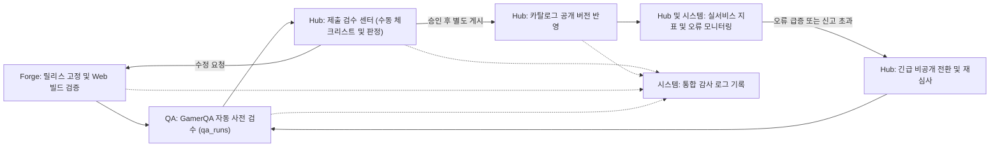

# PlayHub-Admin 페이지 기획안

- 작성일: 2026-11-19
- 상태: v1.0 확정 (브랜치 `PlayHub-Admin`, P0~P1 구현 반영 중)
- 기준 저장소: `PlayHub-Platform` (`hub/`, `forge/`, `tools/`), `PlayHub-GamerQA` (`tools/Gamer/GamerQA`)
- 관련 기준 문서: [FRONTEND_SITE_PLAN.md](FRONTEND_SITE_PLAN.md), [hub-forge-integration.md](architecture/hub-forge-integration.md), [GOOGLE_ACCOUNT_DRIVE_SETUP.md](GOOGLE_ACCOUNT_DRIVE_SETUP.md), [PORTABLE_DESIGN.md](../hub/docs/PORTABLE_DESIGN.md)

---

## 1. 기획 목적과 설계 원칙

기존 관리자 페이지(`hub/web/admin/index.html`)는 단일 스크롤 페이지에 9개 섹션(지표·추이·퍼널·게임·제출 심사·리텐션·커뮤니티·오류·감사 로그)이 나열된 구조였다. 여기에 Forge 창작 인프라(Godot Web 빌드 큐, 운영자 Drive 동기화/보존, 멀티플레이 방)와 QA 체계(GamerQA 자동 검수, 카탈로그 회귀, AI 모델 플레이 QA)가 결합되면 단일 스크롤 화면으로는 운영 경계와 업무 흐름을 감당하기 어렵다.

본 기획안은 PlayHub-Admin을 **4개의 큰 탭(`시스템` / `Hub` / `Forge` / `QA`)** 으로 재편하여, 대시보드·지표·운영·관리·검수·설정 기능을 역할과 책임에 맞게 배치한다.

### 핵심 설계 원칙

1. **별도 관리자 보안 경계 유지**: 관리자 UI(`127.0.0.1:8081`)와 관리자 API(`127.0.0.1:8091`, `/api/admin/*`)의 물리적·네트워크 분리, 별도 세션 쿠키, CSRF·Origin 검증을 유지한다.
2. **상태·검증 의미의 엄격한 분리**:
   - `메타데이터 승인` ≠ `실행 패키지 검증` ≠ `카탈로그 공개`
   - `로컬 저장 성공` ≠ `Drive 업로드 완료(cloudCommitted)` ≠ `원격 재검증 완료(cloudVerified)`
   - `skip` / `not_run` / `error` ≠ `pass` (미실행 항목을 통과율에 합산하지 않음)
   - 데이터 `0`과 `미측정(—)`을 명확히 구분한다.
3. **실서비스(`live`)와 테스트(`qa`/`demo`)의 운영 분리**: `Hub` 탭은 실제 이용 데이터(`live`) 기반 운영·의사결정에 집중하고, `qa`·`demo` 데이터셋 및 `qa_run_id` 추적은 `QA` 탭에 집중 배치한다.
4. **비밀정보 비노출**: OAuth Client Secret, Drive Refresh Token, 관리자 비밀번호/해시, 원시 게임 저장 payload는 어떤 관리자 API 응답이나 로그에도 출력하지 않는다.
5. **정적 호스팅 호환 라우팅**: Portable 환경의 정적 worker는 SPA rewrite를 전제하지 않으므로, 기존 사용자 포털(`/?view=browse`)과 동일하게 **쿼리 파라미터 라우팅(`/?tab=hub&view=dashboard`)** 을 사용한다.
6. **현황과 기획의 구분**: 모든 기능에서 구현됨(As-Is), 부분 구현(백엔드/CLI 존재), 신규 기획(To-Be)을 구분한다.

---

## 2. 전체 정보 구조(IA) 및 기능 배치

### 2.1 4대 큰 탭 구조도

```mermaid
flowchart TD
  Root["PlayHub-Admin (127.0.0.1:8081)"] --> Sys["1. 시스템 (System)"]
  Root --> Hub["2. Hub (서비스 운영)"]
  Root --> Forge["3. Forge (창작 인프라)"]
  Root --> QA["4. QA (품질·자동검증)"]

  Sys --> S1["시스템 대시보드"]
  Sys --> S2["환경·연동 설정"]
  Sys --> S3["관리자 계정·권한"]
  Sys --> S4["백업·유지보수"]
  Sys --> S5["통합 오류 모니터링"]
  Sys --> S6["통합 감사 로그"]

  Hub --> H1["Hub 대시보드"]
  Hub --> H2["이용 지표·리텐션"]
  Hub --> H3["게임 카탈로그·공개 관리"]
  Hub --> H4["제출 검수 센터"]
  Hub --> H5["커뮤니티·신고 관리"]
  Hub --> H6["사용자·저장 관리"]

  Forge --> F1["Forge 대시보드"]
  Forge --> F2["프로젝트·템플릿 관리"]
  Forge --> F3["Web 빌드 큐·패키지"]
  Forge --> F4["Drive 동기화·보존 정책"]
  Forge --> F5["협업 세션·멀티플레이 방"]
  Forge --> F6["Forge 운영 설정"]

  QA --> Q1["QA 대시보드"]
  QA --> Q2["자동화 테스트·회귀"]
  QA --> Q3["AI 모델 플레이 QA"]
  QA --> Q4["심사 정책·스케줄·격리"]
  QA --> Q5["QA·검증 지표 샌드박스"]
```

### 2.2 4대 탭 × 6대 기능 유형 배치 매트릭스

| 기능 유형 | 시스템 (System) | Hub | Forge | QA |
|---|---|---|---|---|
| **대시보드** | 전체 프로세스·헬스·포트·보안 경계·DB 요약 | 서비스 KPI 6종, 일별 추이, 심사/신고/오류 대기 위젯 | 에디터 가동, 빌드 큐 요약, Drive 용량, 활성 방/세션 | 회귀 통과율, 자동 심사 SLA, 번복률, Flaky 격리 현황 |
| **지표** | 프로세스 가동률, 오류 코드 분포, API 헬스 | 플레이 전환 퍼널, D1/D7/D30 리텐션, 창작자 전환 퍼널 | 빌드 성공률/소요 시간, 스토리지 증가 추이, 동시 접속 수 | 스위트별 통과 추이, 오탐률, `live` 분리 QA·Demo 지표 |
| **운영** | 온라인 DB 백업/복원 절차, 로그 열람, 통합 오류·감사 | 게임 공개/비공개·긴급 중단·롤백, 커뮤니티 모더레이션 | 빌드 잡 재시도/취소, Drive 동기화 재시도/정리, 방 종료 | 테스트 수동/예약 실행, AI 플레이테스트 실행, 증거 보존 |
| **관리** | 관리자 계정·RBAC 역할·활성 세션 강제 종료 | 게임 카탈로그/다국어 메타데이터/버전, 회원·병합·백업 | 공식 템플릿(에셋 출처·시연), 창작자 프로젝트 목록 | 게임별 `qa.profile.json`, `quarantine.json` 만료 관리 |
| **검수** | 보안 경계/수용 검사 결과 요약 | **수동 제출 검수**(체크리스트·격리 미리보기·최종 판정) | **빌드 ZIP 구조 검증**(용량·경로·CRC·`index.html`) | **자동 사전 검수**(`static`/`security`/`runtime`), AI 플레이 검증 |
| **설정** | 도메인/Origin, Google OAuth 상태, 기능 플래그, 로컬 자동 로그인 | 카탈로그 노출·로케일 동기화, 커뮤니티 신고 임계치 | 에디터 경로, Hub 세션 검증, 빌드 워커/세션 상한, Drive 폴더 | 심사 정책 버전(`vN`), 체크리스트, 야간 스케줄, AI 추론 서버 |

### 2.3 탭 간 유기적 업무 흐름

---

## 3. 공통 레이아웃 및 기존 화면 이관 매핑

### 3.1 공통 쉘(Shell) 구조

- **상단 1차 바**: 4대 큰 탭 전환 (`?tab=system|hub|forge|qa`), 대기 건수 배지, 실행 환경 표시, 8개 언어 선택, 세션·로그아웃.
- **좌측 2차 사이드바**: 현재 큰 탭에 속한 하위 메뉴만 노출하고, 심사 대기·신고·오류·QA 건수 배지를 표시.
- **기존 해시 호환**: `#overview`, `#trends`, `#play-funnel`, `#retention`, `#games`, `#submissions`, `#community`, `#errors`, `#audit` 해시 진입 시 새 `?tab=&view=` 경로로 자동 매핑.

### 3.2 기존 Admin 9개 섹션 재배치 매핑

| 기존 섹션 (`hub/web/admin`) | 신규 배치 위치 | 변경 사항 |
|---|---|---|
| `#overview` (서비스 현황) | **Hub > Hub 대시보드** | 기본 `live` 기준 + 운영 대기 위젯 추가 |
| `#trends` (일별 추이) | **Hub > Hub 대시보드** | 대시보드 내 추이 패널 유지 |
| `#play-funnel` (플레이 전환) | **Hub > 이용 지표·리텐션** | 퍼널 + 여정 요약 + 창작자 전환 퍼널 확장 |
| `#retention` (재방문 분석) | **Hub > 이용 지표·리텐션** | D1/D7/D30 코호트 표 유지 |
| `#games` (게임별 현황·공개) | **Hub > 게임 카탈로그·공개 관리** | 게임 메타데이터 상세 드로어 확장 |
| `#submissions` (제출 심사) | **Hub > 제출 검수 센터** | 좌우 분할 워크스페이스 + 체크리스트·QA 연동 |
| `#community` (게임 커뮤니티) | **Hub > 커뮤니티·신고 관리** | 신고 우선 필터·정렬 추가 |
| `#errors` (실행 오류) | **시스템 > 통합 오류 모니터링** | 영역·기간·데이터셋 필터 (`Hub 대시보드`에 요약 위젯 유지) |
| `#audit` (운영 기록) | **시스템 > 통합 감사 로그** | 4대 탭 전체 변경 이력 필터·JSON 내보내기 |
| 상단 `QA 실행 기록` / `가상 예제` 토글 | **QA > QA·검증 지표 샌드박스** | `live` 운영 지표와 분리해 QA 전용 검증 뷰로 이관 |

---

## 4. 탭별 상세 기능 명세

### 탭 1. 시스템 (System)

1. **시스템 대시보드 (`?tab=system&view=overview`)**: 서비스/포트 상태, Node 런타임, SQLite 크기·WAL·`maintenance.lock`, 보안 경계 체크 배지(loopback, `secureCookies`, 경로 격리).
2. **환경·연동 설정 (`?tab=system&view=config`)**: 네트워크/Origin, Google OAuth 설정 상태(비밀값 미노출), `admin.localAutoLogin` 경고, Forge/Build/Drive 기능 플래그(초기 읽기 전용 진단).
3. **관리자 계정·권한 (`?tab=system&view=access`)**: 현재 관리자 계정, 활성 세션 현황, 5대 역할(RBAC) 권한 매트릭스.
4. **백업·유지보수 (`?tab=system&view=backups`)**: SQLite 온라인 백업 목록(SHA-256, 무결성, 외래키 검사), 수동 온라인 백업 즉시 실행, 복원 절차 안내.
5. **통합 오류 모니터링 (`?tab=system&view=errors`)**: 데이터셋/기간/게임별 실행 오류 스트림과 코드별 집계.
6. **통합 감사 로그 (`?tab=system&view=audit`)**: 영역(`system`/`hub`/`forge`/`qa`)·액션·검색어 필터 및 JSON 내보내기.

### 탭 2. Hub (플레이어 서비스 운영)

1. **Hub 대시보드 (`?tab=hub&view=dashboard`)**: `live` 기준 기간(KST)·게임 필터, 핵심 KPI 6종, 운영 대기 액션 위젯(심사 대기·신고 글·오류·QA 바로가기), 일별 이용 추이.
2. **이용 지표·리텐션 (`?tab=hub&view=analytics`)**: 플레이 전환 퍼널, 여정 보조 지표, D1/D7/D30 정확일 리텐션 코호트 표.
3. **게임 카탈로그·공개 관리 (`?tab=hub&view=games`)**: 게임별 지표 정렬·검색, 공개/비공개 전환, 게임 상세 패널(8개 언어 메타데이터, 장르·조작·모바일·저장 지원, 관련 제출).
4. **제출 검수 센터 (`?tab=hub&view=submissions`)**: 좌측 대기열 + 우측 상세 워크스페이스(소유자·Forge 릴리스, 수동 검수 체크리스트 `manual-review.v1` 저장, 낙관적 락 판정). 승인 시에도 `publicationStatus: unpublished`와 `packageValidation: not_verified` 구분을 유지한다.
5. **커뮤니티·신고 관리 (`?tab=hub&view=community`)**: 게임·글 종류·표시 상태·신고 여부 필터, 신고 사유 확인, 숨김/공개 및 개선 제안 상태 관리.
6. **사용자·저장 관리 (`?tab=hub&view=users`)**: 등록(Google)/게스트 사용자 통계, 기록 병합(`merge_requests`) 및 충돌 백업(`save_backups`) 현황(원시 payload 미노출).

### 탭 3. Forge (창작 인프라 운영)

1. **Forge 대시보드 (`?tab=forge&view=overview`)**: Forge/Build/Drive/Package 기능 활성화 상태, 공식 템플릿·프로젝트·빌드 잡·Drive 동기화 요약.
2. **프로젝트·템플릿 관리 (`?tab=forge&view=projects`)**: `forge/Templates/*` 공식 템플릿 카탈로그(시연 포함 여부 등)와 Hub 관리 창작자 프로젝트 메타데이터 목록(소스 본문 비노출).
3. **Web 빌드 큐·패키지 (`?tab=forge&view=builds`)**: `OwnedBuildPackages` / `BuildQueue` 잡 목록·상태·오류 및 배포 ZIP 구조 검증 기준(64MiB 압축 / 128MiB 해제, 루트 `index.html`, `runnableVerified` 분리).
4. **Drive 동기화·보존 정책 (`?tab=forge&view=drive`)**: 운영자 Drive 연결 상태(스냅샷/패키지 폴더 분리 검증), 스냅샷·제출·배포 매니페스트 집계, `drive-retention-policy` Dry-Run 기준.
5. **협업·멀티플레이 (`?tab=forge&view=sessions`)**: 협업 SSE 세션 및 BrawlLabs/Fortress War 권한형 멀티플레이 서버 운영 경계.
6. **Forge 운영 설정 (`?tab=forge&view=settings`)**: `/OfficialGodot/` 주력 경로 정책, Hub 단일 인증(`/forge/*` 프록시 및 COOP/COEP 격리) 원칙, GDScript 신뢰 경계.

### 탭 4. QA (품질 자동화·회귀·AI QA·QA 지표)

1. **QA 대시보드 (`?tab=qa&view=overview`)**: QA 실행 세션/오류 요약, 자동화 리포트 집계(`pass`/`warn`/`fail`/`error`/`skip` 분리), AI 플레이 QA 실행 현황, 격리(Quarantine) 건수.
2. **자동화 테스트·회귀 (`?tab=qa&view=runs`)**: `qa_runs` 테이블 및 `artifacts/gamerqa`/`hub/reports` 리포트 목록과 결과 상세.
3. **AI 모델 플레이 QA (`?tab=qa&view=ai`)**: `tools/Gamer` 추론 서버(`GameScaling-0.8B-S3`, `127.0.0.1:8765`) 헬스 스냅샷 및 모델 플레이 QA 실행 결과 요약.
4. **심사 정책·스케줄·격리 (`?tab=qa&view=policies`)**: 심사 정책 버전(`review-policy`), 수동 체크리스트 기준(`manual-review.v1`), 야간 스케줄 및 Flaky 격리(`quarantine.json`) 현황.
5. **QA·검증 지표 샌드박스 (`?tab=qa&view=metrics`)**: `dataset=qa` 및 `dataset=demo` 전용 지표·퍼널·리텐션·게임 표(공개 변경 버튼 비활성 유지) 및 `qa_run_id`별 실행 이력 조회.

---

## 5. 권한 모델(RBAC) 및 API 네임스페이스

- 목표 역할 5종: `Super Admin`, `Hub Operator`, `Reviewer`, `Forge Operator`, `QA Maintainer` (P0~P2는 기존 단일 관리자 계정이 전체 권한을 보유하며, P3에서 다중 계정 확장).
- 신규 관리자 API:
  - `GET /api/admin/summary/badges`
  - `GET /api/admin/system/overview`, `POST /api/admin/system/backups`
  - `GET /api/admin/games/:id`, `GET /api/admin/hub/users-summary`
  - `GET / PUT /api/admin/submissions/:id/checklist`
  - `GET /api/admin/forge/overview`
  - `GET /api/admin/qa/overview`
  - `GET /api/admin/audit` (선택 쿼리 `domain`, `action`, `q`, `limit` 추가, 기존 무인자 호출 하위 호환 유지)
- SQLite 추가 테이블(`hub/tools/restore-data.mjs`의 `OPTIONAL_TABLES`에 등록하여 구/신 스냅샷 복원 호환 유지):
  - `qa_runs`
  - `submission_checklists`

---

## 6. 단계별 로드맵

| 단계 | 범위 | 완료 기준 |
|---|---|---|
| **P0** | 4대 탭 쉘(`?tab=&view=`), 기존 9개 섹션 재배치, 해시 리다이렉트, 시스템 헬스·설정(읽기 전용) | 기존 관리자 기능 무손실 이관, 테스트 통과, 접근성·반응형 검증 |
| **P1** | 제출 검수 좌우 분할·체크리스트 저장, 게임 상세, 사용자/저장 요약, 온라인 백업 트리거, Forge·QA 관측 API 및 UI | 신규 API·UI 단위/통합/브라우저 테스트 및 복원 호환 테스트 통과 |
| **P2** | 격리 미리보기, 카탈로그 버전 배포/롤백, GamerQA 실행 트리거, AI QA 스텝 타임라인, Drive 보존 실행 | 격리 보안 경계 검증 및 E2E 통과 |
| **P3** | 다중 관리자 RBAC, 오류/신고 임계치 경보, AgentReplay 연동, 관리자 서비스 프로세스 분리 대비 | 역할별 비인가 접근 403 차단 및 전 영역 감사 추적 검증 |
