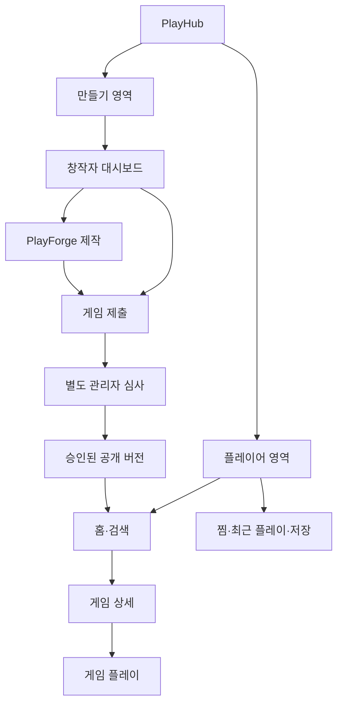
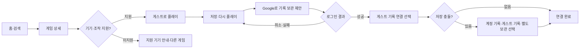
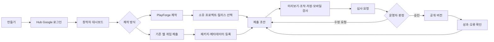

# PlayHub 프론트엔드 사이트 기획

작성일: 2026-11-18. 상태: 아래 9절의 핵심 화면과 메타데이터 심사 흐름을 로컬에 적용했으며 운영 배포 완료 선언이 아니다.

## 1. 목적과 확인 범위

기존 게스트 플레이·저장·분석 기반은 유지하고, 탐색 동선을 정리하며 창작자의 제작→제출→공개 흐름을 연결한다. 전면 재제작보다 기존 기능 확장을 우선한다.

최초 조사는 GamePlayHub의 `WebPlatform/PlayHub_Portable/source` 실제 코드 읽기 기준이다. 이 문서를 저장하며 현재 통합 작업 트리의 [Google 계정·Drive 문서](GOOGLE_ACCOUNT_DRIVE_SETUP.md)를 추가 확인했다. 아래 표에서 기존 코드 존재, 통합 문서상 mock 검증, 신규 기획, 실서비스 미검증을 구분한다. 동시 개발 중인 기능의 최신 상태는 관련 문서와 테스트로 다시 확인해야 한다.

| 영역 | 확인된 상태 | 남은 기획·검증 |
|---|---|---|
| 탐색 | 홈·검색·게임 상세·찜 코드 존재 | 장르·기기·조작 필터 일관화 |
| 게스트 플레이 | 세션·서버 저장·임시 진행·저장 충돌 처리 존재 | 게임별 지원 여부와 저장 상태 표시 |
| Google 가입·로그인 | OAuth 시작/콜백·계정 생성 코드 존재 | 실제 운영 설정·실계정 E2E 미검증 |
| 기록 연결 | 게스트 기록 동의·충돌 선택·분석 이력 별도 선택 존재 | 가입 후 안내와 취소 복귀 개선 |
| 커뮤니티 | 게임별 글·댓글·운영 관리 코드 존재 | 플레이와 독립된 상세 탭 정리 |
| 관리자 | 사용자와 별도 웹/API, 게임 공개 관리·지표·오류·감사 로그 존재 | 제출·버전 심사 화면 |
| 분석 | live/qa/demo, 노출·클릭·활동·리텐션 코드 존재 | 소유 게임만 보는 창작자 분석 |
| Forge 계정 | 기존 화면은 별도 서비스 링크. 현재 통합 문서는 Hub 세션을 권한 기준으로 API 통합·mock 검증했다고 명시 | 실제 Google·에디터 UI 통합 E2E 미검증. 기존 독립 Forge 로그인은 통합 진입점으로 제시하지 않음 |
| 제출·Drive | 통합 문서는 소유자 릴리스 소스 JSON 보관 API·mock 검증 명시 | 실행 패키지 배포·카탈로그 등록·심사 UI는 별도 구현 대상 |

현재 제출 API는 최대 4 MiB 릴리스 소스 JSON 보관이다. 실행 가능한 게임 ZIP 배포나 공개 완료와 혼동하지 않는다. Drive는 운영자 계정 저장소이며 사용자 개인 Drive 연결이라고 표시하지 않는다. 로컬 저장 성공, 원격 업로드 확인, 원격 재검증을 각각 구분한다.

주요 근거: `hub/web/user/index.html`, `hub/web/user/app.js`, `hub/web/user/community.js`, `hub/web/user/PlayForge/redirect.js`, `hub/web/admin/index.html`, `hub/server/app.mjs`, `hub/server/google.mjs`, `hub/server/metrics.mjs`. 원본 조사 시점 이후 통합 변경은 위 계정·Drive 문서를 우선 참고한다.

## 2. 사이트맵

아래는 목표 정보 구조다. 경로명이 확정된 라우팅 명세는 아니다.

```text
PlayHub
├─ 홈: 추천 / 최근 플레이 / 신규 게임
├─ 게임 찾기: 검색 / 장르 / 모바일 지원 / 조작 방식
│  └─ 게임 상세: 플레이 / 소개·조작 / 저장 기록 / 커뮤니티·신고
├─ 내 게임: 찜한 게임 / 최근 플레이·저장 기록
├─ 내 계정: Google 로그인 / 게스트 기록 연결 / 언어·기록 안내
└─ 만들기
   ├─ 창작자 대시보드 [신규 화면]
   ├─ 게임 제출 [신규 화면]
   ├─ 내 게임·버전·심사 상태 [신규 화면]
   ├─ 내 게임 분석 [신규 화면]
   └─ PlayForge 열기 [기존 링크 개선]

별도 운영자 사이트
├─ 운영 개요·분석
├─ 게임 공개 관리
├─ 제출·버전 심사 [신규]
├─ 커뮤니티·신고
└─ 오류·감사 로그
```

상단 메뉴는 게임 찾기 / 내 게임 / 만들기 중심으로 구성한다. PlayForge는 만들기 내부에 역할을 설명하고 진입시킨다.



## 3. 플레이어 흐름



- 탐색과 일반 플레이를 로그인 뒤에 숨기지 않는다.
- 계정 연결 직전 미저장 진행을 확인하고 보관·다운로드 선택을 제공한다.
- 로그인 취소 시 이전 게임 상세로 돌아가며 진행을 자동으로 덮어쓰지 않는다.
- 게스트 게임 기록 연결과 과거 분석 이력 연결은 분리한다.
- 빈 검색 결과, 비공개 게임, 로딩 실패, 오프라인 임시 저장, 다른 탭의 저장 충돌을 서로 다른 상태로 표시한다.

## 4. 창작자 흐름과 제출 상태

아래 공개·심사 단계는 목표 기획이다. 현재 소스 보관 API만으로 달성된 것으로 간주하지 않는다.



상태: 초안 → 검증 중 → 제출 가능 → 심사 중 → 수정 요청/승인 → 공개/비공개.

업로드·검증 실패를 심사 중으로 표시하지 않는다. 기존 공개 버전과 새 제출 버전은 분리한다. 심사 승인 전에는 공개 카탈로그에 자동 노출하지 않는다. Forge 프로젝트 소유권은 서버의 인증 계정으로 검증하며 요청 본문의 owner ID를 신뢰하지 않는다.

## 5. 핵심 화면 와이어프레임

### 5.1 홈·탐색

```text
[PLAY HUB] [게임 이름·장르 검색________] [내 게임] [만들기] [계정]
[장르 ▾] [모바일 지원 ▾] [조작 방식 ▾] [정렬 ▾]

이어하기
[최근 게임 / 저장 시각 / 이어하기] ...

지금 플레이
[썸네일] [썸네일] [썸네일] [썸네일]
게임명 / 장르 / 터치·키보드 지원 / 찜
[더 보기]
```

첫 화면에서 홍보 배너보다 이어하기와 플레이할 게임을 우선한다.

### 5.2 게임 상세·플레이

```text
[← 탐색] 게임명                           [찜] [공유] [신고]
[대표 이미지 또는 실행 전 화면]           제작자 / 지원 기기
[             플레이             ]       조작 안내 / 저장 지원
[소개] [커뮤니티] [업데이트]
```

```text
[← 게임 상세] 게임명 [저장 상태] [전체화면] [도움말]
[                 실제 게임 viewport                  ]
[연결 오류 시 복구·재시도 안내: 필요할 때만 표시]
```

게임 iframe 안에는 Hub 메뉴, 운영 로그, Forge Inspector를 넣지 않는다. 게임 자체 조작 UI와 호스트의 플레이 도구를 구분한다. 에디터의 서버·클라이언트 관리 탭은 Forge의 기본 에디터 UI 영역에 유지한다.

### 5.3 창작자 대시보드

```text
[만들기]                         [PlayForge 열기] [+ 게임 제출]
게임명 | 현재 공개 버전 | 새 버전 상태 | 최근 오류 | 다음 행동
A      | v1.2          | 수정 요청    | 2건       | 수정 내용 보기
B      | 미공개        | 초안         | -         | 제출 계속하기
```

### 5.4 제출 화면

```text
[1 게임 정보] → [2 실행 빌드] → [3 테스트] → [4 제출]
제목·설명·대표 이미지
지원 기기 / 조작 방식 / 저장 지원 / 콘텐츠 정보
[초안 저장 시각] [로컬 저장·원격 동기화 상태]
[검증 결과: 통과 / 실패 / 미검증을 항목별 표시]
[미리보기] [초안 저장] [심사 요청]
```

### 5.5 운영자 심사

```text
[심사 대기 목록]   [게임·제출 버전 / 소유자 / 제출 시각]
                 [격리된 미리보기] [검증 결과] [변경 내역]
                 [수정 요청 사유_______________________]
                 [수정 요청] [승인] [기존 공개 상태 확인]
```

승인과 실제 공개 반영의 성공·실패를 분리하며 운영 변경은 감사 로그에 남긴다.

## 6. 모바일·접근성·관리자 분리

- 모바일 하단: 홈 / 찾기 / 내 게임 / 계정. 만들기는 계정에서 접근하며 제출 상태 확인·간단한 정보 수정 중심이다.
- 복잡한 Forge 편집은 PC 권장으로 안내한다. 모바일에서 빈 에디터를 띄우거나 지원된다고 추정하지 않는다.
- 터치 미지원, 가로 화면 필요, 사운드 활성화, 전체화면 불가 상태를 플레이 전에 안내한다.
- 키보드 이동, 명확한 포커스, 버튼 접근성 이름, 오류 문구와 재시도, 충분한 터치 영역을 기본 요건으로 한다.
- 관리자 메뉴는 단순 숨김이 아니라 별도 웹·API 권한 경계를 유지한다.
- 제출 게임은 격리된 실행 환경에서 검증하고 운영자 인증·사용자 쿠키를 게임 코드에 노출하지 않는다.

## 7. Analytics

| 단계 | 지표 | 구분 |
|---|---|---|
| 발견 | 카드 노출 → 클릭 | 기존 집계 재사용 |
| 실행 | 플레이 요청 → game_ready → 실제 활동 10초 → 60초 | 기존 집계 재사용 |
| 품질 | 오류 세션, 로딩 실패, 저장 충돌 | 수집 범위 확인·확장 |
| 재방문 | 플랫폼·게임별 D1/D7/D30 | 기존 리텐션 재사용 |
| 창작 | 제출 시작 → 검증 통과 → 심사 요청 → 공개 | 신규 이벤트 |

live/qa/demo와 KST 기준을 유지한다. 백그라운드·일시 정지 시간은 실제 플레이에서 제외한다. 저장 성공 수는 있어도 시도·실패 분모가 없으면 저장 성공률을 만들지 않는다. 데이터 0과 미측정을 구분한다. 창작자는 본인 게임의 집계만, 운영자는 전체 집계를 보며 원시 개인 식별 기록은 창작자 화면에 제공하지 않는다. QA 실행을 실제 인기도에 포함하지 않는다.

## 8. 우선순위와 완료 기준

| 우선순위 | 범위 | 완료 판단 |
|---|---|---|
| P0 | 탐색→게스트 플레이→저장·재개 | 지원 기기에서 재개, 실패·충돌·오프라인 복구 검증 |
| P0 | Google 가입·기록 연결 | 실제 설정 후 성공·취소·실패·충돌 선택 E2E. mock만으로 운영 완료 처리 금지 |
| P0 | 모바일·빈 상태·접근성 | 지원/미지원 안내, 키보드·터치 핵심 흐름 검증 |
| P1 | 만들기·대시보드·제출·심사 | 소유권, 상태전이, 실패 복구, 공개 버전 분리 검증 |
| P1 | Forge 연계 | Hub 세션 기준 UI/API 연결. 소스 보관과 실제 배포를 분리 검증 |
| P2 | 창작자 분석·추천·커뮤니티 고도화 | 데이터 권한과 지표 정의·QA 분리 검증 |

기획 저장 당시에는 다른 소스·설정·사용자 데이터 변경과 Git 커밋·푸시를 수행하지 않았다. 이후 사용자의 “구글 로그인 구현, 사이트 구축 계획 적용” 요청에 따라 아래 범위를 로컬 구현했으며, 사용자는 운영 연결 대신 로컬 구현·자동 검증을 선택했다.

## 9. 로컬 적용 범위 (2026-11-18)

- 탐색 필터, 내 게임, 계정, 만들기 진입점을 기존 사용자 사이트에 통합한다.
- Google 로그인은 원래 게임 주소 복귀, 취소·실패 안내, 게스트 기록 보존, 서버 전용 환경변수 설정과 구성 검증을 보완한다.
- 만들기는 소유 프로젝트·릴리스 및 보관 상태를 실제 API에서 조회하고 제출 메타데이터 초안·수정·심사 요청을 제공한다.
- 별도 관리자 사이트는 메타데이터 심사 대기, 수정 요청 사유, 승인과 감사 기록을 제공한다. 승인해도 공개 카탈로그는 변경하지 않는다.
- 실제 Google·Drive 계정 E2E, 격리된 실행 패키지 검사·미리보기, 공개 버전 전환, 창작자 분석·추천 고도화는 미구현 또는 실서비스 미검증 항목으로 남긴다. 전체 기획이나 운영 배포가 완료된 것으로 간주하지 않는다.

구성·API와 검증 한계는 [Google 계정·Drive 설정](GOOGLE_ACCOUNT_DRIVE_SETUP.md)을 따른다. 자동 검증 로그와 브라우저 결과는 `hub/reports/local-site-*`에 보관한다.
