# PlayHub · PlayForge UGC 시장 현황 조사 리포트

> [!IMPORTANT]
> **발표용 5대 핵심 메시지 (Executive Takeaways)**
> 1. **글로벌 시장 규모**: 글로벌 게임 시장은 2026년 **2,139억 달러**, **37억 명**의 플레이어 규모로 성장하고 있습니다.
> 2. **UGC 수요 증명**: Roblox는 분기 **1.38억 DAU**와 **340억 시간**의 참여로 UGC 게임 수요를 증명했습니다.
> 3. **크리에이터 이코노미**: Fortnite는 2024년 크리에이터에게 **3억 5,200만 달러**(Roblox는 2025년 **15억 달러 이상**)를 지급하며 크리에이터 이코노미의 실현 가능성을 보여줬습니다.
> 4. **아시아 UGC 선례**: ZEPETO는 아시아에서 **2,000만 MAU**와 약 **200만~470만 크리에이터**를 확보한 UGC 플랫폼 선례입니다.
> 5. **PlayHub · PlayForge의 기회**: PlayHub·PlayForge는 **AI 네이티브 제작, Godot 기반 오픈 엔진, 브라우저 우선 배포**를 결합해 UGC 게임 제작의 남은 병목을 해결합니다.

---

## 한눈에 보는 시장 구조도 (Market Thesis Flow)

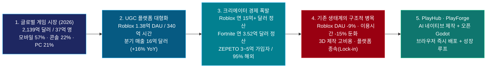

| 영역 | 핵심 지표 | 수치 (기준 시점) | 전략적 시사점 |
|---|---|---|---|
| **글로벌 게임 시장** | 연간 시장 규모 / 이용자 | **2,139억 달러** (+6.1% YoY) / **37억 명** (+4.4% YoY) | 모바일(57%)과 PC(21%)를 동시에 관통하는 **브라우저 즉시 실행**의 거대 유효 시장 |
| **UGC 플랫폼 (Roblox)** | Q3 2026 DAU / 분기 이용시간 | **1.38억 명** (-9% YoY) / **340억 시간** (-15% YoY) | 분기 매출 **16억 달러**(+16%)로 유통 파워는 입증했으나, **성장 둔화로 인한 발견·수익화 혁신 수요** 발생 |
| **크리에이터 경제** | 연간 크리에이터 정산금 | Roblox **15억+ 달러** (2025) / Fortnite **3.52억 달러** (2024) | 콘텐츠 공급의 핵심 동력은 **크리에이터의 실질 수익화 구조**에 좌우됨 |
| **아시아 UGC (ZEPETO)** | 누적 가입자 / 크리에이터 | **3억~5억 명** (해외 95%) / **200만~470만 명** | 아시아 기반 **"제작 → 배포 → 발견 → 수익화 → 재투자"** 플라이휠의 글로벌 확장성 검증 |

---

## 1. 글로벌 게임 시장 (Global Games Market 2026)

### 1-1. 플랫폼별 시장 규모 비교 그래프 (단위: 억 달러)

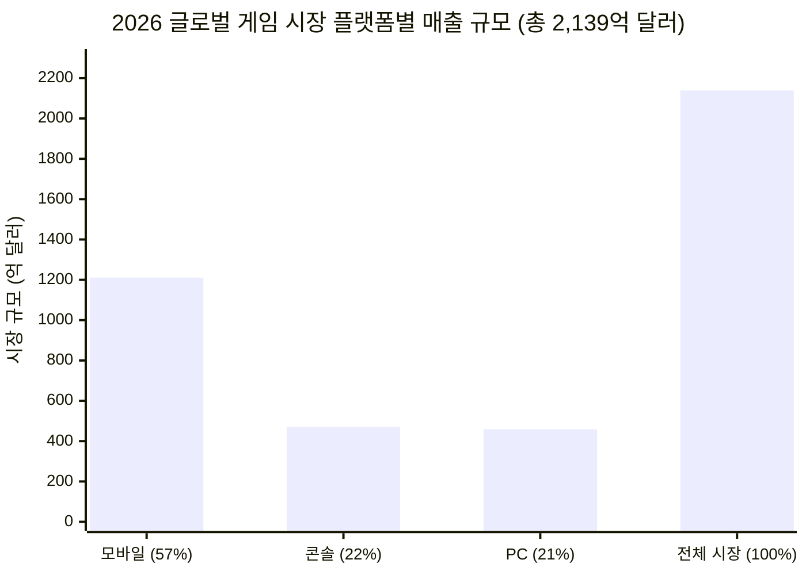

### 1-2. 플랫폼 및 지역 분포 다이어그램

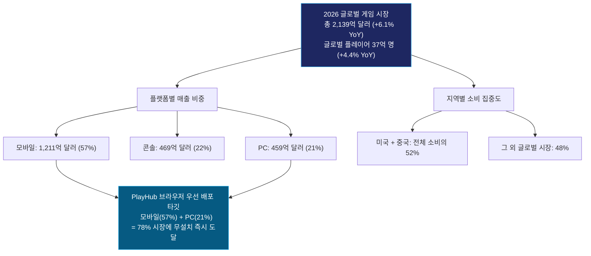

- **시장 성장성**: 2026년 글로벌 게임 시장은 **2,139억 달러**(전년 대비 **+6.1%**), 이용자는 **37억 명**(전년 대비 **+4.4%**)에 달합니다.
- **플랫폼 구성**: 모바일 **1,211억 달러(57%)**, 콘솔 **469억 달러(22%)**, PC **459억 달러(21%)**로 모바일과 PC의 합산 비중이 **78%(1,670억 달러)**를 차지합니다.
- **지역 집중도**: 중국과 미국 두 국가가 전 세계 게임 소비의 **52%**를 차지합니다.
- **출처**: Newzoo, *Global Games Market Report 2026* (2026년 8월 13일 발표) — [Newzoo Global Games Market Key Numbers](https://newzoo.com/key-numbers)

---

## 2. UGC 게임 플랫폼: Roblox의 규모와 성장 변곡점

### 2-1. Roblox Q3 2026 재무 성장 vs. 이용 지표 증감률 비교 (%)

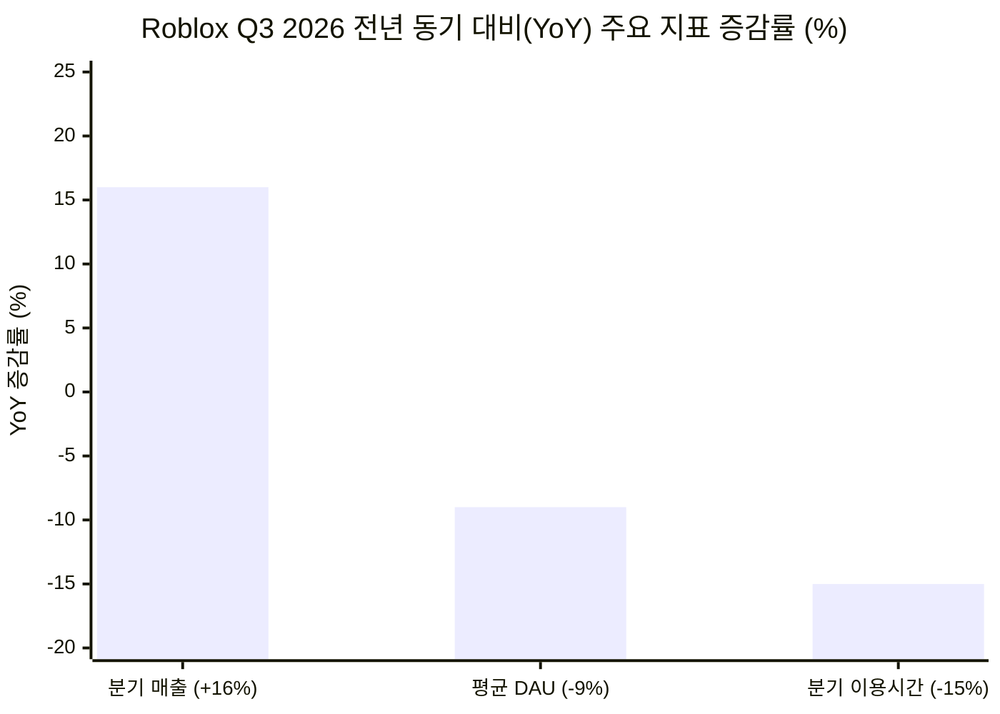

### 2-2. Roblox 지표가 보여주는 시장의 이중 신호 (Dual Signal)

```mermaid
flowchart LR
    subgraph SCALE["검증된 메가 스케일 (Q3 2026)"]
        S1["평균 DAU: 1.38억 명"]
        S2["분기 이용시간: 340억 시간"]
        S3["분기 매출: 16억 달러 (+16% YoY)"]
        S4["분기 Bookings: 17억 달러"]
    end

    subgraph BOTTLENECK["성장 둔화 신호 & 구조적 한계"]
        B1["DAU 전년 대비 -9% 감소"]
        B2["이용시간 전년 대비 -15% 감소"]
        B3["폐쇄형 생태계 내 제작·발견·수익화 피로도"]
    end

    subgraph OPPORTUNITY["PlayHub · PlayForge 기회"]
        O1["설치 장벽 없는 브라우저 즉시 유입"]
        O2["AI 네이티브 제작으로 공급 품질·속도 혁신"]
        O3["크리에이터 친화적 발견·수익화 경험 제공"]
    end

    SCALE --> BOTTLENECK --> OPPORTUNITY

    style SCALE fill:#1E293B,stroke:#38BDF8,color:#FFFFFF
    style BOTTLENECK fill:#3B1219,stroke:#F87171,color:#FFFFFF
    style OPPORTUNITY fill:#065A82,stroke:#34D399,color:#FFFFFF
```

- **압도적 유통 규모**: Q3 2026 기준 평균 DAU **1.38억 명**, 분기 이용시간 약 **340억 시간**, 분기 매출 **16억 달러**(+16% YoY), Bookings **17억 달러**를 기록하며 UGC 게임이 주류 유통 채널임을 입증했습니다.
- **둔화와 공백**: 반면 DAU(**-9% YoY**)와 이용시간(**-15% YoY**)이 동반 감소하며, 기존 플랫폼의 **제작·발견·수익화 경험을 혁신할 차세대 플랫폼의 진입 여지**가 열렸습니다.
- **출처**: Roblox Investor Relations, *Q3 2026 Financial Results* (2026년 10월 29일) — [Roblox Q3 2026 Results](https://ir.roblox.com/news/news-details/2026/Roblox-Reports-Third-Quarter-2026-Financial-Results/)

---

## 3. 크리에이터 이코노미 (Creator Economy: Fortnite & Roblox)

### 3-1. 주요 UGC 플랫폼 연간 크리에이터 정산 규모 추이 (단위: 억 달러)

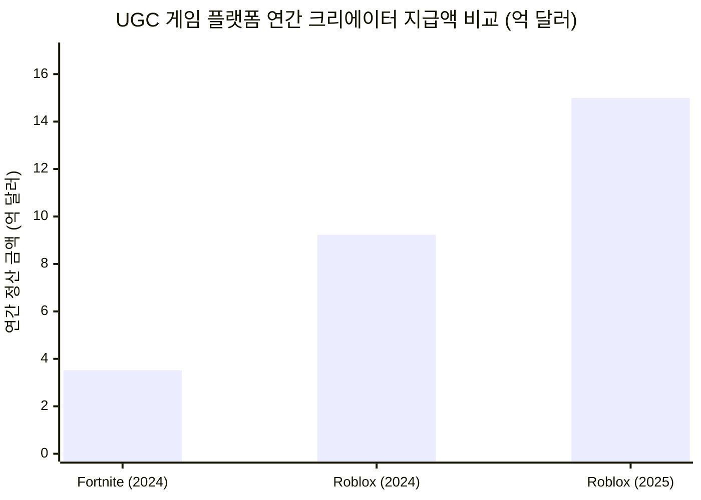

### 3-2. Fortnite 생태계 내 크리에이터 콘텐츠 비중 및 성장성 (2024)

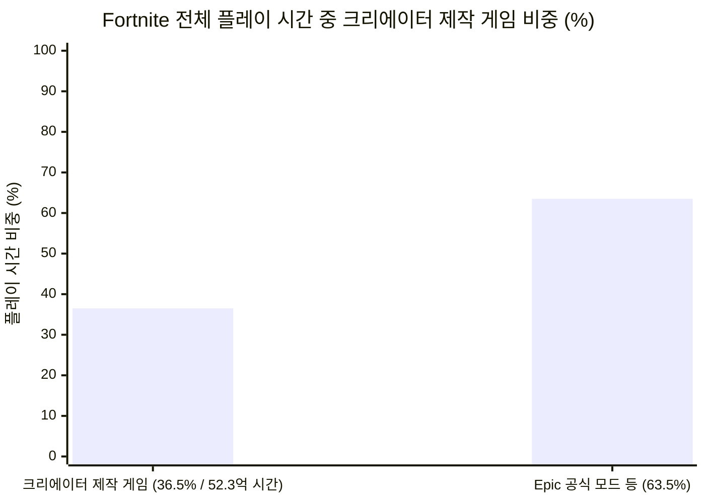

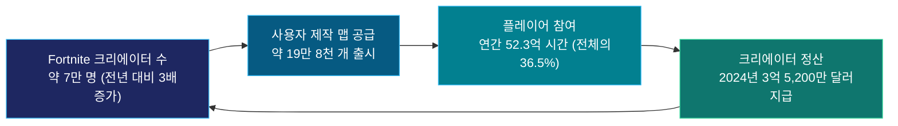

- **Fortnite 크리에이터 생태계 (2024)**:
  - 연간 크리에이터 지급액 **3억 5,200만 달러** 달성.
  - 크리에이터 제작 게임 이용시간 **52.3억 시간**으로 전체 Fortnite 플레이 시간의 **36.5%** 차지.
  - 활동 크리에이터 수 약 **7만 명**(전년 대비 **3배** 증가), 사용자 제작 맵 약 **19만 8천 개** 돌파.
- **Roblox 크리에이터 생태계 (2024~2025)**:
  - 크리에이터 연간 수익이 2024년 **9억 2,300만 달러**에서 2025년 **15억 달러 이상**으로 **+62.5% 이상 급증**.
- **시사점**: UGC 플랫폼의 성패는 단순 콘텐츠 공급을 넘어 **크리에이터가 실질적 소득을 창출하는 수익화 구조**에 의해 결정됩니다.
- **출처**:
  - Epic Games, *Fortnite Ecosystem 2024 Year in Review* (2025년 1월 22일) — [Fortnite Ecosystem Year in Review](https://create.fortnite.com/news/fortnite-ecosystem-2024-year-in-review-celebrating-creators-and-looking-ahead?lang=ko&team=personal/)
  - Roblox Newsroom, *The Global Impact of Creation on Roblox* (2026년) — [Roblox Creator Impact](https://about.roblox.com/newsroom/2026/09/global-impact-of-creation-on-roblox)

---

## 4. 아시아 UGC 사례: ZEPETO

### 4-1. ZEPETO 성장 지표 비교 (공식 보도자료 vs. 2024.10 CFO 인터뷰 최신 트랙션)

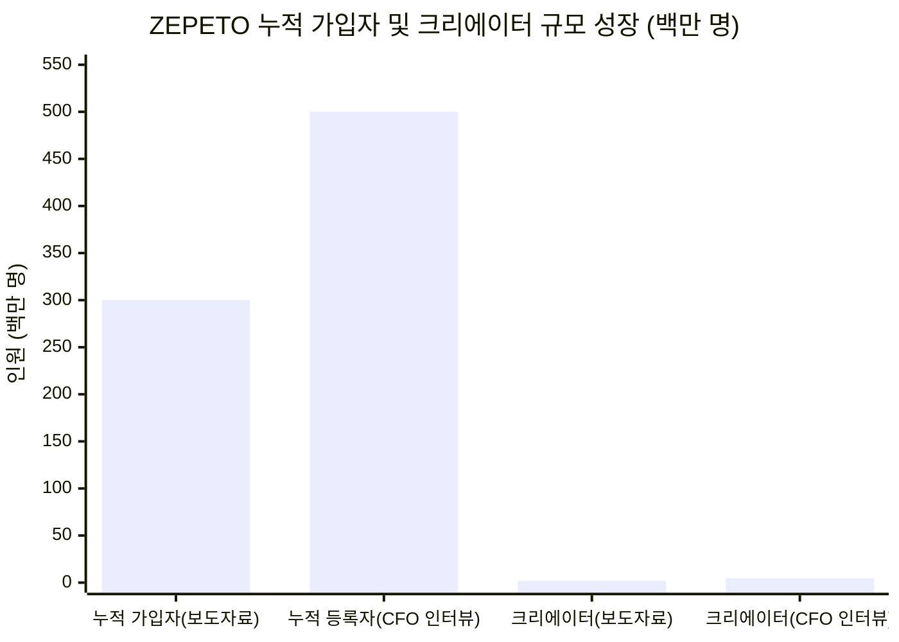

| 지표 구분 | 공식 보도자료 기준 (주요 발표 지표) | 2024년 10월 CFO 인터뷰 (보조·최신 트랙션) | 비고 |
|---|---|---|---|
| **누적 가입자 / 등록자** | **3억 명 돌파** | **5억 명 도달** | 아시아 1위 메타버스·UGC 플랫폼 입지 |
| **글로벌 MAU** | **2,000만 명** | **1,500만 명 이상** | 시점별 활성 사용자 추이 |
| **해외 사용자 비중** | **95%** | 글로벌 다국적 유저 기반 유지 | 아시아 출발 플랫폼의 글로벌 확장성 증명 |
| **크리에이터 규모** | **약 200만 명** | **470만 명 도달** | 크리에이터 풀 2배 이상 확대 |
| **아이템 제작 / 판매량** | **약 410만 개 제작 / 누적 6,800만 개 판매** | 아바타·패션·소셜 아이템 경제 지속 | 크리에이터 아이템 직접 판매 생태계 |

### 4-2. ZEPETO가 검증한 아시아형 UGC 플라이휠 → PlayHub 적용 모델

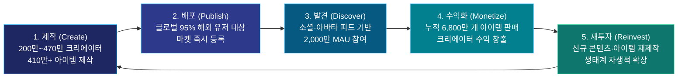

- **출처**:
  - NAVER Z 공식 보도자료, *Asia's No. 1 Metaverse Platform ZEPETO Reaches 300 Million Global Users* — [NAVER Z ZEPETO Release](https://www.navercorp.com/en/media/pressReleasesDetail?seq=30721)
  - ZDNet Korea, 네이버제트 CFO 인터뷰 (2024년 10월 11일) — [ZDNet Interview](https://zdnet.co.kr/view/?no=20241011163156)

---

## 5. AI 게임 제작 기회 및 PlayHub · PlayForge의 공백 공략

### 5-1. 기존 3D UGC 게임 제작의 5대 병목 vs. PlayHub · PlayForge 해결 레버

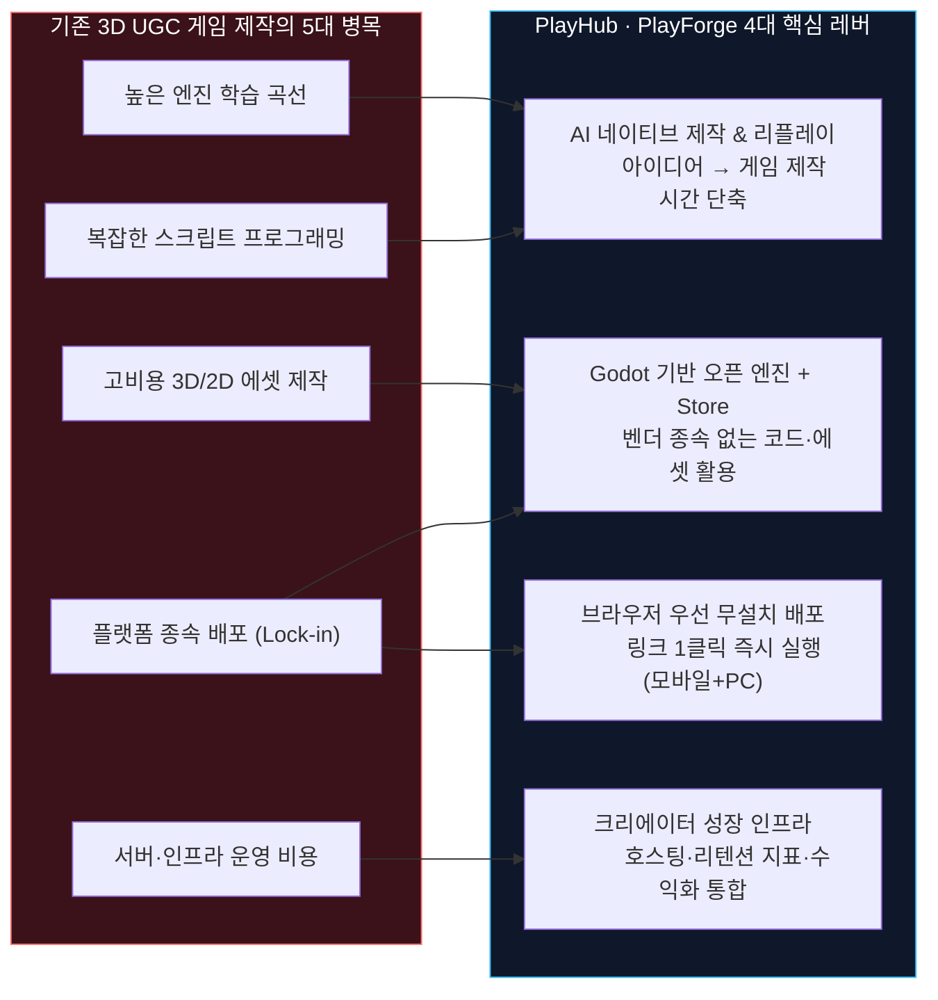

### 5-2. PlayHub · PlayForge 엔드투엔드 크리에이터 루프 (Sequence Diagram)

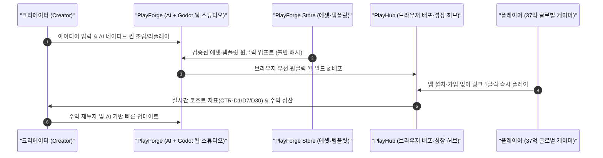

### 5-3. 플랫폼 포지셔닝 비교 매트릭스

| 구분 | **Roblox** | **Fortnite (UEFN)** | **ZEPETO** | **PlayHub · PlayForge** |
|---|---|---|---|---|
| **검증된 성과** | 1.38억 DAU / 연 15억+ 달러 정산 | 52.3억 시간 UGC / 3.52억 달러 정산 | 누적 3~5억 명 / 200만~470만 크리에이터 | **위 3대 검증 시장의 구조적 병목 해결** |
| **핵심 제작 환경** | 독점 Roblox Studio (Luau) | 독점 UEFN (Verse, PC 고사양) | 아바타·아이템·월드 스튜디오 | **AI 네이티브 제작 + 오픈소스 Godot 4.7** |
| **배포 및 접근성** | 전용 앱 설치 필수 | 대용량 클라이언트 설치 필수 | 전용 모바일 앱 중심 | **브라우저 우선(Browser-First) 무설치 즉시 실행** |
| **생태계 개방성** | 플랫폼 종속 (Walled Garden) | 포트나이트 생태계 종속 | 플랫폼 내부 소셜 종속 | **오픈 엔진 기반 + RobloxConverter 이관 지원** |
| **핵심 성장 레버** | 기존 저연령·소셜 네트워크 효과 | 포트나이트 IP 및 그래픽 품질 | 아시아 아바타·가상 패션 소셜 | **AI 제작 장벽 파괴 + 웹 링크 즉시 확산** |

- **출처**: PlayHub·PlayForge Seed Investor Deck (2026년 11월 21일)

---

## 6. 발표용 핵심 문장 (Speaker Script & Slide Headlines)

> [!TIP]
> 투자 설명회(IR) 및 사업 발표에서 각 슬라이드 상단 헤드라인이나 발표자 멘트로 즉시 활용할 수 있는 5대 핵심 문장입니다.

1. **[시장 규모]** 글로벌 게임 시장은 2026년 **2,139억 달러**, **37억 명**의 플레이어 규모로 성장하고 있습니다.
2. **[UGC 수요]** Roblox는 분기 **1.38억 DAU**와 **340억 시간**의 참여로 UGC 게임 수요를 증명했습니다.
3. **[크리에이터 수익화]** Fortnite는 2024년 크리에이터에게 **3억 5,200만 달러**(Roblox는 2025년 **15억 달러 이상**)를 지급하며 크리에이터 이코노미의 실현 가능성을 보여줬습니다.
4. **[아시아 선례]** ZEPETO는 아시아에서 **2,000만 MAU**와 약 **200만 크리에이터**(최신 인터뷰 기준 470만 명)를 확보한 UGC 플랫폼 선례입니다.
5. **[우리의 솔루션]** **PlayHub·PlayForge**는 **AI 제작**과 **브라우저 배포**를 결합해 UGC 게임 제작의 남은 병목을 해결합니다.
