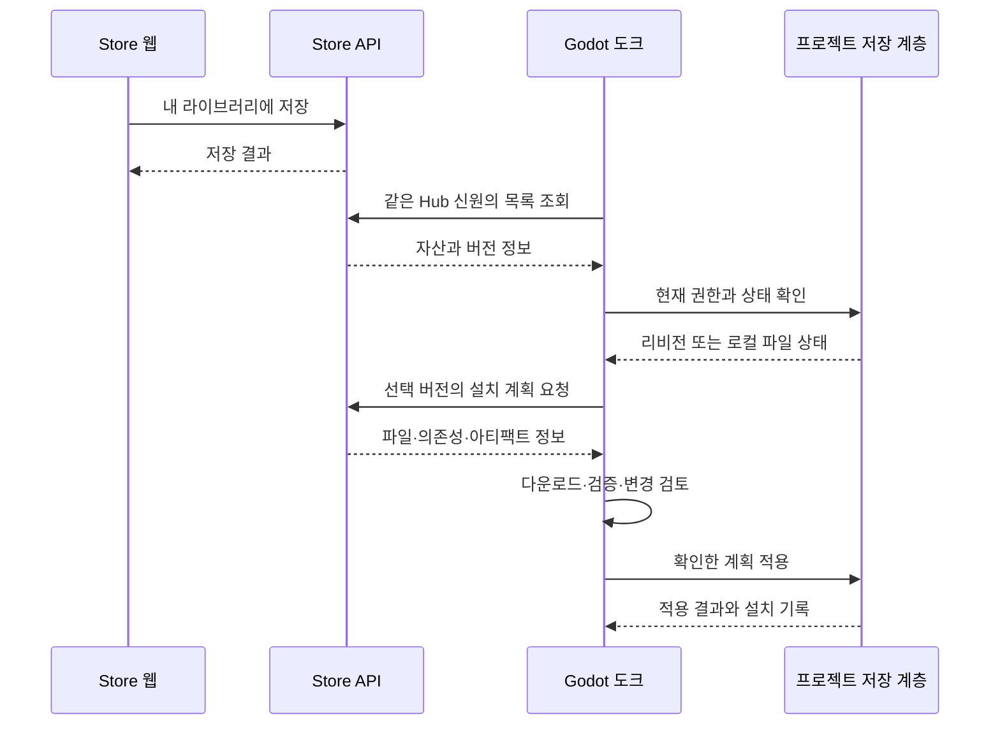

# Unity 에셋 스토어·에디터 연동 구현 사례 조사

> **PlayForge Store / Godot 웹·설치형 에디터 적용을 위한 기술 보고서**  
> 작성일: 2026-11-20 · 버전: 1.0 · 기준 시간대: Asia/Seoul  
> 근거: Unity·Godot 공식 문서, Unity 공식 공개 C# 참조 소스  
> 성격: 구현 사례 조사 및 설계 제안. Unity 설치 실행 시험이나 신규 Store 구현 완료 보고서가 아니다.

## 1. 조사 결론과 이번 설계 결정

**가장 직접적인 참고 사례는 Unity의 “웹 Asset Store + 에디터 Package Manager / My Assets” 역할 분리다.** 사용자는 웹에서 에셋을 발견하고 계정 라이브러리에 추가한 뒤, 같은 계정으로 접속한 에디터에서 형식에 따라 다운로드·가져오기 또는 패키지 설치를 수행한다. 무료 에셋에도 계정 라이브러리를 통한 연결이 적용된다. [S02][S04][S13]

PlayForge에는 다음 구조를 적용한다.

- **Store 웹:** PC·모바일 탐색, 상세 페이지, 일반 콘텐츠, 컬렉션, 내 라이브러리, 게시자 작업.
- **Godot Store Addon:** 좌측·우측·하단의 기본 도크/패널을 이용한 내 라이브러리, 버전 확인, 다운로드, 변경 검토, 현재 프로젝트 적용.
- **외부 브라우저:** 풍부한 검색·미리보기·콘텐츠 열람. 에디터의 “스토어 웹 열기” 버튼으로 진입.
- **Hub 계정:** 모든 사이트와 Addon에서 동일한 사용자 신원으로 접근.
- **Store Admin:** Store 운영 전용 화면·권한·배포 경계.
- **기존 PlayHub·PlayForge:** 게임·프로젝트·배포 산출물의 소유권과 기존 처리 경로 유지.

최종 수용 범위는 **중앙 Store 탭과 중앙 작업 화면 분할을 사용하지 않는 구성**이다. Store 웹을 에디터 내부 iframe으로 넣는 작업도 현재 연동의 전제가 아니다. 웹과 Addon은 API 및 계정 라이브러리 데이터를 공유한다.

이 문서는 기존 `Godot_UGC_Store_Detailed_Spec_v2_20261119.md`를 보완한다. 기존 5개 디자인 시안 중 풍부한 갤러리는 외부 웹 탐색에, 간결한 목록과 적용 검토는 에디터 도크에 배치하는 방향으로 해석한다.

### 핵심 사례 비교

| 사례 | 공식 자료에서 확인한 구조 | PlayForge에 적용할 부분 | 우선순위 |
|---|---|---|---|
| Asset Store + My Assets | 웹에서 확보하고 에디터에서 다운로드·가져오기 | 웹 라이브러리와 도크 목록 연결 | 1차 |
| 공개 AssetStoreWindow 구현 | 웹 열기와 Package Manager 진입을 별도로 처리 | “스토어 웹 열기”와 “내 라이브러리” 분리 | 1차 |
| EditorWindow + UI Toolkit | 기본 도킹 창과 에디터 전용 UI 구성 | Godot 기본 도크에 간결한 네이티브 UI | 1차 |
| Asset Manager 웹·에디터 패키지 | 자산 검색·미리보기·가져오기, 조직·프로젝트 권한 | 조직 라이브러리와 선택 가져오기 | 후속 확장 |
| UPM + Scoped Registries | 패키지 버전·의존성·배포 공급원 관리 | 자체 패키지 매니페스트와 정확한 버전 기록 | 기본 계약에 반영 |
| Publisher Portal + Publishing Tools | 에디터에서 검증·업로드, 웹에서 게시 작업 | 게시자 도구와 운영 화면의 역할 분담 | 1차 게시 흐름부터 적용 |

근거: [S02][S04][S05][S06][S08][S10][S12][S13][S15][S16][S17]

## 2. 조사 범위와 근거의 한계

### 확인한 자료

| 자료 종류 | 사용 범위 | 해석 기준 |
|---|---|---|
| Unity 2020.1 매뉴얼 | 과거 Asset Store 탭 제거 이력 | 역사적 변경만 확인 |
| Unity 6000.0 매뉴얼·API | Package Manager, EditorWindow, UI Toolkit | 해당 문서 버전의 동작·API |
| Unity 6000.3 매뉴얼 | 에디터 게시 도구 | 해당 게시 워크플로 |
| 현재 Unity Asset Store·Asset Manager 문서 | 웹·계정·자산 관리 흐름 | 조사 시점 공개 문서 |
| UnityCsReference master | AssetStoreWindow 내부 구현 | 조사 시점의 참조 코드 관측 |
| Godot 4.3·4.6 문서 | 도크 API와 버전 차이 | 버전별로 분리하여 적용 |
| Godot stable 문서 | 브라우저 열기·HTTP·웹 에디터 조건 | 실제 채택 빌드에서 재확인 |

**공식 문서로 확인한 동작, 공개 소스에서 관측한 구현, PlayForge에 대한 제안을 구분했다.** 특히 Unity 내부 코드의 존재를 외부 플러그인이 사용할 수 있는 공개 API라는 의미로 해석하지 않는다.

이 조사에서는 Unity를 설치해 실제 계정 연결·다운로드·도킹을 실행하지 않았다. 공개 소스의 master는 특정 배포 버전이나 고정 커밋으로 검증한 스냅샷이 아니므로, 모든 Unity 설치본의 동일 동작을 보장하는 근거로 사용하지 않는다.

## 3. 사례 A — 웹 Asset Store와 에디터 My Assets

### 3.1 사용자 흐름

Unity 공식 문서의 무료 에셋 흐름은 웹에서 `Add to My Assets`를 선택하고, 같은 Unity ID로 로그인한 에디터의 Package Manager에서 해당 에셋을 확인하는 방식이다. 웹에 저장한 시점과 프로젝트에 넣는 시점이 구분된다. [S02]

`Open in Unity`는 작업을 에디터로 이어가는 진입점이다. 공식 문서는 에디터가 열려 있으면 Package Manager의 My Assets를 열고, 에디터가 열려 있지 않으면 Unity Hub를 연다고 설명한다. 이 설명만으로 실제 딥링크 스킴이나 IPC·토큰 전달 방식을 확정할 수는 없다. [S03]

`.unitypackage`를 프로젝트에 가져올 때는 다운로드 후 가져오기 창에서 파일을 선택한다. 전체 프로젝트 형태의 패키지는 프로젝트 설정 영향도 별도로 다룬다. 따라서 “웹에서 확보”, “기기에 다운로드”, “프로젝트에 적용”을 하나의 자동 실행으로 묶지 않은 사례로 볼 수 있다. [S04]

### 3.2 PlayForge에서 구분할 상태

아래는 Unity의 역할 분리를 참고하여 정리한 **우리 서비스의 상태 모델 제안**이다.

| 상태 | 의미 | 저장 주체 | 프로젝트 파일 변경 |
|---|---|---|---|
| 라이브러리에 저장 | 사용자가 찾기 쉽게 계정 목록에 추가 | StoreLibraryEntry | 없음 |
| 사용 권한 확인 | 해당 자산·버전에 대한 Store 접근 조건 확인 | UsageGrant 및 라이선스 스냅샷 | 없음 |
| 패키지 다운로드 | 특정 불변 아티팩트를 임시 저장소에 확보 | 에디터 측 캐시 또는 준비 영역 | 없음 |
| 설치 계획 검토 | 대상 프로젝트·버전·파일·의존성·충돌을 확인 | Store 계획 + 에디터 검토 상태 | 없음 |
| 프로젝트 적용 | 검토한 변경을 선택한 프로젝트에 반영 | Forge 저장 계약 또는 로컬 프로젝트 | 있음 |
| 업데이트 가능 | 새 릴리스가 있다는 정보 | Store 조회 + 프로젝트 버전 비교 | 없음 |

라이브러리에 저장했다고 사용 조건을 새로 생성하거나 프로젝트에 설치한 것으로 기록하지 않는다. “업데이트 가능” 표시도 자동 파일 변경을 뜻하지 않는다.

### 3.3 초기 구현에 적합한 연결

1. 사용자가 Hub 로그인 상태로 Store 웹에 들어간다.
2. 원하는 에셋을 내 라이브러리에 저장한다.
3. Godot Store 도크에서 “새로고침”을 누른다.
4. 도크는 같은 Hub 신원에 연결된 Store 라이브러리를 읽는다.
5. 사용자는 버전·호환성·파일 변경을 확인하고 현재 프로젝트에 적용한다.

이 정도 연결만으로도 사용자가 웹과 에디터를 오갈 수 있다. 웹에서 에디터의 특정 프로젝트를 직접 조작하는 창 간 통신은 첫 구현의 필수 조건이 아니다.

## 4. 사례 B — 실제 공개 AssetStoreWindow 구현

Unity 공식 C# 참조 소스의 `Editor/Mono/AssetStore/AssetStoreWindow.cs`에서 다음 역할 구분을 확인했다. [S05]

| 관측 항목 | 코드에서 확인한 처리 | 의미 |
|---|---|---|
| 웹 방문 | `OpenAssetStoreInBrowser()` | 스토어 웹 진입 경로 |
| 로그인 상태의 웹 열기 | `UnityConnect`의 인증을 고려한 URL 열기 경로 | 앱 신원을 고려하는 웹 이동 |
| 비로그인 상태의 웹 열기 | `Application.OpenURL()` | 일반 브라우저 열기 |
| My Assets 진입 | `PackageManagerWindow.OpenAndSelectPage(...)` | 에디터 자산 관리 화면으로 이동 |
| 에디터 안내 UI | UXML/USS 기반 버튼과 설정 | 웹 방문과 Package Manager 진입 선택 |

이 파일에 `AssetStoreWindow`라는 이름이 남아 있다는 이유만으로 전체 웹 상점을 에디터에 렌더링한다고 해석하면 안 된다. 확인한 부분은 웹 방문 및 Package Manager 실행을 연결하는 에디터 UI다.

또한 이 코드의 클래스와 주요 연결 지점은 Unity 내부 구현이다. **외부 플러그인에서 내부 API를 직접 호출하는 구현안으로 제시하지 않는다.**

### 역사적 변경과 함께 해석

Unity 2020.1 공식 문서는 에디터의 Asset Store 탭 제거를 명시하며, My Assets 필터가 2019.3에 도입되었다고 기록한다. 제거 이유나 성능 효과까지 이 문서가 입증하는 것은 아니다. [S01]

### Godot 적용 제안

Store Addon 상단에는 다음 정도의 진입 기능을 둔다.

| 기능 | 동작 |
|---|---|
| 스토어 웹 열기 | 독립 Store 웹사이트 또는 현재 선택 에셋 상세 URL 열기 |
| 내 라이브러리 | 계정에 저장된 에셋 목록 |
| 새로고침 | Store API에서 목록·버전 정보 갱신 |
| 프로젝트에 적용 | 파일 변경 검토 후 적용 단계로 진입 |

Unity의 내부 인증 구현을 복제할 필요는 없다. Hub 인증 계약에 맞춘 Addon 세션과 Store API 접근을 구성하면 된다.

## 5. 사례 C — EditorWindow와 UI Toolkit 도킹 UI

### 5.1 Unity의 기본 확장 창

Unity는 `EditorWindow`를 기반으로 에디터 확장 창을 만들고, 사용자가 탭을 옮겨 작업 레이아웃을 구성하도록 지원한다. `GetWindow`의 `desiredDockNextTo` 인자는 지정한 창 옆으로 도킹을 **시도**하는 기능이다. 특정 분할 비율이나 위치를 항상 강제한다는 뜻은 아니다. [S06][S07]

공식 Sprite Browser 예제는 `CreateGUI`, `ListView`, `ScrollView`, `TwoPaneSplitView`, `Image`를 조합한다. 프로젝트 안의 스프라이트를 목록과 미리보기로 보여주는 로컬 자산 탐색 예제이며, 클라우드 스토어 구현 자체를 제공하는 예제는 아니다. [S08]

`TwoPaneSplitView`는 자신이 구성하는 UI 내부의 분할에 사용된다. 이 예제만으로 기존 Scene View 중앙 영역을 외부 확장 코드가 임의로 분할한다는 결론을 내리지 않는다.

### 5.2 UXML/USS와 웹 HTML의 차이

UI Toolkit은 웹 기술의 영향을 받은 구조와 스타일 문법을 사용하지만, UXML/USS 및 Unity의 UI 렌더링 체계를 사용한다. 웹사이트의 React·HTML 페이지를 iframe처럼 그대로 표시하는 것과는 구현 방식이 다르다. [S09]

여기서 가져올 설계 원칙은 **데이터·API는 공유하고, 에디터 안의 UI는 에디터 환경에 맞게 구성한다**는 것이다.

### 5.3 Godot 도크에 적용할 화면 구성

| 도크 위치 | 권장 배치 | 공통 동작 |
|---|---|---|
| 우측 기본값 | 좁은 목록, 선택 항목의 요약과 적용 버튼 | 검색·새로고침·웹 열기 |
| 좌측 | 동일 기능을 세로 목록 중심으로 배치 | 선택 에셋과 검색어 유지 |
| 하단 | 넓은 목록 또는 도크 내부의 목록·상세 배치 | 다운로드·검토 상태 유지 |

하단 도크 내부에서 목록과 상세를 가로로 배치하더라도, 이는 **중앙 장면 편집 화면을 분할하는 설계가 아니다.**

기본 레이아웃의 시작값은 우측 도크로 두고, 사용자가 위치 메뉴에서 좌측·우측·하단을 선택하도록 제안한다. 넓은 이미지 갤러리와 긴 콘텐츠 본문은 외부 브라우저에서 제공한다.

## 6. 사례 D — Unity Asset Manager 웹과 에디터 패키지

### 6.1 확인한 기능

Unity Asset Manager는 에디터에 설치하는 패키지를 통해 자산 업로드, 검색·탐색·미리보기, 프로젝트 가져오기, 재가져오기 및 제거를 제공한다고 설명한다. 이는 웹 자산 관리 서비스와 에디터 클라이언트를 함께 운영하는 별도 사례다. 공개 안내만으로 에디터 UI가 웹페이지를 iframe으로 재사용한다고 결론 내릴 수는 없다. [S10]

공식 권한 문서는 조직 수준과 프로젝트 수준의 역할을 구분한다. 조직 관리 역할과 프로젝트별 기여·열람 등의 접근 수준을 나누는 구성이 확인된다. [S12]

### 6.2 Asset Store에서 Asset Manager로 가져오는 흐름

공식 연동 문서는 같은 Unity ID로 확보한 Store 자산을 Asset Manager의 조직·프로젝트·폴더로 가져오고, 팩 안의 개별 자산과 의존성을 관리하는 흐름을 설명한다. 현재 문서에는 3D·2D·Audio 범주, 최신 버전만 지원, Store 업데이트의 자동 반영 없음이라는 제한이 명시되어 있다. [S11]

### 6.3 PlayForge에 적용할 판단

Asset Manager 패턴은 다음 확장에 적합하다.

- 개인 라이브러리에서 팀·조직 공용 라이브러리로 확장.
- 전체 팩에서 필요한 자산만 골라 가져오기.
- 팀의 자산 기여자와 소비자 역할 구분.
- 자산 버전 변경 내용을 확인하고 명시적으로 재적용.

다만 첫 버전에서 팩 내부 임의 파일 선택을 서두르지는 않는다. Godot 장면·리소스·UID·스크립트 참조가 연결되어 있으므로, 선택 가져오기를 지원하려면 의존성 폐쇄 집합을 계산하거나 제작자가 정의한 하위 묶음을 사용해야 한다.

**1차에는 검증된 패키지 단위 적용, 후속 단계에는 의존성 검토가 가능한 선택 적용**을 권장한다. 이는 우리 구현 난이도와 프로젝트 보호 요구를 고려한 제안이다.

## 7. 사례 E — UPM, 콘텐츠 패키지와 Scoped Registries

### 7.1 두 패키지 형식을 같은 것으로 다루지 않는다

Unity의 공식 패키지 유형 문서와 현재 게시 안내는 UPM과 `.unitypackage`를 구분하며, Asset Store에서 두 형식을 다룬다. [S13][S14]

| 구분 | UPM 패키지 | .unitypackage |
|---|---|---|
| 대표 콘텐츠 | 코드·도구·라이브러리·SDK | 모델·텍스처·애니메이션·오디오 등 |
| 패키지 매니페스트 | 사용 | 같은 패키지 매니페스트 체계 없음 |
| 패키지 의존성 관리 | 지원 | UPM 방식은 지원하지 않음 |
| 에디터의 버전 전환 | 지원 | UPM과 동일한 방식은 아님 |
| 대표 사용자 동작 | Install | Download / Import |

이 구분에서 “콘텐츠 파일은 서로 참조하지 않는다”는 결론을 내리면 안 된다. 패키지 관리 시스템의 의존성 지원과 프로젝트 파일 사이의 참조는 별개다.

일부 공식 소개 경로에는 Asset Store의 UPM 게시가 베타라는 문구가 남아 있고, 현재 전역 게시 소개는 두 형식 지원을 설명하면서 같은 문구를 사용하지 않는다. 따라서 이 보고서는 **UPM 자체를 베타로 표현하지 않으며, Asset Store UPM 게시의 모든 계정·상품 조건이 동일하다고 단정하지 않는다.** [S14][S18]

### 7.2 Scoped Registry의 역할

공식 문서에서 Scoped Registry는 별도 공급자가 패키지를 호스팅하고, 패키지 이름의 scope에 따라 Unity Package Manager가 적합한 공급원에서 가져오는 구조다. 버전과 패키지 의존성을 다루며 조직 내부 배포에도 사용할 수 있다. [S15]

이 사례에서 참고할 것은 공급원·패키지 ID·버전·의존성의 명시적 계약이다. Registry만으로 일반 콘텐츠, 에셋 상세 페이지, 게시자 운영, 신고·검수 등의 Store 제품 기능까지 구현되는 것은 아니다.

### 7.3 PlayForge 자체 패키지 계약 제안

Unity의 두 형식을 그대로 복제하는 대신, Store 패키지는 다음 항목을 공통 계약으로 가진다.

| 항목 | 목적 |
|---|---|
| asset_id / asset_version_id | 자산과 정확한 버전 식별 |
| release_id / artifact_id | 배포 단위와 대상별 파일 묶음 식별 |
| artifact_digest | 다운로드한 실제 바이트 검증 |
| dependency_manifest_hash | 정확한 의존성 집합 검증 |
| engine_compatibility | 지원 Godot 버전과 대상 환경 |
| file_manifest | 파일 목록·상대 경로·크기·해시 |
| license_snapshot_ref | 해당 배포 시점의 조건 참조 |
| installation_record | 프로젝트에 실제 적용한 버전·경로·상태 기록 |

이 표는 기존 상세 기획의 개념을 설명하기 위한 요약이다. 최종 필드명과 API는 기존 계약에 맞춰 정합성을 확인한다.

새 버전 알림이 와도 기존 프로젝트의 설치 기록은 자동으로 바꾸지 않는다. 내용이 달라진 배포물은 새 release/revision 및 digest로 구분한다. 불변 배포 정책은 우리 서비스의 재현성과 기존 프로젝트 보호 요구에서 나온 결정이다.

## 8. 사례 F — Publisher Portal과 에디터 게시 도구

Unity의 Asset Store Publishing Tools는 에디터에서 자산을 검증하고 업로드하는 역할을 제공한다. 공식 6000.3 안내는 Validator로 자산 경로를 검사한 뒤 Uploader에서 패키지 초안에 업로드하고, Publisher Portal에서 해당 초안을 확인하는 흐름을 설명한다. [S16]

Publisher Portal에서는 초안을 제출하고 심사 상태를 확인한다. 승인 후 자동 공개 여부를 선택할 수 있고, 거절 사유도 확인한다. [S17]

### PlayForge 적용 제안

| 표면 | 맡을 작업 | 소유하지 않을 데이터 |
|---|---|---|
| Godot 게시 도구 | 선택 파일 검사, 의존성 확인, 패키징, 초안 업로드 | 기존 Hub 게임 카탈로그 |
| Store Publisher 웹 | 설명·썸네일·콘텐츠 편집, 버전 제출, 결과 확인 | Forge 원본 프로젝트의 관리 권한 |
| Store Admin | 검수, 공개·숨김, 신고 처리, 운영 기록 | Hub 배포 게임 실행·삭제 권한 |
| Forge | 원본 프로젝트 접근, 저장·충돌·리비전 관리 | Store 공개 승인 |

Unity Publisher Portal은 게시자가 사용하는 웹 화면의 사례다. 이를 Unity 내부 운영자 Admin의 구현 증거와 동일시하지 않는다. **Store 전용 Admin을 별도로 만드는 것은 사용자가 요구한 서비스 경계에 따른 우리 설계다.**

일반 게시글·튜토리얼·컬렉션에는 패키지 설치 버튼을 표시하지 않는다. 기존 기획의 `release_kind = package | editorial` 구분을 유지하며, 글을 게시하기 위해 빈 패키지를 생성하지 않는다.

## 9. 최종 Godot 적용 구조

### 9.1 서비스 경계

| 구성 | 주요 책임 | 기존 서비스와의 관계 |
|---|---|---|
| PlayHub 인증 | 사용자 신원 확인 | 기존 계정 유지 |
| Store 웹·API | 카탈로그, 콘텐츠, 라이브러리, 패키지 배포 | 별도 데이터·배포 경계 |
| Store Publisher | Store 게시자 작업 | Forge 프로젝트는 명시적으로 제출한 사본만 사용 |
| Store Admin | Store 운영과 권한 확인 | Hub·Forge 관리 권한을 자동 상속하지 않음 |
| Godot Addon | 탐색 요약, 다운로드, 검토, 적용 요청 | 선택한 프로젝트에만 동작 |
| Forge 프로젝트 서비스 | 프로젝트 권한·리비전·저장 | 기존 쓰기 계약 사용 |
| Hub 게임 배포 | 빌드된 게임 서비스 | Store 조회를 실행 필수 경로에 넣지 않음 |

Store의 숨김·삭제·장애가 기존 게임 파일이나 프로젝트 소유권을 자동으로 바꾸지 않도록 설계한다. 이는 충족해야 할 수락 조건이며, 이 조사만으로 이미 검증되었다고 주장하지 않는다.

### 9.2 웹에서 저장하고 에디터에서 적용하는 흐름

브라우저와 에디터가 동시에 열려 있지 않아도 이 흐름은 성립한다. 도크가 다시 열릴 때 같은 계정의 목록을 읽으면 된다. 실시간 알림과 “에디터에서 열기”는 그 위에 추가할 편의 기능이다.

### 9.3 Godot 4.3 기준 도크 구현

현재 PoC의 4.3 메타데이터를 엔진 업그레이드 결정으로 바꾸지 않는다. 설계 기준 경로는 다음과 같이 둔다. 실제 지원 빌드는 구현 전에 확정하고 해당 빌드에서 실행 검증한다.

| 요구 | Godot 4.3의 공개 API 기준 접근 |
|---|---|
| 좌측·우측 Store 도크 | `EditorPlugin.add_control_to_dock()` |
| 하단 Store 패널 | `EditorPlugin.add_control_to_bottom_panel()` |
| 좌우↔하단 전환 | 위치 메뉴에서 기존 등록 해제 후 다른 API로 등록 |
| 화면 상태 유지 | 검색어·선택 에셋·검토 상태를 UI 등록 위치와 분리 |
| 위치 복원 | Addon의 위치 모드 저장, 기본 도크 위치 저장과 구분 |
| 플러그인 비활성화 | 등록 해제와 UI 정리를 일관되게 수행 |

4.3에서 좌우 도크와 하단 패널은 별도 API다. **모든 위치 간 이동이 기본 드래그 하나로 가능하다고 약속하지 않는다.** 작은 위치 전환 어댑터를 두고 같은 Control이 여러 위치에 중복 등록되지 않도록 한다. 에디터 내부 노드를 직접 재배치하거나 엔진을 수정할 필요가 없는 접근이다. [G01]

Godot 4.6의 `EditorDock`은 문서상 Experimental이며, 하단 배치를 허용하려면 가로 레이아웃 지원 설정을 고려해야 한다. 엔진 업그레이드가 별도로 결정되면 검토할 선택지로 남긴다. 4.3 구현에 이 API를 섞지 않는다. [G02]

### 9.4 외부 브라우저와 웹 에디터

`OS.shell_open()`은 URL을 기본 브라우저로 여는 공개 API이며 문서에는 Web 플랫폼 지원도 명시되어 있다. 다만 새 탭 또는 별도 OS 창으로 열리는 결과는 브라우저 정책·사용자 설정의 영향을 받으므로, 제품 버튼은 “브라우저에서 열기”로 표현한다. [G03]

네이티브 Godot UI에서 HTTPS API를 호출하는 기반으로 `HTTPRequest`를 사용할 수 있다. 웹 배포에서는 기존 인증 계약과 브라우저 네트워크 조건에 맞춘 API 접근을 검증한다. [G04]

“Godot 웹 에디터”의 실제 호스트도 구분해야 한다. 공식 Godot EditorPlugin을 실행하는 웹 에디터 빌드와 Godot 런타임만 삽입한 React 화면은 같은 환경이 아니다. 후자의 경우에는 호스트와의 연동 지점이 추가로 필요하다. 웹 에디터에는 데스크톱과 다른 실행 제약이 있으므로 Addon의 웹·설치형 실행 검증을 분리한다. [G05]

## 10. Hub 단일 로그인 적용

Unity 공식 문서는 Asset Store와 Hub·Editor에서 같은 Unity ID를 사용하도록 안내하며, 공개 참조 소스는 로그인 상태에 따라 웹 열기 경로를 구분한다. 이것은 **같은 신원으로 여러 표면을 연결하는 사례**다. 모든 표면이 동일한 쿠키를 공유하거나 어떤 조합에서도 인증 화면이 전혀 나오지 않는다는 증거는 아니다. [S02][S05]

아래는 PlayForge 요구에 맞춘 제안이다.

### 웹사이트

- Hub를 사용자 신원의 기준으로 사용한다.
- Store·Publisher·Admin은 별도 회원가입이나 Store 전용 비밀번호를 만들지 않는다.
- 이미 Hub에 로그인된 사용자는 사이트 이동 시 기존 인증을 통해 해당 사이트 세션을 발급받는다.
- 기존 Forge 계정 ID·프로젝트 소유권·팀 권한은 유지한다.
- 동일 Hub 신원이라도 Store Admin 권한은 별도로 확인한다.

Hub가 이미 제공하는 OIDC 또는 신뢰 가능한 세션 연계 인터페이스를 우선 사용한다. 현재 Hub 인증 구현은 조사 자료로 확인되지 않았으므로, 특정 프로토콜이 이미 존재한다고 가정하지 않는다.

### 설치형 Godot Addon

- Addon의 “Hub 계정 연결”이 외부 브라우저의 Hub 인증으로 이어진다.
- 사용자는 같은 계정으로 Addon용 세션을 연결한다.
- 이미 Hub 웹 세션이 유효하면 이를 활용하여 비밀번호 재입력을 줄이는 흐름을 목표로 한다.
- Addon API 세션은 웹 쿠키를 복사하는 방식으로 설계하지 않는다.
- 프로젝트 접근 권한은 계정 연결 후에도 적용 대상별로 확인한다.

SSO의 수락 조건은 **같은 사용자 신원으로 편리하게 이동하는 것과 각 서비스 권한을 정확히 적용하는 것**을 함께 만족하는 것이다.

## 11. API 책임과 프로젝트 적용 계약

다음은 실제 배포된 엔드포인트 목록이 아니라 **서비스 책임을 구체화한 제안**이다. URL과 필드명은 기존 상세 기획과 구현 저장소에서 확정한다.

| 기능 | 소유 서비스 | 핵심 입력 | 핵심 출력 |
|---|---|---|---|
| 내 라이브러리 조회 | Store | 인증 신원, 페이지·검색 조건 | 자산·선택 버전·사용 가능 상태 |
| 라이브러리에 저장 | Store | 자산 ID | 저장 결과 |
| 릴리스 조회 | Store | 자산·버전·대상 환경 | 불변 릴리스와 아티팩트 정보 |
| 설치 계획 생성 | Store + 에디터 계약 | 정확한 버전, 대상 환경, 필요한 프로젝트 상태 | 파일·의존성·검증 조건 |
| 프로젝트 상태 읽기 | Forge 또는 로컬 어댑터 | 대상 프로젝트 | 리비전·기존 파일 상태 |
| 프로젝트 적용 | Forge 또는 로컬 어댑터 | 검토한 계획, 사전 조건 | 새 상태·적용 결과·설치 기록 |
| 게시 제출·검수 | Store Publisher/Admin | Store 초안·릴리스 | Store의 게시 상태 |

### 적용 단계

1. **대상 확인:** 현재 프로젝트와 사용자 접근 권한, Godot 버전·플랫폼 호환성을 확인한다.
2. **계획 고정:** 정확한 릴리스와 의존성, 아티팩트 digest를 고정한다.
3. **준비:** 활성 프로젝트 바깥의 준비 영역에 다운로드하고 파일 목록·경로·해시를 확인한다.
4. **변경 검토:** 추가·변경·충돌 파일과 실행 가능한 Addon 요소를 구분해 표시한다.
5. **적용:** Forge는 기존 리비전 조건을 검증하여 저장하고, 로컬 Addon은 대응하는 파일 상태 검사를 수행한다.
6. **재동기화:** 프로젝트 반영 결과를 기록한 후 에디터 표시를 갱신한다.

검토 이후 프로젝트가 바뀌면 오래된 계획을 그대로 쓰지 않는다. 저장이 성공했으나 화면 갱신만 실패한 경우에는 저장 성공과 표시 실패를 구분하고 재동기화를 제공한다. 화면 오류만으로 정상 커밋을 자동 되돌리는 정책은 두지 않는다.

### 독립성을 유지할 운영 규칙

- Store 변경은 선택한 설치 동작을 통해서만 프로젝트에 들어간다.
- Store Admin의 콘텐츠 상태 변경은 기존 Hub 배포 게임의 자동 재빌드·삭제로 연결하지 않는다.
- 런타임 게임 시작에 Store API 접속을 필수로 넣지 않는다.
- 기존 배포물은 빌드 시 고정된 자산을 사용하며 Store의 최신 버전을 자동 추적하지 않는다.
- Store 외부의 게임·프로젝트는 읽기 링크 또는 명시적으로 제출한 스냅샷으로 참조한다.

이 규칙은 Unity가 보장하는 속성이 아니라 PlayHub·PlayForge의 기존 서비스를 보호하기 위한 요구사항이다.

## 12. PC·모바일·에디터 모드의 적용

| 모드 | 주 사용 목적 | 권장 화면·행동 |
|---|---|---|
| PC Store 웹 | 넓은 탐색·상세 비교·게시자 작업 | 카드/목록, 큰 미리보기, 컬렉션, 내 라이브러리 |
| 모바일 Store 웹 | 탐색·콘텐츠 열람·저장 | 단일 열 상세, 하단 주요 버튼, 라이브러리에 저장 |
| Godot 웹 에디터 도크 | 현재 프로젝트로 가져오기 | 압축 목록, 호환성·버전·파일 검토, 적용 |
| 설치형 Godot 도크 | 로컬 프로젝트로 가져오기 | 동일 기능, 로컬 파일·캐시 어댑터 |
| Store Admin 웹 | 검수·운영 | 별도 진입·세션·역할, 검수 목록과 이력 |

모바일에서 라이브러리에 저장한 에셋을 나중에 PC 또는 Godot에서 이어서 사용하는 흐름을 기본으로 한다. 모바일 웹에서 열려 있지 않은 프로젝트에 즉시 설치하는 동작을 만들지 않는다.

도크의 핵심 정보는 자산명, 썸네일, 버전, 호환성, 현재 프로젝트 설치 상태, 주요 행동이다. 긴 소개글과 풍부한 갤러리는 “웹에서 자세히 보기”로 연결한다.

## 13. 구현 순서와 수락 기준

### 1차 — 기본 연결을 완성한다

| 작업 | 완료 조건 |
|---|---|
| Hub 신원 연결 | Hub 로그인 후 Store·Publisher·권한 있는 Admin 이동에 별도 계정 생성 없음 |
| 독립 Store 웹 | PC·모바일 탐색, 일반 콘텐츠, 라이브러리 저장 가능 |
| Godot 기본 도크 | 좌·우·하단 위치 선택, 검색·선택 상태 유지 |
| 외부 브라우저 열기 | Store 홈 또는 선택 에셋 상세로 이동 |
| 라이브러리 조회 | 같은 계정으로 웹과 Addon에서 일치하는 저장 목록 확인 |
| 패키지 검토·적용 | 고정 버전 다운로드와 변경 검토 후 선택한 프로젝트만 변경 |
| 전용 Admin | Store 권한 검사와 운영 기록, 기존 Hub·Forge 관리 기능과 분리 |

### 후속 — 기본 연결 위에 편의를 추가한다

- “Godot에서 열기”: 대상 에디터에서 에셋을 선택하도록 안내. 즉시 설치와 분리.
- 포커스 복귀 시 목록 갱신 또는 변경 알림.
- 조직 라이브러리와 역할별 접근.
- 의존성 계산을 전제로 한 팩 내부 선택 가져오기.
- 게시자용 Godot 검증·업로드 보조 도구 고도화.

### 구현 시 실행할 검증 시나리오

아래 항목은 **향후 수락 시험 계획**이며 이번 조사에서 실행한 결과가 아니다.

1. 웹에서 저장한 항목이 같은 계정의 도크에 나타나고 다른 계정에 섞이지 않는다.
2. 좌·우·하단 위치 전환 후 검색어와 선택 항목을 유지하며 중복 UI가 생기지 않는다.
3. Addon 종료·재활성화 후 설정한 위치 모드를 복원한다.
4. 브라우저 열기가 차단되거나 실패하면 URL 복사 등 재진입 경로를 제공한다.
5. 라이브러리에 저장하거나 다운로드만 해서는 프로젝트 파일을 바꾸지 않는다.
6. 호환되지 않는 엔진·플랫폼, 누락된 의존성, 변조된 아티팩트는 적용 단계로 진행하지 않는다.
7. 설치 검토 이후 프로젝트가 변경되면 재검토를 요구한다.
8. 패키지 업데이트 알림만으로 기존 설치 버전이나 Hub 배포물을 바꾸지 않는다.
9. Store API 장애 중에도 기존 Hub 게임 실행과 Store를 사용하지 않는 Forge 편집 흐름이 유지된다.
10. 같은 Hub 계정이어도 Store Admin 역할이 없으면 운영 API가 접근을 거부한다.
11. 웹 에디터와 설치형 Godot에서 각자의 파일·세션 어댑터를 별도로 검증한다.
12. 일반 콘텐츠에는 설치 행동이 표시되지 않으며 기존 게임 링크는 원래 서비스로 이동한다.

## 14. 채택·후속·제외 결정표

| 항목 | 결정 | 이유 |
|---|---|---|
| 외부 브라우저 Store | 채택 | 넓은 탐색과 일반 콘텐츠에 적합 |
| 기본 Godot 도크 | 채택 | 엔진 수정 없이 작은 에디터 UI 구성 |
| 계정 라이브러리 동기화 | 채택 | 비동기 웹·에디터 연결의 최소 기능 |
| 설치 전 파일·버전 검토 | 채택 | 선택 프로젝트 변경 범위를 확인 |
| Hub 단일 신원 | 채택 | 모든 표면의 로그인 경험 연결 |
| Store 전용 Admin | 채택 | 기존 서비스 관리 경계 유지 |
| 중앙 Store 탭 | 현재 범위에서 제외 | 사용자 최종 결정 |
| 중앙 작업 화면 분할 | 현재 범위에서 제외 | 사용자 최종 결정 |
| Store 전체 iframe 내장 | 현재 범위에서 제외 | 외부 웹·네이티브 도크 구조에서 필수 아님 |
| 직접 웹→프로젝트 자동 설치 | 채택하지 않음 | 프로젝트 권한·변경 검토 단계 유지 |
| 실시간 창 간 통신 | 후속 | 기본 라이브러리 조회가 먼저 성립 |
| Unity 내부 API 복제 | 채택하지 않음 | 공개 확장 계약이 아니며 Hub 구조와도 다름 |
| Godot 4.6 EditorDock 전환 | 별도 결정 | 현재 기준과 API 상태·검증을 분리 |

## 15. 공식 출처

모든 자료는 2026-11-20 조사 기준이다. 버전이 고정된 매뉴얼과 현재 전역 서비스 문서, master 참조 소스의 범위를 구분한다.

| ID | 자료 | 사용한 근거 |
|---|---|---|
| S01 | [Unity 2020.1 — Asset Store][S01] | 내장 Asset Store 탭 제거 이력 |
| S02 | [Purchase or download an Asset Store package][S02] | 같은 Unity ID, 무료 자산의 My Assets 추가 |
| S03 | [Organize Asset Store packages][S03] | Open in Unity의 사용자 동작 |
| S04 | [Unity 6000.0 — Download and import an asset package][S04] | 다운로드·파일 선택·프로젝트 가져오기 |
| S05 | [UnityCsReference — AssetStoreWindow.cs][S05] | 웹 열기·My Assets 진입의 실제 내부 코드 |
| S06 | [Unity 6000.0 — EditorWindow.GetWindow][S06] | 창 생성·기존 창 반환·도킹 시도 |
| S07 | [Unity 6000.0 — Customize your workspace][S07] | 탭 이동·분리 창·레이아웃 저장 |
| S08 | [Unity 6000.0 — Create an Editor window][S08] | Sprite Browser와 UI 구성 예제 |
| S09 | [Unity 6000.0 — UI Toolkit][S09] | UXML·USS·렌더링 구조 |
| S10 | [Asset Manager — Unity Editor][S10] | 설치 패키지의 검색·미리보기·가져오기 |
| S11 | [Asset Manager — Asset Store integration][S11] | 개별 자산·의존성, 연동 제한 |
| S12 | [Asset Manager — Organization and project roles][S12] | 조직·프로젝트 권한 구분 |
| S13 | [Unity 6000.0 — Differences between package types][S13] | UPM과 .unitypackage 비교 |
| S14 | [Introduction to publishing Asset Store packages][S14] | 현재 게시 안내의 두 형식 지원 |
| S15 | [Unity 6000.0 — Get started with scoped registries][S15] | 자체 공급원·scope·버전·의존성 |
| S16 | [Unity 6000.3 — Validate and upload assets][S16] | Validator와 Uploader 흐름 |
| S17 | [Submit an asset package for approval][S17] | 초안 제출·승인·거절 상태 |
| S18 | [Introduction to the Asset Store][S18] | UPM 상태 문구의 문서 간 차이 |
| G01 | [Godot 4.3 — EditorPlugin][G01] | 좌우 도크와 하단 패널 API |
| G02 | [Godot 4.6 — EditorDock][G02] | Experimental 상태와 레이아웃 |
| G03 | [Godot stable — OS.shell_open][G03] | 외부 브라우저 URL 열기 |
| G04 | [Godot stable — HTTPRequest][G04] | HTTP(S) API 클라이언트 |
| G05 | [Godot stable — Using the Web editor][G05] | 웹 에디터의 실행 조건과 제한 |

[S01]: https://docs.unity3d.com/2020.1/Documentation/Manual/AssetStore.html
[S02]: https://docs.unity.com/en-us/asset-store/downloads/purchase-asset-packages
[S03]: https://docs.unity.com/en-us/asset-store/downloads/organize-asset-packages
[S04]: https://docs.unity.com/en-us/engine/6000.0/manual/packages-list/managing-packages-window/upm-ui-actions-ap/upm-ui-import
[S05]: https://github.com/Unity-Technologies/UnityCsReference/blob/master/Editor/Mono/AssetStore/AssetStoreWindow.cs
[S06]: https://docs.unity.com/en-us/engine/6000.0/script-reference/unityeditor/editorwindow/getwindow
[S07]: https://docs.unity.com/en-us/engine/6000.0/manual/unity-editor/editor-customize/customizing-your-workspace
[S08]: https://docs.unity.com/en-us/engine/6000.0/manual/uitoolkits/uielements/uie-support-for-editor-ui/uie-how-to-create-editor-window
[S09]: https://docs.unity.com/en-us/engine/6000.0/manual/uitoolkits/uielements
[S10]: https://docs.unity.com/en-us/asset-manager/unity-editor
[S11]: https://docs.unity.com/en-us/asset-manager/asset-store-integration
[S12]: https://docs.unity.com/en-us/asset-manager/org-project-roles
[S13]: https://docs.unity.com/en-us/engine/6000.0/manual/packages-list/packages/upm-package-types
[S14]: https://docs.unity.com/en-us/asset-store/publishing/introduction
[S15]: https://docs.unity.com/en-us/engine/6000.0/manual/packages-list/upm-scoped/start
[S16]: https://docs.unity.com/en-us/engine/6000.3/manual/assets-and-media/asset-store/publishing/publishing/upload
[S17]: https://docs.unity.com/en-us/asset-store/publishing/asset-packages/submit
[S18]: https://docs.unity.com/en-us/asset-store/introduction
[G01]: https://docs.godotengine.org/en/4.3/classes/class_editorplugin.html
[G02]: https://docs.godotengine.org/en/4.6/classes/class_editordock.html
[G03]: https://docs.godotengine.org/en/stable/classes/class_os.html#class-os-method-shell-open
[G04]: https://docs.godotengine.org/en/stable/classes/class_httprequest.html
[G05]: https://docs.godotengine.org/en/stable/tutorials/editor/using_the_web_editor.html

