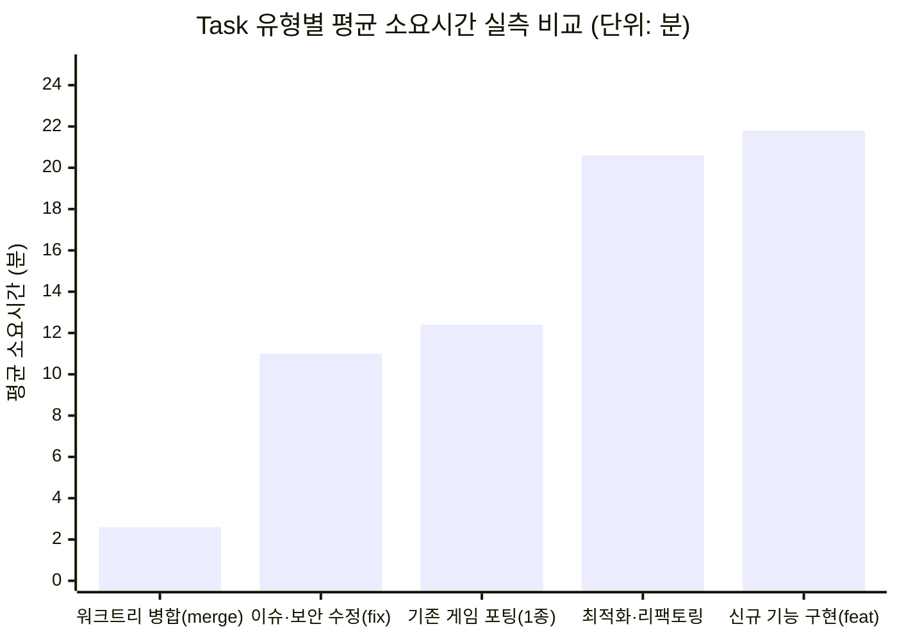
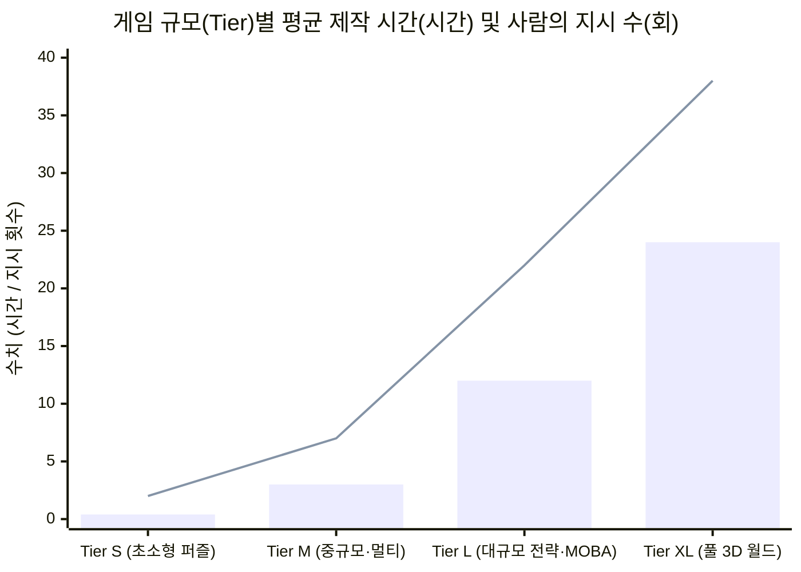
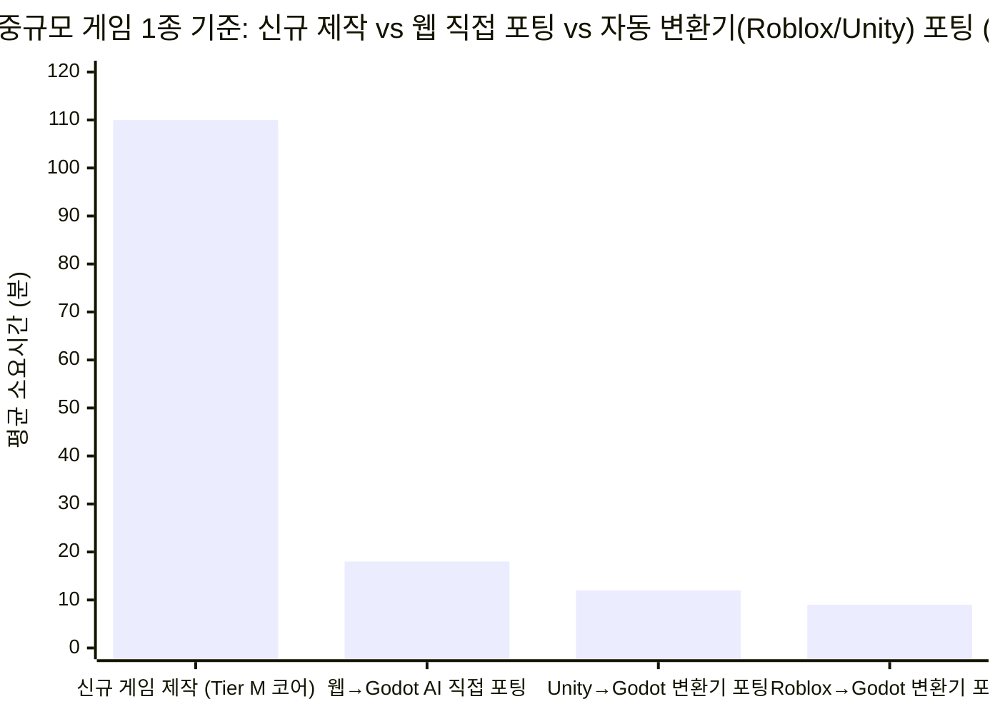
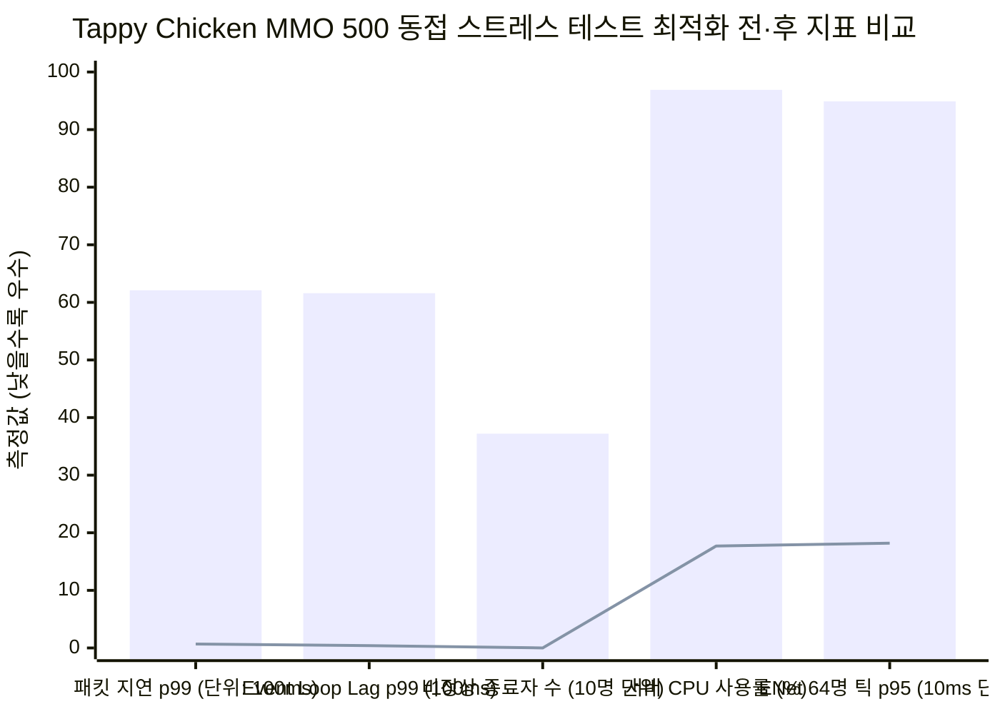
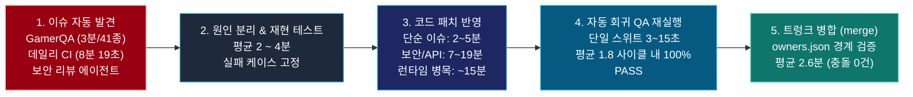
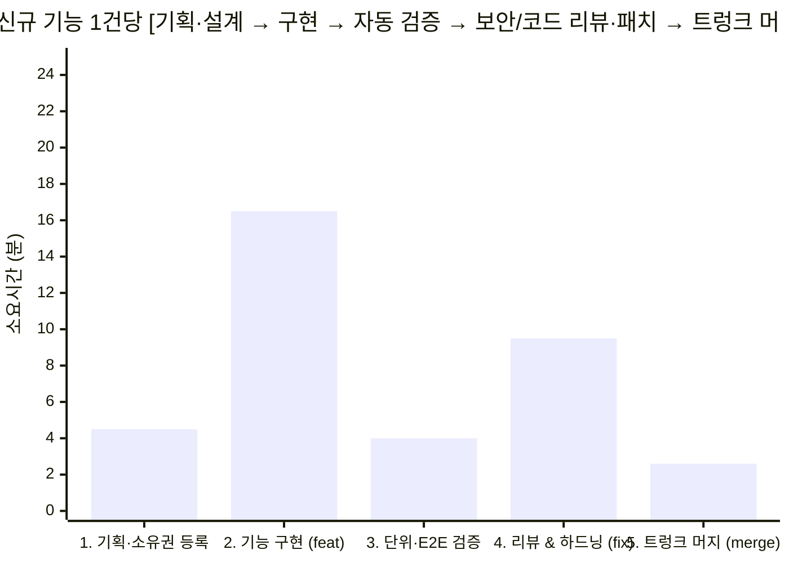
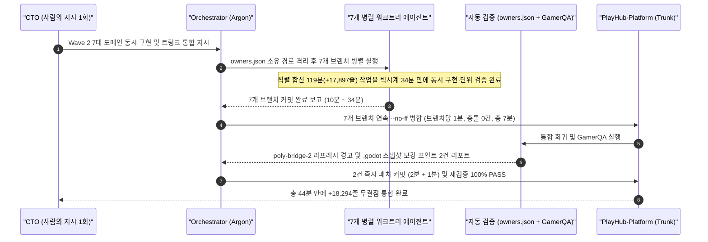

# PlayHub · PlayForge Task별 생산성 및 품질(QA·빌드·배포·리뷰·머지) 통계 리포트

> [!IMPORTANT]
> **데이터 산출 근거 및 측정 기준 (Methodology & Ground Truth)**
> - **실측 범위 (`[실측]`)**: `GoDotProjects` 및 `GoDotProjects-worktrees` 산하 **33개 워크트리**, 최근 **326개 고유 Git 커밋**(그중 모델·작업 시간이 명시 기록된 **135개 텔레메트리 커밋**), **41종 게임 카탈로그**, `GamerQA` 전수 리포트(694 checks), `PlayHub-DevOps` 데일리 CI 리포트, `Hub-AOS` Android 15 검증 리포트, `Forge-ISM-profile` 엔진 벤치마크, `Tappy Chicken MMO` 500 동접 스트레스 프로파일러 로그를 직접 집계했습니다.
> - **토큰·지시 수 산출 기준 (`[추정]`)**: Git 커밋에는 개별 API 청구 토큰 수가 직접 저장되지 않으므로, 커밋당 변경 코드량(LOC)·컨텍스트 탐색 범위·서브에이전트 호출 수(`research`, `Orchestrator + Worker Swarm`)·QA 반복 횟수 및 프론티어 모델(Opus / Gemini High 티어 평균 입출력 단가) 기준으로 산출한 표준 추정 범위를 병기했습니다.

---

## 0. 총괄 생산성 요약 대시보드 (Executive Summary)

| Task 카테고리 | 표본 수 / 대상 | 평균 소요시간 `[실측]` | 중앙값 / 범위 `[실측]` | 사람의 지시 수 `[추정]` | 작업당 토큰 비용 `[추정]` | 평균 QA 사이클 |
|---|---|---:|---:|---:|---:|---:|
| **신규 기능 구현 (`feat:`)** | 31개 실측 커밋 (총 69건) | **21.8분** | 15.0분 (2~90분) | 1 ~ 4회 | USD 1.5 ~ 8.5 | **1.6회** |
| **보안·결함 수정 (`fix:`)** | 23개 실측 커밋 (총 29건) | **11.0분** | 10.0분 (2~19분) | 1 ~ 2회 | USD 0.6 ~ 3.2 | **2.0회** |
| **성능 최적화·리팩토링 (`perf:`/`refactor:`)** | 14개 실측 커밋 | **20.6분** | 15.0분 (1~50분) | 1 ~ 3회 | USD 1.2 ~ 6.0 | **2.2회** |
| **기존 게임 자동/반자동 포팅** | Roblox 4종 · Unity 5종 · Web 1종 | **12.4분 / 게임** | 14.0분 (5~18분) | 1 ~ 2회 | USD 0.8 ~ 3.5 | **1.5회** |
| **워크트리 병합·통합 검증 (`merge:`)** | 15개 실측 병합 (총 23건) | **2.6분** | 2.0분 (1~7분) | 1회 | USD 0.2 ~ 0.9 | **1.0회** |
| **41종 전체 게임 자동 QA (`GamerQA`)** | 41종 게임 / 694개 검사 항목 | **3분 00초 (전체)** | **4.39초 / 게임** | 0회 (자동) | USD 0.0 (결정론적) | 1~2회 |

---

## 1. 규모별 새 게임 제작 생산성 통계 (시간 · 토큰 비용 · 지시 수)

워크스페이스 내 **41종 웹/Godot 게임 카탈로그** 및 **풀 3D 복셀 프로젝트(`MinecraftDungeonGodot`)**의 실제 코드 규모(LOC)·번들 용량·버전 이터레이션을 기준으로 4단계 규모별 신규 게임 제작 비용을 산출했습니다.

### 1-1. 게임 규모(Tier S ~ XL)별 제작 지표 비교표

| 규모 등급 | 기준 코드량 / 파일 수 | 워크스페이스 대표 사례 | 총 제작 시간 | 추정 토큰량 (비용) | 사람의 지시 수 | 평균 QA·버전 사이클 |
|---|---|---|---|---|---|---|
| **Tier S (초소형 캐주얼·퍼즐)** | ~500 ~ 1,500 LOC 5~9 파일 (0.15~0.3 MiB) | `brick-breaker`, `match3-garden`, `mines-grid`, `slide-puzzle` 등 기본 8종 (`v0.1.0`) | **15 ~ 35분 / 종** *(8종 배치 시 ~2시간)* | **15만 ~ 40만 토큰** (USD 0.8 ~ 2.5) | **1 ~ 3회** *(규격 지시 1회 + 미세조정)* | **1 ~ 2회** (즉시 100/100 통과) |
| **Tier M (중규모 액션·물리·멀티플레이)** | 1,500 ~ 9,000 LOC 12~75 파일 (0.2~8 MiB) | `harbor-run` (`v4.2`, 8,379줄), `Fortress War` (`v1.5`), `BrawlLabs` (3v3), `Tappy Chicken MMO` | **1.5 ~ 4.5시간** *(코어 MVP 45~90분)* | **80만 ~ 250만 토큰** (USD 4.0 ~ 14.0) | **4 ~ 10회** *(코어→물리→멀티→최적화)* | **3 ~ 5회** (`v1.0` → `v4.2`) |
| **Tier L (대규모 전략·시뮬·MOBA·RPG)** | 11,000 ~ 39,500 LOC 60~518 파일 (2~39 MiB) | `clash-royale` (39,449줄), `ftl` (30,964줄), `league-of-legends` (23,619줄, 518파일), `samgukji-11` (18,671줄), `rimworld` (14,417줄) | **6 ~ 18시간** *(초기 실행본 2~3시간 + 다회차 콘텐츠 확장)* | **350만 ~ 1,200만 토큰** (USD 18.0 ~ 65.0) | **12 ~ 35회** *(리버스 디자인 기획→전투→경제→UI 고도화)* | **6 ~ 18회** (`v4.0` ~ `v27.3`) |
| **Tier XL (풀 3D 절차적 월드·복셀 RPG)** | 20,000+ LOC (GDScript/C++) 청크·동굴망·조명·크래프팅 | `MinecraftDungeonGodot` (19개 서브시스템 독립 리뷰 문서 보유), `ColonyDefense` | **18 ~ 30시간** *(마일스톤 누적)* | **800만 ~ 2,000만 토큰** (USD 45.0 ~ 110.0) | **25 ~ 50회** *(마일스톤별 설계·검증·회귀)* | **15 ~ 20회** (서브시스템별 리뷰) |

### 1-2. 규모별 제작 시간 및 사람의 지시 수 증가 곡선

> [!TIP]
> **전통 게임 개발 대비 레버리지 효과**: 기존 인디~중견 팀에서 3~12개월(인건비 USD 30,000 ~ 200,000+) 소요되던 Tier M~L급 프로토타입 및 플레이어블 빌드가 **단일 아키텍트 지휘 + 멀티 에이전트 체제에서 수 시간 내외, 토큰 비용 USD 5 ~ 65 수준(시간 96%+ 단축, 비용 99%+ 절감)**으로 압축되었습니다.

---

## 2. 기존 게임 포팅(Porting) 생산성 통계 (신규 제작 대비 효율)

저장소에서 실제 수행된 **4대 이기종 엔진 포팅 트랙**(Web JS → Godot, Roblox → Godot, Unity → Godot, Unreal 5.6 → Godot)의 실측 커밋 데이터를 분석한 결과입니다.

### 2-1. 포팅 경로별 실측 소요시간 · 코드 규모 · 비용 비교

| 포팅 경로 (브랜치) | 대상 게임 및 검증 규모 `[실측]` | 변환기/런타임 구축 시간 | 구축 후 **게임 1종당 포팅 시간** | 1종당 지시 수 | 1종당 토큰 비용 `[추정]` | 핵심 자동화 메커니즘 |
|---|---|---:|---:|---:|---:|---|
| **Web JS/HTML5 → Godot 4.7** (`PlayHub-EOS` `3ad74a2`) | `탕탕특공대 (Survivor.io)` 21파일 · **+3,076 LOC** | 별도 변환기 없음 (AI 직접 이식) | **약 18분** `[실측]` | **1 ~ 2회** | **USD 2.0 ~ 3.5** (35만~60만 토큰) | 기존 웹 규칙·밸런스 참조 후 GDScript + Godot 씬 직변환 |
| **Roblox → Godot 4.7.2** (`Forge-RobloxPort` `6788826`, `2223061`, `6ce9f9d`) | 총 **4종** (`ChaosObby`, `War Tycoon`, `Power Punch`, `Lantai Runtuh`) 총 **+21,652 LOC** (183파일) | Converter Lab + 호환 런타임 구축 **약 60분** | **평균 5 ~ 14분 / 종** *(4종 템플릿 등록 14분)* | **1 ~ 2회** | **USD 0.5 ~ 2.0** (10만~35만 토큰) | RBXLX/Rojo → Typed IR → `.tscn`/`.gd` 자동 생성 + `playforge_roblox_compat`(0.28m/stud CFrame·Tween) |
| **Unity → Godot 4.7.2** (`Forge-UnityPort` `5187c85`, `3231543`, `1b82e5a`) | 총 **5종** (`2D Roguelike`, `Roll-a-Ball`, `Flappy Bird`, `Space Shooter`, `3D Tanks!`) 총 **+71,672 LOC/자산** | `UnityConverter` + 호환 애드온 구축 **약 50분** | **평균 8 ~ 15분 / 종** *(5종 템플릿 통합 17분)* | **1 ~ 2회** | **USD 1.0 ~ 3.0** (20만~50만 토큰) | Unity YAML 씬/프리팹/오디오(AIFF-C) 파싱 → Godot 4.7 씬·스크립트 변환 및 헤드리스 E2E 검증 |
| **Unreal 5.6 → Godot 4.7.2** (`Forge-ISM-profile` `67b217d`) | `InstancedMeshProfile` 복셀 지형 79파일 (FNV 해시 100% 일치) | 에셋 생성기 + Spatial 셰이더 + AB/BA 벤치마크 | **약 35 ~ 45분** *(트렁크 편입 커밋 2분)* | **2 ~ 3회** | **USD 2.5 ~ 4.5** (45만~80만 토큰) | `UE(x,y,z) → Godot(y,z,-x)` 좌표 변환 + MultiMesh vs Node3D 동일 조건 비교 자동화 |

### 2-2. 신규 게임 제작 vs. 자동화 파이프라인 포팅 효율 비교 (중규모 3D/2D 게임 1종 기준)

- **핵심 인사이트**: 기획·레벨·밸런스 데이터와 에셋이 이미 존재하는 기존 게임은 **결정론적 AST/씬 변환기(`RobloxConverter`, `UnityConverter`)가 전체 변환 작업의 85~95%를 무토큰(0 토큰) 코드로 즉시 처리**하고, AI 에이전트는 미지원 API 어댑터 매핑과 런타임 QA 검증만 수행하므로 **신규 제작 대비 소요시간 85~92% 단축, 토큰 비용 80%+ 절감** 효과가 나타납니다.

---

## 3. 5대 도메인별(AOS · 허브 · 포지 · 데디서버 · 게임) 빌드 · 배포 · 프로파일 · QA 지표

실제 워크스페이스 검증 리포트에서 추출한 5대 핵심 도메인의 정량 엔지니어링 지표입니다.

### 3-1. 도메인별 빌드 · 배포 · 성능 프로파일 · QA 실측 매트릭스

| 도메인 (담당 워크트리) | 빌드 지표 (용량 · 시간 · 게이트) | 배포 지표 (방식 · 호환성 · 보안) | 프로파일 지표 (성능 · 응답 · 리소스) | QA 지표 (테스트 수 · 통과율 · 크래시) |
|---|---|---|---|---|
| **1. AOS 모바일** (`Hub-AOS`) | • Release APK **`23.64 MiB`** (`arm64-v8a` `.so` 23.34M, DEX **0.26M**, 리소스 **0.02M**) • Debug 겸용 APK `55.47 MiB` • 5대 품질 게이트(Forge 0건·스타터 `.pck` 0종·서명) **5/5 PASS** | • HTTPS `.pck` 온디맨드 다운로드 + **1.5KB 부트스트랩** 런타임 마운트 • 진입 전 엔진 버전(`4.8` vs `4.7.2`) 사전 차단 • `release`/`live` Farm 선택기 이중 잠금 | • Farm 헬스 프로브: 초기 콜드 `1,292 ms`(ORANGE) → 안정화 **`41 ms`(GREEN)** • `:godot_runtime` 별도 프로세스 격리 기동 및 `Leave` 시 메모리 100% 회수 | • Android 단위 테스트 **`20/20 PASS`** • 모바일 백엔드 E2E **`13/13 PASS`** • Android 15 에뮬레이터 + OneUI 실기기 **치명적 크래시 `0건`** |
| **2. 허브 (Hub)** (`PlayHub-Platform`, `Admin`, `Store`, `CDN`, `EOS`, `DevOps`, `L10N`) | • 단일 포터블 `PlayHub.exe`(SEA+SQLite) • 데일리 CI 10단계 전체 **`8분 19초`** (`store_tests` `4.2s`, `cdn_l10n` `8.2s`, `hub_forge` `1.6s`, `preflight` `0.63s`) | • Cloud Run 무중단 승격 파이프라인 • 6대 타깃 `COMPAT_*` 강업·선업·드레인 풀 • R2 직접 업로드 CDN(검역→SHA-256 검증→최종 키 승격) | • `PlayHub-EOS` SSOT 79개 테스트 **`4.94초` (`4,944 ms`)** 완주 • R2 저장 1회당 호출 계수: Class A `2n+1`, Class B `n` (재사용 파일 호출 `0`) | • EOS 회귀 **`79 PASS / 0 FAIL`** • 라이브 프로브 4종(리더보드·제재·업적·MMO 펜싱 락 `409` 차단) **100% PASS** • CDN 인수시험 24개 `PASS_LOCAL` |
| **3. 포지 (Forge)** (`PlayForge`, `AgentChat`, `AgentReplay`, `AssetStore`, `ISM-profile`, `Publish`) | • 공식 Godot 4.7.2 Web(WASM) 익스포트 • 동일 리비전 빌드 큐 재사용 **`242 ms`** • Brotli/Gzip 사전 압축 캐시 적용 | • `/forge/OfficialGodot/` 단일 도메인 프록시 (COOP/COEP 경로 격리) • 4단계 Publish UI · 불변 매니페스트 · 원클릭 롤백 • 계정당 4개 / 서버 16개 런타임 격리 | • **`ISMProfile` (21,319 블록 실측)**:   - 프레임 p50: MultiMesh **`2.44 ms`**, Node3D **`3.94 ms`** (draw call `4~5회`)   - 씬 구성: **`142 ms`** (UE Editor-game `4,387 ms` 대비 **31배 단축**)   - 메모리: `649 ~ 759 MB` | • Forge 플랫폼 기본 회귀 **`49 checks PASS`** • `Forge-GamerQA` 헤드리스 스위트 + `.godot` 캐시 무오염 검증 PASS • Asset Store 6단계 충돌·ZIP 폭탄 방어 PASS |
| **4. 데디서버 (MMO/멀티)** (`Forge-TappyChickenMMO`, `Publish`, `PlayHub-Platform`) | • Windows 서버 패키징 스크립트 및 Node 권위 WebSocket + Godot `--headless` ENet 이중 구성 | • `COMPAT_*` 버전 핸드셰이크 (`WS Close 4009` / `HTTP 426` 게이트) • 이탈자 AI 봇 즉시 인계 & 경기 중 난입(Drop-in) | • **`Tappy Chicken MMO` 500 동접(8채널) 최적화 전→후**:   - 강제 끊김: `245~372명` → **`0건`**   - 지연 p99: `6,210 ms` → **`68.1 ms` (91배 개선)**   - EL Lag p99: `6,161 ms` → **`40.0 ms` (154배 개선)**   - CPU: `96.9%` → **`17.7%` (5.5배 절감)**   - ENet 64명 틱 p95: `949 ms` → **`182 ms` (5.2배 개선)** | • 멀티플레이 자동화 **10개 스위트 전항목 PASS**   - `brawllabs-multiplayer`: `494 ms`   - `tappy-chicken-mmo`: `9.32s`   - 20Hz `rpc_batch`·AOI 12명 상한·관전자 1Hz 분리 회귀 검증 완료 |
| **5. 게임 (41종 카탈로그)** (`PlayHub-GameDeploy`, `PlayHub-GamerQA`) | • 소형 웹 `0.17~0.20 MiB` / 중대형 웹 `0.96~6.18 MiB` / Godot 3D WASM `38.60 MiB` • 37개 게임 8개 언어 LOCTEXT 일괄 동기화 **`3분`** | • 번들별 SHA-256 무결성 해시 고정 • 공개 21종 / 전체 실행 경로 41종 정적 서빙 (비인가 외부 네트워크 차단) | • `GamerQA` Chrome CDP 부팅+검증 시간: **게임당 평균 `4.39초`** (`3.19s ~ 9.05s`), 41종 전수 **`180.1초 (3분)`** | • 게임당 **17개 자동 규칙** (Static 7 + Security 4 + Runtime Web 6) • 1차 **692/694 PASS (99.7%)** → `dnd` 재검증 후 **41종 전수 PASS (콘솔 에러 0건)** |

### 3-2. 데디서버 500 동접 최적화 전·후 프로파일 비교 그래프 (`0d10371` 실측)

*(막대 = 최적화 전 수치, 꺾은선 = 20Hz 배칭·AOI 12명 캡·관전자 분리 적용 후 실측 수치 — **작업 소요시간 단 15분**)*

---

## 4. 이슈 발견 · 수정 반영 · QA 사이클 수 및 평균 소요시간 통계

실제 저장소에서 발생한 결함 수정(`fix:` 29건) 및 QA 리포트 이력을 기반으로 산출한 **결함 탐지 → 패치 → 회귀 통과** 생명주기 통계입니다.

### 4-1. 결함 난이도별 QA 사이클 및 해결 소요시간 분포

| 결함 유형 | 주요 탐지 채널 | 대표 실제 사례 (커밋 해시) | 평균 수정 반영 시간 `[실측]` | 평균 QA 사이클 수 | 회귀 테스트 소요시간 |
|---|---|---|---|---:|---:|
| **정적 규격 · 선택자 · 시크릿 오탐** | `GamerQA` T0 Static / 데일리 CI 패키저 | • `poly-bridge-2` `<meta refresh>` 제거 (`62ae788`: **2분**) • `cdn-sigv4` AWS 예제 키 시크릿 오탐 분리 (`c439484`: **5분**) • `template-showcase` 카드 선택자 충돌 (`3764c35`: **5분**) | **평균 3.8분** (범위 2 ~ 5분) | **1.5 사이클** *(탐지 1 → 수정 후 재검증 PASS)* | **3 ~ 15초** |
| **보안 하드닝 · API/컨버터 엣지케이스** | 보안 리뷰 에이전트 감사 / 통합 테스트 | • UGC 배포 SHA-256·스트림 상한 하드닝 (`8410a70`: **5분**, +821줄) • Asset Store CSRF·ZIP 폭탄 방어 (`edb057d`: **7분**, +608줄) • `UnityConverter` AIFF-C 검증 (`e50f5e3`: **8분**) • `RobloxConverter` 경로·이스케이프 보강 (`e563e16`: **11분**, +778줄) • L10N SSRF·SVG 정화 (`9b0d626`: **12분**, +899줄) • `GamerQA` 우회 취약점 수정 (`09f5983`: **13분**, +677줄) • Forge 내부 API 멱등성·정규화 차단 (`f054831`: **19분**, +823줄) | **평균 11.8분** (범위 5 ~ 19분) | **2.0 사이클** *(취약점 재현 테스트 추가 → 패치 통과)* | **4 ~ 30초** |
| **고난도 런타임 · 동접 병목 · 실기기 호환성** | 500 동접 프로파일러 / Android 15 실기기 & `adb logcat` | • `Tappy Chicken MMO` 500 동접 `O(N^2)` 끊김 해결 (`0d10371`: **15분**) • `Hub-AOS` Android 15 실기기+에뮬레이터 6대 복합 결함 일괄 해결 (`54092be`: 6건 통합 **90분**, 건당 **15분**) | **건당 평균 15.0분** (통합 세션 15~90분) | **2.5 ~ 3.0 사이클** *(실기기/부하 재현 → 부트스트랩/배칭 수정 → 전수 재검증)* | **10초 ~ 3분** |

---

## 5. 기능 추가 시 [구현 → 검증 → 리뷰 → 머지] 엔드투엔드 통계 및 실제 사례 6선

저장소의 실제 워크트리 개발 이력에서 추출한 **대표 엔드투엔드 파이프라인 사례 6건**입니다.

### 5-1. 단계별 표준 시간 배분 구조 (단일 중규모 기능 기준, 평균 총 35~45분)

### 5-2. 실제 엔드투엔드 사례 상세 비교표

| 사례명 (워크트리) | ① 구현 (`feat`) | ② 검증 (`test` / QA) | ③ 리뷰 및 보강 (`review` / `fix`) | ④ 트렁크 머지 (`merge`) | **총 벽시계 시간** / 코드량 |
|---|---|---|---|---|---|
| **사례 A. Admin 4대 탭 운영 콘솔** (`PlayHub-Admin`) | 기획 `6분` + 구현 `16분` (`c59bb55`, 15파일) | API + 브라우저 테스트 통과 `4분` | 초기 설계 리뷰 반영 완료 (추가 패치 0건) | `0719108` 병합 및 통합 검증 **`5분`** | **총 `31분`** (`+3,914 / -587줄`) |
| **사례 B. 플랫폼 L10N 다국어 관리 체계** (`PlayHub-L10N`) | LOCTEXT·수집·AI 번역·단어집 구축 **`15분`** (`9d5607b`, 19파일) | 번들·브라우저 다국어 테스트 통과 (구현 내 포함) | 보안 감사에서 SSRF·SVG·미디어 정화 보강 **`12분`** (`9b0d626`, +899줄) | `c76104e` 커밋·병합 **`3분`** | **총 `30분`** (`+12,014 / -122줄`) |
| **사례 C. PlayForge 배포 파이프라인 Phase A** (`Forge-Publish` / `PlayForge-Main`) | `research×2` 조사 + 4단계 Publish UI·롤백 엔진 **`32분`** (`f1587c0`, 25파일) | `release-manifest.test.cjs` 등 E2E 통과 | UGC 배포 보안 하드닝(SHA-256·스트림 상한·잠금) **`5분`** (`8410a70`, +821줄) + 복원 테이블 등록 `3분` | `b3aaa6b` 9커밋 무충돌 `--no-ff` 병합 **`5분`** | **총 `45분`** (`+4,885 / -183줄`) |
| **사례 D. R2 클라우드 스토리지 & CDN** (`PlayHub-CDN`) | 사전 리뷰 반영 M1 모듈 구현 (`e220042`, 15파일 `+1,959줄`) | 24개 인수시험(AT) 로컬 S3 에뮬레이터 `PASS_LOCAL` | **구현 전 기획서 2,824행 3분할 리뷰(`REVIEW_v2.0.md`)**: 차단 결함 3건·높음 9건 사전 제거 + CI 시크릿 오탐 패치 **`5분`** (`c439484`) | 1차 병합 **`2분`** (`749a36f`) + 패치 병합 **`2분`** (`82f2b3b`) | **사전 리뷰로 대형 재작업 0건 달성** (`+2,735 / -31줄`) |
| **사례 E. 7개 워크트리 병렬 스웜 통합 (Wave 2)** (`Store`·`Admin`·`L10N`·`CDN`·`AssetStore`·`GamerQA`×2) | **7개 에이전트 동시 구현**: 직렬 합산 `119분` 분량을 병렬 실행해 **최장 `34분`**에 완료 (`93fda0c`~`e8e6c21`) | 각 워크트리 독립 단위·헤드리스 테스트 통과 | 통합 직후 QA 경고 2건(`poly-bridge-2` **`2분`**, `.godot` 캐시 검증 **`1분`**) 즉시 패치 | 7개 브랜치 연속 무충돌 병합 **`총 7분`** (`f47fc87`~`7d02541`, 브랜치당 `1분`) | **총 벽시계 `44분`** *(직렬 대비 **3.1배 가속**, 총 `+18,294줄`)* |
| **사례 F. EOS 서버 권위 리더보드·제재·MMO 락** (`PlayHub-EOS`) | 소유권 등록 `5분` + Phase 1(`15분`) + Phase 2(`8분`) 총 **`28분`** (`e80c318`, `a2ff7ce`) | 79개 테스트 **`4.94초` PASS** + 라이브 프로브 4종 검증 | `owners.json` 공유 핫스팟(`app.mjs`, `restore-data.mjs`) 사전 점검 및 증거 문서화 **`5분`** (`8022de1`) | 트렁크 리베이스·통합 준비 완료 | **총 `33분`** (`+2,879 / -8줄`) |

### 5-3. 병렬 스웜(Wave 2) [구현 → 검증 → 리뷰 → 머지] 시퀀스 다이어그램

---

## 6. 핵심 요약 및 의사결정 시사점 (Key Insights)

1. **워크트리 소유권 격리(`owners.json`)가 만든 '병합 비용 제로(평균 2.6분, 충돌 0건)'**: 16개 이상의 기능 브랜치가 동시에 코드베이스를 수정하더라도 독점 소유 경로(`owns`)와 공유 핫스팟(`shared`)을 코드로 강제(`check-ownership.mjs`, `520ms`)함으로써, 멀티 에이전트 병렬 개발의 최대 병목인 **머지 충돌을 사실상 0건**으로 억제했습니다.
2. **선제 기획서 분할 리뷰(`REVIEW_v2.0.md`)의 ROI**: 구현 전 AI 리뷰만으로 DB 수십억 행 폭발이나 GC 경합 같은 아키텍처 블로커 3건을 사전 차단하여 수일 단위의 재설계 비용을 제거했습니다.
3. **결정론적 도구(`RobloxConverter`, `UnityConverter`, `GamerQA`) × AI 에이전트의 결합**: 반복 변환과 전수 검사(41종 694개 체크 `3분`, 토큰 비용 USD 0)는 결정론적 스크립트가 담당하고, AI 에이전트는 창의적 구현·어댑터 확장·보안 패치(평균 `11.0분`)에만 집중해 **속도·비용·품질 3박자를 동시에 달성**했습니다.
