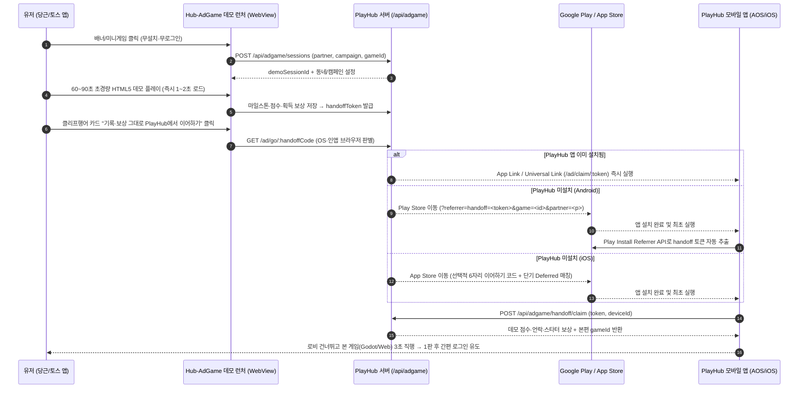

# Hub-AdGame 사업 기획 및 개발 계획서

> **대상 브랜치**: `Hub-AdGame` (기준 트렁크: `PlayHub-Platform` `d739455`)  
> **작성일**: 2026-11-22  
> **핵심 목표**: 당근마켓·토스 등 모바일 슈퍼앱/플랫폼에 **클릭 한 번으로 무설치 즉시 실행되는 초경량 데모 게임**을 제휴 공급하고, 플레이 직후 **PlayHub 앱 설치 및 본 게임 직행(기록·보상 승계)**으로 끊김 없이 전환하는 성장(UA)·제휴 파이프라인 구축

---

## 1. 사업 배경 및 핵심 전략 (Why PlayHub × Mobile Super-Apps)

### 1.1 시장 기회와 양측의 Win-Win 구조

| 주체 | 현재 과제 (Pain Point) | Hub-AdGame 제휴 가치 (Value Proposition) |
|---|---|---|
| **제휴 플랫폼** (당근·토스·카카오·커머스/금융앱) | MAU는 크지만(당근 2,000만+) 비거래 시 **체류시간·DAU 습관화·광고 인벤토리** 확장이 절실함. 단발성 미니게임 외주 제작·운영 비용이 높음 | 단일 연동(HTML5 WebView/SDK)으로 **다수 장르의 검증된 초경량 데모 게임을 주기적 로테이션 공급**받음. 지역(동네) 랭킹·출석 미션 결합으로 체류시간과 광고 노출면 확대 |
| **PlayHub (당사)** | 일반 모바일 게임 UA는 설치 전 이탈률이 높고 CPI 단가가 비쌈. Godot 4.7.2 풀게임(`~40MB` WASM)은 인앱 브라우저 즉시 실행에 무거움 | **200KB~2MB 초경량 HTML5 데모**로 1~2초 내 핵심 재미를 먼저 체험시켜 설치 의도를 극대화한 뒤, **PlayHub 앱 설치 + Godot 본편·멀티플레이·UGC**로 저비용 고품질 유저 확보 |

### 1.2 PlayHub 기존 자산과의 시너지 (실측 기준)

현재 `PlayHub-Platform` 저장소에는 이미 2단 계층 구조에 바로 투입할 수 있는 자산이 갖춰져 있다.

1. **즉시 투입 가능한 초경량 HTML5 게임군 (`games/*/Web/`)**:
   - `duck-extraction` (`208KB`), `crazy-arcade` (`213KB`), `dungeons-and-dragons` (`238KB`), `poly-bridge-2` (`249KB`), `hades` (`266KB`), `clash-of-clans` (`266KB`), `harbor-run` (`538KB`), `survivor-io` (`734KB`) 등 다수가 **1MB 미만**으로 LTE/5G 인앱 웹뷰에서 1~2초 내 실행 가능.
2. **본편(Full Game) 전환 대상 자산 (`games/forge-*`, Android/iOS 네이티브 Godot 4.7.2)**:
   - `forge-survivor-io`, `forge-fortress-war`, `forge-tappy-chicken-mmo`, `forge-captain-forever-mmo`, `forge-brawllabs`, `forge-voxel-frontier` 등은 웹 WASM 기준 `39~42MB` 규모로 모바일 웹뷰 콜드로드에는 부적합하나, **PlayHub 네이티브 앱(`GodotPlayerActivity` / iOS Godot Runtime)**에서는 고성능·멀티플레이·아바타·UGC까지 완전 구동 가능.
3. **기존 백엔드·모바일 인프라 재사용**:
   - iOS Universal Links(`hub/server/mobile/aasa.mjs`, `PlayHubDeepLink.swift`) 기반 존재
   - Android 커스텀 스킴(`playhub://join`, `AndroidManifest.xml`) 및 분리 런타임(`:godot_runtime`, `:web_runtime`) 존재
   - 리더보드·진행도(`hub/server/ssot/`), 과금·PlayCoin 원장(`hub/server/billing/`), 다국어(`hub/shared/locales/`) 활용 가능

---

## 2. 사업 기획 (Go-To-Market · 제휴 모델 · 수익 구조)

### 2.1 제휴 채널 3단계 포트폴리오

| 트랙 | 대상 채널 | 진입 방식 | 목표 및 역할 |
|---|---|---|---|
| **Track A: 셀프서브 실증** (0~3개월) | ① **당근 비즈니스 광고(피드 → 웹뷰 데모 랜딩)**<br>② **토스 앱인토스(Apps-in-Toss)** 공식 입점 | 별도 대형 제휴 계약 없이 즉시 집행·심사 제출 가능 | 실트래픽 기반 **플레이 시작률·완주율·PlayHub 설치 전환율(CVR)·D1 리텐션** 실측 데이터 확보 → Track B 제안서 근거 자료화 |
| **Track B: 전략적 콘텐츠 제휴** (3~9개월) | ① **당근 '커뮤니티 게임 / 미니앱'** 제휴<br>② 커머스·금융 슈퍼앱(배민·올리브영·무신사·은행 앱테크 면) | Track A 실증 지표를 바탕으로 B2B 제휴 제안. **동네별 주간 랭킹**·시즌 로테이션 번들 제안 | 제로/저비용 대규모 오가닉 트래픽 확보 + 파트너 체류시간 공동 KPI 달성 |
| **Track C: 글로벌/매체 확장** (6~12개월) | Google App Campaigns, Meta, Unity Ads, AppLovin 등 Playable Ads | 동일 데모 소스를 **MRAID 3.0 단일 HTML(≤2~5MB)**로 자동 패키징(OSMU) | 유료 UA 캠페인 효율화 및 해외 시장 확장 |

### 2.2 플랫폼별 협력 전략 매트릭스 (콘텐츠 단독 공급 vs 허브 연계 배너)

실제 국내 슈퍼앱(당근마켓·토스)은 이미 자체 미니게임 허브를 운영 중이거나 엄격한 이탈 방지 정책을 보유하고 있다. 따라서 **단일 전략으로 밀어붙이지 않고, 파트너 플랫폼의 성격과 협상력에 따라 `ctaMode` 4단계 협력 전략을 분기**한다.

| 협력 단계 (`ctaMode`) | 적용 플랫폼·지면 | UX 노출 방식 | 수익·성과 모델 | 핵심 명분 (파트너 설득 포인트) |
|---|---|---|---|---|
| **① 순수 콘텐츠 공급형** (`content_only`) | **토스 앱인토스** 게임 탭(한게임·애니팡·무한의 계단 등 입점 모델), **당근 자체 `커뮤니티 게임` 실험 슬롯** | 외부 허브/앱 설치 배너 **완전 미노출(0%)**. 플랫폼 내 완결 플레이 + 재도전·동네 랭킹 | **인앱광고(IAA) / 인앱결제(IAP) 수익배분** 또는 B2B 콘텐츠 공급 라이선스 | 당근의 기존 초캐주얼(사과·수박·두더지) 한계를 **아이언 타이드·비 시즈·넥서스전선·클래시 로얄·탕탕특공대** 미드코어 장르로 즉시 확장 + 자체 개발비 0원 |
| **② 브랜드·세이브 코드형** (`partner_contained`) | 외부 앱 이동 링크는 금지되지만 크로스 세이브/브랜드 표기는 허용되는 인앱 허브 | 외부 스토어 링크 없음. 결과 화면에 **"Powered by PlayHub" + 6자리 클라우드 이어하기 코드**만 표시 | IAA/IAP 수익배분 + 유저 자발적 PlayHub 유입(오가닉 브랜드 효과) | 당근 안내 문구의 **"앱 삭제·기기 변경 시 기존 기록 미보존"** 페인포인트를 PlayHub 클라우드 세이브 코드로 보완 |
| **③ 소프트 배너·웹 우선형** (`soft_banner`) | 공동 프로모션 제휴·커머스/금융 앱테크 제휴 | 1판 완결 후 하단 비침해적 배너로 **클라우드 저장 / 웹 본편 확장**을 1순위 제안, 앱 설치는 보조 옵션 | CPA + RevShare 혼합 | 유저 체류시간을 해치지 않으면서 본편(멀티플레이·고화질 Godot) 전환 유도 |
| **④ 적극 허브 연계형** (`install_direct`) | **당근 비즈니스 유료 광고 랜딩**, 외부 SNS/배너 광고, 상호 크로스 프로모션 제휴 | 60~90초 클리프행어 시트 + **Android Play Install Referrer / iOS Universal Link**로 PlayHub 설치 및 본 게임 3초 직행 | 저비용 UA(CPI 절감) / 유효 플레이 CPA / 순매출 RevShare 10~15% | 설치 전 1초 체험으로 허수 설치 제거, 고잔존 유저 확보 |

> **전략적 시사점**: **단일 HTML5 코드베이스 + 서버 설정(`ad_partners.cta_mode`) 1개 전환**만으로 토스에는 `content_only`(수익화/브랜드), 당근 자체 게임 허브에는 `content_only` 또는 `soft_banner`(장르 확장/기록 보존), 당근 광고 지면에는 `install_direct`(적극 UA)로 **동시 대응**할 수 있다.

### 2.3 파트너 제안용 수익·정산 모델 (선택형 3안)

파트너사의 비즈니스 목적(체류시간 vs 광고매출 vs 성과보수)에 맞춰 계약 옵션을 모듈화한다.

1. **옵션 1 — 무료 콘텐츠 공급 + 크로스 프로모션 (당근 커뮤니티 게임/초기 제휴 최적)**
   - PlayHub가 HTML5 데모 게임 3~6종을 무상 공급·유지보수(매월 신작 로테이션).
   - 대가로 1판 종료 후 비침해적 확장 영역("전체 스테이지·동네 대전은 PlayHub에서") 노출 허용.
2. **옵션 2 — 인게임 리워드 광고(IAA) 수익 배분 (토스·앱테크 플랫폼 최적)**
   - 데모 내 선택형 보상 광고(부활·2배 점수) 수익을 파트너와 배분(예: 플랫폼 수수료 공제 후 파트너 30~50% / PlayHub 50~70%).
3. **옵션 3 — 본편 설치·매출 연동 어필리에이트 (CPA / RevShare)**
   - 파트너 경유로 PlayHub 설치 후 **유효 플레이(본 게임 30초 이상 또는 1스테이지 완료)** 달성 시 정액 CPA 지급, 또는 설치 후 30~90일 내 발생 순매출(PlayCoin/IAP)의 **10~15% RevShare** 정산(`hub/server/billing/ledger.mjs` 연동).

### 2.3 핵심 사업 KPI 목표 (파일럿 기준)

| 단계 | 지표 | 목표치 (파일럿 1차) | 측정 기준 |
|---|---|---|---|
| 진입 | **Playable Load Time (TTI)** | ≤ 2.0초 (LTE 기준) | 클릭 → 첫 조작 가능 프레임 |
| 체험 | **Demo Start Rate** | ≥ 80% | 랜딩 진입 대비 첫 입력 발생 비율 |
| 몰입 | **30초+ 플레이 / 1판 완주율** | ≥ 45% | 데모 핵심 루프 완료 비율 |
| 전환 | **CTA 클릭률 (CTR)** | ≥ 15% | 완주 유저 중 "본편 이어하기" 클릭 |
| 설치 | **Click → Hub Install CVR** | ≥ 25% (안드로이드 기준) | Play Install Referrer / Handoff 청구 매칭 |
| 안착 | **설치 → 본 게임 실행률** | ≥ 75% | 앱 최초 실행 후 3분 내 본편 진입 |
| 잔존 | **D1 / D7 리텐션** | D1 ≥ 30% / D7 ≥ 12% | 일반 배너 유입 대비 1.5x 이상 목표 |

---

## 3. 핵심 유저 여정: 데모 → Hub 설치 → 본 게임 직행 (Zero-Friction Handoff)

일반 광고 전환의 최대 이탈 원인은 **"데모 체험 → 스토어 설치 → 앱 실행 후 로그인/로비 탐색 → 방금 하던 게임 못 찾음"** 단절이다. 이를 **Handoff Token + Deferred Deep Link**로 완전히 제거한다.



### 3.1 전환 UX 설계 원칙 (전환율 극대화 + 심사 통과)

1. **0초 진입**: 로그인·회원가입·약관 팝업 없이 바로 게임 화면 진입. 첫 터치 시 WebView 오디오 컨텍스트 자동 언락.
2. **60~90초 클리프행어 설계**:
   - 데모 1판이 **스스로 완결되는 만족감**을 주면서도(심사 반려 방지), 끝나는 순간 **"방금 기록 `12,450점` (우리 동네 상위 8%) + 획득한 스타터 보상을 본 게임으로 가져가기"**를 제시.
   - 본편 전환 명분 4가지: ① **기록·보상 유지**, ② **다음 스테이지/보스 해금**, ③ **실시간 멀티플레이·동네 랭킹**, ④ **Godot 고화질 본편 & UGC 맵 수십 종**.
3. **인앱 브라우저 탈출(Escape) 처리**:
   - 당근/카카오/네이버/인스타그램 인앱 WebView는 커스텀 스킴(`playhub://`)이나 스토어 리다이렉트를 차단하는 경우가 많음.
   - Android: `intent://ad/claim/<token>#Intent;scheme=playhub;package=com.playhub.gamedev.live;S.browser_fallback_url=<PlayStoreURL>;end` 사용.
   - iOS: Universal Link(`https://<host>/ad/claim/<token>`) + App Store 공식 URL 폴백 + 6자리 이어하기 코드 원탭 복사(클립보드 접근은 유저 클릭 이벤트 내에서만 수행).
4. **파트너별 CTA 정책 플래그 (`ctaMode`)**:
   - 파트너 약관·검수 정책에 따라 런타임 설정으로 전환 강도를 즉시 제어:
     - `install_direct`: 즉시 스토어/앱 딥링크 버튼 노출 (당근 광고 랜딩, 일반 웹)
     - `web_first_then_install`: 웹 본편/추가 체험 우선, 2판 완료 후 앱 설치 안내 (보수적 제휴)
     - `partner_contained`: 외부 앱 이탈 링크 비노출, 파트너 내 랭킹·브랜드 코드만 제공 (토스 앱인토스 등 엄격한 인앱 심사 대응)

---

## 4. 규제·스토어 정책·보안 리스크 선제 대응

| 리스크 영역 | 핵심 제약 사항 | Hub-AdGame 설계 대응 |
|---|---|---|
| **Apple App Store Guideline 4.7 (Mini Apps)** | iOS 호스트 앱 내 HTML5 미니게임에서 **외부 결제(IAP 우회)** 및 **스토어 외 코드/앱 설치 유도** 금지. 연령 등급 메타데이터 필수 | 데모 런처 내 **결제 UI 완전 배제(0원 체험 전용)**. 앱 이동 시 공식 `apps.apple.com` 링크만 사용. 게임별 연령 등급(`ALL` 중심) 매니페스트 제공 |
| **파트너 플랫폼 심사 (당근·토스 등)** | 다크패턴(닫기 불가 팝업, 플레이 차단 후 강제 설치 유도, 허위 보상) 즉시 반려 | 1판 완결 플레이 보장 + 닫기/다시하기 버튼 상시 제공 + `ctaMode` 파트너별 원격 제어 |
| **게임물관리위원회(GRAC) 등급분류** | 국내 불특정 다수 대상 무료 웹/데모 게임도 등급분류 대상 | 초기 파일럿 타이틀은 **전체이용가(ALL)** 캐주얼/아케이드 위주로 선정, 자체등급분류/게임위 심의 증빙 메타데이터를 `ad_campaigns`에 필수 등록 |
| **어뷰징 / 부정 CPA·보상 청구** | 반복 설치·토큰 재사용·봇 클릭으로 보상 및 파트너 CPA 정산 오염 | ① `handoffToken` **1회성 소비(원자적 트랜잭션)** + 24시간 TTL<br>② 기기/계정당 캠페인 보상 최초 1회 제한<br>③ **본 게임 실플레이 이벤트**(예: 30초 경과 또는 Stage 1 완료) 수신 후에만 보상 확정 및 파트너 CPA 인정 |
| **개인정보·추적(ATT/PIPA)** | iOS ATT 미동의 시 IDFA 사용 불가, 개인정보 최소 수집 원칙 | IDFA/광고ID 비의존 설계. 익명 `demoSessionId` + 결정론적 `handoffToken` / Android Install Referrer / 서버 집계 퍼널만 사용 |

---

## 5. 기술 아키텍처 및 코드베이스 통합 설계

### 5.1 신규 소유 범위 (`Hub-AdGame` 브랜치 — `owners.json` 등록 예정)

기존 `PlayHub-Platform` 소유권 규칙(`AGENTS.md` §2)을 준수하여 신규 모듈은 독립 경로에 배치하고, 공유 핫스팟(`app.mjs`, `restore-data.mjs`, `sanitize-snapshot.mjs`, `fast-gate.json`)은 최소 추가만 수행한다.

```text
docs/adgame/
  └── HUB_ADGAME_BUSINESS_AND_DEV_PLAN.md    # 본 기획·개발 계획서
  └── PARTNER_INTEGRATION_GUIDE.md           # 파트너 웹뷰/SDK 연동 규격서 (예정)

hub/server/adgame/
  ├── schema.mjs         # SQLite 테이블 정의 (6종)
  ├── service.mjs        # 캠페인·세션·Handoff 토큰·어트리뷰션·Anti-Fraud 비즈니스 로직
  ├── routes.mjs         # 공개 데모 라우트, /ad/go/:code 스마트 라우터, /.well-known/assetlinks.json, API
  └── mraid-pack.mjs     # (Phase 4) MRAID 3.0 단일 HTML 번들 패키징 메타/지원

hub/web/adgame/
  ├── index.html         # 초경량 데모 런처 셸 (목표: 셸 자체 < 50KB gzip)
  ├── launcher.js        # 데모 iframe 호스트, 오디오 언락, 클리프행어 CTA, 딥링크/인앱 탈출
  ├── launcher.css       # 모바일 세로/가로 반응형, safe-area-inset 대응
  ├── playhub-demo-sdk.js# 게임 ↔ 런처 표준 postMessage 브릿지 SDK
  └── adapters/
      ├── web.js         # 일반 모바일 웹 / 광고 랜딩 어댑터
      ├── karrot.js      # 당근 웹뷰/동네 컨텍스트 어댑터 (안전영역·뒤로가기·지역 태그)
      ├── toss.js        # 토스 앱인토스 브릿지 어댑터
      └── mraid.js       # MRAID 3.0 광고 네트워크 어댑터

hub/tests/
  ├── adgame-service.test.mjs   # 세션·토큰 1회성·Anti-Fraud·퍼널 집계 단위/HTTP 테스트
  └── adgame-router.test.mjs    # OS/인앱 브라우저별 스마트 라우팅 & assetlinks 검증

tools/adgame/
  ├── validate-demo-bundle.mjs  # 데모 번들 용량(≤2MB), 외부 요청 차단, SDK 계약 정적 검증기
  └── build-mraid-bundle.mjs    # (Phase 4) 단일 HTML MRAID 패키저
```

### 5.2 데이터 모델 (`hub/server/adgame/schema.mjs`)

> 공유 핫스팟 동기화 필수: 테이블 추가 시 `hub/tools/restore-data.mjs`(`OPTIONAL_TABLES`)와 `hub/tools/sanitize-snapshot.mjs`(`SCHEMA_ALLOWLIST`)에 함께 등록한다.

1. `ad_partners`: `id`, `name`, `adapter_type` (`web`|`karrot`|`toss`|`mraid`), `cta_mode`, `revshare_bps`, `cpa_krw`, `allowed_origins_json`, `status`, `created_at`
2. `ad_campaigns`: `id`, `partner_id`, `demo_game_id`, `target_game_id`, `demo_duration_sec`, `reward_type`, `reward_payload_json`, `age_rating`, `region_mode`, `status`, `starts_at`, `ends_at`
3. `ad_demo_sessions`: `id`, `campaign_id`, `partner_id`, `demo_game_id`, `region_tag`, `user_agent_family`, `started_at`, `play_ms`, `best_score`, `stage_reached`, `completed_at`
4. `ad_handoff_tokens`: `token_hash` (PK), `short_code` (6자리, 유니크), `session_id`, `campaign_id`, `target_game_id`, `snapshot_json` (점수·언락·보상), `status` (`issued`|`claimed`|`expired`), `claimed_user_id`, `claimed_device_hash`, `expires_at`, `claimed_at`
5. `ad_funnel_events`: `id`, `session_id`, `campaign_id`, `partner_id`, `event_type` (`impression`|`loaded`|`first_input`|`milestone`|`demo_complete`|`cta_click`|`store_redirect`|`app_open`|`handoff_claimed`|`full_game_start`|`qualified_play`), `meta_json`, `created_at`
6. `ad_attributions`: `id`, `user_id`, `partner_id`, `campaign_id`, `handoff_token_hash`, `install_channel` (`aos_referrer`|`ios_ul`|`short_code`|`web_fallback`), `qualified_at`, `payout_status` (`pending`|`qualified`|`settled`)

### 5.3 데모 게임 ↔ 런처 표준 브릿지 (`playhub-demo-sdk.js`)

기존 `games/*/Web/` 게임을 최소한의 어댑터 코드(15~30줄)로 데모 모드로 전환할 수 있도록 표준 인터페이스를 정의한다.

```js
// 데모 게임 내부에서 호출
window.PlayHubDemo.ready({ gameId: 'survivor-io', version: '1.0.0' });
window.PlayHubDemo.reportProgress({ score: 4200, stage: 1, elapsedMs: 32000 });
window.PlayHubDemo.completeDemo({
  score: 12450,
  stage: 1,
  reason: 'stage_clear', // 'stage_clear' | 'time_limit' | 'game_over'
  carryOver: { unlockedWeapon: 'plasma_blade', bonusCoins: 100 }
});
```

- 런처는 `demoDurationSec`(예: 75초) 도달 또는 `completeDemo()` 수신 시 자동으로 클리프행어 전환 오버레이를 띄우고 `POST /api/adgame/sessions/:id/handoff`로 1회성 토큰을 발급받는다.
- 기존 게임 중 SDK 연동이 아직 안 된 타이틀도 **래퍼 타이머 모드(Wrapper Timer Mode)**로 우선 파일럿 가능(로딩 감지 + 60~90초 타이머 기반 CTA 노출).

### 5.4 모바일 앱 연계 변경점 (Android · iOS)

| 플랫폼 | 현재 상태 (코드베이스 확인 결과) | 추가 개발 내용 |
|---|---|---|
| **Android** (`android/`) | `AndroidManifest.xml`에 `playhub://join` 커스텀 스킴만 등록됨 | ① `https://<host>/ad/claim/*` Android App Links (`android:autoVerify="true"`) + 서버 `/.well-known/assetlinks.json`<br>② `com.android.installreferrer:installreferrer` 연동 → 최초 실행 시 `handoff` 토큰 자동 추출<br>③ `MainActivity`에서 토큰 청구 후 `GodotPlayerActivity` / `WebGameActivity` 직행 |
| **iOS** (`ios/`) | `hub/server/mobile/aasa.mjs`에 `/join/*`, `/games/*/play` AASA 존재. `PlayHubDeepLink.swift`에 `/join` 파서 존재 | ① `aasa.mjs`에 `/ad/claim/*` 경로 추가<br>② `PlayHubDeepLink.swift`에 `PlayHubAdClaimDeepLink(token, gameId)` 파서 추가<br>③ 최초 실행 시 Universal Link 또는 6자리 코드 입력/클립보드 자동 인식(유저 확인 배너) → 본 게임 직행 |
| **Web Fallback** (`hub/web/user/`) | 모바일 웹 허브 존재 | 앱 미설치·설치 거부 유저가 "웹에서 계속하기" 선택 시 `handoff` 토큰을 게스트 세션에 즉시 적용해 웹 플레이 유지 |

### 5.5 보안 헤더 & 인앱 웹뷰 호환성

- `/ad/*` 데모 런처 경로에 한해 제휴 파트너 화이트리스트 기반 `Content-Security-Policy: frame-ancestors` 허용(또는 파트너 인앱 WebView 최상위 로드)하되, **메인 Hub 인증 쿠키/관리자 API와 완전히 격리**한다(`SameSite` 보호, 데모 API는 익명 세션 토큰만 사용, 관리자·결제 엔드포인트 접근 차단).
- 데모 번들은 CDN(`hub/server/cdn/` / Cloudflare R2) + 불변 캐시(`Cache-Control: public, max-age=31536000, immutable`) + Brotli/Gzip 압축으로 전송해 첫 로딩을 1.5초 이하로 유지한다.

---

## 6. 단계별 개발 로드맵 (12주 실행 계획)

### Phase 0: 설계 확정·소유권 등록·파일럿 게임 선정 (1주차)
- [ ] `tools/worktree-ownership/owners.json`에 `Hub-AdGame` 브랜치 및 소유 경로 등록
- [ ] 파일럿 데모 게임 3종 확정 및 본편 매핑:
  1. `survivor-io` (`734KB` 데모) → `forge-survivor-io` (Godot 본편)
  2. `crazy-arcade` (`213KB` 데모) → `crazy-arcade` / `forge-brawllabs` (멀티플레이 본편)
  3. `harbor-run` (`538KB`) 또는 `poly-bridge-2` (`249KB`) → 캐주얼/퍼즐 본편
- [ ] `playhub-demo-sdk.js` 메시지 스펙 및 퍼널 이벤트 스키마 동결

### Phase 1: MVP 무설치 데모 런처 & Handoff 백엔드 (2~4주차)
- [ ] `hub/server/adgame/` 구현 (`schema.mjs`, `service.mjs`, `routes.mjs`) + `app.mjs` / `restore-data.mjs` / `sanitize-snapshot.mjs` 최소 연결
- [ ] `hub/web/adgame/` 초경량 모바일 데모 런처 + `playhub-demo-sdk.js` + `adapters/web.js` 구현
- [ ] 스마트 라우터 `GET /ad/go/:code` + `/.well-known/assetlinks.json` 구현
- [ ] 파일럿 3종 게임에 데모 SDK 훅 적용 + `tools/adgame/validate-demo-bundle.mjs`(≤2MB 검사) 추가
- [ ] 단위/HTTP 테스트(`hub/tests/adgame-*.test.mjs`) 작성 및 `npm run gate` 통과
- [ ] `cloudflared` 외부 터널로 실물 스마트폰(당근/카카오/네이버 인앱 브라우저·사파리·크롬) 로딩 속도 및 전환 동작 실측 검증

### Phase 2: Android/iOS 앱 설치·딥링크·본 게임 직행 연동 (5~7주차)
- [ ] Android App Links + Google Play Install Referrer 연동 및 최초 실행 자동 복구 (`Hub-AOS`와 공유 핫스팟 조율)
- [ ] iOS AASA 확장 + `PlayHubDeepLink.swift` 확장 + 6자리 코드 이어하기 UI (`Hub-IOS`와 조율)
- [ ] 본 게임 직행 시 데모 점수·보상(`hub/server/ssot/`, `hub/server/billing/`) 자동 지급 및 1판 완료 후 간편 로그인(SSO) 유도 플로우 구현
- [ ] 모바일 실기 E2E 검증: **외부 링크 클릭 → 데모 60초 플레이 → 앱 설치 → 첫 실행 본 게임 직행 & 보상 복원**

### Phase 3: 파트너 어댑터 & 실전 파일럿 집행 (8~10주차)
- [ ] `adapters/karrot.js`(당근 웹뷰·동네 랭킹 위젯), `adapters/toss.js`(앱인토스 정책 대응 `ctaMode`) 구현
- [ ] Admin 콘솔에 파트너/캠페인 관리·실시간 퍼널 리포트 탭 연결(`PlayHub-Admin`과 조율)
- [ ] **Track A 파일럿 집행**:
  - 당근 비즈니스 소액 피드 광고 → 웹뷰 데모 랜딩 A/B 테스트 (CTA 시점 45초 vs 75초, 보상 유형 비교)
  - 토스 앱인토스 1종 등급 증빙·심사 제출
- [ ] 실측 전환 데이터 기반 **당근마켓 커뮤니티 게임 제휴 제안서(Pitch Deck)** 완성

### Phase 4: OSMU 확장·정산 자동화·UGC 연계 (11~12주차)
- [ ] `tools/adgame/build-mraid-bundle.mjs` 구현 (Google/Meta/Unity Ads용 단일 HTML 플레이어블 자동 빌드)
- [ ] 파트너별 어트리뷰션·CPA/RevShare 정산 리포트 및 사기 탐지(이상 클릭·기기 중복) 고도화
- [ ] `Forge-Publish` 연동: 우수 UGC 크리에이터 게임의 "데모 클립"을 AdGame 카탈로그로 승격하는 파이프라인 설계

---

## 7. 의사결정 필요 사항 (착수 전 확인)

1. **1차 파일럿 진입 순서**:
   - **권장**: Phase 1 MVP 완성 직후 **당근 비즈니스 광고 랜딩(Paid Pilot)**으로 실제 모바일 전환율 데이터를 먼저 확보하고, 동시에 **당근 제휴 제안 + 토스 앱인토스 1종 입점**을 병행.
2. **파일럿 대표 게임 3종 확정**:
   - 기존 초경량 HTML5 중 `survivor-io`(액션) · `crazy-arcade`(캐주얼/아케이드) · `poly-bridge-2` 또는 `harbor-run`(퍼즐/러너) 조합으로 갈지, 아니면 당근 타깃(30~50대·남녀 모두)에 맞춘 전용 초캐주얼(머지/퍼즐/2048류: `merge-tiles`, `match3-garden`, `bubble-split`, `slide-puzzle`)을 우선 배치할지 결정 필요.
3. **보상 정책**:
   - 데모 완료 후 Hub 설치 유저에게 지급할 인센티브 유형 확정 (예: 인게임 스타터 스킨/아이템 전용 vs 소액 PlayCoin 보너스).
4. **`Hub-AdGame` 개발 즉시 착수 여부**:
   - 승인 시 `tools/worktree-ownership/owners.json`에 `Hub-AdGame`을 등록하고 **Phase 1 MVP(서버 API + 초경량 모바일 데모 런처 + 스마트 딥링크 라우터 + 자동 테스트)** 구현을 바로 시작할 수 있음.
