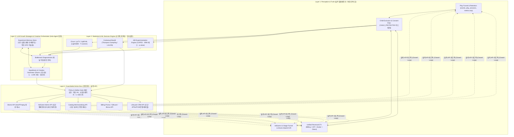
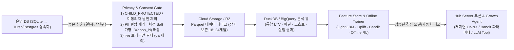

# PlayHub · PlayForge 사용자 데이터 기반 AI · 머신러닝 · 강화학습(RL) 활용 타당성 검토 및 사업 전략 기획서

> **작성 기준일**: 2026-11-22  
> **대상 브랜치**: `AI-Learning` 및 하위 3개 서브 브랜치(`AI-Learning-Growth`, `AI-Learning-Supply`, `AI-Learning-Trust`) — 기반 트렁크: `PlayHub-Platform`  
> **브랜치 분류**: **실험 기능 (Experimental · `PlayHub-Platform` 허브 통합 안함 — 독립 R&D 트랙)**  
> **문서 성격**: 현행 코드베이스 실사 기반 기술·법무 타당성 검토(Feasibility Study) + **Growth Hacker AI 에이전트** 심층 검토 + 사업 전략·수익화 마스터 플랜  
> **심화 부속 문서**: [DEEP_RESEARCH_AND_NEW_ITEMS.md](DEEP_RESEARCH_AND_NEW_ITEMS.md) (글로벌 벤치마크·2026 AI 기본법·Phase 0 DDL/API 블루프린트·신규 AI/ML/RL 사업 아이템 8선)  
> **핵심 전제**: 본 문서는 `PlayHub-Platform` 실제 코드·DB 스키마·AI/QA 파이프라인 실사 결과를 근거로 작성되었으며, 확인된 현행 자산(As-Is)과 미구현 갭(Gap)·신규 기획(To-Be)을 명확히 구분한다.

---

## 1. Executive Summary & 종합 판정

### 1.1 핵심 결론 3줄 요약

1. **사용자 데이터 기반 ML·RL 활용은 "단계적·선별적 Go(Conditional Go)"**: PlayHub·PlayForge는 **114개 SQLite 테이블**, **자체 VLM/시뮬레이션 플레이 파이프라인(`GameScaling-0.8B-S3` + 60Hz 결정론적 하네스)**, **에디터 리플레이(`playforge_replay` v4)**, **수직 통합 그로스 스택(AdGame·Shorts·L10N·Billing·Hub-Agent)**을 이미 보유하고 있어 데이터 플라이휠 잠재력이 매우 높다. 단, **현시점은 운영 SQLite 단일 노드·A/B 실험 레이어 부재·동의/DSAR 미구현 상태**이므로, 딥러닝/RL 직행 대신 **Phase 0 계측·법무 정비 → Tabular ML·Contextual Bandit → Offline RL·특화 SFT** 순서가 필수적이다.
2. **"Growth Hacker 역할 AI Agent 모델"은 '단일 파인튜닝 모델'은 No-Go, '4계층 하이브리드 에이전트'는 Strong Go**: 트래픽 초기~중기 구간에서 단일 LLM이나 End-to-End RL에 그로스 의사결정을 맡기는 것은 샘플 효율성과 매출 리스크 면에서 비현실적이다. 반면 **LLM 오케스트레이터(가설·소재 생성) + 통계/밴딧/Uplift ML 엔진(최적화·검증) + 가드레일드 실행 API(AdGame·Shorts·L10N·Billing·Catalog)**를 결합한 하이브리드 에이전트는 PlayHub의 수직 통합 구조 덕분에 **일반 게임 플랫폼 대비 압도적인 Closed-Loop 자동화 우위**를 갖는다.
3. **킬러 사업 전략 — "0% 판매 수수료 + AI Data Flywheel + Creator Growth-as-a-Service"**: Track B(창작자 직접 판매 수수료 **0%**)로 인디·UGC 창작자를 흡인하고, 확보된 플레이·퍼널·창작 데이터로 고도화한 **내부 그로스 최적화(1P Revenue Lift)**와 **창작자용 'AI 그로스 해커 에이전트'(Track A Pro 구독 + PlayCoin 소모)**를 핵심 고마진 수익원으로 전환한다.

### 1.2 도메인별 타당성 종합 매트릭스 (Go / Conditional Go / No-Go)

| # | 활용 도메인 | 적합 기법 | 현행 준비도 | 단기 ROI (0~6개월) | 중장기 해자 (6~18개월) | 법적·윤리 리스크 | 종합 판정 |
|---|---|---|---|---|---|---|---|
| **D1** | **추천 · 랭킹 · 이탈 예측 · LTV/Uplift** | Tabular ML (LightGBM/CatBoost), Contextual Bandit | 중 (퍼널·세션·결제 테이블 보유, 실험 레이어 부재) | **매우 높음** | 높음 | 중 (PIPA 자동화 결정 거부권·아동 제외) | **Strong Go (최우선)** |
| **D2** | **Growth Hacker AI 에이전트 (내부 + 창작자용 B2B2C)** | **4계층 하이브리드** (LLM + Bandit/Causal + Action API) | **중상** (AdGame·Shorts·L10N·Billing·Hub-Agent 보유) | **높음 (L0~L1)** | **매우 높음 (L2~L3 상품화)** | 중 (예산·프로모션·아동 타겟팅 차단) | **Strong Go (핵심 차별화)** |
| **D3** | **게임플레이 AI · RL · 자동 밸런싱 · MMO AI 봇** | Imitation/BC, Offline RL, Physics Oracle + VLM (`GameScaling`) | 중 (2개 게임 결정론적 하네스·오라클 보유) | 중 (`GamerQA` 자동 밸런스 리포트) | **높음** (MMO 봇필·DDA·치트 탐지) | 낮음 (플레이 패턴 비식별화 용이) | **Conditional Go (Phase 2)** |
| **D4** | **PlayForge 에디터 코파일럿 · 포팅 특화 모델** | SFT / DPO / RAG (`playforge_replay` + MCP + 포팅 로그) | 중하 (로컬 저장·프롬프트/거절 쌍 미수집) | 낮음~중 (RAG 우선) | **높음** (Godot 4.7.2·포팅 성공률 해자) | **높음** (창작자 소스·에셋 IP 저작권) | **Conditional Go (Opt-in 필수)** |
| **D5** | **외부 B2B 사용자/플레이 데이터 판매 · 라이선싱** | 익명화 데이터셋 / 합성 시뮬레이션 데이터 | 낮음 (스케일·법적 근거 부재) | **매우 낮음** | 낮음~중 (합성/옵트인 한정) | **매우 높음** (PIPA·GDPR·COPPA·창작자 반발) | **단기 No-Go** (Phase 3 합성/옵트인만 검토) |

---

## 2. 현행 플랫폼 데이터 · AI 자산 실사 (As-Is Audit)

`PlayHub-Platform` 코드베이스 실사 결과, 플랫폼은 이미 상당한 운영 데이터 스키마와 AI/리플레이 초석을 보유하고 있으나, **학습·실험·자율 실행을 위한 연결 레이어**가 비어 있는 상태다.

### 2.1 보유 데이터 자산 인벤토리 (실측 기준)

전체 영속 스키마는 **`platform.sqlite` 114개 테이블**, **`store-admin.sqlite` 3개 테이블**, **`store/Saved/store-library.json` 1개 파일**로 구성된다.

| 데이터 영역 | 주요 테이블 · 저장소 (실제 경로) | ML / RL / Growth 활용 가치 |
|---|---|---|
| **플레이 · 퍼널 텔레메트리** | `events`, `play_sessions`, `errors`, `analytics_links`, `wishlist_items`, `save_slots` (`hub/server/db.mjs`, `metrics.mjs`) | `game_impression`(가시성 50%·1초 검증) → `click` → `detail` → `play_click` → `game_ready`(로딩 P50/P90) → `active_play_10s/60s` → `round_complete`. `live`/`qa` 트래픽 분리 완료. D1/D7/D30 코호트·활성 시간 실측 가능 |
| **획득 · 플레이어블 광고 (`Hub-AdGame`)** | `ad_partners`, `ad_campaigns`, `ad_demo_sessions`, `ad_handoff_tokens`, `ad_funnel_events`, `ad_attributions` (`hub/server/adgame/schema.mjs`) | 당근·토스 등 11단계 퍼널(`impression` → `qualified_play`), 45초 데모 점수/도달 스테이지, IDFA-Free 6자리 코드·앱링크 핸드오프, 디바이스 해시 중복 방지 |
| **숏폼 발견 · 생성 (`Hub-Shorts`)** | `shorts_videos`, `shorts_likes`, `shorts_views`, `shorts_idempotency` (`hub/server/shorts/schema.mjs`) | 프롬프트·엔진(`Veo 3.1 Fast/Pro`, `FFmpeg 9:16`)·비용(20~120 PC)·조회/좋아요 데이터. 크리에이티브 성과 학습의 원천 |
| **수익화 · 과금 · 사용량 (`Hub-Billing` · `IAP` · `Avatar`)** | `billing_orders`, `billing_wallet_accounts/lots/holds/journal_*`, `billing_subscriptions`, `billing_usage_records`, `billing_giftcards`, `billing_direct_orders`, `iap_transactions`, `avatar_wallets/inventory` (`hub/server/billing/`, `iap/`, `avatar/`) | Zero-Sum 복식부기 원장, 8개 PlayCoin 티어, 채널 보너스(+25% 웹 vs 0% 모바일), Pro 구독, `ai_units`/인프라 종량제, Track B 0% 수수료 직접 판매. LTV·전환·이탈 예측의 정밀한 정답(Label) |
| **소셜 · 멀티플레이 · 진행도 (`Social` · `EOS SSOT`)** | `social_friendships`, `social_presence`, `social_parties`, `social_party_launches`, `leaderboard_*`, `player_stats`, `player_achievements`, `user_sanctions`, `datastore_entries` (`hub/server/social/`, `ssot/`) | 소셜 그래프(바이럴/파티 동반 플레이), 리더보드(안티치트 `min_play_ms`/`max_score_bound`), 업적·스탯, 제재 이력(어뷰징 탐지 레이블) |
| **AI 게이트웨이 · 창작 (`Hub-Agent` · `PlayForge` · `Store`)** | `hub_agent_usage_logs`, `hub_agent_quotas` (`hub/server/agent/`), `playforge_replay` Schema v4 (`.playforge-showcase.json`), `record-agent-mcp.cjs` (`pf_workspace_apply` JSONL), `hub_publications`, `creator_submissions`, `store_admin_packages` | AI 기능별 토큰/비용 로그, Godot 씬 편집 시퀀스(6종 액션 + 기준 `.tscn` + SHA-256 에셋 영수증), UGC 퍼블리시·검수 이력 |
| **게임플레이 VLM · 시뮬레이션 (`tools/Gamer/`)** | `inference_server.py` (`THUSI-Lab/GameScaling-0.8B-S3`), `playhub_model_qa.mjs`, `fortress_planner.mjs`, `besiege_planner.mjs` | 60Hz 가상 클록 + 시드 PRNG 기반 `(1280×800 스크린샷, 게임 상태 텔레메트리, 200ms 6-substep 액션 청크)` JSONL 궤적 수집 및 물리 오라클 티처 정책 이미 동작 |
| **프라이버시 · 안전 컴플라이언스** | `hub/tools/sanitize-snapshot.mjs`(114개 테이블 Fail-Closed 허용목록·HMAC-SHA256 가명화), `hub/server/mobile/age-gate.mjs`(`user_age_compliance`: KR <14 / COPPA <13 / GDPR-K <16), `billing/compliance.mjs`(연령별 결제 한도), `app.mjs` 이벤트 PII 키 정규식 차단 | 아동 보호(`CHILD_PROTECTED`, `disablePersonalizedAds: true`), 가명화 원칙, IDFA-Free 어트리뷰션 등 규제 대응의 우수한 기초 확보 |

### 2.2 AI/ML 및 Growth Agent 도입을 가로막는 7대 핵심 갭 (Verified Gaps)

1. **학습·피처·분석 인프라 전무**: 현재 저장소 내 ML/RL 학습 스크립트(PyTorch/LightGBM/Bandit/Offline RL), 피처 스토어, 분석용 데이터 웨어하우스(ETL)가 없다. 운영 DB는 단일 SQLite(`platform.sqlite`, Cloud Run에서는 영속 DB 이전 전 `/tmp` 임시 경로)이며, `sanitize-snapshot.mjs`는 개발 복제용으로 `billing_*`, `hub_agent_usage_logs`, `ad_attributions`, `shorts_views`를 **전면 삭제(DROP)**하고 `events`를 **최근 7일만 보존**하므로 장기 LTV/이탈/그로스 학습용으로 그대로 쓸 수 없다.
2. **A/B 실험 · 피처 플래그 · 밴딧 배정 레이어 부재**: `hub/server/app.mjs`의 `EVENT_KEYS`에 `placement_id`, `creative_id`, `slot_index`가 정의되어 있으나 인덱스 컬럼 저장·프론트엔드 전송·실험 할당 테이블(`experiments`, `experiment_assignments`)이 전혀 없다.
3. **핵심 미세 행동 텔레메트리 공백**:
   - **Godot 런타임 SDK**(`godot-sdk/playhub_runtime_sdk.gd`): 프로필·세이브·결제만 있고 **게임 내 행동 이벤트·리더보드/스탯 송신·셰이더 텔레메트리 훅 부재**.
   - **Hub-Shorts**: 일 단위 중복 제거 조회/좋아요만 기록 — **시청 시간, 완주율, 이탈 시점, 쇼츠→게임 플레이 전환 귀속 부재**.
   - **Asset Store**(`store/server/store-api.mjs`): 검색어·필터·클릭·설치 퍼널 로그 전무, 사용자 라이브러리가 `store-library.json` 평문 파일로 분리.
   - **멀티플레이**(`ugc-multiplayer.mjs`): 인메모리 WebSocket 방만 존재 — 매치 길이·대기 시간·동접(CCU)·파티 매칭 이력 미저장.
   - **창작자 AI 로그**: `hub_agent_usage_logs`는 토큰 수만 저장(프롬프트/응답/수락·거절 여부 미저장), `chat_sessions.gd`는 로컬 프로젝트 전용, `record-agent-mcp.cjs`는 성공한 `pf_workspace_apply`만 기록(DPO용 실패/수정 쌍 부재).
   - **획득/추천 귀속**: AdGame 외 일반 웹/모바일 유입의 `utm_*`, `referrer`, 사용자 간 `invite_code`/`referral` 컬럼 부재.
4. **Growth Agent 실행 API(Actuator) 누락**:
   - `Hub-AdGame`에 캠페인 생성/수정/일시정지·보상 변경용 **Admin CRUD API 없음**.
   - `GET /api/games`는 정적 `catalog.json` + 최신 UGC 순 정렬 — **동적 랭킹·개인화 추천·피처드/배너 CMS API 없음**.
   - 푸시 알림: `hub/server/mobile/apns.mjs`는 작성만 되고 `app.mjs`에 **미연결(0 import)**, FCM(Android)·디바이스 토큰 테이블·이메일/인앱 CRM 스케줄러 전무.
   - `billing/policy.mjs`의 `upsertBonusRule()`은 HTTP Admin 라우트 미노출, Pro 무료 체험 쿠폰 엔진 부재.
5. **플레이 시뮬레이션 환경 커버리지 협소**: `playhub_model_qa.mjs`가 `fortress-blue`, `besiege` 2종 웹 게임의 DOM 상태 훅에 하드코딩되어 있으며 범용 Gym/Env 인터페이스나 Godot 헤드리스 RL 롤아웃 러너가 없다.
6. **수익화 원장 분석 뷰 파편화**: `billing_wallet_*`, `avatar_wallets`, `player_wallet_*` 3종 지갑이 분리되어 통합 ARPU/LTV 및 채널별 ROAS 산출 뷰가 없다.
7. **AI 학습·개인화 전용 동의(Consent) 및 삭제권(DSAR) 공백**: 아동 연령 게이트는 견고하나, 일반 사용자 대상 **목적별 세분화 동의(`analytics` / `personalization` / `ai_training` / `marketing_push`)** 테이블, **계정 삭제/잊혀질 권리 API(DSAR)**, 분석 파이프라인 내 **`CHILD_PROTECTED` 자동 배제 필터**가 미구현 상태다.

---

## 3. 사용자 데이터 기반 ML · 강화학습(RL) 활용 5대 도메인 심층 검토

### 3.1 Domain 1: 개인화 추천 · 랭킹 · 이탈 예측 · LTV/Uplift 모델링 — **[Strong Go / 최우선]**

- **활용 데이터**: `events`(노출·클릭·플레이·에러), `play_sessions`(활성 시간·로딩 지연), `wishlist_items`, `shorts_videos`/`views`/`likes`, `billing_orders`/`subscriptions`, `social_friendships`/`parties`, `user_preferences.locale`
- **핵심 모델링 과제**:
  1. **게임·쇼츠 개인화 랭킹 (Two-Tower Retrieval + LightGBM/CatBoost Re-ranker + Contextual Bandit)**:
     - 현행 정적 카탈로그 + 최신순 UGC를 대체. 신규 UGC 게임의 콜드스타트 문제를 **Thompson Sampling / LinUCB** 탐색 보너스로 해결하여 창작자 생태계 활력 증대.
     - 단순 클릭률(CTR)이 아닌 **`P(active_play_60s) × Expected_D7_Retention`** 다목적 점수로 최적화하여 낚시성 썸네일(Goodhart's Law) 방지.
  2. **이탈 예측(Churn) & Uplift 모델링 (T-Learner / Causal Forest)**:
     - "이탈할 유저"가 아니라 **"프로모션 PlayCoin이나 복귀 알림을 주면 실제로 돌아올 유저(Persuadables)"**만 선별 타겟팅. 어차피 돌아올 유저(Sure Things)에게 불필요한 프로모션 PlayCoin을 뿌리는 비용 누수를 40~60% 절감.
  3. **로딩/품질 기반 이탈 경보 & PlayCoin 전환 예측 (pLTV)**:
     - `game_ready` P90 지연과 `runtime_error`가 D1 이탈에 미치는 인과적 영향을 정량화해 QA 우선순위(`GamerQA/core/popularity.mjs`)에 자동 반영.
     - AdGame 45초 데모 행동(`play_ms`, `best_score`, `stage_reached`)으로 초기 pLTV를 예측해 당근/토스 파트너별 CPA 입찰·보상 상한을 최적화.
- **필요 데이터 규모**: 일 활성 플레이 세션 **500~2,000건 이상**이면 GBDT(LightGBM)·LinUCB로 즉시 유의미한 성능 달성 가능(딥러닝 불필요).

### 3.2 Domain 2: Growth Hacker AI 에이전트 — **[Strong Go / 4장 심층 설계]**

- 단순 예측을 넘어 **진단 → 가설 → 크리에이티브 생성(Shorts/L10N/AdGame) → A/B 실험 → 승격/롤백**을 수행하는 에이전트. 상세 실현 가능성과 4계층 아키텍처는 **제4장**에서 별도 분석한다.

### 3.3 Domain 3: 게임플레이 AI · 강화학습(RL) · 자동 밸런싱 · MMO 봇 — **[Conditional Go / Phase 2]**

- **현행 강점**: `tools/Gamer/playhub_model_qa.mjs` + `GameScaling-0.8B-S3` + `fortress_planner.mjs`/`besiege_planner.mjs`가 이미 60Hz 결정론적 `(화면, 텔레메트리, 액션)` 궤적을 생성한다.
- **현실적 활용 3대 축 (높은 ROI 순)**:
  1. **AI 플레이테스트 & 자동 밸런스 리포트 (`GamerQA` 확장)**:
     - 온라인 유저의 실플레이 궤적(비식별화된 입력·사망 지점·클리어 시간·점수 분포) + 합성 봇 롤아웃(Behavioral Cloning → Offline RL/PPO)을 결합해 **스테이지 난이도 절벽, 버그/소프트락, 밸런스 붕괴 무기/파츠**를 자동 검출.
     - **사업화**: 창작자가 UGC 게임을 제출할 때 PlayCoin으로 **"AI 1,000판 밸런스·QA 스트레스 테스트"**를 구매하는 유료 상품으로 직결.
  2. **MMO/멀티플레이 콜드스타트 해결용 인간형 AI 봇 (Imitation Learning / Behavior Cloning)**:
     - `Forge-Games-captainMMO`, `tappy-chicken-mmo`, `brawllabs`, `fortress-war` 등 멀티플레이 템플릿의 최대 약점은 초기 동접 부족(빈 방 이탈).
     - 실제 플레이어 궤적에서 비식별 행동 복제(BC)로 학습한 **난이도별 인간형 동반 봇(Bot-fill)**을 자동 투입하면 초기 매칭 대기 시간을 5초 이내로 단축해 D1/D7 리텐션을 구조적으로 방어 가능. (단, 봇임을 투명하게 표시하거나 랭킹 분리 정책 필수.)
  3. **안티치트 이상 행동 탐지 (Anomaly Detection)**:
     - 현행 `ssot/leaderboard.mjs`의 정적 규칙(`min_play_ms`, `max_score_bound`)은 정교한 매크로/메모리 변조에 취약. 정상 플레이어 입력 리듬·점수 증가 곡선 분포를 학습한 Isolation Forest / Autoencoder로 자동 제재 후보를 `user_sanctions`에 플래깅.
- **주의점 (현실적 제약)**:
  - 범용 픽셀-투-액션 Online RL(시각 입력만으로 수십 종 UGC 게임을 직접 학습)은 GPU 비용이 막대하다. 따라서 **Godot 런타임 SDK(`playhub_runtime_sdk.gd`)에 경량 구조화 관측/보상 인터페이스(State Vector Export)**를 먼저 추가해, 저비용 State-based BC/Offline RL(CPU/단일 GPU 학습 가능) 중심으로 접근해야 한다.

### 3.4 Domain 4: PlayForge 창작 코파일럿 · 에디터 액션 모델링 — **[Conditional Go / Opt-in 필수]**

- **활용 데이터**: `playforge_replay` Schema v4 타임라인(`add`/`set`/`delete`/`rename`), `record-agent-mcp.cjs`의 `pf_workspace_apply` JSONL, Roblox/Unity/Unreal 포팅 변환 성공/실패 로그(`tools/{Roblox,Unity}Converter`), `Hub-Agent` 대화·도구 호출 결과(수락 vs Undo/수정).
- **기술 전략**:
  1. **1단계 (무학습 · 즉시 효과)**: 자체 제작 템플릿·성공한 포팅 레시피·Godot 4.7.2 API 오류 수정 패턴을 **벡터/그래프 RAG + Few-shot 프롬프트 라이브러리**로 구축. 외부 사용자 코드 학습 없이 즉시 `Hub-Agent` 성공률 향상.
  2. **2단계 (명시적 Opt-in 기반 SFT/DPO)**: 창작자가 **"AI 품질 개선 데이터 제공 동의 (대신 AI 무료 토큰 보너스 지급)"**에 명시적으로 체크한 세션에 한해, `(에디터 씬 스냅샷, 사용자 요청, pf_workspace_apply JSON, 실행 성공/에러/Undo 여부)`를 수집하여 경량 오픈웨이트 모델(예: Qwen/Gemma 7B~14B LoRA)을 **Godot 4.7.2 + PlayForge 전용 툴콜링 어댑터**로 파인튜닝.
  3. **핵심 기대 효과**: 외부 상용 LLM(Gemini/Claude) 토큰 원가(COGS)를 50~70% 절감하고, 로컬 Ollama(`forge/Tools/local-ollama.cjs`) 및 저지연 자동완성 품질을 압도적으로 개선.
- **절대 원칙**: **창작자 비공개 프로젝트 소스·에셋을 기본값(Opt-out)으로 학습에 사용하면 신뢰가 즉시 붕괴한다.** 반드시 **명시적 Opt-in + 인센티브(PlayCoin/토큰 리워드) + 1P 내부 템플릿/합성 데이터 우선 학습** 원칙을 고수해야 한다.

### 3.5 Domain 5: 외부 B2B 데이터셋 라이선싱 / 월드모델 학습 데이터 판매 — **[단기 No-Go]**

- **냉정한 현실 검증**:
  - **규모 미달**: 대형 AI 연구소(월드모델·로보틱스·에이전트 기업)가 고가에 구매하는 데이터는 수백만 시간 이상의 고해상도 멀티모달·물리 인터랙션 데이터다. 초기 플랫폼 트래픽 규모로는 단가 협상력이 없다.
  - **법적·평판 리스크 폭증**: 개인정보보호법 제3자 제공 동의, 미성년자 데이터 혼입 리스크, UGC 창작자 저작권 분쟁으로 플랫폼 본업(창작자·유저 신뢰)이 치명타를 입을 수 있다.
- **전략적 판단**:
  - **Phase 0~2**: **명시적 No-Go** ("사용자·창작자 데이터를 제3자에게 판매하지 않는다"는 신뢰 정책을 오히려 경쟁 우위 마케팅 포인트로 활용).
  - **Phase 3 (조건부 재검토)**: 플랫폼이 대규모 트래픽과 수천 종의 결정론적 Godot 3D 시뮬레이션 환경을 확보한 뒤, **PII가 원천 존재하지 않는 100% 합성 AI-플레이 궤적** 또는 **수익 배분 계약(Data Royalty)에 명시적 동의한 창작자 코호트**에 한해 제한적으로 연구/B2B 파트너십을 검토.

---

## 4. 심층 검토: Growth Hacker 역할 AI Agent 모델 가능할까?

### 4.1 최종 판정: **가능하다 — 단, "단일 파인튜닝 모델"이 아니라 "4계층 하이브리드 에이전트"로 설계해야 한다**

| 접근 방식 | 개념 | PlayHub 적용 시 평가 | 판정 |
|---|---|---|---|
| **방식 A: 단일 End-to-End 파인튜닝 모델 / Direct Deep RL** | 사용자 로그를 직접 먹여 "그로스 액션"을 출력하는 단일 LLM 또는 Deep RL 정책 학습 | ① 초기 트래픽에서 학습 데이터·실험 횟수 절대 부족 ② 인과관계와 상관관계 혼동(할인 뿌리면 단기 전환은 오르나 수익성 붕괴) ③ 환각·폭주 시 예산·브랜드 치명타 | **No-Go** |
| **방식 B: 4계층 하이브리드 Growth Hacker Agent** | **LLM 전략가·크리에이티브 생성기** + **통계/인과추론/밴딧/Uplift ML 엔진** + **실험 메모리(RAG)** + **예산·안전 가드레일드 Action API** | ① 소규모 데이터에서도 수학적으로 검증된 최적화 ② PlayHub의 AdGame·Shorts·L10N·Billing·Hub-Agent와 즉시 결합 ③ 단계적 자율성(L0→L3)으로 안전하게 확장 ④ **창작자용 유료 SaaS 상품(L3)**으로 직접 수익화 가능 | **Strong Go** |

### 4.2 왜 PlayHub · PlayForge는 Growth Hacker Agent에 유독 유리한가?

일반 모바일 게임사나 웹 플랫폼은 **소재 제작(외주/디자이너) → 광고 집행(Meta/Google 블랙박스) → 스토어 페이지(Apple/Google 제약) → 인게임(별도 빌드 배포)**가 4개 조직과 4개 외부 시스템으로 단절되어 있어 에이전트가 자동화할 수 있는 범위가 좁다.

반면 PlayHub는 **단일 코드베이스 안에 5대 그로스 레버가 수직 통합**되어 있다:
1. **초경량 Playable Ad 엔진 (`Hub-AdGame`)**: 당근/토스 유입 11단계 퍼널 + IDFA-Free 핸드오프 + 스타터 보상 제어 가능.
2. **9:16 숏폼 자동 제작 파이프라인 (`Hub-Shorts`)**: 게임 메타데이터·스크린샷만으로 스토리보드 작성 → Veo 3.1 / FFmpeg 9:16 영상 렌더링 → 피드 게시까지 API 1회 호출로 완결.
3. **8개 언어 AI 로컬라이제이션 (`L10N`)**: 게임 제목·설명·배너·프로모션 카피를 8개 언어(`ko/en/ja/zh-CN/fr/es/pt-BR/hi`)로 즉시 다변량(A/B) 생성 가능.
4. **즉시 플레이 검증 텔레메트리 (`events` + `metrics.mjs`)**: 앱 설치 없이 웹/앱에서 노출→로딩→10초/60초 활성 플레이→D1/D7/D30 리텐션까지 실시간 검증.
5. **제로섬 원장 기반 인센티브 API (`Hub-Billing`)**: 만료 기한이 있는 프로모션 PlayCoin 지급(`/api/admin/billing/wallets/:id/promo`)과 캠페인 기프트카드 일괄 발행(`/api/admin/billing/giftcards/batches`)이 이미 멱등성·원장 정합성과 함께 구현 완료.

즉, PlayHub는 **"가설 수립 → 소재/카피/보상 생성 → 트래픽 배분 → 실시간 플레이·매출 인과 검증 → 자동 승격/롤백"**의 완전한 폐쇄 루프(Closed-Loop)를 자체 인프라 안에서 돌릴 수 있는 드문 플랫폼이다.

### 4.3 4계층 하이브리드 Growth Hacker Agent 아키텍처

### 4.4 자율성 4단계 성숙도 모델 (Autonomy Ladder: L0 → L3)

| 단계 | 명칭 | 에이전트 권한 및 동작 방식 | 필요 신규 개발 | 목표 시점 |
|---|---|---|---|---|
| **L0** | **Growth Analyst Copilot** | 매일/매주 퍼널·코호트·AdGame·Shorts·과금 지표를 스캔해 이상 징후(예: 특정 게임 로딩 P90 급등 → D1 -12%p)와 **근거 기반 실험 제안서(ICE 스코어 포함)**를 Admin 대시보드에 자동 리포트. 직접 실행 권한 없음 | 통합 분석 뷰 + `Hub-Agent` 스케줄 분석 잡 + Admin 리포트 탭 | **Phase 1 (1~2개월)** |
| **L1** | **Creative & Experiment Draftsman** | 승인 대기 상태로 **9:16 쇼츠 변형 3종, 8개국어 타이틀/설명 A/B안, 타겟 기프트카드/프로모션 초안**을 자동 생성해 큐에 등록. 운영자가 Admin에서 **1-클릭 승인**하면 A/B 실험 시작 | Experimentation/Flag 엔진 + Admin 승인 큐 UI + `Hub-Shorts`/L10N 오케스트레이션 | **Phase 1~2 (2~4개월)** |
| **L2** | **Bounded Autonomous Optimizer** | 사전 승인된 가드레일(예: 일 프로모 예산 상한 ₩500,000, 할인율 ≤25%, `CHILD_PROTECTED` 완전 제외, 트래픽 20% 이내 탐색) 안에서 **홈 슬롯 랭킹·쇼츠 피드·AdGame 소재·이탈 Uplift 오퍼**를 Contextual Bandit으로 자율 최적화. 가드레일 지표 하락 시 자동 롤백 | AdGame Admin API + Catalog Ranking API + APNs/FCM CRM + Circuit Breaker | **Phase 2 (4~6개월)** |
| **L3** | **Creator Growth Hacker Agent (B2B2C 상품)** | **PlayHub 창작자 대시보드에 내장된 전담 AI 그로스 매니저**. 창작자가 예산(PlayCoin)과 목표(플레이 수/D7/수익)를 설정하면 에이전트가 자기 게임의 퍼널 진단 → 쇼츠 자동 생성 → AdGame 45초 데모 프로모션 → 다국어 스토어 최적화 → 주간 성과 리포트를 반자율 수행 | Creator Growth Studio UI + PlayCoin 과금 연동 + 테넌트 격리 정책 + 실험 메모리 기반 도메인 어댑터(LoRA/DPO) | **Phase 3 (7~12개월)** |

### 4.5 PlayHub Growth Hacker Agent 핵심 실행 시나리오 4선

1. **시나리오 ① — 당근·토스 `Hub-AdGame` 45초 데모→설치 퍼널 자동 최적화**
   - **관측**: `ad_funnel_events`에서 `demo_complete → cta_click` 전환율이 목표(15%) 대비 9%로 저조.
   - **가설 & 실행**: 에이전트가 데모 종료 타이밍(35초 vs 45초), 스타터 보상 문구(8개 언어/한국어 톤앤매너), 보상 유형(아바타 스킨 vs 소액 프로모 PlayCoin) 변형 3종을 생성해 AdGame Admin API로 A/B 투입.
   - **검증**: `qualified_play`(`playMs >= 5000`) 및 D7 리텐션 기준 승자 자동 선정, CPA 단가 20~35% 절감.
2. **시나리오 ② — 신규 UGC 게임 콜드스타트 자동 부스팅 (Shorts + Catalog Bandit)**
   - **관측**: 신규 퍼블리시 게임이 `GamerQA` 통과 + 초기 50세션에서 `active_play_60s` 비율 상위 15% 기록(숨은 흙속의 진주).
   - **가설 & 실행**: 에이전트가 게임 플레이 캡처·메타데이터로 `Hub-Shorts` 9:16 트레일러 2종(FFmpeg 20 PC / Veo Fast 60 PC)을 자동 생성하고, 홈/쇼츠 피드 탐색 슬롯(Bandit 10% 할당)에 자동 배치.
   - **검증**: 쇼츠 완주율 × 60초 플레이 전환율이 임계치를 넘으면 메인 추천 풀로 자동 승격.
3. **시나리오 ③ — 이탈 위험 고가치 유저 Uplift 복귀 캠페인**
   - **관측**: 최근 7일 내 3회 이상 플레이했으나 72시간 미접속 + Uplift 모델 점수 상위 20%인 **성인·마케팅 수신 동의 유저** 탐지.
   - **가설 & 실행**: 마지막 플레이 게임의 새 리더보드 기록/친구 접속 소식과 함께 **7일 만료 소액 프로모 PlayCoin** 또는 **파티 초대 링크**를 개인화 푸시(APNs/FCM)/인앱으로 발송(주 최대 2회 빈도 제한).
   - **검증**: 대조군(Holdout 10%) 대비 순증(Incremental) 복귀율 및 순매출(프로모션 원가 차감 후)이 양수일 때만 정책 유지.
4. **시나리오 ④ — 인디 창작자용 "원클릭 AI 그로스 매니저" (L3 수익화 킬러)**
   - **관측**: 창작자 게임의 `game_ready` P90가 6.8초로 평균(2.1초) 대비 3배 느리고, `play_click → active_play_10s` 구간에서 62% 이탈.
   - **가설 & 실행**: 에이전트가 먼저 **"광고 태우기 전 에셋/로딩 최적화 권고"**를 제시(무의미한 UA 낭비 방지) → 로딩 개선 확인 후 → 다국어 설명 개선 + 9:16 쇼츠 자동 생성 + AdGame 파일럿 캠페인 자동 세팅을 창작자 PlayCoin으로 집행.

### 4.6 필수 안전장치 (Guardrails & Circuit Breakers)

Growth Agent가 단기 지표만 쫓다 플랫폼 신뢰·수익성을 해치는 사고를 원천 차단하기 위해 **코드 레벨 하드 가드레일**을 의무화한다:

1. **아동·미성년자 하드 차단 (`CHILD_PROTECTED` / `TEEN_MINOR`)**: `user_age_compliance.age_tier !== 'ADULT'` 계정은 개인화 프로모션·과금 유도·AI 학습·행동 타겟팅에서 **DB 쿼리 단계부터 물리적 제외**.
2. **예산·인센티브 하드 캡**: 일/주 단위 프로모션 PlayCoin 발행 한도, 캠페인당 최대 보너스율(웹 ≤25%, 모바일 IAP 엄격히 0%), 유저당 월 수령 횟수 상한을 `Hub-Billing` 원장 레이어에서 강제.
3. **다중 가드레일 지표 & 자동 서킷브레이커**: 실험 중 `runtime_error`율 +0.5%p 상승, `game_ready` P90 +300ms 악화, 신고(`community_reports`/`social_reports`) 급증, 또는 환불/이탈률 상승 감지 시 **사람 개입 없이 5분 내 실험 자동 중단 및 기본값 롤백**.
4. **통계적 무결성 강제**: 표본 비율 불일치(SRM, Sample Ratio Mismatch) 감지, 최소 표본 크기 및 최소 기간(최소 7일, 요일 효과 제거) 미충족 시 조기 승격(Peeking) 차단.
5. **완전 감사 로그 (`growth_agent_audit`)**: 에이전트의 모든 관측 데이터 스냅샷, 프롬프트/근거, 승인자, 실행 API 호출, 사후 실측 결과를 불변 로그로 저장.

---

## 5. 데이터 파이프라인 · 프라이버시 · 법적 컴플라이언스 전략

### 5.1 핵심 규제 요건 및 PlayHub 대응 매핑

| 법령 · 플랫폼 정책 | 핵심 의무 사항 | PlayHub 현행 상태 | 필수 선행 구현 (Phase 0) |
|---|---|---|---|
| **한국 개인정보보호법 (PIPA)** | ① 수집·이용 목적 명시 및 **AI 학습·개인화 별도 동의** ② **가명정보** 처리 시 안전조치·추가정보 분리 보관 ③ **제37조의2(자동화된 결정에 대한 거부권 및 설명요구권)**: AI 추천·프로모션·제재에 대한 거부·설명·재검토 경로 제공 ④ **만 14세 미만** 법정대리인 동의 필수 ⑤ 국외 이전(Gemini API/Cloud Run 해외 리전 등) 고지·동의 | `age-gate.mjs`(<14), `sanitize-snapshot.mjs`(HMAC 가명화), `events` PII 키 차단 보유 | ① `user_consents` 세분화 동의 테이블 + UI ② 설정 화면 내 **"개인화 추천·AI 자동 결정 끄기(비개인화 인기순 전환)"** 토글 및 설명 문구 ③ 가명처리 키 분리 보관(KMS/Secret Manager) ④ 처리방침 국외이전·수탁자 명시 |
| **미국 COPPA (<13) · EU GDPR / GDPR-K (<16)** | ① 아동 행동 프로파일링·맞춤형 광고·AI 학습 전면 금지 ② **GDPR Art. 22** 자동화 의사결정 제한 ③ **삭제권(Right to Erasure / DSAR)** 및 데이터 이동권 ④ 합법적 근거(Consent vs Legitimate Interest) 구분 | `age-gate.mjs`(COPPA <13, GDPR-K <16, `disablePersonalizedAds: true`) 구현됨. **DSAR 삭제 API 미구현** | ① `DELETE /api/account` (및 모바일 DSAR) 영구 삭제·익명화 워크플로우 구현 ② ML/분석 파이프라인 `age_tier = 'ADULT'` 화이트리스트 강제 ③ EU/미국 리전 동의 배너 분기 |
| **한국 AI 기본법 · EU AI Act** | ① 생성형 AI 산출물(쇼츠 영상·AI 채팅·AI 봇) **AI 생성/상호작용 고지 및 표시 의무** ② 위험 기반 거버넌스(신용·고용·생체 등 고위험 영역 회피, 추천·게임 AI는 투명성 의무 준수) | `Hub-Agent`·`Hub-Shorts` 표시 부분 적용 | ① AI 생성 쇼츠·AI 그로스 카피·MMO AI 봇에 표준 메타데이터/UI 배지("AI 생성" / "AI Bot") 일관 표기 ② 고위험 프로파일링(민감정보 추론·감정 인식·아동 취약성 악용) 영구 금지 정책 명문화 |
| **Apple App Store / Google Play 정책** | ① iOS 5.1.1(v) 앱 내 계정 삭제 의무 ② IDFA 추적 시 ATT 필수 ③ 모바일 IAP 외 외부 결제 보너스 안내 제한 | AdGame은 **IDFA/ATT-Free** 설계 완료, 모바일 IAP 보너스 0% 준수 | ① iOS/Android 앱 내 계정 삭제 API 완성 ② Growth Agent의 모바일 푸시/인앱 오퍼가 스토어 외 결제 유도로 위반되지 않도록 **채널 컴플라이언스 룰 엔진** 내장 |
| **창작자 저작권 · UGC IP** | 창작자의 Godot 씬·스크립트·에셋·프롬프트를 플랫폼 모델 학습에 무단 사용 시 저작권 침해 및 생태계 이탈 | `playforge_replay`·`chat_sessions.gd` 로컬 보관, `hub_agent_usage_logs` 본문 미저장 | ① **UGC 코드/에셋/프롬프트 AI 학습은 기본값 OFF (명시적 Opt-in)** ② 동의 창작자에게 PlayCoin/토큰 보너스 또는 크레딧 리워드 제공 ③ 언제든 Opt-out 시 차기 학습 데이터셋에서 제외 |

### 5.2 운영 DB와 분리된 ML-Safe 분석 파이프라인 설계

현행 `hub/tools/sanitize-snapshot.mjs`는 **Live → Dev 환경 복제**가 목적이므로 과금·AI 로그·어트리뷰션을 삭제하고 이벤트를 7일로 잘라낸다. 따라서 ML·그로스 분석을 위해서는 **별도의 비식별 분석 파이프라인(Analytics & ML Lakehouse)**을 구축해야 한다:

- **핵심 설계 원칙**:
  - **초기 저비용 스택**: 초기 트래픽(MAU < 50만)에서는 고가 상용 데이터 브릭스 대신 **Cloudflare R2(이미 `PlayHub-CDN`에 구축) + Parquet + DuckDB(또는 BigQuery Free/On-Demand)** 조합으로 월 인프라 비용 \$50~200 이내 운영.
  - **추론 경량화**: 추천/이탈/밴딧 추론은 Node.js 서버 내 **ONNX Runtime(`onnxruntime-node`) 또는 경량 스코어링 함수**로 처리해 별도 상시 GPU 서버 없이 밀리초(ms) 응답 달성.

---

## 6. 사업 전략 · 수익 모델 · 유닛 이코노믹스

### 6.1 경쟁 포지셔닝: "0% 창작자 수수료 + AI Data Flywheel"

기존 글로벌 UGC/게임 플랫폼(Roblox 약 70%+ 실질 플랫폼 테이크, Steam 30%, Apple/Google 30%)은 **거래 수수료**로 수익을 올리기 때문에 창작자와의 이해관계가 충돌한다. PlayHub·PlayForge는 이미 **Track B 창작자 직접 판매 수수료 0%**를 선언했다. 여기에 사용자 데이터 기반 AI/그로스 엔진을 결합하면 경쟁사가 복제하기 어려운 **이중 플라이휠(Dual Flywheel)**이 형성된다:

1. **공급 측 플라이휠**: 0% 수수료 + AI 제작(`Hub-Agent` + `PlayForge` 포팅) + **AI 그로스 매니저(L3)** + **AI QA/밸런싱(`GamerQA`)** → 인디/UGC 창작자 유입 폭증 & 게임 완성도 상승.
2. **수요 측 플라이휠**: 더 좋은 게임 + **개인화 추천/쇼츠 피드(D1)** + **최적화된 AdGame UA(L2)** + **MMO AI 동반 봇(D3)** → 플레이어 획득 단가(CAC) 하락, D7/D30 리텐션 상승, Track A PlayCoin(+25% 웹 보너스) · Pro 구독 매출 확대.
3. **데이터 복리 효과**: 더 많은 플레이·실험·창작 데이터(옵트인) → 추천·그로스 에이전트·QA 정확도 상승 → 신규 경쟁사의 진입 장벽(Data & Experiment Moat) 강화.

### 6.2 4대 수익화 축 및 유닛 이코노믹스

| 수익화 축 | 과금 방식 (현행 `Hub-Billing` 연계) | 목표 매출원가(COGS) & 매출총이익률(GM) | 기대 사업 효과 |
|---|---|---|---|
| **① 1P 플랫폼 그로스 리프트 (간접 매출)** | 내부 추천·AdGame·이탈 Uplift 최적화를 통한 PlayCoin 충전·Pro 전환·AdGame RevShare 증대 | 분석/추론 인프라 월 \$200~1,500 (초기~성장기) | AdGame 유효 CPA **20~35% 절감**, 홈→플레이 전환율 **+15~30%**, D7 리텐션 **+3~6%p**, 프로모션 낭비 **40%+ 절감** |
| **② Creator Growth Hacker Agent (Track A 핵심 신규 상품)** | **Pro 구독 포함**(L0 주간 퍼널/이탈 AI 진단 무료 제공) + **실행 액션 PlayCoin 종량 과금**: - 쇼츠 9:16 자동 제작: 20 PC(FFmpeg) / 60~120 PC(Veo) - 8개국어 스토어 A/B 카피 생성: 10~20 PC - AdGame 데모 캠페인 자동 최적화·부스팅: 집행비 + 관리 수수료(또는 PlayCoin 패키지) | LLM 토큰 + Veo 렌더 실비 대비 **GM 55~70%** (`Hub-Agent` 기존 `2,000 weighted tokens = 1 PC` 원장 재사용) | 창작자 1인당 월 PlayCoin 소비(ARPC) **2~3배 확대**, Pro 구독 전환·유지율(Net Dollar Retention) 대폭 상승 |
| **③ AI 플레이테스트 · 밸런스 · MMO 봇 SaaS (`GamerQA` + RL)** | - **AI 1,000판 밸런스·소프트락 리포트**: 게임 빌드당 100~300 PlayCoin - **MMO 지능형 AI 동반 봇(Bot-fill)**: `billing_usage_records`의 `server_minutes`/`ai_units` 종량 과금 | CPU/경량 State-RL 추론 원가 낮음 (**GM 65~75%**) | 출시 전 치명적 밸런스 결함 제거 + 초기 멀티플레이 방 이탈 방지 → 플랫폼 전체 게임 품질·리텐션 동반 상승 |
| **④ 중장기 합성/옵트인 데이터 파트너십 (Phase 3 조건부)** | 100% 합성 AI 시뮬레이션 궤적 또는 명시적 Opt-in 창작자 데이터셋 라이선싱 (창작자 50%+ 수익 배분) | 파트너십 성사 시 고마진 | 본업 훼손 없는 보조 수익원 (단, Phase 0~2에서는 사업 계획 매출에 **0원**으로 보수 반영) |

### 6.3 단계별 투자 비용 vs 기대 임팩트 (12개월 보수적 시나리오)

| 단계 | 기간 | 추가 인력/리소스 | 월 추정 클라우드·AI 인프라 | 핵심 비즈니스 목표 KPI |
|---|---|---|---|---|
| **Phase 0** (기반·법무) | M1 | 백엔드 1 + 데이터/ML 1 (겸임 가능) | \$100 ~ \$300 | Consent/DSAR 100% 준수, 핵심 텔레메트리 누락 0건, R2+Parquet 일간 ETL 가동 |
| **Phase 1** (실험·L0/L1·ML 1차) | M2~M3 | + 프론트/Admin 0.5 | \$300 ~ \$800 | A/B 실험 엔진 가동, 홈 CTR/60초 플레이율 **+10~15%**, Growth Agent L0 주간 리포트·L1 쇼츠/카피 초안 가동 |
| **Phase 2** (L2 Bandit·RL 파일럿) | M4~M6 | ML/RL 엔지니어 1 추가 | \$800 ~ \$2,500 | AdGame 유효 CPA **-20%**, D7 리텐션 **+3%p**, Creator Growth Agent Beta 30개 게임 파일럿, `GamerQA` 밸런스 리포트 5종 검증 |
| **Phase 3** (L3 상품화·특화 모델) | M7~M12 | 운영 규모에 따라 탄력 증원 | \$2,000 ~ \$6,000 (매출 연동) | Creator Growth Agent 유료 전환율(Pro 창작자 중) **≥20%**, MMO AI 봇 3종 템플릿 적용, Opt-in PlayForge 어댑터로 LLM COGS **-40%** |

---

## 7. 단계별 실행 로드맵 (Phase 0 ~ Phase 3) 및 정량적 Go/Kill 게이트

### Phase 0 (1개월): 데이터 신뢰성 · 법무 컴플라이언스 · 계측 기반 완성
- **법무·프라이버시**:
  - `user_consents` 테이블 및 UI 구현(`analytics`, `personalization`, `ai_training`, `marketing_push` 분리 동의 + PIPA 제37조의2 자동화 결정 거부 토글).
  - 계정 삭제/DSAR 엔드포인트(`DELETE /api/account`) 구현 및 `CHILD_PROTECTED` 자동 격리 SQL 뷰 구축.
- **텔레메트리 갭 해소**:
  - `events`에 `placement_id`, `creative_id`, `slot_index`, `experiment_id`, `variant_id`, `utm_source/campaign`, `invite_code` 영속 컬럼 추가.
  - `Hub-Shorts`에 `watch_ms`, `duration_ms`, `completed`, `play_clicked` 이벤트 추가.
  - `godot-sdk/playhub_runtime_sdk.gd`에 표준 게임플레이 텔레메트리·리더보드/스탯 송신 메서드 추가.
  - `store/server/store-api.mjs` 검색·클릭·설치 이벤트 로깅 및 `store-library` SQLite 통합.
  - Cloud Run 영속 DB 전환(Turso/Postgres) 완료 및 **R2 Parquet 비식별 증분 ETL(DuckDB 분석 뷰)** 구축.
- **Phase 0 → 1 통과 게이트**: ① `npm run gate` 통과 + DSAR/아동 격리 자동 테스트 100% 통과 ② 통합 수익·퍼널 뷰에서 30일 이상 결측률 < 1% 달성.

### Phase 1 (2~3개월): A/B 실험 플랫폼 + 추천/이탈 ML 1차 + Growth Agent L0/L1
- **A/B 실험·피처 플래그 엔진**: 결정론적 해시 버킷팅(`hash(subject_id, experiment_id)`), SRM 자동 검증, CUPED 분산 축소, Admin 실험 대시보드.
- **ML 모델 1차 (Tabular + Bandit)**:
  - 홈/쇼츠 피드 개인화 재정렬(`LightGBM` + 신규 UGC 탐색용 `Thompson Sampling`).
  - 이탈 위험군 탐지 및 로딩/에러 이탈 기여도 분석.
- **Growth Hacker Agent L0 & L1**:
  - **L0**: 매일 KST 09:00 자동 퍼널·AdGame·Shorts·과금 이상 탐지 및 실험 제안 리포트(Admin 탭).
  - **L1**: 승인 큐 기반 `Hub-Shorts` 9:16 변형 생성 + `L10N` 8개국어 카피 A/B 생성 + 기프트카드/프로모션 초안 자동화.
- **Phase 1 → 2 통과 게이트 (Go/Kill)**:
  - **트래픽 최소 임계치**: 일 활성 플레이 세션 **≥ 1,000건** 또는 월간 A/B 실험 완료 **≥ 8건**.
  - **성과 기준**: 개인화 랭킹이 대조군(기존 정적 순) 대비 `active_play_60s` 전환율 **≥ +8% 통계적 유의(p < 0.05)** 달성. *(미달 시 Bandit/RL 확장 중단하고 UX·콘텐츠 수급 개선에 집중.)*

### Phase 2 (4~6개월): Growth Agent L2 (자율 Bandit) + 핵심 실행 API + RL/QA 파일럿
- **누락 Growth Action API 구축**:
  - `Hub-AdGame` Admin CRUD API(캠페인·보상·소재 로테이션 + 자동 정산 연동).
  - Catalog Merchandising & Dynamic Ranking API.
  - `apns.mjs` 연결 + FCM(Android) + `device_push_tokens` + 빈도/야간(21:00~08:00 KST) 제한 CRM 스케줄러.
  - 사용자 간 Referral/Invite 코드 및 보상 귀속 루프.
  - `upsertBonusRule()` Admin API 및 Pro 체험 쿠폰 엔진.
- **Growth Agent L2 가동**: 예산/아동/서킷브레이커 가드레일 하에 홈·쇼츠·AdGame 소재·Uplift 복귀 오퍼 자율 최적화 + **실험 메모리(Experiment Knowledge Graph)** 축적.
- **RL / AI 플레이 파일럿**:
  - Godot SDK 경량 State Vector 관측 훅 추가 → 대표 템플릿 3종(`fortress-war`, `brawllabs`, `tappy-chicken-mmo`)에서 **AI 밸런스 리포트** 및 **BC 기반 인간형 MMO 봇** 파일럿.
- **Creator Growth Agent Beta**: 선정된 창작자 20~30개 게임에 L0/L1 기능 베타 오픈.
- **Phase 2 → 3 통과 게이트 (Go/Kill)**:
  - L2 자율 실험이 대조군 대비 **순증(Incremental) 매출 또는 D7 리텐션 양의 리프트** 입증 + 가드레일 사고 0건.
  - Creator Beta 창작자 재사용률 **≥ 50%** 및 유료 지불 의향(WTP) 검증.

### Phase 3 (7~12개월): Creator Growth Agent 정식 유료화(L3) · 도메인 특화 모델 고도화
- **Creator Growth Hacker Agent (L3) 정식 출시**: Pro 플랜 + PlayCoin 과금 연동, 창작자 대시보드 내 원클릭 그로스 자동화(진단→쇼츠→AdGame→다국어→A/B).
- **PlayForge 창작 코파일럿 특화 학습 (명시적 Opt-in 한정)**: 축적된 `(에디터 상태, 요청, pf_workspace_apply, 수락/Undo)` 선호 쌍으로 경량 어댑터(LoRA/DPO) 학습 → 외부 LLM 원가 40%+ 절감.
- **Growth Strategist 도메인 어댑터 검토**: 누적 실험 기록이 **1,000건 이상** 도달 시, 실험 메모리 기반 RAG를 넘어 PlayHub 특화 가설 생성·사후분석 어댑터 파인튜닝 착수.
- **멀티게임 Offline RL / 치트 탐지 확장**: 전 템플릿 AI 밸런싱 SaaS 정식화 및 리더보드 이상 탐지 상시 운영.

---

## 8. 실무 리스크 레지스터 및 대응 전략

| 리스크 | 발생 가능성 | 영향도 | 구체적 완화 및 대응 전략 |
|---|---|---|---|
| **① 콜드스타트 · 트래픽 부족 (Over-engineering 함정)** | 높음 | 높음 | 트래픽 임계치(Phase별 Go/Kill 게이트) 미달 시 Deep RL·자체 파인튜닝 착수 금지. 소표본에서도 작동하는 **규칙+LLM(L0/L1) → LightGBM/Bandit** 순으로 철저히 계단식 투자 |
| **② Goodhart's Law (단기 클릭 편향 · 스팸화)** | 높음 | 높음 | 최적화 목적함수를 단순 CTR이 아닌 **`60초 활성 플레이 × D7 리텐션 × 순매출 - 이탈/신고 페널티`** 복합 보상으로 설계. 푸시·프로모션 빈도 상한 하드코딩 |
| **③ 프로모션/AdGame 어뷰징 (보상 사냥꾼)** | 중 | 높음 | 현행 `adgame` 디바이스 해시 중복 차단·`qualified_play(>=5s)`·`billing` `first_spent_at` 안티-보너스-스트리핑 규칙을 Growth Agent 모든 캠페인에 강제 상속 + 이상 계정 자동 동결 |
| **④ 법적 제재 (아동 데이터 혼입 · 무단 AI 학습 · 자동화 결정 위반)** | 중 | **치명적** | `CHILD_PROTECTED` 쿼리 레벨 하드 제외 + 자동화 회귀 테스트(`npm run gate` 편입), 창작자 코드 학습 기본값 OFF(명시적 Opt-in), PIPA 제37조의2 비개인화 전환 토글 및 DSAR 삭제 API를 Phase 0 최우선 필수 조건으로 고정 |
| **⑤ Cloud Run 임시 SQLite 데이터 유실** | 높음 | **치명적** | 현재 `platform.sqlite`가 Cloud Run `/tmp`에 위치하면 재기동 시 장기 학습 데이터가 소멸. Phase 0에서 **Turso/Postgres 영속 DB + R2 Parquet 일간 스냅샷**을 최우선 인프라 선행 과제로 완료 |
| **⑥ 창작자 반발 ("내 게임 데이터로 플랫폼이 AI 학습한다")** | 중 | 높음 | "창작자 소스/에셋은 동의 없이 절대 학습하지 않음" 공개 헌장 명문화 + **데이터가 창작자 자신의 게임 성장을 돕는 도구(Creator Growth Agent·무료 퍼널 진단)**로 환원되는 가치 구조(Win-Win)를 전면에 커뮤니케이션 |

---

## 9. 즉시 실행 권장 Next Actions (의사결정 체크리스트)

1. **[결정 1 — 법무/정책]** 이용약관·개인정보처리방침에 **목적별 동의(분석/개인화/AI 학습/마케팅)**, **PIPA 제37조의2 자동화 결정 거부권**, **창작자 Opt-in 학습 정책** 초안 확정.
2. **[결정 2 — Phase 0 기술 착수]** 다음 3개 트랙을 `PlayHub-Platform` 및 관련 브랜치와 협업해 우선 착수:
   - Track 1 (프라이버시·영속성): `user_consents` + DSAR 계정 삭제 API + R2 Parquet 비식별 분석 ETL.
   - Track 2 (계측 보강): `events` 실험/슬롯/UTM 컬럼 + `Hub-Shorts` 시청 시간/전환 + `godot-sdk` 텔레메트리 훅.
   - Track 3 (실험·Growth L0): 경량 A/B 실험 할당 모듈 + `Hub-Agent` 기반 주간 Growth Analyst Copilot(L0) 프로토타입.
3. **[결정 3 — 디스크 공간 정비]** 현재 워크트리 드라이브(`D:`) 여유 공간이 20MB 미만으로 포화 상태이므로, 별도 승인 후 `npm run worktrees:status`를 점검해 이미 머지된 구 워크트리를 정리한 뒤 Phase 0 구현 브랜치의 전체 체크아웃을 수행하는 것을 권장한다.

---

## 10. 심화 딥 리서치 및 신규 발굴 아이템 8선 요약 (부속 문서 연계)

내부 전체 자산(`store/collected-catalog.json` 11,826종, `Forge-Avatar` 38개, `UnityConverter/orchestrator.mjs` 3-오라클, `RobloxConverter`, `blender-pipeline`, `Desktop shader_telemetry` 6.65s 콜드스타트, MP Hybrid Pool 57.7~62.6% 마진)과 2025~2026 글로벌 벤치마크(GrowthBook/CUPED, Sett.ai, Krafton CPC, Roblox Q3 2026, 2026.01.22 시행 한국 AI 기본법)를 교차 분석해 **8대 신규 AI/ML/RL 사업 아이템(N1~N8)**을 발굴했다. 상세 근거·DDL·API 스펙은 [DEEP_RESEARCH_AND_NEW_ITEMS.md](DEEP_RESEARCH_AND_NEW_ITEMS.md)에 수록했다.

- **플라이휠 1 [즉시 수익·성장]**: Growth Hacker Agent(L0→L3) + **N3 (AI 플레이어블 광고 ≤2MB 자동 증류기)** + **N6 (바이럴 게임플레이 하이라이트 9:16 자동 클리퍼)** + D1 추천/Uplift → 상세 블루프린트: [FLYWHEEL_1_GROWTH_REVENUE_DEEP_DIVE.md](FLYWHEEL_1_GROWTH_REVENUE_DEEP_DIVE.md)
- **플라이휠 2 [창작자 공급 압도]**: **N4 (11,826종 라이선스 안전 오픈 에셋 시맨틱 검색·AI 킷배싱)** + **N1 (RLVR/GRPO 자가진화 Roblox·Unity 포팅 엔진)** + **N2 (VLM 시각비평 3D 프롭 & UGC 아바타 팩토리)** → 상세 블루프린트: [FLYWHEEL_2_CREATOR_SUPPLY_DEEP_DIVE.md](FLYWHEEL_2_CREATOR_SUPPLY_DEEP_DIVE.md)
- **플라이휠 3 [신뢰·마진 방어]**: Phase 0 법무(PIPA 제37조의2·2026 AI 기본법·DSAR·아동 격리) + **N5 (EAC 대체 통합 안티치트·CPA/결제 리스크 ML)** + D3 (`GamerQA` 밸런싱/MMO 봇) + **N7 (셰이더 프리워밍 & MP Warm Pool 오토스케일러)** + **N8 (윤리적 Flow-State DDA & 소셜 매칭 SDK)** → 상세 블루프린트: [FLYWHEEL_3_TRUST_MARGIN_DEEP_DIVE.md](FLYWHEEL_3_TRUST_MARGIN_DEEP_DIVE.md)
