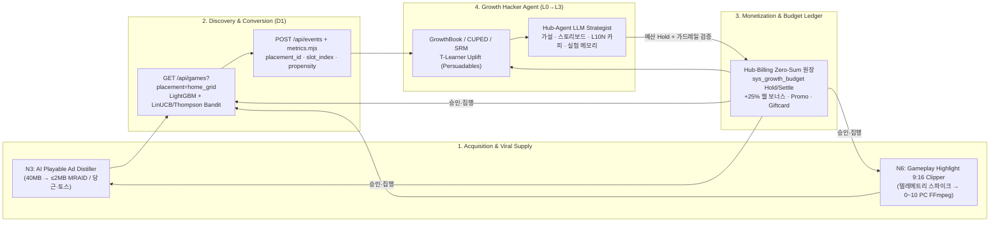

# 플라이휠 1 심화 딥 리서치 & 구현 블루프린트: [수익 · 성장 엔진]

> **대상 모듈**: Growth Hacker Agent (L0→L3) · **N3** AI 플레이어블 광고 증류기(`Hub-AdGame`) · **N6** 바이럴 하이라이트 9:16 쇼츠 클리퍼(`Hub-Shorts`) · **D1** 개인화 랭킹/Contextual Bandit/Uplift(`GET /api/games` · `events`) · **Zero-Sum 예산 가드레일**(`Hub-Billing`)  
> **상위 문서**: [AI_DATA_ML_RL_BUSINESS_STRATEGY.md](AI_DATA_ML_RL_BUSINESS_STRATEGY.md) · [DEEP_RESEARCH_AND_NEW_ITEMS.md](DEEP_RESEARCH_AND_NEW_ITEMS.md)  
> **기준 트렁크**: `PlayHub-Platform` @ `ac2a5720` (실제 코드 라인 단위 정밀 실사 기반)

---

## 1. 플라이휠 1 전체 폐쇄 루프(Closed-Loop) 아키텍처

플라이휠 1의 본질은 **외부 획득(AdGame) → 숏폼 발견(Shorts) → 홈 랭킹/전환(D1 Bandit) → 플레이 검증(`events`/`metrics`) → PlayCoin(+25% 웹 보너스)·Pro 수익화(`Hub-Billing`) → 자율 재투자(Growth Agent L0~L3)**를 단일 플랫폼 내에서 끊김 없이 회전시키는 것이다.

### 실사에서 즉시 발견된 4대 현행 코드베이스 결함 (착수 전 필수 수정)
1. **이벤트 슬롯·소재 필드 묵시적 드롭 (`hub/server/app.mjs:41, 357-408` · `db.mjs:45`)**: `EVENT_KEYS`가 `placement_id`, `creative_id`, `slot_index`를 허용해 `202`를 반환하지만, `events` 테이블에 컬럼이 없고 `processEvent()`가 `properties`에도 복사하지 않아 **DB 저장 시 조용히 소실**된다. 프론트엔드(`hub/web/user/app.js:379, 1263`)도 아직 전송하지 않는다.
2. **AdGame 스타터 PlayCoin 실제 미지급 (`hub/server/adgame/service.mjs:616-656`)**: `claimHandoffToken()`이 `snapshot.reward` (`coins: 150|200`)와 `rewardGranted: true`를 응답하지만 **`billing/ledger.mjs`의 `creditPromo()`를 실제로 호출하지 않는다**.
3. **AdGame 번들 검증기 부재 (`tools/adgame/`)**: 설계 문서에 명시된 `validate-demo-bundle.mjs` / `build-mraid-bundle.mjs`가 미구현 상태이며 `ad_campaigns.bundle_kb`는 단순 하드코딩 정수다.
4. **S2S Usage Hold TTL 버그 (`hub/server/billing/service.mjs:1023`)**: `createUsageHold()`가 `reserveHold()`에 `expiresAt`을 넘기지만 `reserveHold()`(`ledger.mjs:463`)는 `ttlMs`를 구조분해하므로 S2S Hold가 항상 기본 15분 TTL로 고정된다(`ttlMs: expiresAt ? Math.max(1000, expiresAt - now()) : 15*60000` 패치 필요).

---

## 2. [N3] AI 플레이어블 광고 자동 증류기 (40MB → ≤2MB MRAID 3.0)

### 2.1 현행 번들 용량 포렌식 실측 (왜 `besiege` · `LoL`이 2MB를 2~3배 초과하는가)

실제 디스크 실측 결과, 플래그십 5종 중 2종이 2MB 상한을 크게 초과하는 원인은 "그래픽이 무거워서가 아니라 **중복 번들링·비압축 벤더·전체 사전 포함**"이었다:

| 게임 | 실측 크기 | 파일 수 | 초과 핵심 원인 (실측 바이트) | N3 자동 증류 시 예상 크기 |
|---|---:|---:|---|---:|
| `survivor-io` | **732 KB** | 4 | 상한 이내 | ~450 KB |
| `world-of-warships` | **1,507 KB** | 11 | 상한 이내 | ~850 KB |
| `clash-royale` | **2,003 KB** | 21 | 2MB 경계선 | ~1,100 KB |
| **`besiege`** | **4,456 KB** | 19 | ① 비압축 `three.core.js`(1.40MB) + `three.module.js`(603KB) = **2.01MB** ② `index.html`(957KB) 인라인 스크립트가 외부 `scene.js`/`main.js`/`physics.js`와 중복 ③ `playhub-dictionary.js`(**571KB** 전 언어 사전) ④ 비압축 `cannon-es.js`(346KB) ⑤ `platform-cover.png`(257KB) | **~1,150 KB** (-74%) |
| **`league-of-legends`** | **6,352 KB** | 50 | ① **`nexus-front-offline.html`(2.03MB) 중복 사본**이 `index.html`(2.03MB)과 공존 ② `restored-data.js`(**1.00MB** 전체 챔피언/아이템 데이터) ③ `playhub-dictionary.js`(383KB) ④ 인라인 `data:image/*` 31종(415KB) + 외부 PNG 30+개 | **~1,350 KB** (-79%) |

### 2.2 N3 2-트랙 자동 증류 파이프라인 설계

1. **Track 1 — HTML5 웹 게임 결정론적 증류기 (즉시 효과, Phase 1)**:
   - **Step 1 (Static Pruner)**: `*-offline.html` 제거, 중복 인라인/외부 스크립트 병합, `esbuild --minify --tree-shaking=true`로 Three.js/Cannon-es 트리셰이킹, `playhub-dictionary.js`에서 데모 실제 사용 키(`ko`/`en` ~200키)만 추출(571KB → ~15KB), PNG/JPG → WebP(q=78, max 512px) 일괄 변환.
   - **Step 2 (Gameplay Vertical-Slice Slicer)**: `restored-data.js` 등 대형 JSON에서 데모 45초에 등장하는 챔피언 2종·스테이지 1개만 자동 서브셋 추출.
   - **Step 3 (SDK Auto-Injector)**: `<script src="/adgame/playhub-demo-sdk.js">` 및 `window.PlayHubDemo.{ready, reportProgress, milestone, completeDemo}` 훅 자동 삽입.
   - **Step 4 (MRAID 3.0 Single-HTML Packer & Gate)**: 신규 `tools/adgame/build-mraid-bundle.mjs` + `tools/adgame/validate-demo-bundle.mjs`가 **① 원본 ≤2MB / gzip ≤1.5MB ② 외부 네트워크 요청 0건 ③ MRAID 3.0 `viewableChange`/`audioVolumeChange`/`open()` 준수 ④ 헤드리스 Chrome LTE 쓰로틀링 TTI ≤2.0s**를 자동 검증.
2. **Track 2 — 40MB Godot UGC 게임 → ≤2MB HTML5 수직 슬라이스 AI 생성기 (Phase 2, Sett.ai 아키텍처)**:
   - 풀 Godot 4.7.2 WASM(`games/forge-*`, **39~42MB**)은 모바일 슈퍼앱 WebView(당근·토스) 콜드로딩이 구조적으로 불가능하다.
   - **AI Distiller Workflow**:
     1. **핵심 루프 추출**: 실플레이 텔레메트리(`play_sessions`, `round_start/complete`) + 게임 스크린샷·`showcase.json`·GDScript 핵심 루프 분석 → "가장 몰입도가 높은 45초 조작 훅(예: 투석 발사 3회, 뱀서 웨이브 1분)" 설계 JSON 생성.
     2. **경량 Canvas2D/Lite-WebGL 코드 생성**: LLM 코드 생성기(`Hub-Agent` + 검증 루프)가 게임의 실제 스프라이트/아이콘(WebP 압축)과 핵심 조작을 **≤1.2MB 독립 HTML5/JS 미니 데모**로 합성.
     3. **자동 검증 루프**: `validate-demo-bundle.mjs` + `tools/Gamer/playhub_model_qa.mjs` 60Hz 하네스로 10초 무에러 조작·점수 증가·`completeDemo()` 호출 확인 후 `ad_campaigns` 초안 등록.

### 2.3 AdGame 보상 지급 및 수익화 연결
- **결제·어뷰징 방어 통합**: `claimHandoffToken()`이 아닌 **`markQualifiedPlay()`**(`adgame/service.mjs:666`, 서버 검증 `play_sessions.active_ms >= 5000` 교차 확인 후!)에서 `creditPromo(db, { principalId, coins: snapshot.reward.coins, reason: 'adgame_starter_pack:' + campaignId, idempotencyKey: 'adgame:reward:' + attributionId, expiresAt: now + 30*86400000 })`를 호출하여 CPA 보상 사냥꾼의 0초 클레임 악용을 차단한다.
- **창작자 유료화 (L3)**: 인디 창작자가 PlayHub 대시보드에서 **"내 게임 45초 플레이어블 광고 자동 제작 + 당근/토스/피드 파일럿 테스트"**를 **300~500 PlayCoin**에 원클릭 구매(원가 ~\$0.40 LLM/검증 → GM 85%+).

---

## 3. [N6] 바이럴 게임플레이 하이라이트 9:16 쇼츠 자동 클리퍼

### 3.1 현행 `Hub-Shorts` SSOT 구조의 강점과 원가 병목
- `hub/server/shorts/`와 `forge/Tools/shorts-pipeline/handler.cjs`가 5개 코어 모듈을 공유하는 **완벽한 SSOT 구조**이며, `STYLE_PRESETS`에 이미 **`gameplay-highlight`** 프리셋이 정의되어 있다.
- 현행 단가 구조: `forge-motion-ffmpeg` (**20 PC**, 정적 이미지 3장 Ken Burns), `google-flow-veo-fast` (**60 PC**), `google-flow-veo-pro` (**120 PC**), `flow-import` (**0 PC**).
- **문제**: Veo는 고원가이며 실제 게임 화면과 이질감이 생길 수 있고, 정적 이미지 3장 Ken Burns는 실제 플레이의 타격감·물리 붕괴·역전 쾌감을 전달하지 못한다.

### 3.2 N6 텔레메트리 스파이크 융합(Spike Fusion) + FFmpeg 클리퍼 아키텍처

Eklipse/Powder형 멀티모달 스파이크 탐지를 **게임 엔진 1st-party 텔레메트리**로 훨씬 저렴하고 정확하게 구현한다(OCR 불필요!):

1. **클라이언트 링 버퍼 캡처 (30~60초 순환)**:
   - 웹(Canvas `captureStream(30)` + `MediaRecorder` WebM, ~3~6MB/30s) 또는 데스크톱/Godot 리플레이에서 최근 30초 영상을 메모리 링 버퍼에 유지.
2. **경량 흥분도 스파이크 점수 ($S(t)$)**:
   $$S(t) = 2.0 \cdot z(\Delta\text{score}_t) + 3.0 \cdot \mathbb{I}(\text{boss\_kill} \lor \text{multi\_kill}) + 2.5 \cdot \mathbb{I}(\text{clutch\_hp}<10\%) + 1.5 \cdot z(\text{audio\_rms}_t) + 2.0 \cdot \mathbb{I}(\text{physics\_destruction\_burst})$$
   - `S(t)` 상위 2~3개 피크 시각(`tsMs`)을 자동 추출하여 `[ts - 2.5s, ts + 3.5s]` 윈도우(총 12~18초)를 서버에 업로드 (`POST /api/shorts/clip` + `spikesJson`).
3. **신규 엔진 `gameplay-clipper-ffmpeg` (`hub/server/shorts/engines.mjs` · `ffmpeg-adapter.mjs`)**:
   - **원가/가격**: 서버 CPU FFmpeg 3~5초 실행(원가 **<\$0.002**) → 창작자/유저 가격 **5~10 PC** (또는 Growth Agent 시스템 자동 클립 **0 PC**). Veo(60~120 PC) 대비 **90~95% 원가 절감**.
   - **파이프라인 재사용**: `ffmpeg-adapter.mjs`의 기존 `overlayChain`(UTF-8 `drawtext` 3-씬 Hook/Highlight/CTA, 챕터 진행 바, H.264 `yuv420p +faststart`, `extractPosterFromVideo`)을 100% 그대로 재사용하고, 입력부만 `-loop 1 -i img` + `zoompan` 대신:
     - 구간 트림: `-ss <startSec> -t <segDur> -i <sourceVideoPath>`
     - 피크 순간 `slowmo-hero`: `setpts=(PTS-STARTPTS)/0.5` (0.5배속 임팩트 슬로모션)
     - 9:16 리프레이밍: `blur-stack`(블러 세로 배경 + 중앙 680px 선명 게임 화면) 또는 액션 중심 `center-crop` (`crop=ih*9/16:ih`)
     - 오디오 믹싱: 원본 게임 효과음(`1.0`) + 신스/배경 BGM(`0.25`) `amix`
   - **소유권 게이트 확장**: `shorts/service.mjs:150` `assertCanBindGame()`에 `clipKind: 'player_highlight' | 'growth_campaign'` 경로를 열어, 일반 플레이어도 공개 카탈로그 게임의 하이라이트 클립을 게시(`isPrimary = false` 고정, 창작자 공식 트레일러 덮어쓰기 불가)할 수 있게 하여 **플레이어 UGC 바이럴 쇼츠 피드**를 점화한다.

---

## 4. [D1] 개인화 랭킹 · Contextual Bandit · Uplift & Off-Policy 평가 설계

### 4.1 `GET /api/games` → 개인화 2-Stage 랭커 + Bandit 삽입 설계
1. **이벤트 손실 복구 (최우선 패치)**:
   - `hub/server/app.mjs:369` `processEvent()`에서 top-level `placement_id`, `creative_id`, `slot_index` 및 신규 `experiment_id`, `variant_id`, `rec_token`을 `properties` 또는 전용 `rec_serve_log` 테이블에 반드시 영속화(`PRAGMA user_version=1` 유지!).
   - `hub/web/user/app.js:379, 1263` 카드 DOM에 `data-placement`, `data-slot-index`, `data-creative-id`, `data-rec-token`을 부착해 `game_impression`·`game_card_click`에 회신.
2. **2-Stage 랭킹 & 탐색 파이프라인 (`hub/server/recs/service.mjs`)**:
   - **Stage 1 — Candidate Filtering**: `enabled = 1`, `canPlayAgeRating(ageTier, game.ageRating, parentalConsent)` 통과 게임만 후보군 구성(`CHILD_PROTECTED` 및 `personalization=0` 옵트아웃 유저는 **비개인화 안전 인기순**으로 즉시 분기 — PIPA 제37조의2 준수).
   - **Stage 2 — LightGBM Re-ranker (`onnxruntime-node`, <5ms) + LinUCB/Thompson Bandit**:
     - 피처: 유저 최근 7일 플레이 장르·`active_ms`·`wishlist_items`·`locale`·디바이스(모바일/데스크톱) × 게임 롤링 `active60sRate`·`d1NewRate`·`loadP90Seconds`·신규성(출시 14일 이내 부스트).
     - **Position Bias 보정 & 탐색 하한**: 슬롯 위치 `slot_index`에 따른 클릭 편향을 역확률 가중치(IPS)로 보정하고, 최소 탐색 확률 $\epsilon \ge 0.05$ 및 서빙 시점의 액션 확률 **`propensity` $p(a \mid x)$를 `rec_serve_log`에 필수 기록**하여 추후 오프라인 정책 평가(Doubly-Robust OPE)가 가능하게 한다.
   - **실시간 보상 업데이트**: `processEvent()`에서 `game_card_click`(+0.2), `active_play_10s`(+0.5), `active_play_60s`(+1.0) 발생 시 `impression_id`/`play_session_id`로 역조인해 Bandit 사후분포(Beta/Gaussian) 즉시 갱신. 일간 배치에서는 D1/D7 리텐션·결제 순마진을 반영.

### 4.2 Uplift 모델링 & CUPED 실험 검증
- **실험 할당**: `hash(subject_id, experiment_id) % 10000` 기반 결정론적 버킷팅 + `growth_experiment_assignments` 기록.
- **SRM(Sample Ratio Mismatch) 자동 알람**: 카이제곱 검정($p < 0.001$) 발생 시 실험 결과 오염으로 자동 판정 및 분석 보류.
- **CUPED 분산 축소**: 실험 전 14일간의 `validatedActivity()` 활성 시간과 결제액을 공변량으로 사용하여 `active_play_60s` 및 ARPU 실험 기간을 **14일 → 7일 수준으로 단축**.

---

## 5. Growth Hacker Agent (L0→L3) 예산 강제 및 실행 가드레일 (`sys_growth_budget`)

### 5.1 DB 레벨 원천 초과 집행 차단 패턴
`Hub-Billing`의 Zero-Sum 복식부기 원장을 그대로 전용 예산 계정에 적용하면, 에이전트 버그나 무한 루프가 발생해도 **예산 초과가 물리적으로 불가능**해진다:

1. **전용 시스템 예산 계정**: `sys_growth_budget` (`billing_wallet_accounts`)에 월/일 단위 예산(예: 일 50,000 PC ≈ ₩700,000)만 충전.
2. **선 Hold → 실행 → 정산/해제**:
   - L2/L3 에이전트가 쇼츠 렌더(`ai_shorts_generation`), LLM/증류기 호출(`usage_ai_units`), 유저 프로모션 지급(`creditPromo`), 기프트카드 발행(`issueGiftCardBatch`)을 실행하기 전 **반드시 `reserveHold(db, { principalId: 'sys_growth_budget', ... })` 호출**.
   - SQLite `CHECK(paid_balance + bonus_balance + promo_balance - reserved_coins >= amount)` 제약이 원자적으로 초과 집행을 차단.
3. **법무·스토어 정책 하드 룰 엔진**:
   - `bonus_bps <= 2500` (SQL `CHECK` 기적용), 모바일 IAP 채널 보너스 `0%` 고정.
   - `age_tier !== 'ADULT'` 대상 프로모션/푸시/개인화 오퍼 호출 시 `403 GROWTH_AGE_POLICY_BLOCKED` 하드 거부.
   - 모바일 앱 푸시/인앱 메시지 내 외부 웹 결제 유도 문구("웹에서 +25% 충전" 등) 정규식/분류기 사전 차단(Apple/Google 스토어 정책 위반 예방).
   - 5분 주기 헬스체크: 실험군 `runtime_error`율 +0.5%p 또는 `game_ready` P90 +300ms 악화 시 **자동 `rolled_back` 서킷브레이커**.

---

## 6. 플라이휠 1 실행 로드맵 (8주 스프린트) 및 기대 경제성

| 스프린트 | 핵심 산출물 | 검증 지표 (DoD) |
|---|---|---|
| **W1~W2** | ① `app.mjs`/`app.js` `placement_id`/`slot_index`/`creative_id`/`propensity` 영속화 ② `billing/service.mjs:1023` `ttlMs` 패치 ③ `adgame` `markQualifiedPlay` → `creditPromo` 연동 ④ `tools/adgame/validate-demo-bundle.mjs` 구현 & `besiege`/`LoL` ≤1.5MB 증류 | `besiege`/`LoL` TTI ≤2.0s 달성, 이벤트 슬롯 누락 0%, `npm run gate` 통과 |
| **W3~W4** | ① `gameplay-clipper-ffmpeg` 엔진 + `POST /api/shorts/clip` (N6) ② `growth_experiments` / CUPED / SRM 할당 모듈 ③ **Growth Agent L0** 주간 자동 퍼널 진단 리포트 | 9:16 하이라이트 클립 5초 내 렌더(원가 <\$0.002), L0 리포트 Admin 탭 정상 출력 |
| **W5~W6** | ① `GET /api/games` LightGBM(`onnxruntime-node`) + LinUCB Bandit 1차 배포(D1) ② **Growth Agent L1** (쇼츠·L10N 카피·기프트카드 초안 → 1-클릭 승인 큐) ③ `sys_growth_budget` Hold 가드레일 | A/B 테스트 `active_play_60s` 전환율 ≥ +8% (p<0.05), 예산 초과 차단 테스트 100% 통과 |
| **W7~W8** | ① AdGame Admin CRUD API + **Growth Agent L2** (Bandit 소재/보상 로테이션) ② **L3 Creator Growth Agent Beta** (Pro 창작자 20개 게임 파일럿) | AdGame 유효 CPA -20%+, 쇼츠 제작 원가 -90%+, 창작자 베타 재사용률 ≥50% |
