# 플라이휠 2 심화 딥 리서치 & 구현 블루프린트: [창작자 공급 압도 엔진]

> **대상 모듈**: **N4** 11,826종 라이선스 안전 오픈 에셋 시맨틱 검색 & AI 씬 킷배싱(`store/` · `playforge_agent_chat`) · **N1** RLVR(GRPO) 자가진화 크로스엔진 포팅 엔진(`UnityConverter` · `RobloxConverter` · `ssot/datastore` · `billing/direct-commerce`) · **N2** VLM 시각비평 3D 프롭 & UGC 아바타 팩토리(`blender-pipeline` · `Forge-Avatar`)  
> **상위 문서**: [AI_DATA_ML_RL_BUSINESS_STRATEGY.md](AI_DATA_ML_RL_BUSINESS_STRATEGY.md) · [DEEP_RESEARCH_AND_NEW_ITEMS.md](DEEP_RESEARCH_AND_NEW_ITEMS.md)  
> **기준 트렁크**: `PlayHub-Platform` @ `ac2a5720` (실제 코드 라인 단위 정밀 실사 기반)

---

## 1. 플라이휠 2 전략적 핵심: "0% 수수료 × AI 제작/이식 압도"

Roblox는 2025년 창작자 지급액 \$1.5B+로 시장을 증명했으나 Q3 2026 DAU(-9%)·플레이시간(-15%) 둔화와 높은 실질 수수료(~70%+)로 창작자 피로가 누적되고 있다. 플라이휠 2는 **① 11,826종 저작권 안전 에셋 AI 킷배싱(N4) ② Roblox·Unity 프로젝트의 RLVR 자가진화 자동 포팅 + 0% 결제/DataStore 자동 배선(N1) ③ 38개에 묶인 아바타 경제를 수만 개로 폭발시키는 VLM 3D/아바타 팩토리(N2)**로 창작자 공급 장벽을 완전히 파괴한다.

```mermaid
flowchart TB
    subgraph N4["N4: 11,826 Open Asset Semantic Kitbashing (저작권 리스크 0%)"]
        CAT["collected-catalog.json (11,826종)<br/>99.4% 썸네일 · CC0/CC-BY/MIT"]
        IDX["SigLIP 2 + 다국어 Text HNSW 인덱스<br/>GET /api/store/search/semantic"]
        HYD["External Hydrator + R2 CAS 캐시<br/>+ 루트 Third-Party Notices.txt 자동 병합"]
        CHAT["playforge_agent_chat<br/>pf_store_search + scene.instantiate(GLB)"]
    end

    subgraph N1["N1: RLVR / GRPO Self-Improving Porting Engine"]
        SRC["Roblox (.rbxlx/Luau) · Unity (C#/YAML) · UE5"]
        TRANS["Transpiler + X-Grade Bridge<br/>DataStore→ssot/datastore · Marketplace→Track B 0%"]
        ORA["공용 3-Oracle Verifier<br/>1) IR+Idempotency 2) Godot --check-only 3) GPU 60fps + Pixel Gate"]
        RLVR["Bounded GRPO / LLM Patcher<br/>성공·실패 궤적 수집 → 도메인 GRPO 파인튜닝"]
    end

    subgraph N2["N2: VLM Visual-Critique 3D & UGC Avatar Factory"]
        PLAN["llm-planner.cjs → MeshRecipe v1 (≤96 parts)"]
        BLEN["GPL 격리 blender_worker.py<br/>GLB 생성 + 4-View 턴테이블 PNG 렌더"]
        CRIT["VLM Multi-View Critic + GLB Budget Gate<br/>폴리곤/텍스처/바운드/소켓 자동 검증 (최대 3회 리파인)"]
        AVAT["HMAC 서명 동적 UGC 아바타 카탈로그<br/>kaykit_v1 · robot_expressive_v1 정규화 장착"]
    end

    CAT --> IDX --> HYD --> CHAT
    SRC --> TRANS --> ORA
    ORA -->|"에러 진단 JSON"| RLVR -->|"패치 후보"| TRANS
    PLAN --> BLEN --> CRIT
    CRIT -->|"미달 시 Recipe 패치"| PLAN
    CRIT -->|"통과"| AVAT
```

---

## 2. [N4] 11,826종 오픈 에셋 멀티모달 시맨틱 검색 & AI 씬 킷배싱

### 2.1 현행 카탈로그 정밀 실사 및 3대 숨은 병목
`store/data/collected-catalog.json` (**30.4 MB**, **11,826개**, 전수 `ai_disclosure: "No generative AI used"`, `tier1_cc0` 5,510 + `tier2_attribution` 6,306 + `OFL` 2 + `tier4_external` 8) 실사 결과, 즉시 풀어야 할 **3가지 정확한 코드 병목**이 확인되었다:

1. **검색 엔진 빈약 (`store/web/store-catalog.js:255-324`)**: `filterCatalogEntries()`가 매 요청마다 11,826개를 `O(N)` 선형 스캔하며 단순 `String.includes()`만 수행한다(토큰화·BM25·한영 교차검색·유사도 정렬 전무).
2. **바이너리 하이드레이션 공백 (`package-builder.mjs:423-529`)**: **11,826종 중 단 5종(29개 GLB)만 `local_bundle_files`를 포함**하고, 나머지 **11,821종은 메타데이터 전용 `.playforgepkg`**(외부 `download_url` 링크만 포함)다. AI가 원클릭으로 3D 모델/PBR/아이콘을 씬에 배치하려면 **서버 측 Fetch-and-Hydrate 프록시(R2 CAS 캐시, `tier4_external_only` 제외)**가 필수다.
3. **Godot Agent Chat 3D 킷배싱 차단 (`forge/Godot/addons/playforge_agent_chat/`)**:
   - `chat_context.gd:98` `_collect_store_packs()`는 로컬 `res://.playforge-store.json`만 읽고 Store API(11,826종)를 전혀 모른다.
   - `scene_commands.gd:5-18` `PROPERTIES` 화이트리스트에 **3D 핵심 속성(`mesh`, `material_override`, `albedo_texture`, `light_energy`, `light_color`, `shadow_enabled`, `environment`)이 없다**.
   - `scene_commands.gd:178` `prepare()`에 **`.glb`/`.tscn` 인스턴스화 명령(`scene.instantiate`)이 없다**(`node.add`는 `ClassDB.instantiate`만 지원).
   - `package_installer.gd`가 패키지별 `assets/<slug>/Third-Party Notices.txt`는 풀지만, 여러 에셋을 조합할 때 프로젝트 루트 **`CREDITS.md` / 통합 `Third-Party Notices.txt` 자동 병합기**가 없다.

### 2.2 N4 엔지니어링 구현 설계 (2~3주 퀵윈)

1. **오프라인 멀티모달 인덱스 빌더 (`store/tools/build-semantic-index.mjs`)**:
   - **이미지 인코딩 (`SigLIP 2` / `CLIP-ViT-B/16`)**: `11,758 / 11,826` (**99.4%**)가 이미 `thumbnail_url`을 보유. Game-Icons SVG 4,239종은 `sharp`/`resvg`로 256×256 PNG 래스터화, 썸네일 없는 68종(로컬 GLB 5팩 포함)은 Three.js/Blender 헤드리스 1장 렌더 후 전수 임베딩.
   - **다국어 텍스트 인코딩 (`multilingual-e5` / `BGE-M3`)**: `title + summary + category + tags + formats + file_manifest[].path` 결합 → 한국어 프롬프트("비 오는 중세 판타지 돌바닥")로 영문 ambientCG/Poly Haven 에셋을 즉시 정밀 검색.
   - **인덱스 크기 & 서빙**: 11,826 × 768차원 int8/fp16 벡터 ≈ **18~36 MB** — SQLite(`sqlite-vec`) 또는 인메모리 HNSW(`hnswlib-node` / `usearch`)로 `store-api.mjs` 내 **< 5ms 하이브리드 검색(RRF: BM25 + Text Vector + Image Vector)** 구현.
   - **신규 엔드포인트**: `POST /api/store/search/semantic` `{ query, imageBase64?, category?, licenseTiers?: ['tier1_cc0','tier2_attribution'], noAiOnly: true, limit: 20 }`.
2. **R2 CAS 에셋 하이드레이터 (`store/server/asset-hydrator.mjs`)**:
   - `hosting_policy === 'direct_or_external'` 및 `license_tier !== 'tier4_external_only'` 검증 후 `download_url`에서 GLB/PBR/SVG를 가져와 `artifact_digest` 키로 R2 CAS에 캐시하고 검증된 `.playforgepkg` 바이너리를 반환.
3. **PlayForge AI 씬 킷배싱 업그레이드 (`playforge_agent_chat/{plugin.gd, scene_commands.gd}`)**:
   - `pf_store_search` + `store.install` 툴 추가(설치 시 프로젝트 루트 `Third-Party Notices.txt`에 `attribution_text` 자동 중복 제거 병합).
   - `scene_commands.gd`에 `scene.instantiate` (`GLTFDocument`/`PackedScene` 로드) 및 3D `PROPERTIES`(`material_override`, `light_energy`, `light_color`, `shadow_enabled`, `fov`) 화이트리스트 추가.
   - **결과**: 창작자가 "사이버펑크 네온 골목 아레나 만들어줘" 입력 시 AI가 **HDRI + PBR 머티리얼 + 3D 프롭 + UI 아이콘 + SFX를 11,826종에서 스타일 일관성 있게 자동 조합** (저작권 소송 리스크 **0%**, 외부 3D 생성 API 원가 **80% 절감**).

---

## 3. [N1] RLVR(GRPO) 자가진화 크로스엔진 게임 포팅 엔진

### 3.1 `UnityConverter` 3-Oracle Verifier의 재발견 & 공용화
실사 결과 `tools/UnityConverter/src/orchestrator.mjs`에는 이미 **RLVR(Reinforcement Learning with Verifiable Rewards)**에 이상적인 **3단계 결정론적 오라클**이 완성되어 있다:
1. **Oracle 1 (IR + Idempotency)**: `validate-ir.mjs` + 결정론적 컴파일 2회 실행(`pass2.filesWritten === 0`).
2. **Oracle 2 (Static Compiler Gate)**: `Godot_v4.7.2 --headless --check-only`로 전 `.gd` 구문·타입·셰이더 검증 (`[autoload]` 오탐 필터링 내장).
3. **Oracle 3 (Live GPU 60fps + Pixel Gate)**: `--fixed-fps 60 res://tests/verify_and_capture.tscn` 실행 + Python PIL/NumPy Rec.709 픽셀 텔레메트리(`mean_luminance < 0.05 || non_black_ratio < 0.5 || overexposed_white_ratio > 0.55`).

**현행 한계**:
- `applyBoundedDeterministicRepairs(portedDir, diagnostics)` (`orchestrator.mjs:189`)가 비공개 함수이며 **정규식 2개 규칙만 존재**(`FIX_GDSCRIPT_TYPE_INFERENCE`, `FIX_EMISSION_OP_MULTIPLY`).
- `tools/RobloxConverter/`는 60개 API 분류(`D/A/R/X/V`)와 `conversion_report.json`은 있으나 **3-Oracle 검증기와 수리 루프가 전혀 없다**.

### 3.2 RLVR / GRPO 자가진화 포팅 아키텍처

1. **공용 Verifier 추출 (`tools/PortingVerifier/oracle-runner.mjs`)**:
   - `UnityConverter`의 3-Oracle을 공용 모듈로 분리해 `RobloxConverter`, `UnityConverter`, `UnrealConverter` 모두에 적용.
   - **연속·검증 가능 보상 함수 ($R_{\text{RLVR}} \in [0, 1]$)**:
     $$R_{\text{RLVR}} = 0.25 \cdot \left(1 - \frac{N_{\text{static\_err}}}{N_{\text{scripts}}}\right) + 0.20 \cdot \left(1 - \frac{L_{\text{todo}}}{L_{\text{total}}}\right) + 0.35 \cdot \frac{C_{\text{runtime\_pass}}}{C_{\text{runtime\_total}}} + 0.20 \cdot \mathbb{I}(\text{PixelGatePass})$$
2. **2-Stage Bounded Repair Loop (즉시 도입 → GRPO 파인튜닝)**:
   - **Stage A (Deterministic Rules)**: 기존 정규식/AST 규칙 우선 적용 (0ms, 비용 \$0).
   - **Stage B (Verifier-Guided Candidate Patching)**: Stage A로 해결 안 된 실패 파일에 대해 `K=4` 후보 패치를 LLM으로 병렬 샘플링 → 공용 3-Oracle 즉시 채점 → 최고 보상 패치 채택 (최대 3회 반복).
   - **Trajectory Dataset 적재**: 매 포팅마다 `(원본 Luau/C# AST, IR 컨텍스트, 에러 진단 JSON, K개 후보 GDScript 패치, 3-Oracle 실측 보상)` 튜플을 저장.
   - **Stage C (GRPO 오프라인 강화학습 — 5,000+ 포팅 궤적 축적 후)**: DeepSeek-R1 방식의 **GRPO(Group Relative Policy Optimization, 별도 Critic 네트워크 불필요)**로 경량 코딩 모델(Qwen-Coder 7B~14B)을 파인튜닝 → 외부 상용 LLM 의존 없이 **초고속·저원가·고성공률 Godot 4.7.2 전용 포팅 모델** 확보.

### 3.3 Roblox X-등급 API → PlayHub SSOT & 0% 결제 자동 배선 설계

Roblox 창작자 이주의 가장 큰 장애물인 `DataStoreService`와 `MarketplaceService`를 PlayHub 네이티브 백엔드로 **자동 변환**하는 정확한 설계:

| Roblox X-등급 API | 현행 갭 (`luau-transpiler.mjs` · `roblox_compat.gd`) | PlayHub 자동 배선 설계 (To-Be) |
|---|---|---|
| **`DataStoreService`** (`GetAsync`, `SetAsync`, `UpdateAsync`, `RemoveAsync`, `GetOrderedDataStore`) | `luau-transpiler.mjs:246`이 동기 스텁만 생성, `UpdateAsync`/`RemoveAsync`/`Ordered` 미변환. 타겟 `/internal/v1/datastore/*`는 S2S 전용(`verifyInternalAccess`)이라 클라이언트 직접 호출 불가 | ① **PlayHub Game-Session Proxy** (또는 권위 헤드리스 서버) 경유 호출 + `store_name`을 소문자 슬러그 `scope`(`/^[a-z0-9][a-z0-9_-]{0,31}$/`)로 정규화 ② 트랜스파일러가 `GetAsync`/`SetAsync`/`UpdateAsync`를 **`await` 비동기 GDScript**로 출력 ③ `UpdateAsync(k, fn)` → `GET`(revision 획득) → `fn` → `PUT(expectedRevision)` (`412` 충돌 시 최대 3회 재시도, 또는 `lock`+`fencingToken`+`releaseLock:true`) ④ `GetOrderedDataStore` → `hub/server/ssot/leaderboard.mjs` 브리지 자동 매핑 |
| **`MarketplaceService`** (`UserOwnsGamePassAsync`, `PromptGamePassPurchase`, `PromptProductPurchase`, `ProcessReceipt`) | `luau-transpiler.mjs`에 **변환 규칙 0건**, `RobloxPlayer.user_id`가 `1001`로 하드코딩(`roblox_compat.gd:184`) | ① 변환 시 숫자 `gamePassId`/`devProductId`를 추출해 **`commerce_manifest.json`** 생성 (`productKey` ↔ Track B `billing_creator_products` 자동 초안 연동, **플랫폼 수수료 0%**) ② `RobloxPlayer.user_id`를 PlayHub 세션 `principalId`에 바인딩 ③ `UserOwnsGamePassAsync` → `await GET /api/billing/entitlements?gameId=...` (`state='ACTIVE'` 조회) ④ `Prompt*Purchase` → `POST /api/billing/direct/orders` 웹 결제 모달 오픈 ⑤ `ProcessReceipt` 콜백이 `PurchaseGranted` 반환 시에만 `POST /api/billing/entitlements/:id/consume` 멱등 소모 |

---

## 4. [N2] VLM 시각비평 폐쇄루프 3D 프롭 & UGC 아바타 팩토리

### 4.1 아바타 공급 병목과 기술적 함정(Scale Trap · GPL Boundary)
- **시장 기회 vs 공급 병목**: ZEPETO(410만 종 아이템·6,800만 개 판매) 대비 PlayHub `Forge-Avatar`는 **38개(스킨 10, 부착물 20, 이모트 8, 총 카탈로그 가치 6,570 PC ≈ ₩92,000)**에 불과하다.
- **실사에서 발견된 3대 엔지니어링 함정**:
  1. **GPL 격리 경계 (`engine-adapter.cjs:290-310`)**: `assertAdapterPolicy()`가 `unmodifiedOfficialBinary: true, directDllLink: false, isolatedProcess: true, ipcMode: 'json-file'`을 강제한다. 따라서 **VLM 비평·프롬프트·리파인 로직은 반드시 Node.js(`job-manager.cjs`)에 두고, `blender_worker.py`는 순수 JSON→GLB + 4-View PNG 렌더러로만 유지**해야 한다.
  2. **100배 소켓 스케일 함정 (`playforge_avatar/catalog.json:42-392`)**: `kaykit_v1` 소켓 스케일은 `0.85~1.95`인 반면 `robot_expressive_v1`은 본 공간이 100배 축소된 센티미터 기준(`head: 0.025`, `back: 0.018`, `hand_r/l: 0.016`)이다. 모든 UGC 부착물 GLB는 **표준 미터 단위·정규화 피벗**(`head`: 폭 0.25~0.35m `bottom_center`, `hand_r/l`: 손잡이 `[0,0,0]` `+Y` 축, `back`: 전면 `Z=0`)으로 출력해야 두 리그 모두에 오차 없이 장착된다.
  3. **GLB 폴리곤·텍스처 게이트 미강제 & 정적 봉인 카탈로그**: `blender_worker.py:collect_metrics()`는 `triangleCount`/`boundingBox`를 측정만 하고 차단하지 않으며(`MAX_GLB_BYTES = 16 MiB`만 체크), `hub/server/avatar/catalog.mjs`는 부팅 시 정적 `catalog.json`을 동결(`seal_manifest.json`)한다.

### 4.2 VLM Multi-View Self-Critique 루프 & 동적 UGC 아바타 파이프라인
1. **폐쇄루프 생성 (`job-manager.cjs:_runItem()`)**:
   - ① `llm-planner.cjs`가 `MeshRecipe v1`(≤96 parts) 생성 → ② 격리 `blender_worker.py`가 `.glb` 출력 + **4-View 정사영/턴테이블 PNG(정면 `-Y`, 측면 `+X`, 후면 `+Y`, 3/4 아이소메트릭)** 동시 렌더 → ③ Node 측 **VLM Multi-View Critic**이 4장 이미지 + 원본 프롬프트 + `metrics`를 평가하여 `[실루엣 일치도, 떠있는 파츠 유무, 비율, 색감]` 점수(0~10)와 JSON 패치 지시 출력 → ④ 8.0점 미만이면 최대 2~3회 자동 리파인.
2. **하드 예산 게이트 (`engine-adapter.cjs:validateGlbBuffer()` 확장)**:
   - **UGC 아바타 부착물 (`head`/`back`/`hand_r`/`hand_l`)**: `≤ 4,000 tris`, `≤ 1.5 MiB` GLB, `≤ 2` 머티리얼, 바운딩 박스 `≤ 1.2m`, 부유 컴포넌트(disconnected mesh island) 검사 통과.
   - **UGC 아바타 스킨**: `≤ 15,000 tris`, `≤ 5 MiB` GLB, `≤ 4` 머티리얼, `≤ 1024×1024` 텍스처, `kaykit_v1` / `robot_expressive_v1` 필수 본 매핑 검증.
   - **씬 프롭**: `≤ 25,000 tris`, `≤ 8 MiB` GLB (웹 WASM 메모리 보호).
3. **HMAC 서명 동적 UGC 아바타 발행**:
   - `hub/server/avatar/service.mjs:47`의 `resolveSigningSecret()`으로 **동적 UGC 아이템 확장 카탈로그**를 HMAC-SHA256 서명 배포하고, Godot 클라이언트 Layer 3D(`avatar_rig.gd:330-384`)는 기존 `sha256` Fail-Closed 검증·캐시 경로를 그대로 재사용.
   - **수익화**: UGC 아이템 생성·VLM 리파인 시 **50~150 PlayCoin**(Track A, GM 65%+), 창작자 판매는 **수수료 0%**(Track B) 또는 PlayHub 1P 아바타 상점 큐레이션 수익 배분.

---

## 5. 플라이휠 2 실행 로드맵 (8주 스프린트) 및 기대 임팩트

| 스프린트 | 핵심 산출물 | 검증 지표 (DoD) |
|---|---|---|
| **W1~W2** | **N4 1차 완료**: 11,826종 SigLIP 2 + 다국어 텍스트 인덱스 빌드 + `POST /api/store/search/semantic` + R2 에셋 하이드레이터 + 루트 `Third-Party Notices.txt` 병합기 | 한/영 시맨틱 검색 P95 <15ms, Top-5 정밀도 ≥85%, `No generative AI used` 100% 보존 |
| **W3~W4** | ① **N4 2차**: `playforge_agent_chat` `pf_store_search` + `scene_commands.gd` `scene.instantiate` & 3D `PROPERTIES` 추가 ② **N1 1차**: `UnityConverter` 3-Oracle 공용화 + `RobloxConverter` 연결 + `applyBoundedDeterministicRepairs` LLM 패처(K=4) 연동 | AI 원클릭 3D 씬 킷배싱 동작, Roblox 4종 + Unity 6종 자동 수리 성공률 측정 및 궤적 JSONL 적재 |
| **W5~W6** | ① **N1 2차**: Roblox `DataStoreService`(비동기 CAS/fencing 프록시) & `MarketplaceService`(Track B 0% `commerce_manifest.json`) 자동 배선 ② **N2 1차**: `blender_worker.py` 4-View 렌더(GPL 격리 준수) + `job-manager.cjs` VLM Critic 루프 + `validateGlbBuffer` 폴리곤/바운드 게이트 | Roblox 샘플 1종 실결제·DataStore E2E 통과, VLM Critic 통과율 +40%p 개선 |
| **W7~W8** | ① **N2 2차**: `kaykit_v1`/`robot_expressive_v1` 정규화 소켓 프리뷰 + HMAC 동적 UGC 아바타 카탈로그 오픈 ② **N1 3차**: 축적된 포팅 궤적 기반 GRPO 1차 파일럿 학습 평가 | UGC 아바타 카탈로그 38개 → 500+개 파일럿 확장, 포팅 1차 통과율(Zero-touch) ≥85% |
