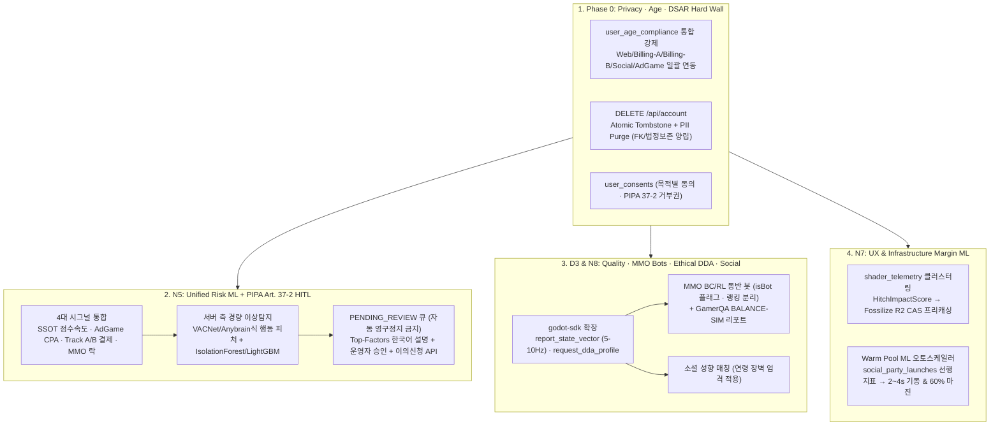

# 플라이휠 3 심화 딥 리서치 & 구현 블루프린트: [신뢰 · 품질 · 마진 방어 엔진]

> **대상 모듈**: **Phase 0** 법무·동의·DSAR·아동 연령 게이트 수정 · **N5** 서버 권위 안티치트/CPA 부정방지/Track A·B 리스크 ML + PIPA 제37조의2 `PENDING_REVIEW` · **D3** `GamerQA` AI 밸런싱 & MMO BC 봇 · **N7** 데스크톱 셰이더 히치(6.65s→0.96s) 예측 프리워밍 & 멀티플레이 Warm Pool ML 오토스케일러 · **N8** 윤리적 Flow-State DDA & 소셜 성향 매칭  
> **상위 문서**: [AI_DATA_ML_RL_BUSINESS_STRATEGY.md](AI_DATA_ML_RL_BUSINESS_STRATEGY.md) · [DEEP_RESEARCH_AND_NEW_ITEMS.md](DEEP_RESEARCH_AND_NEW_ITEMS.md)  
> **기준 트렁크**: `PlayHub-Platform` @ `ac2a5720` (실제 코드 라인 단위 정밀 실사 기반)

---

## 1. 플라이휠 3 전략적 핵심: "규제·어뷰징·인프라 마진 방어 없이는 성장도 없다"

플라이휠 1(성장)과 2(공급)가 가속할수록 **아동 규제 위반·PIPA 제37조의2 분쟁·웹/UGC 치팅(EAC 부재)·AdGame CPA 부정·차지백·콜드스타트 6.65초 이탈·멀티플레이 유휴 서버 적자**가 폭발한다. 플라이휠 3은 이를 **코드 레벨 가드레일과 경량 서버 측 ML**로 선제 봉쇄해 플랫폼 신뢰와 60%대 인프라 마진을 수성한다.

### 실사에서 즉시 발견된 5대 치명적 컴플라이언스·보안 갭 (Phase 0 최우선 패치)
1. **웹 과금 아동 연령 미연동 (`hub/server/billing/compliance.mjs:140-164`)**: `resolveSpendingPolicy()`가 `billing_spending_limits`만 읽고 `user_age_compliance`를 조인하지 않아, 모바일 Age Gate의 `CHILD_PROTECTED` 계정이 웹 결제에서 **`ADULT`로 취급되는 버그**가 존재한다.
2. **Track B 직접 판매 연령·동의 검증 누락 (`hub/server/billing/direct-commerce.mjs:257-338`)**: `createDirectOrder()`가 `product.age_rating` 및 `user_age_compliance`를 검사하지 않는다.
3. **소셜 리더보드 안티치트 완전 우회 (`hub/server/social/routes.mjs:1072`)**: `POST /api/social/leaderboards/.../scores`가 SSOT의 `play_sessions`, `minPlayMs`, `maxScoreBound`, `leaderboard_submissions` 검증을 전혀 거치지 않는다.
4. **AdGame 중복 디바이스 CPA 정산 누수 (`hub/server/adgame/service.mjs:613-681`)**: `duplicateDeviceGuard`가 스타터 보상은 막아도 `ad_attributions(payout_status='pending')` 레코드는 생성하며, `markQualifiedPlay`가 서버 검증 `play_sessions.active_ms`가 아닌 **클라이언트 전송 `playMs`를 신뢰**해 ₩1,000~1,500 CPA 어뷰징에 취약하다.
5. **웹 플레이/소셜/AdGame 연령 게이트 편차**: `app.mjs:483` (`POST /api/play-sessions`), `social/routes.mjs:450,904` (`UNKNOWN` fail-open, 파티 합류 시 `target_game_id` 미검사), `adgame/service.mjs` (`age_rating` 미검사)에 일괄 Fail-Closed 적용이 필요하다.

---

## 2. [Phase 0] `PRAGMA user_version=1` 제약 하의 DSAR(`DELETE /api/account`) 설계

### 2.1 DB 아키텍처 제약 실측 (`hub/server/db.mjs`)
- `PRAGMA foreign_keys=ON`, `PRAGMA journal_mode=WAL`, **`PRAGMA user_version=1` 엄격 고정**(1 초과 시 기동 거부). 따라서 모든 신규 테이블은 뷰·트리거·가상 테이블 없는 순수 `CREATE TABLE IF NOT EXISTS`로만 추가해야 `restore-data.mjs`·Turso/libSQL 호환성이 유지된다.
- 대부분 테이블에 `ON DELETE CASCADE`가 없으므로 단순 `DELETE FROM users`는 `SQLITE_CONSTRAINT_FOREIGNKEY`로 실패하며, 전자상거래법(결제·환불 기록 5년 법정 보존)·Zero-Sum 원장 정합성·제재 회피 방지를 위해 금융/제재 레코드는 물리 삭제해서는 안 된다.

### 2.2 원자적 DSAR 처리 프로토콜 (`DELETE /api/account` & `DELETE /api/mobile/account`)
단일 `transaction(db, ...)` 내에서 **사전 게이트 → PII/인증/소셜/세이브 완전 삭제 → 법정 보존 원장용 Tombstone 비식별화** 순서로 실행한다:

1. **Pre-Check Gate (차단 조건)**:
   - `billing_wallet_accounts.reserved_coins > 0` 또는 `debt_coins > 0` 또는 활성 구독(`billing_subscriptions.status = 'ACTIVE'`) 또는 미이관 퍼블리시 게임(`hub_publications`) 존재 시 `409 ACCOUNT_DELETE_PRECONDITION_FAILED`와 해제 안내 반환.
2. **Hard Purge (즉시 영구 삭제)**:
   - 인증·토큰: `sessions`, `mobile_tokens`, `oauth_states`, `identities`, `email_credentials`
   - 개인 설정·세이브: `user_preferences`, `wishlist_items`, `save_slots`, `save_slot_versions`, `save_idempotency`, `save_backups`, `merge_requests`, `analytics_links`
   - 소셜·커뮤니티·AI 로그: `leaveCurrentParty()` 호출 후 `user_profiles`, `social_presence`, `social_friendships`, `social_blocks`, `social_party_members`, `social_party_launch_acks`, `social_leaderboards`, `social_reports`, `community_votes/reports`, `shorts_likes`, `avatar_*`, `hub_agent_quotas`, `hub_agent_usage_logs`, `device_push_tokens`
   - 게임 기록: `leaderboard_entries`, `leaderboard_submissions`, `player_stats`, `player_achievements`
3. **Tombstone / Anonymize (법정 보존 및 FK·원장 무결성 유지)**:
   - `users`: `kind = 'deleted', display_name = NULL` (식별 정보 0 바이트)
   - `play_sessions`, `events`, `ad_handoff_tokens`, `ad_attributions`, `datastore_entries`: 소유자/주체 참조 NULL 또는 비가역 익명 토큰화
   - `social_messages`, `community_items`, `shorts_videos`: 작성자 익명화 및 본문 `[deleted]` 마스킹
   - **보존 대상**: `billing_*` (5년 법정 보존, `users`가 Tombstone이라 PII 없음), `user_sanctions` (영구제재 회피 재가입 차단 목적).

---

## 3. [N5] 서버 권위 안티치트 · CPA 부정방지 · Track A/B 리스크 ML & PIPA 제37조의2

### 3.1 왜 EAC 대신 "VACNet / Anybrain식 서버 측 행동 ML"인가
`docs/eos/EOS_FEASIBILITY_AND_SSOT_PLAN.md`에서 확정했듯 커널 안티치트(EAC)는 웹/WASM·모바일·동적 `.pck` UGC와 구조적으로 양립할 수 없다. Valve **VACNet**과 **Anybrain**이 증명한 것처럼, 서버 측 틱/이벤트·입력 리듬·경제 흐름 텔레메트리를 결합한 **경량 이상 탐지 ML**이 크로스플랫폼 UGC 허브의 유일한 해답이다.

### 3.2 5대 통합 플러그인 포인트 & PIPA 제37조의2 준수 설계
한국 **PIPA 제37조의2** 및 **2026.01.22 시행 AI 기본법**에 따라, 권리·금전에 중대한 영향을 미치는 결정(영구정지, 정산 보류, 창작자 상품 중단)은 **절대 ML 단독 확정 금지 → `PENDING_REVIEW` 임시 격리 + 상위 기여 요인(`top_factors_json`) 한국어 설명 + 운영자 승인 + 유저 이의신청 API** 구조를 강제한다.

신규 테이블 (`hub/server/risk/schema.mjs`, `user_version=1` 유지):
- `risk_assessments(id, domain, entity_type, entity_id, principal_id, model_version, risk_score, decision, top_factors_json, feature_snapshot_json, created_at)`
- `risk_review_queue(id, assessment_id, domain, principal_id, target_ref, status, assigned_to, resolution_note, explanation_ko, user_appeal_text, sla_due_at, resolved_at, created_at)`

| # | 도메인 & 코드 훅 | 핵심 ML 피처 | 고위험(`risk_score >= θ`) 조치 (HITL) |
|---|---|---|---|
| **1** | **리더보드** (`ssot/leaderboard.mjs:404` + `social/routes.mjs:1072` SSOT 통합) | `score / max(active_ms, 1000)` 속도, 보드 롤링 z-score, `play.last_sequence` 주기 균일도(매크로 탐지), 과거 `leaderboard_submissions` 거절 빈도 | `leaderboard_entries`에 **`excluded=1, exclude_reason='PENDING_REVIEW'`** 소프트 격리 → Admin 승인 시 복구 또는 `user_sanctions` 확정 |
| **2** | **AdGame CPA 부정방지** (`adgame/service.mjs:626, 681`) | **서버 검증 `play_sessions.active_ms`** 교차 확인, 클릭→클레임 경과시간, `priorDeviceClaim`, IP 서브넷/ASN 버스트, 데모 입력 엔트로피 | `ad_attributions.payout_status = 'pending_review'` 보류 (중복 디바이스 CPA ₩1,000~1,500 자동 정산 원천 차단) |
| **3** | **Track A 1P 결제** (`billing/service.mjs:405, 902`) | 시간당 주문 속도, 실패 인텐트 수, 신규 계정 연령, 기프트카드 PIN 실패 근접도, 동일 디바이스/IP 차지백 그래프 | 3DS/KYC 추가 인증 유도 또는 `PENDING_REVIEW` CS 검토 큐 라우팅 |
| **4** | **Track B 창작자 사기/차지백** (`billing/service.mjs:1334, 1547`) | 30일 롤링 `(chargeback / paid)` 비율(Stripe Connect 임계치 **0.75%**), 환불 급등, 자전거래(wash-purchase) 패턴 | `PENDING_REVIEW` 등록 + 기존 `POST /api/admin/billing/direct/{products|connections}/:id/suspend` 원클릭 검토 연결 + 창작자 설명/이의신청(`POST /api/me/risk-reviews/:id/appeal`) |
| **5** | **MMO DataStore 경제 이상** (`ssot/datastore.mjs`) | `datastore_versions` 연속 리비전 간 재화/아이템 수량 급등, `409 FENCING_TOKEN_STALE` / `412` 비정상 반복 | 운영자 알람 및 해당 게임 세션 감사 리포트 자동 발행 |

---

## 4. [D3 · N8] `GamerQA` AI 밸런싱 · MMO BC 봇 · 윤리적 DDA · 소셜 매칭

### 4.1 `godot-sdk/playhub_runtime_sdk.gd` 최소 확장 계약
현행 86라인 SDK(Android 단일 호스트)를 Desktop(`desktop_host.gd` WebSocketPeer) 및 Web(`JavaScriptBridge`)로 확장하면서 **단 2개 메서드 + 1개 시그널**을 추가한다:
- `report_state_vector(obs: PackedFloat32Array, action: int, reward: float, done: bool, meta: Dictionary = {})`: 클라이언트 5~10 Hz 쓰로틀링 / 50-step 링 버퍼 일괄 송신 (`consent_ml_telemetry` 동의 성인 또는 내부 QA 실행 시에만 활성).
- `request_dda_profile(game_id: String, mode: String = "solo") -> String` + `signal dda_profile_updated(profile: Dictionary)`.

### 4.2 D3: MMO 빈 방 이탈 방지용 인간형 BC 봇 & `GamerQA` 밸런스 리포트
- **MMO 봇 투명 주입 (`hub/server/ugc-multiplayer.mjs` · `tools/ugc-shared/mmo-room-core.cjs`)**:
  - `SpatialMmoRoom.join()`에 `isBot: Boolean(options.isBot)` 및 `botPolicyId` 추가(내부 시크릿 `X-PlayHub-Bot-Secret` 인증 시에만 허용).
  - 닉네임 `[AI]` 표기(2026 AI 기본법 투명성 준수) 및 공식 인간 리더보드 자동 배제.
  - `onEventHook(room, player, params, nowMs)` 비차단 콜백(기본 `null`, 오버헤드 0)으로 `(runDistance, y, vy, score, phase, nearbyCount)` 궤적을 샘플링 → `d3rlpy`/PyTorch Behavioral Cloning 학습 → **< 2ms CPU ONNX 추론**으로 저동접 방에 난이도별 인간형 봇 자동 투입.
- **`GamerQA` 유료 밸런스 리포트 (`hub/server/gamerqa-hub.mjs`)**:
  - `executeSingleTarget`에 `BALANCE-SIM` 단계 추가: 헤드리스 봇 100~1,000판 롤아웃 결과를 집계해 스테이지별 클리어율·사망 히트맵·소프트락·무기 승률 편차 리포트를 생성(창작자당 **100~300 PlayCoin**, GM 65~75%).

### 4.3 N8: 윤리적 Flow-State DDA & 안전 소셜 매치메이킹
- **윤리적 DDA 아키텍처 격리 원칙**:
  - **결제·지갑 테이블 접근 코드 레벨 원천 차단**: DDA 모듈(`hub/server/dda/`)은 `billing_*`, `iap_*`, `avatar_wallets` DB 조회 권한 자체를 갖지 않는다(P2W·사행성 논란 원천 봉쇄).
  - 싱글/협동 PvE 전용, 난이도 승수 `[0.75, 1.25]` 하드 클램프, 플레이어 설정에서 언제든 ON/OFF 가능.
- **소셜 성향 매치메이킹 (`GET /api/social/matchmaking/candidates?gameId=...`)**:
  - 기존 SQLite 그래프(`social_friendships`, `social_party_launch_acks` 공동 플레이 이력, `player_stats`, `play_sessions`)를 활용해 점수화: `Score = w1·MutualFriends + w2·PriorCoPlayAck + w3·SkillProximity + w4·RttRegionMatch`.
  - **절대 안전 장벽 (4중 하드 필터)**: ① `!isBlockedBetween` ② `!hasActiveSanction(['all','multiplayer'])` ③ **`CHILD_PROTECTED`는 오직 검증된 `CHILD_PROTECTED`(또는 보호자 승인 친구/AI 봇)와만 매칭 — 성인 낯선 사람 매칭 0% 원천 차단** ④ `UNKNOWN` 연령 계정은 `403 AGE_GATE_REQUIRED`.

---

## 5. [N7] 데스크톱 셰이더 히치(6.65s→0.96s) 프리워밍 & MP Warm Pool ML 오토스케일러

### 5.1 데스크톱 셰이더 히치 크라우드소싱 프리캐싱 (Steam/Fossilize 패턴)
- **실측 문제 (`HUB_DESKTOP_PLAN.md` §6.2)**: `survivor-arena-g2` Win x64에서 웜 첫 프레임 **963~1,092 ms** vs 콜드 첫 프레임(셰이더 컴파일) **6,651 ms (~6.9배 지연)**.
- **N7 예측 프리워밍 파이프라인**:
  1. `bridge.v1` `shader_telemetry`를 `desktop_shader_telemetry` 테이블(PII 0%, 전 연령 안전)에 수집.
  2. 일간 집계 스코어 계산:
     $$\text{HitchImpact}(g, \text{gpu}, \text{drv}) = P95(\text{cold\_ms} - \text{warm\_ms}) \times \text{cold\_sessions}_{7d} \times (1 + \overline{\text{hitch}_{100\text{ms}}})$$
  3. **자동 실행 훅**:
     - **Stage 2 (`content-manifest.v1`)**: 게임별 최악 히치 셰이더 목록을 `warmupShaders` 매니페스트에 자동 반영해 로딩 화면 중 사전 컴파일.
     - **Stage 5 (Fossilize / R2 CAS)**: `HitchImpact` 상위 Top-K `(gameId, engineVersion, renderer, gpuVendor, gpuName, driverVersion)` 튜플에 대해 CI GPU 러너가 사전 빌드한 Vulkan/D3D12 파이프라인 캐시(`.foz` 청크)를 R2 CAS에 배포 → 신규 유저 첫 실행부터 **6.65s → ≤2.0s** 단축.

### 5.2 멀티플레이 Warm Pool ML 오토스케일러 & 예측 Burn-Rate 경보
- **실측 경제성 (`multiplayer-deploy-billing-plan.md`)**:
  - Option B Hybrid Pool(`Nano 3 P/hr` ~ `Large 48 P/hr`, 마진 **57.7~62.6%**)은 비인기 롱테일 월드(90~95% 유휴)를 노드당 10~20개 패킹(목표 효율 75%)하면서 **2~4초 기동 SLA**를 지켜야 한다.
  - 단순 고정 시간표(`00~12h` Warm 축소)만으로도 새벽 마진이 **-87.3% → -10.8%**, MO Spot 버스트 도입 시 전체 마진이 **42.9% → 56.5% (+13.6%p)** 개선된다.
- **N7 ML 오토스케일링 핵심 혁신 (선행 지표 활용)**:
  1. **실시간 방 텔레메트리 영속화**: `ugc-multiplayer.mjs` `SimpleWsConnection`에 `lastPingAt`/`rttMs`를 추가하고, 60초 주기 및 방 종료 시 `mmo_room_telemetry`에 CCU·봇 수·RTT p50/p95·이벤트 처리량을 영속화.
  2. **초강력 선행 지표(Leading Indicators)**:
     - `social_party_launches`: 파티 런치는 실제 WebSocket 방 접속보다 **5~30초 선행** → 즉시 Warm 노드에 해당 `.pck` 프리-스테이징(`prewarmPckList`).
     - `ad_demo_sessions` / `shorts_views` 급등: 바이럴 트래픽은 멀티플레이 CCU 급증보다 **15~60분 선행** → 15분/60분 시계열 예측 모델(LightGBM/Prophet)이 Warm Pool(`targetWarmRuntimeCount`)과 MO Spot 비율(`moSpotAllocationRatio`)을 선제 조절.
  3. **예측 Burn-Rate 경보**: 급증하는 CCU 예측치를 `hub_point_accounts.burn_rate_per_hour`에 선반영해, 기존 3단계 임계치(≤20%/72h, ≤5%/24h, ≤2h)보다 **바이럴 폭증으로 인한 갑작스러운 잔액 고갈(15~30분 유예 버퍼 진입)을 사전에 창작자에게 경고**하고 자동 충전(Auto Top-Up) 전환을 유도한다.

---

## 6. 플라이휠 3 실행 로드맵 (8주 스프린트) 및 기대 방어 효과

| 스프린트 | 핵심 산출물 | 검증 지표 (DoD) |
|---|---|---|
| **W1~W2** | **5대 보안/법무 갭 즉시 패치**: ① `billing/compliance.mjs` & `direct-commerce.mjs` `user_age_compliance` 통합 ② `social/routes.mjs:1072` 리더보드 SSOT 검증 편입 ③ `adgame` `play_sessions.active_ms` 교차 검증 & 중복 디바이스 정산 보류 ④ `user_consents` + `DELETE /api/account` DSAR 구현 | 아동 결제/매칭 차단 회귀 테스트 100%, DSAR FK 무결성 테스트 100%, `npm run gate` 통과 |
| **W3~W4** | ① **N5 1차**: `risk_assessments` + `risk_review_queue` (`PENDING_REVIEW` HITL + 한국어 설명·이의신청 API) + 리더보드/CPA/Track B 이상 탐지 스코어러 ② `ugc-multiplayer.mjs` RTT 측정 + `mmo_room_telemetry` 영속화 | 자동 영구정지 0건(100% HITL), CPA 중복/가짜 5초 플레이 탐지율 ≥95%, 방 텔레메트리 손실 0% |
| **W5~W6** | ① **N7 1차**: `desktop_shader_telemetry` 수집 + `HitchImpactScore` 기반 `warmupShaders` 우선순위화 ② **N7 2차**: `social_party_launches`·`mmo_room_telemetry` 기반 Warm Pool ML 오토스케일러 & 예측 Burn-Rate 경보 | 데스크톱 콜드 첫 프레임 6.65s → ≤2.5s(1차), 멀티플레이 유휴 노드 비용 -25%+ 절감 |
| **W7~W8** | ① **D3**: `godot-sdk` `report_state_vector` + `isBot` MMO BC 봇 2종 템플릿 파일럿 + `GamerQA` `BALANCE-SIM` 리포트 ② **N8**: 윤리적 Flow-State DDA SDK(결제 격리) + 안전 소셜 매치메이킹 API | MMO 초기 매칭 대기 <5초, `[AI]` 봇 표기·랭킹 분리 100%, 아동-성인 낯선 매칭 0% |
