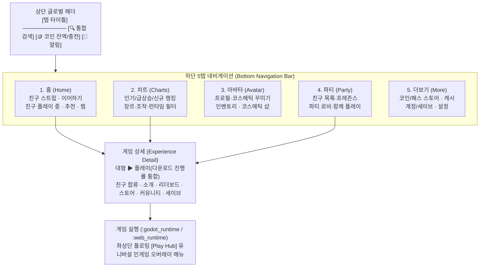
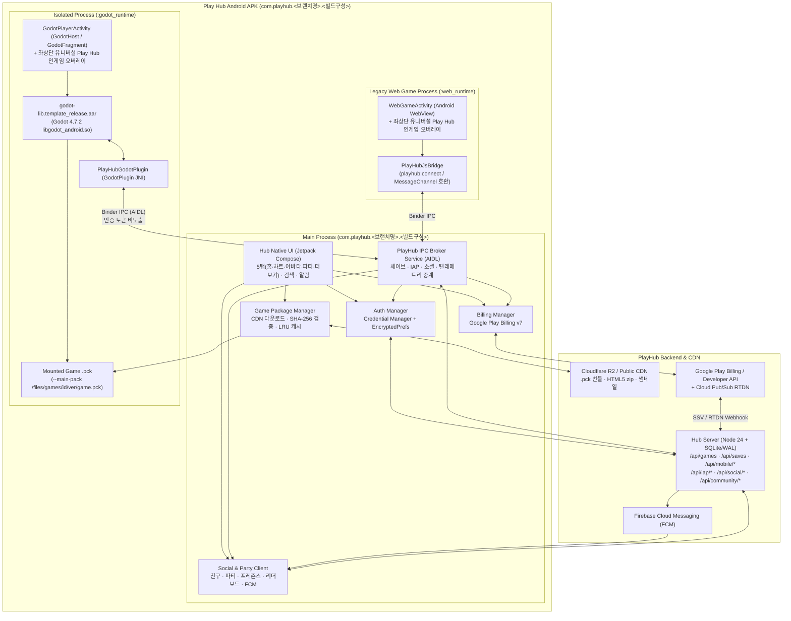
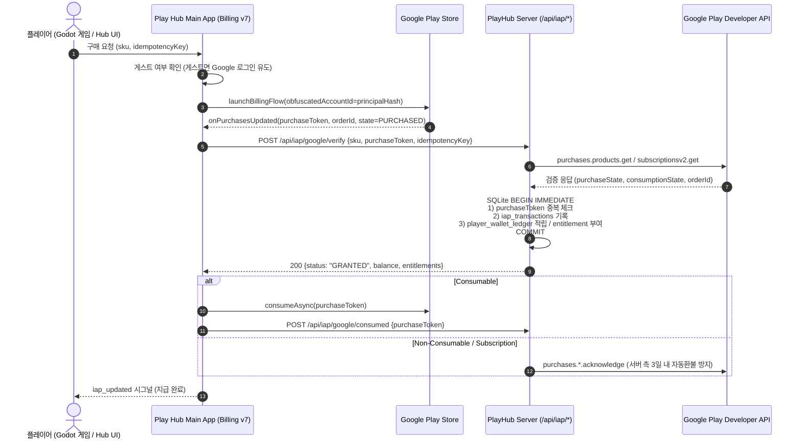
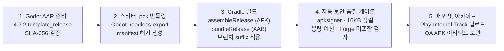

# Play Hub Android (AOS) APK · Godot 엔진 내장 번들링 빌드 계획안

- **브랜치 / 워크트리**: `Hub-AOS` (`D:\Github\GoDotProjects-worktrees\Hub-AOS`, 기준 `PlayHub-Platform` `3ad74a2`)
- **Android 패키지 ID 규칙 (`com.playhub.<브랜치명>.<빌드구성>`)**:
  - 4세그먼트 통일 구조이며, 마지막 세그먼트는 항상 **5종 빌드 구성(`debug` · `dev` · `test` · `release` · `live`)**으로 끝난다.
  - 공식/트렁크 빌드: `com.playhub.gamedev.<debug|dev|test|release|live>` (정식 출시: `com.playhub.gamedev.live`)
  - 브랜치 빌드: `com.playhub.<정규화_브랜치명>.<debug|dev|test|release>` (예: `Hub-AOS` → `com.playhub.hub_aos.debug`, `com.playhub.hub_aos.dev`, `com.playhub.hub_aos.test`, `com.playhub.hub_aos.release`)
- **문서 상태**: v1.6 (2026-11-21 — 배포 용량 최소화 정책 확정: 스타터 0종 100% On-Demand, `arm64-v8a` 단독 APK, 경량 네이티브 쉘, R8/리소스 축소)
- **대상 엔진**: `godot-engine` 포크 고정 커밋 `ed1daf0bf001b61586d9930840f2f1394092c079` (**Godot 4.7.2-stable**)
- **핵심 범위**: Android용 Play Hub **게임 플레이 런타임 전용 APK/AAB**, **Roblox 스타일 5탭 + 인게임 오버레이 메뉴 구성**, Godot 4.7.2 네이티브 엔진 내장 및 게임 번들링(`.pck` + 기존 HTML5/JS 호환), **Guest 즉시 플레이 + 연령 확인 법령 준수**, **인앱구매(IAP)**, **소셜 기능**
- **명시적 제외 (Non-Goals)**: **PlayForge 전면 제외** — 웹 에디터(`/forge/*`), 창작자 대시보드(`/?view=create`), 프로젝트 빌드/PIE, `@tool` 스크립트 실행, Godot 에디터 바이너리 및 개발 도구는 APK에 일절 포함하지 않는다. (Roblox의 `Create` 메뉴에 해당하는 창작자 진입점 역시 제외한다.)

---

## 1. 배경 및 목표

현재 PlayHub 웹 포털(`hub/`)은 브라우저에서 HTML5/JS 게임(40종)과 Godot Web/WASM 게임(`survivor-arena-g2` 등)을 실행한다. 그러나 Android 모바일 환경에서 웹 브라우저 기반 Godot WASM 실행은 다음과 같은 구조적 한계가 있다.

1. **초기 로딩 및 메모리 부담**: 매 게임마다 수십 MB 규모의 Godot WASM 바이너리를 다운로드·컴파일해야 하며, 모바일 브라우저 탭 메모리 제한으로 대형 3D 게임이 강제 종료(OOM)되기 쉽다.
2. **COOP/COEP 및 WebView 제약**: Godot 멀티스레드 WASM(`SharedArrayBuffer`)은 `COOP/COEP` 격리 헤더를 요구해 Hub 포털 iframe·OAuth·결제 흐름과 충돌한다.
3. **모바일 네이티브 기능 부재**: Google Play 인앱결제(IAP), 네이티브 Google 로그인(Credential Manager), 푸시 알림(FCM), 앱 링크 초대, 오프라인 `.pck` 캐싱을 브라우저만으로 제공하기 어렵다.

### 목표

- **단일 Play Hub APK에 Godot 4.7.2 네이티브 런타임(`libgodot_android.so`)을 1회 내장**하고, 개별 Godot 게임은 경량 `.pck` 리소스 팩(예: `survivor-arena-g2` 1.87 MiB) 단위로 번들링·온디맨드 다운로드해 **네이티브 60fps**로 즉시 실행한다.
- **게임 플레이 전용 앱**으로서 Forge 관련 기능·코드·라우트를 완전히 배제하고 공격 표면과 APK 용량을 최소화한다.
- 기존 PlayHub 백엔드(`hub/server/`, Node 24 + SQLite WAL + Cloudflare R2 CDN)와 계정을 공유하면서, 모바일에 필수적인 **Google Play 인앱구매(IAP)**와 **소셜 기능(프로필·친구·프레즌스·초대·리더보드·커뮤니티)**을 통합 제공한다.
- 기존 `games/*/Web/` HTML5/JS 게임도 동일 APK 내 전용 `WebGameActivity`로 끊김 없이 실행할 수 있게 브릿지 호환성을 유지한다.

---

## 2. 범위 정의 (포함 vs 제외)

| 영역 | 포함 (Hub-AOS APK) | 제외 (Non-Goals) |
|---|---|---|
| **엔진/런타임** | Godot 4.7.2 `template_release` 네이티브 라이브러리(`godot-lib.template_release.aar`) 내장, `.pck` 동적 실행, 기존 HTML5/JS 게임용 격리 WebView 런타임 | PlayForge 웹 에디터, Godot 에디터/디버거 바이너리, GDScript 프로젝트 컴파일/익스포트, `@tool` 실행 |
| **포털 UI / 메뉴** | **Roblox 스타일 5탭 네비게이션**(`홈` · `차트` · `아바타` · `파티` · `더보기`), 상단 유틸리티 바(검색·코인·알림), Experience 상세 화면, **유니버설 인게임 오버레이 메뉴** | `/forge/*`, `/?view=create`, 창작자 제출 콘솔, Admin 콘솔(`/api/admin/*`) |
| **인증 · 연령 준수** | **Guest 즉시 플레이** + Google Credential Manager 로그인 + 기존 `merge_requests` 계정 병합, **중립적 연령 게이트(Neutral Age Gate)**, KR(개인정보보호법·게임산업법·청소년보호법)·COPPA·GDPR-K·Google Play Families 준수 | Forge 세션 쿠키(`poc_forge_session`), 관리자 로그인 |
| **결제 (IAP)** | Google Play Billing v7, 서버 영수증 검증(SSV), RTDN(환불/구독), 플레이어 코인·Play Pass·아바타 코스메틱·게임별 엔타이틀먼트 원장 | 외부 웹 결제 우회(Google Play 정책 위반), 제작자 인프라 과금 UI(`Hub Point`) |
| **소셜** | 프로필/핸들, 친구 요청·차단, 실시간 프레즌스, **파티 로비(함께 플레이)**, 게임 초대 딥링크(App Links), 리더보드/업적, 기존 게임 커뮤니티(댓글·건의·투표·신고), FCM 푸시 | 음성 채팅/스트리밍(Phase 2 이후 검토), 오픈 월드 길드 서버 |

---

## 3. 앱 메뉴 구성 및 UX 아키텍처 (Roblox 스타일 런타임 허브)

Roblox 모바일 앱의 검증된 **상단 유틸리티 바 + 하단 5탭 + 유니버설 인게임 오버레이 메뉴** 패턴을 Play Hub 런타임 전용 구조에 맞게 매핑한다. Forge(창작) 메뉴는 완전히 제거하고 **게임 발견 → 즉시 실행 → 친구 합류 → 인앱 구매/꾸미기** 루프에 집중한다.



### 3.1 상단 글로벌 헤더 (Top Utility Bar)

| 요소 | 위치 | 동작 |
|---|---|---|
| **타이틀 / 로고** | 좌측 | 현재 탭 이름 표시 (`홈`, `차트`, `아바타`, `파티`, `더보기`) |
| **통합 검색 (`Search`)** | 우측 1 | 게임 카탈로그 + 사용자 핸들(`@handle`) 통합 검색 화면 진입 (최근 검색어·인기 태그 제공) |
| **코인 잔액 (`Play Coin` Pill)** | 우측 2 | 보유 코인 수량 실시간 표시 → 탭 시 **코인 충전 · Play Pass 스토어** 모달/화면 즉시 오픈 (Roblox Robux 버튼 역할) |
| **알림 (`Notifications`)** | 우측 3 | 미확인 배지 카운트 + 알림 피드(친구 요청 수락/거절, 게임·파티 초대 즉시 합류, 커뮤니티 답글, 결제/보상 내역) |

### 3.2 하단 5탭 상세 기능 정의

| 탭 | Roblox 대응 | 핵심 화면 구성 및 기능 |
|---|---|---|
| **1. 홈 (`Home`)** | `Home` | • **친구 가로 스트립 (Connections)**: 최상단에 온라인(초록 점)·플레이 중(파란 아이콘) 친구 아바타 가로 나열 + `친구 추가(+)` 버튼. 탭 시 프로필·`합류하기(Join)` 바텀시트<br/>• **이어하기 (`Continue`)**: 최근 플레이한 게임 가로 카드(로컬 `.pck` 캐시 완료 배지 + 클라우드 세이브 동기화 시각)<br/>• **친구들이 플레이 중 (`Friends Are Playing`)**: 현재 친구가 즐기는 게임과 참여 친구 수 + 원탭 합류<br/>• **추천 게임 (`Recommended`)** & **찜한 게임 (`Favorites`)**: 기존 `wishlist_items` 연동 |
| **2. 차트 (`Charts`)** | `Charts` / `Discover` | • **실시간 랭킹 레일**: 인기 급상승(Trending), 최다 플레이(Top Playing), 최고 추천(Top Rated), 신규·업데이트(New & Updated — 기존 `gameReleaseBadge` 14일 규칙 적용)<br/>• **필터 칩**: 장르(`액션`·`생존`·`퍼즐`·`전략`·`Godot 3D`·`타워 디펜스` 등), 조작(`터치`·`게임패드`), 런타임(`네이티브 3D`·`즉시 웹플레이`) |
| **3. 아바타 (`Avatar`)** | `Avatar` | • **프로필 & 아바타 꾸미기**: 프리셋 2D/3D 아바타, 프로필 프레임, 칭호, 배지(Play Pass·업적) 장착 및 미리보기<br/>• **인벤토리 (`Inventory`)**: 플랫폼 코스메틱 + 게임별 보유 엔타이틀먼트(DLC·패스·영구 아이템) 통합 보관함<br/>• **코스메틱 샵 (`Marketplace` 경량판)**: 플랫폼 공용 코인으로 구매 가능한 아바타·프레임·이모티콘 카탈로그(IAP 소비처 확보) |
| **4. 파티 (`Party`)** | `Party` / `Connect` | • **파티 로비 (`Party`)**: 최대 4~8인 친구 파티 생성, 파티 텍스트/퀵메시지 채팅, 파티장이 게임 선택 시 파티원 전원에게 `함께 플레이` 초대 카드 전송 → 동의 시 동일 `roomCode`로 동시 실행<br/>• **친구 목록 & 프레즌스**: 인게임 / 온라인 / 오프라인 섹션 분리, 원탭 `합류하기(Join)`·`초대하기(Invite)`<br/>• **친구 추가 & 안전**: 핸들 검색, QR 코드 스캔/표시, 딥링크 초대 복사, 차단/신고 관리 |
| **5. 더보기 (`More`)** | `More` | • 2열 타일 그리드 구성 (**Forge/만들기 메뉴 미포함**):<br/>  - **스토어 / 코인 충전 (`Play Coin & Pass`)**: 코인 패키지, Play Pass 구독, 구매/원장 내역, 구매 복원<br/>  - **찜한 게임 (`Favorites`)** & **저장소/캐시 관리 (`Storage`)**: 설치된 `.pck` 게임 목록·용량 확인·개별 삭제·캐시 일괄 정리<br/>  - **내 프로필 & 업적 (`Profile & Badges`)**<br/>  - **계정 & 클라우드 세이브 (`Account`)**: Google 계정 연결, 게스트 기록 병합(`merge_requests`), 로그아웃<br/>  - **설정 (`Settings`)**: 다국어(`ko/en/ja/zh-CN/fr/es/pt-BR/hi`, 기존 `user_preferences`), 그래픽 품질(`자동/고/중/저`, GL/Vulkan), 알림(FCM 토글), 프라이버시(프레즌스/초대 범위), 약관·계정 삭제 |

### 3.3 게임 상세 화면 (Experience Detail)

Roblox의 Experience 상세 페이지와 동일한 단일 진입 허브를 제공한다.

- **히어로 영역**: 16:9 커버/스크린샷 캐러셀, 게임 타이틀·장르 태그·런타임 배지(`Godot 3D` / `Web`), 추천 비율·플레이 수·지원 조작(`터치`/`게임패드`), 찜하기(`♡/♥`)·공유 버튼
- **통합 대형 `▶ 플레이` CTA 버튼**:
  - `.pck` 캐시 완료 시: 즉시 `:godot_runtime` 실행
  - 미설치/구버전 시: 버튼 자체가 다운로드 진행률 바(`다운로드 중 64% · 1.2/1.9 MB`)로 전환 → SHA-256 검증 완료 즉시 자동 실행
- **친구 합류 배너**: 현재 이 게임을 플레이 중인 친구 아바타와 `합류하기` 버튼 노출
- **상세 서브 탭 5종**:
  1. `소개`: 게임 설명·규칙·조작법·업데이트 내역
  2. `리더보드`: 전체 / 친구 / 내 주변 순위 (일간·주간·누적)
  3. `스토어(아이템/패스)`: 해당 게임에서 사용 가능한 인앱 상품·패스 목록 미리보기 및 사전 구매
  4. `커뮤니티`: 기존 `/api/games/:id/community` 댓글·건의·투표·신고 네이티브 UI
  5. `세이브`: 클라우드 세이브 슬롯·백업 목록 및 복원(`main` / 보관 슬롯 / 충돌 해결)

### 3.4 유니버설 인게임 오버레이 메뉴 (Roblox 좌상단 로고 버튼 패턴)

`:godot_runtime`(`GodotPlayerActivity`)과 `:web_runtime`(`WebGameActivity`) 모두 화면 좌상단 안전 영역(Safe Area)에 반투명 플로팅 **`Play Hub` 로고 버튼**을 네이티브 오버레이로 고정한다.

- **탭 1 — 플레이어 & 초대 (`People`)**: 현재 세션/파티 참여자 목록, 온라인 친구 즉시 초대(`Invite Friends`), 신고/차단
- **탭 2 — 인게임 스토어 (`Store`)**: 게임을 종료하지 않고 현재 보유 코인 확인 + 부족 시 Google Play Billing 코인 즉시 충전 → 게임으로 자동 지급
- **탭 3 — 설정 (`Settings`)**: 마스터/BGM/SFX 볼륨, 터치 조이스틱 감도, FPS/핑 표시, 그래픽 절전 모드, 언어 변경
- **하단 고정 액션**: `클라우드 즉시 저장`(`host_snapshot` 트리거), `다시 시작`, **`허브로 나가기 (Leave)`** (마지막 세이브 저장 → `game_end` 이벤트 전송 → `:godot_runtime` 프로세스 완전 회수)

---

## 4. 전체 시스템 아키텍처

### 4.1 프로세스 분리 기반 하이브리드 런타임 구조

Godot 4 Android 엔진은 단일 OS 프로세스 내에서 C++ 네이티브 엔진 인스턴스를 반복 종료·재초기화할 때 전역 상태 잔존이나 크래시가 발생할 수 있다. 멀티 게임 플랫폼(Roblox/슈퍼앱 패턴)으로 안정적으로 동작하기 위해 **Play Hub 메인 앱 프로세스**와 **Godot 게임 실행 프로세스(`:godot_runtime`)를 OS 수준에서 분리**한다.



### 4.2 아키텍처 핵심 설계 결정

| 항목 | 채택안 | 이유 |
|---|---|---|
| **Godot 내장 방식** | Android 네이티브 앱(Kotlin/Compose)이 `godot-lib.template_release.aar`을 의존하고 `GodotFragment`/`GodotHost`로 호스팅 | 네이티브 Google Play Billing, Credential Manager, App Links, FCM, WebView, 유니버설 인게임 오버레이를 표준 Android API로 안정 구현 가능 |
| **게임 전환 안정성** | `GodotPlayerActivity`를 `android:process=":godot_runtime"`으로 격리하고 게임 종료 시 `Process.killProcess()`로 프로세스 회수 | 게임 A → 게임 B 전환 시 GPU 컨텍스트·오디오·C++ 싱글톤 누수 및 재초기화 크래시 원천 차단 |
| **권한·보안 경계** | 게임 프로세스(`:godot_runtime`)에는 인증 토큰·결제 키를 절대 전달하지 않고 Main Process의 `PlayHubBrokerService`(AIDL)만 호출 | 악성/오동작 UGC 게임이 세션 토큰을 탈취하거나 타 게임 세이브에 접근하는 경로 차단 |
| **기존 HTML5 게임** | `WebGameActivity` (`:web_runtime`) + `WebViewAssetLoader` + `PlayHubJsBridge` | 기존 `games/*/Web/` 40종을 별도 포팅 없이 즉시 플레이 가능. 기존 `playhub:connect` / `MessageChannel` 프로토콜 100% 유지 |

---

## 5. Godot 4.7.2 엔진 내장 및 게임 번들링 전략

### 5.1 로컬 4.7.2 엔진 템플릿 실측 및 바이너리 예산

현재 개발 호스트(`%APPDATA%\Godot\export_templates\4.7.2.stable\android_source.zip`)에 설치된 Godot 4.7.2 공식 Android 템플릿 실측 결과는 다음과 같다.

| 구성 요소 | 실측 스펙 / 크기 | 비고 |
|---|---|---|
| **Gradle / AGP / Kotlin / JDK** | Gradle `8.11.1`, AGP `8.6.1`, Kotlin `2.1.21`, Java `17` | 호스트 `JAVA_HOME=D:\SDK\jdk-17.0.15.6-hotspot` 보유 |
| **Android SDK 타겟** | `compileSdk 36`, `targetSdk 36`, `minSdk 24`, `buildTools 36.1.0` | 호스트 `D:\SDK\AndroidSDK`에 `android-36`, `build-tools 36.0.0`, `ndk 27.2.12479018` 보유 |
| **`godot-lib.template_release.aar` 전체** | 98.5 MiB (4개 ABI 통합) | `arm64-v8a`, `armeabi-v7a`, `x86`, `x86_64` 포함 |
| **`arm64-v8a` 네이티브 `.so`** | `libgodot_android.so` 67.8 MiB (압축 **22.9 MiB**) + `libc++_shared.so` 1.3 MiB (압축 **0.43 MiB**) | 64비트 실기기 타겟 핵심 용량 (~23.3 MiB) |
| **`armeabi-v7a` 네이티브 `.so`** | `libgodot_android.so` 71.5 MiB (압축 **24.3 MiB**) + `libc++_shared.so` 0.92 MiB (압축 **0.38 MiB**) | 구형 32비트 기기 지원용 (AAB 분할 전달) |
| **`x86` / `x86_64` 네이티브 `.so`** | 각 약 25~26 MiB 압축 | 프로덕션 APK/AAB에서 **제외**, `devDebug` 에뮬레이터 빌드만 `x86_64` 포함 |

### 5.2 배포 용량 최소화 전략 (확정안)

배포 APK/AAB 크기를 최소화하기 위해 다음 5대 원칙을 **M0부터 기본 정책으로 강제**한다.

1. **스타터 게임 0종 내장 (100% On-Demand `.pck`)**: 초기 APK에 게임 `.pck`나 대형 미디어 자산을 포함하지 않고, 사용자가 선택한 게임만 R2/CDN에서 다운로드·SHA-256 검증·LRU 캐싱한다.
2. **단일 `template_release` AAR + 최소 ABI 패키징**: `debug`/`dev` 빌드에서도 Godot 엔진 자체는 `godot-lib.template_release.aar`을 사용해 디버그 심볼 팽창을 방지한다. 배포 APK는 **`arm64-v8a` 단독**으로 패키징하며(`x86_64`는 `-PincludeX86=true` 에뮬레이터 옵션 시에만 포함), Google Play AAB만 `arm64-v8a` + `armeabi-v7a` 분할 전달을 사용한다.
3. **초경량 Android 네이티브 쉘**: M0~M1 단계에서 대형 UI 런타임(Compose/Material3 대용량 리소스 등) 의존을 최소화하고 순수 AndroidX + `VectorDrawable` + WebP로 구성해 앱 쉘 오버헤드를 **1~2 MiB 이하**로 억제한다.
4. **R8 Full Mode + 리소스/로케일 축소**: `test`/`release`/`live` 구성에서 `isMinifyEnabled = true`, `isShrinkResources = true`, `resourceConfigurations` 8개 지원 로케일(`ko`, `en`, `ja`, `zh-rCN`, `fr`, `es`, `pt-rBR`, `hi`)만 유지한다.
5. **2단계 엔진 경량화**:
   - **Stage 1 (M0 즉시 적용)**: 고정 포크 4.7.2 `godot-lib.template_release.aar` (`arm64-v8a` `.so` 압축 23.3 MiB) → **목표 APK 크기 ≤ 28 MiB**.
   - **Stage 2 (커스텀 SCons 빌드, `tools/aos/custom.py`)**: `godot-engine` 서브모듈에서 `target=template_release`, `use_lto=yes`, `optimize=size`, `debug_symbols=no`, `openxr=no`, `module_mono_enabled=no`, 불필요 임포터/모듈 제거 → `arm64-v8a` `.so` 압축 14~18 MiB, **목표 APK 크기 ≤ 20 MiB**. (포크 코어 규칙 [docs/migration/godot-submodule.md](../migration/godot-submodule.md) 준수)

### 5.3 Android 15/16 (API 35~36) 및 16 KB 메모리 페이지 대응

- Google Play 정책(API 35+ 기기)에 따라 모든 네이티브 `.so` 라이브러리는 **16 KB ELF 페이지 정렬**을 충족해야 한다.
- `packaging.jniLibs.useLegacyPackaging = false` (비압축 16 KB 정렬 매핑, 또는 `minSdk`별 분기) 및 빌드 후 `zipalign -c -p 4` + ELF `LOAD` 세그먼트 정렬(`p_align >= 16384`) 자동 검증을 CI 게이트에 포함한다.
- 렌더링 드라이버 전략:
  - PlayHub 기존 Godot 게임(`survivor-arena-g2`, `forge/Samples/*`)은 `gl_compatibility` 기준이다.
  - 게임 매니페스트의 `android.renderingMethod` (`gl_compatibility` 기본, `mobile` 선택)와 기기 Vulkan/GLES3 지원 여부를 조합해 `--rendering-driver opengl3` 또는 `--rendering-driver vulkan`으로 기동한다.

### 5.4 게임 패키지 번들링 · 동적 배포 · 호환성 검증

PlayHub의 모든 게임을 APK 안에 정적으로 때려 넣지 않고 **3계층 번들링 모델**을 채택한다.

| 계층 | 대상 | 저장 위치 | 용도 |
|---|---|---|---|
| **Tier 0: Install-time 스타터 번들 (선택)** | 대표 Godot 게임 1~2종 (예: `survivor-arena-g2`, ~1.9 MiB) | APK `assets/bundled_games/` 또는 Play Asset Delivery `install-time` | 앱 설치 직후 오프라인·무대기 즉시 플레이 체험 |
| **Tier 1: On-demand Godot `.pck` 캐시** | PlayHub 카탈로그의 모든 Godot 4.7.2 게임 | `context.filesDir/games/<gameId>/<version>/game.pck` | 최초 플레이 시 R2/CDN에서 다운로드 → SHA-256 검증 → 로컬 캐싱(LRU 상한 예: 2 GiB) |
| **Tier 2: HTML5/JS 레거시 번들** | 기존 `games/*/Web/` 40종 | 원격 HTTPS(기본) 또는 선택적 오프라인 zip 캐시 | `WebGameActivity`에서 기존 `playhub:connect` 프로토콜로 실행 |

#### `game.manifest.json` 확장 계약 (`android` 블록 제안)

기존 `games/<id>/game.manifest.json` 하위 호환을 깨지 않으면서 선택적 `android` 필드를 추가한다.

```json
{
  "android": {
    "runtime": "godot-pck",
    "engineVersion": "4.7.2",
    "pckFormatVersion": 2,
    "renderingMethod": "gl_compatibility",
    "orientation": "landscape",
    "bundle": {
      "url": "/cdn/games/survivor-arena-g2/2.1.0/game.pck",
      "sha256": "<64-hex>",
      "bytes": 1961420,
      "bundledInApk": false
    },
    "touchOptimized": true,
    "minAppVersionCode": 100
  }
}
```

#### `.pck` 실행 및 호환성·보안 게이트

1. **사전 검증**: 다운로드 완료 후 `.tmp` 파일의 크기 및 SHA-256을 매니페스트와 대조하고, 파일 헤더(`GDPC` 매직 바이트 + `format_version` + `engine_major.minor == 4.7`)를 검사한 뒤 원자적 `rename`으로 캐시에 확정한다.
2. **실행 인자 전달**: `GodotPlayerActivity.getCommandLine()`에서 아래 인자를 Godot 엔진에 전달한다.
   - `--main-pack <absolute_pck_path>`
   - `--rendering-driver <opengl3|vulkan>`
   - `--user-data-dir <filesDir>/game_userdata/<accountHash>/<gameId>` (게임·계정별 `user://` 완전 격리)
   - `--playhub-game-id=<gameId>`, `--playhub-locale=<ko|en|...>`, `--playhub-launch-token=<ephemeral_ipc_nonce>`
3. **샌드박스 제약**:
   - `:godot_runtime` 프로세스는 `PlayHubBrokerService` IPC 외에 Main Process의 `EncryptedSharedPreferences`, 인증 토큰 DB, 타 게임 `user://` 경로에 접근하지 않도록 파일 경로·권한을 분리한다.
   - `game.manifest.json`의 `capabilities.externalNetwork` 외 임의 도메인 통신 및 `OS.execute()`류 위험 호출은 PlayHub 검수(GamerQA 정적/동적 규칙) 단계에서 사전 차단한다.

---

## 6. PlayHub Native ↔ Godot 브릿지 SDK 설계

게임 개발자(및 기존 Godot 게임 포팅)가 **단일 GDScript 코드로 Web과 Android APK 양쪽에서 동작**할 수 있도록 런타임 전용 경량 브릿지 계약을 정의한다.

### 6.1 Android 측 (`PlayHubGodotPlugin`)

`org.godotengine.godot.plugin.GodotPlugin`을 상속해 싱글톤 이름 `PlayHubBridge`로 등록한다. 모든 메서드는 비동기 요청 ID(`reqId`)를 반환하고 결과를 Godot 시그널(`bridge_response(req_id, ok, json_payload)`) 및 이벤트 시그널(`bridge_event(event_type, json_payload)`)로 통지한다.

### 6.2 브릿지 API 계약 (기존 웹 `playhub:connect` 1:1 확장)

| 도메인 | 메서드 / 이벤트 | 설명 및 백엔드 매핑 |
|---|---|---|
| **Lifecycle** | `ready()`, `pause()`, `resume()`, `activity_pulse()` / 이벤트 `host_pause`, `host_resume`, `host_snapshot` | 기존 `hub/web/user/app.js`의 `play_sessions`·`play_heartbeat`·`round_start`·`round_complete` 계약 그대로 유지 |
| **Save** | `save_load(slot)`, `save_write(slot, json)` | Main Process 브로커가 기존 `GET/PUT /api/saves/:gameId` 호출(ETag/`If-Match` 낙관적 잠금 + 오프라인 Room 캐시 및 충돌 해결 UI 제공) |
| **Auth / Profile** | `get_profile()`, `request_google_sign_in()` | `displayName`, `handle`, `avatarId`, `frameId`, `isGuest`, `locale` 반환 (액세스 토큰은 절대 게임에 미전달) |
| **IAP** | `iap_query_products(skus_json)`, `iap_purchase(sku, idempotency_key)`, `iap_get_entitlements()`, `iap_spend_coin(item_id, amount, key)` / 이벤트 `iap_updated` | Main Process의 Google Play Billing v7 + Hub SSV/원장 API 연동 (인게임 오버레이 스토어와 상태 동기화) |
| **Social / Party** | `social_get_friends()`, `social_get_party()`, `social_invite_friend(friend_id, room_json)`, `social_submit_score(board_id, score)`, `social_get_leaderboard(board_id, scope)`, `social_open_overlay(tab)`, `social_share_link(room_json)` / 이벤트 `social_invite_received` | Hub 소셜/파티 API 및 Android ShareSheet / App Links / 인게임 오버레이 연동 |

---

## 7. 인앱구매 (IAP) 아키텍처

### 7.1 정책 준수 및 멀티게임 SKU 전략

Google Play 정책상 Android APK 내부의 모든 디지털 재화·아이템·구독 결제는 **Google Play Billing Library (v7.x)**를 통해 처리해야 한다. 또한 PlayHub처럼 다수의 게임이 카탈로그에 수시로 추가되는 플랫폼에서는 게임마다 Play Console에 개별 SKU를 수동 등록하는 방식이 확장되지 않는다.

따라서 **플랫폼 공용 재화(플레이어 코인/패스) + 주요 피처드 게임 직접 SKU 하이브리드 구조**를 채택한다.

> [!IMPORTANT]
> **용어 분리**: 제작자 멀티플레이 서버 인프라 과금용 `Hub Point`와 혼동하지 않도록, Android 플레이어 인앱결제 재화는 별도 명칭(예: **`Play Gem` / `Play Coin`**, 확정 전 가칭 `Play Coin`)과 별도 원장 테이블을 사용한다.

| 구매 계층 | Google Play 상품 유형 | SKU 예시 | 동작 방식 |
|---|---|---|---|
| **1. 플랫폼 공용 코인 (핵심)** | Consumable (고정 가격 티어) | `playhub.coin.tier1` (100), `tier2` (500), `tier3` (1200), `tier4` (3000), `tier5` (6500) | Google Play로 코인 충전 → Hub 원장 적립 → 모든 입점 게임 내에서 코인으로 아이템·스킨·부활권 즉시 구매 (신규 게임 추가 시 Play Console SKU 심사 불필요) |
| **2. Play Pass 구독** | Subscription (월간/연간) | `playhub.pass.monthly`, `playhub.pass.yearly` | 광고 제거, 월간 보너스 코인, 클라우드 세이브 슬롯 확장, 프로필 배지 |
| **3. 피처드 게임 전용 상품 (선택)** | Non-Consumable / Consumable | `game.<gameId>.<productKey>` | 대표 타이틀의 DLC·풀버전 해금 등 직접 결제가 유리한 상품에 한해 선별 등록 |

### 7.2 결제 및 서버 검증(SSV) 시퀀스

클라이언트의 결제 성공 응답만 믿고 아이템을 지급하지 않는다. 모든 결제는 **Hub 서버의 Google Play Developer API 검증 + SQLite `BEGIN IMMEDIATE` 트랜잭션 원장 기록** 후에만 확정한다.



### 7.3 RTDN(실시간 개발자 알림) · 환불 · 예외 처리

- **RTDN Webhook (`POST /api/iap/google/rtdn`)**: Google Cloud Pub/Sub Push 구독을 연결해 구독 갱신(`SUBSCRIPTION_RENEWED`), 보류(`ON_HOLD`), 취소(`CANCELED`), 결제 취소/환불(`VOIDED_PURCHASE`)을 자동 수신한다.
- **환불·차지백 회수 정책**: `VOIDED_PURCHASE` 수신 시 해당 `iap_transactions`를 `VOIDED`로 전이하고 `player_entitlements.revoked_at`을 기록하며, 코인 잔액 차감(음수 전환 시 계정 결제 제한 플래그 및 관리자 감사 로그 `audit` 기록)을 수행한다.
- **미지급 복구 (Pending / 크래시 내성)**: 앱 재시작 및 결제 화면 진입 시 `BillingClient.queryPurchasesAsync()`를 호출해 서버 미반영 `purchaseToken`을 자동으로 `/api/iap/google/verify`에 재전송한다(`purchaseToken` UNIQUE 멱등성 보장).
- **게스트 계정 보호**: 게스트 상태의 결제는 기기 초기화 시 영구 유실 위험이 있으므로, **결제 시작 전 Google 계정 연결을 필수(또는 강력 권장 + 기존 `merge_requests`로 게스트 기록 자동 병합)**로 정책화한다.
- **어뷰징 방어**: Google **Play Integrity API** 토큰을 고액 결제·리더보드 제출 시 검증해 변조 APK 및 에뮬레이터 결제 사기를 차단한다.

### 7.4 IAP · 아바타 코스메틱 데이터베이스 스키마 설계 (`hub/server/iap/schema.mjs`)

기존 `hub/server/db.mjs`(`PRAGMA user_version = 1`) 호환성을 유지하기 위해 `hub/server/cdn/schema.mjs`와 동일한 패턴으로 `CREATE TABLE IF NOT EXISTS` 독립 모듈로 구성한다.

| 테이블 | 핵심 컬럼 | 불변 조건 / 목적 |
|---|---|---|
| `iap_products` | `sku (PK)`, `platform`, `kind`, `game_id`, `coin_amount`, `entitlement_key`, `active` | 서버 기준 상품 마스터 |
| `iap_transactions` | `id (PK)`, `principal_id`, `sku`, `purchase_token (UNIQUE)`, `order_id`, `state`, `raw_receipt_hash`, `created_at`, `updated_at` | 중복 검증 차단 및 상태 전이 감사 |
| `player_wallet_accounts` | `principal_id (PK)`, `balance INTEGER NOT NULL CHECK(balance >= 0)`, `updated_at` | 플레이어 공용 코인 잔액 |
| `player_wallet_ledger` | `id (PK)`, `principal_id`, `delta`, `balance_after`, `reason`, `ref_id`, `idempotency_key (UNIQUE)`, `created_at` | 불변 이중 기입 거래 원장 |
| `player_entitlements` | `principal_id`, `game_id`, `item_id`, `source_tx_id`, `expires_at`, `revoked_at` | 게임별 영구/기간제 보유 권한 및 플랫폼 코스메틱 인벤토리 |
| `avatar_loadouts` | `principal_id (PK)`, `avatar_id`, `frame_id`, `title_id`, `badge_ids_json`, `updated_at` | 아바타 탭 장착 코스메틱 상태 (소유권 검증 필수) |

---

## 8. 소셜 · 파티 기능 아키텍처

### 8.1 기존 Hub 자산 재사용 및 확장 범위

PlayHub 백엔드에는 이미 `users`, `identities`, `wishlist_items`, `play_sessions`, `community_items`/`community_votes`/`community_reports`([hub/server/community.mjs](../../hub/server/community.mjs))가 구현되어 있다. Android 소셜 기능은 이를 그대로 재사용하면서 **Roblox 스타일의 친구 스트립 · 파티 로비 · 즉시 합류** 계층을 추가한다.

### 8.2 소셜 핵심 기능 7대 축

1. **플레이어 프로필 · 고유 핸들 · 아바타**
   - `user_profiles`: `principal_id (PK)`, `handle (UNIQUE, 예: alex#4821)`, `avatar_id`, `bio`, `privacy_level (public|friends|private)`, `featured_game_id`.
   - 최근 플레이한 게임·총 플레이 타임은 기존 `play_sessions` 집계 쿼리로 자동 노출(비공개 설정 시 숨김).
2. **친구 & 차단 관리**
   - `social_friendships`: `requester_id`, `addressee_id`, `status (pending|accepted|declined)`, `created_at`, `updated_at`.
   - `social_blocks`: `blocker_id`, `blocked_id`, `created_at` (차단 시 친구 관계 자동 해제, 파티·초대·프레즌스·댓글 상호 숨김).
   - 친구 추가 수단: 핸들 검색, 1회용 친구 초대 링크/QR 코드, 최근 함께 플레이한 유저 목록.
3. **파티 로비 (`Party` — 함께 플레이)**
   - `social_parties`: `id (PK)`, `leader_id`, `title`, `target_game_id`, `room_code`, `max_members (기본 8)`, `created_at`, `updated_at`.
   - `social_party_members`: `party_id`, `principal_id`, `role (leader|member)`, `ready_state`, `joined_at`.
   - 파티장이 게임을 선택하면 파티원 전원에게 **"함께 플레이" 초대 카드 + 푸시**가 전달되고, 수락 시 동일 `room_code` 인자로 `:godot_runtime`에 합류한다.
4. **실시간 프레즌스 (Online / Playing Game X)**
   - 앱 포그라운드 시 WebSocket(`/api/social/ws`) 또는 30초 주기 경량 Heartbeat(`POST /api/social/presence`)로 상태(`online`, `in_game`, `offline`) + 현재 `gameId` + 참가 가능 여부(`joinable`, `roomCode`) 갱신.
   - 홈 상단 친구 스트립 및 파티 탭에서 "지금 `Survivor Arena G2` 플레이 중" 표시 및 **원탭 `합류하기(Join)`** 지원.
5. **게임 초대 & Android App Links (딥링크)**
   - 표준 URL 스킴: `https://playhub.<domain>/join/<gameId>?room=<roomCode>&inviter=<handle>`
   - `.well-known/assetlinks.json`을 Hub 정적 루트에 배포해 Android App Links 검증.
   - 수신자 플로우:
     - 앱 설치됨 → Play Hub 앱 즉시 실행 → 해당 게임 `.pck` 미보유 시 자동 다운로드 모달 → 완료 즉시 `:godot_runtime`에 `roomCode`를 전달해 합류.
     - 앱 미설치 → 모바일 웹 안내 페이지(Google Play 설치 링크 + 지연 딥링크 `Install Referrer`).
6. **리더보드 & 업적**
   - `social_leaderboards`: `game_id`, `board_id`, `principal_id`, `score`, `period_key (all|weekly:2026-W47|daily:2026-11-21)`, `updated_at`.
   - 범위 필터: **전체(Global) / 친구(Friends) / 내 주변 순위(Around Me)**.
   - 기존 `round_complete` 이벤트 검증(`play_session_id` 유효성, 플레이 시간 대비 점수 상한 체크 + Play Integrity 토큰)을 통해 점수 조작을 억제한다.
7. **기존 커뮤니티 연동 + FCM 푸시 알림 + 모더레이션**
   - 게임 상세 화면의 `커뮤니티` 서브 탭에 기존 `/api/games/:id/community` (댓글·건의·투표·신고) 네이티브 UI 탑재.
   - `mobile_push_tokens` 테이블로 기기별 FCM 토큰 등록 → 친구 요청, 파티/게임 초대, 커뮤니티 답글/상태 변경 시 푸시 발송(사용자별 알림 On/Off 및 방해금지 설정 지원).
   - 모든 사용자 생성 텍스트(핸들, 상태 메시지, 파티 메시지, 댓글)에 신고 기능을 제공하고 기존 `PlayHub-Admin` 모더레이션 큐와 연결한다.

### 8.3 모바일 인증 확장 (`hub/server/mobile/auth.mjs`)

기존 웹 Google OAuth(`hub/server/google.mjs`)는 브라우저 리다이렉트 + `HttpOnly` 쿠키(`poc_public_session`) 기반이다. Android 네이티브 앱을 위해 다음 인증 경로를 추가한다.

- **로그인 엔드포인트**: `POST /api/auth/google/mobile`
  - 클라이언트가 Android **Credential Manager**로 획득한 Google ID Token을 전달.
  - 서버는 기존 `google.mjs`의 `verifyIdToken` 검증 로직을 재사용하되 `aud` 허용 목록에 Android/Web OAuth Client ID를 추가한다.
- **세션 토큰 구조**:
  - **Access Token (JWT, 수명 15분)** + **Rotating Refresh Token (30일, DB 해시 저장, 재사용 감지 시 세션 일괄 폐기)** 발급.
  - Android 기기에서는 **Android Keystore 기반 EncryptedSharedPreferences**에 안전하게 보관.
  - 기존 게스트 세션을 보유한 기기가 Google 로그인 시 기존 `merge_requests` 흐름을 그대로 호출해 세이브·찜·커뮤니티 기록을 손실 없이 병합한다.

### 8.4 Guest 플레이 정책 및 연령 확인 · 법령 준수 아키텍처 (`hub/server/mobile/age-gate.mjs`)

앱 설치 직후 **로그인 강제 없이 Guest로 즉시 게임을 플레이**할 수 있되, 국내외 아동·청소년 보호 법령 및 Google Play 정책을 설계 단계부터 강제한다.

#### (1) 온보딩 및 중립적 연령 게이트 (Neutral Age Gate)

1. **최초 실행 플로우**: 앱 첫 기동 시 로그인 화면보다 먼저 **중립적 연령 게이트(생년월일 / 출생연월 직접 선택, 기본값 미채움, "만 14세 이상입니까?" 식 유도 질문 금지)**를 노출한다.
2. **연령 티어 판정 (국가/지역별 법정 기준 적용)**:
   - `CHILD_PROTECTED`: 한국 만 14세 미만(개인정보보호법) / 미국·글로벌 만 13세 미만(COPPA) / EU·UK 회원국별 만 13~16세 미만(GDPR-K)
   - `TEEN_MINOR`: 법정 아동 연령 이상 ~ 만 19세 미만(KR 청소년보호법) 또는 만 18세 미만(글로벌)
   - `ADULT`: 성인(만 19세 이상 KR / 만 18세 이상 글로벌)
3. **우회 방지 & 데이터 최소화**:
   - 연령 게이트 완료 결과는 서버(`user_age_compliance`)와 기기 암호화 저장소에 기록하며, 아동 판정 후 앱 재실행으로 생년월일을 임의 상향 변경하지 못하도록 쿨다운·재검증 잠금을 둔다.
   - `CHILD_PROTECTED` 이용자는 원시 생년월일 저장을 최소화하고 `age_tier`, `region_code`, `consent_status`, `verified_at`만 보관한다.

#### (2) Guest / 연령 티어별 기능 허용 매트릭스

| 기능 | Guest (성인/청소년) | Guest (`CHILD_PROTECTED`) | Google 로그인 (`CHILD_PROTECTED` · 보호자 동의 전/후) | Google 로그인 (청소년/성인) |
|---|---|---|---|---|
| **게임 플레이** | 연령 등급(`ageRating`) 이하 게임 즉시 플레이 | 전체이용가(`ALL`)만 즉시 플레이 | 전체이용가(`ALL`) · 동의 시 12+ 허용 | 본인 연령 등급 이하 전체 플레이 |
| **클라우드 세이브 / 찜** | 게스트 세션 저장(추후 Google 로그인 시 `merge_requests` 병합) | 로컬/게스트 임시 저장(개인식별 정보 미수집) | 동의 후 계정 동기화 | 전체 지원 |
| **친구 · 파티 · 자유 채팅** | 열람·초대 링크 조회 가능, 글쓰기/친구추가 시 로그인 유도 | **자유 채팅·커뮤니티 작성·프로필 공개·외부 링크 전면 차단** | 동의 전 차단 / 동의 후 사전 정의 **안전 퀵메시지**만 허용 | 전체 지원 (신고·차단 적용) |
| **인앱구매 (IAP)** | 결제 시 Google 계정 연결 유도(기기 분실 시 유실 방지) | **차단** (보호자 동의 + Google Play Family Link 승인 필요) | 보호자 동의 및 Google Play 구매 인증 시 제한적 허용 | 전체 지원 (KR 미성년자 결제 한도 준수) |
| **개인화 광고 · 트래킹** | 동의 시 허용 | **전면 비활성화** (`tagForChildDirectedTreatment`) | **전면 비활성화** | 동의 시 허용 |

#### (3) 국내외 핵심 법령·스토어 정책 체크포인트

- **대한민국 개인정보보호법 (만 14세 미만)**: 회원가입·개인정보 수집 전 **법정대리인(보호자) 동의 절차**(보호자 이메일/본인인증 기반 동의 확인) 필수 구현 및 보호자 열람·삭제 요청 API 제공.
- **대한민국 게임산업법 · 청소년보호법**:
  - 모든 게임의 `game.manifest.json`에 필수 `ageRating`(`"ALL" | "12+" | "15+" | "18+"`)을 정의하고, 클라이언트 카탈로그 필터링뿐 아니라 서버 `POST /api/play-sessions`에서도 사용자의 `age_tier` 대비 게임 등급을 **이중 검증(Fail-Closed)**한다.
  - **확률형 아이템 확률 고지 의무**: 랜덤박스·가챠형 인앱 아이템을 제공하는 게임은 상품 상세·인게임 스토어 화면에 개별 확률표(`dropRates`) 노출을 강제한다.
  - **성인/본인 확인 확장 슬롯**: 향후 `18+` 게임 또는 청소년 결제 한도 해제가 필요할 경우 국내 본인확인(PASS/휴대폰 본인인증/아이핀) 프로바이더를 플러그인 형태로 연결할 수 있게 `user_age_compliance.kyc_verified_at` 필드를 예약한다.
- **미국 COPPA / EU GDPR-K / Google Play Families Policy**:
  - `CHILD_PROTECTED` 세션에는 행태 분석/광고 ID(AAID) 수집 중단, 외부 URL 이동 시 부모 게이트(Parental Gate) 표시, Google Play Age Signals API(지원 지역) 연동 대응.

#### (4) 연령 준수 DB 스키마 (`hub/server/mobile/age-gate.mjs`)

| 테이블 | 핵심 컬럼 | 목적 |
|---|---|---|
| `user_age_compliance` | `principal_id (PK)`, `region_code`, `age_tier`, `birth_year_month` (성인/동의 완료 시 선택), `parental_consent_status (not_required\|pending\|verified\|revoked)`, `parental_consent_at`, `kyc_verified_at`, `updated_at` | 연령 티어·보호자 동의 상태·등급 게이트 서버 검증 근거 |
| `parental_consent_logs` | `id (PK)`, `principal_id`, `guardian_contact_hash`, `method`, `status`, `created_at` | 만 14세/13세 미만 법정대리인 동의 감사 이력 |

---

## 9. 프로젝트 디렉터리 구조 및 워크트리 소유권

### 9.1 신규 디렉터리 구조 (`Hub-AOS`)

```text
Hub-AOS/
├─ android/                              # [신규] Android Gradle 멀티모듈 프로젝트
│  ├─ settings.gradle.kts
│  ├─ build.gradle.kts
│  ├─ gradle/wrapper/                    # Gradle 8.11.1 Wrapper
│  ├─ app/                               # Play Hub 메인 앱 (Roblox 스타일 5탭 Compose UI, Auth, IAP, Social/Party, PackageManager)
│  ├─ godot-runtime/                     # :godot_runtime 프로세스, GodotPlayerActivity, 유니버설 인게임 오버레이, PlayHubGodotPlugin, godot-lib.aar
│  ├─ web-runtime/                       # :web_runtime 프로세스, WebGameActivity, 유니버설 인게임 오버레이, PlayHubJsBridge
│  ├─ core-network/                      # Hub API Client, Auth Interceptor, WebSocket/Presence
│  └─ core-storage/                      # Room DB (오프라인 세이브/캐시 메타), EncryptedPrefs
├─ godot-sdk/                            # [신규] 게임 개발자용 런타임 전용 경량 GDScript SDK
│  └─ addons/playhub_runtime_sdk/        # Web(JSBridge) + Android(PlayHubBridge) 통합 추상화
├─ hub/server/
│  ├─ mobile/                            # [신규] 모바일 Google 로그인, Guest/토큰 회전, 연령 게이트(age-gate.mjs), 푸시 토큰, App Links
│  ├─ iap/                               # [신규] Google Play SSV, RTDN Webhook, 원장/엔타이틀먼트, 아바타 코스메틱
│  └─ social/                            # [신규] 프로필, 친구, 차단, 파티 로비, 프레즌스, 초대, 리더보드
├─ hub/tests/
│  ├─ mobile-auth.test.mjs               # [신규] 모바일 인증·Guest·토큰 회전·게스트 병합 테스트
│  ├─ mobile-age-gate.test.mjs           # [신규] 연령 게이트·KR/COPPA/GDPR-K 등급 차단·보호자 동의 테스트
│  ├─ iap.test.mjs                       # [신규] SSV·멱등성·원장·RTDN 환불·코스메틱 장착 테스트
│  └─ social.test.mjs                    # [신규] 친구·차단·파티·프레즌스·리더보드 테스트
├─ tools/aos/                            # [신규] Android 빌드·.pck 번들러·16KB/서명 검증 자동화 스크립트
│  ├─ extract-godot-aar.ps1              # 4.7.2 template AAR 추출 및 체크섬 고정
│  ├─ export-game-pcks.ps1               # Godot 게임 헤드리스 .pck 추출 + manifest SHA-256 갱신
│  ├─ build-apk.ps1                      # Flavor별 APK/AAB 빌드(브랜치 suffix 지원) + 16KB 정렬·서명·Forge 미포함 검증
│  └─ custom.py                          # Stage 2 경량 Godot Android SCons 프로파일
└─ docs/aos/
   └─ ANDROID_PLAYHUB_APK_BUILD_PLAN.md  # 본 계획안
```

### 9.2 워크트리 소유권 (`tools/worktree-ownership/owners.json`) 등록 제안

`owners.json`은 `PlayHub-Platform` 트렁크 소유 파일이므로, 구현 착수 전 트렁크에 아래 소유권 등록 PR/체리픽을 선행한다.

- **단독 소유(`owns`)**: `android/**`, `godot-sdk/**`, `hub/server/mobile/**`, `hub/server/iap/**`, `hub/server/social/**`, `hub/tests/mobile-*.mjs`, `hub/tests/iap*.mjs`, `hub/tests/social*.mjs`, `tools/aos/**`, `docs/aos/**`
- **공유 핫스팟(`shared`, 최소 변경)**: `hub/server/app.mjs` (신규 라우터 연결 및 `close()` 훅 각 1줄, `config.mobile/iap/social.enabled` 플래그로 기본 비활성 보호)

---

## 10. 빌드 · 번들링 · 서명 · CI/CD 파이프라인

### 10.1 로컬 개발 환경 현황 및 준비 항목

호스트 실측 결과 기준 즉시 착수 가능 상태와 보완 항목은 다음과 같다.

| 항목 | 현재 호스트 상태 | 조치 필요 여부 |
|---|---|---|
| **JDK 17** | `D:\SDK\jdk-17.0.15.6-hotspot` 설치 확인 | `JAVA_HOME` 유지 (Godot 4.7.2 요구 버전 일치) |
| **Android SDK** | `D:\SDK\AndroidSDK` (`platforms/android-33~36`, `build-tools 34~36.0.0`, `adb`, `emulator`) | 즉시 사용 가능 (`buildToolsVersion`은 `36.0.0` 또는 `sdkmanager`로 `36.1.0` 설치) |
| **Android NDK** | `ndk/25.1`, `25.2`, `27.2.12479018` 설치 확인 | Stage 1(사전 빌드 AAR 사용)에는 불필요. Stage 2 커스텀 C++ 빌드 시 NDK 29 또는 27 호환 검증 + `scons` 설치 필요 |
| **Godot 4.7.2 Export Templates** | `%APPDATA%\Godot\export_templates\4.7.2.stable\android_source.zip` 보유 (`godot-lib.template_release.aar` 포함) | `tools/aos/extract-godot-aar.ps1`로 추출·체크섬 고정하여 Gradle 로컬 Maven/flatDir로 연결 |

### 10.2 패키지 ID 규칙 및 5종 빌드 구성 (`debug` · `dev` · `test` · `release` · `live`)

**패키지 ID 명명 규칙 (`com.playhub.<브랜치명>.<빌드구성>`)**

- 모든 Android APK/AAB의 `applicationId`는 **`com.playhub.<브랜치명>.<빌드구성>`** 4세그먼트 형식으로 통일한다.
- **마지막 세그먼트는 항상 5종 빌드 구성** 중 하나다: `debug` · `dev` · `test` · `release` · `live`
- **공식 / 트렁크 빌드 (`<브랜치명> = gamedev`)**: `com.playhub.gamedev.<debug|dev|test|release|live>`
  - Google Play 정식 출시 앱 ID: **`com.playhub.gamedev.live`**
- **브랜치 빌드**: `git rev-parse --abbrev-ref HEAD`에서 추출한 브랜치명을 정규화해 3번째 세그먼트로 사용한다.
  - 예 (`Hub-AOS` 브랜치): `com.playhub.hub_aos.debug`, `com.playhub.hub_aos.dev`, `com.playhub.hub_aos.test`, `com.playhub.hub_aos.release`
  - **정규화 규칙 (Android `applicationId` 스펙 준수)**: 소문자 변환 → `-`, `/`, `.`, 공백 등 비영숫자를 `_`로 치환 → 연속 `_` 축약 → 세그먼트 시작이 숫자면 `b_` 접두 → 최대 32자 제한.
  - **Side-by-Side 동시 설치**: 브랜치명과 빌드 구성이 모두 패키지 ID에 포함되므로, 한 대의 Android 테스트 기기에 `com.playhub.gamedev.live`, `com.playhub.gamedev.dev`, `com.playhub.hub_aos.debug`, `com.playhub.hub_aos.test` 등을 **충돌 없이 동시 설치**해 비교 검증할 수 있다. (앱 라벨에도 `Play Hub [Hub-AOS/debug]` 형태로 자동 표기)
  - **`live` 브랜치 가드**: `live` 빌드 구성은 공식 트렁크/릴리스 브랜치 전용으로 `com.playhub.gamedev.live` 고정이며, 일반 작업 브랜치에서 `live` 빌드 시도 시 Gradle이 즉시 실패한다.
  - **Farm 서버군 선택 규칙 (`ALLOW_FARM_SELECTOR`)**: `release`·`live`가 **아닌** `debug`·`dev`·`test` 빌드에서만 상단 헤더 및 `더보기` 탭에서 Farm 서버군(`local`, `dev-farm-1`, `dev-farm-2`, `qa-farm`, `staging-farm`, Custom Tunnel URL)을 선택·전환할 수 있다. `release`·`live` 빌드는 컴파일 타임(`BuildConfig.ALLOW_FARM_SELECTOR = false`)과 런타임(`FarmServerRegistry` 잠금) 이중 차단으로 지정된 고정 서버만 사용한다.
  - **외부 서비스 등록 참고**: Google Play Billing / FCM / Credential Manager OAuth는 등록된 정확한 패키지 ID에 묶이므로, 실결제 IAP·FCM·Google 로그인 통합 검증 시에는 `-PpackageBranch=gamedev`로 공식 고정 ID(`com.playhub.gamedev.dev` / `test` / `release` / `live`)를 지정해 빌드할 수 있다.

| 빌드 구성 (마지막 세그먼트) | 공식 / 트렁크 `applicationId` | 브랜치 빌드 예시 (`Hub-AOS`) | ABI | 최적화 / 서명 | 용도 |
|---|---|---|---|---|---|
| **`debug`** | `com.playhub.gamedev.debug` | `com.playhub.hub_aos.debug` | `arm64-v8a`, `x86_64` | `debuggable=true`, R8 꺼짐, Debug Keystore | 로컬 실기기·에뮬레이터 디버깅, 로그/프로파일러 |
| **`dev`** | `com.playhub.gamedev.dev` | `com.playhub.hub_aos.dev` | `arm64-v8a`, `x86_64` | `debuggable=true`, 개발 Hub/Tunnel 연결 | 일일 개발 빌드, 브랜치 기능 검증 |
| **`test`** | `com.playhub.gamedev.test` | `com.playhub.hub_aos.test` | `arm64-v8a` | Release 서명(테스트 키), R8 켜짐, QA/Staging Hub | 내부 QA, 자동화 E2E, Google Play Internal Testing (라이선스 테스터 IAP) |
| **`release`** | `com.playhub.gamedev.release` | `com.playhub.hub_aos.release` | `arm64-v8a`, `armeabi-v7a` | Release 서명, R8·리소스 축소 켜짐, Pre-Live Hub | 릴리스 후보(RC), Google Play Closed Testing 사전 검증 |
| **`live`** | **`com.playhub.gamedev.live`** | *(브랜치 빌드 금지 — 공식 트렁크 전용)* | `arm64-v8a`, `armeabi-v7a` (AAB) / `arm64-v8a` (APK) | Play App Signing 업로드 키, R8·Play Integrity 강제 | **Google Play Store 정식 프로덕션 출시** |

### 10.3 자동 빌드 및 품질 게이트 파이프라인



#### 필수 자동 검증 게이트 (CI/로컬 공통)

1. **Forge 비포함 검사**: 최종 APK/AAB 내부 리소스·DEX·assets 목록에서 `PlayForge`, `/forge/`, `editor_bridge`, `godot_editor` 문자열·파일 부재 확인.
2. **바이너리 서명 & 16 KB 정렬 검사**: `apksigner verify --verbose`, `zipalign -c -p 4`, `libgodot_android.so` ELF `LOAD` alignment `>= 16384` 확인.
3. **APK 크기 예산 (배포 용량 최소화 기준)**: `arm64-v8a` 단독 APK(스타터 게임 0종, 100% On-Demand) **Stage 1 ≤ 28 MiB** (Stage 2 커스텀 엔진 적용 후 **≤ 20 MiB** 목표).
4. **시크릿 보호**: `keystore.jks`, Keystore 비밀번호, Play Developer API 서비스 계정 JSON, Firebase `google-services.json` 키는 저장소에 커밋하지 않고 CI Secret Manager / 로컬 untracked 경로로만 주입한다.

---

## 11. 테스트 및 검증 전략

`CLAUDE.md`의 자동화 테스트 우선 원칙에 따라 아래 계층으로 검증을 자동화한다.

| 계층 | 대상 및 도구 | 핵심 검증 시나리오 |
|---|---|---|
| **1. 백엔드 단위·통합 (`node --test`)** | `hub/tests/mobile-auth.test.mjs`, `mobile-age-gate.test.mjs`, `iap.test.mjs`, `social.test.mjs` | Google ID Token 검증, Guest 세션·병합, KR/COPPA/GDPR-K 연령 게이트 및 게임 등급 차단, Refresh 회전·재사용 차단, SSV 중복 `purchaseToken` 차단, 음수 원장 방지, RTDN 환불 회수, 코스메틱 소유 검증, 친구·파티·차단·프레즌스·리더보드 필터 |
| **2. Android 단위 테스트 (JUnit5)** | `android/**/src/test/` | `.pck` 헤더(`GDPC`/버전 4.7) 및 SHA-256 검증기, LRU 캐시 축출, 세이브 ETag 충돌 해결, IAP 대기열 상태 머신, 5종 빌드 구성(`debug/dev/test/release/live`) + `.브랜치명` 패키지 ID 생성 규칙, Neutral Age Gate 판정 |
| **3. 런타임 스트레스·격리 테스트 (`adb` + Instrumentation)** | 실제 Android 기기 / API 35~36 에뮬레이터 | `survivor-arena-g2.pck` ↔ `survivor-io.pck` **20회 연속 게임 전환** 시 `:godot_runtime` 프로세스 완전 종료·메모리(PSS) 안정성 확인, 인게임 오버레이 `Leave` 시 마지막 세이브 저장, HTML5 게임 WebView 세이브 왕복 |
| **4. 결제·소셜 E2E** | Google Play License Tester + Staging Hub | 정상 결제 → 코인 적립 → 인게임 오버레이/아바타 샵 소비 → 테스트 환불 RTDN 회수; 파티 생성 → 게임 선택 → 파티원 초대 수락 → `.pck` 자동 다운로드 → 동일 `roomCode` 합류 |

---

## 12. 단계별 구현 로드맵 (M0 ~ M4)

| 마일스톤 | 예상 기간 | 핵심 산출물 | 완료 기준 (Definition of Done) |
|---|---|---|---|
| **M0: Godot 내장 APK 부팅 PoC** | 1주 | `android/` Gradle 스캐폴딩(`com.playhub.<브랜치명>.<debug\|dev\|test\|release\|live>` 규칙), `extract-godot-aar.ps1`, `:godot_runtime` `GodotPlayerActivity`, 좌상단 `Play Hub` 오버레이 골격, `PlayHubGodotPlugin` | `Hub-AOS`에서 `com.playhub.hub_aos.debug` APK 빌드 성공, 에뮬레이터/실기기에서 `survivor-arena-g2.pck` 네이티브 60fps 실행 및 오버레이 `Leave` 재실행 크래시 0건 |
| **M1: Roblox 스타일 5탭 코어 · Guest · 연령 게이트** | 2주 | 상단 유틸리티 바 + 하단 5탭 쉘(`홈`·`차트`·`아바타`·`파티`·`더보기`) + Experience 상세 화면(진행률 통합 `▶ 플레이` 버튼), **Neutral Age Gate + `ageRating` 등급 필터 + Guest 즉시 플레이**, 모바일 Google 로그인(`Credential Manager`) + 게스트 병합, CDN `.pck` 다운로드·SHA-256·LRU 캐시, 클라우드 세이브 브릿지, HTML5 `WebGameActivity` | Guest 즉시 플레이 + 아동 연령 등급 차단 + Godot/HTML5 게임 실행·클라우드 세이브 저장/이어하기·5탭 네비게이션 자동 테스트 통과 |
| **M2: 인앱구매 (IAP) & 아바타 스토어** | 2주 | Google Play Billing v7, `hub/server/iap/` (SSV·원장·엔타이틀먼트·RTDN·`avatar_loadouts`), 확률형 아이템 확률 표기 UI, Guest/아동 결제 보호 게이트, 상단 코인 스토어 + 아바타/인벤토리 탭 + 인게임 오버레이 즉시 충전, `PlayHubGodotPlugin` IAP API + `playhub_runtime_sdk` | `com.playhub.gamedev.test`로 Google Play Internal Testing 트랙에서 실제 테스트 카드 결제 → 서버 검증 → 코인 적립·아바타/인게임 소비 → 환불 RTDN 회수 E2E 통과 |
| **M3: 소셜 · 파티 허브 & 인게임 소셜** | 2주 | `hub/server/social/` (프로필·친구·차단·파티 로비·프레즌스·리더보드), 아동 보호 모드(자유 채팅 차단/안전 퀵메시지) 및 보호자 동의 연동, 홈 상단 친구 스트립 + 파티 탭 + 인게임 오버레이 `People` 초대, Android App Links 딥링크, 기존 커뮤니티 네이티브 탭, FCM 푸시 | 2대 기기 간 친구 추가 → 홈 친구 스트립 프레즌스 확인 → 파티 "함께 플레이" 초대 합류 → 아동 계정 채팅/초대 차단 검증 → 리더보드 친구 순위 반영 E2E 통과 |
| **M4: 경화 · 경량화 · 릴리스 파이프라인** | 1~2주 | R8 난독화, Play Integrity 검증, 16 KB 페이지·Forge 미포함 CI 게이트, (선택) Stage 2 커스텀 경량 Godot 빌드, Play Store 심사·연령/Families 체크리스트 | `com.playhub.gamedev.release` RC 검증 및 `com.playhub.gamedev.live` AAB/APK 자동 빌드·전체 게이트 통과, Google Play 비공개 테스트(Closed Testing) 제출 준비 완료 |

---

## 13. 주요 리스크 및 의사결정 필요 항목 (Open Decisions)

### 13.1 주요 기술·정책 리스크

| 리스크 | 영향 | 대응 전략 |
|---|---|---|
| **Google Play "동적 코드 다운로드" 심사 정책** | 실행 코드(DEX/네이티브 `.so`)의 동적 다운로드는 Play Store 정책 위반으로 즉시 거절 | 네이티브 엔진(`libgodot_android.so`)과 모든 실행 바이너리는 **APK 내부에 정적 내장**하고, 동적 다운로드는 **순수 게임 리소스/스크립트 번들(`.pck`)**로 제한하며, Play Console 심사용 UGC 게임 플랫폼 정책(콘텐츠 모더레이션·신고·연령등급)을 완비 |
| **아동·청소년 보호 법령 위반 (KR/COPPA/GDPR-K)** | 만 14세/13세 미만 무단 개인정보 수집, 확률 미고지, 청불 게임 노출 시 행정 제재 및 스토어 퇴출 | 중립적 연령 게이트 + `CHILD_PROTECTED` 자동 제한 모드 + 서버 측 `ageRating` Fail-Closed 검증 + 법정대리인 동의 절차 + 확률형 아이템 확률 표기 강제 |
| **Godot 엔진 마이너/패치 업그레이드 시 `.pck` 비호환** | 구버전 앱에서 신규 `.pck` 실행 실패 | `game.manifest.json`의 `android.engineVersion`·`minAppVersionCode` 강제 검증 + CDN에 버전별 `.pck` 병행 유지 + 강제/권장 앱 업데이트 팝업 |
| **저사양 Android 기기 GPU/발열** | 3D 게임 프레임 드롭 또는 OOM | `gl_compatibility` 기본 채택, 게임 매니페스트에 최소 RAM/기기 등급 표기, 인게임 오버레이 설정에 그래픽 절전 옵션 제공 |

### 13.2 착수 전 확정 필요 항목

1. **한국 만 14세 미만 법정대리인 동의 수단**: 1단계에서 보호자 이메일 인증으로 시작할지, 초기부터 국내 본인확인(PASS/휴대폰 본인인증) PG/연동 업체를 붙일지 결정.
2. **플레이어 인앱결제 재화 명칭 및 정책**: 제작자용 `Hub Point`와 분리된 플레이어 공용 코인 명칭(예: `Play Coin` / `Play Gem`), 가격 티어(예: ₩1,500 ~ ₩99,000), 확률형 아이템 포함 여부.
3. **Google Play Console / Firebase 프로젝트 준비**: Play Console 개발자 계정(`com.playhub.gamedev.live` / `com.playhub.gamedev.test` 등록), OAuth Android Client ID(SHA-1 지문 등록), FCM 프로젝트, RTDN용 Google Cloud Pub/Sub 토픽 생성 주체.
