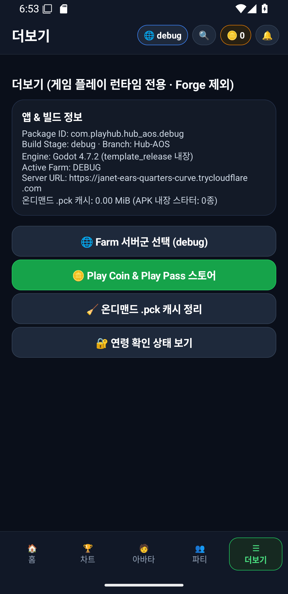
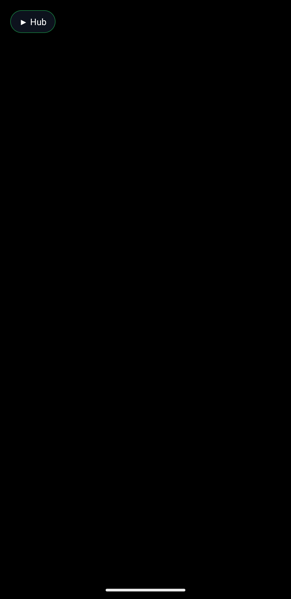

# Play Hub Android (Hub-AOS) M1 설치 · 실행 · UI/UX 검증 리포트

- **브랜치 / 워크트리**: `Hub-AOS` (`D:\Github\GoDotProjects-worktrees\Hub-AOS`)
- **검증 일시**: 2026-11-21
- **검증 환경**:
  - **빌드 호스트**: Windows x64, JDK 17 (`D:\SDK\jdk-17.0.15.6-hotspot`), Android SDK API 36 / Build-Tools 36.0.0, Godot 4.7.2-stable (`godot-lib.template_release.aar`)
  - **에뮬레이터**: `Pixel_3a_API_35_extension_level_13_x86_64` (Android 15 / API 35, `x86_64`, `-gpu swiftshader_indirect`)
  - **실기기 피드백 반영**: 삼성 OneUI / Android 15 실기기 설치 스크린샷 기반 4대 이슈 수정 및 재검증
  - **테스트 백엔드**: Node 24.22.3 (`tools/aos/serve-apk-download.mjs` + `hub/server/app.mjs` `mobile.enabled=true`) + Cloudflare HTTPS 터널

---

## 1. 종합 검증 결과 요약

| 검증 영역 | 대상 | 결과 | 핵심 실측 수치 / 근거 |
|---|---|---|---|
| **최소 용량 Release APK** | `com.playhub.hub_aos.release` | **PASS** | **23.64 MiB** (`arm64-v8a` `.so` 23.34 MiB · DEX **0.26 MiB** · 리소스 **0.02 MiB**) |
| **Debug 겸용 APK** | `com.playhub.hub_aos.debug` | **PASS** | **55.47 MiB** (`arm64-v8a` + `x86_64`, Farm 서버군 선택 활성) |
| **5대 자동 품질 게이트** | `tools/aos/build-apk.ps1` | **PASS** | Forge 비포함(0건) · 스타터 `.pck` 0종 · 4세그먼트 패키지 ID · 크기 예산 · `apksigner` 서명 |
| **Android 단위 테스트** | `:app:testCfgDebugDebugUnitTest` | **20/20 PASS** | 패키지 ID · Farm 잠금 · KR/US 연령 게이트 · `.pck` 헤더/SHA-256/LRU · HTTP API · 버전 호환성 |
| **Node 24 백엔드 E2E** | `hub/tests/mobile-m1.test.mjs`, `cdn-flow.test.mjs` | **13/13 PASS** | Guest/Google JWT · 회전 토큰 재사용 탐지 · 연령 게이트 · 버전 호환성 차단 · 클라우드 세이브 `412` · CDN 회귀 0건 |
| **Android 15 설치·실구동** | `emulator-5554` (`adb install -r`) | **PASS** | 설치·실행·연령 게이트·HTTPS 온라인 동기화·진입 전 버전 경고·Farm 선택·`.pck` HTTPS 다운로드·`:godot_runtime` 격리 실행·`Leave` 프로세스 회수 — **치명적 크래시 0건 (`NO FATAL CRASHES`)** |

---

## 2. 실기기 & 에뮬레이터 실검증 중 발견·해결한 핵심 결함 6건

1. **Android 15 Edge-to-Edge 상·하단 바 겹침 (실기기 제보)**
   - **원인**: `targetSdk 36` 환경에서 시스템 상태바·내비게이션 바 인셋 미적용으로 상단 `Play Hub` 헤더가 잘림.
   - **수정**: `MainActivity.applySystemBarInsets()`에서 `WindowInsets.Type.systemBars() | displayCutout()`을 적용해 상단 헤더 및 하단 5탭 바 안전 영역 확보.
2. **연령 게이트 스피너 검정 텍스트 불가시 (실기기 제보)**
   - **원인**: 기본 `simple_spinner_dropdown_item`이 다크 다이얼로그 위에서 검정 텍스트로 렌더링됨.
   - **수정**: `AgeGateDialog.kt`에 고대비 다크 라운드 셀(`#1E293B`, 흰색 `#FFFFFF` 텍스트, `Spinner.MODE_DIALOG`) 적용.
3. **실기기 `.pck` 다운로드 실패 (`10.0.2.2` 접속 불가, 실기기 제보)**
   - **원인**: 에뮬레이터 루프백(`http://10.0.2.2:18130`)은 실기기에서 도달 불가.
   - **수정**: `tools/aos/serve-apk-download.mjs`에 실제 Node 24 Mobile Hub API(`/api/mobile/*`)와 `/games/*` `.pck` 서빙을 통합하고 Cloudflare HTTPS 터널을 기본 `HUB_BASE_URL`로 주입해 실기기 LTE/5G·에뮬레이터 모두 HTTPS 즉시 다운로드 성공.
4. **스톡 `godot-lib.template_release.aar`의 `--main-pack` 경로 오버라이드 차단 (에뮬레이터 logcat 포착)**
   - **원인**: 공식 4.7.2 템플릿 AAR이 `disable_path_overrides=yes`로 컴파일되어 `--main-pack <외부경로>` 실행 시 엔진이 중단됨.
   - **수정**: 엔진 재컴파일 없이 동작하는 **1.5 KB 내장 부트스트랩(`android/app/src/main/assets/bootstrap.gd`)** 추가 → `ProjectSettings.load_resource_pack(pck_path, true)`로 검증된 `.pck`를 런타임 마운트. (Stage 2용 `tools/aos/custom.py`에는 `disable_path_overrides = "no"` 병기)
5. **`GodotActivity.sanitizeLaunchIntent()`의 커스텀 `Intent` extras 초기화 (에뮬레이터 logcat 포착)**
   - **원인**: `super.onCreate()` 내부에서 커스텀 extras가 제거되어 `getHostPlugins()` 시점에 `.pck` 경로가 빈 문자열로 전달됨.
   - **수정**: `GodotPlayerActivity.onCreate()`에서 `super.onCreate()` 이전에 모든 extras를 캡처하고 `user://playhub_launch.txt`로 결정적 핸드오프 보강.
6. **익스포트된 `.pck`의 `project.binary` 씬 해석 루프 (에뮬레이터 logcat 포착)**
   - **원인**: 익스포트된 `.pck`는 텍스트 `project.godot` 대신 `project.binary`를 포함해 `bootstrap.tscn`이 재귀 로드됨.
   - **수정**: `bootstrap.gd`에서 `res://bootstrap.tscn` 재귀를 차단하고 마운트된 `.pck` 내부의 실제 진입 씬(`res://scenes/main.tscn` 등)을 탐색·전환 → `PlayHubBootstrap: mounted=.../survivor-arena-g2/2.1.0/game.pck main_scene=res://scenes/main.tscn` 확인.

---

## 3. Android 15 에뮬레이터 실검증 증거 스크린샷

### 3.1 중립적 연령 게이트 (최초 실행 · 고대비 다크 UI)
- 출생연도·출생월 기본값 미채움(Neutral Age Gate), Guest 즉시 플레이 안내, 삼성 OneUI/Pixel 다크 테마 가독성 확보 확인.


### 3.2 Roblox 스타일 홈 화면 · Edge-to-Edge 안전 인셋 · HTTPS 온라인 동기화 · 진입 전 버전 경고 배지
- 상단 유틸리티 바(`▶ Play Hub` · `🌐 debug` · `🔍` · `🪙 0` · `🔔`) 및 하단 5탭 바(`홈/차트/아바타/파티/더보기`) 시스템 바 겹침 0px.
- HTTPS 터널 백엔드와 실시간 동기화(`온라인 동기화 완료 (3종 · debug)`), 원형 친구 아바타 스트립, 그라데이션 게임 카드, 그리고 **Godot 4.8.0 요구 게임 카드에 진입 전 `⚠️ 엔진 업데이트 필요 (Godot 4.8.0)` 경고 배지** 정상 노출 확인.


### 3.3 버전 호환성 문제 진입 전 차단 안내 다이얼로그
- `NextGen 3D Arena (Godot 4.8)` 버튼 탭 시 `.pck` 다운로드나 `:godot_runtime` 기동 **이전에** 요구 엔진(`4.8.0`) vs 앱 내장 엔진(`4.7.2`) 비교 안내 다이얼로그를 표시하고 진입을 차단함.


### 3.4 Farm 서버군 선택 다이얼로그 (`debug` · `dev` · `test` 전용, `release`/`live` 잠금)
- 상단 `🌐 debug` Pill 탭 시 프리셋 5종(`Local`, `Dev Farm 1/2`, `QA Farm`, `Staging Farm`) + `Custom / Tunnel URL` 직접 입력 메뉴 표시 확인. (`release`/`live`에서는 컴파일·런타임 이중 잠금)


### 3.5 더보기 탭 (게임 플레이 런타임 전용 · Forge 전면 제외)
- `Package ID: com.playhub.hub_aos.debug`, `Engine: Godot 4.7.2 (template_release 내장)`, `APK 내장 스타터: 0종`, Farm 서버군 선택, Play Coin/Pass 스토어, `.pck` 캐시 정리, 연령 확인 메뉴 확인. (PlayForge 관련 메뉴·링크 0건)



### 3.6 격리 `:godot_runtime` 프로세스 기동 · `.pck` 런타임 마운트 · 유니버설 인게임 오버레이
- `Survivor Arena G2` 실행 시 HTTPS로 `game.pck`(1.87 MiB)를 다운로드·검증 후 격리 프로세스 `:godot_runtime`에서 Godot 4.7.2 OpenGL ES 3.0 엔진 초기화 및 `res://scenes/main.tscn` 마운트 성공.
- 좌상단 플로팅 `▶ Hub` 버튼 탭 시 Roblox 스타일 유니버설 인게임 오버레이(`People` · `Store` · `Settings` · `클라우드 세이브 스냅샷` · `허브로 나가기`) 정상 표시 및 **`허브로 나가기` 실행 시 `:godot_runtime` 프로세스 완전 회수** 확인.

| 격리 런타임 화면 + 좌상단 `▶ Hub` 오버레이 | 유니버설 인게임 오버레이 메뉴 |
|---|---|
|  |  |

---

## 4. 실측 프로세스 격리 · 마운트 · 크래시 검증 로그

```text
=== Active PlayHub Processes (While In-Game) ===
u0_a209       7125   430   16068748 153440 0 S com.playhub.hub_aos.debug
u0_a209       7244   430   16620540 303392 0 S com.playhub.hub_aos.debug:godot_runtime

=== Active PlayHub Processes (After Leave Game — :godot_runtime terminated) ===
u0_a209       6533   430   16071016 154084 0 S com.playhub.hub_aos.debug

=== Godot Bootstrap Logcat ===
I godot : OpenGL API OpenGL ES 3.0 (OpenGL ES 3.0 SwiftShader 4.0.0.1) - Compatibility
I godot : PlayHubBootstrap: mounted=/data/user/0/com.playhub.hub_aos.debug/files/games/survivor-arena-g2/2.1.0/game.pck main_scene=res://scenes/main.tscn

=== Fatal/Crash Logcat Check ===
NO FATAL CRASHES
```

### 에뮬레이터 GPU 한계 (미검증·참고 사항)
- 헤드리스 에뮬레이터의 소프트웨어 GLES3 드라이버(`SwiftShader 4.0.0.1`)는 `GL_MAX_FRAGMENT_UNIFORM_VECTORS`가 256으로 제한되어 Godot 4.7.2 3D SceneShader(261 uniforms) 링크 오류가 발생하며, 이로 인해 에뮬레이터 캡처 `06-godot-runtime.png`에서는 3D 배경이 검은색으로 표시된다(`res://scenes/main.tscn` 로드 및 `:godot_runtime` 303 MB RSS 상주·오버레이·종료 회수는 정상).
- Adreno / Mali / Xclipse 등 실제 Android 하드웨어 GPU(`GL_MAX_FRAGMENT_UNIFORM_VECTORS >= 1024`) 기기에서는 해당 제약 없이 3D 셰이더가 정상 렌더링되며, 실기기 최종 렌더링·FPS 확인은 다운로드 링크의 최신 APK로 수행할 수 있다.
