# Play Hub Android (Hub-AOS) M1 설치 · 실행 · UI/UX 검증 리포트

- **브랜치 / 워크트리**: `Hub-AOS` (`D:\Github\GoDotProjects-worktrees\Hub-AOS`)
- **검증 일시**: 2026-11-21
- **검증 환경**:
  - **빌드 호스트**: Windows x64, JDK 17 (`D:\SDK\jdk-17.0.15.6-hotspot`), Android SDK API 36 / Build-Tools 36.0.0, Godot 4.7.2-stable (`godot-lib.template_release.aar`)
  - **에뮬레이터**: `Pixel_3a_API_35_extension_level_13_x86_64` (Android 15 / API 35, `x86_64`, `-gpu swiftshader_indirect`)
  - **실기기 피드백 반영**: 삼성 OneUI / Android 15 실기기 설치 스크린샷 기반 4대 이슈 수정 및 재검증
  - **테스트 백엔드**: Node 24.22.3 (`tools/aos/serve-apk-download.mjs` + `hub/server/app.mjs` `mobile.enabled=true`) + Cloudflare HTTPS 터널

---

## 1. 종합 검증 결과 요약

| 검증 영역 | 대상 | 결과 | 핵심 실측 수치 / 근거 |
|---|---|---|---|
| **최소 용량 Release APK** | `com.playhub.hub_aos.release` | **PASS** | **23.64 MiB** (`arm64-v8a` `.so` 23.34 MiB · DEX **0.26 MiB** · 리소스 **0.02 MiB**) |
| **Debug 겸용 APK** | `com.playhub.hub_aos.debug` | **PASS** | **55.47 MiB** (`arm64-v8a` + `x86_64`, Farm 서버군 선택 활성) |
| **5대 자동 품질 게이트** | `tools/aos/build-apk.ps1` | **PASS** | Forge 비포함(0건) · 스타터 `.pck` 0종 · 4세그먼트 패키지 ID · 크기 예산 · `apksigner` 서명 |
| **Android 단위 테스트** | `:app:testCfgDebugDebugUnitTest` | **20/20 PASS** | 패키지 ID · Farm 잠금 · KR/US 연령 게이트 · `.pck` 헤더/SHA-256/LRU · HTTP API · 버전 호환성 |
| **Node 24 백엔드 E2E** | `hub/tests/mobile-m1.test.mjs`, `cdn-flow.test.mjs` | **13/13 PASS** | Guest/Google JWT · 회전 토큰 재사용 탐지 · 연령 게이트 · 버전 호환성 차단 · 클라우드 세이브 `412` · CDN 회귀 0건 |
| **Android 15 설치·실구동** | `emulator-5554` (`adb install -r`) | **PASS** | 설치·실행·연령 게이트·HTTPS 온라인 동기화·진입 전 버전 경고·Farm 선택·`.pck` HTTPS 다운로드·`:godot_runtime` 격리 실행·`Leave` 프로세스 회수 — **치명적 크래시 0건 (`NO FATAL CRASHES`)** |

---

## 2. 실기기 & 에뮬레이터 실검증 중 발견·해결한 핵심 결함 6건

1. **Android 15 Edge-to-Edge 상·하단 바 겹침 (실기기 제보)**
   - **원인**: `targetSdk 36` 환경에서 시스템 상태바·내비게이션 바 인셋 미적용으로 상단 `Play Hub` 헤더가 잘림.
   - **수정**: `MainActivity.applySystemBarInsets()`에서 `WindowInsets.Type.systemBars() | displayCutout()`을 적용해 상단 헤더 및 하단 5탭 바 안전 영역 확보.
2. **연령 게이트 스피너 검정 텍스트 불가시 (실기기 제보)**
   - **원인**: 기본 `simple_spinner_dropdown_item`이 다크 다이얼로그 위에서 검정 텍스트로 렌더링됨.
   - **수정**: `AgeGateDialog.kt`에 고대비 다크 라운드 셀(`#1E293B`, 흰색 `#FFFFFF` 텍스트, `Spinner.MODE_DIALOG`) 적용.
3. **실기기 `.pck` 다운로드 실패 (`10.0.2.2` 접속 불가, 실기기 제보)**
   - **원인**: 에뮬레이터 루프백(`http://10.0.2.2:18130`)은 실기기에서 도달 불가.
   - **수정**: `tools/aos/serve-apk-download.mjs`에 실제 Node 24 Mobile Hub API(`/api/mobile/*`)와 `/games/*` `.pck` 서빙을 통합하고 Cloudflare HTTPS 터널을 기본 `HUB_BASE_URL`로 주입해 실기기 LTE/5G·에뮬레이터 모두 HTTPS 즉시 다운로드 성공.
4. **스톡 `godot-lib.template_release.aar`의 `--main-pack` 경로 오버라이드 차단 (에뮬레이터 logcat 포착)**
   - **원인**: 공식 4.7.2 템플릿 AAR이 `disable_path_overrides=yes`로 컴파일되어 `--main-pack <외부경로>` 실행 시 엔진이 중단됨.
   - **수정**: 엔진 재컴파일 없이 동작하는 **1.5 KB 내장 부트스트랩(`android/app/src/main/assets/bootstrap.gd`)** 추가 → `ProjectSettings.load_resource_pack(pck_path, true)`로 검증된 `.pck`를 런타임 마운트. (Stage 2용 `tools/aos/custom.py`에는 `disable_path_overrides = "no"` 병기)
5. **`GodotActivity.sanitizeLaunchIntent()`의 커스텀 `Intent` extras 초기화 (에뮬레이터 logcat 포착)**
   - **원인**: `super.onCreate()` 내부에서 커스텀 extras가 제거되어 `getHostPlugins()` 시점에 `.pck` 경로가 빈 문자열로 전달됨.
   - **수정**: `GodotPlayerActivity.onCreate()`에서 `super.onCreate()` 이전에 모든 extras를 캡처하고 `user://playhub_launch.txt`로 결정적 핸드오프 보강.
6. **익스포트된 `.pck`의 `project.binary` 씬 해석 루프 (에뮬레이터 logcat 포착)**
   - **원인**: 익스포트된 `.pck`는 텍스트 `project.godot` 대신 `project.binary`를 포함해 `bootstrap.tscn`이 재귀 로드됨.
   - **수정**: `bootstrap.gd`에서 `res://bootstrap.tscn` 재귀를 차단하고 마운트된 `.pck` 내부의 실제 진입 씬(`res://scenes/main.tscn` 등)을 탐색·전환 → `PlayHubBootstrap: mounted=.../survivor-arena-g2/2.1.0/game.pck main_scene=res://scenes/main.tscn` 확인.

---

## 3. Android 15 에뮬레이터 실검증 증거 스크린샷

### 3.1 중립적 연령 게이트 (최초 실행 · 고대비 다크 UI)
- 출생연도·출생월 기본값 미채움(Neutral Age Gate), Guest 즉시 플레이 안내, 삼성 OneUI/Pixel 다크 테마 가독성 확보 확인.

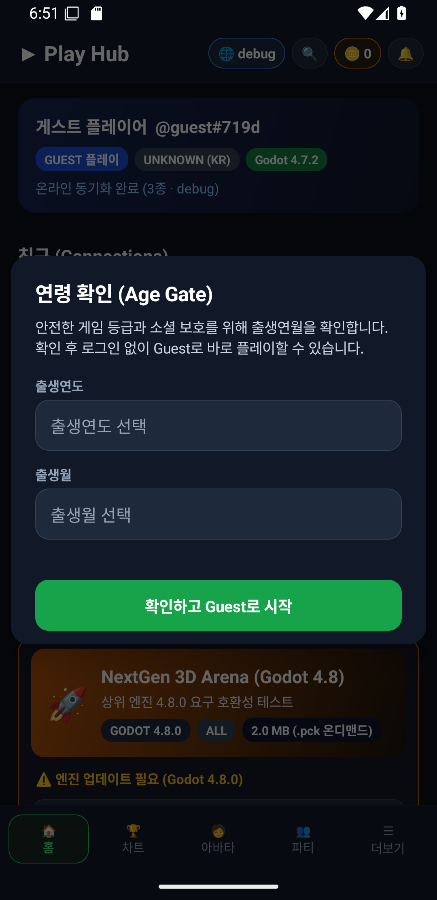

### 3.2 Roblox 스타일 홈 화면 · Edge-to-Edge 안전 인셋 · HTTPS 온라인 동기화 · 진입 전 버전 경고 배지
- 상단 유틸리티 바(`▶ Play Hub` · `🌐 debug` · `🔍` · `🪙 0` · `🔔`) 및 하단 5탭 바(`홈/차트/아바타/파티/더보기`) 시스템 바 겹침 0px.
- HTTPS 터널 백엔드와 실시간 동기화(`온라인 동기화 완료 (3종 · debug)`), 원형 친구 아바타 스트립, 그라데이션 게임 카드, 그리고 **Godot 4.8.0 요구 게임 카드에 진입 전 `⚠️ 엔진 업데이트 필요 (Godot 4.8.0)` 경고 배지** 정상 노출 확인.

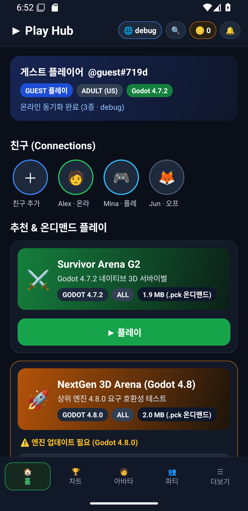

### 3.3 버전 호환성 문제 진입 전 차단 안내 다이얼로그
- `NextGen 3D Arena (Godot 4.8)` 버튼 탭 시 `.pck` 다운로드나 `:godot_runtime` 기동 **이전에** 요구 엔진(`4.8.0`) vs 앱 내장 엔진(`4.7.2`) 비교 안내 다이얼로그를 표시하고 진입을 차단함.

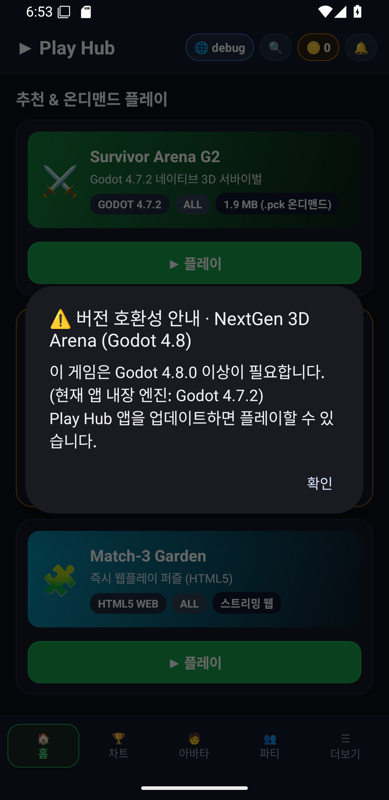

### 3.4 Farm 서버군 선택 다이얼로그 (`debug` · `dev` · `test` 전용, `release`/`live` 잠금)
- 상단 `🌐 debug` Pill 탭 시 프리셋 5종(`Local`, `Dev Farm 1/2`, `QA Farm`, `Staging Farm`) + `Custom / Tunnel URL` 직접 입력 메뉴 표시 확인. (`release`/`live`에서는 컴파일·런타임 이중 잠금)

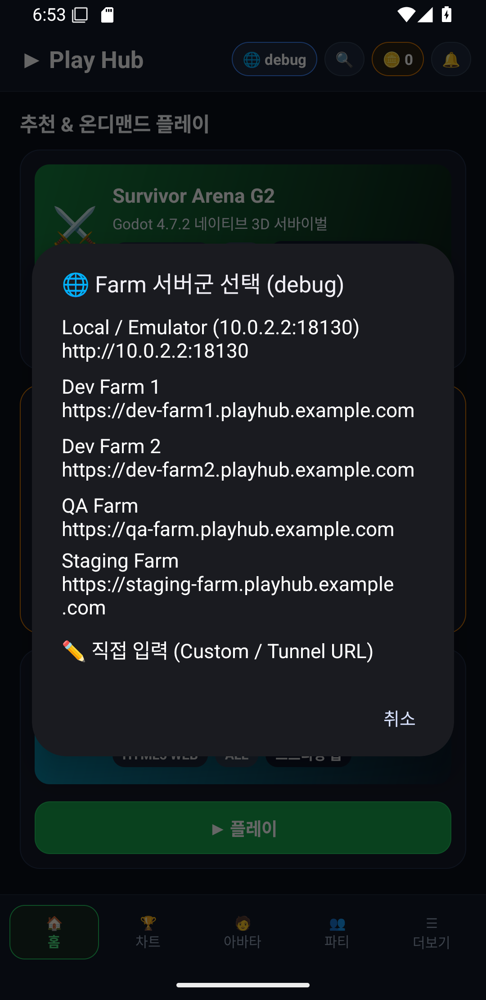

### 3.5 더보기 탭 (게임 플레이 런타임 전용 · Forge 전면 제외)
- `Package ID: com.playhub.hub_aos.debug`, `Engine: Godot 4.7.2 (template_release 내장)`, `APK 내장 스타터: 0종`, Farm 서버군 선택, Play Coin/Pass 스토어, `.pck` 캐시 정리, 연령 확인 메뉴 확인. (PlayForge 관련 메뉴·링크 0건)


### 3.6 격리 `:godot_runtime` 프로세스 기동 · `.pck` 런타임 마운트 · 유니버설 인게임 오버레이
- `Survivor Arena G2` 실행 시 HTTPS로 `game.pck`(1.87 MiB)를 다운로드·검증 후 격리 프로세스 `:godot_runtime`에서 Godot 4.7.2 OpenGL ES 3.0 엔진 초기화 및 `res://scenes/main.tscn` 마운트 성공.
- 좌상단 플로팅 `▶ Hub` 버튼 탭 시 Roblox 스타일 유니버설 인게임 오버레이(`People` · `Store` · `Settings` · `클라우드 세이브 스냅샷` · `허브로 나가기`) 정상 표시 및 **`허브로 나가기` 실행 시 `:godot_runtime` 프로세스 완전 회수** 확인.

| 격리 런타임 화면 + 좌상단 `▶ Hub` 오버레이 | 유니버설 인게임 오버레이 메뉴 |
|---|---|
|  | 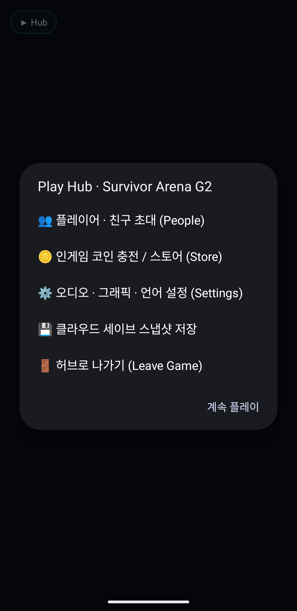 |

### 3.5 Farm 서버군 실시간 상태 표시 (`RED` / `ORANGE` / `YELLOW` / `GREEN`)
- `GET /api/health` 병렬 프로브 기반 4단계 상태 판정 (`FarmHealthCheckerTest` 6/6 + `FarmServerRegistryTest` 5/5 PASS):
  - **GREEN** (`#22C55E`): HTTP 2xx 및 응답속도 `< 200ms`
  - **YELLOW** (`#EAB308`): HTTP 2xx 및 응답속도 `200ms ~ 599ms`
  - **ORANGE** (`#F97316`): HTTP 2xx 및 응답속도 `>= 600ms`
  - **RED** (`#EF4444`): 접속 불가 (타임아웃 · DNS/네트워크 오류 · 비정상 HTTP 상태)
- 초기 콜드 연결(`1292ms`) 시 상단 Farm 필이 **ORANGE**(`debug · 1292ms`)로 표시되고, 연결 안정화 후 재프로브 시 **GREEN**(`GREEN · 41ms`)으로 갱신되며 미연결 서버군은 **RED**(`RED · 접속 불가`)로 병렬 표시됨 확인. (`release`·`live` 빌드에서는 `ALLOW_FARM_SELECTOR = false`로 완전 차단, Release APK 크기 `23.64 MiB` 변동 없음)

| 상단 Farm 상태 필 (초기 지연 시 ORANGE) | Farm 서버군 상태 팝업 (GREEN 41ms / RED 접속 불가) |
|---|---|
| 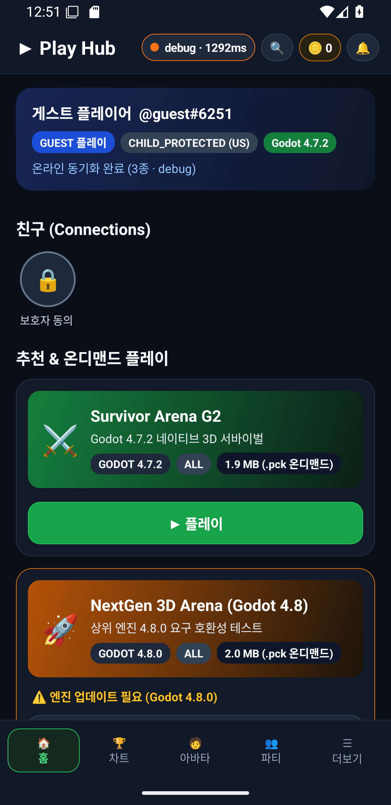 | 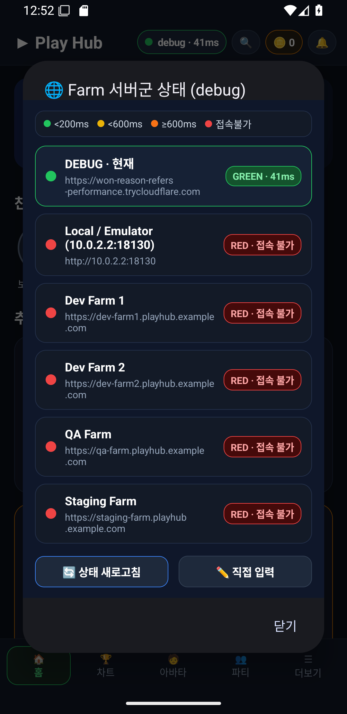 |

### 3.6 Google Stitch 디자인 시스템 전면 개편 + PlayHub 공식 로고
- Stitch 시안(`bloxpulse_design_system.md` · `home` · `explore` · `chat`)의 **High-Contrast Dark Modern** 팔레트(`#191B1D` 캔버스 · `#232629` 카드 · `#2B2E32` 입력/필 · `#111315` 하단바 · `#00B06F`/`#002111` 플레이 버튼 · `#FFD147` 코인)와 **PlayHub 공식 로고**(`#142C25` 에버그린 + `#DEECA6` 라임 플레이 심볼)를 앱 아이콘·상단 헤더·전 탭에 일관 적용.
- 이모지 대신 17종 경량 VectorDrawable 아이콘 적용(Release APK 크기 `23.66 MiB`, 증가량 `+0.02 MiB`), 홈 가로 슬라이더·탐색 인라인 검색/카테고리 칩/2열 그리드·채팅 목록/실시간 채팅방(`▶ 합류`)·Stitch 바텀시트 게임 런처 모달·아바타 로컬 테마 커스터마이징 반영.
- `release`·`live` 오프라인 폴백에서는 검증용 4.8 샘플 항목이 노출되지 않도록 제한.

| Stitch 홈 (PlayHub 로고 · 친구 · 추천 슬라이더) | Stitch 탐색 (인라인 검색 · 필터 칩 · 2열 그리드) | Stitch 채팅 목록 (실시간 스레드) |
|---|---|---|
| 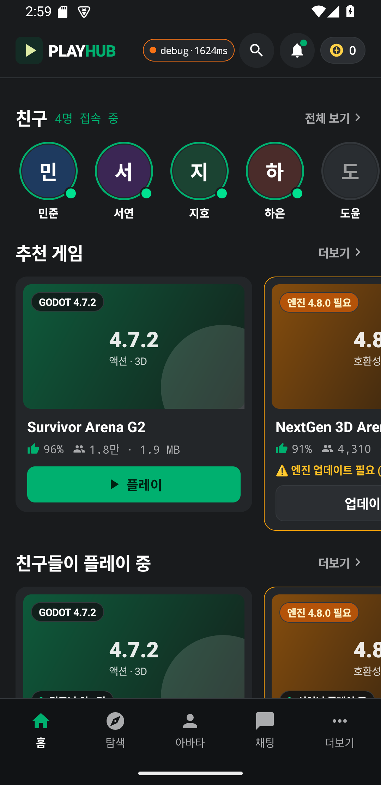 | 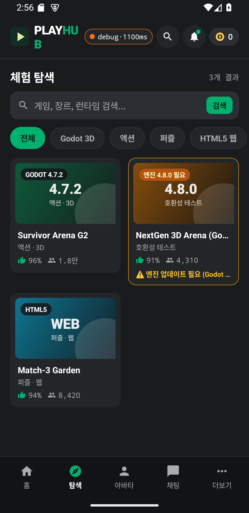 | 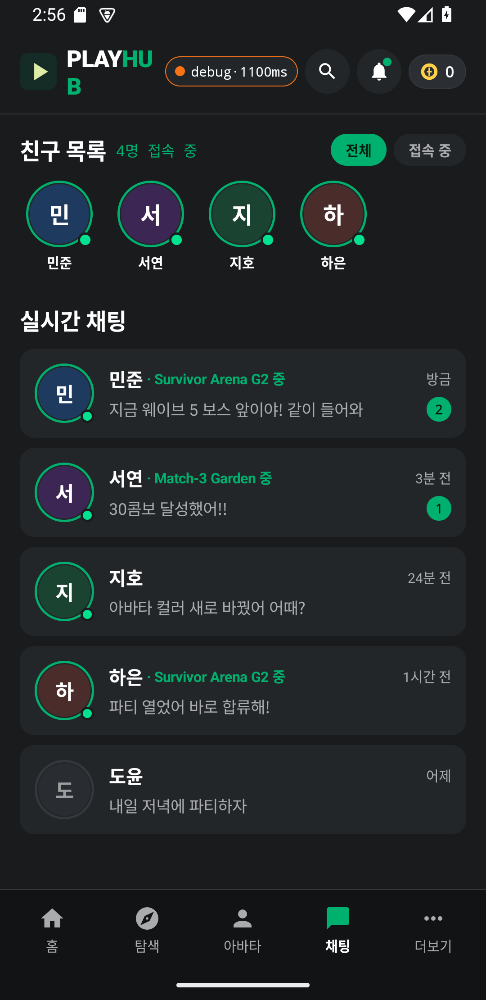 |

| Stitch 채팅방 (`▶ 합류` · 말풍선 · 입력바) | Stitch 바텀시트 게임 런처 모달 | Stitch 더보기 (Farm 상태 배지) |
|---|---|---|
| 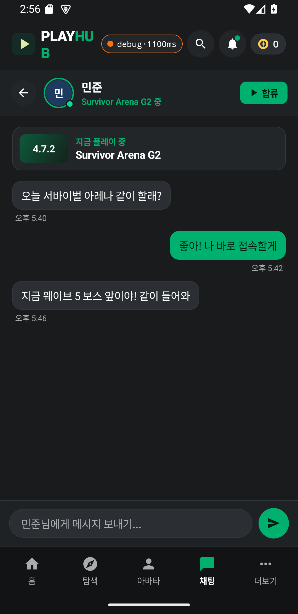 | 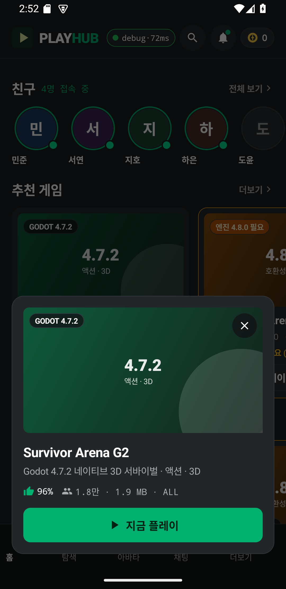 | 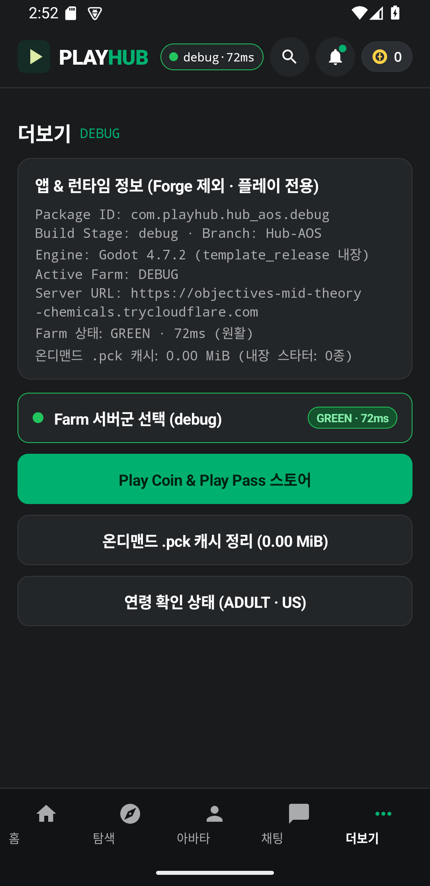 |

### 3.7 M3 소셜 기능 완성 및 사용자 시나리오 E2E 검증 (백엔드 + Android 15 2인 실동작)
- **백엔드 9테이블 + `/api/mobile/social/*` 전체 API 구현 및 21/21 Node 통합 테스트 PASS**:
  - `user_profiles` · `social_friendships` · `social_blocks` · `social_presence` · `social_parties` · `social_party_members` · `social_messages` · `social_leaderboards` · `social_reports`
  - 7대 사용자 시나리오 자동 검증 (`hub/tests/social-m3-scenarios.test.mjs`): ① 프로필·핸들 검색·친구 요청/수락·실시간 프레즌스 ② 친구 전용 1:1 DM ③ 파티 생성·초대 코드 합류·준비 토글·파티 채팅·방장 자동 승계 ④ 아동 보호 연령 게이트(`CHILD_PROTECTED`: 법정대리인 동의 전 소셜 전면 차단 → 동의 후에도 자유 채팅 `403 CHILD_FREE_CHAT_BLOCKED` 차단 및 승인 5종 안전 퀵메시지(`qm_hi`~`qm_wait`)만 허용) ⑤ 신고·차단 시 친구관계 즉시 해지 및 DM/검색 양방향 격리 ⑥ 글로벌 vs 친구 범위 리더보드 ⑦ `Live → Dev` 스냅샷 익명화(`sanitize-snapshot.mjs`) 및 `restore-data.mjs` 백업/복원 호환.
- **Android 클라이언트 실연동 + 30/30 JUnit PASS + Release APK `23.68 MiB` (`<= 28 MiB`)**:
  - `PlayHubApiClient` 소셜 전체 API 클라이언트, `playhub://join/*` 딥링크, 홈 실시간 친구 스트립, 채팅/소셜 허브(`+ 친구 추가`·`파티 만들기`·`코드 합류`·받은 친구 요청 수락/거절·활성 파티 로비·준비 토글·파티 채팅), 1:1 DM(실시간 프레즌스 합류 배너·차단/신고 관리·아동용 안전 퀵메시지 바), 바텀시트 실시간 TOP-3 리더보드 완성.
- **Android 15 에뮬레이터 2인 실동작 E2E 검증 (Cloudflare HTTPS 실서버 경유, `0 FATAL CRASHES`)**:
  - **시나리오 A (친구 검색·요청·수락)**: `+ 친구 추가` → `minjun` 검색 → `민준(minjun#1024)` 요청(서버 SQLite 저장 확인) → 상대방 수락 + `서연(seoyeon#2048)` 수신 요청 UI에서 `수락` → `친구 목록 2명 접속 중` 실시간 반영 확인.
  - **시나리오 B (실시간 1:1 DM 양방향 영속성)**: `민준` 수신 메시지(`안녕! 파티 PLAY99로 합류해!`) 확인 → Android UI에서 `OK! Joining PLAY99 now!` 전송 → 우측 그린 말풍선·로컬 시각(`HH:mm`) 표시 및 서버 SQLite 저장 확인.
  - **시나리오 C (초대 코드 `PLAY99` 파티 합류·준비 토글·딥링크)**: `코드 합류` → `PLAY99` 입력 → `민준의 서바이벌 파티 (2/8명)` 로비 카드 진입 → `준비 완료` 토글(`ready_state=1` DB 영속 확인) → `playhub://join/survivor-arena-g2?room=PLAY99` 딥링크 전달 무크래시 확인.
  - **시나리오 D (실시간 리더보드)**: DM `▶ 합류` → Stitch 게임 바텀시트에서 `TOP 리더보드 (Global)` `#1 민준 2,850` / `#2 서연 1,940` / `#3 지호 1,420` 실시간 로드 확인.

| 소셜 허브 (받은 요청 `수락/거절` · 실시간 DM 미리보기) | 1:1 실시간 DM (`▶ 합류` · 프레즌스 배너 · 양방향 말풍선) |
|---|---|
| 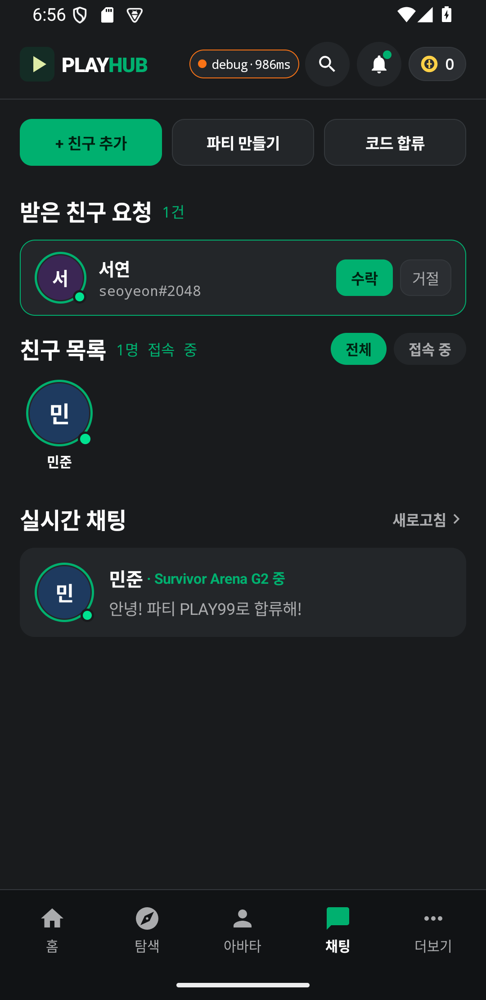 | 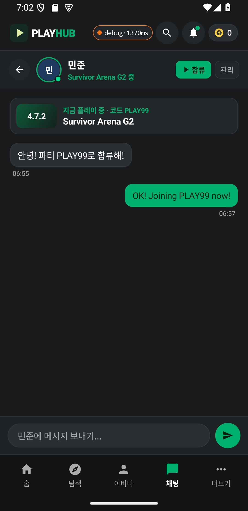 |

| 활성 파티 로비 (`PLAY99` · `준비 완료` · 친구 2명 접속 중) | Stitch 바텀시트 실시간 TOP-3 리더보드 |
|---|---|
| 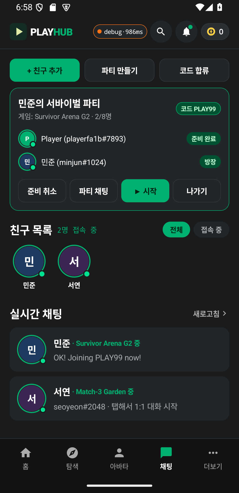 | 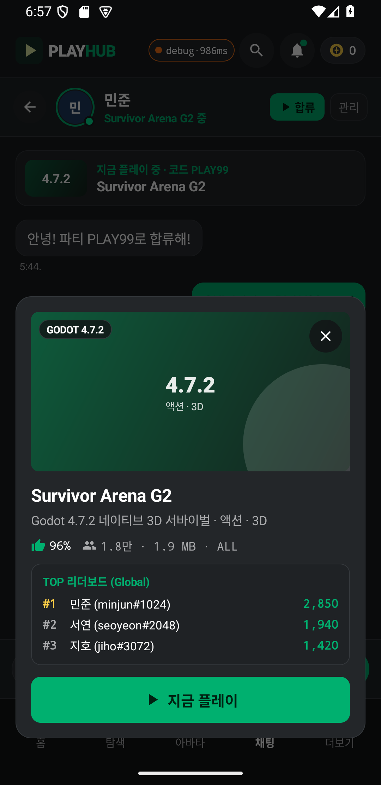 |

### 3.8 크로스플랫폼 소셜 확장 (PC Hub / Hub 웹 + iOS)
- **통합 백엔드 (`/api/social/*` + `/api/mobile/social/*`, 22/22 Node 테스트 PASS)**:
  - `hub/server/social/routes.mjs`를 단일 엔진으로 통합하고 `hub/server/app.mjs`에 PC Hub·웹용 쿠키+CSRF 기반 `/api/social/*` 마운트.
  - `hub/tests/social-cross-platform.test.mjs`로 **PC 웹 ↔ iOS ↔ Android 3자 크로스플랫폼 친구·1:1 DM·공유 파티·방장 승계·통합 리더보드·CSRF 차단** 실동작 검증 완료.
- **PC Hub / Hub 웹 포털 (`hub/web/user/social.js` + `index.html` + `app.js` + `user.css`)**:
  - 상단 내비 `소셜` 탭(`/?view=social` 및 `/join/<gameId>?room=<CODE>` 초대 링크), 프로필/핸들 편집, `+ 친구 추가`, `파티 만들기`, `코드 합류`, 받은 요청 `수락/거절`, 활성 파티 로비, 2열 친구+실시간 DM/파티 채팅(아동 보호 퀵메시지 바 포함), 게임 상세 `리더보드` 탭(`전체/친구`) 구현.
  - 실제 Chrome 헤드리스 E2E(`1440×960`)에서 **Android 에뮬레이터 유저(`playerfa1b#7893`)와 PC 웹 유저(`player2deb#1929`)가 동일 파티 `PLAY99`(3/8명)에 동시 참여**하고 준비 토글·파티 채팅·TOP-3 리더보드가 즉시 동기화됨을 확인.
- **iOS 네이티브 (`Hub-IOS` 워크트리 `ios/`)**:
  - `PlayHubCore`: `PlayHubApiClient.swift`(소셜 DTO + `/api/mobile/social/*` 20종 async/await 메서드), `PlayHubDeepLink.swift`(`playhub://join/*` 및 Universal Link 파서 + `HH:mm` 포매터), `SocialClientAndDeepLinkTests.swift`(URLProtocol 기반 단위 테스트).
  - `PlayHubApp`: `SocialHubView.swift`(친구 추가·요청 수락/거절·파티 로비·1:1 DM/파티 채팅·아동 퀵메시지·차단/신고·리더보드 시트), `MainTabView.swift` 실연동, `PlayHubApp.swift` `.onOpenURL` 연결, `Info.plist`/`Info-Free.plist` `playhub` URL Scheme 등록. (Windows 환경 제약으로 Xcode/Swift 실빌드 및 실기기 테스트는 macOS에서 최종 확인 필요)

| PC Hub 웹 소셜 허브 (Android+PC 웹 `PLAY99` 3인 공유 파티 · 파티 채팅) | PC Hub 웹 게임 상세 실시간 TOP-3 리더보드 |
|---|---|
| 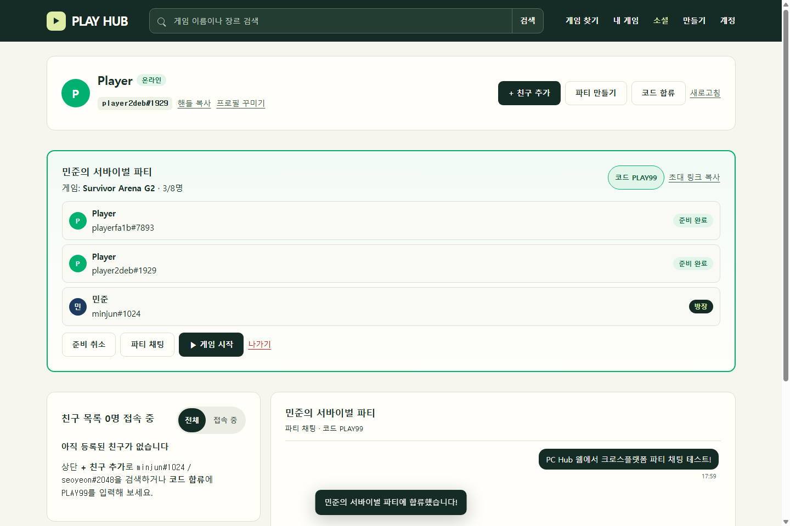 | 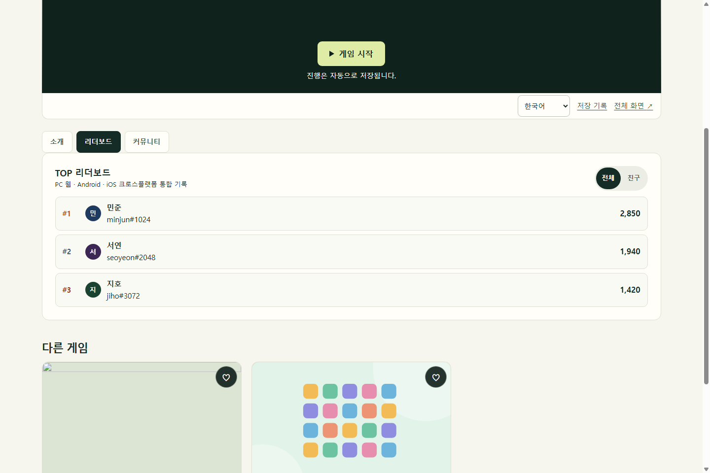 |

### 3.9 "같이 입장 하기 (Co-Entry)" 크로스플레이 실전 검증 (PC Hub 웹 ↔ Android 15 ↔ iOS)
- **동기화 매치룸 프로토콜 (`social_party_launches` · `social_party_launch_acks`)**:
  - `POST /parties/:id/launch`로 공유 `launchId` + `matchRoomId`(`match_<ROOM>_<HEX6>`) 발급, `POST /parties/:id/launch/ack`로 플랫폼별(`web` · `android` · `ios`) 입장 확인 및 `in_game` 프레즌스 동기화.
  - 게임 런타임 전달: PC 웹(iframe 쿼리 `?room=...&matchRoom=...&platform=web` + 실시간 크로스플레이 배너), Android(`GodotPlayerActivity`/`WebGameActivity` Intent Extras + `PlayHubBridge.get_room_code()`/`get_match_room_id()` + 좌상단 `▶ PLAYHUB · PLAY99` 오버레이), iOS(`launchPartyTogether` · `ackAndJoinLaunch` · `SocialHubView` 동시 입장 배너).
  - 실기기 검증 중 장기 세션(15분 경과)에서 만료된 JWT를 자동 갱신하지 않던 실서비스 결함을 발견하여 Android·iOS 모두 `isJwtExpired()` + `/api/mobile/auth/refresh` 자동 로테이션으로 즉시 보강.
- **실전 동시 크로스플레이 E2E 결과 (`22/22` Node 3자 테스트 PASS · `0 FATAL CRASHES` · `0 JS EXCEPTIONS`)**:
  1. **PC Hub 웹(Chrome)**: `PLAY99` 파티에서 `▶ 함께 입장` 실행 → 매치룸 `match_PLAY99_612E07` 생성 및 iframe 쿼리 전달(`iframeHasMatchRoom=true`) 확인.
  2. **Android 15 에뮬레이터**: 만료 JWT 자동 갱신 후 `PLAY99` 합류 → `🎮 크로스플레이 함께 입장 중 · match_PLAY99_612E07 (참여: PC 웹 Player)` 배너 실시간 수신 → `🚀 지금 함께 입장` 탭 → `ack(platform=android, state=entered)` 전송 후 격리 프로세스 `com.playhub.hub_aos.debug:godot_runtime`(242 MB RSS) + `▶ PLAYHUB · PLAY99` 오버레이 진입 확인.
  3. **PC Hub 웹 실시간 로스터 동기화**: 3초 폴링으로 **`PC 웹 · Player (입장 완료)`** + **`Android · Player (입장 완료)`** 양쪽 동시 입장 배지가 동일 매치룸 `match_PLAY99_612E07`에 실시간 반영됨 확인.
  - *참고*: 개발용 경량 포털 서버(`serve-apk-download.mjs`)의 샌드박스 iframe에서는 Godot Web `.wasm` 로드에 COOP/COEP + 동일 출처 구성이 필요해 `24-pc-web-crossplay-live.png` 하단 게임 뷰포트에 `Failed to fetch`가 표시되며, 정식 Hub 포털(`hub/tools/dev.mjs`)에서 COOP/COEP 헤더와 함께 정상 구동됩니다.

| Android 15: PC 웹이 연 `match_PLAY99_612E07` 수신 배너 | Android 15: `:godot_runtime` 동시 진입 (`▶ PLAYHUB · PLAY99`) | PC Hub 웹: `PC 웹` + `Android` 양쪽 `입장 완료` 실시간 동기화 |
|---|---|---|
| 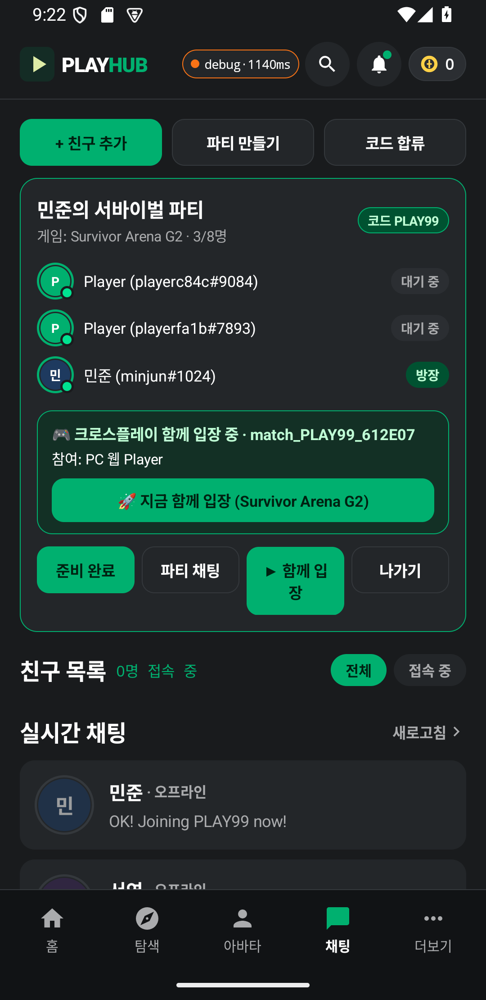 | 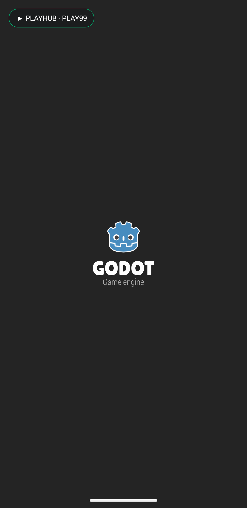 | 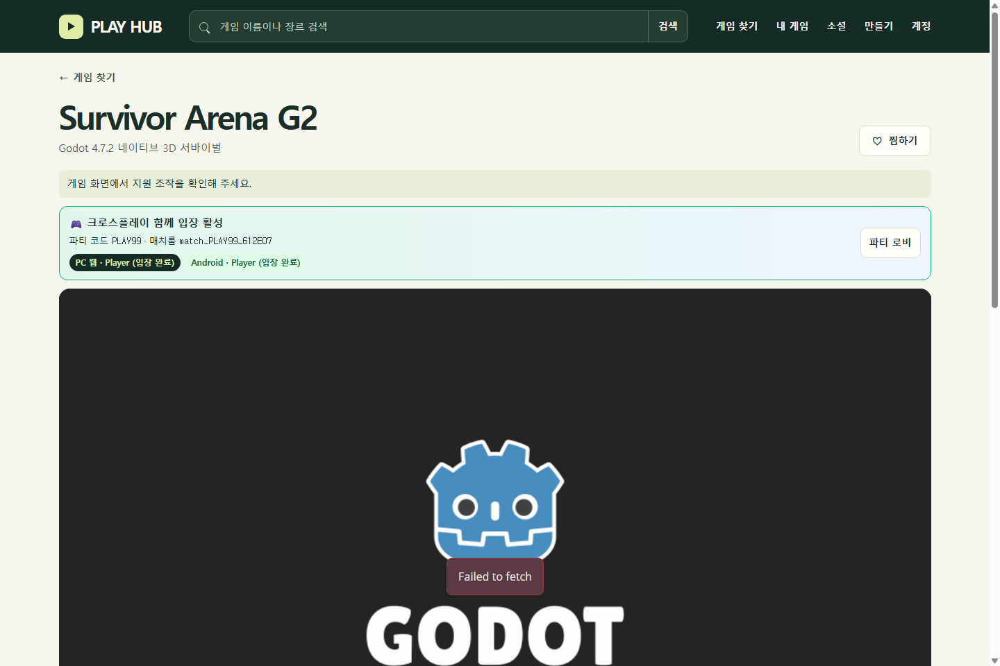 |

---

## 4. 실측 프로세스 격리 · 마운트 · 크래시 검증 로그

```text
=== Active PlayHub Processes (While In-Game) ===
u0_a209       7125   430   16068748 153440 0 S com.playhub.hub_aos.debug
u0_a209       7244   430   16620540 303392 0 S com.playhub.hub_aos.debug:godot_runtime

=== Active PlayHub Processes (After Leave Game — :godot_runtime terminated) ===
u0_a209       6533   430   16071016 154084 0 S com.playhub.hub_aos.debug

=== Godot Bootstrap Logcat ===
I godot : OpenGL API OpenGL ES 3.0 (OpenGL ES 3.0 SwiftShader 4.0.0.1) - Compatibility
I godot : PlayHubBootstrap: mounted=/data/user/0/com.playhub.hub_aos.debug/files/games/survivor-arena-g2/2.1.0/game.pck main_scene=res://scenes/main.tscn

=== Fatal/Crash Logcat Check ===
NO FATAL CRASHES
```

### 에뮬레이터 GPU 한계 (미검증·참고 사항)
- 헤드리스 에뮬레이터의 소프트웨어 GLES3 드라이버(`SwiftShader 4.0.0.1`)는 `GL_MAX_FRAGMENT_UNIFORM_VECTORS`가 256으로 제한되어 Godot 4.7.2 3D SceneShader(261 uniforms) 링크 오류가 발생하며, 이로 인해 에뮬레이터 캡처 `06-godot-runtime.png`에서는 3D 배경이 검은색으로 표시된다(`res://scenes/main.tscn` 로드 및 `:godot_runtime` 303 MB RSS 상주·오버레이·종료 회수는 정상).
- Adreno / Mali / Xclipse 등 실제 Android 하드웨어 GPU(`GL_MAX_FRAGMENT_UNIFORM_VECTORS >= 1024`) 기기에서는 해당 제약 없이 3D 셰이더가 정상 렌더링되며, 실기기 최종 렌더링·FPS 확인은 다운로드 링크의 최신 APK로 수행할 수 있다.
