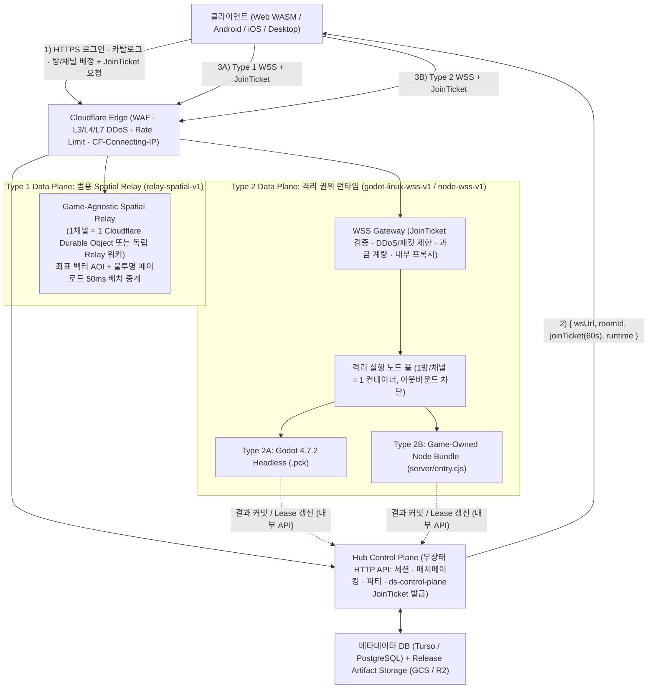

# PlayHub · PlayForge 멀티플레이 플랫폼 탈결합 리팩토링 설계안
**Type 1 (범용 Spatial Relay) + Type 2 (격리 권위 런타임) 하이브리드 아키텍처**

> [!IMPORTANT]
> 본 설계안은 현재 [hub/server/ugc-multiplayer.mjs](file:///D:/Github/GoDotProjects-worktrees/PlayHub-Platform/hub/server/ugc-multiplayer.mjs), [tools/ugc-shared/mmo-room-core.cjs](file:///D:/Github/GoDotProjects-worktrees/PlayHub-Platform/tools/ugc-shared/mmo-room-core.cjs), [forge/Tools/multiplayer-server.cjs](file:///D:/Github/GoDotProjects-worktrees/PlayHub-Platform/forge/Tools/multiplayer-server.cjs)에 하드코딩된 특정 게임 4종(`Tappy Chicken MMO`, `BrawlLabs`, `Fortress War`, `Captain Forever MMO`)의 로직을 플랫폼에서 완전히 분리하고, **인증 · 로드밸런싱 · DDoS 방어 · 유지비 · 게임 단독 배포**를 모두 만족하는 장기 지속 가능 구조로 전환하기 위한 리팩토링 청사진입니다.

---

## 1. 설계 원칙 (Platform vs Game 책임 경계)

1. **Zero Game-Specific Logic in Platform**: 플랫폼 코어(`hub/`, `forge/Tools/`, `tools/ugc-shared/`)는 어떤 게임의 이벤트명(`flap`), 물리 상수(`speed=170`, `height=640`, `WALLS`), 캐릭터·부품 목록(`pin`, `catapult`, `thruster`), 점수 공식도 알지 못한다.
2. **단일 제어면(Control Plane) + 이중 데이터면(Data Plane)**:
   - 모든 멀티플레이 게임은 **동일한 인증(`JoinTicket`) · 매치메이킹 · 파티 · 텔레메트리 제어면**을 공유한다.
   - 실시간 데이터면은 게임 매니페스트 선언(`serverRuntime`)에 따라 **Type 1(범용 Spatial Relay)** 또는 **Type 2(격리 권위 런타임)**으로 자동 라우팅된다.
3. **게임 단독 배포 보장**: 새 멀티플레이 게임을 출시하거나 기존 게임의 규칙·프로토콜을 수정할 때 **해당 게임 패키지(클라이언트 + 선택적 서버 번들)만 배포**하며, 플랫폼 서버(Hub/Forge/Relay)는 재배포하지 않는다.
4. **블라스트 반경 격리 및 보안 기본값**:
   - Hub 웹/API(로그인·상점·카탈로그·결제) 프로세스와 실시간 WebSocket 프로세스를 완전히 분리한다.
   - 모든 실시간 WS 연결은 **서명된 단기 `JoinTicket`** 없이 업그레이드할 수 없다.
   - Godot 엔진 C++ 코어 수정은 **0건**(`GDScript` + `Node.js` / 인프라 계층 변경만 수행)이다.

---

## 2. 전체 아키텍처 (Control Plane + Type 1 / Type 2 Data Plane)



### Type 1 vs Type 2 선택 기준

| 기준 | Type 1: 범용 Spatial Relay (`relay-spatial-v1`) | Type 2A: Godot Headless (`godot-linux-wss-v1`) | Type 2B: 게임 소유 Node (`node-wss-v1`) |
|---|---|---|---|
| **핵심 역할** | 플랫폼이 좌표 기반 AOI 필터링 + 불투명 페이로드 배치 중계만 수행 | 게임 제작자의 GDScript 권위 시뮬레이션을 Linux Headless 컨테이너로 실행 | 게임 패키지 내부 `server/entry.cjs`를 격리 컨테이너로 실행 (기존 3종 이관용) |
| **적합 장르** | 고스트 MMO(Tappy Chicken MMO), 비경쟁 광장/소셜, P2P형 협동, 경량 오픈필드 | PvP 액션(BrawlLabs), 턴제 탄도(Fortress War), 권위 물리/전투 MO·MMO, UGC 제작자 표준 | 기존 Node 권위 서버 템플릿의 무중단 이관 경로 |
| **치트 방어** | 중계 무결성 + 선택적 리플레이/점수 검증 API | **높음** (서버 권위 물리·판정) | **높음** (서버 권위 물리·판정) |
| **유지비 (유휴 시)** | **₩0** (Durable Objects Hibernation / 공용 멀티테넌트) | **≈ ₩0** (Warm 풀 + 2~4초 기동 + 유휴 2~15분 Scale-to-Zero) | **≈ ₩0** (공용 Node Warm 풀 + 유휴 회수) |
| **확장 한계** | 채널당 64~100명 × 무한 채널 자동 분할 | 방/채널당 6~150명 × 컨테이너 오토스케일링 | 방/채널당 6~150명 × 컨테이너 오토스케일링 |

---

## 3. 공통 매니페스트 계약 (`publish-contract.cjs` 확장)

[tools/ugc-shared/publish-contract.cjs](file:///D:/Github/GoDotProjects-worktrees/PlayHub-Platform/tools/ugc-shared/publish-contract.cjs)의 `SERVER_RUNTIMES`에 `relay-spatial-v1`을 공식 런타임으로 추가하고, 플랫폼이 게임별로 필요로 하는 모든 설정을 **코드가 아닌 매니페스트 선언**으로 읽게 합니다.

```js
// tools/ugc-shared/publish-contract.cjs
const DEPLOY_MODES = new Set(['singleplay', 'mo', 'mmo']);
const SERVER_RUNTIMES = new Set([
  'none',                // SinglePlay (정적 CDN)
  'relay-spatial-v1',    // Type 1: 플랫폼 범용 Spatial Relay
  'godot-linux-wss-v1',  // Type 2A: 게임 패키지 내 Godot 4.7.2 Headless (.pck)
  'node-wss-v1',         // Type 2B: 게임 패키지 내 격리 Node 서버 번들 (server/entry.cjs)
]);
```

### Type 1 게임 매니페스트 예시 (`tappy-chicken-mmo/metadata.json`)

```json
{
  "deployProfile": {
    "deployMode": "mmo",
    "serverRuntime": "relay-spatial-v1",
    "lobbyMode": "stateless_ui",
    "relayConfig": {
      "dimensions": 1,
      "aoiRadius": 520,
      "aoiHysteresis": 60,
      "maxPlayersPerChannel": 64,
      "maxVisiblePeers": 12,
      "flushIntervalMs": 50,
      "maxPayloadBytes": 512,
      "sharedRoomSeed": true,
      "extrapolateVelocity": true,
      "maxVelocity": 400
    }
  }
}
```

### Type 2 게임 매니페스트 예시 (`brawllabs/metadata.json` / `fortress-war/metadata.json`)

```json
{
  "deployProfile": {
    "deployMode": "mo",
    "serverRuntime": "node-wss-v1",
    "specTier": "micro",
    "lobbyMode": "stateless_ui",
    "runtimeConfig": {
      "serverEntry": "server/entry.cjs",
      "maxPlayersPerSession": 18,
      "tickRateHz": 20,
      "idleSleepSec": 180,
      "resultCommitEnabled": true
    }
  }
}
```
> [!NOTE]
> `godot-linux-wss-v1`의 경우 `runtimeConfig.serverPck: "server/server.pck"` 및 `serverScene: "res://scenes/server_main.tscn"`만 지정하면 기존 [export-linux-ds.cjs](file:///D:/Github/GoDotProjects-worktrees/PlayHub-Platform/forge/Tools/dedicated-server/export-linux-ds.cjs) 파이프라인과 바로 연결됩니다.

---

## 4. 공통 제어면(Control Plane) & 보안 리팩토링

현재 [hub/server/ugc-multiplayer.mjs](file:///D:/Github/GoDotProjects-worktrees/PlayHub-Platform/hub/server/ugc-multiplayer.mjs)의 치명적 보안·운영 결함 3가지를 Type 1·Type 2 공통 제어면으로 일괄 해결합니다.

### 4.1 인증 단일화 (`JoinTicket` 필수화)
- 기존 [hub/server/ds-control-plane.mjs](file:///D:/Github/GoDotProjects-worktrees/PlayHub-Platform/hub/server/ds-control-plane.mjs) 및 [join-ticket-service.cjs](file:///D:/Github/GoDotProjects-worktrees/PlayHub-Platform/forge/Tools/dedicated-server/join-ticket-service.cjs)를 Type 1·Type 2 공용 티켓 발급기로 승격합니다.
- **절차**:
  1. 클라이언트가 `POST /api/multiplayer/match` (`{ gameId, partyCode?, preferredRegion? }`) 호출 (Hub 로그인 세션 또는 게스트 세션 쿠키/모바일 JWT 필수).
  2. Hub 매치메이커가 게임 매니페스트의 `serverRuntime`을 확인해 적절한 채널/세션을 배정하고, HMAC-SHA256/Ed25519 서명된 **단기 `JoinTicket` (TTL 60초, 1회용 `jti`)** 발급:
     ```json
     {
       "jti": "tkt_...",
       "sub": "principal_id",
       "name": "VerifiedDisplayName",
       "platform": "web|android|ios|desktop",
       "gameId": "tappy-chicken-mmo",
       "releaseId": "rel_...",
       "runtime": "relay-spatial-v1",
       "roomId": "ch_a1b2c3d4e5f6",
       "role": "player",
       "exp": 1795680060
     }
     ```
  3. 클라이언트가 WebSocket 연결 시 `Sec-WebSocket-Protocol: playhub.v1, ticket.<JWT>`(또는 업그레이드 직후 3초 내 `auth` 메시지)로 티켓 제출.
  4. 릴레이/게이트웨이는 서명·만료·`gameId`·`roomId`·`jti` 재사용 여부를 검증한 뒤 통과. **무인증 접속, `Origin` 우회, 닉네임 스푸핑, 타 게임 방 난입이 원천 차단**됩니다.

### 4.2 신뢰 프록시 실제 클라이언트 IP 추출 (Caddy 32명 차단 버그 해소)
- 현재 `req.socket?.remoteAddress` 직접 참조를 제거하고 `resolveClientIp(req, trustedProxies)` 유틸리티로 통일합니다.
- `remoteAddress`가 신뢰 프록시(`127.0.0.1`, `::1`, 또는 지정 CIDR)인 경우 `CF-Connecting-IP` → `X-Forwarded-For`(우측에서 첫 비신뢰 IP) 순으로 실제 클라이언트 IP를 추출합니다.

### 4.3 Edge DDoS 방어 및 프로세스 격리
- 앞단에 **Cloudflare Proxy + WAF + WebSocket 연결 Rate Limit** 배치(원본 VM/게이트웨이 IP 비공개).
- Hub 웹/API 서버(`8080`)에서 실시간 WS 업그레이드 핸들러를 제거하고, 독립 프로세스/서비스(`relay` 또는 `wss-gateway`)로 분리하여 실시간 트래픽 폭증이 로그인·결제·카탈로그에 영향을 주지 않게 합니다.

---

## 5. Type 1 상세 설계: 범용 Spatial Relay (`relay-spatial-v1`)

기존 [tools/ugc-shared/mmo-room-core.cjs](file:///D:/Github/GoDotProjects-worktrees/PlayHub-Platform/tools/ugc-shared/mmo-room-core.cjs)를 **`tools/ugc-shared/generic-spatial-room.cjs`**로 대체(또는 v2 신설 후 점진 교체)합니다.

### 5.1 플랫폼에서 완전히 제거할 게임 종속 요소
- 제거 대상: `DEFAULT_PLAYER_SPEED = 170`, `VALID_EVENTS = ['flap', ...]`, `VALID_PHASES = ['crashing', ...]`, `estimateFlapTime()`, `runDistance`, `y`의 `0..640` 클램프, `defaultSeed = 42071`, 5-튜플 `[shortId, 1, runDistance, y, score]` 하드코딩.

### 5.2 범용 공간 중계 프로토콜 (`playhub.relay.v1`)

플랫폼은 오직 **표준 봉투(Envelope)의 공간 좌표**만 읽고, 내부 게임 데이터 `d`는 **완전 불투명(Opaque)**으로 취급합니다.

- **클라이언트 → 릴레이 (위치 + 불투명 이벤트 발행)**:
  ```json
  {
    "t": "pub",
    "seq": 42,
    "p": [12480],          // 1D/2D/3D 좌표 (dimensions에 따라 길이 1~3)
    "v": [170],            // 선택: 선형 외삽용 속도 벡터 (extrapolateVelocity=true 시)
    "m": 1,                // 1=이동/활성(외삽 적용), 0=정지(외삽 중지)
    "k": 1,                // 선택: 전달 우선순위/채널 (0=상태스냅샷, 1=중요이벤트)
    "d": [1, 244, 15]      // 불투명 게임 페이로드 (플랫폼은 해석 안 함, maxPayloadBytes만 검사)
  }
  ```
  - **초기 상태(Drop-in Snapshot)** 지원: 피어가 AOI 반경에 새로 진입할 때 최신 상태를 즉시 전달받을 수 있도록, 클라이언트가 `k: 0`(또는 별도 `"s"` 스냅샷 필드)를 보낼 때 릴레이는 피어별 최신 불투명 스냅샷 `lastOpaqueState` 1건만 캐시해 신규 진입자에게 그대로 전달합니다. (기존 `Tappy`의 대칭 AOI 진입 드롭인 기능을 게임 로직 없이 100% 일반화!)

- **릴레이 → 클라이언트 (50ms 배치 플러시)**:
  ```json
  {
    "b": [
      [7, [12480], [1, 244, 15]],           // [shortId, pos, opaqueData]
      [12, [12610], [0, 310, 8], "Alice"]   // 최초 AOI 진입 시 검증된 닉네임 1회 첨부
    ],
    "r": [3],                                // AOI 이탈 또는 퇴장한 shortId 목록
    "o": [42, 6]                             // [채널 온라인 수, 내 AOI 주변 수]
  }
  ```

### 5.3 기존 게임 2종의 Type 1 적용 검증

| 게임 | `relayConfig` | 클라이언트(`*.gd`)가 `d`에 넣는 불투명 페이로드 | 플랫폼 변경 필요 여부 |
|---|---|---|---|
| **Tappy Chicken MMO** | `dimensions: 1`, `aoiRadius: 520`, `extrapolateVelocity: true`, `sharedRoomSeed: true` | `p: [run_distance]`, `v: [speed]`, `d: [evCode, y, score, phaseCode, flap100]` | **0줄** (코덱은 `MmoNetwork.gd` 단독 소유) |
| **Captain Forever MMO** (경량 릴레이 모드 시) | `dimensions: 2`, `aoiRadius: 2400`, `extrapolateVelocity: true`, `maxVisiblePeers: 16` | `p: [shipX, shipY]`, `v: [vx, vy]`, `d: { ev, parts, fire, hit }` | **0줄** (부품 22종·전투 이벤트는 게임 단독 소유) |

> [!TIP]
> **Type 1 인프라 권장 배포 대상 — Cloudflare Workers + Durable Objects (WebSocket Hibernation API)**
> - **1 채널 = 1 Durable Object (`idFromName("${gameId}:${channelId}")`)**: 방 단위 강한 일관성(Split-Brain 0%)과 글로벌 자동 라우팅·로드밸런싱을 별도 Redis/Sticky LB 없이 달성합니다.
> - **WebSocket Hibernation**: 이벤트가 없을 때 DO 메모리가 자동 절전되어 유지비가 사실상 `₩0`에 수렴하며, Cloudflare 네트워크 자체가 L3/L4/L7 DDoS를 엣지에서 흡수합니다.
> - 로컬 개발·PlayForge PIE·자체 VM 환경에서는 동일한 `GenericSpatialRoom` 코어를 경량 독립 Node 프로세스(`ws` 라이브러리 사용, `SimpleWsConnection` 수동 버퍼 파서 대체)로 실행합니다.

---

## 6. Type 2 상세 설계: 격리 권위 런타임 호스팅 (`godot-linux-wss-v1` / `node-wss-v1`)

서버가 물리·충돌·탄도·전투 판정의 권위를 가져야 하는 게임(`BrawlLabs`, `Fortress War`, 향후 권위 `Captain Forever MMO`, UGC 제작자의 Godot 멀티플레이 게임)을 위한 표준 호스팅 계약입니다.

### 6.1 게임 패키지 소유 구조 (플랫폼에서 게임 폴더로 이관)

```text
forge/Templates/
├── brawllabs/
│   ├── metadata.json                # serverRuntime: "node-wss-v1", serverEntry: "server/entry.cjs"
│   ├── server/
│   │   └── entry.cjs                # 기존 forge/Tools/brawllabs-multiplayer.cjs 이관
│   └── ... (Godot 클라이언트)
├── fortress-war/
│   ├── metadata.json                # serverRuntime: "node-wss-v1", serverEntry: "server/entry.cjs"
│   ├── server/
│   │   ├── entry.cjs                # 기존 forge/Tools/fortress-multiplayer.cjs 이관
│   │   └── fortress-engine.cjs      # 기존 forge/Tools/fortress-engine.cjs 이관
│   └── ...
└── <ugc-creator-game>/
    ├── metadata.json                # serverRuntime: "godot-linux-wss-v1", serverPck: "server/server.pck"
    └── ... (export-linux-ds.cjs로 서버 .pck 자동 패키징)
```

### 6.2 플랫폼 ↔ 게임 서버 표준 런타임 계약 (Runtime Contract v1)

모든 Type 2 게임 서버(`godot-linux-wss-v1`, `node-wss-v1`)는 동일한 컨테이너 인터페이스를 준수합니다.

| 계약 항목 | 규격 |
|---|---|
| **환경변수 주입** | `PLAYHUB_PORT`, `PLAYHUB_SESSION_ID`, `PLAYHUB_GAME_ID`, `PLAYHUB_RELEASE_ID`, `PLAYHUB_MAX_PLAYERS`, `PLAYHUB_IDLE_TIMEOUT_SEC`, `PLAYHUB_TICKET_VERIFY_KEY`(공개키/세션키), `PLAYHUB_CONTROL_PLANE_URL`(내부 루프백/프라이빗) |
| **입장 검증** | 앞단 **WSS Gateway**가 1차 `JoinTicket` 서명·TTL·정원 검증 후 내부 WS로 포워딩하고, 인증된 `X-PlayHub-Principal`, `X-PlayHub-Display-Name`, `X-PlayHub-Role` 헤더 전달 (게임 서버는 인증 로직을 직접 구현할 필요 없음) |
| **헬스체크** | `GET /healthz` → `200 { ok: true, players, state, idleSec }` |
| **우아한 종료** | 유휴 TTL 만료 또는 `SIGTERM` 수신 시 진행 중 결과를 [ds-control-plane.mjs](file:///D:/Github/GoDotProjects-worktrees/PlayHub-Platform/hub/server/ds-control-plane.mjs#L97-L103) `POST /internal/v1/multiplayer/ds/sessions/:id/results`로 멱등 커밋 후 10초 내 종료 (기존 [verify-linux-ds-sigterm.cjs](file:///D:/Github/GoDotProjects-worktrees/PlayHub-Platform/forge/Tools/dedicated-server/verify-linux-ds-sigterm.cjs) 검증 재사용) |
| **샌드박스 격리** | 1 세션/채널 = 1 격리 컨테이너(`--read-only`, `--cap-drop=ALL`, CPU/RAM cgroups 제한, **외부 임의 아웃바운드 네트워크 차단**, Control Plane 내부 엔드포인트만 허용) |

### 6.3 PlayForge PIE (`multiplayer-server.cjs`) 통합
- [forge/Tools/multiplayer-server.cjs](file:///D:/Github/GoDotProjects-worktrees/PlayHub-Platform/forge/Tools/multiplayer-server.cjs)에서 4개 게임 하드코딩 `require`와 경로 정규식(`MULTIPLAYER_WS_RE`)을 제거합니다.
- 대신 **`POST /api/pie/sessions`** 요청 시 프로젝트의 `metadata.json`을 읽어:
  - `relay-spatial-v1` → 로컬 공용 `GenericSpatialRoom` 인스턴스에 동적 룸 생성
  - `node-wss-v1` → 격리 child process/컨테이너로 `<project>/server/entry.cjs` 기동 후 프록시
  - `godot-linux-wss-v1` → 격리 Godot `--headless` 서버 프로세스 기동 후 프록시
- 이로써 **PlayForge 로컬 PIE와 PlayHub 프로덕션이 100% 동일한 런타임 계약**을 사용하게 됩니다.

---

## 7. 파일별 변경 매핑 (Before → After)

| 영역 | 현재 파일 | 변경 방향 |
|---|---|---|
| **공용 계약** | [tools/ugc-shared/publish-contract.cjs](file:///D:/Github/GoDotProjects-worktrees/PlayHub-Platform/tools/ugc-shared/publish-contract.cjs) | `SERVER_RUNTIMES`에 `relay-spatial-v1` 추가, `relayConfig`/`runtimeConfig` 스키마 검증 함수 추가 |
| **Type 1 코어** | [tools/ugc-shared/mmo-room-core.cjs](file:///D:/Github/GoDotProjects-worktrees/PlayHub-Platform/tools/ugc-shared/mmo-room-core.cjs) | 신규 `generic-spatial-room.cjs`(좌표 + 불투명 페이로드) 도입 후 Tappy 전환 완료 시 레거시 제거 |
| **Hub 제어면** | [hub/server/ds-control-plane.mjs](file:///D:/Github/GoDotProjects-worktrees/PlayHub-Platform/hub/server/ds-control-plane.mjs) | Type 1(채널 티켓) + Type 2(세션 티켓) 통합 `POST /api/multiplayer/match` 및 `JoinTicket` 발급 |
| **Hub 릴레이 분리** | [hub/server/ugc-multiplayer.mjs](file:///D:/Github/GoDotProjects-worktrees/PlayHub-Platform/hub/server/ugc-multiplayer.mjs) | Hub 프로세스 내장 WS 제거(또는 개발용 어댑터화) → 독립 Relay 서비스 / Cloudflare Durable Object로 분리, `ws` 패키지 및 신뢰 프록시 IP 추출 적용 |
| **Hub 카탈로그/관리자** | [hub/server/app.mjs](file:///D:/Github/GoDotProjects-worktrees/PlayHub-Platform/hub/server/app.mjs), [hub/server/admin-console.mjs](file:///D:/Github/GoDotProjects-worktrees/PlayHub-Platform/hub/server/admin-console.mjs) | `deployMode === 'mmo'` 일괄 매핑 제거 → 매니페스트 `serverRuntime` 기반 동적 디스크립터 생성, 관리자 서비스 목록 하드코딩 제거 |
| **Forge PIE 서버** | [forge/Tools/multiplayer-server.cjs](file:///D:/Github/GoDotProjects-worktrees/PlayHub-Platform/forge/Tools/multiplayer-server.cjs) | 4개 게임 하드코딩 import·정규식 제거 → 매니페스트 기반 Type 1/Type 2 동적 런타임 런처로 전환 |
| **게임 전용 서버 이관** | `forge/Tools/{brawllabs,fortress,captain-forever-mmo}-multiplayer.cjs`, `fortress-engine.cjs` | 각 게임 템플릿 폴더 `forge/Templates/<game>/server/`로 이동 (게임 소유권 복원, 게임 단독 배포 가능) |
| **Tappy 클라이언트** | [forge/Templates/tappy-chicken-mmo/Scripts/MmoNetwork.gd](file:///D:/Github/GoDotProjects-worktrees/PlayHub-Platform/forge/Templates/tappy-chicken-mmo/Scripts/MmoNetwork.gd) | `playhub.relay.v1` 클라이언트 어댑터로 갱신 (`JoinTicket` 제출, `p:[run_distance]` + `d:[ev,y,score,...]` 자체 인코딩) |

---

## 8. 단계별 마이그레이션 로드맵 (무중단 전환)

### Phase 0: 긴급 보안·운영 결함 차단 (1~2일, 현행 서비스 보호)
1. [ugc-multiplayer.mjs](file:///D:/Github/GoDotProjects-worktrees/PlayHub-Platform/hub/server/ugc-multiplayer.mjs)의 `remoteAddress` 버그 수정 (`CF-Connecting-IP` / 신뢰 프록시 `X-Forwarded-For` 적용).
2. `/ws/ugc-mmo` 업그레이드 단계에 [ds-control-plane.mjs](file:///D:/Github/GoDotProjects-worktrees/PlayHub-Platform/hub/server/ds-control-plane.mjs) 서명 `JoinTicket` 검증 필수화 (임시 익명 접속 차단).
3. VM/도메인 앞단 Cloudflare Proxy + WAF Rate Limit 적용.

### Phase 1: Type 1 범용 Spatial Relay 구축 & Tappy Chicken MMO 전환 (3~5일)
1. `publish-contract.cjs`에 `relay-spatial-v1` + `relayConfig` 계약 추가.
2. `tools/ugc-shared/generic-spatial-room.cjs` 구현 및 단위·부하 테스트 작성 (1D/2D/3D AOI, 불투명 스냅샷, 50ms 배치, `JoinTicket` 검증).
3. 독립 Node Relay 프로세스(및 선택적 Cloudflare Workers + Durable Objects 워커) 구축, Hub 프로세스에서 WS 중계 분리.
4. `tappy-chicken-mmo`의 `MmoNetwork.gd`와 `metadata.json`을 `relay-spatial-v1`으로 전환하고 기존 `mmo-room-core.cjs`와 `tappy-chicken-mmo-multiplayer.cjs` 폐기.

### Phase 2: Type 2 런타임 계약 표준화 & 기존 3종 게임 서버 이관 (1주)
1. `WSS Gateway` + 표준 Runtime Contract(`PLAYHUB_*` env, `/healthz`, `SIGTERM` 결과 커밋) 구현.
2. `brawllabs`, `fortress-war`, `captain-forever-mmo`의 서버 코드를 `forge/Tools/`에서 각 `forge/Templates/<game>/server/`로 이동.
3. `forge/Tools/multiplayer-server.cjs`를 매니페스트 기반 동적 런처로 교체하고, 하드코딩된 4개 게임 경로 정규식 삭제.
4. 게임 배포 파이프라인(`publish-forge-templates.mjs` / `ugc-publish.mjs`)이 게임 단독 배포 시 서버 번들(`server/entry.cjs` 또는 `server/server.pck`)까지 아티팩트 스토리지에 함께 업로드하도록 확장.

### Phase 3: Type 2A (`godot-linux-wss-v1`) UGC 공개 & 자동 스케일링 (1~2주)
1. [export-linux-ds.cjs](file:///D:/Github/GoDotProjects-worktrees/PlayHub-Platform/forge/Tools/dedicated-server/export-linux-ds.cjs)를 격리 빌드 워커에 연결해 제작자가 Godot 프로젝트만으로 권위 서버 `.pck`를 자동 빌드·단독 배포.
2. 공용 Warm 컨테이너 풀(Docker/gVisor 또는 GKE Agones) + 유휴 자동 슬립(MO 2~3분, MMO 10~15분) + 채널 자동 분할/드레인(Drain) 연동.
3. [multiplayer-deploy-billing-plan.md](file:///D:/Github/GoDotProjects-worktrees/PlayHub-Platform/docs/architecture/multiplayer-deploy-billing-plan.md)의 1분 단위 허브 포인트 계량을 WSS Gateway에 연결.

---

## 9. 검증 계획 (Gate & Acceptance Criteria)

- **계약 테스트 (`tier: fast`)**:
  - 플랫폼 디렉터리(`hub/server/`, `forge/Tools/`, `tools/ugc-shared/`)에 게임 고유 식별자(`flap`, `WALLS`, `catapult`, `thruster` 등)가 0건인지 정적 계약 테스트(`contract.platform-game-isolation.test.mjs`)로 영구 가드.
  - `JoinTicket` 위조·만료·재사용(`jti` replay)·타 `gameId` 혼용 거부 테스트.
  - 신뢰 프록시 헤더(`CF-Connecting-IP`, `X-Forwarded-For`) IP 추출 및 스푸핑 차단 테스트.
- **Type 1 통합 테스트**:
  - 1D(`Tappy Chicken MMO`)와 2D(가상 2D 이동 게임) 두 이종 게임이 **동일한 `GenericSpatialRoom` 코드 수정 없이** 매니페스트 설정만으로 동시 동작하고 AOI 필터링이 정확히 동작하는지 검증.
- **Type 2 통합 테스트**:
  - `brawllabs` / `fortress-war`가 `forge/Templates/<game>/server/`에서 격리 기동되고, `SIGTERM` 시 결과 커밋 후 10초 내 정상 종료되는지 검증.
- **게임 단독 배포 테스트**:
  - 플랫폼 코드 0줄 변경 상태에서 신규 테스트 멀티플레이 게임(Type 1 1종, Type 2 1종)을 단독 배포해 매칭·입장·동기화 E2E 통과 확인.

---

## 10. 착수 전 확인이 필요한 의사결정 항목

1. **Type 1 프로덕션 실행 인프라 선택**:
   - **안 A (권장)**: **Cloudflare Workers + Durable Objects** (글로벌 분산 · DDoS 방어 · 유휴 ₩0 · 서버 운영 무부담)
   - **안 B**: **독립 Node.js Relay 컨테이너** (기존 VM/GCP 스택 유지, 초기 구성 단순하나 수평 확장 시 Redis/채널 라우터 추가 필요)
2. **Captain Forever MMO의 기본 런타임 분류**:
   - 현재 760줄 Node 서버가 함선 부품·발사·피격을 중계하고 있는데, 이를 **Type 1 (2D Spatial Relay)**로 경량화할지, 아니면 권위 전투 판정을 유지하는 **Type 2B (`node-wss-v1` → 추후 `godot-linux-wss-v1`)**로 이관할지 결정 필요.
3. **착수 범위**: Phase 0(긴급 보안/프록시 IP 버그 + `JoinTicket` 적용)부터 바로 구현에 들어갈지, 아니면 Phase 0+1(Type 1 범용 릴레이 + Tappy 전환)까지 묶어 새 브랜치(예: `PlayHub-MultiplayerDecouple`)에서 진행할지 선택해 주세요.
