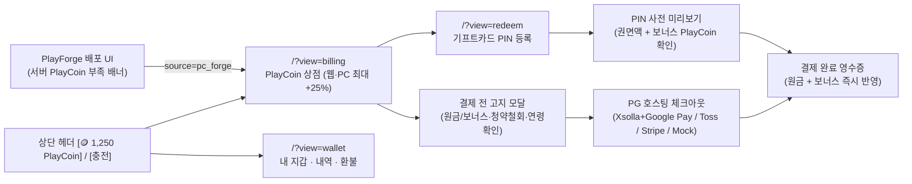
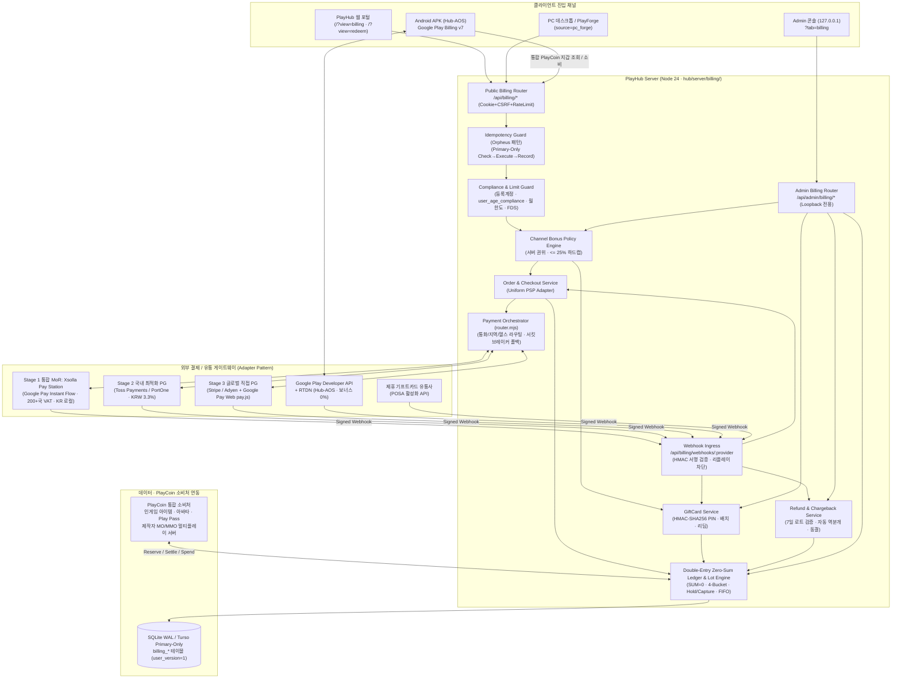
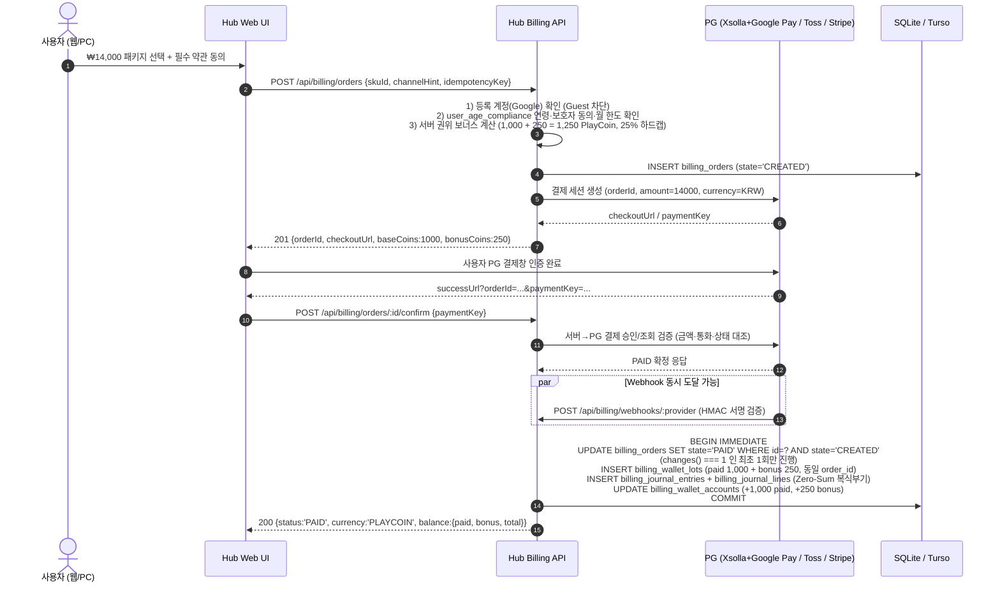
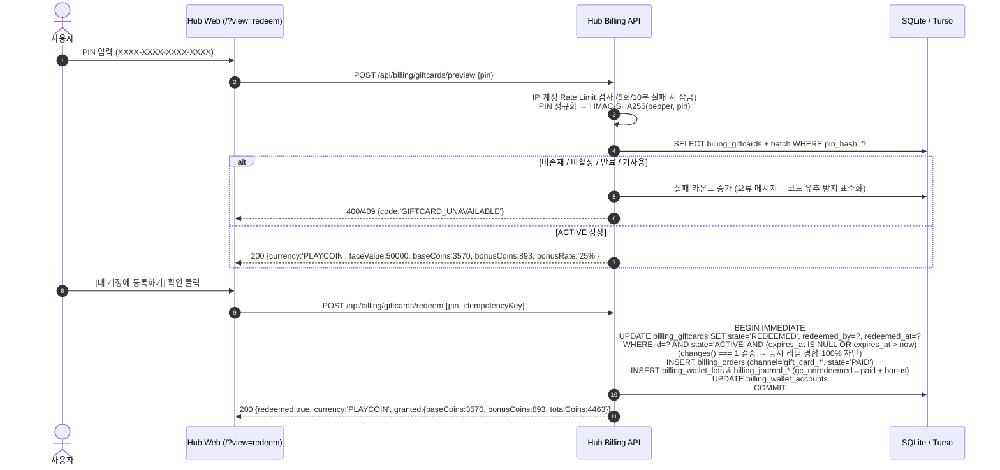

# PlayHub 통합 과금 · PlayCoin · 기프트카드 운영 정책 및 개발 기획 계획안 (`Hub-Billing`)

- **브랜치 / 워크트리**: `Hub-Billing` (`D:\Github\GoDotProjects-worktrees\Hub-Billing`, 기준 `PlayHub-Platform` `746e0c7`)
- **문서 상태**: v1.3 (2026-11-21 — **단일 통합 재화 `PlayCoin` 확정 · Google Pay 연동 · Xsolla(MoR) 검토 · Airbnb/Uber/Lyft 벤치마크 기반 복식부기/오케스트레이터 업그레이드** 반영)
- **핵심 정책 목표**: **Roblox의 상시 보너스 모델("웹·PC·기프트카드 구매 시 최대 +25% 추가 재화")**을 PlayHub 단일 통합 재화 **`PlayCoin`**에 도입하고, **Airbnb(Orpheus 멱등성·복식부기)·Uber(Zero-Sum Hold/Capture·스마트 라우팅)·Lyft(선불 지갑·보너스 엔진 분리)** 검증 패턴을 PlayHub 규모에 맞게 적용한 **단일 서버 권위 과금·지갑 원장·리딤·환불·운영 콘솔 체계**를 구축한다.
- **관련 기준 문서**:
  - [PAYMENT_BENCHMARK_AND_SOLUTION.md](PAYMENT_BENCHMARK_AND_SOLUTION.md) — **Airbnb · Uber · Lyft · Roblox 결제 아키텍처 벤치마크 및 3단계 최적 솔루션 검토 보고서**
  - [multiplayer-deploy-billing-plan.md](../architecture/multiplayer-deploy-billing-plan.md) — 제작자 멀티플레이 서버 호스팅 과금·원장 설계(기존 가칭 `Hub Point (P)` → 본 통합 정책에 따라 **`PlayCoin`**으로 단일 통합, `1 PlayCoin = USD 0.01`, 약 ₩14)
  - `Hub-AOS` [ANDROID_PLAYHUB_APK_BUILD_PLAN.md](../../../Hub-AOS/docs/aos/ANDROID_PLAYHUB_APK_BUILD_PLAN.md) — Android Google Play Billing v7 IAP · SSV · RTDN · 중립적 연령 게이트(`user_age_compliance`) 설계(가칭 `Play Coin` → 공식 명칭 **`PlayCoin`** 통일)
  - [ADMIN_PAGE_PLAN.md](../ADMIN_PAGE_PLAN.md) — PlayHub-Admin 탭 구조 및 루프백 보안 경계
  - [site-operations-plan.md](../architecture/site-operations-plan.md) — 운영·백업·시크릿·장애 대응 원칙

---

## 목차

1. [배경 · 목표 및 범위 정의](#1-배경--목표-및-범위-정의)
2. [벤치마크 분석 및 채널별 단위 경제성(Unit Economics)](#2-벤치마크-분석-및-채널별-단위-경제성unit-economics)
3. [PlayCoin 통합 재화 체계 및 4-Bucket 원장 거버넌스](#3-playcoin-통합-재화-체계-및-4-bucket-원장-거버넌스)
4. [운영 정책 (가격 · 보너스 · 기프트카드 · 환불 · 법령 · 스토어 규정)](#4-운영-정책-가격--보너스--기프트카드--환불--법령--스토어-규정)
5. [사용자 경험(UX) 및 화면 기획](#5-사용자-경험ux-및-화면-기획)
6. [관리자 콘솔(Admin) 운영 화면 기획](#6-관리자-콘솔admin-운영-화면-기획)
7. [시스템 아키텍처 및 핵심 시퀀스](#7-시스템-아키텍처-및-핵심-시퀀스)
8. [데이터베이스 스키마 설계 (`hub/server/billing/schema.mjs`)](#8-데이터베이스-스키마-설계-hubserverbillingschemamjs)
9. [HTTP API 계약 (`hub/server/billing/routes.mjs`)](#9-http-api-계약-hubserverbillingroutesmjs)
10. [보안 · 어뷰징 방지 · 회계/컴플라이언스](#10-보안--어뷰징-방지--회계컴플라이언스)
11. [디렉터리 구조 · 워크트리 소유권 · 테스트 전략 · 구현 로드맵](#11-디렉터리-구조--워크트리-소유권--테스트-전략--구현-로드맵)
12. [확정 결정 및 착수 전 남은 의사결정 항목 (Open Decisions)](#12-확정-결정-및-착수-전-남은-의사결정-항목-open-decisions)

---

## 1. 배경 · 목표 및 범위 정의

### 1.1 추진 배경

PlayHub는 웹 포털(`hub/`), PlayForge 제작 환경(`forge/`), 그리고 Android 네이티브 런타임(`Hub-AOS`)으로 확장되고 있다. 게임 플랫폼의 수익화에서 가장 큰 구조적 비용은 **모바일 앱 마켓(Google Play / Apple App Store)의 15~30% 인앱결제(IAP) 수수료**다.

Roblox는 **웹 브라우저·PC(데스크톱)·기프트카드 구매 시 모바일/콘솔 인앱 구매 대비 최대 25% 더 많은 Robux를 상시 지급**함으로써 다음 3가지 효과를 동시에 달성했다.

1. **수수료 절감분의 이용자 환원(Win-Win)**: 앱 마켓 30% 수수료를 3~5%대 직접 결제(PG) 또는 5~10%대 기프트카드 유통으로 전환하여, 이용자에게 **최대 +25% 추가 PlayCoin**을 제공하고도 **플랫폼의 코인당 순매출(Net Revenue per PlayCoin)을 오히려 개선**한다.
2. **자연스러운 웹·PC·기프트카드 전환(Direct-to-Consumer)**: 앱 마켓의 반유도(Anti-Steering) 규정을 위반하지 않으면서도 이용자 스스로 웹 상점과 기프트카드를 선택하도록 강력한 가격 인센티브를 형성한다.
3. **단일 재화(`PlayCoin`) 생태계 통합**: 플레이어(인게임 아이템·아바타·Play Pass)와 창작자(멀티플레이 서버 호스팅)가 **하나의 `PlayCoin` 지갑과 기프트카드**를 공유하여 브랜드 단순성과 유통 효율을 극대화한다.

### 1.2 범위 정의 (In-Scope vs Non-Goals)

| 영역 | 포함 범위 (`Hub-Billing`) | 명시적 제외 (Non-Goals) |
|---|---|---|
| **PlayCoin 상품·보너스** | 웹·PC 직접 결제 및 기프트카드 리딤 시 **최대 +25% 상시 보너스** 정책·카탈로그·계산 엔진(서버 권위, DB `<= 25%` 하드캡) | 한시적 가변 가챠/랜덤 할인, 앱 마켓 결제에 웹 보너스 동일 적용 |
| **결제 수단 (PG)** | 국내 PG(Toss Payments / PortOne) + 글로벌 PG(Stripe / Xsolla / Paddle 중 택1) 어댑터, 로컬 검증용 Mock PG | 카드 번호 직접 수집·저장(PCI-DSS SAQ-D 범위 회피, PG 호스팅 체크아웃만 사용) |
| **기프트카드** | 자사 디지털 `PlayCoin` 기프트카드(이메일/선물), 온·오프라인 유통 배치 PIN 발행·활성화·폐기, 웹 PIN 리딤(`/?view=redeem`), 프로모션 바우처 | 실물 플라스틱 카드 인쇄·물류 자체 운영(제휴 유통사/POSA 연동으로 분리) |
| **통합 지갑·원장** | `PlayCoin` 단일 통합 지갑 + 4-Bucket(`paid`/`bonus`/`promo`/`earned`) Append-Only 원장, 주문 로트(`lot`) 단위 사용 추적, `Hub-AOS` IAP 및 `multiplayer-deploy-billing` 연동 인터페이스 | 크립토/블록체인 토큰, 이용자 간 현금 환전(P2P 거래) |
| **환불·리스크·법령** | 전자상거래법 7일 미사용 청약철회, 상품권 표준약관(유효기간·60%/80% 잔액환불), 차지백 자동 역분개/동결, 미성년자·아동(`user_age_compliance`) 결제 게이트 및 월 한도 | 개별 입점 게임 내부의 확률형 아이템 드롭 로직 자체 구현(확률 표기 메타데이터 검증만 연동) |
| **운영 콘솔 (Admin)** | 매출·보너스 대시보드, 상품·보너스율 관리, 기프트카드 배치 관리, 주문·환불·차지백 센터, 원장 조회·수동 조정, 일일 PG 대사 | 회계 ERP 자체 구축(회계 정산 CSV/JSON Export 제공으로 대체) |

---

## 2. 벤치마크 분석 및 채널별 단위 경제성(Unit Economics)

### 2.1 Roblox "최대 25% 추가 Robux" 정책 실측 요약

Roblox는 2024년 말~2025년부터 일시 프로모션이 아닌 **영구 글로벌 가격 정책**으로 웹·컴퓨터·기프트카드 구매 시 최대 25% 추가 Robux를 제공하고 있다.

| 구분 | Roblox 적용 구조 (확인된 사실) | PlayHub `PlayCoin` 설계 반영 포인트 |
|---|---|---|
| **적용 채널** | 공식 웹사이트(`roblox.com`), PC 데스크톱 웹 체크아웃, 온·오프라인 Roblox 기프트카드(웹 리딤) | `web_browser`, `pc_desktop`, `gift_card_web_redeem` 3대 채널에 상시 적용 |
| **미적용 채널** | iOS App Store, Google Play Store, PlayStation/Xbox 등 콘솔 스토어 인앱결제 | `aos_google_play`, `ios_app_store`는 기본 단가(0% 보너스) 유지 |
| **가격 티어 구조 (USD 기준)** | USD 2.99(240→270, +12.5%), USD 4.99(400→500, +25%), USD 9.99(800→1,000, +25%), USD 14.99(1,200→1,500, +25%), USD 19.99(1,700→2,000, +17.6%), USD 49.99(4,500→5,250, +16.7%), USD 99.99(10,000→11,000, +10%) 등 **소·중액 구간에서 최대 +25% 체감 극대화** | 전 구간에서 **모바일 IAP 대비 +10% ~ +25%**가 명확히 체감되도록 설계하고, 핵심 주력 티어(₩14,000 ~ ₩280,000)에 **+25%** 배치 |
| **기프트카드 정책** | 정책 시행 전 구매한 미사용 카드도 리딤 시 신정책 혜택 적용, 리딤 후 크레딧/Robux 전환 | **리딤 시점 정책** 적용 + 리딤 전 `PlayCoin` 지급량 미리보기 UI 제공 |
| **환불·차지백·DevEx** | 구매·기프트카드·보너스 Robux는 창작자 출금(`Earned Robux`)에 불포함, 차지백 시 음수 잔액·계정 정지 및 DevEx 영구 박탈 | `earned` 버킷 완전 분리, 차지백 자동 역분개·음수 부채(`debt_coins`)·계정 결제 동결 |

### 2.2 PlayHub 채널별 단위 경제성 시뮬레이션 (부가세 포함/제외 검증)

기준 단가: **모바일 IAP 기준 `1 PlayCoin = ₩14 (USD 0.01)`** (`multiplayer-deploy-billing-plan.md` 단가와 완전 일치).  
대표 패키지 **₩14,000 (USD 9.99)** 결제 시 채널별 `1 PlayCoin`당 순매출 비교는 다음과 같다.

#### (1) 총액(Gross) 기준 비교 (글로벌 USD / 부가세 별도 기준)

| 구매 채널 | 결제액 | 수수료율 (가정) | 지급 PlayCoin (기본 + 보너스) | 보너스율 | 플랫폼 순수취액 | **1 PlayCoin당 순매출** | 모바일 IAP 대비 |
|---|---:|---:|---|---:|---:|---:|---:|
| **Mobile IAP (표준 30%)** | USD 9.99 | 30.0% | `1,000 PlayCoin` (`1,000 + 0`) | **0%** | USD 6.99 | **USD 0.00699** | 기준 (100.0%) |
| **Mobile IAP (중소 15%)** | USD 9.99 | 15.0% | `1,000 PlayCoin` (`1,000 + 0`) | **0%** | USD 8.49 | **USD 0.00849** | 121.5% *(연매출 USD 1M 미만 한시)* |
| **Web / PC 직접 (국내 PG · Toss/PortOne)** | ₩14,000 | 3.3% | **`1,250 PlayCoin`** (`1,000 + 250`) | **+25%** | ₩13,538 | **₩10.83** *(USD 0.00774)* | **+10.7% 우위** |
| **Web / PC 직접 (Stripe + Google Pay Web)** | USD 9.99 | 3.5~4.0% | **`1,250 PlayCoin`** (`1,000 + 250`) | **+25%** | USD 9.59 | **USD 0.00767** | **+9.7% 우위** |
| **Web / PC 직접 (Xsolla MoR · 카드/Google Pay)** | USD 9.99 | ~8.5% *(5% + 3.5%)* | **`1,250 PlayCoin`** (`1,000 + 250`) | **+25%** | USD 9.14 | **USD 0.00731** | **+4.6% 우위** |
| **자사 디지털 기프트카드** | ₩14,000 | 4.0% *(PG+발급)* | **`1,250 PlayCoin`** (`1,000 + 250`) | **+25%** | ₩13,440 | **₩10.75** *(USD 0.00768)* | **+9.9% 우위** |
| **외부 유통 기프트카드 (온라인)** | ₩14,000 | 7.0% | **`1,250 PlayCoin`** (`1,000 + 250`) | **+25%** | ₩13,020 | **₩10.42** *(USD 0.00744)* | **+6.4% 우위** |
| **외부 유통 기프트카드 (오프라인)** | ₩14,000 | 10.0% | **`1,200 PlayCoin`** (`1,000 + 200`) | **+20%** | ₩12,600 | **₩10.50** *(USD 0.00750)* | **+7.3% 우위** |
| **외부 유통 기프트카드 (오프라인 최대)** | ₩14,000 | 10.0% | **`1,250 PlayCoin`** (`1,000 + 250`) | **+25%** | ₩12,600 | **₩10.08** *(USD 0.00720)* | **+3.0% 우위** |

#### (2) 한국 부가가치세(VAT 10% 내포가) 반영 순수취 비교 (₩14,000 결제, 공급가액 ₩12,727)

| 구매 채널 | 공급가액 | 수수료 차감액 | 순수취액 (VAT 제외) | 지급 PlayCoin | **1 PlayCoin당 순매출 (VAT 제외)** | 모바일 IAP 대비 |
|---|---:|---:|---:|---:|---:|---:|
| **Mobile IAP (30% 수수료)** | ₩12,727 | ₩3,818 *(공급가 30%)* | ₩8,909 | `1,000 PlayCoin` | **₩8.91 / Coin** | 기준 |
| **Web / PC (국내 PG 3.3%, +25%)** | ₩12,727 | ₩462 *(총액 3.3%)* | ₩12,265 | `1,250 PlayCoin` | **₩9.81 / Coin** | **+10.1% 우위** |
| **Web / PC (Xsolla MoR 8.5%, +25%)** | ₩12,727 | ₩1,190 *(총액 8.5%)* | ₩11,537 | `1,250 PlayCoin` | **₩9.23 / Coin** | **+3.6% 우위** |
| **오프라인 기프트카드 (10%, +20%)** | ₩12,727 | ₩1,400 *(총액 10%)* | ₩11,327 | `1,200 PlayCoin` | **₩9.44 / Coin** | **+6.0% 우위** |
| **오프라인 기프트카드 (10%, +25%)** | ₩12,727 | ₩1,400 *(총액 10%)* | ₩11,327 | `1,250 PlayCoin` | **₩9.06 / Coin** | **+1.7% 우위** |

> **경제성 결론**: **+25% 보너스 상한**은 앱 마켓 30% 수수료 구조 대비 국내 PG(3.3%), Stripe+Google Pay(4%), **Xsolla MoR(8.5%)**, 그리고 유통 마진 10% 이하 기프트카드까지 **모든 정상 채널에서 역마진 없이 모바일 IAP 대비 순매출 우위(+1.7% ~ +10.7%)를 유지**한다. 단, Xsolla 내 신흥국 고수수료 APM(실효 총 수수료 12% 초과)이나 수수료 10% 초과 오프라인 기프트카드 제휴는 채널 설정에서 비활성화하거나 **+15%~+20% 보너스 티어**로 자동 제어한다.

#### (3) 제작자 멀티플레이 서버 호스팅(`multiplayer-deploy-billing-plan.md`) 마진 영향 검증

`multiplayer-deploy-billing-plan.md` §5.1의 Option B(저Egress 하이브리드 실행 풀)는 `1 PlayCoin = USD 0.01`, PG 4% 가정 시 단위 마진 **57.7% ~ 62.6%**를 산출했다. 제작자가 웹에서 **+25% 보너스**로 충전한 `PlayCoin`을 멀티플레이 서버 요금에 전액 사용할 경우:

- 코인당 실현 순매출: `USD 0.00960 → USD 0.00767` (-20.1%)
- `Small (12 PlayCoin/hr)` 기준: 시간당 실현 매출 `USD 0.0920`, 인프라 원가 `USD 0.048` → **단위 마진 47.8%** (건전)
- `Medium (24 PlayCoin/hr)` 기준: 시간당 실현 매출 `USD 0.1841`, 인프라 원가 `USD 0.101` → **단위 마진 45.1%** (건전)
- **권장 안전장치**: 인프라 서버 과금에서도 보너스 `PlayCoin` 사용을 허용하되, 설정 플래그(`billing.bonusAllowedForInfra`, 기본 `true`)로 정책 제어가 가능하게 설계한다. (상세는 §12 Open Decision #4)

---

## 3. PlayCoin 통합 재화 체계 및 4-Bucket 원장 거버넌스

### 3.1 `PlayCoin` 단일 통합 확정 및 표기 표준

**[확정]** PlayHub 전체 생태계(웹 포털, PC 클라이언트, PlayForge, Android/iOS 앱, 기프트카드, 멀티플레이 서버 호스팅)의 공식 플랫폼 재화는 **`PlayCoin`** 하나로 통합한다.

#### 표기 및 명명 표준

| 구분 | 표준 표기 | 금지 표기 / 주의 사항 |
|---|---|---|
| **공식 영문 브랜드** | **`PlayCoin`** (붙여쓰기, 대소문자 고정) | `Play Coin`(띄어쓰기), `Hub Point`, `Play Gem` 등 혼용 금지 |
| **한국어 UI 표기** | **`PlayCoin`** (또는 문맥상 보조 설명 `플레이코인`) | `허브 포인트`, `포인트` 단독 혼용 지양 (카피 일관성 유지) |
| **축약/아이콘 표기** | **`🪙 1,250 PlayCoin`** / 좁은 공간 **`🪙 1,250`** | **`PC` 약어 사용 금지** ("웹·PC 구매"의 `PC`와 혼동 유발) |
| **코드·DB·API 통화 상수** | `PLAYCOIN` (`base_coins`, `bonus_coins`, `delta_coins`) | `HUB_POINT` 신규 사용 금지 (기존 매니페스트 호환 파서만 레거시 별칭 수용) |
| **인프라 원가 크레딧 구분** | **`GCP Credit`** (구글 클라우드 청구서 상계용, 내부 원가 측) | `PlayCoin`과 절대 혼동 금지 (`multiplayer-deploy-billing-plan.md` §0 원칙 승계) |

#### 타 브랜치 · 기존 문서 동기화 매핑표 (트렁크 통합 시 반영)

본 브랜치(`Hub-Billing`)는 `owners.json` 소유권 경계 준수를 위해 타 브랜치 소유 문서를 직접 수정하지 않으며, 트렁크 통합 시 아래 매핑대로 정합성을 맞춘다.

| 기존 문서 / 브랜치 | 기존 명칭 · 테이블 | `Hub-Billing` 통합 기준 |
|---|---|---|
| `PlayHub-Platform` · `docs/architecture/multiplayer-deploy-billing-plan.md` | `Hub Point (P)`, `HUB_POINT`, `hub_point_accounts`, `hub_point_ledger` | **`PlayCoin` (`PLAYCOIN`)**, `billing_wallet_accounts`, `billing_journal_entries`/`billing_journal_lines` (복식부기 SSOT 단일 원장 연동, `deployProfile.billing.currency`는 `PLAYCOIN` 신규 표준 + `HUB_POINT` 하위호환 수용) |
| `Hub-AOS` · `docs/aos/ANDROID_PLAYHUB_APK_BUILD_PLAN.md` | 가칭 `Play Coin`, `player_wallet_accounts`, `player_wallet_ledger` | 공식 명칭 **`PlayCoin`** 통일, `billing_wallet_accounts` · `billing_journal_*` 원장 SSOT로 통합 (`Hub-AOS`의 `/api/iap/google/verify`·RTDN이 `Hub-Billing` 원장 적립 API 호출) |

### 3.2 4-Bucket 원장 구조 및 불변 규칙

모든 사용자 지갑은 **소수점 없는 정수(`INTEGER`)** 단위의 4개 버킷으로 구성되며, 총 가용 잔액은 `paid_balance + bonus_balance + promo_balance - reserved_coins`다. (`earned_balance`는 창작자 정산 영역으로 분리 표시하되, 창작자가 명시적으로 호스팅/소비 지갑 전환을 선택할 때만 단방향 이동 가능.)

| 버킷 (`bucket`) | 성격 및 원천 | 환불(청약철회) 가능 여부 | 유효기간 / 소멸시효 | `earned`(출금) 전환 |
|---|---|---|---|---|
| **`paid`** | 웹·PC·모바일 IAP·유상 기프트카드 충전 원금 `PlayCoin` | **가능** (7일 미사용 100% 청약철회 / 잔액환불 법령 기준) | 소멸시효 **5년** (상법·신유형 상품권 표준약관) | **절대 불가** |
| **`bonus`** | 웹·PC·기프트카드 채널 추가 지급 `PlayCoin` (**최대 +25%**) | **단독 환불 불가** (연결된 `paid` 주문 환불 시 전액 동반 회수) | 연결된 유상 로트 소멸 시 또는 지급일로부터 **5년** | **절대 불가** |
| **`promo`** | 월간 Free 서버 쿼터, 이벤트 보상, CS 무상 지급, 프로모션 쿠폰 | **불가** | 캠페인별 명시 유효기간 (예: 30~90일, 만료 시 자동 소각) | **절대 불가** |
| **`earned`** | *(Phase 3+)* 입점 게임 내 판매로 창작자가 획득한 정산 `PlayCoin` | 창작자 정산(DevEx 유사) 출금 정책 적용 | 정산 규정 따름 | 출금 전용 원천 |

### 3.3 차감 우선순위(Spend Waterfall) 및 로트(Lot) 기반 청약철회 보호

단순 합산 지갑에서 `bonus`를 먼저 차감하면 *"보너스 250 PlayCoin만 먼저 소비한 뒤 유상 원금 1,000 PlayCoin은 미사용이라 주장하며 100% 환불을 요구하는"* 치명적 어뷰징이 발생한다. 이를 원천 차단하기 위해 **로트(Lot) 단위 사용 추적**을 결합한다.

1. **소비 차감 순서 (Spend Waterfall)**:
   - ① **`promo`** (만료일이 가장 빠른 로트부터 FIFO)
   - ② **`bonus`** (생성일이 오래된 로트부터 FIFO — 이용자 소멸 부담 완화)
   - ③ **`paid`** (생성일이 오래된 로트부터 FIFO)
2. **로트 동반 사용 개시 규칙 (Anti-Bonus-Stripping Rule)**:
   - 모든 유상 주문(`order_id`)과 기프트카드 리딤은 **`paid` 로트 1건 + `bonus` 로트 1건**을 동일한 `parent_order_id`로 묶어 발행한다.
   - 특정 `parent_order_id`에 속한 **`paid` 또는 `bonus` 중 어느 쪽이든 1 PlayCoin이라도 소비되면**, 해당 주문의 `first_spent_at`이 즉시 기록되어 **"사용 개시됨(CONSUMED_STARTED)"** 상태로 전이된다.
   - 따라서 보너스만 먼저 소비하고 원금을 7일 청약철회로 환불받는 악용은 시스템적으로 100% 불가능하다.

---

## 4. 운영 정책 (가격 · 보너스 · 기프트카드 · 환불 · 법령 · 스토어 규정)

### 4.1 공식 상품 티어 및 채널별 최대 +25% 보너스 정책표

#### (1) 웹·PC 직접 결제 vs 모바일 IAP 패키지 비교 (KRW / USD)

기본 단가는 `1 PlayCoin = ₩14 (USD 0.01)`이며, **핵심 주력 티어(₩14,000 이상)에 최대 +25% 상시 보너스**를 적용하고 소액 티어(PG 고정 수수료 비중이 큰 구간)에는 **+10% ~ +20%** 단계적 보너스를 적용해 소액 결제 역마진을 방지한다.

| SKU 코드 | 판매가 (KRW, VAT포함) | 판매가 (USD) | 모바일 IAP 지급량 (0%) | **웹·PC 기본 PlayCoin** | **웹·PC 채널 보너스** | **웹·PC 총 지급량** | **보너스율** | 비고 |
|---|---:|---:|---:|---:|---:|---:|---:|---|
| `playhub.coin.t1` | ₩1,500 | USD 0.99 | `100` | `100` | `+10` | **`110 PlayCoin`** | **+10%** | 스타터 소액 (PG 고정비 보호) |
| `playhub.coin.t2` | ₩4,500 | USD 2.99 | `300` | `300` | `+45` | **`345 PlayCoin`** | **+15%** | 라이트 팩 |
| `playhub.coin.t3` | ₩7,000 | USD 4.99 | `500` | `500` | `+100` | **`600 PlayCoin`** | **+20%** | 스탠다드 입문 |
| `playhub.coin.t4` | ₩14,000 | USD 9.99 | `1,000` | `1,000` | **`+250`** | **`1,250 PlayCoin`** | **+25%** | **인기(Best Value) 진입 티어** |
| `playhub.coin.t5` | ₩28,000 | USD 19.99 | `2,000` | `2,000` | **`+500`** | **`2,500 PlayCoin`** | **+25%** | 주력 티어 |
| `playhub.coin.t6` | ₩70,000 | USD 49.99 | `5,000` | `5,000` | **`+1,250`** | **`6,250 PlayCoin`** | **+25%** | 헤비·창작자 추천 |
| `playhub.coin.t7` | ₩140,000 | USD 99.99 | `10,000` | `10,000` | **`+2,500`** | **`12,500 PlayCoin`** | **+25%** | 프로·스튜디오 |
| `playhub.coin.t8` | ₩280,000 | USD 199.99 | `20,000` | `20,000` | **`+5,000`** | **`25,000 PlayCoin`** | **+25%** | 대형 MMO/스튜디오 전용 (성인 KYC 권장) |

> **다통화(8개 언어·글로벌) 환율 정책**: `USD`, `KRW`, `JPY`, `EUR`, `GBP`, `BRL` 등 지원 통화별 가격은 실시간 환율 변동을 매번 노출하지 않고 **월 1회(또는 환율 ±8% 변동 시) 어드민에서 고시하는 고정 티어 가격표(`billing_catalog_skus`)**를 사용한다. 환율 차익(VPN을 이용한 저가 통화 우회 결제)을 방지하기 위해 결제 통화는 **카드 발급국(BIN) 또는 PG 청구 국가와 일치**시킨다.

#### (2) 기프트카드 권종 및 리딤 보너스 정책표 (웹 리딤 기준)

기프트카드는 권면액(Face Value)을 기준으로 **리딤 시점의 `base_coins` + 채널 보너스(`bonus_coins`)**를 즉시 지급한다.

| 기프트카드 권종 | 권면액 (KRW / USD) | 기본 PlayCoin | **자사 디지털 카드 보너스** | **총 지급 (디지털)** | **외부 유통 카드 보너스 *(옵션)*** | **총 지급 (외부유통)** |
|---|---|---:|---:|---:|---:|---:|
| **GC-10K / GC-10** | ₩10,000 / USD 10 | `700` / `1,000` | **+20%** (`+140` / `+200`) | **`840` / `1,200 PlayCoin`** | **+15%** ~ **+20%** | `805~840` / `1,150~1,200` |
| **GC-30K / GC-25** | ₩30,000 / USD 25 | `2,150` / `2,500` | **+25%** (`+538` / `+625`) | **`2,688` / `3,125 PlayCoin`** | **+20%** ~ **+25%** | `2,580~2,688` / `3,000~3,125` |
| **GC-50K / GC-50** | ₩50,000 / USD 50 | `3,570` / `5,000` | **+25%** (`+893` / `+1,250`) | **`4,463` / `6,250 PlayCoin`** | **+20%** ~ **+25%** | `4,284~4,463` / `6,000~6,250` |
| **GC-100K / GC-100** | ₩100,000 / USD 100 | `7,140` / `10,000` | **+25%** (`+1,785` / `+2,500`) | **`8,925` / `12,500 PlayCoin`** | **+20%** ~ **+25%** | `8,568~8,925` / `12,000~12,500` |

- **반올림 규칙**: `bonus_coins = Math.round(base_coins * bonus_bps / 10000)` (정수 반올림, 모든 채널 동일 수식).
- **하드캡 불변식**: 채널·캠페인·쿠폰을 불문하고 상시 채널 보너스율 `bonus_bps`는 **`0 <= bonus_bps <= 2500` (최대 25.00%)**을 DB `CHECK` 제약과 서버 코드 양쪽에서 강제한다.
- **중복 혜택 방지**: 일회성 마케팅 쿠폰(`promo` 추가 지급)이 적용되더라도 채널 보너스 자체는 25%를 초과하지 않으며, 쿠폰 지급분은 별도 `promo` 버킷으로 분리 기록한다.

### 4.2 서버 권위 채널 판별(Channel Attribution) 규칙

클라이언트 요청 헤더(`User-Agent`)나 본문의 `channel` 값은 위변조가 가능하므로 **보너스 지급 여부를 클라이언트에 절대 위임하지 않는다.**

| 실제 결제/발급 원천 (서버 검증 값) | 부여되는 확정 채널 (`channel`) | 최대 보너스 허용 |
|---|---|---|
| Toss Payments / PortOne / Stripe / Xsolla 웹 체크아웃 승인 | `web_browser` | **허용 (최대 +25%)** |
| PC 데스크톱 클라이언트(또는 PlayForge) 인증 토큰 + 직접 PG 승인 | `pc_desktop` | **허용 (최대 +25%)** |
| 유상 발행·활성화된 기프트카드 PIN 웹 리딤 (`billing_giftcards`) | `gift_card_direct` / `gift_card_retail` | **허용 (최대 +25% / 유통별 20~25%)** |
| Google Play Billing v7 SSV 영수증 검증 | `aos_google_play` | **불가 (0%)** |
| Apple App Store StoreKit2 / ASSN 영수증 검증 | `ios_app_store` | **불가 (0%)** |

### 4.3 기프트카드 운영 정책

1. **생애주기 상태 머신**:
   - `ISSUED` (배치 생성 완료, 판매 전 — 리딤 불가, 도난 시 피해 0)
   - → `ACTIVE` (결제 완료 또는 제휴사 POSA 활성화 Webhook 수신 — 리딤 가능)
   - → `REDEEMED` (계정 리딤 완료, 원금+보너스 `PlayCoin` 적립 — 재사용 불가)
   - 예외 전이: `ACTIVE/ISSUED → VOIDED` (결제 취소, 도난 배치 일괄 폐기, 분실 재발급), `ACTIVE → EXPIRED` (유효기간 만료 — 환불/연장 접수 가능).
2. **유효기간 및 잔액 환불 (공정위 신유형 상품권 표준약관 준수)**:
   - 유상 기프트카드의 리딤 유효기간은 **최소 1년(기본 5년 권장)**으로 설정하며, 유효기간 경과 전 만료 안내 알림(30일·7일 전 이메일)을 발송한다.
   - 유효기간이 경과했더라도 발행일로부터 **소멸시효 5년 이내**에는 미사용 카드의 리딤 연장 또는 법정 기준 환급을 지원한다.
   - `PlayCoin` 전환 후 잔액 환불 요청 시: **1만 원 초과 권종은 60% 이상, 1만 원 이하 권종은 80% 이상 사용 시** 잔여 유상(`paid`) `PlayCoin`에 대해 현금 환불을 제공한다. (무상 `bonus`는 환불 산정 제외.)
3. **자사 디지털 선물하기 정책**:
   - 구매자가 웹에서 타인에게 디지털 기프트카드를 선물할 경우, 수령인이 리딤하기 전 7일 이내에는 구매자가 취소·환불할 수 있다(`ACTIVE → VOIDED`). 리딤 완료 후에는 수령인 지갑의 `PlayCoin` 규정을 따른다.
4. **국가/통화 일치 원칙**:
   - 기프트카드는 발행 통화(`KRW` / `USD` 등)가 지정되며, 계정 지역/통화와 다른 카드를 리딤할 경우 환율 아비트라지 방지를 위해 **발행 통화 기준 고정 `PlayCoin` 지급표**를 적용하거나 지원 지역 제한 정책을 적용한다.

### 4.4 청약철회 · 환불 · 차지백 · 미성년자 결제 정책

#### (1) 청약철회 및 환불 매트릭스 (전자상거래법 제17조 준수)

| 상황 | 판단 기준 | 처리 정책 | 보너스(`bonus`) 처리 |
|---|---|---|---|
| **결제 후 7일 이내 · 미사용** | `now - paid_at <= 7d` AND 해당 `order_id` 로트의 `first_spent_at IS NULL` | **100% 원결제수단 자동/즉시 환불** (`/?view=wallet` 원클릭 신청 가능) | 연결된 `bonus` 전액 동반 회수 |
| **결제 후 7일 이내 · 일부 사용** | `first_spent_at IS NOT NULL` (원금 또는 보너스 1 PlayCoin 이상 소비) | 청약철회 제한 대상(결제 전 명시 고지·동의 필수). 단, 이용자 요청 시 **미사용 `paid` 잔여분만 법정 환불 기준 정산** | 해당 주문의 미사용 `bonus` 전액 소멸, 이미 소비한 `bonus` 가치는 정산 시 공제(법령 한도 내) |
| **결제 후 7일 경과 · 미사용** | `now - paid_at > 7d`, `first_spent_at IS NULL` | 유상 원금 환불 신청 접수(CS 심사 → 수수료 10% 또는 최소 수수료 법령·약관 기준 차감 후 환불, 소멸시효 5년 내 보장) | 연결된 `bonus` 전액 회수 |
| **미성년자 무단 결제 (민법 제5조)** | 만 19세 미만(KR) 법정대리인 동의 없는 결제 입증 시 | **사용 여부와 무관하게 계약 취소 및 환불 심사** (법정대리인 가족관계·결제내역 확인) | 전액 회수 (관련 엔타이틀먼트 회수) |
| **차지백 / PG 강제 취소 / RTDN `VOIDED`** | 카드사 이의제기·도난카드·구글/애플 강제 환불 Webhook 수신 | **즉시 자동 역분개**: `paid`+`bonus` 전액 차감(잔액 부족 시 `debt_coins` 음수 부채 기록) + 관련 엔타이틀먼트 회수 + **계정 결제/선물/출금 자동 동결** + Admin 리스크 큐 등재 | 전액 회수 (이미 사용된 경우 부채 합산) |

#### (2) 연령 티어별 결제 보호 및 한도 정책 (`user_age_compliance` 공통 적용)

`Hub-AOS`에서 정의한 중립적 연령 게이트(`user_age_compliance`)를 웹·PC 과금에도 동일하게 강제한다.

| 계정 상태 / 연령 티어 | 웹·PC 직접 결제 | 기프트카드 리딤 | 기본 월 결제 한도 (KRW 기준) | 필수 게이트 |
|---|---|---|---|---|
| **Guest (미로그인)** | **차단** | **차단** | ₩0 | Google 로그인 + `merge_requests` 완료 후 허용 (기기 유실 시 유상 재화 손실 방지) |
| **`CHILD_PROTECTED`** (KR 만 14세 미만 / US 만 13세 미만 / EU 13~16세 미만) | **기본 차단** (법정대리인 동의·승인 시 제한 허용) | **보호자 승인 시 허용** | 기본 ₩0 (보호자 설정 시 최대 ₩70,000/월) | 법정대리인 동의 완료 + 보호자 결제 알림 이메일 필수 |
| **`TEEN_MINOR`** (KR 만 14~18세 / 글로벌 만 13~17세) | **법정대리인 동의 확인 후 허용** | **허용** (월 한도 합산) | 기본 **₩70,000/월** (보호자 동의 시 최대 ₩300,000/월) | 결제 전 미성년자 취소권 고지 + 보호자 동의 기록 |
| **`ADULT`** (KR 만 19세+ / 글로벌 만 18세+) | **허용** | **허용** | 신규 7일 ₩300,000 → 일반 ₩2,000,000/월 (FDS 자동/심사 상향) | 고액(단건 ₩140,000+) 이상거래 점검 |

### 4.5 모바일 스토어 정책(Anti-Steering) 지역별 준수 전략

2025~2026년 미국(Epic v. Apple / Google 판결) 및 EU(DMA)의 반유도 규정 완화로 외부 웹 상점 운용이 확산되었으나, 국가별·스토어별 수수료와 링크 허용 조건이 상이하다. PlayHub는 **리스크 제로 2단계 전략**을 채택한다.

| 단계 | Android (`Hub-AOS`) / iOS 앱 내부 동작 | 웹·PC·외부 마케팅 동작 | 비고 |
|---|---|---|---|
| **Phase A (기본 · 글로벌 안전 모드)** | 앱 내에서는 Google Play / Apple IAP만 노출. **외부 웹 결제 링크나 "웹에서 25% 더 싸다"는 비교 문구를 앱 UI에 노출하지 않음.** 단, 웹·PC·기프트카드에서 충전한 `PlayCoin`은 동일 계정 통합 지갑으로 앱에서 즉시 사용 가능(Cross-Wallet Sync). | 웹사이트(`/?view=billing`), PC/PlayForge, 이메일 뉴스레터, 공식 SNS, 기프트카드 패키지에서 **"웹·PC·기프트카드 구매 시 최대 +25% 추가 PlayCoin"** 적극 홍보 | Google Play / App Store 심사 거절 리스크 0% |
| **Phase B (선택 · 허용 관할권 점진 개방)** | 서버 정책 플래그(`external_offers_regions`)로 법령·스토어 공식 API가 허용된 관할권(예: US / EU External Offers Program 등록 완료 지역)에 한해 공식 규격 외부 링크 버튼 활성화 | 동일 | 각 스토어 외부 결제 신고 수수료(예: 5~20%)와 웹 보너스율의 순익 비교 후 활성화 |

### 4.6 결제 게이트웨이 검토 (Xsolla 심층 평가) 및 Google Pay 연동 설계

#### (1) Google Pay 연동 원칙 — Google Pay Web ≠ Google Play Billing

| 구분 | **Google Pay (웹·PC 직접 결제)** | **Google Play Billing v7 (`Hub-AOS` 인앱)** |
|---|---|---|
| **역할** | 웹·PC 브라우저의 원탭 카드 지갑/토큰화 계층 (`pay.js` 또는 PG 내장) | Android APK 내부 디지털 재화 인앱결제(IAP) |
| **Google 수수료** | **0%** (하부 PG/MoR의 일반 카드 수수료만 발생) | **15% ~ 30%** 앱 마켓 수수료 |
| **PlayCoin 보너스** | **적용 (최대 +25%)** — `web_browser` / `pc_desktop` 채널 판정 | **미적용 (0%)** — `aos_google_play` 채널 판정 |
| **한국(KR) 가용성** | **주의**: Google Pay는 대한민국 국내 카드망/원화(KRW) 로컬 간편결제로 미출시 상태. **해외(미국·유럽·일본·브라질·인도 등) 카드/계정 원탭 결제**의 핵심 수단으로 동작하며, 국내 KRW 결제는 카카오페이·네이버페이·토스페이·국내카드와 병행 필수 | 대한민국 및 글로벌 Google Play 전체 정상 지원 |

- **Google Pay 연동 2가지 기술 경로**:
  1. **경로 A (권장 1단계 — Xsolla 내장 Google Pay Instant Flow)**: `@xsolla/pay-station-sdk` (`isGooglePayInstantFlowEnabled: true`) 또는 Xsolla Pay Station 호스팅 UI로 연동. 별도 `pay.js` 토큰화·Google Merchant 심사·PCI 처리를 Xsolla가 대행한다.
  2. **경로 B (확장/자체 PG — Google Pay Web API `pay.js` + Stripe `PAYMENT_GATEWAY`)**: 프론트엔드에 `https://pay.google.com/gp/p/js/pay.js`를 로드하고 `tokenizationSpecification` (`gateway: 'stripe'`)으로 암호화 토큰만 받아 백엔드 `providers/stripe.mjs`에서 `PaymentIntent`를 승인한다. (국내 브라우저에서 `isReadyToPay()`가 `false`이거나 KRW 통화일 때는 Google Pay 버튼을 자동 숨김 처리하고 국내 간편결제를 우선 노출한다.)

#### (2) Xsolla (Merchant of Record) 심층 검토

Roblox를 비롯한 글로벌 게임 웹 상점의 대표 인프라 중 하나인 **Xsolla Pay Station / Web Shop**을 국내 PG(Toss Payments/PortOne) + Stripe 조합과 비교 검토한다.

| 평가 항목 | **Xsolla Pay Station (MoR)** | **국내 PG (Toss/PortOne) + 글로벌 Stripe (직접 운영)** |
|---|---|---|
| **수수료 구조** | **기본 5% + 결제수단별 채널 수수료(2.5~4.0%) = 실효 약 7.5~9.0%** *(월 고정비 없음)* | 국내 **~3.0~3.3%** / 글로벌 Stripe **~3.4~4.5%** *(Google Pay 추가 수수료 0%)* |
| **1 PlayCoin 순매출 (+25% 보너스)** | USD 0.00731 / ₩9.23 *(모바일 IAP 대비 +3.6~4.6% 우위)* | USD 0.00767 / ₩9.81 *(모바일 IAP 대비 +9.7~10.7% 우위)* |
| **글로벌 세무 (VAT/GST/Sales Tax)** | **Xsolla가 MoR로서 200+ 국가 세금 징수·신고·납부 전담** | PlayHub가 각국 세무 임계치 모니터링 및 직접 신고·납부 필요 |
| **결제수단 커버리지** | 단일 연동으로 **Google Pay, Apple Pay, PayPal, 글로벌 카드 + 한국 카카오페이·네이버페이·토스·PAYCO·국내카드** 포함 700+ 수단 제공 | 국내 PG와 글로벌 Stripe를 **2중 연동·2중 대사**해야 하며, 국가별 로컬 지갑 개별 추가 필요 |
| **차지백 · 사기방지(AFS)** | 내장 AFS(3DS·AVS·ML) + 1차 결제 CS·차지백 은행 대응 대행 (`dispute` 웹훅 연동) | Stripe Radar / 국내 PG FDS + 차지백 증빙·CS 직접 대응 |
| **정산 · 한국 특화 제약** | 기본 USD 정산(환전·Net-30/계약 주기 확인 필요), 국내 현금영수증·PASS 본인확인 직접 연동 제약 | KRW 국내 익영업일~T+5 정산, 국세청 현금영수증·PASS 본인확인 완벽 지원 |
| **개발 속도 · 종속성** | **1회 연동으로 8개 언어 글로벌+한국 동시 오픈(최단 출시)**. 단, Xsolla 자체 카탈로그 종속 회피 필요 | 초기 구축·세무 비용이 크나 장기 매출 증가 시 한국 수수료 **~5.2%p 절감** |

#### (3) PlayHub 권장 PG 전략 — "SSOT 분리 + 경량 Payment Orchestrator (`router.mjs`) + 3단계 정량 진화"

Airbnb·Uber·Lyft의 Multi-PSP 오케스트레이션 교훈을 PlayHub 규모에 맞게 경량화하여 적용한다. 상세 비교와 손익분기점 분석은 [PAYMENT_BENCHMARK_AND_SOLUTION.md](PAYMENT_BENCHMARK_AND_SOLUTION.md)를 따른다.

1. **Vendor Lock-in 원천 차단 원칙**: Xsolla를 도입하더라도 상품·가격·**최대 25% 보너스 계산**·기프트카드·복식부기 원장의 진실 원천(SSOT)은 **100% PlayHub 서버(`hub/server/billing/`)**에 두고, 모든 PG는 동일한 내부 어댑터 인터페이스(`providers/*.mjs`)와 경량 스마트 라우터(`router.mjs`) 뒤에 격리한다.
2. **Stage 1 (M1 ~ 한국 월 결제액 < ₩3,000만 — 속도·세무 우선)**: **Xsolla Pay Station (MoR)** 1차 단일 어댑터로 **Google Pay Instant Flow + 글로벌 8개 언어 200+국 VAT 대행 + 한국 로컬 간편결제**를 최단 기간에 동시 출시한다. (고수수료 신흥국 APM >10%는 Xsolla 프로젝트 설정에서 비활성화하여 +25% 보너스 역마진 차단.)
3. **Stage 2 (한국 월 결제액 ≥ ₩3,000만 3개월 연속 시 — 수수료 ~5.2%p 절감 & 이중화)**: `providers/toss.mjs`(또는 PortOne V2)를 추가해 `router.mjs`가 `currency === 'KRW'`를 국내 PG(3.3%)로 자동 분기하고, 국내 PG 일시 장애 시 서킷 브레이커가 Xsolla로 자동 폴백한다. (월 ₩5,000만 기준 월 +₩260만/연 +₩3,120만 순익 개선 + 국세청 현금영수증·PASS 본인확인 완벽 지원.)
4. **Stage 3 (해외 월 결제액 ≥ USD 100,000 & 해외 법인/자동 세무 확보 시)**: 북미·유럽·일본 카드 및 **Google Pay Web(`pay.js`)**을 **Stripe/Adyen 직접 연동(`providers/stripe-gpay.mjs`)**으로 분기하여 글로벌 수수료 ~4~5%p를 추가 절감하고, 신흥국 로컬 APM만 Xsolla MoR로 유지한다.
5. **Xsolla 필수 웹훅 보안 계약**:
   - `POST /api/billing/webhooks/xsolla`에서 **HTTP Message Signatures (또는 프로젝트 Webhook Secret 서명)** 검증 통과 전에는 어떠한 응답/적립도 수행하지 않는다.
   - `user_validation` 웹훅에서 등록 계정·동결 여부·`user_age_compliance` 연령/월 한도를 실시간 검사해 미충족 결제를 승인 전 차단한다.
   - `dispute` / `refund` 웹훅 수신 시 §4.4의 자동 역분개·`debt_coins` 기록·계정 동결 파이프라인을 즉시 실행한다.
6. **Phase 2 확장 슬롯 — Lyft/Uber Cash형 성인 옵트인 자동 충전 (`Auto-Reload`)**:
   - `multiplayer-deploy-billing-plan.md`의 `autoTopUp` 및 헤비 플레이어 수요를 위해, 잔액 임계치 도달 시 설정 금액 자동 충전(+25% 보너스 유지) 기능을 **성인(`ADULT`) 명시적 동의 전용 · 매회 이메일 고지 · 원클릭 해지** 조건으로 Phase 2에 추가한다.

---

## 5. 사용자 경험(UX) 및 화면 기획

### 5.1 기존 사용자 포털(`hub/web/user/`) 확장 원칙

- 기존 정적 호스팅 호환 **쿼리 파라미터 라우팅**(`/?view=...`)을 그대로 유지한다.
- 모든 UI 문자열은 `PlayHub-L10N` 체계(`data-l10n`, 8개 지원 로케일: `ko`, `en`, `ja`, `zh-CN`, `fr`, `es`, `pt-BR`, `hi`)를 적용한다.
- 헤더 우측(로그인 사용자 기준)에 **실시간 `PlayCoin` Pill (`🪙 1,250`)**을 배치해 `Hub-AOS` 상단 `PlayCoin` Pill과 디자인·UX를 100% 통일한다.

### 5.2 핵심 3대 사용자 화면



1. **PlayCoin 상점 (`/?view=billing`)**
   - **상단 가치 제안 히어로**: `"웹·PC 직접 구매 시 최대 +25% 추가 PlayCoin 상시 지급"` + `"구매한 PlayCoin은 웹·PC·Android 앱 모든 게임과 멀티플레이 서버에서 통합 사용"` 배지.
   - **패키지 카드 그리드 (8개 티어)**:
     - 각 카드에 `기본 1,000` + **`+250 (웹 보너스 +25%)`** = **`총 1,250 PlayCoin`**을 시각적으로 분리 표기.
     - `₩14,000` 카드에 `인기 · 최대 25%` 배지 강조.
   - **결제 수단 선택**: 국내(신용/체크카드, 카카오페이·네이버페이·토스페이, 계좌이체) / 글로벌(Visa/Mastercard, Apple Pay/Google Pay Web, PayPal).
   - **결제 전 필수 고지 및 동의 체크박스**:
     - ① 유상 원금(`paid`)과 채널 보너스(`bonus`)의 정확한 `PlayCoin` 수량 구분
     - ② 7일 이내 미사용 시 전액 청약철회 가능, 원금 또는 보너스 1 PlayCoin 이상 사용 시 청약철회 제한 안내
     - ③ 미성년자 결제 시 법정대리인 동의 필요 안내
   - **게스트 상태 진입 시**: 상품과 보너스 혜택은 미리 볼 수 있으나 구매 클릭 시 `"PlayCoin 보호를 위해 Google 로그인 후 구매해 주세요"` 모달 노출 → 로그인 및 `merge_requests` 완료 후 원래 선택한 SKU로 자동 복귀.

2. **기프트카드 등록 (`/?view=redeem`)**
   - **PIN 입력 폼**: 대소문자 자동 대문자화 및 4자리 하이픈 자동 삽입(`ABCD-EFGH-JKLM-NPQR`), 혼동 문자(`I`, `O`, `0`, `1`) 입력 시 즉시 가이드 안내.
   - **2단계 안전 리딤 (`미리보기 → 확정`)**:
     - `코드 확인` 클릭 시(`POST /api/billing/giftcards/preview`): 아직 소모하지 않고 권면액·기본 PlayCoin·**기프트카드 보너스(+20%~+25%)**·총 지급량을 명확히 보여준다.
     - `내 계정에 등록하기` 클릭 시(`POST /api/billing/giftcards/redeem`): 원자적으로 리딤 완료 + 지갑 잔액 갱신 + 영수증 ID 발급.
   - **선물하기 탭 (Phase 2)**: 디지털 `PlayCoin` 기프트카드 권종 선택 → 수령인 이메일/PlayHub 핸들·메시지 입력 → 결제 후 PIN 이메일 발송(보낸 선물함에서 미사용 시 7일 내 취소 가능).

3. **내 지갑 · 거래 내역 · 청약철회 (`/?view=wallet`)**
   - **잔액 분해 카드**: 총 사용 가능 PlayCoin / 유상(`paid`) / 채널 보너스(`bonus`) / 프로모션(`promo`, 최근 만료 예정 표시) / 서버 예약 중(`reserved`).
   - **거래 원장 테이블**: 유형 필터(충전 · 보너스 · 기프트카드 · 게임 소비 · 서버 과금 · 환불), 기간 필터(KST), 거래별 영수증 상세.
   - **원클릭 청약철회**: 결제 후 7일 이내이고 `first_spent_at IS NULL`인 유상 주문 행에 `[청약철회]` 버튼 자동 활성화 → 확인 모달(원금+보너스 동시 회수 고지) → 즉시 PG 취소 및 원장 역분개.

---

## 6. 관리자 콘솔(Admin) 운영 화면 기획

기존 `PlayHub-Admin`(`127.0.0.1:8081`, 루프백 전용)의 6대 1차 탭(`시스템`, `Hub`, `Forge`, `QA`, `L10N`, `Store`)에 이어 **7번째 1차 탭 `Billing (과금·결제)` (`?tab=billing&view=...`)**을 추가한다. (기존 `PlayHub-Admin` 브랜치와의 파일 충돌을 최소화하기 위해 뷰 로직은 독립 파일 `hub/web/admin/billing-views.js`로 구현하고, `index.html`/`admin.js` 연결은 `PlayHub-Admin`과 협의해 최소 훅만 반영한다.)

| 서브뷰 (`view`) | 핵심 기능 및 운영 액션 | 권한 / 감사 로그 (`audit`) |
|---|---|---|
| **1. 매출·보너스 대시보드 (`overview`)** | 일/주/월 총결제액(GMV), PG 수수료 차감 순매출, 채널별 매출 비중(Web/PC/GiftCard/AOS/iOS), 평균 보너스 지급률, `1 PlayCoin`당 실효 순매출 추이, 환불율·차지백율 경보 배지 | 조회 전용 (15분 캐시 / 실시간 새로고침) |
| **2. 상품·보너스 정책 (`catalog`)** | SKU 가격·기본 PlayCoin·활성 상태 관리, 채널별 보너스율(`0~2500 bps`) 편집(25% 초과 입력 서버·UI 이중 차단), 변경 전 단위 경제성(`1 PlayCoin`당 순매출) 실시간 시뮬레이터 | 변경 시 사유 필수 + `billing.policy.update` 감사 로그 |
| **3. 기프트카드 배치 (`giftcards`)** | 배치 생성(유통사·통화·권면액·수량·유효기간·보너스 규칙), 암호화 PIN CSV **1회 다운로드**(재열람 불가), 배치/개별 카드 일괄 활성화(`ACTIVE`)·폐기(`VOIDED`), 시리얼 상태 검색 | `billing.giftcard.batch_create`, `activate`, `void` 감사 로그 |
| **4. 주문·환불·차지백 (`orders`)** | 주문 ID/사용자/PG 거래 ID 검색, 상태 전이 타임라인, 7일 미사용 환불 처리, 예외 CS 환불 승인, 차지백 대응 증빙 내보내기 및 동결 해제 | `billing.refund.approve`, `billing.account.unfreeze` 감사 로그 |
| **5. 지갑·원장·수동 조정 (`wallets`)** | 사용자별 4-Bucket PlayCoin 잔액·로트(`first_spent_at`) 조회, 부채(`debt_coins`) 및 동결 상태 확인, CS 무상 보상(`promo`) 지급/회수(티켓 ID·만료일·멱등키 필수) | `billing.wallet.adjust` 감사 로그 (유상 `paid` 임의 생성 금지) |
| **6. 대사·리스크 모니터 (`reconciliation`)** | PG 정산 파일(CSV/API) vs Hub `billing_orders` 자동 대사(누락/금액불일치/상태불일치 하이라이트), PIN 오입력 차단 IP/계정 목록, 미성년자 한도 초과 및 FDS 의심 거래 큐 | `billing.reconcile.run` 감사 로그 |

---

## 7. 시스템 아키텍처 및 핵심 시퀀스

### 7.1 멀티채널 통합 과금 아키텍처



### 7.2 시퀀스 1 — 웹·PC 직접 결제 및 최대 +25% 보너스 확정

클라이언트의 완료 콜백과 PG 서버 Webhook이 동시에 도착하거나 네트워크가 끊겨도 **정확히 1회만 적립(Exactly-Once)**되도록 이중 검증 + 멱등 트랜잭션을 강제한다.



### 7.3 시퀀스 2 — 기프트카드 PIN 리딤 및 보너스 지급



---

## 8. 데이터베이스 스키마 설계 (`hub/server/billing/schema.mjs`)

기존 `hub/server/cdn/schema.mjs` 및 `hub/tools/restore-data.mjs` 규칙을 100% 준수한다.

- **`PRAGMA user_version = 1` 유지**: 기존 `openDatabase()` 호환성을 깨지 않고 `ensureBillingSchema(db)`에서 Additive `CREATE TABLE IF NOT EXISTS`로 초기화한다.
- **뷰(View)·트리거(Trigger) 미사용**: `restore-data.mjs`의 백업 무결성 검사(`RESTORE-SCHEMA-OBJECTS`)와 향후 Turso(libSQL) 이관 호환성을 보장한다.
- **`restore-data.mjs` 동기화**: 신규 `billing_*` 테이블 전부를 `OPTIONAL_TABLES`에 등록한다.

### 8.1 테이블 명세 (13종 — Airbnb/Uber 복식부기 · Orpheus 멱등성 반영)

| 테이블명 | 핵심 컬럼 및 제약 | 목적 |
|---|---|---|
| `billing_catalog_skus` | `sku_id (PK)`, `title_l10n_key`, `currency`, `amount_minor INTEGER CHECK(>0)`, `base_coins INTEGER CHECK(>0)`, `sort_order`, `active INTEGER CHECK(0\|1)`, `updated_at` | 서버 권위 `PlayCoin` 상품 마스터 |
| `billing_channel_bonus_rules` | `id (PK)`, `channel CHECK('web_browser'\|'pc_desktop'\|'gift_card_direct'\|'gift_card_retail'\|'aos_google_play'\|'ios_app_store')`, `sku_id` *(nullable=채널 기본)*, `min_amount_minor`, `bonus_bps INTEGER NOT NULL CHECK(bonus_bps >= 0 AND bonus_bps <= 2500)`, `active`, `starts_at`, `ends_at`, `updated_at` | **최대 25% (`2500 bps`) DB 하드캡** 보너스 정책 테이블 |
| `billing_idempotency` | `scope`, `idempotency_key`, `principal_id`, `request_hash`, `status_code`, `response_json`, `created_at`, `PRIMARY KEY(scope, idempotency_key)` | **Airbnb Orpheus 패턴 공통 멱등성 저장소** (Turso 이관 시에도 Primary-Only 읽기/쓰기 강제) |
| `billing_orders` | `id (PK)`, `principal_id NOT NULL REFERENCES users(id)`, `channel`, `provider`, `sku_id`, `currency`, `amount_minor`, `base_coins`, `bonus_coins`, `bonus_bps CHECK(0..2500)`, `state CHECK('CREATED'\|'PENDING'\|'PAID'\|'FAILED'\|'CANCELLED'\|'REFUNDED'\|'CHARGEBACK')`, `provider_payment_id UNIQUE`, `idempotency_key UNIQUE`, `first_spent_at`, `paid_at`, `created_at`, `updated_at` | 멀티채널 주문 마스터 및 로트 사용 개시(`first_spent_at`) 추적 |
| `billing_payment_events` | `id (PK)`, `provider`, `external_event_id UNIQUE`, `order_id`, `event_type`, `payload_sha256`, `status`, `received_at`, `processed_at` | Webhook / SSV / RTDN 멱등 처리 및 감사 로그 |
| `billing_wallet_accounts` | `principal_id (PK) REFERENCES users(id)`, `paid_balance INTEGER CHECK(>=0)`, `bonus_balance INTEGER CHECK(>=0)`, `promo_balance INTEGER CHECK(>=0)`, `earned_balance INTEGER CHECK(>=0)`, `reserved_coins INTEGER CHECK(>=0)`, `debt_coins INTEGER CHECK(>=0)`, `frozen_reason`, `frozen_at`, `updated_at` | 사용자 통합 `PlayCoin` 4-Bucket 잔액 투영(Projection) 및 차지백 부채/동결 상태 |
| `billing_wallet_lots` | `id (PK)`, `principal_id`, `parent_order_id`, `bucket CHECK('paid'\|'bonus'\|'promo')`, `initial_coins`, `remaining_coins CHECK(>=0)`, `expires_at`, `created_at` | FIFO 차감 · 유효기간 만료 · 7일 청약철회 로트 단위 추적 |
| `billing_journal_entries` | `id (PK)`, `event_type CHECK('topup'\|'channel_bonus'\|'giftcard_activate'\|'giftcard_redeem'\|'promo_grant'\|'spend'\|'reserve'\|'settle'\|'release'\|'refund_clawback'\|'chargeback_clawback'\|'expire'\|'admin_adjust')`, `order_id`, `sink_type`, `sink_ref_id`, `idempotency_key UNIQUE`, `metadata_json`, `created_at` | **Airbnb/Uber 복식부기 전표 헤더** (불변 Append-Only, 수정·삭제 금지, 취소는 역분개 전표 추가) |
| `billing_journal_lines` | `id (PK)`, `entry_id NOT NULL REFERENCES billing_journal_entries(id)`, `account_code NOT NULL` *(예: `user:<id>:paid`, `user:<id>:bonus`, `sys:clearing:xsolla`, `sys:contra:channel_bonus`, `sys:liability:gc_unredeemed`, `sys:revenue:platform`, `creator:<id>:earned`)*, `signed_coins INTEGER NOT NULL CHECK(signed_coins != 0)`, `lot_id`, `created_at` | **Zero-Sum 복식부기 분개 라인** — 모든 `entry_id` 단위로 `SUM(signed_coins) === 0` 불변식 트랜잭션 강제 |
| `billing_giftcard_batches` | `id (PK)`, `channel CHECK('gift_card_direct'\|'gift_card_retail')`, `partner_name`, `currency`, `face_value_minor`, `base_coins`, `bonus_bps CHECK(0..2500)`, `quantity`, `state CHECK('DRAFT'\|'ISSUED'\|'ACTIVE'\|'CLOSED'\|'VOIDED')`, `expires_at`, `created_by`, `created_at` | 기프트카드 배치 발행 및 유통사 관리 |
| `billing_giftcards` | `id (PK)`, `batch_id REFERENCES billing_giftcard_batches(id)`, `serial_no UNIQUE`, `pin_hash UNIQUE`, `pin_hint`, `currency`, `face_value_minor`, `state CHECK('ISSUED'\|'ACTIVE'\|'REDEEMED'\|'VOIDED'\|'EXPIRED')`, `activated_at`, `redeemed_by`, `redeemed_at`, `redeemed_order_id`, `expires_at` | 개별 기프트카드 상태 (평문 PIN 미저장, HMAC 해시만 저장) |
| `billing_refunds` | `id (PK)`, `order_id REFERENCES billing_orders(id)`, `principal_id`, `kind CHECK('withdrawal_7d'\|'balance_refund'\|'minor_cancel'\|'cs_exception'\|'chargeback')`, `refund_amount_minor`, `clawback_paid_coins`, `clawback_bonus_coins`, `debt_added_coins`, `provider_refund_id`, `status`, `reason`, `actor_id`, `created_at`, `completed_at` | 청약철회 · 잔액환불 · 미성년자 취소 · 차지백 정산 기록 |
| `billing_spending_limits` | `principal_id (PK) REFERENCES users(id)`, `age_tier`, `monthly_cap_minor INTEGER CHECK(>=0)`, `daily_cap_minor INTEGER CHECK(>=0)`, `guardian_approved INTEGER CHECK(0\|1)`, `updated_by`, `updated_at` | 연령 티어별·보호자 설정·FDS 결제 한도 |

---

## 9. HTTP API 계약 (`hub/server/billing/routes.mjs`)

`hub/server/app.mjs`에 `config.billing.enabled === true` 플래그로 마운트한다(기본 비활성, 기존 테스트·기능 무영향).

### 9.1 Public API (`/api/billing/*`)

| 메서드 · 경로 | 인증 / 보안 | 요청 · 응답 핵심 계약 |
|---|---|---|
| `GET /api/billing/catalog` | 공개(세션 선택) | `?currency=KRW&channel=web_browser` → `{ unit: 'PLAYCOIN', items: [{ skuId, amountMinor, baseCoins, bonusCoins, bonusBps, totalCoins, mobileBaseCoins }] }` |
| `GET /api/billing/wallet` | 로그인 세션(등록 계정) | `{ unit: 'PLAYCOIN', balances: { paid, bonus, promo, earned, reserved, available, debt }, frozen, limits: { monthlyCapMinor, monthlyUsedMinor, ageTier } }` |
| `GET /api/billing/ledger` | 로그인 세션 | `?limit=30&cursor=...&bucket=...` → 거래 원장 + 주문별 `withdrawalEligible` (7일 미사용 여부) 포함 |
| `POST /api/billing/orders` | 등록 계정 + CSRF + `Idempotency-Key` | `{ skuId, provider, currency, channelHint, agreedTermsVersion }` → 연령/한도/동결 검증 후 PG 체크아웃 세션 생성 (`201`) |
| `POST /api/billing/orders/:id/confirm` | 등록 계정 + CSRF | `{ providerPaymentId, amountMinor }` → 서버에서 PG 직접 조회 검증 후 `PlayCoin` 원장 적립 (`200`, 재호출 멱등) |
| `POST /api/billing/webhooks/:provider` | **PG 서명(HTTP Message Signature / HMAC) + 리플레이 검증** (CSRF 제외) | `xsolla` (`user_validation`/`payment`/`refund`/`dispute`) · `toss` · `stripe` · `google_rtdn` · `posa` 이벤트 수신 → `billing_payment_events` 중복 차단 후 적립 또는 차지백 역분개 |
| `POST /api/billing/giftcards/preview` | 등록 계정 + CSRF + 엄격 Rate Limit | `{ pin }` → 소모 없이 `{ unit: 'PLAYCOIN', faceValueMinor, currency, baseCoins, bonusCoins, bonusBps, totalCoins, expiresAt }` 반환 |
| `POST /api/billing/giftcards/redeem` | 등록 계정 + CSRF + `Idempotency-Key` + 엄격 Rate Limit | `{ pin }` → 원자적 `ACTIVE → REDEEMED` 전이 및 `paid` + `bonus` `PlayCoin` 적립 |
| `POST /api/billing/orders/:id/withdraw` | 등록 계정 + CSRF + `Idempotency-Key` | 결제 후 7일 이내 & `first_spent_at IS NULL` 검증 통과 시 PG 취소 API 호출 + 원금/보너스 전액 회수 |
| `POST /api/billing/spend` | 등록 계정 / 내부 서비스 시크릿 + `Idempotency-Key` | `{ amountCoins, sinkType, sinkRefId, mode: 'direct'\|'reserve'\|'settle'\|'release' }` → FIFO 로트 차감 + `parent_order_id.first_spent_at` 갱신 |

### 9.2 Admin API (`/api/admin/billing/*` — `127.0.0.1:8091` 루프백 전용)

- `GET /api/admin/billing/overview?from=&to=` — 매출·채널별 보너스·순수취·환불/차지백 KPI 집계
- `GET /api/admin/billing/policies` / `PUT /api/admin/billing/policies/bonus/:id` — 상품·보너스율 관리 (`bonus_bps <= 2500` 검증, `audit` 기록)
- `POST /api/admin/billing/giftcards/batches` — 배치 발행(응답으로 1회성 평문 PIN 목록 반환, DB에는 해시만 저장)
- `POST /api/admin/billing/giftcards/batches/:id/activate` / `void` — 배치 활성화/도난 폐기
- `GET /api/admin/billing/orders` / `POST /api/admin/billing/orders/:id/refund` — 주문 검색 및 CS/미성년자 환불 처리
- `GET /api/admin/billing/wallets/:principalId` / `POST /api/admin/billing/wallets/:principalId/adjust` — 원장 조회·`promo` 수동 조정·동결 해제
- `POST /api/admin/billing/reconcile` — PG 정산 내역 대사 실행 및 불일치 리포트 반환

---

## 10. 보안 · 어뷰징 방지 · 회계/컴플라이언스

### 10.1 보안 불변 규칙

1. **Zero Client Trust**: 금액, 기본 `PlayCoin`, 보너스율, 채널 판별, 환불 가능 여부는 모두 서버 DB와 PG 검증 응답에서만 산출한다.
2. **기프트카드 PIN 암호화 보관**:
   - PIN 형식: Crockford Base32 16자리(`XXXX-XXXX-XXXX-XXXX`, `80 bit` 엔트로피 ≈ 1.2 × 10²⁴ 조합, 무작위 추측 불가).
   - DB 저장: `HMAC-SHA256(PLAYHUB_BILLING_PIN_PEPPER, normalizedPin)` 해시 + 표시용 끝 4자리 힌트(`****-****-****-7K9P`)만 보관한다.
   - 오입력 방어: IP 또는 계정당 10분 내 5회 실패 시 15분 잠금, 10회 실패 시 24시간 잠금 + Admin 리스크 경보.
3. **PCI-DSS 최소화 (SAQ-A)**: 카드 번호·CVC·비밀번호는 Hub 서버를 절대 통과하지 않고 PG 호스팅 결제창/SDK 토큰으로만 처리한다.
4. **시크릿 격리**: `PLAYHUB_BILLING_XSOLLA_PROJECT_ID`, `PLAYHUB_BILLING_XSOLLA_API_KEY`, `PLAYHUB_BILLING_XSOLLA_WEBHOOK_SECRET`, `PLAYHUB_BILLING_TOSS_SECRET`, `PLAYHUB_BILLING_STRIPE_SECRET`, `PLAYHUB_BILLING_PIN_PEPPER`는 환경변수/Secret Manager에서만 주입하며 로그·오류 응답·Admin Config API에 절대 노출하지 않는다.
5. **복식부기 원장 무결성 (Zero-Sum)**: 모든 잔액 변동은 `BEGIN IMMEDIATE` 트랜잭션 안에서 `billing_journal_entries` + `billing_journal_lines` (`SUM(signed_coins) === 0`) 기록과 `billing_wallet_accounts` 투영 갱신을 원자적으로 수행한다. 일일 감사 배치로 ① 전 전표 Zero-Sum, ② 계정별 `SUM(signed_coins) === current_balance`, ③ `withIdempotency()` Primary-Only 일관성을 검증한다.

### 10.2 세무 · 회계 처리 기본 원칙

- **선수금(Deferred Revenue) 인식**: `PlayCoin` 충전·기프트카드 판매 시점의 유상 대가는 즉시 매출이 아닌 **선수금(부채)**으로 계상하고, 이용자가 인게임 아이템·코스메틱·서버 호스팅에 `PlayCoin`을 **실제 소비(또는 소멸시효 완성)하는 시점에 매출로 인식**한다.
- **채널 보너스(`bonus`) 회계 처리**: 거래가격 배분(K-IFRS 제1115호) 원칙에 따라 동일 주문 내 유상 원금과 무상 보너스의 비례 단가를 로트 메타데이터에 기록하여, 재무 정산 Export 시 정확한 수익 인식이 가능하도록 지원한다.
- **현금영수증·영수증 발급**: 국내 PG(계좌이체·간편결제 현금성 수단) 및 자사 디지털 기프트카드 현금 구매 건은 PG/국세청 연동 현금영수증 자동 발급을 활성화한다.
- **전자금융거래법 선불전자지급수단 점검**: 선불충전금 발행 잔액 및 연간 총발행액이 법정 등록 기준(2024년 개정 전금법 기준: 발행 잔액 30억 원 또는 연간 총발행액 500억 원 초과, 가맹점 2개 이상 해당 여부)에 근접하기 전 **초기 단계부터 발행 잔액 모니터링 대시보드**를 Admin에 포함하고, 기준 도달 전 법무 검토 및 선불업 등록/결제대행 전환 일정을 수립한다.

---

## 11. 디렉터리 구조 · 워크트리 소유권 · 테스트 전략 · 구현 로드맵

### 11.1 `Hub-Billing` 디렉터리 구조

```text
Hub-Billing/
├─ docs/billing/
│  ├─ HUB_BILLING_PLAN.md                  # 본 운영 정책·개발 기획·구현 계획안
│  └─ PAYMENT_BENCHMARK_AND_SOLUTION.md    # Airbnb·Uber·Lyft·Roblox 벤치마크 및 3단계 최적 솔루션 검토
├─ hub/server/billing/                     # [신규] PlayCoin 과금·지갑·기프트카드 서버 모듈
│  ├─ schema.mjs                           # Additive SQLite/Turso 스키마 13종 (user_version=1 유지)
│  ├─ idempotency.mjs                      # Airbnb Orpheus 패턴 공통 withIdempotency() 래퍼 (Primary-Only)
│  ├─ policy.mjs                           # 채널별 보너스 계산 엔진 (<= 25% 하드캡)
│  ├─ ledger.mjs                           # Double-Entry Zero-Sum 원장 · 4-Bucket · Hold/Capture · Lot FIFO
│  ├─ compliance.mjs                       # 등록계정 · 연령 게이트 · 월 한도 · FDS 가드
│  ├─ giftcards.mjs                        # 고엔트로피 PIN 생성/HMAC · 배치 · 선수금 분개 · 리딤 상태머신
│  ├─ refunds.mjs                          # 7일 미사용 청약철회 · 차지백 역분개 · 동결
│  ├─ router.mjs                           # Uber/Lyft형 경량 Payment Orchestrator (동적 라우팅 · 서킷브레이커 폴백)
│  ├─ providers/                           # Uniform PSP 어댑터 (mock.mjs, xsolla.mjs, toss.mjs, stripe-gpay.mjs, google-iap-bridge.mjs)
│  ├─ service.mjs                          # 주문·결제·대사 오케스트레이션
│  └─ routes.mjs                           # /api/billing/* & /api/admin/billing/* 라우터
├─ hub/web/user/
│  ├─ billing.js                           # [신규] PlayCoin 상점(/?view=billing), 리딤(/?view=redeem), 지갑(/?view=wallet) UI
│  └─ billing.css                          # [신규] 과금·기프트카드·지갑 전용 스타일
├─ hub/web/admin/
│  └─ billing-views.js                     # [신규] Admin Billing 탭 6대 운영 뷰
└─ hub/tests/
   ├─ billing-policy-ledger.test.mjs       # [신규] 보너스 25% 캡 · 4-Bucket · FIFO 로트 · 동시성 테스트
   ├─ billing-checkout.test.mjs            # [신규] Mock PG 체크아웃 · Webhook 서명 · 멱등성 · 연령/한도 테스트
   ├─ billing-giftcards.test.mjs           # [신규] 배치 발행 · HMAC PIN · 브루트포스 잠금 · 동시 리딤 경합 테스트
   ├─ billing-refunds.test.mjs             # [신규] 7일 청약철회 · 보너스 선소비 악용 차단 · 차지백 부채/동결 테스트
   └─ billing-admin.test.mjs               # [신규] Admin API 루프백 경계 · 정책/배치/수동조정/감사로그 테스트
```

### 11.2 워크트리 소유권 (`tools/worktree-ownership/owners.json`) 등록 제안

`tools/worktree-ownership/owners.json`은 `PlayHub-Platform` 트렁크 소유 파일이므로, 구현 코드 착수 전 트렁크에 아래 소유권 등록을 선행한다.

- **단독 소유 (`owns`)**:
  - `docs/billing/**`
  - `hub/server/billing/**`
  - `hub/web/user/billing.js`, `hub/web/user/billing.css`
  - `hub/web/admin/billing-views.js`
  - `hub/tests/billing*.mjs`
- **공유 핫스팟 / 타 브랜치 사전 협의 항목**:
  - `hub/server/app.mjs` (`shared`): `createBilling()` 마운트 및 `publicRoute`/`adminRoute` 각 1줄 (`config.billing.enabled === true` 가드)
  - `hub/tools/restore-data.mjs` (`shared`): `OPTIONAL_TABLES`에 `billing_*` 테이블 13종 등록
  - `hub/web/user/index.html`, `hub/web/user/app.js`: 헤더 `PlayCoin` Pill 및 `/?view=billing|redeem|wallet` 라우트 위임 훅
  - `hub/web/admin/index.html`, `hub/web/admin/admin.js`, `hub/web/admin/contracts.js` (`PlayHub-Admin` 소유): 7번째 `Billing` 탭 등록은 `PlayHub-Admin` 브랜치와 사전 합의 후 최소 훅으로 연결
  - `hub/shared/locales/**` (`PlayHub-L10N` 소유): 과금 UI 다국어 키 추가는 `PlayHub-L10N` 파이프라인으로 동기화

### 11.3 자동화 테스트 전략 (`node --test` 우선)

`CLAUDE.md` §4 자동화 테스트 우선 원칙에 따라 모든 결제·보너스·리딤·환불 불변식을 자동 테스트로 검증한다.

| 테스트 스위트 | 핵심 검증 항목 |
|---|---|
| `billing-policy-ledger.test.mjs` | 채널별 보너스 계산 정확도, `bonus_bps > 2500` DB·서비스 이중 거부, `aos_google_play` 보너스 0% 강제, 4-Bucket FIFO 차감, `SUM(delta_coins) === balance` 불변식, `earned` 전환 차단 |
| `billing-checkout.test.mjs` | Guest 결제 차단, `CHILD_PROTECTED`/`TEEN_MINOR` 월 한도 차단, Confirm + Webhook 동시 도달 시 이중 적립 0건, 위조 Webhook 서명/만료 타임스탬프 401 거부 |
| `billing-giftcards.test.mjs` | `ISSUED` 미활성 카드 리딤 거부, `ACTIVE` 동시 2요청 경합 시 정확히 1명만 성공, 5회 오입력 Rate Limit 잠금, DB에 평문 PIN 미존재 검증, 도난 배치 `VOIDED` 즉시 차단 |
| `billing-refunds.test.mjs` | 7일 이내 미사용 전액 환불 + 보너스 회수, **보너스 1 PlayCoin 소비 후 원금 청약철회 차단**, 차지백 시 음수 `debt_coins` 기록·계정 동결·추가 결제 차단 |
| `billing-admin.test.mjs` | 루프백 외 Admin API 차단, `audit` 로그 기록 검증, 배치 발행 1회성 PIN 반환 후 재조회 비노출, `restore-data.mjs` 백업·복원 무결성 통과 |

### 11.4 단계별 구현 로드맵 (M0 ~ M4)

| 마일스톤 | 예상 기간 | 핵심 산출물 | 완료 기준 (Definition of Done) |
|---|---|---|---|
| **M0: 코어 복식부기 원장 · 멱등성 · 보너스 엔진** | 1주 | `schema.mjs`(13종), `idempotency.mjs`(Orpheus), `policy.mjs`, `ledger.mjs`(Double-Entry Zero-Sum · Hold/Capture · Lot FIFO), `compliance.mjs`, `restore-data.mjs` 등록, `owners.json` 제안 | `billing-policy-ledger.test.mjs` 전수 통과, Zero-Sum(`SUM=0`)·25% 하드캡·FIFO·로트 동반 사용 개시 규칙 검증 완료 |
| **M1: 경량 오케스트레이터 · Xsolla(Google Pay) & 상점 UI** | 2주 | `router.mjs`, `service.mjs`, `routes.mjs`, `providers/mock.mjs` + **`providers/xsolla.mjs`(Pay Station · Google Pay Instant Flow · 웹훅 4종)**, `hub/web/user/billing.js` (`/?view=billing`, `/?view=wallet`), 헤더 `PlayCoin` Pill | Mock 및 Xsolla 샌드박스(Google Pay 포함) 결제 → `user_validation`/`payment` 웹훅 검증 → 복식부기 적립(+최대 25% 보너스) → 지갑 조회 E2E 자동화 + 로컬/Cloudflare 모바일 확인 |
| **M2: 기프트카드 · 청약철회 · 차지백·한도** | 2주 | `giftcards.mjs`, `refunds.mjs`, `/?view=redeem` PIN 리딤 UI, 7일 미사용 원클릭 청약철회, 차지백 자동 역분개·동결, 연령·월 한도 강제 | 기프트카드 배치 발행→활성화→리딤(+25% 보너스) 및 브루트포스 차단, 청약철회/차지백 자동 테스트 전수 통과 |
| **M3: Admin Billing 콘솔 & 다국어(L10N)** | 1.5주 | `hub/web/admin/billing-views.js` 6대 뷰, `/api/admin/billing/*`, PG 일일 대사 잡, 8개 언어 L10N 키 등록 | 관리자 콘솔에서 보너스율 변경·기프트카드 배치 발행/폐기·환불 승인·수동 조정·대사 리포트 E2E 검증 완료 |
| **M4: 멀티플랫폼 통합 & 실결제 릴리스 게이트** | 1.5주 | `Hub-AOS` Google Play IAP 통합 원장 브릿지, `multiplayer-deploy-billing` 서버 차감 연동, 보안 점검(서명·PIN·시크릿)·법무 약관 체크리스트 완료 | Web/PC/GiftCard/AOS 크로스월렛 `PlayCoin` 잔액 동기화 E2E, 실PG 샌드박스 대사 일치율 100%, 운영 릴리스 승인 |

---

## 12. 확정 결정 및 착수 전 남은 의사결정 항목 (Open Decisions)

### 12.1 확정 사항

- **#1 재화 통합 (`확정`)**: PlayHub 전 플랫폼(플레이어 인앱·웹·PC·기프트카드 + 제작자 멀티플레이 서버 호스팅)의 단일 공식 재화를 **`PlayCoin`** (`PLAYCOIN`, `1 PlayCoin = ₩14 / USD 0.01`)으로 통합하고 내부 원장은 4-Bucket(`paid`/`bonus`/`promo`/`earned`)으로 분리 관리한다. (`PC` 약어는 데스크톱과 혼동 방지를 위해 미사용.)

### 12.2 착수 전 확정 필요 항목 (Open Decisions)

| # | 결정 항목 | 선택지 | 권장안 및 근거 |
|---|---|---|---|
| **2** | **1차 PG / MoR 및 Google Pay 연동 방식** | A) **1단계 Xsolla Pay Station (MoR)** 단일 연동(Google Pay Instant Flow + 글로벌 200+국 VAT + 한국 간편결제 동시 오픈) → **2단계 한국 KRW만 Toss Payments(3.3%) 하이브리드 분기**<br/>B) 초기부터 국내 **Toss Payments(3.3%)** + 글로벌 **Stripe + Google Pay Web(`pay.js`)** 2중 직접 구축 | **A안 권장 (§4.6 검토 근거)** — Xsolla 실효 수수료(~8.5%)에서도 +25% 보너스 시 모바일 IAP 대비 **+3.6~4.6% 순매출 우위**가 유지되며, 8개 언어 글로벌 VAT·차지백·Google Pay를 1회 구현으로 해결. 한국 매출이 커진 뒤 Toss 분기로 ~5.2%p 추가 절감 |
| **3** | **외부 오프라인 기프트카드 보너스 상한** | A) 자사 디지털·오프라인 유통 모두 **최대 +25%** 통일<br/>B) 자사 디지털 **최대 +25%**, 오프라인 유통(수수료 8~10%)은 **최대 +20%** 차등 | **A안(수수료 ≤10% 제휴 한정) + B안(10% 초과 제휴 자동 +20%) 하이브리드** — 마케팅 단순성과 역마진 방지를 동시 달성 |
| **4** | **보너스 `PlayCoin`의 제작자 서버 호스팅 사용 허용** | A) 허용 (Option B 저Egress 기준 마진 45~48% 유지)<br/>B) 플레이어 소비(게임·아바타·패스)만 허용, 서버 호스팅은 `paid`/`promo`만 차감 | **A안 권장 (기능 플래그 제어)** — 제작자의 웹·PC 대량 충전 유인 확대 및 지갑 UX 단순화 (마진 45%+ 확보 검증됨) |
| **5** | **한국 만 14세 미만/미성년자 본인확인 수단** | A) M1 보호자 이메일·결제수단 동의 확인 선행 → 정식 출시 전 PASS/휴대폰 본인인증 연동<br/>B) M1부터 국내 본인확인 업체 연동 필수 | **A안 권장** — 개발·테스트 속도를 확보하되 정식 유료 오픈 게이트(M4)에 본인확인 연동을 필수 조건으로 고정 |
| **6** | **모바일 앱 내 웹 상점 안내(App2Web) 정책** | A) 1단계 앱 내 외부 결제 링크 전면 미노출(크로스월렛 자연 유입)<br/>B) US/EU 등 허용 지역 한정 스토어 공식 External Offers API 즉시 적용 | **A안 권장** — 초기 스토어 심사 통과 안정성을 최우선 확보하고, MAU/결제 규모 성장 후 B안 단계적 도입 |
