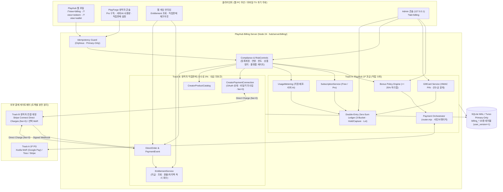
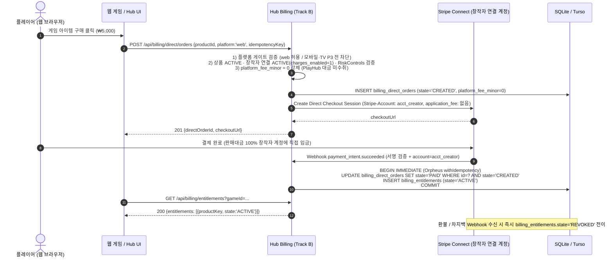

# PlayHub 2-Track 통합 과금 · PlayCoin · 창작자 직접판매(수수료 0%) 운영 정책 및 개발 기획 계획안 (`Hub-Billing`)

- **브랜치 / 워크트리**: `Hub-Billing` (`D:\Github\GoDotProjects-worktrees\Hub-Billing`, 기준 `PlayHub-Platform` `746e0c7`)
- **문서 상태**: v2.0 확정 기준 (2026-11-21 — **2-Track 통합 아키텍처 채택: Track A PlayHub 1P 과금·`PlayCoin` 최대 +25% 보너스 + Track B 창작자 직접판매 수수료 0%·`EntitlementService`**)
- **한 줄 핵심 정책**:
  > **PlayHub는 게임 제작·호스팅 인프라(Pro 구독 · 저장공간 · 서버 · AI)와 `PlayCoin` 선불 크레딧(웹·PC·기프트카드 최대 +25% 보너스)으로 수익을 얻고, 창작자의 UGC 게임·아이템 판매 매출에는 플랫폼 수수료 0%를 적용한다. 창작자가 직접 판매·수취하며 PlayHub는 결제 검증과 구매 권한(`Entitlement`) 연동만 제공한다.**
- **관련 기준 문서**:
  - [PAYMENT_BENCHMARK_AND_SOLUTION.md](PAYMENT_BENCHMARK_AND_SOLUTION.md) — Airbnb · Uber · Lyft · Roblox 결제 아키텍처 벤치마크 및 3단계 최적 솔루션 검토
  - [multiplayer-deploy-billing-plan.md](../architecture/multiplayer-deploy-billing-plan.md) — 제작자 멀티플레이 서버 호스팅 과금·원장 설계(기존 `Hub Point` → **`PlayCoin`** 통합, `1 PlayCoin = USD 0.01`, 약 ₩14)
  - `Hub-AOS` [ANDROID_PLAYHUB_APK_BUILD_PLAN.md](../../../Hub-AOS/docs/aos/ANDROID_PLAYHUB_APK_BUILD_PLAN.md) — Android 앱 아키텍처 및 `user_age_compliance` 연령 게이트 (모바일 유료 판매는 P3 별도 결정 전까지 무료 플레이 우선)
  - [ADMIN_PAGE_PLAN.md](../ADMIN_PAGE_PLAN.md) — PlayHub-Admin 탭 구조 및 루프백 보안 경계
  - [site-operations-plan.md](../architecture/site-operations-plan.md) — 운영·백업·시크릿·장애 대응 원칙

> **유의**: 본 문서는 제품·기술 기획 및 운영 정책 기준안이며, 최종 법률·세무 자문이나 최신 앱스토어 심사 정책 검토를 대체하지 않는다.

---

## 목차

1. [기본 원칙 및 2-Track 과금 구조](#1-기본-원칙-및-2-track-과금-구조)
2. [Track A — PlayHub 1P 과금 · Pro 구독 · 사용량 계측 · PlayCoin(+25% 보너스)](#2-track-a--playhub-1p-과금--pro-구독--사용량-계측--playcoin25-보너스)
3. [Track B — 창작자 UGC 직접판매(수수료 0%) · 권한 검증(`EntitlementService`)](#3-track-b--창작자-ugc-직접판매수수료-0--권한-검증entitlementservice)
4. [플랫폼별 정책 (웹 · PC · 모바일 · TV · 제휴)](#4-플랫폼별-정책-웹--pc--모바일--tv--제휴)
5. [결제 게이트웨이(Xsolla · Stripe Connect · Toss) 및 Google Pay 연동](#5-결제-게이트웨이xsolla--stripe-connect--toss-및-google-pay-연동)
6. [사용자 · 창작자 · 관리자(Admin) UX 기획](#6-사용자--창작자--관리자admin-ux-기획)
7. [시스템 아키텍처 및 핵심 시퀀스](#7-시스템-아키텍처-및-핵심-시퀀스)
8. [데이터베이스 스키마 설계 (`hub/server/billing/schema.mjs`, 20종)](#8-데이터베이스-스키마-설계-hubserverbillingschemamjs-20종)
9. [HTTP API 계약 (`hub/server/billing/routes.mjs`)](#9-http-api-계약-hubserverbillingroutesmjs)
10. [보안 · 리스크 통제 · 회계/법령 컴플라이언스](#10-보안--리스크-통제--회계법령-컴플라이언스)
11. [디렉터리 구조 · 워크트리 소유권 · 테스트 전략 · 단계별 도입 로드맵 (P0~P3 / M0~M4)](#11-디렉터리-구조--워크트리-소유권--테스트-전략--단계별-도입-로드맵-p0p3--m0m4)
12. [확정 결정 및 미확정 검토 항목 (Open Decisions)](#12-확정-결정-및-미확정-검토-항목-open-decisions)

---

## 1. 기본 원칙 및 2-Track 과금 구조

### 1.1 5대 기본 원칙

1. **주 매출원은 창작자 인프라·구독·AI·1P 크레딧**: PlayHub의 주요 매출원은 창작자 호스팅, `Pro` 구독, 추가 저장공간·배포 용량, 멀티플레이 서버·트래픽, AI 사용량 과금 및 이를 선불 충전하는 **`PlayCoin` 크레딧**이다.
2. **창작자 UGC 판매 플랫폼 수수료 0%**: 창작자 게임·아이템 판매에 대한 PlayHub 플랫폼 수수료는 **0%**다 (`application_fee_amount` 미사용, DB `CHECK(platform_fee_bps = 0)` 및 `CHECK(platform_fee_minor = 0)` 강제).
3. **창작자 직접 판매·수취 (대금 미보관·미정산)**: 창작자가 법적 판매자이며 판매대금을 본인의 연결 결제 계정으로 직접 수취한다. PlayHub는 창작자 판매대금을 보관하거나 창작자에게 현금 정산(`DevEx`/`earned` 출금)하지 않는다.
4. **외부 비용 책임 분리**: 결제대행(PG) 수수료, 환전비, 세금(VAT/GST), 환불·차지백 비용은 플랫폼 수수료 0%와 별개이며, 계약상 책임 주체(판매자 및 결제사 계약)를 명확히 구분한다.
5. **실행·결제 분리 및 권한(Entitlement) 검증**: 게임 실행과 판매·결제는 분리하고, PlayHub는 서버 검증을 거친 구매 권한(`Entitlement`)의 발급·조회·환불 시 회수를 관리한다.

### 1.2 2-Track 과금 매트릭스

| 트랙 | 과금 대상 | 결제 주체 | 수취 주체 | PlayHub 역할 | 정책 요약 |
|---|---|---|---|---|---|
| **Track A (1P)** | **Free** 기본 한도 | 창작자 | PlayHub | 할당량 관리 | 제작공간 100 MB · 프로젝트 최대 3개 · 배포 50 MB · AI 최초 체험 크레딧 |
| **Track A (1P)** | **Pro 구독** (`SubscriptionService`) | 창작자 | PlayHub | 직접 판매·갱신·연체 관리 | 제작공간 1 GB · 프로젝트 무제한 · 배포 100 MB · AI 주간 한도 *(정액제 금액 추후 확정)* |
| **Track A (1P)** | **추가 저장공간·배포 용량** (`UsageMetering`) | 창작자 | PlayHub | 계측·과금 | 초과 사용량 기준 종량 청구 또는 `PlayCoin` 차감 |
| **Track A (1P)** | **멀티플레이 서버·트래픽** (`UsageMetering`) | 창작자 | PlayHub | 1분 단위 계량·선점/정산 | `Hold/Capture` 기반 `PlayCoin` 차감 (`multiplayer-deploy-billing-plan.md` 연동) |
| **Track A (1P)** | **AI 추가 사용량** (`UsageMetering`) | 창작자 | PlayHub | 할당량·초과 계측 | 기본 한도 초과 시 `PlayCoin` 차감 또는 초과 과금 |
| **Track A (1P)** | **`PlayCoin` 선불 크레딧 · 기프트카드** | 창작자 · 이용자 | PlayHub | 직접 판매·복식부기 원장 | **웹·PC·기프트카드 구매 시 최대 +25% 추가 `PlayCoin` 상시 제공** (PlayHub 1P 소비 전용) |
| **Track B (0%)** | **UGC 게임·아이템 직접판매** | 플레이어 | **창작자 직접 수취** | 계정 연결·결제 검증·**`EntitlementService`** | **플랫폼 수수료 0%**, 대금 미보관·미정산, Stripe Connect Direct Charges 우선 |

---

## 2. Track A — PlayHub 1P 과금 · Pro 구독 · 사용량 계측 · PlayCoin(+25% 보너스)

### 2.1 Free vs Pro 용량 및 할당량 기준

| 항목 | Free 티어 | Pro 구독 | 초과 시 과금 방식 |
|---|---|---|---|
| **제작공간 (Workspace)** | `100 MB` | `1 GB` | 초과 저장공간 `UsageMetering` (`PlayCoin` / 종량 청구) |
| **소유 프로젝트 수** | 최대 `3개` | **무제한** | Free 한도 초과 생성 차단 (Pro 업그레이드 유도) |
| **배포 용량 합계** | 총 `50 MB` | 총 `100 MB` | 초과 배포 용량 `UsageMetering` |
| **AI 사용량** | 최초 체험 크레딧 | 주간 사용량 한도 | 할당량 소진 시 `PlayCoin` 추가 사용량 차감 *(단가 추후 확정)* |
| **멀티플레이 서버 (MO/MMO)** | `Free-Nano` 월 무료 한도 (MO 체험 한정) | 전 프리셋 · 무제한 동접 자동 확장 | `multiplayer-deploy-billing-plan.md` 단일 고정 단가 (`1 PlayCoin = USD 0.01`, `Hold/Capture` 정산) |
| **Pro 월 구독료** | ₩0 | **추후 확정** | 정액제 자동 갱신 · 연체/유예/해지 상태 머신 (`SubscriptionService`) |

### 2.2 `PlayCoin` 단일 1P 재화 & 3-Bucket Zero-Sum 원장

Track A에서 PlayHub가 직접 판매·수취하는 선불 크레딧은 **`PlayCoin`** (`PLAYCOIN`, 기준 단가 `1 PlayCoin = ₩14 / USD 0.01`)으로 통일한다.
- **표기 표준**: 공식 명칭 **`PlayCoin`**, 축약 아이콘 **`🪙 1,250 PlayCoin`** (`PC` 약어는 데스크톱 PC와 혼동되므로 사용 금지). 인프라 원가 측 `GCP Credit`(구글 크레딧)과 엄격히 구분한다.
- **3-Bucket 분리 (원칙 3 반영 — `earned` 버킷 제거)**:
  - PlayHub는 창작자 판매대금을 보관·정산하지 않으므로 Track A 지갑은 **`paid` / `bonus` / `promo` 3개 버킷**만 유지한다.
  - **`paid`**: 웹·PC·기프트카드 유상 충전 원금 (7일 미사용 100% 청약철회 대상, 소멸시효 5년).
  - **`bonus`**: 웹·PC·기프트카드 채널 상시 추가 지급분 (**최대 +25%**, 단독 현금 환불 불가, 원금 환불 시 전액 동반 회수).
  - **`promo`**: Free 월 무료 서버 쿼터·AI 체험 크레딧·CS 보상 (유효기간 만료 시 자동 소각, 환불 불가).
- **Airbnb/Uber Zero-Sum 복식부기 & Anti-Bonus-Stripping**:
  - 모든 `PlayCoin` 변동은 `billing_journal_entries` + `billing_journal_lines`에 **`SUM(signed_coins) === 0`** 불변식으로 기록한다.
  - 소비 차감 순서는 **`promo(만료 임박 FIFO) → bonus(FIFO) → paid(FIFO)`**이며, 동일 주문 로트(`parent_order_id`)의 원금 또는 보너스 중 **1 PlayCoin이라도 소비되면 `billing_orders.first_spent_at`이 즉시 기록**되어 "보너스만 먼저 쓰고 원금 7일 청약철회" 악용을 원천 차단한다.
  - 멀티플레이 서버·AI·스토리지 종량 과금은 Uber Hold/Capture 패턴(`reserveHold` → `settleHold` / `releaseHold`)으로 동시 다중 세션 이중 지출을 차단한다.

### 2.3 웹·PC·기프트카드 최대 +25% 보너스 정책 및 단위 경제성

Roblox의 영구 글로벌 웹·PC·기프트카드 보너스 모델을 Track A `PlayCoin` 충전에 적용한다.

#### (1) 공식 `PlayCoin` 패키지 티어 (KRW VAT포함 / USD)

| SKU 코드 | 판매가 (KRW) | 판매가 (USD) | 기본 PlayCoin (0%) | **웹·PC 채널 보너스** | **웹·PC 총 지급량** | **보너스율** | 비고 |
|---|---:|---:|---:|---:|---:|---:|---|
| `playhub.coin.t1` | ₩1,500 | USD 0.99 | `100` | `+10` | **`110 PlayCoin`** | **+10%** | 스타터 소액 (PG 고정비 보호) |
| `playhub.coin.t2` | ₩4,500 | USD 2.99 | `300` | `+45` | **`345 PlayCoin`** | **+15%** | 라이트 팩 |
| `playhub.coin.t3` | ₩7,000 | USD 4.99 | `500` | `+100` | **`600 PlayCoin`** | **+20%** | 스탠다드 입문 |
| `playhub.coin.t4` | ₩14,000 | USD 9.99 | `1,000` | **`+250`** | **`1,250 PlayCoin`** | **+25%** | **인기(Best Value) 진입 티어** |
| `playhub.coin.t5` | ₩28,000 | USD 19.99 | `2,000` | **`+500`** | **`2,500 PlayCoin`** | **+25%** | 주력 티어 |
| `playhub.coin.t6` | ₩70,000 | USD 49.99 | `5,000` | **`+1,250`** | **`6,250 PlayCoin`** | **+25%** | 창작자·스튜디오 추천 |
| `playhub.coin.t7` | ₩140,000 | USD 99.99 | `10,000` | **`+2,500`** | **`12,500 PlayCoin`** | **+25%** | 프로·중형 멀티플레이 |
| `playhub.coin.t8` | ₩280,000 | USD 199.99 | `20,000` | **`+5,000`** | **`25,000 PlayCoin`** | **+25%** | 대형 MMO/스튜디오 전용 |

- **기프트카드 보너스**: 자사 디지털 기프트카드(+20% 소액 / **+25%** ₩30,000·USD 25 이상), 외부 유통 기프트카드(+15%~+20%, 유통 수수료 ≤10% 제휴 시 최대 +25% 옵션).
- **하드캡 및 채널 판별**: 서버 권위 채널 판별(`resolveAuthoritativeChannel`)과 DB `CHECK(bonus_bps <= 2500)`으로 **최대 +25%** 상한과 모바일 IAP 0%(향후 P3 도입 시에도 동일)를 이중 강제한다.

#### (2) 채널별 단위 경제성 검증 (₩14,000 / USD 9.99 티어 기준)

| 구매 채널 | 실효 수수료 | 지급 PlayCoin | 1 PlayCoin 순매출 (Gross / KR VAT제외) | 멀티플레이 서버(Option B) 단위 마진 |
|---|---:|---:|---|---:|
| *(참고)* 모바일 IAP 표준 30% | 30.0% | `1,000` (0%) | USD 0.00699 / ₩8.91 | 40~43% |
| **Web·PC 국내 PG (Toss/PortOne)** | 3.3% | **`1,250` (+25%)** | **USD 0.00774 / ₩9.81 (+10.1% 우위)** | **45.6 ~ 50.8%** |
| **Web·PC 글로벌 직접 (Stripe + Google Pay)** | 3.5~4.0% | **`1,250` (+25%)** | **USD 0.00767 (+9.7% 우위)** | **45.1 ~ 47.8%** |
| **Web·PC Xsolla MoR (글로벌+KR+Google Pay)** | ~8.5% | **`1,250` (+25%)** | **USD 0.00731 / ₩9.23 (+3.6~4.6% 우위)** | **42.5 ~ 45.3%** |
| **자사 디지털 기프트카드** | ~4.0% | **`1,250` (+25%)** | **USD 0.00768 / ₩9.75 (+9.4% 우위)** | **45.2 ~ 47.9%** |
| **외부 오프라인 기프트카드** | ~10.0% | **`1,200` (+20%)** | **USD 0.00750 / ₩9.44 (+6.0% 우위)** | **44.0 ~ 46.7%** |

### 2.4 기프트카드 · 청약철회 · 차지백 · 미성년자 정책 (Track A)

- **기프트카드**: Crockford Base32 16자리(`80 bit` 엔트로피), DB에는 `HMAC-SHA256(pepper, pin)` 해시와 끝 4자리 힌트만 저장(평문 미보관). `ISSUED → ACTIVE → REDEEMED` 상태 머신, 5회/10분 오입력 잠금. 공정위 신유형 상품권 표준약관(유효기간 1~5년, 소멸시효 5년, 1만 원 초과 60% / 이하 80% 사용 시 잔여 `paid` 현금 환불) 준수.
- **전자상거래법 7일 청약철회**: 결제 후 7일 이내 `first_spent_at IS NULL`일 때 원결제수단 100% 환불 + 연결 `bonus` 전액 회수. 원금 또는 보너스 1 PlayCoin 이상 소비 시 청약철회 제한(결제 전 명시 동의 필수).
- **차지백 대응**: Webhook 수신 시 자동 역분개, 부족분 `debt_coins` 기록 + 계정 결제/소비 자동 동결(`CHARGEBACK_DISPUTE`) + Admin 리스크 큐 등재.
- **연령·계정 게이트**: Guest 결제 금지(Google 로그인 필수), `user_age_compliance` 연동 (`CHILD_PROTECTED` 보호자 동의 필수, `TEEN_MINOR` 월 ₩70,000 기본 한도, 신규 성인 7일 일 ₩150,000/월 ₩300,000 한도).

---

## 3. Track B — 창작자 UGC 직접판매(수수료 0%) · 권한 검증(`EntitlementService`)

### 3.1 핵심 구조 (판매자 = 창작자, 수수료 = 0%)

1. **웹 MVP 우선 모델 — Stripe Connect Direct Charges**:
   - 창작자가 자신의 결제 계정(Stripe Connect Standard/Express 연결 계정)을 PlayHub에 OAuth로 연결하고, 결제사 측에서 판매자 신원 확인(KYC/KYB)을 완료한다.
   - 플레이어가 웹 게임 내 상품·DLC·패스를 구매하면 **창작자 연결 계정으로 Direct Charge가 실행**되며, PlayHub는 **`application_fee_amount`를 일절 설정하지 않는다 (플랫폼 수수료 0%)**.
   - **비밀키 비수집 절대 원칙**: 창작자의 개인 API 비밀키(`sk_live_*` 등)는 PlayHub에 절대 수집·저장하지 않으며, 오직 연결 계정 ID(`connected_account_id`)와 승인 상태(`onboarding_status`, `charges_enabled`, `payouts_enabled`)만 저장한다.
2. **PlayHub의 권한 검증 경계 (`EntitlementService`)**:
   - PlayHub는 판매대금을 일절 보관·이체·정산하지 않고, 오직 **① `billing_direct_orders` 주문 기록, ② 서명 검증된 결제 Webhook(`payment_intent.succeeded` / `charge.refunded` / `charge.dispute.created`), ③ `billing_entitlements` 구매 권한 지급 및 환불·차지백 시 즉시 회수(`REVOKED`)**만 수행한다.
3. **세금 · 환불 · 차지백 책임 경계 및 선택적 MoR**:
   - 글로벌 세금(VAT/GST), 환불, 차지백, 소비자 보호 법적 의무는 판매자(창작자)와 결제사 계약을 기준으로 귀속된다. 단, 결제사 계정 유형·국가·계약 조건에 따라 플랫폼에 2차 손실 책임이 남을 수 있으므로 **Direct Charges(표준 연결 계정) 우선 채택 + 법무 계약 검토**를 거친다.
   - 세무 부담을 줄이길 원하는 창작자를 위해 P2에서 **창작자 선택형 MoR 제공업체 연결**(지원 상품·국가·UGC 정책 별도 확인 후)을 플러그인 어댑터로 검토한다.
4. **리스크 통제 (`RiskControls`)**:
   - 사기성 상품 신고 접수, 과도한 환불/차지백 비율 감지, 약관 위반 시 Admin이 즉시 `billing_creator_products.status = 'SUSPENDED'` 또는 `billing_creator_connections.onboarding_status = 'SUSPENDED'`로 신규 판매를 차단한다.
   - 미성년자 결제 보호 및 연령등급(`ageRating`) 필터링을 Track B 주문 생성 단계에도 동일 적용한다.

---

## 4. 플랫폼별 정책 (웹 · PC · 모바일 · TV · 제휴)

| 채널 | 초기 정책 (P0 ~ P2) | 유의사항 및 P3 게이트 |
|---|---|---|
| **웹 브라우저 게임** | **Track A(`PlayCoin` +25% · Pro) & Track B(창작자 직접판매 0%) 허용** *(결제사 승인 조건)* | 판매자 국가, 글로벌 세금(VAT/GST), 소비자 보호·청약철회 고지 |
| **Windows 등 PC 직접 배포** | **Track A(`PlayCoin` +25%) 허용 · Track B 웹 판매 연동 검토** | 배포 채널별(자체 런처/외부 스토어) 약관 확인 |
| **Android / Google TV** | **무료 플레이 우선** *(Track B 유료 판매 비활성, `billing_creator_products` 플랫폼 게이트 Fail-Closed)* | 앱 내 디지털 상품은 Google Play Billing 등 스토어 규정 적용 가능 |
| **iOS / Apple TV** | **무료 플레이 우선** *(유료 판매 비활성)* | 앱 내 디지털 상품은 Apple IAP 규정 적용 가능 |
| **Samsung TV** | **무료 플레이 우선** *(유료 판매 비활성)* | Samsung TV 앱스토어 결제·수수료 규정 별도 검토 |
| **Netflix** | **별도 제휴 검토** | 일반 공개 앱스토어로 취급하지 않음 |

> **[중요 법무·스토어 가드]** PlayHub 플랫폼 수수료가 0%이거나 창작자 직접판매 구조라는 이유만으로 Apple·Google·Samsung의 인앱결제 규정이 면제되지는 않는다. 앱 내 웹 결제 링크·QR 유도 및 외부 구매 `Entitlement`의 모바일 앱 내 사용 허용 여부 역시 지역·스토어별 최신 규정 검증 후에만 허용한다. 앱스토어 IAP를 도입하면 대금 수취 및 창작자 정산 구조가 원칙 3(직접 수취·미정산)과 달라지므로, **별도 정책 확정 전(P3 이전)에는 모바일/TV 유료 판매를 출시하지 않는다.**

---

## 5. 결제 게이트웨이(Xsolla · Stripe Connect · Toss) 및 Google Pay 연동

상세 벤치마크 및 손익분기점 분석은 [PAYMENT_BENCHMARK_AND_SOLUTION.md](PAYMENT_BENCHMARK_AND_SOLUTION.md)를 따른다.

### 5.1 트랙별 PG 어댑터 분리 (`BillingProviderAdapter`)

PlayHub 1P 결제(Track A)와 창작자 직접판매 결제(Track B)는 어댑터·웹훅·계정을 완전히 분리한다.

| 트랙 | Stage 1 (P0~P1 초기 오픈) | Stage 2 (국내/글로벌 성장) | Google Pay 연동 방식 |
|---|---|---|---|
| **Track A (PlayHub 1P · Pro/사용량/`PlayCoin` +25%)** | **Xsolla Pay Station (MoR)** 단일 연동 *(Google Pay Instant Flow + 200+국 VAT + 한국 카카오페이·네이버페이·토스·카드)* **또는** Stripe(Pro 구독·글로벌)+국내 PG | 한국 월 결제 ≥ ₩3,000만 시 `KRW`만 **Toss Payments(3.3%)** 분기(+5.2%p 절감, 장애 시 Xsolla 자동 폴백) → 해외 USD 100K+ 시 **Stripe + Google Pay Web(`pay.js`)** 분기 | **Google Pay Web**은 수수료 **0%**(하부 PG 수수료만 발생)로 웹·PC 최대 +25% 보너스 적용. 단, 한국 국내 카드망 미출시 상태이므로 해외 원탭 결제 핵심 수단으로 배치하고 국내 KRW는 카카오페이·네이버페이·토스페이 병행 |
| **Track B (창작자 직접판매 0%)** | **Stripe Connect Direct Charges** (`application_fee_amount` 미사용, 창작자 직접 수취) | P2: 글로벌 현지 결제수단(Google Pay / Apple Pay via Stripe Connect) + **창작자 선택적 MoR 파트너** 검토 | Stripe Connect Checkout에서 해외 카드 이용자에게 Google Pay 자동 노출(별도 수수료 없음) |

- **Vendor Lock-in 차단**: 모든 PG는 경량 오케스트레이터(`router.mjs`)와 Uniform Adapter(`providers/*.mjs`) 뒤에 격리하며, 상품·보너스(+25%)·복식부기 원장·`Entitlement`의 SSOT는 100% PlayHub 서버가 소유한다.

---

## 6. 사용자 · 창작자 · 관리자(Admin) UX 기획

### 6.1 웹 포털 (`hub/web/user/`, 쿼리 라우팅 호환 + 8개 언어 L10N)

1. **PlayCoin 충전 & Pro 구독 (`/?view=billing`)** — Track A:
   - 창작자/이용자용 `Pro` 구독 카드(Free 100MB/3프로젝트 vs Pro 1GB/무제한 비교) + **`PlayCoin` 패키지 8티어(웹·PC 상시 최대 +25% 보너스 투명 비교)**.
   - 결제 전 필수 고지(원금/보너스 구분, 7일 미사용 청약철회 조건, 미성년자 동의 안내).
2. **기프트카드 등록 (`/?view=redeem`)** — Track A:
   - 16자리 PIN 입력 → 사전 미리보기(권면액 + 보너스 `PlayCoin`) → 원자적 등록.
3. **내 지갑 · 사용량 · 보유 권한 (`/?view=wallet`)** — Track A + B 통합 조회:
   - `PlayCoin` 3-Bucket 잔액(`paid`/`bonus`/`promo`/`reserved`), Free/Pro 할당량·사용량 현황, 7일 미사용 원클릭 청약철회.
   - **내 게임 보유 아이템/패스(`Entitlements`) 목록** — 창작자 직접판매로 구매한 게임별 권한 상태(`ACTIVE`/`REVOKED`) 및 판매자(창작자) 영수증 확인.
4. **창작자 판매 설정 (`/?view=create` 하위 수익화 탭)** — Track B (P1):
   - 결제 계정 연결 상태(`Stripe Connect` OAuth 온보딩 버튼, **"PlayHub 수수료 0% · 직접 수취"** 안내), 게임별 상품 등록(가격·지역·연령등급·웹 허용), 주문·권한 발급 내역 조회.

### 6.2 관리자 콘솔 (`PlayHub-Admin`, `127.0.0.1:8081` 루프백 전용, `?tab=billing`)

독립 모듈 `hub/web/admin/billing-views.js`로 구현하며 6대 운영 뷰를 제공한다.
1. **1P 매출·구독·보너스 대시보드 (`overview`)**: Pro 구독 MRR, 서버/저장/AI 사용량 매출, `PlayCoin` 채널별 매출·보너스율·1 코인 순매출.
2. **상품·보너스 정책 (`catalog`)**: SKU 가격·채널 보너스율(`<= 2500 bps` 이중 검증)·단위 경제성 시뮬레이터.
3. **기프트카드 배치 (`giftcards`)**: 배치 발행(1회성 PIN CSV), 활성화/도난 폐기, 시리얼 조회.
4. **1P 주문·환불·차지백 (`orders`)**: 청약철회/차지백/부채 동결 해제, 일일 PG 대사(`reconcile`).
5. **창작자 직접판매 & 리스크 통제 (`direct-risk`)**: 연결 계정 현황, 사기성 상품 신고 큐, 원클릭 상품/계정 판매 일시정지(`SUSPENDED`), `Entitlement` 회수 이력.
6. **지갑·사용량·수동 조정 (`wallets`)**: 3-Bucket 잔액·로트·`UsageMetering` 내역 조회, CS 무상 `promo` 지급(감사 로그 필수).

---

## 7. 시스템 아키텍처 및 핵심 시퀀스

### 7.1 2-Track 통합 아키텍처



### 7.2 Track B 시퀀스 — 창작자 직접판매(수수료 0%) 및 권한(`Entitlement`) 지급·회수



---

## 8. 데이터베이스 스키마 설계 (`hub/server/billing/schema.mjs`, 20종)

`PRAGMA user_version = 1` 유지, Additive `CREATE TABLE IF NOT EXISTS` 전용, 뷰·트리거 미사용(`restore-data.mjs` 및 Turso 호환). 모든 20종 테이블을 `hub/tools/restore-data.mjs`의 `OPTIONAL_TABLES`에 등록한다.

### 8.1 Track A — PlayHub 1P 과금 · `PlayCoin` 복식부기 · 구독 · 사용량 (16종)

| 테이블명 | 핵심 컬럼 및 제약 | 목적 |
|---|---|---|
| `billing_catalog_skus` | `sku_id`, `currency`, `PRIMARY KEY(sku_id, currency)`, `amount_minor (>0)`, `base_coins (>0)`, `active` | 서버 권위 1P `PlayCoin` 상품 마스터 |
| `billing_channel_bonus_rules` | `id (PK)`, `channel`, `sku_id`, `currency`, `min_amount_minor`, `bonus_bps CHECK(0..2500)` | **최대 25% (`2500 bps`) DB 하드캡** 보너스 정책 |
| `billing_idempotency` | `scope`, `idempotency_key`, `principal_id`, `request_hash`, `status_code`, `response_json`, `PRIMARY KEY(scope, idempotency_key)` | **Airbnb Orpheus 패턴 공통 멱등성 저장소** (Track A·B 공용, Primary-Only) |
| `billing_orders` | `id (PK)`, `principal_id`, `channel`, `provider`, `sku_id`, `currency`, `amount_minor`, `base_coins`, `bonus_coins`, `bonus_bps CHECK(0..2500)`, `state`, `first_spent_at`, `paid_at` | Track A 1P 충전·기프트카드 주문 및 `first_spent_at` 추적 |
| `billing_payment_events` | `id (PK)`, `provider`, `external_event_id UNIQUE`, `order_id`, `event_type`, `payload_sha256`, `status` | 1P & Track B Webhook 멱등 감사 로그 |
| `billing_wallet_accounts` | `principal_id (PK)`, `paid_balance`, `bonus_balance`, `promo_balance`, `reserved_coins`, `debt_coins`, `frozen_reason` | **3-Bucket `PlayCoin` 지갑** (`earned` 미보유 — 대금 미보관 원칙 강제) |
| `billing_wallet_lots` | `id (PK)`, `principal_id`, `parent_order_id`, `bucket CHECK('paid'\|'bonus'\|'promo')`, `initial_coins`, `remaining_coins`, `expires_at` | FIFO 차감 · 유효기간 만료 · 7일 청약철회 로트 추적 |
| `billing_wallet_holds` | `id (PK)`, `principal_id`, `amount_coins (>0)`, `settled_coins`, `sink_type`, `sink_ref_id`, `state CHECK('HELD'\|'SETTLED'\|'RELEASED')` | **Uber Hold/Capture** (서버·AI 종량 선점-정산) |
| `billing_journal_entries` | `id (PK)`, `event_type`, `order_id`, `sink_type`, `sink_ref_id`, `idempotency_key UNIQUE`, `metadata_json` | **Zero-Sum 복식부기 전표 헤더** (불변 Append-Only) |
| `billing_journal_lines` | `id (PK)`, `entry_id`, `account_code`, `signed_coins (!=0)`, `lot_id` | **복식부기 분개 라인** (`SUM(signed_coins) === 0` 불변식) |
| `billing_giftcard_batches` | `id (PK)`, `channel`, `partner_name`, `currency`, `face_value_minor`, `base_coins`, `bonus_bps CHECK(0..2500)`, `quantity`, `state` | 기프트카드 배치 발행 및 유통 관리 |
| `billing_giftcards` | `id (PK)`, `batch_id`, `serial_no UNIQUE`, `pin_hash UNIQUE`, `pin_hint`, `state`, `redeemed_by`, `redeemed_order_id` | 개별 기프트카드 (평문 PIN 미저장) |
| `billing_refunds` | `id (PK)`, `order_id`, `principal_id`, `kind`, `refund_amount_minor`, `clawback_paid_coins`, `clawback_bonus_coins`, `debt_added_coins` | 1P 청약철회 · 차지백 정산 기록 |
| `billing_spending_limits` | `principal_id (PK)`, `age_tier`, `monthly_cap_minor`, `daily_cap_minor`, `guardian_approved` | 연령 티어·보호자 동의·FDS 월/일 한도 |
| `billing_subscriptions` | `id (PK)`, `principal_id UNIQUE`, `plan_tier CHECK('free'\|'pro')`, `status CHECK('ACTIVE'\|'PAST_DUE'\|'CANCELED'\|'EXPIRED')`, `provider`, `provider_subscription_id UNIQUE`, `current_period_start`, `current_period_end`, `cancel_at_period_end` | **`SubscriptionService`**: Free / Pro 구독 상태·갱신·연체 관리 |
| `billing_usage_records` | `id (PK)`, `principal_id`, `metric_type CHECK('storage_bytes'\|'deploy_bytes'\|'server_minutes'\|'egress_bytes'\|'ai_units')`, `resource_ref_id`, `quantity (>0)`, `billable_coins (>=0)`, `hold_id`, `journal_entry_id`, `period_key`, `idempotency_key UNIQUE` | **`UsageMetering`**: 호스팅·저장공간·배포·서버·AI 사용량 계측 원장 |

### 8.2 Track B — 창작자 직접판매(수수료 0%) · 권한 검증 (4종)

| 테이블명 | 핵심 컬럼 및 제약 | 목적 |
|---|---|---|
| `billing_creator_connections` | `principal_id (PK)`, `provider CHECK('stripe_connect'\|'mor_partner')`, `connected_account_id UNIQUE`, `onboarding_status`, `charges_enabled`, `payouts_enabled`, `country_code`, **`platform_fee_bps INTEGER NOT NULL DEFAULT 0 CHECK(platform_fee_bps = 0)`** | **`CreatorPaymentConnection`**: 창작자 계정 연결·승인 상태 (개인 API 비밀키 컬럼 없음, 수수료 0% DB 강제) |
| `billing_creator_products` | `id (PK)`, `creator_id`, `game_id`, `product_key`, `kind CHECK('game_access'\|'consumable'\|'durable'\|'pass')`, `title`, `currency`, `amount_minor (>0)`, `allowed_regions_json`, `allowed_platforms_json`, `age_rating`, `status CHECK('DRAFT'\|'ACTIVE'\|'SUSPENDED'\|'ARCHIVED')`, `UNIQUE(creator_id, game_id, product_key)` | **`CreatorProductCatalog`**: 창작자별 상품·가격·지역·플랫폼 정책 |
| `billing_direct_orders` | `id (PK)`, `buyer_id`, `creator_id`, `product_id`, `game_id`, `platform`, `provider`, `connected_account_id`, `provider_charge_id UNIQUE`, `currency`, `amount_minor (>0)`, **`platform_fee_minor INTEGER NOT NULL DEFAULT 0 CHECK(platform_fee_minor = 0)`**, `state`, `idempotency_key UNIQUE` | **창작자 직접판매 주문 검증 로그** (대금 미수취, 수수료 0원 DB 강제) |
| `billing_entitlements` | `id (PK)`, `buyer_id`, `creator_id`, `game_id`, `product_id`, `product_key`, `direct_order_id`, `state CHECK('ACTIVE'\|'CONSUMED'\|'REVOKED')`, `granted_at`, `expires_at`, `revoked_at`, `revoke_reason` | **`EntitlementService`**: 게임 내 구매 권한 발급·조회·환불 시 즉시 회수 |

---

## 9. HTTP API 계약 (`hub/server/billing/routes.mjs`)

`hub/server/app.mjs`에 `config.billing.enabled === true` 플래그로 마운트한다(기본 비활성).

### 9.1 Track A — PlayHub 1P API (`/api/billing/*`)
- `GET /api/billing/catalog?currency=KRW&channel=web_browser` — `PlayCoin` 8티어(보너스 포함) 및 Free/Pro 플랜 안내
- `GET /api/billing/wallet` — 3-Bucket `PlayCoin` 잔액, Pro 구독 상태, 할당량·월 사용량 요약
- `POST /api/billing/subscriptions/checkout` / `POST /api/billing/subscriptions/cancel` — Pro 구독 시작·해지
- `POST /api/billing/orders` / `POST /api/billing/orders/:id/confirm` / `POST /api/billing/orders/:id/withdraw` — 1P `PlayCoin` 체크아웃·확정·7일 미사용 청약철회
- `POST /api/billing/giftcards/preview` / `POST /api/billing/giftcards/redeem` — 기프트카드 미리보기·원자적 리딤
- `POST /api/billing/usage` *(내부 서비스 시크릿)* — 서버·저장공간·AI `UsageMetering` 기록 및 `Hold/Capture` 정산
- `POST /api/billing/webhooks/:provider` — `xsolla` / `toss` / `stripe` 서명 검증 웹훅

### 9.2 Track B — 창작자 직접판매 & 권한 API (`/api/billing/direct/*` · `/api/billing/entitlements`)
- `GET /api/billing/creator/connection` / `POST /api/billing/creator/connection/start` — 창작자 결제 계정 OAuth 연결·상태 조회 (비밀키 입력 거부)
- `GET/POST/PATCH /api/billing/creator/products` — 창작자 상품 카탈로그 관리
- `POST /api/billing/direct/orders` — 웹 직접판매 체크아웃 세션 생성(플랫폼 게이트·상품 활성·연결 계정 활성·연령 검증, `application_fee` 미설정)
- `POST /api/billing/webhooks/stripe-connect` — Connect Direct Charge 성공/환불/차지백 서명 웹훅 → `Entitlement` 자동 발급·회수
- `GET /api/billing/entitlements?gameId=...` — 로그인 플레이어의 게임별 보유 권한(`ACTIVE`) 조회 (웹 게임 SDK 연동)

### 9.3 Admin API (`/api/admin/billing/*` — `127.0.0.1:8091` 루프백 전용)
- 1P 대시보드(`overview`), SKU/보너스 정책(`policies`), 기프트카드 배치(`giftcards/batches`), 1P 환불/대사(`orders`, `reconcile`), 지갑 `promo` 수동 조정(`wallets/:id/adjust`), **Track B 리스크 통제(`direct/products/:id/suspend`, `direct/connections/:id/suspend`)**.

---

## 10. 보안 · 리스크 통제 · 회계/법령 컴플라이언스

1. **Zero Client Trust & Zero Secret Key Collection**:
   - Track A 금액·보너스(<=25%)·환불 적격성은 서버 DB·PG 검증만 신뢰한다.
   - Track B에서 창작자 개인 결제 API 비밀키는 절대 수집·저장하지 않으며, OAuth 연결 계정 ID와 서명 검증된 Webhook만 처리한다.
2. **DB 수준 이중 안전장치**:
   - Track A 보너스 상한: `CHECK(bonus_bps >= 0 AND bonus_bps <= 2500)`
   - Track B 플랫폼 수수료 0%: `CHECK(platform_fee_bps = 0)` 및 `CHECK(platform_fee_minor = 0)`
   - Track A 원장 무결성: `billing_journal_lines` 전 전표 `SUM(signed_coins) === 0` + `verifyLedgerIntegrity()` 감사.
3. **PCI-DSS SAQ-A 및 시크릿 격리**: 카드 번호는 서버 미통과, PG 시크릿·PIN 페퍼는 환경변수/Secret Manager 주입.
4. **선불전자지급수단·세무 경계**:
   - Track B(창작자 직접판매)는 PlayHub가 대금을 보관·정산하지 않으므로 선불충전금·PG 중개 정산 리스크에서 분리된다.
   - Track A(`PlayCoin` 1P 충전·기프트카드)는 PlayHub 자체 서비스(호스팅·서버·AI·1P 상품) 단일 발행자 선불 크레딧으로 선수금 부채 관리 및 전금법 모니터링 대시보드를 유지한다.

---

## 11. 디렉터리 구조 · 워크트리 소유권 · 테스트 전략 · 단계별 도입 로드맵 (P0~P3 / M0~M4)

### 11.1 `Hub-Billing` 디렉터리 구조

```text
Hub-Billing/
├─ docs/billing/
│  ├─ HUB_BILLING_PLAN.md                  # 본 2-Track 통합 정책·기획·구현 계획안 (v2.0)
│  └─ PAYMENT_BENCHMARK_AND_SOLUTION.md    # Airbnb·Uber·Lyft·Roblox 벤치마크 및 3단계 PG 전략
├─ hub/server/billing/                     # [신규] 2-Track 통합 과금 모듈
│  ├─ schema.mjs                           # Additive SQLite/Turso 20종 스키마 (user_version=1)
│  ├─ idempotency.mjs                      # Orpheus 공통 withIdempotency() (Primary-Only)
│  ├─ policy.mjs                           # Track A 카탈로그 & 최대 25% 보너스 엔진
│  ├─ ledger.mjs                           # Track A 3-Bucket Zero-Sum 복식부기 · Hold/Capture · Lot FIFO
│  ├─ subscriptions.mjs                    # Track A SubscriptionService (Free/Pro) & UsageMetering
│  ├─ direct-commerce.mjs                  # Track B CreatorConnection · ProductCatalog · DirectOrder · Entitlement · RiskControls
│  ├─ compliance.mjs                       # 등록계정 · 연령 게이트 · 월/일 한도 가드
│  ├─ router.mjs                           # 경량 Payment Orchestrator (동적 라우팅 · 서킷브레이커)
│  ├─ giftcards.mjs                        # [M2] HMAC PIN 발행/배치/리딤
│  ├─ providers/                           # [M1~M3] BillingProviderAdapter (mock, xsolla, toss, stripe-connect, stripe-gpay)
│  ├─ service.mjs                          # [M1] Track A/B 통합 오케스트레이션
│  └─ routes.mjs                           # [M1] /api/billing/* & /api/admin/billing/*
├─ hub/web/user/
│  ├─ billing.js                           # [M1~M3] 1P 상점/구독/기프트카드/지갑/권한 & 창작자 판매 설정 UI
│  └─ billing.css
├─ hub/web/admin/
│  └─ billing-views.js                     # [M4] Admin Billing 탭 6대 운영 뷰
└─ hub/tests/
   ├─ billing-policy-ledger.test.mjs       # [M0] Track A 보너스 25% 캡 · 복식부기 · 멱등성 · Hold/Capture · 청약철회 · 차지백 · 라우터
   ├─ billing-2track.test.mjs              # [M0] Track A Pro구독/UsageMetering & Track B 수수료0% · 비밀키차단 · 플랫폼게이트 · Entitlement 지급/회수 · RiskControls
   ├─ billing-checkout.test.mjs            # [M1] Track A HTTP 체크아웃 · Webhook 서명 · Xsolla/Mock E2E
   ├─ billing-giftcards.test.mjs           # [M2] 기프트카드 배치 · 브루트포스 잠금 · 동시 리딤 경합
   └─ billing-direct-connect.test.mjs      # [M3] Track B Stripe Connect Direct Charges · Webhook · Entitlement E2E
```

### 11.2 워크트리 소유권 (`owners.json`)
- **단독 소유(`owns`)**: `docs/billing/**`, `hub/server/billing/**`, `hub/web/user/billing.js`, `hub/web/user/billing.css`, `hub/web/admin/billing-views.js`, `hub/tests/billing*.mjs`
- **공유 핫스팟(`shared` / 타 브랜치 협의)**: `hub/server/app.mjs`(마운트 1줄), `hub/tools/restore-data.mjs`(`OPTIONAL_TABLES` 20종 등록), `hub/web/user/index.html`·`app.js`, `hub/web/admin/*`(`PlayHub-Admin` 협의), `hub/shared/locales/**`(`PlayHub-L10N` 동기화).

### 11.3 단계별 도입 로드맵 (정책 단계 P0~P3 ↔ 구현 마일스톤 M0~M4)

| 정책 단계 | 마일스톤 | 핵심 산출물 | 완료 기준 (DoD) |
|---|---|---|---|
| **P0 — 호스팅·Pro·`PlayCoin` 1P 과금** *(게임 무료 플레이 우선)* | **M0 (완료 진행)** | 20종 스키마, Orpheus 멱등성, 최대 25% 보너스, 3-Bucket Zero-Sum 원장, `SubscriptionService`, `UsageMetering`, `direct-commerce.mjs` 코어, `router.mjs`, `restore-data.mjs` 20종 등록 | `billing-policy-ledger.test.mjs` + `billing-2track.test.mjs` + `restore.data.test.mjs` Node 24 전수 통과 |
| **P0** | **M1** | Track A `/api/billing/*` API, `providers/mock.mjs` + `providers/xsolla.mjs`(Google Pay 포함), `/?view=billing`(Pro 구독 + `PlayCoin` +25% 상점)·`/?view=wallet` UI | 웹·PC 1P 충전/구독 체크아웃 → Webhook 검증 → 복식부기 적립 E2E + 로컬/Cloudflare 모바일 확인 |
| **P0** | **M2** | 기프트카드 배치·HMAC PIN 리딤(`/?view=redeem`), 7일 미사용 원클릭 청약철회, 차지백 자동 동결, `UsageMetering` 서버/저장/AI 실연동 | 기프트카드 리딤(+25%)·브루트포스 차단·청약철회·사용량 계측 자동 테스트 전수 통과 |
| **P1 — 웹 창작자 직접판매 (수수료 0%)** | **M3** | `providers/stripe-connect.mjs`(Direct Charges, `application_fee` 미사용), 창작자 연결·상품 등록 UI, 웹 게임 SDK `EntitlementService` 조회/검증, 환불 시 즉시 `REVOKED` | 웹 게임에서 창작자 연결 계정 직접 결제(수수료 0%) → `Entitlement` 자동 지급 → 환불 Webhook 즉시 회수 E2E 통과 |
| **P2 — 글로벌 판매 확대 · Admin · L10N** | **M4** | Admin `?tab=billing` 6대 뷰(1P 대사 + Track B `RiskControls` 신고/정지), Stage 2 `KRW` Toss 분기·글로벌 Google Pay·창작자 선택형 MoR 어댑터 검토, 8개 언어 L10N | Admin 6대 뷰 E2E, PG 대사 100%, 8개 언어 검수 완료 |
| **P3 — 모바일·TV 유료 판매** | **별도 결정** | Android/Google TV · iOS/Apple TV · Samsung TV 스토어 정책·수취·정산 구조 법무 검증 후 별도 착수 | 스토어별 법무/심사 정책 확정 전까지 플랫폼 게이트 Fail-Closed 유지 |

---

## 12. 확정 결정 및 미확정 검토 항목 (Open Decisions)

### 12.1 확정 사항
1. **2-Track 통합 아키텍처 (`확정`)**: Track A(PlayHub 1P 호스팅·Pro·사용량·`PlayCoin` 웹/PC/기프트카드 최대 +25% 보너스) + Track B(창작자 UGC 직접판매 **수수료 0%**, 대금 미보관·미정산, `EntitlementService`만 관리).
2. **1P 재화 명칭 (`확정`)**: **`PlayCoin`** (`PLAYCOIN`, `1 PlayCoin = ₩14 / USD 0.01`, 3-Bucket `paid`/`bonus`/`promo`, `earned` 미보유).
3. **모바일·TV 초기 정책 (`확정`)**: Android/Google TV · iOS/Apple TV · Samsung TV는 P3 정책 검증 전까지 **무료 플레이 우선(유료 판매 비활성)**.

### 12.2 미확정 사항 (출시 전 확정 필요)
1. **Pro 월 구독료 및 초과 단가**: Pro 정액제 가격, 추가 저장공간(GB당)·배포 용량·AI 초과 단가 확정.
2. **창작자 판매 가능 국가 및 판매자 유형**: 개인 창작자 허용 여부 vs 사업자 필수 국가 목록(특히 한국 통신판매업 신고 기준).
3. **1차 PG 최종 선정**: Track A 초기 `Xsolla MoR` vs `Stripe + Toss` 조합, Track B `Stripe Connect Direct Charges`의 한국 창작자 지원 범위(Stripe 한국 정식 지원 여부에 따라 국내 창작자용 대체 직접정산 PG 또는 MoR 옵션 병행 검토 필수!).
4. **글로벌 VAT/GST 책임 및 선택적 MoR**: 창작자 직접판매 시 세무 부담 완화용 MoR 파트너(Paddle / Lemon Squeezy / Xsolla 등) UGC 정책 검증.
5. **디지털 상품 환불 및 구매자 지원 책임 분담**: 창작자 미응답 분쟁 시 PlayHub의 `RiskControls` 개입 기준(판매 정지·계정 제한).
6. **P3 모바일·TV 유료 판매 및 외부 링크 범위**: Apple/Google/Samsung 스토어 규정 검증 결과에 따른 출시 여부 결정.
