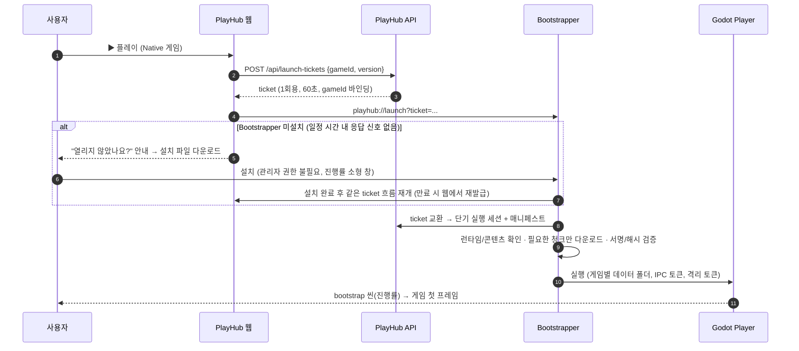
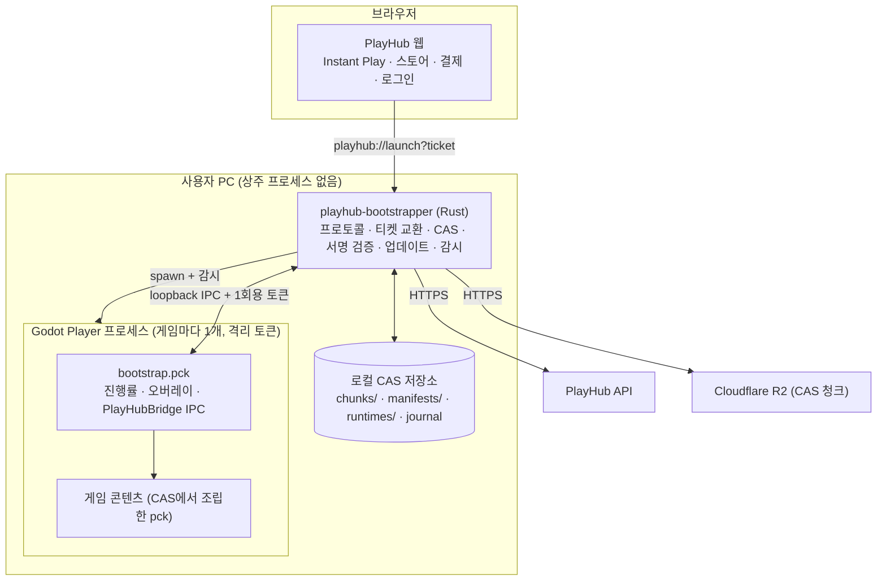
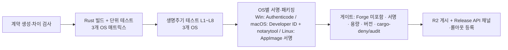

# Play Hub Desktop — 웹 허브 + Rust Bootstrapper + 공용 Godot Player 구현 계획안

- **브랜치 / 워크트리**: `Hub-Desktop` (`D:\Github\GoDotProjects-worktrees\Hub-Desktop`, 기준 `PlayHub-Platform` `00bd71e`)
- **문서 상태**: v0.2 (2026-11-22 — 기준 아키텍처를 "웹 허브 + 경량 Native Player"로 전환, 기술 스택 확정, 데스크톱 앱·SteamOS를 P2로 이관)
- **대상 엔진**: `godot-engine` 포크 고정 커밋 `ed1daf0bf001b61586d9930840f2f1394092c079` (**Godot 4.7.2-stable**)
- **입력 문서**: `PlayHub_Desktop_Performance_Responsiveness_LowFriction.md` (사용자 제공 데스크톱 최적화 설계), 기술 전략 검토 기록(2026-11-21~22)

### 확정 사항 요약

| 항목 | 결정 |
|---|---|
| 기준 아키텍처 | **PlayHub 웹이 기본 허브**(발견·스토어·라이브러리·결제·로그인). 네이티브는 **Rust Bootstrapper + 공용 Godot Player**로 실행만 담당. 필수 설치형 런처를 두지 않음 |
| 4계층 분리 | PlayForge = 제작 / PlayHub 웹 = 발견·유통 / Native Bootstrapper = 설치·실행·업데이트·복구 / Godot Player = 게임 플레이 |
| 대상 OS | **Windows · macOS · Linux를 처음부터 같은 테스트 규격으로 검증**. 정식 배포 순서: Windows(`live`) → macOS·Linux(`rc` → `live`) |
| 배포 채널 | 자체 배포(Bootstrapper 설치 파일 + 자동 업데이트). 결제는 `Hub-Billing` 웹 PG |
| 기술 스택 | **Rust**(코어·보안·OS 연동) + **TypeScript**(도구·테스트·자동화) + **JSON Schema/OpenAPI**(계약) + **Godot 4.7.2**(Player) |
| 제외·연기 | **Slint 배제**. Steam형 데스크톱 앱(UI 기술 미정)과 SteamOS 전용 UX는 **P2** |

### 명시적 제외 (Non-Goals)

- **PlayForge 전면 제외**: 웹 에디터(`/forge/*`), `/?view=create`, Godot 에디터 바이너리, `@tool` 실행
- **PlayHub Portable(`PlayHub.exe`, Node SEA 자체 호스팅 서버)과는 별개 산출물**이며 서로 대체하지 않는다([hub/portable/BUILD.md](../../hub/portable/BUILD.md)).
- P0/P1에서 상주형 런처 UI, 네이티브 오버레이 주입, 음성 채팅, Steam/Microsoft Store 배포는 하지 않는다.

---

## 1. 배경 및 핵심 원칙

PlayHub는 **Roblox처럼 UGC 게임을 즉시 실행**하면서 **Steam처럼 대형 게임을 네이티브로 설치·실행**할 수 있어야 한다. 성능을 가장 크게 좌우하는 것은 런처 자체의 무게가 아니라 **게임을 시작하기까지 거쳐야 하는 단계 수**다.

### 핵심 원칙

1. **진입 단계 최소화**: 탐색에는 설치도 회원가입도 필요 없다. 웹에서 실행할 수 있는 게임은 브라우저에서 바로 시작한다. 네이티브 게임을 처음 실행할 때만 경량 Bootstrapper를 설치한다.
2. **상주 없음**: 게임 실행 중에는 런처 UI가 없다. Bootstrapper는 실행 경로에서만 동작하고, 업데이트도 실행 시점에 확인한다.
3. **공통 코어 유지**: 계층 사이 경계를 **버전이 붙은 계약**으로 고정해, 플랫폼(데스크톱 앱, SteamOS, Steam 배포)을 늘려도 코어를 다시 만들지 않는다.
4. **생명주기 자동 검증 우선**: 3개 OS에서 **설치 → 실행 → 업데이트 → 비정상 종료 → 복구**를 같은 규격으로 자동 검증한다. 이것이 UI 기술 선택보다 장기 안정성에 더 큰 영향을 준다.
5. **PCK는 샌드박스가 아니다**: 다운로드한 게임 콘텐츠는 서명 검증, 신뢰 등급, 게임 간 데이터 격리, OS 권한 제한을 거쳐야 실행된다.

---

## 2. 실행 경로 및 범위

```text
PlayHub Web / PWA  ── 발견 · 스토어 · 라이브러리 · 아바타 샵 · 로그인 · 결제
  ├─ Instant Play ─→ Godot Web(단일 스레드) / HTML5 ─→ 브라우저
  └─ Native Play  ─→ playhub://launch?ticket=… ─→ Rust Bootstrapper
                                                   ├─ 런타임·콘텐츠 매니페스트 확인 / CAS 다운로드·복구
                                                   └─ Godot Player (게임별 별도 프로세스, 격리)
PlayHub API ── Launch Ticket · Release/Manifest · 세이브 · 소셜 · 원장
Cloudflare R2 ── 불변 CAS 청크 · 서명 매니페스트 · 런타임 패키지
PlayForge (별도 웹) ── 제작 · 빌드 · 제출 → Store 심사 → 서명 매니페스트 발행
```

| 경로 | 대상 게임 | 설치 | 비고 |
|---|---|---|---|
| **Instant Play** | HTML5/JS 게임, 경량 Godot Web 게임 | 없음 | Godot Web은 **단일 스레드(nothreads) 익스포트로 통일**해 COOP/COEP 충돌(AOS 계획 §1)을 피한다 |
| **Native Play** | 3D·대형·고성능 Godot 게임 | 최초 1회 Bootstrapper + Player | 이후에는 게임 콘텐츠만 갱신 |

- 게임 매니페스트에 `playModes: ["instant", "native"]`를 선언한다. 웹은 사용자 환경(OS, 설치 여부, 성능)에 따라 기본 경로를 고른다.
- 로그인은 탐색·무료 체험의 필수 조건이 아니다. 세이브 동기화, 친구, 구매, 멀티플레이처럼 **계정이 필요한 시점**에만 요청한다(Guest 세션과 기존 `merge_requests` 병합 재사용).

---

## 3. 사용자 진입 흐름 (UX)

### 3.1 최초 Native 실행



### 3.2 화면 책임 분담

| 화면 | 담당 | 비고 |
|---|---|---|
| 탐색·상세·스토어·라이브러리·결제·커뮤니티 | **PlayHub 웹** | 기존 `hub/web/user/` |
| 최초 Player 설치 진행률·오류·동의 | **Bootstrapper 소형 네이티브 창** | OS 기본 위젯 수준. UI 프레임워크 불필요 |
| 콘텐츠 다운로드·검증 진행률, 인게임 오버레이 | **Godot Player bootstrap 씬** | AOS `bootstrap.gd` 패턴. 오버레이 3탭(`People`·`Store`·`Settings`)과 `허브로 나가기` |
| "열리지 않았나요?" / 설치 안내 | **PlayHub 웹** | 브라우저에는 설치 여부를 확인하는 API가 없으므로 시간 초과 기반 안내 |

> [!NOTE]
> 웹 페이지가 `127.0.0.1`의 Bootstrapper에 직접 접속해 상태를 묻는 방식은 Chrome Private Network Access 제한에 막히고 보안 노출면도 커지므로 **채택하지 않는다**. 웹 → 네이티브 전달은 프로토콜 핸들러 한 방향뿐이다.

### 3.3 3D 아바타

| 환경 | 표시 방식 |
|---|---|
| 웹 방문자 / Player 미설치 | 2D 썸네일 기본 + 선택적 웹 3D(기존 `hub/web/user/avatar-glb-viewer.js`) |
| Player 설치됨 | 인게임 오버레이와 게임 안에서 Godot 런타임으로 렌더링 |

별도 Godot Viewer 설치를 강제하지 않는다. Godot 창을 다른 앱에 임베딩하는 방식은 Wayland·포커스 문제로 P2 데스크톱 앱 단계에서 재검토한다.

---

## 4. 시스템 아키텍처

### 4.1 구성 요소



### 4.2 핵심 설계 결정

1. **게임마다 프로세스 1개**: 게임이 끝나면 Player 프로세스를 완전히 회수한다. Bootstrapper가 비정상 종료되면 OS별 백엔드(§4.4)가 Player도 함께 정리한다.
2. **Bootstrapper의 수명은 실행 기간과 같다**: Player를 감시하는 동안만 살아 있고, 세이브·IAP·소셜 IPC를 중계한다. 게임이 끝나면 종료한다. 트레이 상주나 백그라운드 서비스는 없다.
3. **토큰 비노출**: Hub 세션 토큰은 Bootstrapper만 가진다. 게임 프로세스에는 실행마다 새로 발급하는 IPC 토큰만 전달한다(AOS §6.2 원칙과 같음).
4. **실행 바이너리 정적 서명**: Bootstrapper와 Player 런타임은 서명된 패키지로만 설치·교체한다. 게임 콘텐츠(`pck` 리소스)만 CAS로 동적 다운로드한다.
5. **런타임 버전 공존**: `runtimes/godot/<engineVersion>/`를 버전별로 공유한다. 매니페스트의 `engineVersion`으로 런타임을 고르고, 참조 카운트가 0이 된 버전은 GC로 정리한다.

### 4.3 계약 (JSON Schema / OpenAPI, 단일 기준)

| 계약 | 내용 | 생산자 → 소비자 |
|---|---|---|
| `launch-ticket.v1` | 1회용 실행 티켓 발급·교환 | 웹 → API → Bootstrapper |
| `release-manifest.v1` | 런타임·Bootstrapper·게임 릴리스, 채널, 롤아웃 %, 강제/선택 업데이트(`COMPAT_*`), 롤백 지시 | API → Bootstrapper |
| `content-manifest.v1` | CAS 청크 목록, 필수/선택 패키지, `engineVersion`, 네트워크 허용 목록, Ed25519 서명 | Store 심사 파이프라인 → Bootstrapper |
| `bridge.v1` | Player ↔ Bootstrapper IPC (AOS §6.2 메서드 1:1 + `get_host_info`) | Player ↔ Bootstrapper |
| `deeplink.v1` | `playhub://launch` / `join` / `install` | 웹 → Bootstrapper |

- 계약 파일은 `contracts/`에 두고 **Rust 타입과 TS 타입을 자동 생성**한다. 생성 결과가 커밋된 코드와 다르면 CI를 실패시킨다.
- 기존 [hub/specs/openapi.yaml](../../hub/specs/openapi.yaml)은 `0.1.0-plan` 검토용 계약이라 실제 서버 경로(약 129개)와 맞지 않는다. 데스크톱에 필요한 엔드포인트부터 계약을 먼저 쓰고 구현한다(contract-first).

### 4.4 OS별 Platform Backend (Rust trait 하나로 통일)

| 기능 | Windows | macOS | Linux |
|---|---|---|---|
| 프로세스 감시·고아 방지 | Job Object (`KILL_ON_JOB_CLOSE`) | `posix_spawn` + `kqueue EVFILT_PROC` + 프로세스 그룹 | `pidfd` + cgroup v2 + `PR_SET_PDEATHSIG` |
| 게임 격리 (L2) | AppContainer / Low Integrity + Restricted Token | App Sandbox entitlements를 가진 Player 헬퍼 (`sandbox-exec`는 공식 지원 중단 API라 대안으로만 검토) | bubblewrap + Landlock + seccomp |
| 보안 저장소 | Credential Manager / DPAPI | Keychain | Secret Service (없으면 저장 거부 + 매 실행 티켓 방식) |
| 프로토콜 등록 | HKCU 레지스트리 | `Info.plist` `CFBundleURLTypes` | `.desktop` `MimeType=x-scheme-handler/playhub` |

### 4.5 보안 경계

| 계층 | 조치 | 시점 |
|---|---|---|
| **L1 배포 신뢰** | Store 심사를 통과한 빌드만 Native 카탈로그에 노출. `content-manifest` Ed25519 서명 + 청크 해시. 공개키는 고정하고 검증 실패 시 실행하지 않음(Fail-Closed) | P0 |
| **L1' 업데이트 신뢰** | TUF 방식 메타데이터(루트/타깃/스냅샷/타임스탬프 키 분리, 만료, **버전 단조 증가로 롤백 공격 방지**) | P0 |
| **L2 프로세스 격리** | §4.4 OS별 격리. 쓰기는 게임별 데이터 폴더만, 네트워크는 loopback IPC와 매니페스트 허용 목록만 | P1 (P0에서 PoC 실측) |
| **L3 엔진 하드닝** (`[GD-Core]`) | 커스텀 템플릿에서 `OS.execute/create_process/shell_open` 비활성화, 허용 경로 밖 파일 접근 거부, GDExtension 로드 금지 | P2 (선택) |

- **Launch Ticket**: 서버에 저장되는 불투명 값. 60초 TTL, 1회 사용, `gameId`·`version`·발급 세션에 바인딩한다. URL에는 티켓만 들어가고 세션 토큰은 절대 들어가지 않는다.

---

## 5. 다운로드 · 패치 · 설치 용량

### 5.1 Content-addressed Store (Rust)

- **청크 분할**: Godot `.pck`는 단일 대형 파일이라 파일 단위 해시로는 델타 업데이트 이점이 없다. **FastCDC 콘텐츠 기반 청크**(평균 1 MiB 내외, PoC에서 조정)로 나눈다.
- **R2 배치**: `chunks/<blake3 또는 sha256>` 불변 키 + 장기 캐시. 유료 콘텐츠는 API가 `Entitlement`를 확인한 뒤 단기 서명 URL을 발급한다(`hub/server/cdn/**` 소유 브랜치 `PlayHub-CDN`과 조율).
- **원자적 설치**: `staging/`에 쓰기 → fsync → 해시 검증 → 원자적 rename → 저널 커밋. 시작할 때마다 저널을 재조정해 중단된 작업을 이어서 하거나 되돌린다.
- **패키지 분리**: 게임 콘텐츠는 **실행 필수 패키지**와 **선택 패키지**(고해상도 리소스, 추가 지역 등)로 나눈다. 필수 패키지만 받으면 실행할 수 있어야 한다.

### 5.2 설치 용량 정책

| 항목 | 정책 |
|---|---|
| PlayHub 웹 | 설치 불필요 |
| Bootstrapper | 프로토콜·다운로드·검증·실행·업데이트만 포함 (목표 수 MiB, M0 실측) |
| Godot Player 런타임 | 최초 1회 설치, 버전별 공유 (4.7.2 `windows_release_x86_64` 원본 104.2 MiB, 압축 후 크기는 M0 실측) |
| 게임 콘텐츠 | 실행 필수 데이터 우선, 선택 패키지는 필요할 때 |
| 공통 에셋·아바타 | 게임 간 CAS 청크 중복 제거로 공유 |
| 오래된 캐시 | 용량 상한 + LRU 정리 (기본 상한은 설정에서 변경 가능) |
| 업데이트 | 변경된 청크만 다운로드 |

### 5.3 엔진 템플릿 실측 (2026-11-21, `%APPDATA%\Godot\export_templates\4.7.2.stable`)

| 파일 | 크기 |
|---|---|
| `windows_release_x86_64.exe` | 104.2 MiB |
| `windows_release_arm64.exe` | 87.4 MiB |
| `linux_release.x86_64` / `.arm64`, `macos.zip` | 보유 (크기 미측정) |

---

## 6. 반응성 목표

아래 수치는 실측값이 아니라 **초기 PoC 목표**다. 측정할 때는 네트워크, 디스크, 셰이더 컴파일(첫 실행과 재실행), 하드웨어 편차를 나눠 기록한다.

| 지표 | 목표 | 측정 시작 → 종료 |
|---|---|---|
| 웹 홈 표시 | ≤ 1초 | 내비게이션 시작 → LCP |
| 게임 상세 진입 | ≤ 200ms | 클릭 → 상세 렌더링 (캐시된 메타데이터 기준) |
| Play 클릭 피드백 | ≤ 100ms | 클릭 → 상태 표시 |
| 캐시된 Native 게임 시작 | ≤ 2초 | **프로토콜 핸들러 호출 → Player 첫 프레임 보고** (브라우저 확인 창은 제외하고 따로 기록) |
| 게임 실행 중 Bootstrapper CPU | ≈ 0% (IPC 이벤트 처리 시에만) | — |
| 게임 실행 중 런처 UI 메모리 | 0 (UI 없음) | — |

- **즉시 피드백**: Play 클릭 직후 웹이 "실행 중 / 다운로드 중 / 설치 필요" 상태를 표시한다.
- **로컬 우선**: Bootstrapper는 로컬 매니페스트와 실행 가능 여부를 먼저 확인하고, 원격 확인은 병렬로 진행한다. 오프라인이면 서명된 `Entitlement` 캐시(TTL)로 실행한다.
- **비동기 처리**: 다운로드·해시·압축 해제는 UI 스레드나 Player 메인 루프를 막지 않는다.
- **예측적 준비**: 상세 페이지에서는 가벼운 메타데이터와 이미지만 프리패치한다. 대용량 사전 다운로드는 설정과 동의에 따른다.

---

## 7. 인증 · 결제 · 소셜

- **Native 인증 (P0)**: 웹 세션에서 발급한 **Launch Ticket을 교환**해 단기 실행 세션을 받는다. 네이티브 쪽에서 다시 로그인하지 않는다.
- **장기 세션 (P1)**: 라이브러리 오프라인 실행과 이후 데스크톱 앱을 위해 OAuth 2.1 Authorization Code + PKCE + loopback redirect(RFC 8252)를 지원하고, 리프레시 토큰은 OS 보안 저장소에 둔다.
  - 현재 PlayHub 서버는 Google의 RP로서 웹 PKCE([hub/server/google.mjs](../../hub/server/google.mjs))와 모바일 토큰 발급(`hub/server/mobile/`)만 제공하며 **OIDC Provider가 아니다**. 네이티브 클라이언트용 인가 엔드포인트를 새로 추가해야 한다(담당 브랜치는 §13).
- **결제**: [HUB_BILLING_PLAN.md](../billing/HUB_BILLING_PLAN.md) §4의 "PC 직접 배포: Track A `PlayCoin` +25% 허용" 정책을 따른다. 결제는 **웹(시스템 브라우저)**에서만 처리한다. 인게임 오버레이 `Store`는 웹 결제 페이지를 열고, 완료 후 Bootstrapper가 서버 원장을 다시 조회해 `iap_updated`를 게임에 전달한다.
- **소셜·크로스플레이**: `Hub-AOS` M3의 같이 입장(Co-Entry) 계약을 따른다. 초대 `https://<hub>/join/<roomCode>`는 웹이 받아 Instant 또는 Native 경로(`playhub://join`)로 분기한다.

---

## 8. Godot Player · 브릿지 SDK

- `bootstrap.pck`(Player에 내장): 진행률 화면, 유니버설 오버레이, `PlayHubBridge`(GDScript `WebSocketPeer` 기반 loopback IPC)를 포함한다.
- `godot-sdk/playhub_runtime_sdk.gd`에 Desktop 호스트 감지(`--playhub-ipc` 인자)를 추가한다. 어댑터는 별도 파일(`godot-sdk/hosts/desktop_host.gd`)로 분리해 `Hub-AOS`/`Hub-IOS`와의 충돌 면적을 줄인다. 공개 API는 바꾸지 않는다.
- 렌더러: 매니페스트의 `renderer`를 따른다. 시작에 실패하면 `--rendering-driver opengl3`로 1회 자동 재시도하고 결과를 기록한다.
- 게임별 데이터 격리: Player 실행 인자로 게임별 사용자 데이터 경로를 지정하고, L2 격리로 다른 경로 쓰기를 차단한다. 게임이 선언한 `user://` 경로는 신뢰하지 않는다.

---

## 9. 기술 스택 및 언어 역할

| 언어 / 형식 | 담당 | 금지 사항 |
|---|---|---|
| **Rust** | Bootstrapper, CAS, 서명·해시, 업데이트, Platform Backend, `playhub-pack` CLI(매니페스트 생성·청크 분할·서명) | — |
| **TypeScript** | 3개 OS 생명주기 테스트 하네스, 릴리스·업로드 자동화, 계약 코드 생성, 웹 연동 부분 | **보안 핵심 로직(청크 분할·해시·서명) 재구현 금지** — 반드시 `playhub-pack` CLI를 호출 |
| **JSON Schema / OpenAPI** | 단일 기준 계약, AI가 이해할 수 있는 인터페이스 | — |
| **GDScript** | `bootstrap.pck`, SDK 어댑터 | — |
| 서버 (`hub/server`) | 기존 `.mjs` 형식 유지 + 계약에서 생성한 JSDoc 타입 + `// @ts-check` | TS 전면 전환 금지 (공유 영역) |

- TS는 Node 24의 type stripping으로 **빌드 없이 실행**하고, 타입 검사는 CI에서 `tsc --noEmit`으로만 한다. Portable이 쓰는 Node 24.22.1에 맞춰 버전을 고정한다(이 PC의 Node는 22.16이라 맞춰야 함).
- 툴체인 고정: `rust-toolchain.toml`, `.node-version`, lockfile. CI에서 `cargo-deny`(라이선스)와 `cargo-audit`(취약점)를 실행한다.
- 런처 자체 업데이트는 **Velopack**(Rust crate, Win/macOS/Linux AppImage 지원)을 1순위 후보로 두고, M0에서 TUF 메타데이터와 함께 쓸 수 있는지 검증한다.

---

## 10. 디렉터리 구조 · 워크트리 소유권

### 10.1 신규 디렉터리

```text
Hub-Desktop/
├─ contracts/                        # [신규] JSON Schema / OpenAPI 단일 기준 (launch-ticket, release/content-manifest, bridge, deeplink)
├─ native/                           # [신규] Cargo workspace
│  ├─ core/                          # playhub-core: manifest · CAS · journal · compat · api client (OS/UI 의존 0)
│  ├─ platform/                      # PlatformBackend trait + win/ macos/ linux/
│  ├─ bootstrapper/                  # playhub-bootstrapper 바이너리 (프로토콜 · 소형 설치 창 · 감시 · IPC 중계)
│  ├─ pack/                          # playhub-pack CLI (청크 분할 · 매니페스트 · 서명)
│  ├─ runtime-bootstrap/             # Godot bootstrap 프로젝트 → bootstrap.pck
│  └─ ffi/                           # (P2) UniFFI — 모바일 코어 공유
├─ tools/desktop/                    # [신규] TypeScript: 생명주기 하네스 · 릴리스/업로드 · 계약 코드 생성
├─ godot-sdk/hosts/desktop_host.gd   # [신규] Desktop 호스트 어댑터
├─ hub/tests/desktop-*.test.mjs      # [신규] Launch Ticket · 매니페스트 서명 · COMPAT 판정
└─ docs/desktop/HUB_DESKTOP_PLAN.md  # 본 계획안
```

### 10.2 소유권 등록 제안 (트렁크 `PlayHub-Platform`에 선행 반영)

- **단독 소유(`owns`)**: `native/**`, `contracts/desktop/**`, `tools/desktop/**`, `docs/desktop/**`, `hub/tests/desktop*.mjs`, `godot-sdk/hosts/desktop_host.gd`
- **공유(`shared`, 사전 합의)**: `contracts/**` 루트 규칙, `godot-sdk/playhub_runtime_sdk.gd`(AOS/iOS 공동), `hub/web/user/app.js`(Play 버튼 분기), `hub/server/app.mjs`(Launch Ticket·Release 라우터 연결), `games/*/game.manifest.json`(`playModes`·`desktop` 블록)
- **트렁크 변경 요청**: `tools/build-version/**`과 [build-version-naming-policy.md](../architecture/build-version-naming-policy.md)에 7번째 타깃 `hub-desktop` 추가

> [!WARNING]
> 현재 `owners.json`에는 `Hub-AOS`/`Hub-IOS` 항목이 없어 `godot-sdk/**` 소유권이 비어 있다. 착수 전에 트렁크에서 AOS/iOS/Desktop의 SDK 경계를 함께 등록해야 한다.

---

## 11. 빌드 ID · 빌드 구성 · CI/CD

### 11.1 빌드 타깃 및 산출물

- 타깃: `hub-desktop` (빌드 ID 형식은 정책 §2.1을 따름)
- 산출물: `PlayHub-Bootstrapper-v<semver>-…-<os>-<arch>.<exe|dmg|AppImage>`, 런타임 패키지 `PlayHub-GodotPlayer-4.7.2-…-<os>-<arch>` (CAS 매니페스트 + 서명). 모든 산출물에 `BUILD_INFO.json`을 동봉한다.

### 11.2 5종 빌드 구성 및 side-by-side 설치

| 구성 | 서명 | Farm 선택 | 업데이트 채널 | 프로토콜 |
|---|---|---|---|---|
| `debug` | 미서명 허용 | 허용 | 없음 | `playhub-<branch>-debug://` |
| `dev` | 테스트 인증서 | 허용 | `dev` | `playhub-<branch>-dev://` |
| `test` | 테스트 인증서 | 허용 | `qa` | `playhub-<branch>-test://` |
| `release` | 정식 인증서 | 차단 | `rc` | `playhub-rc://` |
| `live` | 정식 인증서 | 차단 | `live` | `playhub://` (트렁크 전용) |

- 설치 경로·데이터 경로·AppUserModelID(Windows)·Bundle ID(macOS)·`.desktop` ID(Linux)에 `<branch>.<config>`를 넣어 동시에 설치할 수 있게 한다(AOS `com.playhub.<branch>.<config>` 규칙과 대칭).
- `-dirty` 빌드는 `qa`/`rc`/`live` 채널에 게시할 수 없다.

### 11.3 파이프라인



- CI는 **GitHub Actions 매트릭스**(windows / macos-arm64 / ubuntu)를 쓴다. 현재 `cloudrun-pipeline.yml`과 DevOps의 Google Cloud Build는 Linux 전용이므로, macOS 서명·공증에는 macOS 러너(또는 자체 Mac)와 Apple Developer 계정이 필요하다.
- 시크릿(서명 인증서, Ed25519/TUF 개인키, Apple 공증 자격)은 저장소에 두지 않고 CI Secret으로만 주입한다.

---

## 12. 3개 OS 공통 생명주기 테스트 규격 (M0부터 필수)

같은 시나리오 정의를 같은 TS 하네스로 3개 OS 러너에서 실행한다. 대상은 Bootstrapper와 Player를 **블랙박스로 실행**하는 형태이며, 테스트 빌드 전용 훅(`--test-hooks`)과 크래시·행·대량 쓰기 훅이 들어 있는 테스트 게임 `.pck`를 쓴다.

| ID | 시나리오 | 주입 장애 | 합격 기준 |
|---|---|---|---|
| L1 | 설치 | 다운로드 50% 지점에서 Bootstrapper 강제 종료 | 재시작 후 이어받기, 해시가 일치하는 청크만 유지 |
| L2 | 실행 | — | 프로토콜 호출 → IPC 핸드셰이크 → 첫 프레임 보고가 목표 시간 이내 |
| L3 | 업데이트 | 원자적 교체 직전 강제 종료 | 이전 버전 실행 가능, 재시도하면 새 버전 적용 |
| L4 | 게임 비정상 종료 | Player segfault / 행 | 감지 → 마지막 세이브 보존 → 크래시 리포트 생성 |
| L5 | Bootstrapper 비정상 종료 | 게임 실행 중 강제 종료 | Player 고아 프로세스 0개 |
| L6 | 손상 복구 | 설치된 청크 1바이트 변조 | 실행 전 검증에서 감지 → 해당 청크만 다시 받음 |
| L7 | 자체 업데이트 실패 | 새 Bootstrapper 첫 기동 크래시 | 이전 버전으로 자동 롤백 |
| L8 | 서명 위조 | 서명 불일치 매니페스트, 만료·롤백된 TUF 메타데이터 | 설치·실행 거부 (Fail-Closed) |
| L9 | 티켓 오용 | 만료·재사용·다른 게임 ID 티켓 | 교환 거부 |

- GPU가 없는 CI 러너에서는 Player를 `--headless` 또는 Mesa llvmpipe(OpenGL3)로 실행한다. 실제 GPU 회귀는 자체 러너에서 야간에 돌린다.
- 결과는 OS별로 같은 JSON 리포트 형식으로 `artifacts/`에 보관한다(DevOps 아카이브와 연동).

---

## 13. 단계별 로드맵

### 13.1 우선순위

| 우선순위 | 기능 | 기술 |
|---|---|---|
| **P0** | 웹 Discover·Store·Library, Play 버튼 분기(Instant/Native), Launch Ticket | 기존 PlayHub 웹 + API |
| **P0** | 웹 게임 즉시 실행 | Godot Web(단일 스레드) / HTML5 |
| **P0** | Native 실행: Bootstrapper + 공용 Player + IPC + 오버레이 | Rust + Godot |
| **P0** | 설치·업데이트·복구·서명 검증 + 3개 OS 생명주기 테스트 | Rust + TS |
| **P1** | 런타임 버전 공존, CAS 중복 제거·선택 패키지, L2 OS 격리, 장기 세션(OAuth PKCE + 보안 저장소), 오프라인 실행 | Rust + Godot |
| **P1** | 아바타 상점 (웹 2D/3D + Godot 재사용) | 웹 + Godot |
| **P2** | Steam형 데스크톱 라이브러리 앱 (선택 설치) | Rust 코어 + UI 기술 미정 (§14) |
| **P2** | SteamOS 컨트롤러 UX, Flatpak, Steam 배포 검토, L3 엔진 하드닝, 모바일 코어 Rust 공유(UniFFI) | — |

### 13.2 마일스톤 (기간은 실측 전 추정)

| 마일스톤 | 기간 | 핵심 산출물 | 완료 기준 |
|---|---|---|---|
| **M0 기반** | 2~3주 | Rust·Node 툴체인 고정, `contracts/` 초안(launch-ticket, bridge), `native/platform` 3개 OS 프로세스 감시, Player 실행 PoC, 3개 OS CI 매트릭스 + 하네스(L2, L4, L5), 용량·기동 시간 실측, Velopack·격리 PoC | 3개 OS CI에서 Player 실행·크래시 감지·고아 0개 통과, 실측 리포트 |
| **M1 Native 실행 경로** | 3주 | Launch Ticket API + 웹 Play 분기 + "열리지 않았나요?" 안내, 프로토콜 등록, `bootstrap.pck`(진행률·오버레이·IPC), 세이브 브릿지 | 웹 ▶ → (설치) → 실행 → 세이브 왕복 → `허브로 나가기` E2E, L9 통과 |
| **M2 CAS·업데이트·복구** | 3주 | `playhub-pack` CLI, FastCDC CAS, 서명 매니페스트 + TUF, 저널 복구, R2 게시 도구, Release API 채널·롤아웃 | L1, L3, L6, L7, L8 통과 (3개 OS) |
| **M3 격리·런타임 관리** | 2~3주 | L2 OS별 격리, 런타임 버전 공존·GC, 오프라인 Entitlement 캐시, 크래시 수집 | 격리 탈출 테스트 통과, 2개 엔진 버전 공존 실행 |
| **M4 서명·배포** | 2주 | OS별 서명·공증·패키징 파이프라인, `hub-desktop` 빌드 타깃, 반응성 목표 측정 | Windows `live`, macOS·Linux `rc`. L1~L9 3개 OS 전체 통과 |

---

## 14. 리스크 및 착수 전 확정 항목

### 14.1 주요 리스크

| 리스크 | 영향 | 대응 |
|---|---|---|
| **UGC `.pck` 악성 동작** (데스크톱에는 기본 샌드박스가 없음) | 사용자 PC 피해, 플랫폼 신뢰 붕괴 | L1 서명 Fail-Closed(P0), L2 OS 격리(P1), L3 엔진 하드닝(P2) |
| **프로토콜 핸들러 마찰** (브라우저 확인 창, 설치 여부 감지 불가) | 첫 실행 이탈 | 웹의 명확한 안내 흐름, "항상 허용" 유도, 설치 후 자동 재개 |
| **미서명·미공증 바이너리** | SmartScreen 경고, macOS 실행 차단 | M3 전에 Windows 서명 인증서(OV/EV 또는 Azure Trusted Signing)와 Apple Developer ID 확보 |
| **Godot Web 단일 스레드 성능 한계** | Instant Play 품질 저하 | `playModes`로 Native 전용 게임 분류, 웹 성능 예산 정의 |
| **엔진 업그레이드 시 비호환** | 구버전 게임 실행 실패 | 런타임 버전 공존 + `COMPAT_*` 강제/선택 업데이트 |
| **macOS 격리 API 제약** | L2 구현 난이도 | M0 PoC로 방식 확정, 불가하면 서명 신뢰 등급만으로 제한 운영 |
| **3개 OS CI 비용** | macOS 러너 비용, GPU 부재 | 헤드리스·소프트웨어 렌더러로 기본 검증, GPU 회귀는 야간 자체 러너 |

### 14.2 착수 전 확정 필요 항목 (Open Decisions)

1. **macOS 빌드 인프라와 Apple Developer 계정 주체**: GitHub Actions macOS 러너(유료) 또는 자체 Mac
2. **Windows 코드 서명 방식과 조달 주체**: OV / EV / Azure Trusted Signing
3. **PlayHub API 네이티브 인가 엔드포인트(Launch Ticket, OAuth PKCE) 담당 브랜치**: `Hub-Desktop`에서 할지, 트렁크·공통 인증 영역에서 할지
4. **Native 카탈로그 노출 범위**: Store 심사 통과 빌드만(권장) / 개발자 사이드로딩 모드(`debug`·`dev` 전용) 허용 여부
5. **Ed25519·TUF 키 관리**: 생성·보관 위치(Secret Manager 등)와 Store 심사 파이프라인(`PlayHub-Store`) 연동 주체
6. **P2 데스크톱 앱 UI 기술**: P2 착수 시점에 결정. 후보는 Tauri 2(TS 화면, 언어 2개) / Flutter(Dart 추가) / egui(WebView 완전 배제). Slint는 배제
7. **`hub-desktop` 빌드 타깃 추가와 `owners.json` 등록의 트렁크 반영 시점**
