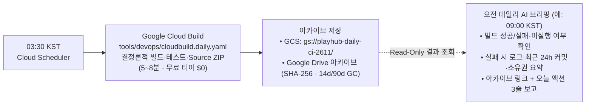

# PlayHub-DevOps 데일리 빌드 · 아카이브 · 오전 AI 브리핑 · 수동 배포 설계서

- 상태: 최종 검토 확정안 (브랜치 `PlayHub-DevOps`, 기준 `PlayHub-Platform` `13c70ba`, 2026-11-21)
- 범위:
  - **클라우드(Google Cloud Build)**: 결정론적 빌드 + 단위/계약/통합 검증 + 아카이브 저장 (AI QA 제외)
  - **AI 역할**: **오전 데일리 브리핑 전용 (Read-Only)** — 빌드·배포·코드 수정 없이 결과 매니페스트·로그·최근 커밋만 읽어 요약 브리핑 작성
  - **수동 배포/테스트**: 특정 브랜치/커밋 선택 빌드 및 로컬(`local-preview`) / Dev(`dev-tag`, `dev-promote`) 선택 테스트
- 대상 GCP 프로젝트: `playhub-dev-2611` (`us-west1`, Always Free 및 Cloud Build 무료 2,500분/월 범위)
- 관련 문서: [site-operations-plan.md](../architecture/site-operations-plan.md), [hub-forge-decoupling-plan.md](../architecture/hub-forge-decoupling-plan.md)

---

## 1. 최종 운영 흐름 (Cloud Build 자율 완결 → 오전 Read-Only AI 브리핑)

### AI를 "오전 데일리 브리핑(Read-Only)"으로 한정했을 때의 장점
1. **빌드·아카이브와 AI 완전 분리**: 빌드·테스트·아카이브가 클라우드/결정론적 스크립트로 100% 완결되므로 AI 장애·쿼터·로컬 PC 새벽 절전과 무관하게 데일리 빌드가 돌아갑니다.
2. **새벽 PC 전원 문제 원천 해소**: PC를 새벽 4시에 켜둘 필요 없이, **오전 업무 시작 시각(예: 08:30~09:00 KST)**에 브리핑만 받으면 됩니다.
3. **최소 권한·최소 토큰**: AI는 빌드 실행·배포·코드 수정 권한 없이 결과 JSON·로그·`git log`만 읽기 전용으로 소비하므로 안전하고 비용이 극소화됩니다.

---

## 2. 결정론적 빌드·아카이브 단계 구성

| 단계 | 실행 항목 | 검증/산출물 |
|---|---|---|
| **Stage 0** | `check-ownership.mjs`, `godot-engine` 커밋 핀(`ed1daf0b...`) | 소유권 침범 0건, 서브모듈 드리프트 0건 |
| **Stage 1** | `hub/tools/acceptance.mjs --with-python`, `store/tests`, `hub/tests/cdn*`, `hub/tests/l10n*`, `tests/deployment/{preflight,test_source_package}` | `hub/dist` 빌드, Node 회귀, HTTP 스모크, Python 계약 검증 |
| **Stage 2** | `forge/Tools/run-tests.cjs`, `hub-forge-integration.test.mjs`, `hub-forge-platform-parity.test.mjs` | Forge 서버·멀티플레이 분리·원격 세션 검증 |
| **Stage 3** | `tools/build/package_source.py` | 시크릿 스캔 + CRC/SHA-256 검증된 클린 Source ZIP 생성 |
| **Stage 4** | `archive-gdrive.mjs` + `prune-daily-builds.mjs` | Google Drive 복사 + `ARCHIVE_SHA256SUMS.txt` 바이트 일치 재검증 + 보존 GC(일간 14일 / 월요일 주간 90일 / `latest-good`·매니페스트 영구) |
| **Stage 5** | 04:00 AI 마무리 | `DAILY_REPORT.md` / `DAILY_REPORT.html` 확정, 실패 시 최근 24h 커밋 + `owners.json` 기반 원인 요약 |

---

## 3. 특정 브랜치/커밋 수동 빌드·배포 & 로컬/Dev 선택 테스트

### 3.1 CLI 도구 (`tools/devops/manual-build-test.mjs`)

- 브랜치·최근 커밋 조회: `node tools/devops/manual-build-test.mjs --list-refs`
- 로컬 격리 테스트 계획: `node tools/devops/manual-build-test.mjs --ref <브랜치|SHA> --build local --test local-preview --port 18280`
- Dev 서버 독립 태그 테스트 계획: `node tools/devops/manual-build-test.mjs --ref <브랜치|SHA> --build cloudbuild --test dev-tag`

### 3.2 테스트 대상 3모드

| 모드 | 동작 방식 | 테스트 URL | 기존 환경 영향 |
|---|---|---|---|
| **`local-preview`** | 임시 detached 워크트리 빌드 → 전용 포트(`18280+`) + 일회용 `dataDir` | `http://127.0.0.1:18280/` | 없음 (기본 포트 `8080/4177`·실 DB 격리) |
| **`dev-tag`** | `playhub-dev-2611` Cloud Run에 `--no-traffic --tag rev-<shortSha>` 배포 | `rev-<shortSha>---playhub-hub-...run.app` | 없음 (Dev 메인 트래픽 100% 유지, 독립 테스트) |
| **`dev-promote`** | 검증 완료 다이제스트를 `playhub-dev-2611` 메인 트래픽 100% 승격 | `playhub-hub-...run.app` | Dev 메인 갱신 (1초 롤백 지원) |

### 3.3 `PlayHub-Admin` 페이지 연동 계약 (`PlayHub-Admin` 브랜치 구현용)

- `GET /api/admin/devops/refs` — 브랜치·최근 커밋 목록
- `GET /api/admin/devops/builds` — 데일리·수동 빌드 및 Google Drive 아카이브 이력 조회
- `POST /api/admin/devops/builds` — `{ ref, buildTarget: "local"|"cloudbuild", testTarget, archiveToGdrive }` 수동 빌드 트리거 (관리자 세션 + `X-CSRF-Token` + `ref` 화이트리스트 검증 + 감사 로그 필수)
- `POST / DELETE /api/admin/devops/builds/:runId/preview` — `local-preview` 시작/중지 또는 `dev-tag`/`dev-promote` 실행

---

## 4. Google Cloud Build 03:30 KST 자동 트리거 설정 절차 (`gcloud` 검증 템플릿)

1. **Step 1 — Syntax Validation**: `gcloud help builds submit`, `gcloud help builds triggers create github`, `gcloud help scheduler jobs create http`, `gcloud help storage buckets create`
2. **Step 2 — Parameter Verification**: `--project=playhub-dev-2611`, `--region=us-west1`, `tools/devops/cloudbuild.daily.yaml` 및 `--dry-run` / `--validate-only` 지원 확인
3. **Step 3 — Dry-Run / 수동 1회 검증**: GCS 버킷 `gs://playhub-daily-ci-2611` 생성 후 수동 1회 빌드로 `deterministic-manifest.json` 및 Source ZIP 업로드 확인
4. **Step 4 — Authorization & Schedule 활성화**: 매일 03:30 KST(`Asia/Seoul`) Cloud Scheduler → Cloud Build Trigger 연결
