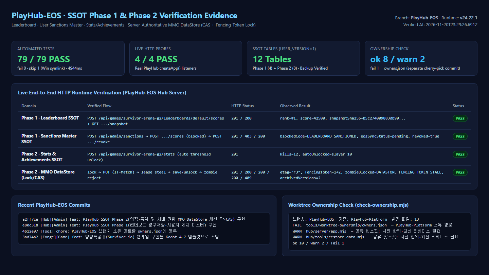

# PlayHub EOS 적용성 검토 및 SSOT 우선 도입 설계안

- **브랜치 / 워크트리**: `PlayHub-EOS` (기준: `PlayHub-Platform` `3ad74a2`)
- **작성일**: 2026-11-21
- **관련 문서**: [cloud-run-pipeline-plan.md](../architecture/cloud-run-pipeline-plan.md), [multiplayer-plan-review.md](../architecture/multiplayer-plan-review.md)

---

## 1. EOS 기능별 적용 가능성 및 SSOT 경계 확정

### 1.1 PlayHub 고유의 4가지 제약 조건

1. **Web/HTML5(WASM) 미지원**: EOS C/C++ SDK 및 Godot 플러그인(`EOSG`)은 네이티브(Windows/Linux/macOS/Android/iOS/콘솔)만 지원하며 브라우저 WASM을 지원하지 않는다. 웹+모바일+PC 크로스플레이가 필요한 영역에 EOS 클라이언트 SDK를 쓰면 웹 유저가 단절된다.
2. **UGC 멀티게임 허브 vs 1 Product = 1 Game**: EOS 리더보드·업적·통계·EAC는 Epic Developer Portal 사전 등록과 Service Limits를 전제로 하므로 동적 UGC 게임 포털의 단일 원본(SSOT)으로 부적합하다.
3. **인증 브릿지(OIDC) 선행 필요**: EOS `Connect` 인터페이스는 외부 OIDC(JWT/JWKS) 또는 외부 플랫폼 계정이 필요하다. 현재 Hub에는 OIDC 제공자가 없으므로 Guest 즉시 플레이 UX를 유지하려면 Hub OIDC/토큰 교환 계층이 먼저 필요하다.
4. **Godot 4.7.2 커스텀 포크 & 경량 APK 정책**: `EOSG` GDExtension은 Godot 4.7.2 커스텀 ABI 및 Android `arm64-v8a` 경량 APK 용량 예산에 맞춰 별도 크로스 컴파일 검증이 필요하다.

### 1.2 기능별 최종 경계 (PlayHub SSOT vs EOS 선택 도입)

| 기능 | 원본(SSOT) | 도입 단계 | 적용 방식 |
|---|---|---|---|
| **리더보드** | **PlayHub DB** | **Phase 1 (완료)** | `hub/server/ssot/leaderboard.mjs` (웹/AOS/PC 공통, 시즌 `period_key` 영구보존, 게스트 병합, QA 격리). EOS는 EGS 단독 출시 시 선택 미러링 |
| **사용자 신고·제재** | **PlayHub DB** | **Phase 1 (완료)** | `community_reports` + `hub/server/ssot/sanctions.mjs` (`user_sanctions` 마스터 원장 + `eos_sync_status` outbox). 향후 EOS Sanctions Web API 단방향 푸시 |
| **업적·통계** | **PlayHub DB** | **Phase 2 (완료)** | `hub/server/ssot/progression.mjs` (`stat_definitions`, `player_stats`, `achievement_definitions`, `player_achievements` + 자동 임계치 해금 + 게스트 병합) |
| **MMO DataStore (Warm KV)** | **PlayHub DB** | **Phase 2 (완료)** | `hub/server/ssot/datastore.mjs` (`/internal/v1/datastore/*` 서버 권위 CAS·fencing-token 세션 락·버전 이력·게임별 쿼터) |
| **로비·파티** | **PlayHub 백엔드** | Phase 2 | 포털/앱 파티·프레즌스·초대는 자체 백엔드 소유. EOS Lobby는 네이티브 인게임 보조 수단으로만 제한 |
| **매치메이킹** | **PlayHub 백엔드** | Phase 2 | 크로스플레이는 자체 매칭 + Gateway/JoinTicket + WSS 데디케이티드 서버. EOS 세션은 네이티브 소규모 게임 옵션 |
| **P2P 네트워크** | EOS (네이티브 옵션) | Phase 3 | 네이티브(PC/AOS) 2~8인 캐주얼/협동 게임의 무료 NAT 홀펀칭·릴레이 절감 옵션 |
| **음성 채팅** | EOS Voice (네이티브 옵션) | Phase 3 | PlayHub 서버에서 EOS Voice Web API로 Trusted Server 룸 토큰 발급(자체 파티와 결합 + 연령 게이트 연동) |
| **Easy Anti-Cheat** | 보류 | 보류 | 64비트 데스크톱 전용·부트스트래퍼·Epic 심사 제약으로 동적 `.pck` UGC 허브와 부적합. 서버 권위 판정 + 서버 점수/세션 검증 우선 |

---

## 2. Phase 1 도입 범위 (SSOT 고가능성 항목 우선 구현)

### 2.1 스키마 및 영구저장 계약 (`hub/server/ssot/schema.mjs`)

- **무중단 하위 호환**: `PRAGMA user_version=1`을 올리지 않는 순수 additive `CREATE TABLE IF NOT EXISTS` + 인덱스만 사용(뷰·트리거·가상 테이블 금지).
- **백업·복구 통합**: [restore-data.mjs](../../hub/tools/restore-data.mjs)의 `OPTIONAL_TABLES`에 4개 테이블을 등록해 온라인 백업 및 복구 무결성 검증을 유지한다.
- **Turso(libSQL) Step 2 호환**: 모든 쿼리는 표준 SQLite/libSQL 호환 SQL로 작성했다.
  - **중요 운영 전제**: Cloud Run 현행 [entrypoint.mjs](../../deploy/cloudrun/hub/entrypoint.mjs)의 `PLAYHUB_DATA_DIR` 기본값(`/tmp/playhub-data`)은 인스턴스 재시작·scale-to-zero 시 휘발되므로, **클라우드 운영 영구저장은 [cloud-run-pipeline-plan.md](../architecture/cloud-run-pipeline-plan.md) Step 2(`DbPort` + Turso libSQL) 완료 후 완성**된다.
  - 시즌 마감 스냅샷은 `GET /api/admin/games/:gameId/leaderboards/:boardKey/snapshot`(SHA-256 포함)으로 추출해 GCS/R2에 불변 아카이브한다.

### 2.2 도입된 API 표면

- **리더보드 Public**:
  - `GET /api/games/:gameId/leaderboards` — 게임별 활성 보드 목록 (`default` 자동 프로비저닝)
  - `GET /api/games/:gameId/leaderboards/:boardKey?period=&limit=&offset=` — 랭킹 조회 + 호출자 본인 순위(`me`), QA 트래픽·제재 유저 자동 격리
  - `POST /api/games/:gameId/leaderboards/:boardKey/scores` — `Idempotency-Key` 멱등성, `playSessionId` 소유권·`minPlayMs`·`maxScoreBound` 검증, `best`/`sum`/`latest` 및 `desc`/`asc` 정렬 지원
- **리더보드 Admin**:
  - `PUT /api/admin/games/:gameId/leaderboards/:boardKey` — 보드 정책 생성/수정
  - `GET /api/admin/games/:gameId/leaderboards/:boardKey/entries` — 제외/QA 포함 관리자 조회
  - `PATCH /api/admin/games/:gameId/leaderboards/:boardKey/entries/:principalId` — 기록 제외/복구 + `audit`
  - `GET /api/admin/games/:gameId/leaderboards/:boardKey/snapshot` — 불변 JSON 스냅샷(SHA-256) 추출
- **사용자 제재 Master SSOT**:
  - `GET /api/me/sanctions` — 본인 활성 제재 조회
  - `GET /api/admin/sanctions` / `POST /api/admin/sanctions` / `POST /api/admin/sanctions/:id/revoke` — 제재 생성·조회·철회 + `eos_sync_status` 상태 관리
- **Guest → Google 계정 병합**:
  - `mergeGuestLeaderboard`, `mergeGuestSanctions`, `mergeGuestProgression`, `mergeGuestDataStore`를 [app.mjs](../../hub/server/app.mjs) `merge_requests` 트랜잭션에 연동(기록·통계·업적·소유권 병합 + 제재 회피 차단).

---

## 3. Phase 2 도입 범위 (업적·통계 SSOT + 서버 권위 MMO DataStore)

### 3.1 업적·통계 SSOT (`hub/server/ssot/progression.mjs`)

- **테이블**: `stat_definitions`, `player_stats`, `achievement_definitions`, `player_achievements`, `progression_idempotency`
- **Public API**:
  - `GET /api/games/:gameId/progression` — 활성 통계·업적 정의 및 본인 진행도 조회(미해금 숨김 업적 자동 마스킹)
  - `POST /api/games/:gameId/stats` — `Idempotency-Key` 멱등성, `playSessionId` 검증, `sum`/`max`/`min`/`latest` 집계, `minValue`/`maxValue`/`maxDelta` 제한, 임계치 도달 시 업적 자동 해금
  - `POST /api/games/:gameId/achievements/:achievementKey/unlock` — 수동 업적 해금(통계 연동 업적은 `409`로 우회 차단)
- **Admin API**: `PUT /api/admin/games/:gameId/stats/:statKey`, `PUT /api/admin/games/:gameId/achievements/:achievementKey`

### 3.2 서버 권위 UGC MMO DataStore (`hub/server/ssot/datastore.mjs`)

- **설계 원칙**: Roblox `DataStoreService` + ProfileService 세션 락 모델. 창작자/게임 서버에는 PlayHub 표준 API만 노출해 향후 하부 엔진을 `Turso/PostgreSQL + Redis`로 교체해도 게임 코드 변경이 없도록 격리한다.
- **테이블**: `datastore_quotas`, `datastore_entries`, `datastore_versions`(키별 최근 20버전 롤백 아카이브)
- **보안 경계**: `/internal/v1/datastore/*`는 `/internal/session/verify`와 동일한 내부 경계(`admin` 리스너 또는 `remoteForgeVerify`, `Origin` 헤더 차단, `X-PlayHub-Internal-Secret` 검증)에서만 허용한다.
- **동시성·아이템 복사(Dupe) 방지**:
  - `POST .../keys/:key/lock` / `unlock`: 분산 세션 락(임대 TTL) 획득 시 단조 증가하는 `fencingToken` 발급.
  - `PUT .../keys/:key`: 활성 락 검증 + `If-Match`/`expectedRevision` 낙관적 CAS + 좀비 서버의 구 `fencingToken` 쓰기 차단(`409 DATASTORE_FENCING_TOKEN_STALE`) + `releaseLock: true` 단일 RTT 저장·해제 지원.
  - `PUT /api/admin/games/:gameId/datastore/quota`, `GET .../datastore/stats`, `POST .../force-unlock`(비상 강제 해제 시 `fencingToken` 강제 증가로 기존 홀더 재쓰기 차단).

---

## 4. 검증 증거 (Verification Evidence)

- **검증 스크린샷**: 
- **실측 요약 JSON**: [verification-summary.json](evidence/verification-summary.json)
- **검증 결과 (Node v24.22.1)**:
  - 자동화 테스트: **79 / 79 통과** (실패 0건, Windows symlink 1건 skip, 4.9s)
  - 실서버 HTTP 프로브: **4 / 4 통과** (리더보드·스냅샷 SHA-256, 제재 차단 `403`·`eosSyncStatus=pending`·철회, 통계 임계치 업적 자동 해금, MMO DataStore 락/CAS/임대 만료 승계·좀비 서버 `409 DATASTORE_FENCING_TOKEN_STALE` 차단)
  - 소유권 검사(`check-ownership.mjs`): `ok 10 / warn 2 / fail 1`(`owners.json` 단독 커밋 1건만 `PlayHub-Platform` 소유)

