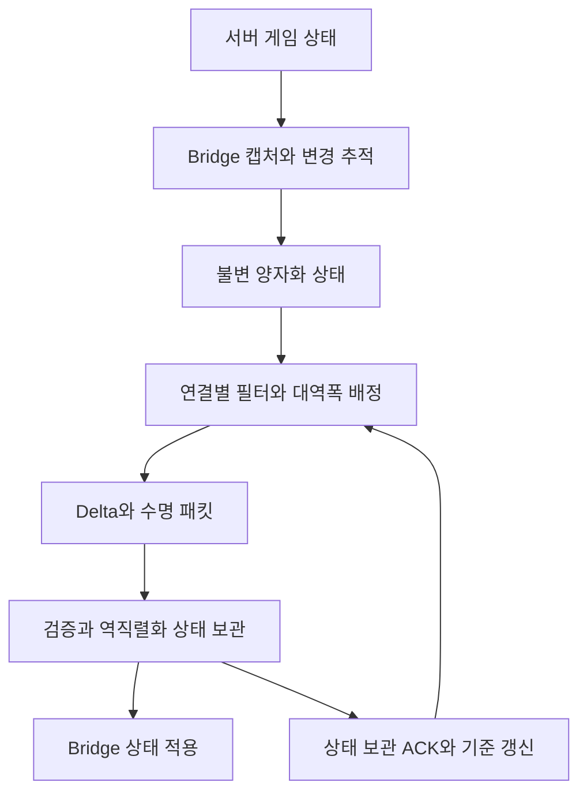

# 26. Iris 방식 상태 복제 시스템 개발 계획

| 항목 | 계획 |
| --- | --- |
| 계획 ID / 기준일 | NET-26 / 2026-11-24 |
| 원문 대응 | PDF 5-6쪽 복잡한 상태 동기화·확장성, 7-9쪽 멀티플레이 개선; 사용자 Iris 지정 |
| 우선순위 / 상태 | P0 기본 복제, P1 대규모 최적화 / 설계안 |
| 구현 위치 | C++ GDExtension의 복제 코어 + GDScript bridge + 스키마 도구 |
| 선행 과제 | 25 객체·권한 계약, 13 측정 포맷; 28 테스트 실행기 |
| 담당 / 예상 공수 | 네트워크 엔지니어 2명, 도구·QA / 26-40 PW |
| 범위 | Godot 전용 독립 구현; UE Iris 소스·wire protocol 호환을 전제로 하지 않음 |

아래 클래스·스키마·정량 수치는 자체 설계 제안이다. PW는 사람-주이며 공수와 성능은 목표이지 구현 결과가 아니다.

## 1. 목표

게임 객체와 복제 코어를 분리하고, 상태 캡처·양자화 작업을 연결들 사이에서 공유한다. 관련 객체만 보내며 연결별 대역폭·갱신 지연·메모리를 제한한다. 단순 값 외에 인벤토리 컬렉션, 서브오브젝트, owner 전용 상태, late join, dormancy, 손실 복구를 다룬다.

Iris는 이 계획에서 상태 복제 아키텍처의 기준이다. 이동 예측, 물리 재시뮬레이션, 인증, UDP 전송, 데디서버 배치는 각각 NET-27/29/28의 기능이며 Iris 도입만으로 완성되지 않는다.

## 2. 확인한 사실과 적용 경계

Epic의 Iris 문서는 replication state, bridge, descriptor, fragment, serializer, filter, prioritizer를 설명하며 gameplay와 분리된 양자화 상태를 사용한다. 열람 문서에는 Experimental 표기가 있다. 따라서 명칭을 가져왔다고 상용 품질을 확보한 것으로 보지 않고 기능별 인수 기준을 둔다. [Introduction to Iris](https://dev.epicgames.com/documentation/unreal-engine/introduction-to-iris-in-unreal-engine)

Godot MultiplayerSynchronizer는 가시성 제어가 있으며 Object/Resource·RID·인스턴스 ID 등의 동기화 제한을 명시한다. 원문의 “복제는 원시 타입만 가능”이라는 포괄적 단정은 채택하지 않는다. 필요한 추가 범위는 안정 ID, 컬렉션 항목별 변경, 예산 기반 스케줄링이다. [Godot MultiplayerSynchronizer](https://docs.godotengine.org/en/stable/classes/class_multiplayersynchronizer.html)

## 3. 구성 요소와 담당

| 개념 | 제안 모듈 | 책임 |
| --- | --- | --- |
| Replication Bridge | FgReplicationBridge | Node/Component 등록·삭제, prefab 생성, 주 스레드 상태 적용 |
| Descriptor / Protocol | FgNetSchema / FgProtocolRegistry | 타입·필드 ID·양자화·조건·호환 hash |
| Replication Fragment | FgStateFragment | Transform/Health/Inventory 등의 캡처·적용 어댑터 |
| Net Handle | NetObjectId(index,generation) | 세션·world_epoch 범위 안정 ID; NodePath/RID 전송 금지 |
| Quantized State | FgStateStore | 불변 상태 버퍼, dirty mask, revision |
| Net Serializer | FgSerializer | 검증·양자화·delta·복호화, 길이·범위 제한 |
| Filtering | FgInterestFilter | owner/team/그룹/spatial/비공개 정책 |
| Prioritization | FgReplicationScheduler | 연결별 예산, 중요도, 마지막 전송 이후 시간 |
| Data Streams | FgLifecycleStream / FgStateStream | spawn/destroy·snapshot·ACK·RPC의 분리 |

공용 모듈은 어떤 게임의 데이터도 하드코딩하지 않는다. 각 프로젝트는 별도 schema와 정책을 선언하고 build manifest에 고정한다.

## 4. 송수신 파이프라인



캡처는 월드 주 스레드에서 한 번 수행한다. 객체 버퍼를 발행한 뒤 송신 워커는 Node를 접근하지 않는다. 스레드 간 fence와 버퍼 수명은 명시한다. 이 분리는 Iris의 공식 구성 설명을 참고하되 배치 크기와 자료구조는 Godot 부하로 결정한다. [Components of Iris](https://dev.epicgames.com/documentation/unreal-engine/components-of-iris-in-unreal-engine)

수신은 길이·세션·epoch·schema·권한을 먼저 검증하고, packet 전체 구조가 유효할 때만 적용 명령을 주 스레드로 넘긴다. 잘못된 패킷 일부가 이미 게임을 바꾸는 부분 적용을 허용하지 않는다.

## 5. 제안 스키마와 버전 규칙

```json
{
  "schema_id": "character",
  "version": 1,
  "fields": [
    {"id": 1, "name": "position", "type": "vec3_cell_relative", "step_m": 0.01},
    {"id": 2, "name": "rotation", "type": "quat_quantized", "max_error_deg": 0.2},
    {"id": 3, "name": "health", "type": "u16", "scope": "relevant"},
    {"id": 4, "name": "inventory", "type": "keyed_collection", "scope": "owner"}
  ],
  "atomic_groups": [[1, 2]],
  "max_collection_items": 128
}
```

수치는 예시 프로파일이다. 좌표 셀 크기·잔여 범위·overflow 정책을 serializer별로 고정하고, 양자화가 만드는 최대 오차를 자동 검사한다. 큰 월드에서는 절대 좌표를 임의로 잘라내지 않는다.

프로토콜 hash는 정렬한 schema, RPC registry, prefab catalog, serializer 버전에서 만든다. MVP는 정확히 일치하는 클라이언트·서버만 허용한다. 후속 호환 모드는 명시적 추가 필드·기본값·폐기 규칙을 정한 경우에만 허용하며 필드 ID를 다른 의미로 재사용하지 않는다.

## 6. 변경 추적·delta·ACK 정확성

Dirty 표시는 “상태 캡처 필요”와 “특정 연결에 전달 필요”를 분리한다. 전역 dirty mask를 지웠다는 이유로 느린 연결의 미전송 revision을 소실시키지 않는다. GDScript 제작 API는 setter/mark_dirty를 제공하고 개발 빌드의 주기적 비교로 누락된 dirty 표시를 탐지한다.

연결별 baseline은 수신 측이 완전히 역직렬화하여 보관했다고 ACK한 불변 상태만 참조한다. transport packet ACK와 상태 보관 ACK를 구분하며 패킷을 보냈거나 받았다는 사실만으로 baseline을 앞당기지 않는다. delta에는 baseline_id와 target_revision을 넣고 수신 측 기준 상태가 없으면 full snapshot을 요청한다. ACK 손실·중복·역순도 같은 결과로 수렴해야 한다.

초기 정책은 bounded baseline history, 주기적 full-state 보정, 연결별 최대 보관량이다. history 초과 시 오래된 baseline을 몰래 재사용하지 않고 기준 무효화와 full refresh를 수행한다. 상태 보관 ACK는 전체 재조립·타입 검증·기준 상태 확인·역직렬화가 끝난 뒤 보낸다. spawn/destroy·원자 transaction의 적용 ACK는 주 스레드 적용이 완료된 뒤 보내며 두 ACK를 혼용하지 않는다. 보관 ACK를 보냈지만 적용할 수 없게 된 상태는 baseline 무효화 후 복구하거나 연결을 종료한다.

수신 baseline 보관과 gameplay 적용 revision은 별도로 관리한다. epoch·generation 검증 후 객체/원자 그룹의 last_applied_revision보다 오래된 상태는 게임에 다시 적용하지 않는다. 과거 패킷은 필요한 decoding history로만 보관할 수 있고, tombstone 이후의 지연 update가 객체를 되살려서는 안 된다. 송신 기록에 없는 future revision의 ACK는 거절한다.

인벤토리는 index가 아닌 item_id와 entry_revision을 사용해 add/update/remove 및 tombstone을 전송한다. 교환·수량 변경은 transaction_revision 단위로 적용한다. 삭제 후 ID 재사용은 generation 또는 새 ID로 구별한다.

## 7. 필터링·우선순위·dormancy

Owner/connection/group/spatial 필터를 순서와 비용 예산을 가진 정책으로 조합한다. owner 전용 필드가 공개 fragment에 섞이지 않도록 schema 검사한다. 안개·은폐 정보는 UI에서 숨기기 전에 서버 송신 대상에서 제외한다. [Iris Filtering](https://dev.epicgames.com/documentation/en-us/unreal-engine/iris-filtering-in-unreal-engine)

스케줄링 점수는 중요도, 상호작용 거리, 변화량, 마지막 송신 경과 시간으로 계산하는 자체 정책이다. 필터를 통과한 낮은 우선순위 객체에도 최대 대기시간을 둔다. 필터에서 제외된 비공개 객체에는 starvation 방지를 이유로 정보를 보내지 않는다. [Iris Prioritization](https://dev.epicgames.com/documentation/unreal-engine/iris-prioritization-in-unreal-engine)

Dormancy는 서버에 상태가 고정된 객체의 정기 갱신을 중단하되 late join에는 최초 상태를 준다. 변경·외력·owner 변경·관련성 재진입은 wake 조건이다. 수면 중 파괴도 tombstone으로 통지하고 ACK·세대 격리 전까지 잘못 재사용하지 않는다. 이는 지원할 기능의 계약이며 UE 세부 구현 동일성을 뜻하지 않는다.

## 8. 패킷·상태 예산

기본 실험 프로파일은 연결당 평균 하향 64 KiB/s·상향 16 KiB/s, 중요 상태의 목표 갱신 대기 200ms, 저우선 상태 2초이다. late join의 짧은 burst는 별도 token bucket으로 제한한다. 값은 장르별 조정 가능한 시작 목표다.

native datagram application payload는 초기 1,000 bytes로 제한해 전송·암호화 헤더 여유를 두고 실제 wire 크기와 path MTU를 측정한다. 큰 snapshot은 제한된 수의 chunk로 분할하고 재조립 총량·시간·개수를 제한한다. 64 KiB보다 큰 논리 항목은 작은 상태로 재설계하거나 별도 인증 콘텐츠 경로를 쓴다.

오래된 위치 snapshot은 최신 상태로 합칠 수 있지만 spawn/destroy/거래 완료를 무조건 버리지 않는다. budget 초과 시 낮은 중요도의 갱신률을 낮추고, 안전한 상한을 넘으면 신규 입장 제한 또는 세션 부하 거절을 한다.

## 9. WBS와 예상 공수

| 작업 ID | 작업 | PW | 인수 산출물 |
| --- | --- | --- | --- |
| NET26-01 | 스키마·안정 ID·프로토콜·fuzz corpus | 3-4 | spec/codec v1 |
| NET26-02 | Bridge·fragment·서브오브젝트·수명 | 4-6 | 등록/생성/파괴 |
| NET26-03 | dirty·양자화·불변 버퍼·serializer | 4-6 | 캡처와 기본 복제 |
| NET26-04 | ACK baseline·delta·컬렉션·복구 | 5-8 | 손실/재접속 수렴 |
| NET26-05 | 필터·예산·우선순위·dormancy | 4-6 | 관심 영역 정책 |
| NET26-06 | 추적 도구·GDScript 제작 API | 2-4 | 객체/필드별 트레이스 |
| NET26-07 | 부하·장시간·보안·이행 QA | 4-6 | 후보 릴리즈·기록 |
| 합계 | NET-25/27/28 별도 | 26-40 | production 후보 |

첫 기능 릴리즈는 full snapshot+수명+권한 필터부터 만든다. Delta와 고급 스케줄러는 정답 상태 비교가 가능한 이후 도입한다. 완성형 전체를 단일 스프린트 납기로 잡지 않는다.

## 10. 시험 프로파일과 완료 기준

공통 로컬 최소는 DS+2 clients이다. 아래는 논리 복제 부하 기준이며 실제 게임의 AI·물리 비용을 포함한 서버 용량 보장이 아니다.

| 프로파일 | 연결 / 월드 객체 / 연결당 관련 객체 / dirty | 검증 목표 |
| --- | --- | --- |
| N0 | 2 / 100 / 80 / 10% | 기본 기능·상태 일치 |
| N1 | 8 / 500 / 100 / 5% | 모바일·기본 협동 게임 |
| N2 | 32 / 2,000 / 200 / 5% | 4 vCPU 기준 복제 CPU p95 ≤4ms/tick 목표 |
| N3 | 100 / 10,000 / 500 / 5% | 8 vCPU 기준 복제 CPU p95 ≤8ms/tick 연구 목표 |

모두 simulation 30Hz, snapshot 10Hz, transform+health+16-item inventory, 고정 seed, 5분 warmup·30분 표본·5회 반복으로 시작한다. CPU 모델·RAM·NIC·engine/build hash를 기록하고 실제 원격 네트워크 검증을 별도 수행한다.

기능 gate는 RTT 0/50/150/300ms, jitter 0/20/50ms, loss 0/1/5%, 재정렬·중복에서 reconnect 후 최신 상태 일치, 10만 spawn/despawn에서 ID 오염 0건, owner/team 비공개 누출 0건이다. 관심 영역을 경계 왕복해도 ghost object와 중복 항목이 없어야 한다.

후보 릴리즈는 24시간 soak에서 warmup 뒤 메모리 증가율 목표 1%/hour 미만을 관찰 지표로 사용하되, 정상화된 동일 부하에서 설명되지 않는 지속 증가나 미해제 객체가 있으면 이 수치 이하라도 실패로 판정한다. 1.5배 부하에서는 crash/무한 큐 없이 정책적 과부하 대응을 요구한다. 낮은 CCU에서도 실패하면 수치를 축소 발표하고 병목을 개선한다.

## 11. 리스크와 대안

스키마 코드 생성과 GDScript setter 우회가 복잡하면 초기에는 명시적 typed fragment만 지원한다. 자동 반사 기반 임의 Object 복제는 범위에서 제외한다. 작은 게임은 동일 제작 API 위에 검증된 단순 복제 backend를 유지할 수 있다.

Iris의 성공 사례나 원문의 40/100 CCU 숫자를 Godot 성능 근거로 사용하지 않는다. 범용 동기화 프레임워크의 비용이 소규모 게임보다 크면 기본 snapshot backend를 우선하고 고급 정책을 opt-in한다.

## 12. 산출물·출처

schema compiler, protocol spec, lifecycle/baseline 상태 머신, serializer 라이브러리, packet trace viewer, deterministic input corpus, 부하 스크립트, 성능/메모리 기록 양식, 권한 누출 회귀, 마이그레이션·버전 롤백 절차를 제출한다.

출처는 본문 링크의 Epic Iris 4개 문서와 Godot MultiplayerSynchronizer이며 확인일은 2026-11-24이다. 세부 수명·예산·컬렉션·호환 정책은 이 계획의 독립 제안이다.
