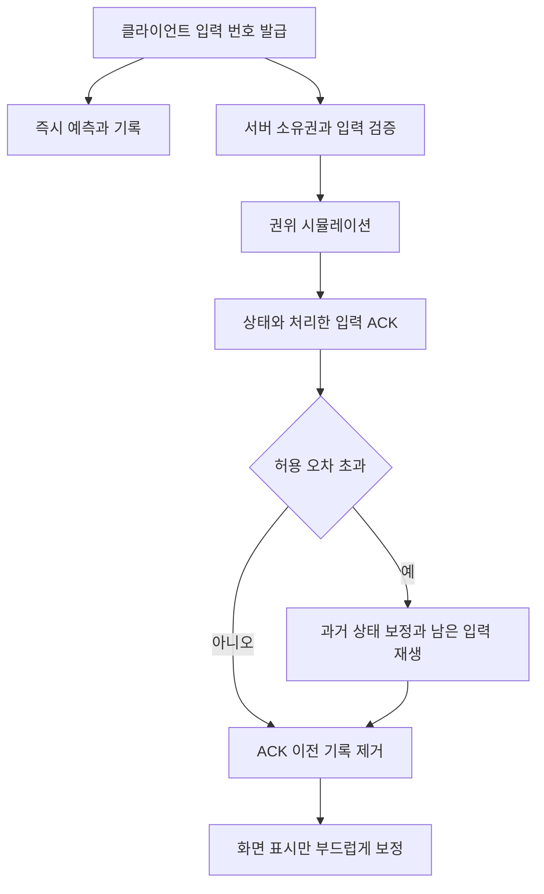

# 27. Unreal 방식 이동 예측·보정·네트워크 물리 개발 계획

| 항목 | 계획 |
| --- | --- |
| 계획 ID / 기준일 | NET-27 / 2026-11-24 |
| 원문 대응 | PDF 5-6쪽 예측·보정·지연 보상, 7-9쪽 수동 물리 스텝 |
| 우선순위 / 상태 | P0 캐릭터 예측, P1 물리 보간, P2 제한 재시뮬레이션 / 설계안 |
| 구현 위치 | 이동 GDExtension + GDScript 명령 API; 필요 시 12의 최소 코어 패치 |
| 선행 과제 | 25 권한·입력, 26 snapshot; 전체 physics resim은 12 snapshot/step gate |
| 담당 / 공수 | 네트워크·물리 엔지니어, 게임플레이 QA / 22-34 PW |
| 기본 기준 | 서버 권한, simulation 30Hz 시작; 60Hz는 측정 후 별도 프로파일 |

## 1. 목표

사용자 입력에는 즉시 반응하면서 게임의 최종 결과는 서버가 결정하게 한다. 로컬 캐릭터 예측, 원격 캐릭터 보간, 물리 오브젝트 보정, 제한된 physics resimulation, 서버 hit rewind를 별도 기능으로 개발한다.

“Iris를 쓰면 예측이 자동 제공된다”, “space_step API 하나면 롤백이 된다”, “동일 입력이면 Windows·ARM·모든 물리 백엔드가 동일 결과”를 전제로 하지 않는다. 본 문서의 수치·API는 계획용 제안이며 아직 구현 검증하지 않았다.

## 2. Unreal에서 채택하는 원칙

CharacterMovementComponent는 owning client의 입력 기록과 서버 판정·ACK/보정, 원격 proxy의 smoothing을 구분한다. 이를 참고하되 Godot 구현은 고정 tick 입력 명령을 사용하므로 UE CMC의 모든 시간 처리와 일치한다고 주장하지 않는다. [Epic Networked Movement](https://dev.epicgames.com/documentation/en-us/unreal-engine/understanding-networked-movement-in-the-character-movement-component-for-unreal-engine)

Unreal의 Networked Physics는 Default, Predictive Interpolation, Resimulation을 구분한다. 재시뮬레이션에는 과거 상태·입력 기록이 필요하며 비용이 증가한다. 따라서 모든 물체에 같은 모드를 강제하지 않는다. [Epic Networked Physics Overview](https://dev.epicgames.com/documentation/unreal-engine/networked-physics-overview)

## 3. 캐릭터 이동 실행 흐름



충돌·피해 판정용 transform과 화면 보정 offset을 분리한다. 화면 smoothing이 서버 정답 위치를 다시 바꾸거나 벽을 통과하는 충돌 위치가 되지 않게 한다.

첫 단계는 capsule 기반 이동·점프·지면·경사·정적 지형이다. 동적 이동 플랫폼·밀기·수영·사다리·root motion은 각각 별도 재현 fixture를 통과한 뒤 허용한다.

## 4. 제안 데이터·API 계약

```text
InputCommand = {
  input_seq:u32, client_tick:u64, move_axes, look_delta,
  button_edges, movement_mode, ability_request_id
}
AuthoritySnapshot = {
  server_tick, acked_input_seq, object_id, world_epoch, schema_hash,
  position, rotation, linear_velocity, movement_mode,
  base_object_id, base_relative_transform, teleport_revision
}
PredictionConfig = {
  input_history_ms:1000, visual_smoothing_ms:100,
  max_replay_ticks:32, max_extrapolation_ms:100,
  position_error_m:0.02, angle_error_deg:1.0
}
FgPredictedCharacter.simulate(command, fixed_dt, collision_snapshot)
FgPredictedCharacter.reconcile(authority_snapshot)
FgNetworkPhysics.set_mode(object_id, mode, profile_id)
```

수치는 1 unit=1m인 기준 샘플의 시작값이다. tick wrap·sequence wrap 비교와 clock offset 추정을 구현하며, wall-clock 시간으로 물리 dt를 무제한 늘리지 않는다. root motion은 clip_hash·시작 tick·이동 곡선 버전·능력 상태를 입력/상태에 포함한다.

서버는 클라이언트가 보고한 위치를 그대로 확정하지 않는다. 이동 명령 수·시간 진행·속도·능력·owner를 검증하고 자신의 상태에서 시뮬레이션한다. 누락 입력은 제한된 반복 또는 중립 입력 정책을 적용하며 오래 지연된 입력을 무한 처리하지 않는다.

acked_input_seq는 실행 또는 명시된 폐기 정책으로 처리가 확정된 입력 시퀀스의 연속 경계다. 서버는 이 경계와 server_tick·권위 상태를 원자적으로 캡처한다. button_edges·ability_request는 입력 시퀀스/요청 ID별 한 번만 소비하며 중복 전송 때문에 점프·스킬이 다시 발생하지 않게 한다.

## 5. 보정과 원격 보간

클라이언트는 server_tick과 acked_input_seq의 대응 기록을 사용해 같은 시뮬레이션 시점의 예측 상태와 비교한다. 서버 tick과 로컬 client_tick의 숫자가 같다는 이유만으로 같은 시점으로 취급하지 않는다. 오차가 크면 권위 상태로 되돌린 뒤 ACK 경계 이후의 입력을 검증된 고정 tick 대응에 따라 재생한다. 대응 history가 없거나 최대 재생 예산을 넘으면 안전한 hard correction 후 기록을 초기화한다.

원격 객체는 server tick으로 정렬한 snapshot ring을 사용한다. 위치와 회전은 같은 기준 시각과 같은 interpolation alpha로 평가하고 quaternion 회전 경로를 처리한다. 위치·회전의 외삽 시간을 별도로 적용해 물체 자세가 어긋나는 기본 설정을 피한다.

Jitter에 따라 보간 지연을 완만하게 조정하되 상한을 둔다. 최대 외삽 시간 뒤에는 추가 예측을 중단하고 상태 갱신을 기다린다. teleport_revision·리스폰·owner 변경·world_epoch 변경은 smoothing/history를 리셋한다.

## 6. 물리 복제 모드와 단계

| 제안 모드 | 적용 대상 | 동작 | 적용 게이트 |
| --- | --- | --- | --- |
| SnapshotInterpolation | 장식·관찰 대상 | 과거 서버 상태 보간 | 가장 먼저 제공 |
| PredictiveInterpolation | 밀 수 있는 서버 권한 rigidbody | 서버 속도·로컬 예측 영향·전송 간격을 고려한 제한 보정 | 충돌 에너지·발산·sleep/wake 시험 |
| Resimulation | 중요 차량·물리 Pawn 등 제한 객체 | 과거 상태 복원 후 저장 입력 재실행 | 12의 backend snapshot/step 합격 |
| ServerOnly | 복잡한 파괴·비결정적 군집 | 서버 계산 결과만 시각화 | 전송량과 표현 품질 검증 |

모드 이름은 UE 설계 방향을 설명하기 위한 제안으로, Chaos 또는 UE 코드가 Godot에 존재한다는 의미가 아니다. mode 변경 시 authority revision·캐시 초기화 규칙을 둔다.

상호 충돌하는 중요 객체 하나만 되감으면 다른 객체와 접촉 결과가 달라진다. resim 범위는 dependency island 또는 별도 예측 공간으로 제한하고 영향권 밖 물체는 검증된 proxy로 제공한다. 예측된 외력은 request ID로 서버 입력과 대응시켜 이중 적용을 막는다.

## 7. 수동 스텝·snapshot의 필수 조건

[12번 물리 계획](12_Physics_Step_Snapshot_Stability.md)은 body transform 외에 속도, sleep, constraints, 접촉/warm-start 상태의 저장 가능 범위를 조사한다. 모든 backend가 같은 저장·복구 능력을 갖는다고 보지 않는다.

추가로 게임 상태·spawn/destroy·RNG·능력 timer·외력 journal을 같은 tick에 보존한다. 재시뮬레이션에서는 게임 상태를 결정하는 내부 이벤트와 callback을 다시 실행한다. 오디오·파티클·외부 알림·영구 보상 기록 등 외부 부작용은 별도 확정 큐로 분리하여 event ID로 중복을 제거하고 확정 시 한 번만 commit한다. 저장된 물리와 gameplay snapshot은 원자적으로 대응해야 한다.

기존 CharacterBody3D 이동을 현재 live world에 그대로 재호출하는 것만으로 과거 동적 충돌 환경을 복구했다고 간주하지 않는다. 초기에는 정적 월드 제한을 명시하고, 이동 플랫폼/동적 충돌은 snapshot query 공간이 준비된 이후 지원한다.

저장 예산은 대략 객체 수 × history tick 수 × 객체당 상태 크기 + 접촉/constraint/게임 journal이다. 후보 값뿐 아니라 실제 backend 저장 바이트와 replay CPU p95/p99를 측정한다.

## 8. 지연 보상과 명중 판정

서버는 일정 기간의 피해 판정용 hitbox·중요 차폐물 이력을 보관하고 인증된 발사 요청의 시각을 서버 clock 범위에 매핑한다. 최대 rewind는 초기 200ms 정책으로 시작하되 게임 규칙에 따라 조정한다. 클라이언트가 임의 과거·미래 시각을 선택할 수 없도록 offset·시퀀스·지연 변동 상한을 검사한다.

전체 live 물리 월드를 되돌리는 대신 읽기 전용 역사 hit-test 공간을 사용한다. 이동 문·파괴 엄폐물의 시간 이력을 갖지 못한 상태에서 “완전한 지연 보상”을 제공하지 않는다. 이력이 부족하면 현재 서버 판정 또는 명시된 제한 정책을 적용한다.

탄약·발사 간격·능력·발사점·사거리·시야/차폐는 서버에서 재검증한다. lag compensation은 히트 판정 정책이며 inventory rollback이나 클라이언트 최종 판정 수용이 아니다.

## 9. WBS와 예상 공수

| 작업 ID | 내용 | PW | 산출물 |
| --- | --- | --- | --- |
| NET27-01 | tick/clock/input/history 계약과 testbed | 3-4 | 시간·입력 명세 |
| NET27-02 | 정적 월드 캐릭터 예측·ACK·reconcile | 4-6 | 기본 이동 컴포넌트 |
| NET27-03 | 원격 smoothing·teleport·동적 platform 확장 | 3-5 | 품질 fixture |
| NET27-04 | Predictive Interpolation·sleep/wake | 3-5 | rigidbody 프로파일 |
| NET27-05 | 제한 resim·snapshot/island 연결 | 4-6 | capability별 구현 |
| NET27-06 | 서버 hit history·lag compensation | 3-5 | 판정·악용 방지 |
| NET27-07 | 장치/네트워크 매트릭스 회귀 | 2-3 | 정량 비교·가이드 |
| 합계 | 물리 backend 코어 개발은 12번 별도 | 22-34 | 단계별 기능 릴리즈 |

첫 릴리즈는 NET27-01/02와 정적 월드 원격 보간에 한정한다. 재시뮬레이션은 서버 기본 게임 출시를 차단하는 선행 조건으로 두지 않는다.

## 10. 완료 기준과 측정 방법

기준 조건은 DS+2 clients, 30Hz simulation·10Hz snapshot, 1m 단위 캐릭터, 고정 입력 seed, 10분 경로·5회 반복이다. 60Hz 프로파일은 별도 결과로 기록한다.

| 시험 | 목표 |
| --- | --- |
| 정상 LAN 정적 지형 | 예측/권위 위치 오차 p95 ≤2cm, 발산 0건 |
| RTT 150ms·jitter 20ms·loss 1% | 입력의 로컬 다음 simulation tick 반영; 보정량·빈도 기록 |
| RTT 300ms·loss 5% | 무한 replay/queue 없음, 마지막 정상 snapshot 후 정책적 복구 |
| 이동 플랫폼·점프·root motion | 지정 fixture에서 시퀀스 재생과 서버 규칙 일치 |
| teleport·respawn·재접속 | 이전 history 적용 0건 |
| 보상 이벤트 재시뮬레이션 | hit/reward/audio event 중복 확정 0건 |
| 제한 resim | 선택 hardware에서 replay CPU p95 ≤2ms 시작 목표; 예산 초과 hard correction |
| 악성 timestamp/입력량 | 허용 rewind 초과·미래 시각·가속 시간 요청 모두 정책대로 거절 |

위치 오차 측정은 표시 smoothing offset이 아닌 simulation transform으로 한다. 시각 품질은 별도로 correction 거리·camera jitter·충돌 관통을 기록한다. 실제 실행 전에는 성공률이나 결정론을 보고하지 않는다.

## 11. 리스크·대체 경로

backend state 저장이 불완전하면 해당 물체는 PredictiveInterpolation 또는 ServerOnly로 유지한다. cross-platform bit-exact 검증이 안 되면 서버 교정을 전제로 하고 lockstep 지원을 광고하지 않는다.

100인전에서 1인칭 정밀 물리·대규모 파괴까지 동시에 보장하는 범용 목표는 두지 않는다. 장르별 최소 프로파일을 먼저 통과하고 물리 객체·history·island 크기에 quota를 둔다.

## 12. 제출 산출물·출처

입력/시간 프로토콜, 이동 컴포넌트, 객체별 physics mode 가이드, snapshot capability 표, 지연 보상 정책, 네트워크 에뮬레이션 fixture, input replay와 오차 그래프, 모바일 품질 기록을 제출한다.

확인일 2026-11-24. 공식 근거는 본문의 Epic 이동 및 Networked Physics 문서이며 구현 제약과 구체 알고리즘·임계값은 본 계획의 제안이다.
