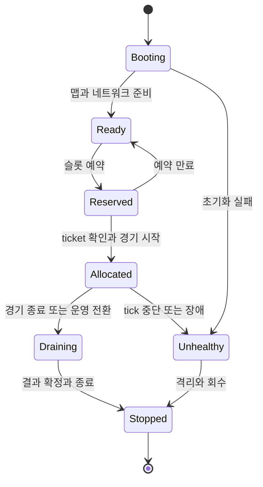

# 28. Unreal 방식 데디케이티드 서버·PIE·운영 개발 계획

| 항목 | 계획 |
| --- | --- |
| 계획 ID / 기준일 | NET-28 / 2026-11-24 |
| 원문 대응 | PDF 5-6쪽 서버 확장성, 7-10쪽 CI·검증·전용 서버 |
| 우선순위 / 상태 | P0 로컬·단일 VM, P1 운영, P2 대규모 fleet / 설계안 |
| 구현 위치 | Godot 서버 export preset + 서버 bootstrap + 실행 도구 + 호스팅 adapter |
| 선행 과제 | 16 빌드, 25 월드/역할, 29 join 계약; NET-26/27과 통합 |
| 담당 / 공수 | 런타임·네트워크·플랫폼 엔지니어, QA / 20-32 PW |
| 기준 | Linux headless export template, 1프로세스=1경기 우선 |

모든 비용·공수·SLO는 계획용 추정이다. 여기서는 설계 문서를 작성했으며 서버 배포·접속·부하 시험을 수행하지 않았다.

## 1. 서버 실행 모델

Unreal 전용 서버처럼 모든 플레이어를 외부 client로 취급한다. 서버에는 로컬 플레이어·카메라·게임 HUD가 없고 GameMode·권위 GameState·물리·게임 규칙만 실행한다. listen server는 렌더링과 로컬 플레이어를 갖는 별도 모드다. [Epic Dedicated Servers](https://dev.epicgames.com/documentation/unreal-engine/setting-up-dedicated-servers-in-unreal-engine)

초기에는 경기별 프로세스를 분리해 장애·메모리·스크립트·게임 데이터를 격리한다. 한 VM에 여러 경기 프로세스를 배치하는 것과 한 Godot 프로세스에 여러 경기 월드를 넣는 것을 구분한다. 후자는 측정과 격리 검증을 통과한 뒤 제공하는 별도 최적화다.

## 2. 기존 Godot 기능의 재사용

Godot 4는 headless 실행과 dedicated server export, dedicated_server feature tag, 시각 리소스 stripping을 제공한다. 서버 실행 자체를 새 엔진 기능으로 개발하지 않는다. export template 기반 배포, 역할 분리, 세션 수명과 운영 자동화가 추가 범위다. [Godot Dedicated Server Export](https://docs.godotengine.org/en/stable/tutorials/export/exporting_for_dedicated_servers.html)

충돌에 쓰는 heightmap, navigation data, 서버 root-motion 곡선, 규칙 데이터는 단순히 “그래픽 자료”라는 이유로 제거하지 않는다. 서버 리소스 검사를 통해 필요한 참조를 보존하고 UI·일반 사운드·시각 표현만 제외한다.

## 3. 제안 런타임 모듈과 계약

| 모듈 | 책임 |
| --- | --- |
| ServerBootstrap | build 검증, 포트 bind, map 준비, 역할 판정 |
| NetWorldHost | world/physics/replication 상태 및 tick 수명 |
| SessionLease | 배정 권한·만료·중복 소유 방지 fencing token |
| JoinGate | NET-29 ticket·build·protocol·slot 검증 |
| LifecycleAdapter | local supervisor, VM, 향후 Agones API 연결 |
| HealthReporter | process alive와 simulation tick 진행을 따로 검사 |
| ResultCommitter | 경기 결과·보상을 idempotent하게 backend에 확정 |
| DrainController | 새 입장·새 배정 차단, 경기 종료 후 회수 |

```text
ServerSpec = {
  project_id, build_id, protocol_hash, content_manifest_hash,
  session_id, world_epoch, map_id, max_players,
  simulation_hz, snapshot_hz, region, resource_profile
}
SessionLease = {session_id, instance_id, lease_epoch, expires_at}
Health = {ready, last_tick, tick_p95_ms, connected_players, drain_reason}
MatchResult = {session_id, lease_epoch, result_revision, result_hash, events}
```

제안 실행 예는 server_binary --headless -- --role=server --session-id=... 이다. --role과 --session-id는 새 bootstrap 인자이며 기본 Godot CLI가 이미 지원하는 것으로 설명하지 않는다.

## 4. 상태 머신과 실패 처리



연결 수 0이라는 이유로 진행 중 재접속 유예를 즉시 종료하지 않는다. idle TTL, reconnect TTL, 최대 경기 시간, drain deadline은 장르별 정책이다. 서버 재시작 시 메모리 월드가 자동 복원된다고 가정하지 않고 경기 실패/환불/재매칭 정책과 선택적 체크포인트를 사용한다.

Agones는 준비·건강·배정·종료 SDK와 배정 중인 GameServer를 고려한 fleet 업데이트를 제공한다. 실제 adapter는 사용할 버전에 고정해 lifecycle 상태와 mapping을 검증한다. [Agones SDK](https://agones.dev/site/docs/guides/client-sdks/), [Fleet Updates](https://agones.dev/site/docs/guides/fleet-updates/)

## 5. 로컬 PIE 유사 실행기

기본 Run Multiplayer는 서버 1개 + 클라이언트 2개를 각각 독립 프로세스로 실행한다. 각 프로세스는 서로 다른 user:// 경로, 포트, 로그 파일, 입력 장치 포커스와 identity를 사용한다. clone하는 것은 시작 콘텐츠이며 런타임 GameState를 공유하지 않는다.

실행기에는 서버 로그, Client 1/2 탭, 역할·connection_id·session_id·world_epoch, 네트워크 에뮬레이션 상태를 표시한다. 추가 Client 버튼은 같은 session_id에 대해 새 테스트 identity와 슬롯을 예약하고 그 클라이언트 전용 join ticket을 발급한다. 기존 클라이언트의 ticket·nonce를 재사용하지 않으며, 다른 경기로 잘못 연결되지 않도록 build/protocol/session을 로그로 교차 확인한다.

에디터 창과 플레이 창은 분리한다. 게임 화면에는 에디터 inspector를 겹치지 않는다. 선택적인 single-process 다중 viewport 모드는 빠른 디버깅용이며 출시 인수는 반드시 다중 프로세스로 한다. 에디터 종료 때 자식 프로세스·포트를 회수한다.

## 6. 배포와 호스팅 단계

| 단계 | 구현 | 승격 조건 |
| --- | --- | --- |
| H0 로컬 | 실행기 + loopback + 고정 fixture | DS+2 clients 핵심 플레이 |
| H1 초기 서비스 | Linux VM, 프로세스 supervisor, 포트 풀, 세션 registry | 소수 경기의 배정·종료·재시작 재현 |
| H2 복수 VM | warm pool·용량 registry·지역별 배정·자동 증감 | 단일 VM 장애에서 신규 배정 복구 |
| H3 fleet | Kubernetes/Agones adapter | 운영 인력·규모·총비용상 실익 입증 |
| H4 프로세스 내 다중 세션 | 신뢰된 동일 테넌트·동일 배포 코드에 한정한 WorldContext·physics space·quota 분리 | 장애 영향·공정 tick·논리 데이터 분리·메모리 예산 시험 통과 |

허브·인증·빌드 API와 게임 시뮬레이션은 서비스 경계를 나눈다. 소수 사용자 단계에서 H3를 선행 조건으로 강제하지 않는다.

H4의 월드 분리는 프로세스 내부의 논리적 분리이며 보안 sandbox가 아니다. 서로 다른 테넌트 또는 불신 UGC 코드는 NET-30의 프로세스/OS 격리 경계를 유지한다. 같은 프로세스에 적재한 native addon의 메모리 접근을 WorldContext만으로 차단할 수 있다고 가정하지 않는다.

Cloud Run의 공개 서비스 URL 경로와 임의 UDP 게임 서버 endpoint를 동일하게 취급하지 않는다. 공식 문서는 서비스, worker pool, instance의 연결 기능을 구분하고 Direct VPC ingress를 private network 대상으로 설명한다. 따라서 기본 game data plane은 UDP endpoint가 검증된 VM/fleet로 설계하고, Cloud Run은 HTTP control plane 후보로 둔다. private ingress를 활용하는 대안은 별도 경로·부하·주소 수명 검증 대상이다. [Cloud Run runtime contract](https://docs.cloud.google.com/run/docs/container-contract), [security/networking](https://docs.cloud.google.com/run/docs/securing/security)

## 7. 버전 전환과 롤백

배포 단위는 engine/template hash, server binary, PCK, protocol/schema, 콘텐츠 manifest를 합친 immutable build_id이다. dev/shipping 빌드 설정과 staging/live 운영 환경은 서로 다른 축으로 관리한다.

새 버전 10% 전환은 “새 경기 배정 중 10%”를 뜻한다. 이미 진행 중인 UDP 연결을 HTTP traffic split처럼 다른 프로세스로 넘기지 않는다. 구 build는 해당 경기 종료까지 drain하고 프로토콜이 다른 clients는 같은 경기로 섞지 않는다.

문제 발견 시 새 배정을 구 build로 되돌리고 신버전은 신규 입장을 막는다. 장기 세션 이동이 필요하면 checkpoint format, client reconnect, state migration, 실패 복구를 별도 gate로 추가한다. 강제 재시작을 무중단 이관으로 표시하지 않는다.

경기 결과는 session_id+result_revision으로 중복 확정을 막는다. lease_epoch가 오래된 서버는 결과를 덮어쓰지 못한다. 일반 리플레이/체크포인트와 결제·보상 원장은 별도 보존한다.

## 8. 용량·관측·비용 모델

N0/N1/N2/N3 부하 정의는 NET-26을 사용하고 실제 게임 AI·물리·내비게이션·script workload를 추가한 서버용 fixture를 만든다. 30Hz에서 전체 simulation tick p95 ≤25ms, p99 ≤33.3ms는 초기 목표다. 충족하지 못하면 max_players·map/physics quota·tick profile을 재설정한다.

수집 지표는 tick miss, replication 시간, 메모리 고점, 객체 수, packet/byte, join latency, disconnect reason, queue age, 비용/경기 시간이다. 모든 로그에는 project/build/session/instance ID를 넣고 user ID는 분석용 식별자로 제한한다.

월 비용 = VM·노드 시간 + 예비 용량 시간 + 외부 전송량 + 저장·로그·backend + 운영 인건비로 계산한다. 동시 경기 수는 CCU ÷ 실제 평균 점유 인원에 기반하고 100 CCU를 단일 서버 100인전과 혼동하지 않는다. 가격은 실행 지역·계약 시점 견적을 입력한다.

## 9. WBS와 공수

| 작업 ID | 내용 | PW | 산출물 |
| --- | --- | --- | --- |
| NET28-01 | headless role·리소스 분리·bootstrap | 3-4 | 서버 preset·manifest |
| NET28-02 | DS+2 clients 실행기·격리 로그 | 3-5 | PIE 유사 도구 |
| NET28-03 | lifecycle·lease·join·결과 확정 | 3-5 | 서버 runtime SDK |
| NET28-04 | VM supervisor·포트 풀·배정 registry | 3-5 | H1/H2 운영 구성 |
| NET28-05 | health·성능·비용 계측 | 2-4 | dashboard 계약·경보 |
| NET28-06 | fleet adapter·버전 drain·롤백 | 3-5 | H3 선택 모듈 |
| NET28-07 | soak·장애·배포 회귀·운영 문서 | 3-4 | 인수 기록 |
| 합계 | H4 다중 세션 상용 구현은 별도 재견적 | 20-32 | 단계별 출시 |

## 10. 완료 기준

- 로컬 launcher에서 100회 연속 DS+2 clients 시작/종료 시 고아 process·포트·공유 save 오염 0건.
- 서버가 player slot을 차지하지 않고 2클라이언트가 같은 session에 각각 고유 Pawn을 갖는다.
- RTT/손실 매트릭스와 늦은 참가·재접속을 통과하고 server-only 리소스로 핵심 규칙이 일치한다.
- 목표 부하 24시간 soak에서 crash 0건, 무한 메모리 증가 없음; 1.5배 stress는 연결 제한 또는 성능 저하를 명시적으로 보고한다.
- 배정 1,000회 중 같은 lease로 서로 다른 경기 배정 0건; expired ticket과 옛 lease 결과 제출은 거절한다.
- 신·구 build가 공존하는 배포에서 진행 중 경기를 유지하고 신규 배정 롤백을 5분 이내 수행하는 것을 목표로 한다.
- kill, OOM, tick stall, registry 장애, 결과 확정 timeout을 주입해 보상 중복과 세션 무한 예약이 없음을 검사한다.

## 11. 중단 기준·산출물·출처

서버 resource stripping이 게임 규칙에 영향을 주거나 연결 간 데이터가 섞이면 확장 테스트를 멈춘다. H4는 수익성 지표와 격리 결과가 없으면 도입하지 않는다. 전체 프로세스 장애가 모든 경기에 퍼지는 비용을 반드시 비교한다.

산출물은 export preset, bootstrap/runtime SDK, 로컬 실행기, 배정·lease spec, 컨테이너/VM 설정, stage/live 전환 runbook, 장애 시나리오와 부하 fixture이다. 위 링크의 공식 문서 확인일은 2026-11-24이다.
