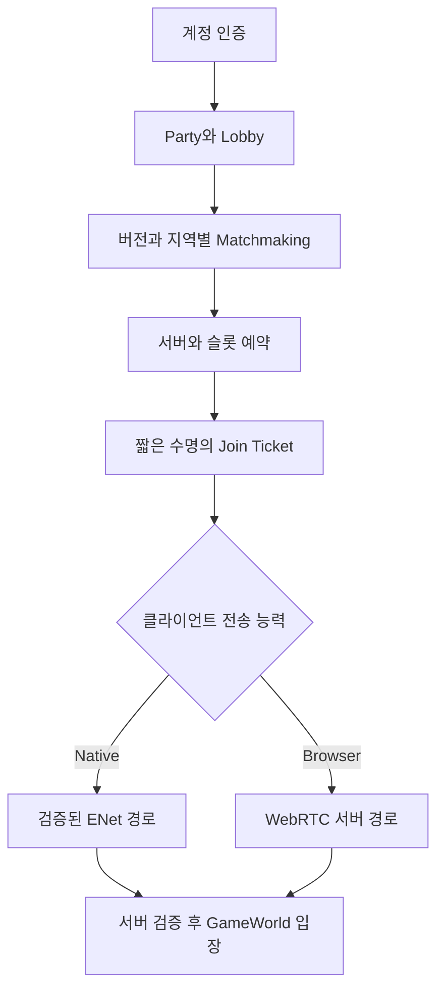

# 29. Unreal 방식 온라인 서비스·로비·매치메이킹·릴레이 개발 계획

| 항목 | 계획 |
| --- | --- |
| 계획 ID / 기준일 | NET-29 / 2026-11-24 |
| 원문 대응 | PDF 5-6쪽 인증·로비·릴레이 부재, 9쪽 온라인 보완 스택 |
| 우선순위 / 상태 | P0 인증·세션, P1 matchmaking·다중 전송 / 설계안 |
| 구현 위치 | provider 중립 서비스 interface + backend + Godot 전송 adapter |
| 선행 과제 | 25 권한 모델, 28 서버 배정; 23 패키지와 배포 계약 |
| 담당 / 공수 | 온라인·backend·네트워크 엔지니어, QA / 18-28 PW |
| 기본 방향 | 서버 권한 게임 data plane과 계정/로비 control plane 분리 |

본 문서의 API·TTL·SLO·공수는 신규 설계 및 목표다. 실제 계정 연결, 서비스 가입, 결제, 배포를 수행하지 않았다.

## 1. 목표와 Unreal 참조 범위

게임 코드가 Steam/EOS/Nakama/자체 backend의 특정 SDK에 묶이지 않도록 인증·로비·세션·프로필·특권 interface를 분리한다. Unreal Online Services가 서비스별 구현 위에 공통 인터페이스를 두는 접근을 참고한다. 현재 열람 문서의 Beta 표기를 우리 서비스의 완료 상태로 혼동하지 않는다. [Epic Online Services](https://dev.epicgames.com/documentation/en-us/unreal-engine/online-services-in-unreal-engine)

실제 Godot 서버가 게임을 시뮬레이션하며 온라인 backend는 입장과 배정·영속 기록을 담당한다. 외부 backend의 authoritative match 기능을 쓰는 경우는 별도 게임 런타임으로 분류하고 같은 상태를 이중으로 판정하지 않는다.

## 2. 서비스 경계

| 제안 interface | 책임 | 권위 데이터 |
| --- | --- | --- |
| IAuthProvider | 외부 로그인 검증·내부 계정 매핑 | 내부 user_id와 검증된 provider subject |
| IPrivilegeService | crossplay·연령·차단·참여 권한 | 서버 정책과 계정 상태 |
| ILobbyService | party·초대·ready·공개 정보 | 버전 있는 lobby record |
| IMatchmaker | region·skill·build별 매칭 | 검증된 profile·대기 ticket |
| ISessionAllocator | 빈 서버·slot 예약 | NET-28 lease와 fencing token |
| IJoinTicketIssuer | 단기 세션 입장 증명 | 서명된 제한 scope ticket |
| IRelayProvider | 직결 불가 또는 browser 경로 | 연결 수명·대역폭 quota |
| IProgressService | 보상·진행·leaderboard | 서버 확정 결과 |

OAuth/외부 로그인 토큰을 게임 RPC 인자나 공개 PlayerState에 복제하지 않는다. 게임 접속용 ticket은 별도로 발급하고 대상 서버·세션·build에 묶는다. 계정 연동은 사용자가 입증한 외부 신원을 통해서만 수행한다.

## 3. 연결 흐름



연결 성공과 게임 Ready를 분리한다. 클라이언트는 콘텐츠 manifest 확인·필수 자산 로딩·initial snapshot 수신 이후 Ready 상태가 된다. 슬롯 TTL이 끝나면 예약을 회수하고 matchmaking 상태를 확정적으로 갱신한다.

## 4. 제안 데이터 계약

```json
{
  "join_ticket": {
    "user_id": "internal-subject",
    "project_id": "project-key",
    "build_id": "immutable-build",
    "protocol_hash": "schema-and-rpc-hash",
    "session_id": "match-key",
    "reservation_id": "slot-key",
    "lease_epoch": 7,
    "permissions": ["join_player"],
    "expires_at": "server-time",
    "nonce": "single-use-value"
  }
}
```

실제 전송 ticket은 검증 가능한 서명과 발급자·대상·key ID를 포함한다. 초기 TTL은 60초를 목표로 하되 모바일 로딩 시간과 시계 오차 예산을 측정한다. private signing key는 backend에만 둔다.

Join nonce 소비는 원자적이며 동일 connection의 네트워크 재시도는 같은 결과를 반환하고 별도 동시 접속은 거절한다. 정상 재접속에는 새 ticket을 발급한다. 탈취된 오래된 ticket으로 owner_epoch를 되살리지 않는다.

제안 HTTP API는 POST /lobbies, POST /match-tickets, DELETE /match-tickets/{id}, POST /sessions/{id}/join-ticket, POST /sessions/{id}/resume이다. 모두 계정 scope·idempotency key·요청 크기 상한과 deadline을 갖는다.

## 5. Lobby와 matchmaking 규칙

Lobby는 host_user_id, members, ready_revision, join_policy, build_id를 가진다. 호스트만 변경 가능한 옵션을 서버에서 제한한다. 사용자의 현재 display name이나 클라이언트 제출 skill 값을 곧바로 보안·매칭 기준으로 사용하지 않는다.

매칭 partition은 project/build/protocol/gameplay_profile을 우선하고 region·party size·skill 범위를 다음으로 적용한다. 대기 시간이 길어질 때 완화할 수 있는 값과 절대 섞으면 안 되는 값을 구분한다. protocol이 다른 게임을 빠른 매칭을 위해 섞지 않는다.

취소·timeout·동시 배정은 CAS/revision으로 처리한다. 중복 큐 ticket은 같은 유저/party의 예약 정책에 따라 거절하거나 이전 요청을 대체한다. 예약 후 한 명이 떠날 경우 재충원·경기 취소·시작 가능 최소 인원을 게임 규칙으로 선언한다.

## 6. Native·Web 전송 설계

Godot ENetConnection은 UDP 기반이며 DTLS 설정 메서드를 제공한다. 구현 시 인증서 검증·호스트명·서버 설정 순서를 시험하고, ENet을 사용했다는 사실만으로 암호화가 활성화됐다고 보지 않는다. [Godot ENetConnection](https://docs.godotengine.org/en/stable/classes/class_enetconnection.html)

WebRTC는 signaling과 연결 협상이 필요하다. 브라우저 client가 native ENet endpoint에 직접 붙는 구조로 설계하지 않는다. 서버에 호환 WebRTC adapter 또는 검증된 gateway를 두고 같은 ForgeNet packet schema를 전달한다. TURN은 전송 중계이며 ENet와 WebRTC의 프로토콜 변환기가 아니다. [Godot WebRTC](https://docs.godotengine.org/en/stable/tutorials/networking/webrtc.html)

| 경로 | 용도 | 필수 검증 |
| --- | --- | --- |
| Native ENet + 검증된 DTLS | Windows/Android/iOS | 인증서·MTU·재연결·손실 |
| WebRTC DataChannel | Web 실시간 게임 | server 측 native extension, signaling, ICE/TURN |
| WSS fallback | 저속/협동·로비용 프로파일 | head-of-line 지연을 포함한 품질 gate |
| vendor relay | 선택 provider | platform 계정·쿼터·개인정보·지원 빌드 |

전송 어댑터는 ordered/reliable/unreliable 능력을 보고한다. TCP/WSS에서 unreliable 의미를 완전히 재현한다고 주장하지 않는다. fallback의 성능이 장르 기준을 못 넘으면 해당 조합을 지원 대상에서 제외한다.

## 7. 재접속·맵 이동·backend 장애

네트워크 전환 시 client는 resume 요청으로 새 connection_id와 ticket을 받는다. 서버는 정해진 유예 시간 동안만 슬롯/Pawn을 보존하고 새 연결에 full baseline을 전달한다. 과거 client의 남은 입력과 RPC는 owner_epoch로 거절한다.

맵 이동은 NET-25/28의 session/world_epoch 계약을 따른다. lobby 화면 전환과 실제 server travel을 같은 작업으로 보지 않는다. 시작 MVP는 재접속형 이동이다.

인증·매치메이커 장애 시 진행 중 서버는 검증된 기존 세션을 일정 정책 안에서 지속할 수 있게 한다. 새 유저는 임의 offline 인증으로 우회하지 않는다. 결과 저장은 outbox·idempotency로 재시도하고 확정 전후 상태를 사용자에게 구별한다.

## 8. WBS와 예상 공수

| 작업 ID | 내용 | PW | 산출물 |
| --- | --- | --- | --- |
| NET29-01 | provider 계약·내부 identity·인증 adapter | 3-4 | API/권한 명세 |
| NET29-02 | lobby·party·ready·취소 race 처리 | 3-5 | lobby 서비스 |
| NET29-03 | match tickets·allocator·join tickets | 3-5 | 입장 파이프라인 |
| NET29-04 | native transport·재연결·key lifecycle | 3-4 | ENet 경로 |
| NET29-05 | browser signaling·WebRTC/relay adapter | 3-5 | Web 프로파일 |
| NET29-06 | 장애·부하·provider 교체 QA·운영 안내 | 3-5 | 통합 검증 |
| 합계 | 외부 서비스 승인 대기·요금 별도 | 18-28 | 기능별 릴리즈 |

MVP에서는 local/test auth provider와 하나의 실서비스 provider만 구현한다. Steam/EOS/Nakama 전부를 동시에 지원하는 비용은 별도 산정한다.

## 9. 인수 기준

- DS+2 clients에서 인증→lobby→match→join→Ready→결과 확정 전체 흐름을 자동 재현한다.
- 잘못된 project/build/protocol, 만료·재사용 nonce, 타인 슬롯 ticket 10,000건에서 권한 밖 입장 0건.
- cancel/allocate/join 경합 1,000회에서 중복 경기·무한 예약·동일 사용자 중복 슬롯 0건.
- 기준 region과 warm server에서 내부 서비스 처리 join 준비 p95 ≤2초를 목표로 한다. 사용자 로그인·다운로드·대기열 시간은 별도 기록한다.
- 기기 Wi-Fi↔모바일망 변경, background 복귀, ICE 실패, relay만 가능한 경로를 시험하고 지원 프로파일별 결과를 기록한다.
- token·key·원문 외부 인증 정보가 일반 로그와 client-visible 상태에 포함되지 않는지 검사한다.
- provider timeout/재시도에서도 중복 결제·보상/계정 연동이 발생하지 않는다.

## 10. 위험과 단계적 대안

브라우저 서버 adapter가 기한 내 검증되지 않으면 1차 multiplayer 출시는 native에 한정하고 Web은 별도 지원 등급으로 제공한다. 경쟁형 게임에 성능 미달 WSS를 자동 연결해 같은 품질로 표시하지 않는다.

초기 운영은 단일 지역·단순 매칭·기본 계정부터 시작한다. 지역 확대, skill rating, social/voice는 측정된 사용자 수요와 운영 역량 이후 확장한다.

## 11. 산출물·출처

provider interface와 계약 시험, identity/권한 표, join ticket spec, match/lobby 상태 머신, client SDK, transport capability 표, region/relay 비용 모델, 장애 복구 runbook을 제출한다.

위 공식 문서 확인일은 2026-11-24이다. WebRTC 문서는 stable 페이지 자체가 4.7에 대한 업데이트 미완료를 표시하므로 사용할 engine/native extension 조합에서 실제 호환 시험을 추가한다.
